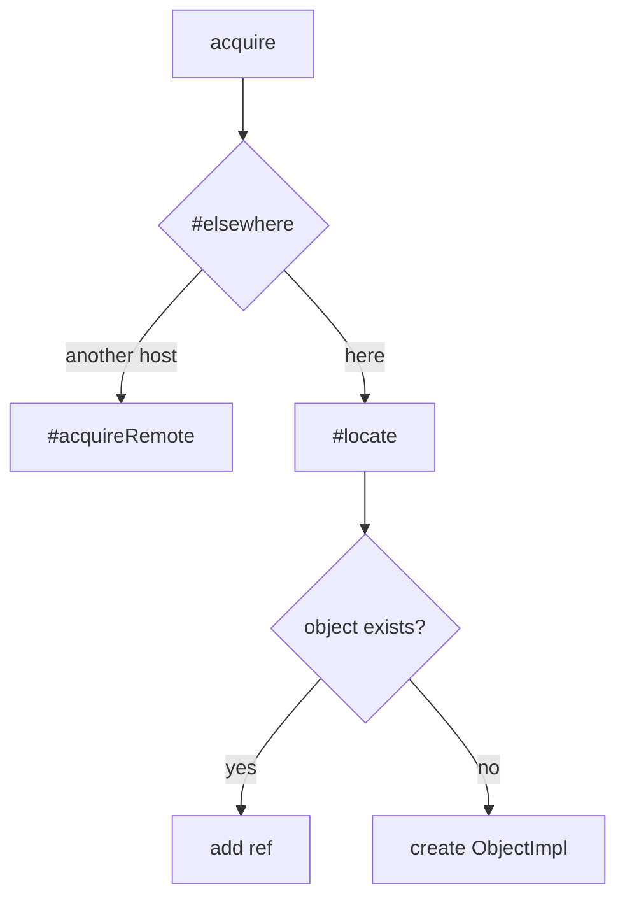
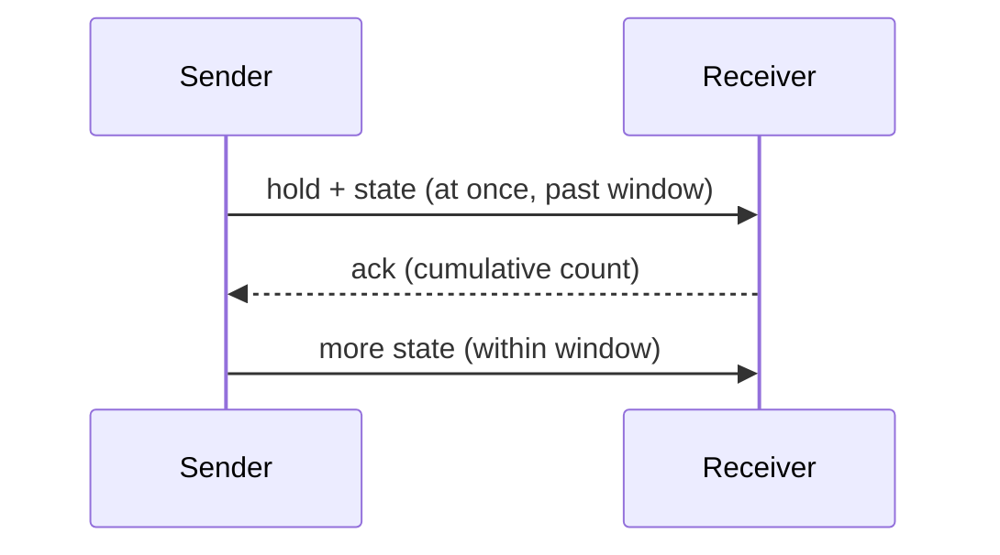
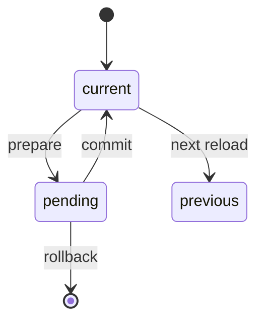

# 03 -- Chord Runtime: Deep Dive

chord's runtime is a host. A host holds objects, routes calls to them, connects to other hosts over links, and reloads their code without losing state. This document is a deep dive into the host, the address, the links, flow control, and hot reload.

## The Host

A host is created by `createHost<P>()`. `P` is the principal type, the identity the host carries. The host keeps maps of objects, code versions, facets, connections, and bindings.

```ts
// packages/chord/src/host.ts -- host options (abridged)
export type HostOptions<P> = {
  name?: string;
  self?: P;
  principalKey?: string;
  dev?: boolean;
  onError?: (error: unknown) => void;
  taskStopDeadline?: number; // default 5000 ms
  readyTimeout?: number;     // default 60000 ms
  linger?: number;
  loader?: ...;
  kind?: "host" | "client";
  upstream?: ...;
};
```

`taskStopDeadline` is how long a stop waits for a task. `readyTimeout` is how long a reference waits for its object. `linger` keeps a remote binding alive briefly after its last reference.

## The Address

Every object has an address. The address is built from the type name, the input identity, and the principal.

```ts
// packages/chord/src/host.ts -- locate builds the address (abridged)
#locate(service, input, principal) {
  const normalized = normalize(schema, input, `${name} input`);
  const identity = canonicalIdentity(schema, normalized);
  return { address: `${name}\u0000${identity}\u0000${this.#principalPart(principal)}`, normalized, principal };
}
```

A remote binding key adds the contract fingerprint.

```ts
// packages/chord/src/host.ts -- the remote key (abridged)
#remoteKey(type, normalized, principal) {
  const identity = canonicalIdentity(type.input, normalized);
  return `@${type.name}\u0000${identity}\u0000${this.#principalPart(principal)}\u0000${type.fingerprint}`;
}
```

The Aha is that the address is a string you can recompute. There is no central registry. Any host that knows a type and an input can compute where the object lives. The identity part comes from canonical JSON of the normalized input, so `{ a: 1, b: 2 }` and `{ b: 2, a: 1 }` name the same object.

## Acquire, Elsewhere, Locate

When code asks for an object, the host decides in three steps.



`#elsewhere` reads the placement from the contract, normalizes the input, and resolves the host.

```ts
// packages/chord/src/host.ts -- elsewhere (abridged)
#elsewhere(type, input) {
  const placement = type.description.host;
  if (type.scope !== "remote" || placement === undefined) return undefined;
  const normalized = normalize(type.input, input, `${type.name} input`);
  const at = resolveHost(type.name, placement, normalized);
  return at === this.name ? undefined : { at, input: normalized };
}
```

The Aha is that the caller never chooses. The host chooses, based on the contract's placement. Code that reads an object does not know whether it is local or remote.

### The Cycle Check

Before creating an object, the host checks for a reference cycle.

```ts
// packages/chord/src/host.ts -- the cycle check (abridged)
if (from !== undefined && object !== undefined && (object === from || reaches(object, from))) {
  throw invalid("cycle", `${from.address} -> ${address} would create a ref cycle`);
}
```

An object cannot hold a reference that reaches back to itself. This keeps the object graph acyclic, so disposal can drain it in waves.

## Links

A link connects two hosts. There are three transports, one interface.

| Link | Use |
|------|-----|
| `MemoryLink` | Two hosts in one process |
| `IpcLink` | Two Node processes on one machine |
| `WebSocketLink` | Two processes on different machines |

All links share one protocol. `BaseLink` handles the receive queue, close handlers, the `bye` frame, and in-order delivery.

```ts
// packages/chord/src/link.ts -- the link interface (verbatim)
export interface Link {
  readonly closed: boolean;
  send(frame: Frame): number | undefined;
  receive(handler: (frame: Frame) => void): void;
  onClose(handler: (reason: string) => void): void;
  close(reason?: string): void;
}
```

### Wire Frames

Every message is a frame. A frame is declared once as a TypeBox schema, and every received frame is validated against it.

```ts
// packages/chord/src/wire.ts -- the protocol version (verbatim)
export const PROTOCOL_VERSION = 4;
```

The frame vocabulary:

| Direction | Frames |
|-----------|--------|
| consumer to provider | `hold`, `release`, `call`, `cancel`, `sub`, `unsub`, `resync` |
| provider to consumer | `shape`, `gone`, `result`, `state` |
| both | `hello`, `ack`, `ping`, `pong`, `bye`, `root_end` |
| parent to child | `invalidate`, `prepare`, `commit`, `abort`, `retire` |
| child to parent | `vote` |

The Aha is that every frame type has one direction, so ids never collide. The side that creates a hold, call, or subscription chooses the id.

### Packing

A frame's payload (call args, a result value, a state snapshot) is deflated when its JSON exceeds `PACK_THRESHOLD`.

```ts
// packages/chord/src/link.ts -- the threshold (verbatim)
export const PACK_THRESHOLD = 64 * 1024;
```

A packed payload travels as `z: [field, base64]` on object transports, or as a binary message on WebSockets. A relay forwards the packed bytes without inflating them. Only the host that uses the payload inflates it. This keeps large state transfers cheap across a relay.

## Connection Flow Control

State is pushed as fast as it changes. A slow peer cannot be flooded. The connection solves this with cumulative acknowledgements.



```ts
// packages/chord/src/connection.ts -- the window bookkeeping (abridged)
// #window, #sent, #acked, #unackedBytes
```

The peer sends `ack`, a cumulative frame count. The sender counts the sizes of unacknowledged frames. While they exceed the window, state waits in slots.

A member's stream has one slot; ops are appended. A hold's unit has one slot, built lazily when sent. The first unit of a hold is sent at once, past the window, because a `get` waits for it. Results, shapes, gone, and pings are also sent at once.

Waiting ops are capped per link (`pendingCap`). Beyond the cap, the oldest streams are replaced by their current value, so memory stays bounded no matter how long the peer stalls. Both hellos must announce `acks`; links that report no sizes, like IPC, never fill the window.

The Aha is the one ordering exception. While state waits, a result can arrive before state changes made before it. Frames of one stream stay in order, but streams do not have to wait behind each other.

## Hot Reload

Hot reload swaps an object's code without losing its state. A host keeps up to three code versions: `current`, `previous`, and `pending`.



A reload has three phases: `prepare`, `commit`, or `rollback`.

```ts
// packages/chord/src/reload.ts -- the phases (abridged)
async prepare(): Promise<void> {
  await this.prepareAll();   // load code, prepare objects
  await this.gate();         // open the gate for grandfathered roots
  // on failure: rollback
}
```

### Prepare

Prepare loads the new code and checks it can run. It prepares every live object of a changed type. A cell write is validated against every schema that will apply after the commit. A failure fails prepare, and the host rolls back.

### The Gate

A changed type is gated. From the gate open, new objects of that type are rejected with `upgrade_conflict` until commit or abort.

```ts
// packages/chord/src/host.ts -- the gate (abridged)
if (this.gating?.has(type.name)) {
  throw new ChordError("upgrade_conflict", `${type.name} is being upgraded; retry`, { reason: "gate" });
}
```

The gate waits for roots already running to finish (default 5000 ms). Missed: the reload aborts. This makes the candidate set final: no new object of a changed type slips in mid-reload.

### Commit

Commit installs the new code, drains old holders, and retires the previous version. `disposeHoldersFirst` disposes objects in waves, so they stop cleanly before their code is dropped.

```ts
// packages/chord/src/host.ts -- dispose holders first (abridged)
async function disposeHoldersFirst(objects, reason, message): Promise<void> {
  // dispose in waves
}
```

The Aha is why reload works at all. The address is stable. State lives at the address. Code is a version attached to it. Reload changes the version, not the identity.

## Version Negotiation

When two hosts connect, they announce their code version in `hello`. `peerHello` compares versions.

```ts
// packages/chord/src/host.ts -- peerHello (abridged)
peerHello(connection, codeVersion): void {
  if (codeVersion > this.current.id) {
    connection.link.close("code version ahead of parent");
    return;
  }
  if (codeVersion === this.current.id) {
    connection.markSynced(codeVersion);
    return;
  }
  connection.peerCodeVersion = codeVersion;
  connection.fencedCodeVersions.add(codeVersion);
  reconcileChild(this, connection);
}
```

Three outcomes.

| Outcome | Meaning |
|---------|---------|
| In step | Same code version: the connection is usable |
| Behind, fenced | The child is older: its code version is fenced and reconciled |
| Ahead, refused | The child is newer: the link closes |

The Aha is the fence. A behind child runs code this host never had. Its calls are fenced, not relabeled. The host reconciles the child to the current version before trusting it.

## Authorization on Every Resolve

The host checks authorization twice on a resolve: authorize, resolve the object, then authorize again.

```ts
// packages/chord/src/host.ts -- resolve authorizes twice (concept)
// authorize → resolve → authorize
```

The double check closes a race. A route might change between the first check and the resolve. The second check catches it. A route has an `authorize` function, a `resolve` function, and a principal.

## Linger and Retirement

A remote binding can linger after its last reference. The cap is four bindings.

```ts
// packages/chord/src/host.ts -- linger cap (abridged)
readonly #lingerCap: number;   // options.linger?.cap ?? 4
```

When the last reference is released, the binding lingers briefly. The least recently released go first past the cap. This avoids re-establishing a link for an object the caller will ask for again soon.

A code version retires once no roots of it remain, and a child waits for its parent to allow it.

```ts
// packages/chord/src/host.ts -- retire when retirable (abridged)
maybeRetire(): void {
  if (this.retirable()) this.retire();
}
```

The Aha is that retirement is cooperative. A parent tells a child which versions it retired, so the child does not wait forever for a `retire` frame that will not come.

## Where to Go Next

chord is the foundation. durable is the harness on top. The next document is the deep dive into durable's six core parts. Read [04-durable-concepts.md](./04-durable-concepts.md). For the concepts behind objects and contracts, read [02-chord-concepts.md](./02-chord-concepts.md).
