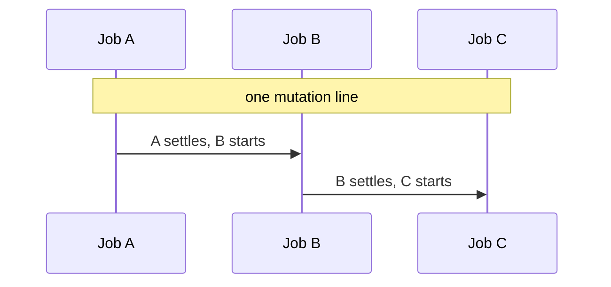
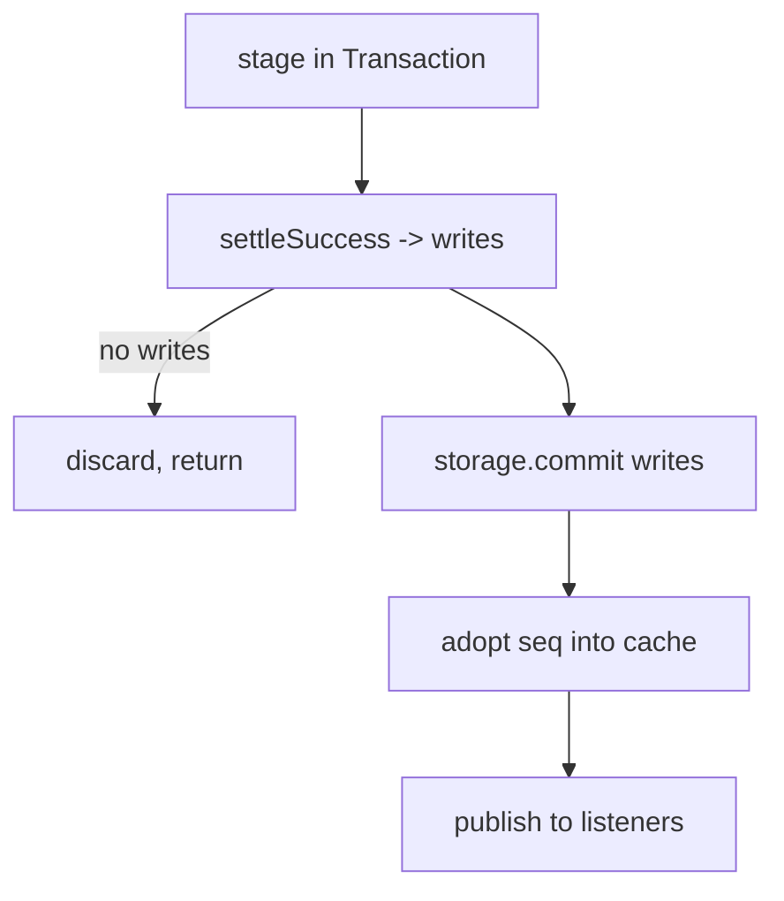
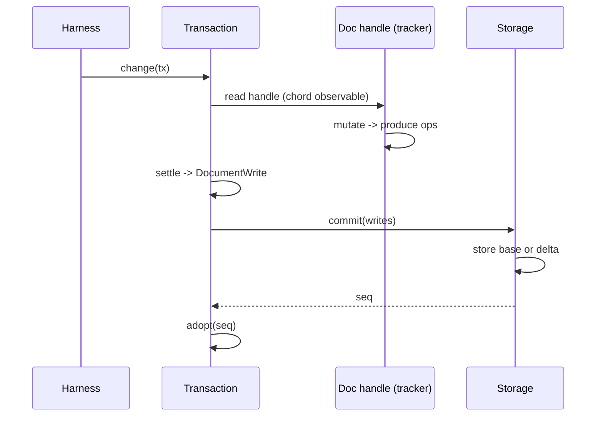
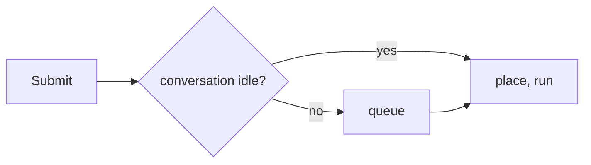
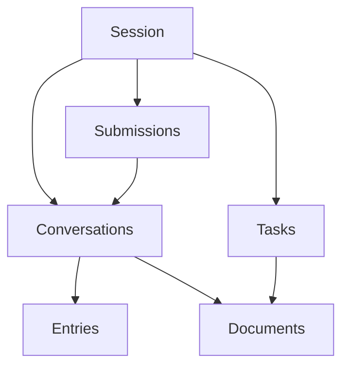

# 04 -- Durable Core: Deep Dive

durable has six core parts: session, conversation, entry, document, task, and submission. This document is a deep dive into each one. It shows how each part works, not just what it is. The document is the deepest dive, because it is the part that makes change durable and efficient.

## Session: One Writer, One Line

A Session is one open view over one storage backend. It owns one mutation line. Every change, read or write, queues onto that line. The line is a promise chain.

```ts
// packages/durable/src/session/session.ts -- the mutation line (verbatim)
#enqueue<T>(job: () => Promise<T>): Promise<T> {
  const run = this.#tail.then(job);
  this.#tail = run.then(
    () => undefined,
    () => undefined,
  );
  return run;
}
```

`#tail` starts as `Promise.resolve()`. Each job chains onto the current tail. Each job updates the tail. The result: one job runs at a time. There is no lock, no mutex, no `await` race. The promise chain is the serialization.



The Aha is that durable does not use a lock. It uses a promise chain. Concurrency becomes "one thing at a time, in order."

### GuardedStorage

The Session wraps its backend in `GuardedStorage`. The guard tracks every backend call still underway and decides what a failure means.

```ts
// packages/durable/src/session/session.ts -- one guarded backend call (abridged)
async #call<T>(read: Context | undefined, run: () => Promise<T>): Promise<T> {
  this.#assertHealthy();
  if (this.#closing) throw new Error("Session is closed");
  const call = (async () => run())();
  this.#underway.add(call);
  try {
    return await call;
  } catch (error) {
    this.#assertHealthy();
    // A failed read says nothing about Storage; a failed commit says everything.
    const exempt =
      read !== undefined && (error instanceof StorageRequestError || read.abortSignal?.aborted === true);
    if (!exempt) this.#latch.fail(error);
    throw error;
  } finally {
    this.#underway.delete(call);
  }
}
```

The key line is `exempt`. A read that fails is a single failed call. A commit that fails is fatal. `commit` and `mintId` pass no read context, so they are never exempt. Once a commit is admitted, we do not know whether it wrote. The guard fails the whole Session. A caller can never act on a commit whose outcome is unknown.

### The Commit Path

`#runCommit` is the heart. It stages a change, settles it, commits it, then adopts it.



If adoption fails after a successful commit, the Session fails. Storage already has the data; memory does not. That is unrecoverable, so the Session fails rather than diverge.

### The Document Cache

The Session caches loaded documents by their address. Three maps track them: `#documents`, `#idleDocuments`, and `#attachedDocuments`. An idle document is dropped after the retention period. An attached document stays because a watcher holds it. A later read cold-loads from storage. This keeps memory bounded in a long-running process.

## Conversation: Forks and Ownership

A conversation is a chat with an ID. It may have a parent and a fork point. It may have an owner task. Entries are immutable, so a fork shares the parent's entries and adds its own.

```ts
// packages/durable/src/types.ts -- a conversation record (abridged)
export type ConversationRecord = {
  id: ConversationId;
  parent?: { conversationId: ConversationId; at: EntryId };
  owner?: { conversationId: ConversationId; taskId: TaskId };
  // ...
};
```

`parent` is the fork source and the entry it forked at. `owner` is the task that created the conversation. A child task owns its sub-conversation. The ownership tree is how an abort cascades from a root task down to its children.

A fork copies documents according to a fork policy. `current` copies the current value. `initial` resets to the initial value. `asOf` copies the value at the fork entry. The copies page through storage, `SCAN_PAGE_SIZE = 256` documents at a time. See [07-durable-tasks.md](./07-durable-tasks.md) for how ownership drives the scheduler.

## Entry: Immutable Append

An entry is one immutable piece of a conversation. It has a kind, a model payload, and a head marker. Entries are appended, never edited. To change a conversation, you add an entry; you do not rewrite an old one.

The `head` field marks the start of a context window. The context is the entries from the head forward. A `ResetEntry` has `head: "self"`. Compaction sets `head` to the first kept entry. A head marker is found by scanning backward from an entry.

```ts
// packages/durable/src/entries.ts -- the built-in entry kinds (abridged)
export const UserEntry = defineEntry("pi.user");
export const AssistantEntry = defineEntry("pi.assistant");
export const SystemEntry = defineEntry("pi.system");
export const ToolResultEntry = defineEntry("pi.tool-result");
export const ResetEntry = defineEntry("pi.reset");
export const CompactionEntry = defineEntry("pi.compaction");
```

The Aha is the reason for immutability. History is a fact. A fork can point at any entry and share it. Compaction can move the head without rewriting the past. Storage can keep entries as an append-only list.

## Document: The Durable Unit of State

A document is typed, versioned JSON at a scope. It is the part that makes change durable and efficient. This is the deep dive.

### Address: Where a Document Lives

A document has a scope. The scope is session, conversation, or task. A document family adds a key within that scope. The address combines kind, scope, owner, and key.

```ts
// packages/durable/src/documents.ts -- resolve the address from arguments (abridged)
export function resolveAddress(definition, args): ResolvedAddress {
  let index = 0;
  let scope;
  switch (definition.scope) {
    case "session":      scope = { kind: "session" }; break;
    case "conversation": scope = { kind: "conversation", conversationId: ownerId(args[index++]) }; break;
    case "task":         scope = { kind: "task", taskId: ownerId(args[index++]) }; break;
  }
  const key = definition.family === true ? (args[index++] as string) : undefined;
  const address = key === undefined
    ? { kind: definition.kind, scope }
    : { kind: definition.kind, scope, key };
  return { address, id: addressId(address), nextArgument: index };
}
```

The address turns into a stable string identity.

```ts
// packages/durable/src/documents.ts -- stable string identity (verbatim)
export function addressId(address: DocumentAddress): string {
  const owner =
    address.scope.kind === "session"
      ? null
      : address.scope.kind === "conversation"
        ? address.scope.conversationId
        : address.scope.taskId;
  return JSON.stringify([address.kind, address.scope.kind, owner, address.key ?? null]);
}
```

The Aha is that the address is logical, not a storage row. A document at an address can have many incarnations over time. Each incarnation is a `DocumentId`. The address stays stable; the incarnation advances.

### Semantics: Scope, History, Fork

A document definition declares three semantics plus a version.

| Field | Meaning |
|-------|---------|
| `scope` | session, conversation, or task |
| `history` | `latest` (keep current only) or `rewindable` (keep every version) |
| `fork` | `current`, `initial`, or `asOf` |
| `version` | schema version, a positive integer |
| `initial` | the value before any change |
| `migrate` | rewrite an old value to the new version |
| `checkpointWhen` | when to store a full base instead of a delta |

`defineDoc` makes a singleton. `defineDocFamily` makes a family, where `initial(seed)` builds the first value from a key.

### Incarnation: A New Record Per Version

When a document changes, storage may create a new incarnation. `documentCreate` builds the create record.

```ts
// packages/durable/src/documents.ts -- a new incarnation (abridged)
export function documentCreate(definition, address, id): DocumentCreate {
  // scope conversation carries history and fork; session and task do not
  return { id, kind: address.kind, scope: address.scope, history, fork };
}
```

A rewindable document creates a new incarnation per version. A latest-only document reuses one incarnation. Either way, a read must agree with the definition.

```ts
// packages/durable/src/documents.ts -- the definition must match the record (verbatim)
export function checkRecordScope(definition, record): void {
  if (
    record.scope.kind !== definition.scope ||
    (record.scope.kind === "conversation" &&
      (record.history !== definition.history || record.fork !== definition.fork))
  ) {
    throw new TypeError(`Document ${record.id} (${record.kind}) does not match the supplied definition semantics`);
  }
}
```

### Versioning and Migration

A stored version must be usable by the supplied definition. `checkRecordVersion` rejects a stored version newer than the code, and rejects an older version with no migration.

```ts
// packages/durable/src/documents.ts -- version gate (verbatim)
export function checkRecordVersion(definition, record, version): void {
  if (version > definition.version) {
    throw new Error(`Document ${record.id} (${record.kind}) has newer version ${version} than ${definition.version}`);
  }
  if (version < definition.version && definition.migrate === undefined) {
    throw new Error(`Document ${record.id} (${record.kind}) requires migration from version ${version}`);
  }
}
```

`materializeDocumentValue` runs the migration when versions differ, then returns a detached copy.

```ts
// packages/durable/src/documents.ts -- materialize and migrate (verbatim)
if (version === definition.version) return value;
return copyJson(definition.migrate!(value, version)) as JsonObject;
```

The Aha is that migration is lazy. A stored old value stays old on disk. It becomes the new shape only when read. That avoids a full-store rewrite on every schema change.

### How a Change Becomes Durable and Efficient

Here is the whole path of one document change.



A document handle is a chord observable. Mutating it produces a delta of operations, not a full value. On settle, the transaction emits a `DocumentWrite` carrying the value and the operations. Storage stores either a base (full value) or a delta (operations). The commit returns only after storage applied it. Then the cache adopts the new value.

Durability: the write is one element of a commit batch. It is atomic with every other change. A crash before the commit loses it. A crash after the commit keeps it. There is no half document.

Efficiency: small changes store only the operations. `checkpointWhen` decides when a full base is cheaper than a long delta tail. A huge change falls back to a root replace past `MAX_DELTA_OPERATIONS = 4096` operations. The storage deep dive in [05-durable-storage.md](./05-durable-storage.md) explains base-plus-delta and checkpointing in full.

## Task: A Durable State Machine

A task is a durable state machine. It has a kind, an input, a checkpoint, and a status.

```ts
// packages/durable/src/types.ts -- task state (concept)
export type TaskState = {
  status: "pending" | "running" | "waiting" | "completing" | "terminal";
  checkpoint?: ...;
  outcome?: TaskOutcome;
  on?: TaskId[];
  policy?: JoinPolicy;
};
```

The five statuses.

| Status | Meaning |
|--------|---------|
| `pending` | Ready to run |
| `running` | A phase is executing |
| `waiting` | Waiting for other tasks |
| `completing` | Held while owned work finishes |
| `terminal` | Done; outcome is final |

A task runs phases. A phase reads state, writes a new checkpoint, and returns a next step. A phase can wait on child tasks, then resume from the checkpoint. The scheduler drives this. The deep dive is [07-durable-tasks.md](./07-durable-tasks.md).

The Aha is that the checkpoint, not the stack, is the memory. A crash loses the running stack. It does not lose the checkpoint. On resume, the phase re-runs from the checkpoint and reaches the same state.

## Submission: Requests Into a Conversation

A submission is a request to a conversation. It is an input (a user message) or a write (a tool result, a compaction summary).

| Status | Meaning |
|--------|---------|
| `queued` | Waiting to be placed |
| `placed` | Placed in the conversation |
| `done` | Settled |
| `unanswered` | Could not be answered |

A busy conversation queues submissions. An idle conversation places them. A submission matches its response by a request id. `submissionByRequest` looks one up. This is how many writers share one conversation safely.



The Aha is that a conversation has one active turn. Submissions serialize onto that turn. A tool result arrives later and is matched to its turn by request id.

## Commit: The Atomic Step

Every change is a commit. A transaction stages writes, settles them, commits them as one batch, and adopts the sequence. There is no partial change. The storage document explains why a commit is atomic and recoverable. See [05-durable-storage.md](./05-durable-storage.md).

## The Whole Shape



A Session owns conversations, tasks, and submissions. A conversation owns entries and documents. A task owns its input, checkpoint, and outcome.

## Where to Go Next

The next document explains how storage makes a commit durable across the three backends. Read [05-durable-storage.md](./05-durable-storage.md). For the runtime that hosts these objects, read [03-chord-runtime.md](./03-chord-runtime.md).
