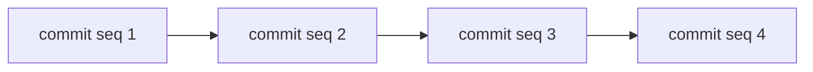
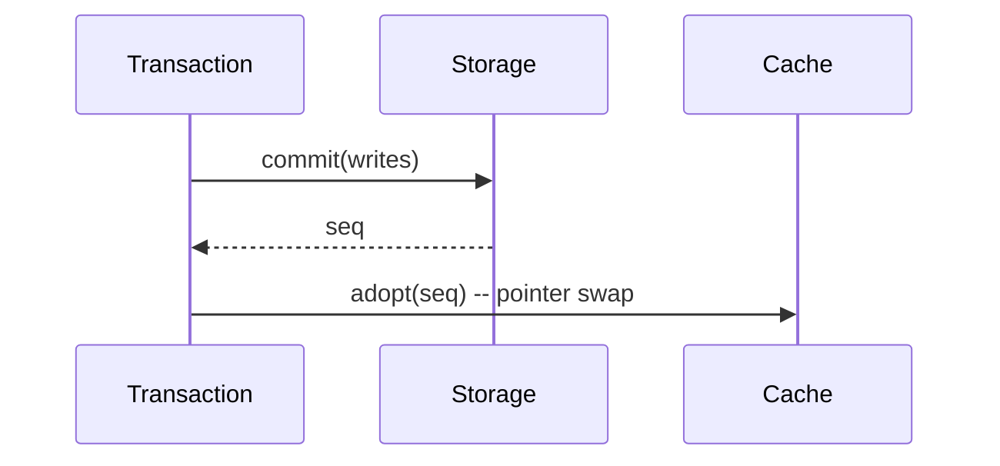
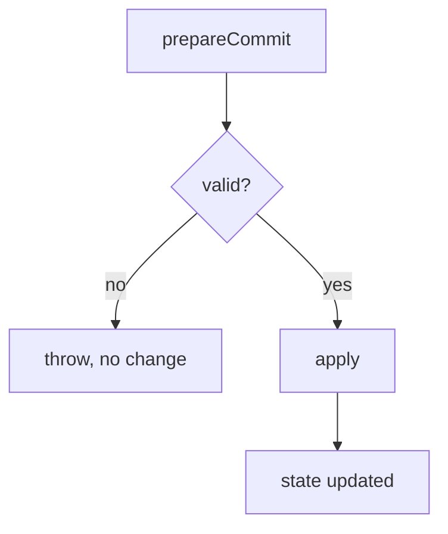
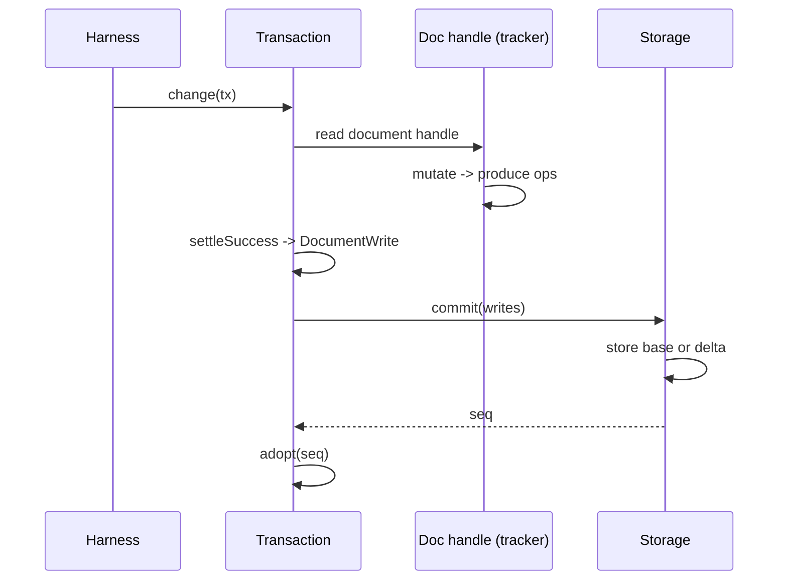
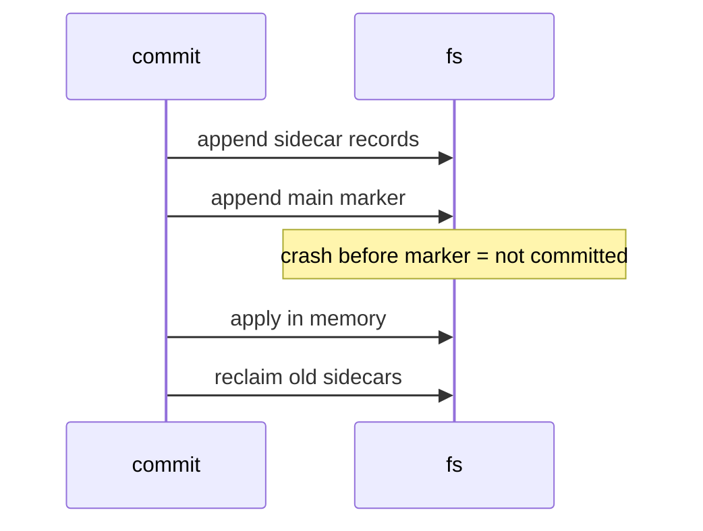

# 05 -- Durable Storage

durable's storage is a small contract with three implementations. The contract says one thing: a commit is atomic and recoverable. Memory, JSONL, and SQLite each honor that contract differently. This document explains the contract, the transaction, and all three backends. It ends with how to build a system like this from scratch.

## The Storage Contract

Every backend implements one interface. The interface is narrow. The Session never knows which backend it uses.

```ts
// packages/durable/src/types.ts -- the Storage contract (abridged)
export interface Storage {
  commit(writes: readonly StorageWrite[], context: Context): Promise<Seq>;
  mintId<I extends Id<string>>(): Promise<I>;
  conversation(id: ConversationId, context: Context): Promise<ConversationRecord | undefined>;
  scanConversations(query, limit, cursor, context): Promise<Page<...>>;
  entry(...): Promise<...>;
  findLatestHeadMarker(...): Promise<...>;
  scanEntries(...): Promise<...>;
  task(id: TaskId, context: Context): Promise<TaskRecord<...> | undefined>;
  scanTasks(...): Promise<...>;
  submission(id: SubmissionId, context: Context): Promise<SubmissionRecord | undefined>;
  scanSubmissions(...): Promise<...>;
  submissionByRequest(...): Promise<...>;
  findDocument(address, at, context): Promise<DocumentRecord | undefined>;
  document(id, at, context): Promise<StoredDocument | undefined>;
  scanDocuments(...): Promise<...>;
  close(context: Context): Promise<void>;
}
```

The key method is `commit`. It takes a batch of writes and returns a new `Seq`. If it returns, the batch is durable. If it throws, the batch is not. There is no in-between.

The Aha is that this single method is the entire durability guarantee. Everything above it, the whole harness, rests on "commit returned" meaning "this happened".

## One Writer, Strictly Increasing Sequences

Every commit gets the next sequence number. The number strictly increases. This gives a total order to every change.

```ts
// packages/durable/src/storage/memory.ts -- sequence starts at 1 (concept)
let nextSeq = 1;
let nextId = 2;
```

The sequence number is the clock. `snapshotAsOf` reads a document as of an entry, which maps to a commit sequence. The sequence is how history is ordered without wall-clock time.



There is one writer: the Session's mutation line. So sequences never race. The backend just increments.

## The Transaction

A transaction stages writes. It does not touch storage until it settles. The Session's `#runCommit` shows the full path.

```ts
// packages/durable/src/session/session.ts -- the commit path (abridged)
async #runCommit<T>(change, context, scope): Promise<T> {
  const tx = new Transaction(this.#host, context, scope);
  let result: T;
  try {
    result = await change(tx);
    this.#assertHealthy();
  } catch (error) {
    await tx.settleFailure();
    throw error;
  }
  let writes: readonly StorageWrite[];
  writes = await tx.settleSuccess();
  if (writes.length === 0) {
    tx.discard();
    return result;
  }
  const seq = await this.#storage.commit(writes, withoutAbortSignal(context));
  const documents = tx.adopt(seq);
  this.#publish(seq, writes, documents, context);
  return result;
}
```

Four steps.

1. **Stage** the change in a transaction.
2. **Settle** into a list of writes, or abort.
3. **Commit** the writes to storage, getting a sequence.
4. **Adopt** the sequence into the in-memory cache.

If any step fails, the transaction discards. Storage is never left half-written.

### ReadAfterWrite

A transaction enforces one rule: read before you write. After the first table write, a table read throws.

```ts
// packages/durable/src/errors.ts -- the read-after-write guard
export class ReadAfterWrite extends Error {
  constructor(method: string) {
    super(`Tx.${method}() cannot read tables after the first table write`);
    this.name = "ReadAfterWrite";
  }
}
```

Why? Because a write stages a change that has not committed. A later read would see a mix of committed and uncommitted state. The rule makes that impossible. The Aha is that this is a compile-time-ish discipline enforced at runtime: read every required row first, then write.

### Adopt by Pointer Swap

After commit, `adopt(seq)` installs the new state. It does a pointer swap: the cache's tracker is replaced by the prepared one. If anything went wrong, the prepared tracker is aborted.



The swap is atomic in one process. Readers see either the old value or the new value, never a mix.

## MemoryStorage: Prepare Then Apply

The memory backend is the reference. It splits a commit into prepare and apply.

```ts
// packages/durable/src/storage/memory.ts -- prepare returns a closure (concept)
prepareCommit(writes): { seq, writes, apply() } {
  // validate, detach, freeze
  // return a closure that applies the writes
}
```

`prepareCommit` validates everything first. It returns a frozen, detached set of writes and an `apply()` function. Only after `apply()` does the in-memory state change. The split means validation errors happen before any mutation.



This prepare/apply split is the same idea the JSONL backend uses, but against files.

## Document Storage: Base Plus Deltas

A document is stored as a base plus a tail of deltas. A base is a full value. A delta is a list of chord operations.

```ts
// packages/durable/src/types.ts -- document content (concept)
export type DocumentContent =
  | { kind: "base"; version: number; value: JsonObject }
  | { kind: "delta"; version: number; ops: readonly Op[] };
```

Reading a document materializes it: load the base, then apply each delta in order.

```ts
// packages/durable/src/storage/sqlite/storage.ts -- materialize (abridged)
let value = parseJson<JsonObject>(base.content);
for (const revision of tail) {
  value = apply(value, parseJson<readonly Op[]>(revision.content)) as JsonObject;
}
return { record, version: base.version, value, deltasSinceBase: tail.length };
```

This is space-efficient. Small edits are small deltas. But a long tail is slow to read. So a document can checkpoint.

### checkpointWhen

A document definition can declare `checkpointWhen`. When it returns true, an ordinary change is stored as a full base instead of a delta.

```ts
// packages/durable/src/session/transaction.ts -- the predicate (concept)
checkpointWhen(value, ops, { deltasSinceBase }): boolean
```

The Aha is the trade-off it encodes. Deltas are small to write but slow to read. Bases are large to write but fast to read. `checkpointWhen` lets each document pick its own balance. The built-in `AgentDoc` always checkpoints; other documents keep deltas.

## How One Document Change Becomes Durable

Here is the full path of one change to one document.

1. The harness reads the document handle. It is a chord observable, so mutating it produces a delta of operations.
2. The change runs inside a Transaction.
3. On settle, the transaction emits a `DocumentWrite`.
4. Storage stores the write as a base or a delta.
5. The transaction adopts the sequence into the cache.



The write carries the value and the operations.

```ts
// packages/durable/src/session/transaction.ts -- a document write (concept)
type DocumentWrite = {
  address: DocumentAddress;
  value: JsonObject;
  ops: readonly Op[];
  checkpoint: boolean; // true when checkpointWhen fires
};
```

### What Makes It Durable

Durability comes from two facts. The write is one element of a commit batch, so it is atomic with every other change. And the commit returns only after storage applied it. A crash before the commit loses the change entirely. A crash after the commit keeps it entirely. There is no half document.

### What Makes It Efficient

Efficiency comes from three choices.

1. **Delta, not value.** Small changes store only the operations, not the whole value.
2. **checkpointWhen.** A document decides when a full base is cheaper than a long delta tail.
3. **The 4096-operation cap.** A giant change falls back to a root replace, so a delta never grows past a bound.

```ts
// packages/chord -- the delta cap (concept)
const MAX_DELTA_OPERATIONS = 4096;
```

The result stores small edits cheaply and still reads large values quickly, because each document picks its own checkpoint rule.

## JSONL Storage: Append-Only Log

The JSONL backend is portable. It stores every commit as one line in `main.jsonl`. Large or live data goes to sidecar files.

```ts
// packages/durable/src/storage/jsonl/storage.ts -- format (concept)
const FORMAT_VERSION = 1;
const MAIN_FILE = "main.jsonl";
const RECLAIM_SUFFIX = ".reclaim";
```

The layout.

| File | Contents |
|------|----------|
| `main.jsonl` | One commit marker per line |
| `doc-{id}.jsonl` | Document content sidecar |
| `task-{id}.jsonl` | Live task sidecar |

A commit marker names the writes and points at sidecar records by sequence and ordinal.

```ts
// packages/durable/src/storage/jsonl/storage.ts -- commit (abridged)
async commit(writes, context): Promise<Seq> {
  const prepared = this.memory.prepareCommit(writes);
  const encoded = this.encodeCommit(prepared.seq, prepared.writes);
  // append sidecars, then the main marker
  for (const sidecar of sidecars) await this.fs.appendFile(sidecar.path, sidecar.content, context);
  await this.fs.appendFile(this.mainPath, encoded.marker, context);
  const seq = prepared.apply();
  this.adoptSidecarState(prepared.writes);
  await this.reclaimSidecars(reclamations, context);
  return seq;
}
```

The order matters. Sidecars are written first. The main marker is written last. The main marker is the commit point. If the process dies before the marker, the sidecar bytes are ignored. If it dies after, the marker makes the commit complete.



### Recovery by Replay

Opening a JSONL store replays the log into a fresh `MemoryStorage`. It reads `main.jsonl`, validates each marker, confirms sidecar records, and applies them in sequence.

```ts
// packages/durable/src/storage/jsonl/storage.ts -- recover (abridged)
for (const marker of main.lines) {
  memory.prepareCommit(writes, marker.seq).apply();
}
```

Recovery also repairs torn writes. A final line without a newline is truncated. A reclaim file left behind is removed.

### Poisoning

A write error is final. The store becomes poisoned. Every later call throws `JsonlStoragePoisonedError`. The store must be reopened.

```ts
// packages/durable/src/storage/jsonl/storage.ts -- poison (concept)
export class JsonlStoragePoisonedError extends Error {
  constructor(cause: Error) {
    super("JSONL storage is poisoned and must be reopened", { cause });
  }
}
```

This is the correct behavior for append-only logs. A partial append corrupts the tail. You cannot know what committed. You stop and reopen, and recovery truncates the torn line.

### Reclamation

Append-only logs grow. Two reclamations bound the growth. Current-only documents drop their old sidecar records. Terminal tasks drop their live sidecars. A reclaim writes a replacement and atomically renames it into place.

## SQLite Storage: Indexed and Strict

The SQLite backend is indexed and typed. It has nine tables and sixteen indexes.

```ts
// packages/durable/src/storage/sqlite/schema.ts -- the tables (abridged)
const TABLE_NAMES = {
  durableSchema: "durable_schema",
  durableMetadata: "durable_metadata",
  recordIds: "record_ids",
  conversations: "conversations",
  entries: "entries",
  tasks: "tasks",
  submissions: "submissions",
  documents: "documents",
  documentRevisions: "document_revisions",
};
```

The tables are `STRICT`. Every `TEXT` record has a `CHECK (json_valid(record))`. Task status and submission status have check constraints. The database itself rejects a bad record.

```sql
-- packages/durable/src/storage/sqlite/migrations.ts -- tasks table (abridged)
CREATE TABLE tasks (
  id INTEGER PRIMARY KEY,
  conversation_id INTEGER NOT NULL,
  kind TEXT NOT NULL,
  status TEXT NOT NULL CHECK (status IN ('pending','running','waiting','completing','terminal')),
  abort_requested INTEGER NOT NULL CHECK (abort_requested IN (0,1)),
  background INTEGER NOT NULL CHECK (background IN (0,1)),
  record TEXT NOT NULL CHECK (json_valid(record))
) STRICT;
```

This is a second line of defense. TypeScript types guard at compile time. SQLite constraints guard at write time.

### Migrations

The schema evolves through ordered migrations. Each migration has a version and a list of statements. A `durable_schema` table records the applied version.

```ts
// packages/durable/src/storage/sqlite/migrations.ts -- apply pending (concept)
for (const migration of migrations) {
  if (migration.version <= row.version) continue;
  for (const statement of migration.statements) await transaction.exec(statement);
  await transaction.run(`UPDATE ... SET version = ?`, migration.version);
}
```

Migrations run atomically inside one transaction. The Aha is that the schema history is immutable: `TABLE_NAMES` is a constant, and migrations never edit an old name.

### One Commit Is One SQLite Transaction

`commit` runs entirely inside `db.transaction`.

```ts
// packages/durable/src/storage/sqlite/storage.ts -- commit (abridged)
const seq = await this.db.transaction(async (transaction) => {
  await this.checkGlobalIds(transaction, writes);
  await this.checkDocumentActions(transaction, documentActions);
  for (const write of writes) await this.applyTableWrite(transaction, write, committedSeq);
  await this.applyDocumentActions(transaction, documentActions, committedSeq);
  await transaction.run(`UPDATE ... SET next_id = ?, next_seq = ?`, ...);
  return committedSeq;
});
```

If any statement fails, SQLite rolls back the whole transaction. Nothing is partially written. That is the same atomicity guarantee the JSONL marker gives, but enforced by the database.

### Global ID Uniqueness

`checkGlobalIds` verifies no ID is reused across record types. A `record_ids` table maps every ID to its table. A conversation and a task cannot share an ID.

### Document Action Validation

`checkDocumentActions` validates document writes. It checks that creates target nonexistent IDs, that deltas have a base, and that an address has at most one current incarnation. The check "Document address already has a current incarnation" prevents two live versions of the same logical document.

### The Two SQLite Adapters

The SQLite core is portable. `SqliteStorage` talks to one facade, `SqliteDatabase`. Two adapters implement that facade.

```ts
// packages/durable/src/storage/sqlite/database.ts -- the facade (verbatim)
export interface SqliteDatabase extends SqliteExecutor {
  transaction<T>(callback: (transaction: SqliteExecutor) => Promise<T>): Promise<T>;
  close(): Promise<void>;
}
```

Every operation is asynchronous, so an adapter may execute outside the harness runtime. The `SqliteExecutor` surface is four operations plus a transaction: `exec`, `run`, `get`, `all`, and `transaction`.

#### Node: `node:sqlite`

The Node adapter wraps the built-in `node:sqlite` `DatabaseSync`.

```ts
// packages/durable/src/storage/sqlite/node.ts -- connection settings (abridged)
export type NodeSqliteDatabaseOptions = {
  readonly walAutoCheckpointPages?: number;   // default 1000; 0 disables
  readonly busyTimeoutMs?: number;            // default 5000; SQLite defaults to 0
};
```

Prepared statements are cached per connection by SQL text, so the database and its transaction handles share them across transactions.

The adapter serializes operations through a `SerialOperationQueue`. An operation starts immediately when nothing is running or waiting. Otherwise it waits behind everything before it. An asynchronous operation holds the queue until it settles, with a barrier published before it starts, so calls it makes synchronously wait behind it. A transaction handle throws if it is used after its transaction settled.

#### Cloudflare: Durable Object SQL

The Cloudflare adapter targets the SQLite storage of a Cloudflare Durable Object.

```ts
// packages/durable/src/storage/sqlite/cloudflare.ts -- the binding (abridged)
export type DurableObjectSqliteStorage = {
  readonly sql: { exec(query: string, ...bindings: DurableObjectSqlValue[]): ... };
  transaction<T>(closure: () => Promise<T>): Promise<T>;
};
```

The type is structural, so the package needs no Workers type dependency. `DurableObjectSqlValue` is `ArrayBuffer | string | number | null`.

Two adaptations matter. First, Durable Object SQL binds numbers as doubles, so a `bigint` outside the safe integer range would lose precision. `bindValue` throws instead of silently rounding.

```ts
// packages/durable/src/storage/sqlite/cloudflare.ts -- bind bigint (abridged)
if (value < BigInt(Number.MIN_SAFE_INTEGER) || value > BigInt(Number.MAX_SAFE_INTEGER)) {
  throw new RangeError(`Durable Object SQL cannot bind ${value} without losing precision`);
}
```

Second, `BLOB` columns come back as `ArrayBuffer`, converted to `Uint8Array` in place.

The adapter serializes through a `SerialQueue`. Synchronous operations run immediately when idle. A transaction holds the queue, so queued calls wait behind it. Adapters given the same storage object share one queue through a `WeakMap`.

```ts
// packages/durable/src/storage/sqlite/cloudflare.ts -- transaction (abridged)
transaction<T>(callback): Promise<T> {
  return this.queue.hold(() =>
    this.storage.transaction(async () => {
      const transaction = new DurableObjectSqliteTransaction(this.storage);
      try {
        return await callback(transaction);
      } finally {
        transaction.active = false;
      }
    }),
  );
}
```

The transaction handle is invalid once the callback settles. `close` is a no-op drain, because the Durable Object owns its storage.

The Aha is that one SQLite core serves two very different hosts. Node gets WAL, a file lock, and a busy timeout. Cloudflare gets a single-owner binding where the platform owns the file and there is no lock. The facade hides that difference behind one `SqliteDatabase` interface.

## Comparing the Three Backends

| Backend | Write | Read | Recovery | Use |
|---------|-------|------|----------|-----|
| Memory | Fast | Fast | None | Tests, ephemeral |
| JSONL | Fast append | Replay to memory | Replay | Portable, single-file-ish |
| SQLite | Indexed | Indexed | Native | Production, queries |

The contract is identical. Only the trade-offs change.

## What Is Not a Backend: Postgres and the Browser

The storage contract has exactly three implementations: Memory, JSONL, and SQLite. There is no Postgres backend. The SQL in `migrations.ts` is SQLite-specific: `STRICT` tables, `CHECK (json_valid(record))`, and SQLite check constraints. The migrations run through SQLite. durable does not ship a Postgres adapter.

There is also no browser-side durable store. durable requires Node 22.19.0 or newer. It is a server-side runtime.

The browser appears in two places, neither of which is storage:

- chord's `WebSocketLink` lets a browser be a client host that talks to a server host. State still lives on the server.
- codemode's `InlineCodemodeSandbox` runs a QuickJS VM on the calling thread, for Cloudflare Workers and browsers.

Cloudflare appears in two real places: the SQLite adapter above (Durable Object SQL) and codemode's inline sandbox in [10-codemode.md](./10-codemode.md). What the code does not contain is a Cloudflare D1 or KV backend, a Postgres backend, or an IndexedDB/localStorage durable store. Those would be new backends, not gaps in this documentation.

## What This Looks Like in Rust

Rust maps the design almost one-to-one, with stronger compile-time guarantees.

```rust
// A branded ID with zero runtime cost, like durable's Id<Kind, Type>
struct Id<const K: &'static str>(u64);

// A commit is a batch of writes to one trait object
#[async_trait]
trait Storage {
    async fn commit(&self, writes: &[StorageWrite]) -> Result<Seq>;
    async fn conversation(&self, id: ConversationId) -> Result<Option<ConversationRecord>>;
    // ...
}
```

The branded ID becomes a const-generic. The `Storage` interface becomes an async trait. Rust's `enum` makes `StorageWrite` a sum type with exhaustive matching, so the compiler forces every match arm to handle every write kind. The mutation line becomes a `tokio::sync::mpsc` channel with a single receiver. The `Arc<RwLock<...>>` pointer swap replaces the cache adoption.

Rust's ownership removes a class of bugs TypeScript lets through. A frozen, detached write cannot be mutated by two threads because the borrow checker rejects shared mutable access. The `Result` type makes failure explicit; a commit cannot silently swallow an error.

## What a Production-Grade Version Looks Like

A production version adds five things on top of this design.

1. **Write-ahead log with fsync and checksums.** JSONL already appends; production adds a CRC per line and fsyncs the marker before acknowledging the commit.
2. **Snapshots and log truncation.** Instead of replaying the whole log, periodically write a snapshot and truncate older lines.
3. **MVCC for readers.** Serve reads from a consistent snapshot so readers never block the writer.
4. **Replication.** Ship the log to replicas so a machine loss is not a data loss.
5. **Compaction.** Merge document deltas into bases in the background, off the commit path.

The core discipline is already correct in durable. Production hardens the edges: durability under power loss, read throughput, and fault tolerance.

## How to Build a Resilient Storage System (For a New Engineer)

Build it in this order. Each step adds one guarantee.

### Step 1: One Writer

Start with a single in-process writer. Every change is a function call that produces a new value. Never mutate state in place.

```ts
// simplest: a versioned value
let state = initialState;
function commit(change: (s: State) => State): number {
  state = change(state);
  return ++version;
}
```

This gives you a total order. No concurrency, no lost updates.

### Step 2: Prepare Then Apply

Split every change into validate-then-apply. Validate builds a detached copy. Apply installs it.

```ts
function prepare(change: (s: State) => State) {
  const next = change(structuredClone(state)); // detached
  validate(next);                              // may throw
  return () => { state = next; };              // apply later
}
```

Now a validation error changes nothing. That is the same split `MemoryStorage.prepareCommit` uses.

### Step 3: Write-Ahead Log

Append every change to a log before acknowledging it. Write the log entry, flush it, then apply. On startup, replay the log.

```ts
async function commit(change) {
  const apply = prepare(change);
  const entry = JSON.stringify(change);
  await appendAndFlush(logFile, entry + "\n"); // durable
  apply();
}
```

The log is the source of truth. Memory is a cache.

### Step 4: A Commit Marker

Batch several changes into one commit. Write the commit marker last. Only the marker makes the batch real.

The JSONL backend does exactly this: sidecars first, marker last. A crash before the marker means the batch never happened. A crash after means it fully happened. There is no half state.

### Step 5: Handle Torn Writes

On recovery, truncate a final line that lacks a newline. Ignore records the marker never confirmed. This is what `recover()` does.

### Step 6: Add Checksums and Tests

Put a checksum on each log entry. Test recovery by killing the process at random points and checking that the recovered state matches. A resilient storage system is one whose recovery is tested, not assumed.

The whole lesson is one sentence. Durability comes from a strict order of operations: validate, write the log, flush, then apply. Everything else is elaboration.
