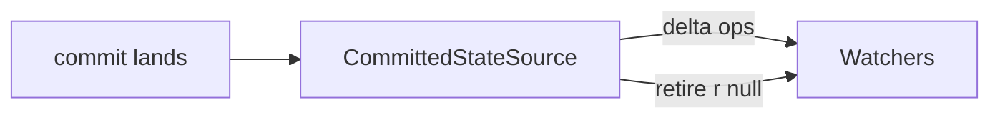

# 06 -- Durable Harness

The harness is durable's application layer. It is one Session plus the machinery that turns a Session into a working agent: agents, settings, environment, extensions, and live documents. This document is a deep dive into how a harness opens, what it stages, and how an agent is resolved.

## What a Harness Is

A harness is a Session with application meaning attached. `HarnessImpl` extends `SessionImpl`. It adds an agent configuration, a registry, a scheduler, and a document cache.

```ts
// packages/durable/src/harness/harness.ts -- HarnessImpl extends the Session (verbatim)
class HarnessImpl<Tool extends ToolRegistration> extends SessionImpl implements HarnessType {
  // ...
}
```

The Aha is that the harness is not a second storage system. It reuses the Session kernel unchanged. Everything the harness adds is a document or a task, stored through the same commit path.

## Opening a Harness

`Harness.open` validates the registry, creates the Session, stages the standard documents, and reopens tasks.

```ts
// packages/durable/src/harness/harness.ts -- open (abridged)
static async open<Tool>(storage, options, context): Promise<Harness> {
  context.abortSignal?.throwIfAborted();
  const snapshot = options.registry.snapshot();
  const missing = BUILTIN_TASKS.filter((task) => snapshot.task(task.definition.name) === undefined);
  if (missing.length > 0) {
    const names = missing.map((task) => task.definition.name).join(", ");
    throw new Error(`Registry lacks built-in tasks ${names}; create it with createRegistry()`);
  }
  const harness = new HarnessImpl(storage, options, context);
  try {
    await harness.openTasks(context);   // load live tasks, running -> pending
  } catch (error) {
    await harness.close(withoutAbortSignal(context)).catch(() => {});
    throw error;
  }
  return harness;
}
```

Three facts matter.

1. Open is abortable before any work. The caller's signal is checked first.
2. Open fails if the registry lacks a built-in task. A harness that cannot run a turn is refused at open, not at first submit.
3. Open failure closes the Session without the caller's signal. Cleanup must not be cancelled by the very failure it cleans up.

`openTasks` reconciles surviving `running` tasks back to `pending`. That is the recovery story in [07-durable-tasks.md](./07-durable-tasks.md).

## What a Conversation Creation Stages

Every commit that creates or forks a conversation runs one hook. It stages the standard documents.

```ts
// packages/durable/src/harness/harness.ts -- the built-in creation hook (verbatim)
protected override async conversationCreated(tx: Transaction, record: ConversationRecord): Promise<void> {
  await tx.doc(LiveDoc, record.id);
  await tx.doc(InboxDoc, record.id);
  await tx.doc(UsageDoc, record.id);
  await tx.doc(ProviderDoc, record.id);
  await createAgent(tx, record);
  await this.#options.conversationCreated?.(tx, record);
}
```

The staged documents.

| Document | Scope | Purpose |
|----------|-------|---------|
| `LiveDoc` | conversation | The current live state a UI watches |
| `InboxDoc` | conversation | Incoming submissions not yet placed |
| `UsageDoc` | conversation | Token and usage accounting |
| `ProviderDoc` | session | Provider and model settings |
| `AgentDoc` | conversation | Agent definition and configuration |

The Aha is that `conversationCreated` runs inside the creating commit, after the table write that created the conversation. So its document reads are fine, but a table read would throw `ReadAfterWrite`. The hook only stages documents and copies the agent.

## The Agent Document

An agent is a typed document, not a plain object.

```ts
// packages/durable/src/harness/agent.ts -- the agent document (verbatim)
export const AgentDoc = defineDoc<AgentState>({
  kind: "pi.agent",
  version: 1,
  scope: "conversation",
  history: "rewindable",
  fork: "asOf",
  initial: () => ({}),
  checkpointWhen: () => true,
});
```

Three fields define its behavior.

- `history: "rewindable"` keeps every version, so you can look back at how the agent was configured at any past entry.
- `fork: "asOf"` means a forked conversation inherits the agent as configured at the fork point, not a later change.
- `checkpointWhen: () => true` stores every change as a full base, not a delta. The agent is small and read often, so a base is cheaper than a delta tail.

`createAgent` copies the agent for a new conversation.

```ts
// packages/durable/src/harness/agent.ts -- copy on creation (verbatim)
export async function createAgent(tx: Tx, conversation: ConversationRecord): Promise<void> {
  if (conversation.parent !== undefined) return;   // a fork already has its asOf copy
  const agent = await tx.doc(AgentDoc, conversation.id);
  if (conversation.owner === undefined) return;    // ownerless starts empty
  const owner = await tx.doc(AgentDoc, conversation.owner.conversationId);
  Object.assign(agent, copyJson(owner) as AgentState);
}
```

The Aha is the three-way rule. A fork keeps its own `asOf` copy. A task-owned conversation copies the agent of its owner task's conversation. An ownerless conversation starts empty. This is how a child task inherits its parent's agent without a shared mutable object.

## Resolving an Agent

A stored `AgentState` is names, not objects. `resolveAgent` turns it into a usable `Agent` against a registry snapshot and settings.

```ts
// packages/durable/src/harness/agent.ts -- resolve an agent (abridged)
export function resolveAgent<Tool>(state, snapshot, settings, report): Agent<Tool> {
  const extensions = selectExtensions(state?.extensions, snapshot, settings);

  // Compose every selected extension's tools and sections, last one wins by name.
  const composed = new Map<string, Tool>();
  for (const extension of extensions) for (const tool of extension.tools ?? []) composed.set(tool.name, tool);
  const sections = new Map<string, PromptSection<Tool>>();
  for (const extension of extensions) for (const section of extension.sections ?? []) sections.set(section.key, section);
  // Then apply wraps in order; a wrapper that throws or renames drops its target and is reported.
  for (const extension of extensions) for (const wrap of extension.wraps ?? []) { /* applyWrap */ }

  const enabled = filterTools([...composed.values()], state?.tools);
  const callableBy = (caller) => (tool) => tool.callers === undefined || tool.callers.includes(caller);
  const modelCallable = enabled.filter(callableBy("model"));
  const tools = offeredTools(modelCallable, state?.modelTools);   // what the model is offered
  const offered = new Set(tools);
  const deferred = modelCallable.filter((tool) => tool.deferred === true && !offered.has(tool));
  const callable = enabled.filter(callableBy("tools"));           // what tools may call

  const instructions = state?.instructions;
  const agentSections = [...sections.values()];
  if (instructions !== undefined) agentSections.push({ key: INSTRUCTIONS_KEY, render: () => instructions });
  // ...
}
```

The pipeline is five steps.

1. **Select** the extensions by the stored names or the host default.
2. **Compose** each extension's tools and sections into maps.
3. **Wrap** tools and sections in order; a failing wrapper is reported and dropped.
4. **Filter** tools by `tools`, then by `modelTools`, then by who may call them (`model`, `tools`, or both).
5. **Assemble** the agent with model, extensions, offered tools, callable tools, deferred tools, and sections.

The Aha is the split between `tools` and `callable`. `tools` is what the model may call. `callable` is what other tools may call. A code mode tool is offered to the model but not to tools, so a script cannot start another script. An MCP tool behind code mode is callable by tools but never offered to the model. One agent, two audiences.

### The Deferred Tool

A `deferred` tool is not offered to the model until loaded. `tool_search` loads one by writing its name into `modelTools.add`. The Aha is that `offeredTools` keeps deferred tools out of the request until a tool explicitly loads them. Loading is a durable agent change, so it survives a crash.

## Configuring an Agent

`configure` changes an agent. `addTools` loads tools mid-run.

```ts
// packages/durable/src/harness/agent.ts -- configure (abridged)
export async function configure(tx: Tx, conversationId: ConversationId, change: AgentChange): Promise<void> {
  const state = await tx.doc(AgentDoc, conversationId);
  applyChange(state, change);
}
```

`applyChange` follows one rule: a given field replaces the stored one, `null` clears it, `undefined` changes nothing.

```ts
// packages/durable/src/harness/agent.ts -- the change rule (abridged)
function applyChange(state: Draft<AgentState>, change: AgentChange): void {
  const set = (key, value) => {
    if (value === undefined) return;   // no change
    if (value === null) delete state[key];   // clear
    else state[key] = value;
  };
  set("model", ...);
  set("instructions", change.instructions);
  set("cwd", change.cwd);
  // tools, modelTools, extensions: an array selects, { remove } drops, { add } appends
}
```

`addTools` is called by `ToolControl.addTools` from a tool result. It appends names to `tools` and to `modelTools.add`, so the next request offers them.

```ts
// packages/durable/src/harness/agent.ts -- addTools (abridged)
export async function addTools(tx, conversationId, added): Promise<void> {
  const state = await tx.doc(AgentDoc, conversationId);
  const tools = state.tools;
  if (Array.isArray(tools)) {
    for (const name of added) if (!tools.includes(name)) tools.push(name);
  } else if (tools?.remove.some((name) => added.includes(name))) {
    state.tools = { remove: tools.remove.filter((name) => !added.includes(name)) };
  }
  // modelTools: append to add; a deferred tool becomes offered next request
}
```

The Aha is that loading a tool is a document write, not a runtime side effect. The next generation reads the agent document and offers the tool. A crash between loading and the next request still has the tool loaded.

## Settings

Settings are layered and resolved to a single value. Every default is a named constant.

```ts
// packages/durable/src/harness/agent.ts -- the default policies (verbatim)
export const DEFAULT_RETRY_POLICY: ConversationRetryPolicy = {
  enabled: true, maxRetries: 3, baseDelayMs: 2000, maxAgentDelayMs: 60000,
};
export const DEFAULT_COMPACTION_POLICY: CompactionPolicy = {
  enabled: true, reserveTokens: 16384, keepRecentTokens: 20000, backgroundTokens: 32768,
};
export const DEFAULT_PROGRESS_POLICY: ProgressPolicy = {
  partialIntervalMs: 100, outputIntervalMs: 100,
};
```

`resolveSettings` merges each field over its default.

```ts
// packages/durable/src/harness/agent.ts -- resolve settings (abridged)
export function resolveSettings(settings: HarnessSettings | undefined): Settings {
  const extensions = settings?.extensions;
  return {
    ...(extensions === undefined ? {} : { extensions }),
    stream: { ...settings?.stream },
    retry: { ...DEFAULT_RETRY_POLICY, ...settings?.retry },
    compaction: { ...DEFAULT_COMPACTION_POLICY, ...settings?.compaction },
    progress: {
      partialIntervalMs: settings?.progress?.partialIntervalMs ?? DEFAULT_PROGRESS_POLICY.partialIntervalMs,
      outputIntervalMs: settings?.progress?.outputIntervalMs ?? DEFAULT_PROGRESS_POLICY.outputIntervalMs,
    },
    toolExecution: settings?.toolExecution ?? "parallel",
    steeringMode: settings?.steeringMode ?? "one-at-a-time",
    followUpMode: settings?.followUpMode ?? "one-at-a-time",
    contextRetentionMs: settings?.contextRetentionMs ?? DEFAULT_CONTEXT_RETENTION_MS,
    documentRetentionMs: documentRetention(settings?.documentRetentionMs),
  };
}
```

The Aha is the progress merge. It is field by field, not object spread. An explicitly `undefined` interval keeps its default. A plain spread would replace the whole object, losing the other interval's default.

`DEFAULT_CONTEXT_RETENTION_MS = 600_000` (ten minutes) is how long an idle conversation keeps its context read in memory. A busy conversation always keeps it; `0` drops it when idle.

### Settings and Models as Functions

Both `settings` and `models` may be values or functions. The function form is read at each use, so a host can swap model configuration without reopening the harness.

```ts
// packages/durable/src/harness/harness.ts -- function or value (abridged)
function currentModels(models) { return typeof models === "function" ? models : () => models; }
function currentSettings(settings) { return typeof settings === "function" ? settings : () => settings; }
```

## The Invocation Binding

Tasks and tools operate through a bound conversation. Every operation first checks the invocation and runs under its signal.

```ts
// packages/durable/src/harness/harness.ts -- bound conversation (abridged)
function boundConversation(id, binding, submissions, tasks): ConversationHandle {
  const bind = (context) => withAbortSignal(binding.signal, context);
  const bound = (operation) => async (context) => {
    binding.check();                     // reject after the invocation ends
    return operation(bind(context));
  };
  return { id, submit: ..., abort: ..., waitForIdle: bound(...) };
}
```

The Aha is the boundary of an invocation. A tool's operations reject once its invocation ends, but admitted work stays durable. Cancelling the wait does not cancel the commit. This is the same "reject only the waiter" rule chord's context gives in [02-chord-concepts.md](./02-chord-concepts.md).

## Watching and Observation

The harness exposes live documents. A `CommittedStateSource` turns a committed document into a chord observable. Each commit calls `advance` with the new value and its delta operations.



A watcher has a retirement operation: `[["r", null]]`. When a document retires, the watcher receives a root replace to null. The pending watch buffer is capped at `MAX_PENDING_WATCH_FRAMES = 100`, so a slow watcher cannot grow memory unbounded. See [01-architecture.md](./01-architecture.md) for the bridge.

## Where to Go Next

The harness schedules tasks. The next document shows how tasks run, wait, abort, and settle. Read [07-durable-tasks.md](./07-durable-tasks.md). For how a generation task produces an answer, read [08-durable-generation.md](./08-durable-generation.md).
