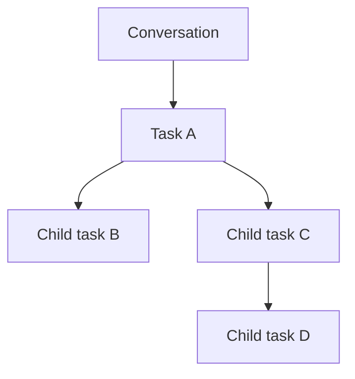
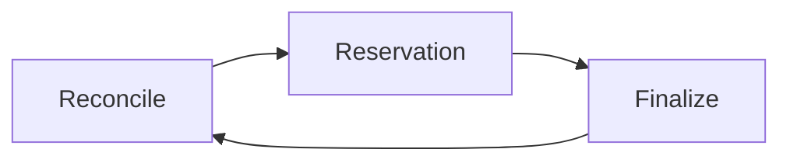
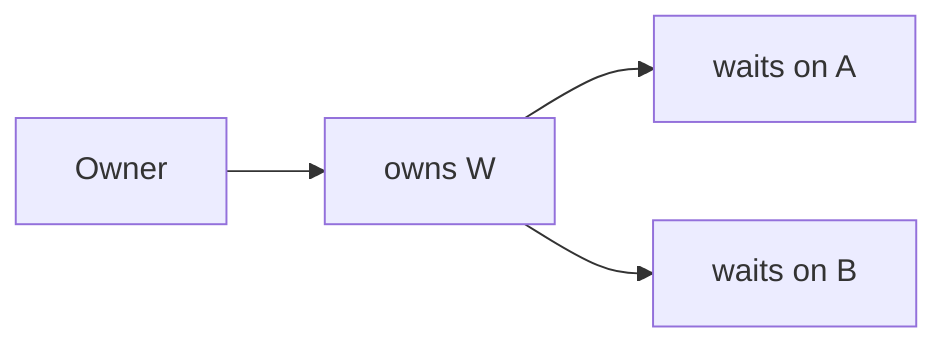

# 07 -- Durable Tasks: The Scheduler

The scheduler is durable's engine. It drives tasks through phases, cascades aborts down an ownership tree, and enforces one invariant: the wait-for graph never has a cycle. This document is a deep dive into that engine.

## The Scheduler's One Invariant

Every task transition is decided and written by one callback serialized on the Session line. That covers reservation, marks, runtime commits, finalization, and the synchronous step before each phase.

```ts
// packages/durable/src/harness/scheduler.ts -- the core invariant (abridged comment)
// Invariant: every task transition is decided and written by one callback serialized
// on the Session line.
```

The Aha is that the scheduler never races. A task can have a phase running off the line, but its transition is written on the line. A runtime commit either lands before the decision or is rejected.

## The Live Mirror

`#live` mirrors every committed non-terminal task: `pending`, `running`, `waiting`, `completing`.

```ts
// packages/durable/src/harness/scheduler.ts -- live statuses (verbatim)
const LIVE_STATUSES = ["pending", "running", "waiting", "completing"] as const;
```

The mirror is updated by a synchronous commit listener on the Session line. Code running on the line reads exactly the committed state. Terminal tasks are not live. They settle and drop.

## The Ownership Tree

Tasks and conversations form one ownership tree. A task's parent is its owner task, or its conversation. A conversation's parent is its owner task, if any.



The tree decides what reaches a task. A cancelling owner reaches every task below it. An abort cascades down the tree.

`#below` lists the tree downward around live work. `#roots` holds ownerless conversations with work. `#edges` maps each conversation to its owner task. The indexes are bounded by live work, so the scheduler never walks the whole tree on every pass.

## The Passes

The scheduler runs three kinds of passes.

| Pass | What it does |
|------|--------------|
| Reconcile | Finds new cancellations, fail-fast failures, and orphaned work |
| Reservation | Picks runnable tasks and starts their phases |
| Finalize | Settles `completing` tasks whose owned work finished |



Each pass writes its decisions through the commit line. Passes never mutate state directly.

### Abort Cascades

A task with cancellation intent is a source of an abort cascade. `#intent` holds those tasks. When one is marked, the scheduler walks down the tree and marks everything below it. The cascade reaches child tasks and child conversations.

A task holds as `completing` while its ordinary owned work is live. Only after that work settles does it become terminal and run its abort handler.

```ts
// packages/durable/src/harness/scheduler.ts -- terminate holds or settles (abridged)
if (this.#hasOwnedLive(record.id, overlayOf(tx))) {
  tx.setTask(withState(record, { status: "completing", outcome }));
  return;
}
tx.setTask(withState(record, { status: "terminal", outcome }));
```

The Aha is that an abort is not instant. It is a cascade that respects ownership. A parent cannot finish until its children finish.

## The Wait-For Graph

A waiting task names the tasks it waits on in `on`. Each wait adds an edge in the wait-for graph. Edges run from each task to what it waits on and to its live ordinary owned work.



The invariant: the graph is acyclic. A wait may not close a cycle.

```ts
// packages/durable/src/harness/scheduler.ts -- the invariant (abridged comment)
// Invariant: the wait-for graph is acyclic. Only a wait adds an edge between existing
// tasks, as a new task has only incoming edges, so checking each wait maintains it.
```

A wait on itself, or on an owner holding it, is the shortest cycle. The scheduler rejects it.

```ts
// packages/durable/src/harness/scheduler.ts -- the cycle check (abridged)
const cycle = await this.#waitCycle(current.id, targets, overlay);
if (cycle !== undefined) {
  throw new Error(
    `Task ${current.id} cannot wait on ${cycle[0]}: ${[current.id, ...cycle].join(" -> ")} is a wait cycle`,
  );
}
```

### Join Policy

A wait has a policy. `failFast` stops at the first failure. `allSettled` waits for every task. A `failFast` wait may name only tasks the waiter owns.

```ts
// packages/durable/src/harness/scheduler.ts -- failFast ownership check (abridged)
if (policy === "failFast" && member.owner !== current.id) {
  throw new Error(`Task ${current.id} can wait failFast only on tasks it owns; ${id} is not one`);
}
```

An abort handler cannot wait at all. It must settle.

## The Six Precedence Rules

Before each phase, the scheduler applies six rules in order. Rules 1 and 2 are applied by `#step`. Rules 3 through 6 are applied by `#decide`.

```ts
// packages/durable/src/harness/scheduler.ts -- #decide, abridged
// 3. abort mark: end; a fresh abort invocation starts once the task's ordinary owned work is gone.
if (current.abortRequested) return false;
// An owner's cancellation intent ends it too.
if (!current.background && this.#belowCancelled(parentOf(current))) { ... return false; }
if (previous === undefined) return true;
// 4. uncaught error.
if (previous.failure !== undefined) return { fault: previous.failure.error };
// 6. no durable progress.
if (jsonEqual(current.state.checkpoint, previous.checkpoint)) {
  const message = `Task ${current.kind} phase ${previous.checkpoint.phase} returned without durable progress`;
  return { fault: new Error(message) };
}
// 5. progress: refresh the snapshot; hand over to a replacement definition.
```

The six rules, in check order. Rules 1 and 2 run first. Then rule 3, rule 4, rule 6, and finally rule 5. Rule 6 runs before rule 5 because a phase must progress before it can hand over.

| Rule | Meaning |
|------|---------|
| 1 | Already terminal, `completing`, or `waiting`: end |
| 2 | Harness is closing: end without a write |
| 3 | Abort mark or cancelled owner: end |
| 4 | Phase threw: fault with that error |
| 6 | Phase returned with the same checkpoint: fault |
| 5 | Phase progressed: refresh, hand over to a new definition |

### The "No Durable Progress" Fault

Rule 6 is the safety net. A phase must write a new checkpoint. If it returns and the checkpoint is unchanged, the task has made no durable progress. It faults.

```ts
// packages/durable/src/harness/scheduler.ts -- the fault (verbatim)
const message = `Task ${current.kind} phase ${previous.checkpoint.phase} returned without durable progress`;
return { fault: new Error(message) };
```

The Aha is why this exists. A phase that loops without writing would otherwise run forever, and a crash would lose its place. The rule forces every phase to persist progress. Durable progress is the checkpoint.

## Outcomes

A task ends with one of five outcomes.

| Outcome | Meaning |
|---------|---------|
| `completed` | Finished successfully |
| `failed` | Failed with an error |
| `aborted` | Aborted on request |
| `orphaned` | No definition can run it |
| `faulted` | The scheduler caught a bug |

`orphaned` and `faulted` are written only by the scheduler. A task is orphaned when no registered definition can take it. A task is faulted when a phase broke a rule.

```ts
// packages/durable/src/harness/scheduler.ts -- scheduler-only outcomes (abridged)
if (outcome.status === "faulted" || outcome.status === "orphaned") {
  // only the scheduler writes these
}
```

## Open and Resume

Opening a scheduler loads every live task and changes surviving `running` tasks back to `pending`. A `running` task at open means a crash happened mid-phase. Its checkpoint is durable, so it re-runs from there.

```ts
// packages/durable/src/harness/scheduler.ts -- open (abridged comment)
// Load live tasks and change surviving `running` tasks back to `pending`.
```

Tasks with `abandonOnRestart` found at open are abort-marked with reason `restart`, so nothing of them runs a phase again.

The Aha is that this is the whole recovery story. On open, running becomes pending, and the checkpoint restores state. No phase is lost. No phase runs twice to completion without a checkpoint.

## The Public API

The scheduler exposes a small surface.

| Method | What it does |
|--------|--------------|
| `open` | Load live tasks, downgrade running to pending |
| `resume` | Dispatch runnable tasks |
| `join` | Wait for a task or the harness to idle |
| `abort` | Mark a task or conversation for abort |
| `waitForTask` | Await one task's settle |
| `waitForIdle` | Await a conversation's idleness |
| `abortConversation` | Abort a whole conversation, optionally its background work |

`waitForTask` and `waitForIdle` are what tools use to wait for child work. `abortConversation` is the top-level cancel.

## Where to Go Next

The scheduler runs tasks. The most important task is generation. The next document shows how a generation task produces an answer through phases. Read [08-durable-generation.md](./08-durable-generation.md). For how a task reads and writes documents, read [04-durable-concepts.md](./04-durable-concepts.md).
