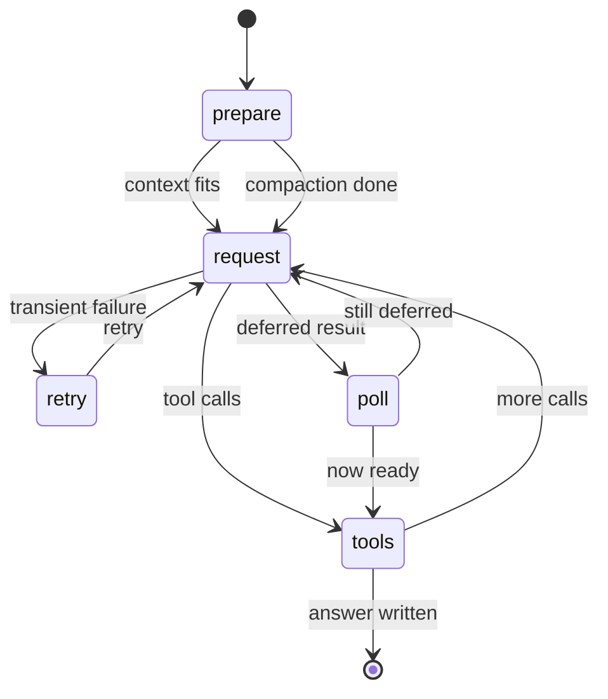
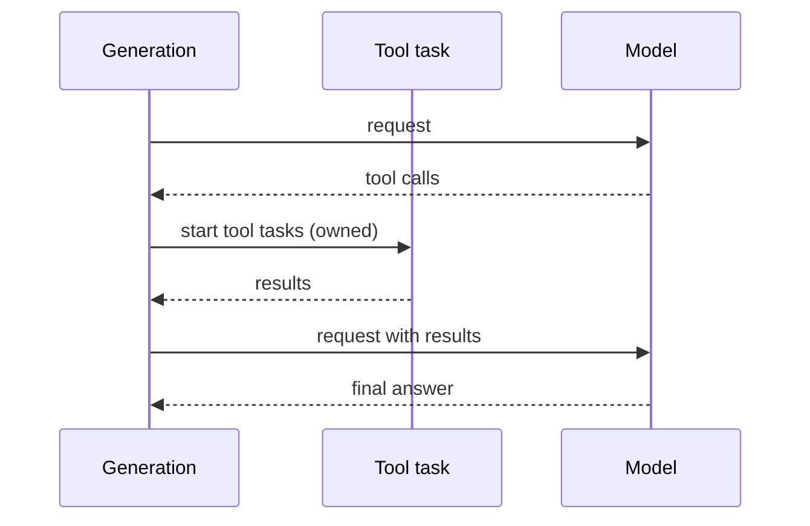

# 08 -- Durable Generation

The generation task is the most important task. It turns a user message into an assistant answer. This document is a deep dive into its phases, its checkpoint, and how it survives a crash at any point.

## The Task

`GenerationTask` is a task of kind `pi.generation`. Its input is empty. Its result is the entry id of the answer.

```ts
// packages/durable/src/harness/generation.ts -- the task (abridged)
export const GenerationTask = defineTask({
  name: "pi.generation",
  initial: () => ({ phase: "prepare", attempt: 1 }),
  // ...
});

export type GenerationResult = { entryId: EntryId };
```

The checkpoint is the whole story. It is a union of five phases. Each phase carries exactly the data needed to resume.

```ts
// packages/durable/src/harness/generation.ts -- the checkpoint (abridged)
export type GenerationCheckpoint =
  | { phase: "prepare"; attempt: number; compacted?: TaskId; overflow?: string; threshold?: true }
  | { phase: "request"; attempt: number; model: ModelRef; cutoff: EntryId; streamOptions: ... }
  | { phase: "retry"; attempt: number; until: number }
  | { phase: "poll"; attempt: number; model: ModelRef; cutoff: EntryId; handle: DeferredHandle; pollAt: number }
  | { phase: "tools"; assistant: EntryId; tools: TaskId[]; pending: string[] };
```

The Aha is that the phase is the program counter. A crash loses the call stack. It does not lose the phase. On resume, the task reads the checkpoint and continues exactly there.

## The Five Phases



| Phase | Purpose |
|-------|---------|
| `prepare` | Decide whether to compact, then build the request |
| `request` | Stream the model response and classify it |
| `retry` | Wait and retry a transient failure |
| `poll` | Poll a deferred result until it is ready |
| `tools` | Run tool calls, then loop back to request |

### Prepare

`prepare` checks whether the context is over threshold. If it is, the generation spawns a compaction child task and waits on it.

```ts
// packages/durable/src/harness/generation.ts -- threshold compaction (abridged)
const compaction = thresholdCompaction(view, entries, resolved.contextWindow, compactionPolicy(settings, model));
if (compaction !== undefined) {
  const child = await createCompaction(runtime, compaction, context);
  const checkpoint = { phase: "prepare", attempt, compacted: child, threshold: true } as const;
  return { status: "waiting", on: [child], checkpoint, policy: "failFast" };
}
```

The generation waits `failFast` on the compaction. If the compaction fails, the generation fails. The `compacted` child id is stored in the checkpoint, so a resume re-checks the compaction outcome once and does not start a second one.

### Request

`request` streams the response and classifies it. `streamResponse` writes partial output through the progress policy. `classify` reads the message and picks the next move.

```ts
// packages/durable/src/harness/generation.ts -- request (abridged)
const message = await streamResponse(runtime, model, messages, options, attempt, context);
await classify(runtime, request, message, context);
```

Classify has three outcomes: a text answer, tool calls, or a deferred result to poll.

### Retry

A transient failure moves to `retry`. The checkpoint carries an `until` deadline. On resume, the task checks the deadline and either retries or gives up.

```ts
// packages/durable/src/harness/generation.ts -- retry (abridged)
{ phase: "retry", attempt: number, compacted?: TaskId, until: number }
```

The retry policy bounds this. `maxRetries` and `maxAgentDelayMs` cap how long a single turn can retry.

### Poll

A deferred model result moves to `poll`. The checkpoint carries the handle and `pollAt`.

```ts
// packages/durable/src/harness/generation.ts -- poll interval (verbatim)
const DEFAULT_POLL_AFTER_MS = 5000;
```

```ts
// packages/durable/src/harness/generation.ts -- schedule the next poll (abridged)
runtime.now() + (handle.pollAfterMs ?? DEFAULT_POLL_AFTER_MS);
```

The Aha is that polling is durable. The handle and deadline live in the checkpoint. A crash during a long poll does not lose the in-flight request; the task resumes and polls again.

### Tools

A tool-calling answer moves to `tools`. The phase stores the assistant entry, the tool tasks started so far, and the calls still pending.

```ts
// packages/durable/src/harness/generation.ts -- the tools phase (abridged)
{ phase: "tools"; assistant: EntryId; tools: TaskId[]; pending: string[] }
```

`startToolRound` creates tool tasks in call order. `finishToolRound` writes the tool results and loops back to `request`. Sequential rounds start one call at a time; parallel rounds start many. The generation owns its tool tasks.



## Why It Is Durable

Every phase ends by committing a new checkpoint. The scheduler's rule 6 enforces this: a phase that returns without changing the checkpoint faults. So progress is always persisted.

```ts
// packages/durable/src/harness/scheduler.ts -- the fault (verbatim)
const message = `Task ${current.kind} phase ${previous.checkpoint.phase} returned without durable progress`;
return { fault: new Error(message) };
```

A crash at any point loses at most the current in-flight model call. The checkpoint before it is durable. On resume, the phase re-runs from that checkpoint and reaches the same state. The model call is retried, not silently dropped.

## Compaction: The Companion Task

Compaction is its own task, `pi.compaction`. It has three phases.

```ts
// packages/durable/src/harness/compaction.ts -- the phases (abridged)
| { phase: "select" }
| ({ phase: "summarize" } & SummaryRequest)
| ({ phase: "retry"; until: number } & SummaryRequest);
```

`select` picks a cut point with `selectCut`, keeping `keepRecentTokens`. `summarize` asks a model to fold older messages into a summary. `retry` waits and retries a failed summary. Then `placeSummary` writes the summary and moves the conversation head.

```ts
// packages/durable/src/harness/compaction.ts -- the summarization prompt (abridged)
const SUMMARIZATION_PROMPT = `The messages above are a conversation to summarize. ...`;
```

Tool results are truncated in the summary to `TOOL_RESULT_MAX_CHARS = 2000`. `estimateContext` counts tokens. `serializeConversation` renders the messages for the model.

The Aha is the division of labor. Generation decides compaction is needed. Compaction does it. Generation waits. The separation keeps each task small and each checkpoint focused.

## Where to Go Next

Generation and compaction use tools and settings. The next document shows how tools, settings, and environment plug into a task. Read [09-durable-tools-env.md](./09-durable-tools-env.md). For the scheduler that runs these phases, read [07-durable-tasks.md](./07-durable-tasks.md).
