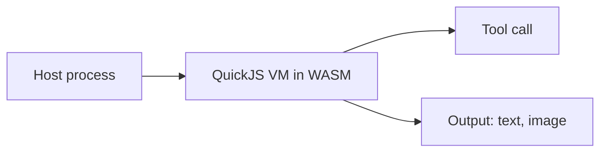
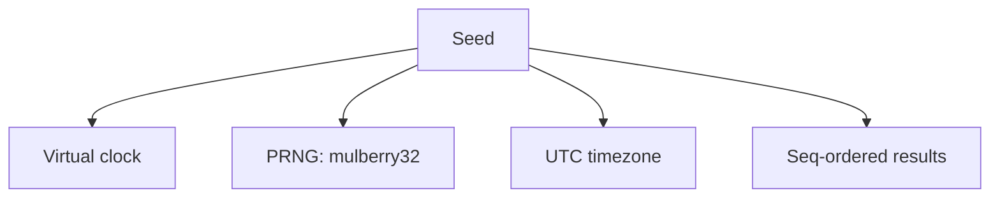
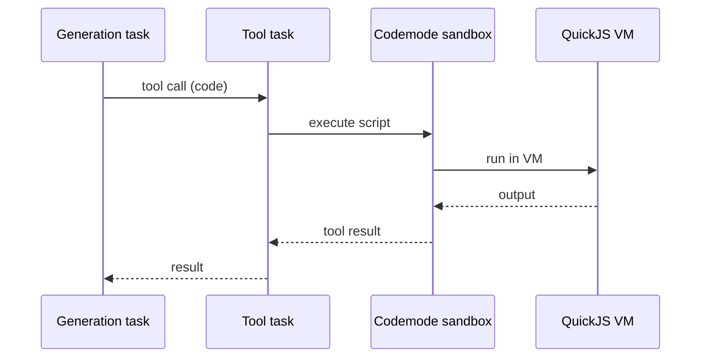

# 10 -- Codemode: The Sandbox

codemode runs user JavaScript in a sandbox. The sandbox is a QuickJS virtual machine compiled to WebAssembly. This document explains the three sandbox placements, the interrupt budget, the lockdown, and deterministic mode.

## The Problem It Solves

A model wants to run code to answer a question. That code is untrusted. If it runs on the host, a `while (true) {}` blocks the whole process. codemode solves this by running the code in a QuickJS VM, isolated from the host runtime.



The Aha is that QuickJS runs synchronously inside WebAssembly. A spinning script cannot touch the host event loop if the VM is on another thread, and cannot escape the VM at all. Isolation is a property of the VM, not a permission check.

## Three Sandbox Placements

The same VM can run in three places. They share one interface.

| Sandbox | Where the VM runs | Use |
|---------|-------------------|-----|
| `CodemodeSandbox` | A Node or Bun worker thread | Default, servers |
| `InlineCodemodeSandbox` | The calling thread | Cloudflare Workers, browsers |
| `RemoteCodemodeSandbox` | A remote server | Untrusted multi-tenant |

`CodemodeSandbox` gives each execution a fresh worker thread and VM.

```ts
// packages/codemode/src/runtime/host.ts -- a fresh worker per run (abridged)
// Each execution gets its own worker thread and QuickJS VM. A fresh worker per run keeps
// termination simple: a runaway script is killed with terminate() and cannot poison a later run.
```

The Aha is why each run gets a fresh VM. If a script corrupts its VM, a later run starts clean. A runaway script is killed with `terminate()`, and the next run is unaffected.

## The Interrupt Budget

A worker thread can be terminated. An inline VM on the calling thread cannot, because the event loop is blocked. So the inline sandbox uses an interrupt budget instead.

```ts
// packages/codemode/src/runtime/inline.ts -- the budget (verbatim)
export const DEFAULT_INTERRUPT_BUDGET = 100_000;
```

QuickJS polls its interrupt handler while a script runs. The launcher counts the polls. When the count passes the budget, it interrupts the script.

```ts
// packages/codemode/src/runtime/inline.ts -- count and interrupt (abridged)
shouldInterrupt: () => {
  if (stopped || settled || exhausted) return true;
  if (++polls <= interruptBudget) return false;
  exhausted = true;
  return true;
}
```

The Aha is that the budget is a count of polls, not a wall clock. On a blocked thread, a wall clock never advances. The poll count does. Roughly 100,000 polls is two to ten seconds of CPU, depending on the machine.

## Lockdown

Before any user code runs, the prelude freezes the built-ins and makes the built-in globals read-only.

```ts
// packages/codemode/src/runtime/prelude-source.ts -- freeze first (abridged)
// Before anything else the prelude freezes the built-ins and makes the built-in globals read-only.
(function lockdown() {
  // ...
  Object.freeze(object);
  // ...
})();
```

The Aha is that this is defense at the object level. A script cannot redefine `Object`, `Array`, or `Promise`. It cannot plant a `json.py`-style surprise by mutating a built-in another tool shares.

## Deterministic Mode

A script can run in deterministic mode. The same seed produces the same calls and the same results. A host can replay it after a restart.

```ts
// packages/codemode/src/runtime/vm.ts -- deterministic guarantees (abridged)
// - Time: every WASI clock reads virtual time, never going backwards.
// - Randomness: random_get draws from a PRNG over the seed.
// - Timezone: UTC, not the host's.
// - Garbage collection: WeakRef and FinalizationRegistry are not available.
// - Delivery order: results carry a seq and are applied strictly in that order.
```



The Aha is why this matters. A durable task replays its phase from a checkpoint. If a code step depends on time or randomness, replay diverges. Deterministic mode makes the step repeatable. A phase can re-run and reach the same state.

```ts
// packages/codemode/src/runtime/vm.ts -- the PRNG (verbatim)
/** mulberry32: a small, fast PRNG; one 32-bit draw per call. */
function prng(seed: number): () => number {
  let state = seed >>> 0;
  return () => {
    state = (state + 0x6d2b79f5) >>> 0;
    let value = Math.imul(state ^ (state >>> 15), 1 | state);
    value = (value + Math.imul(value ^ (value >>> 7), 61 | value)) ^ value;
    return (value ^ (value >>> 14)) >>> 0;
  };
}
```

## Tools, Globals, and Output

A script calls tools as `tools.<id>(args)`. A tool is typed.

```ts
// packages/codemode/src/types.ts -- a tool (abridged)
export interface CodemodeTool {
  name: string;
  description?: string;
  inputSchema?: CodemodeJsonSchema;
  outputSchema?: CodemodeJsonSchema;
  execute(args: unknown, context: CodemodeToolContext): Promise<unknown> | unknown;
}
```

The script produces output items. Text and images are the two kinds.

```ts
// packages/codemode/src/types.ts -- output items (abridged)
export type CodemodeOutputItem =
  | { type: "text"; text: string; console?: true }
  | { type: "image"; data: string; mimeType: string };
```

A tool call returns through a JSON round trip. A thrown error surfaces in the script as an `Error` with the same message.

## Errors

Every failure has a kind.

```ts
// packages/codemode/src/types.ts -- error kinds (abridged)
export type CodemodeErrorKind =
  | "script"     // the script threw or failed to parse
  | "timeout"    // deadline expired or interrupt budget used up
  | "aborted"    // caller's signal fired or the sandbox closed
  | "sandbox";   // the VM or transport failed outside the script
```

The Aha is the split between `script` and `sandbox`. A script error is the user's code failing. A sandbox error is the sandbox failing. durable reports them differently, because one is a tool result and the other is a harness problem.

## How It Plugs Into durable

codemode is a tool. durable's tool task calls it like any other tool. The code tool's `execute` runs the script in a sandbox and returns the output. durable does not know the output came from QuickJS.



The boundary is clean. durable owns durability and scheduling. codemode owns isolation. Neither re-implements the other.

## Where to Go Next

The next document traces one request through every layer, from submission to answer. Read [11-data-flow.md](./11-data-flow.md). For how tools plug into the harness, read [09-durable-tools-env.md](./09-durable-tools-env.md).
