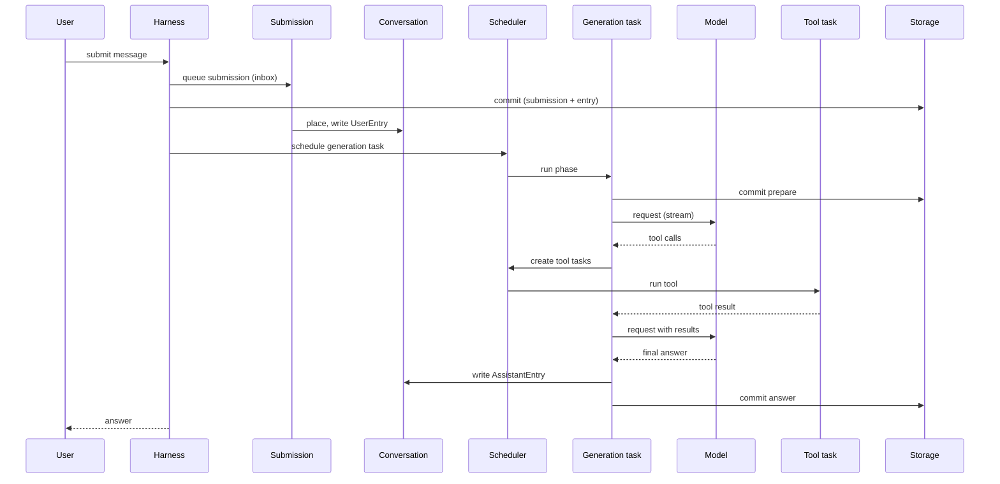
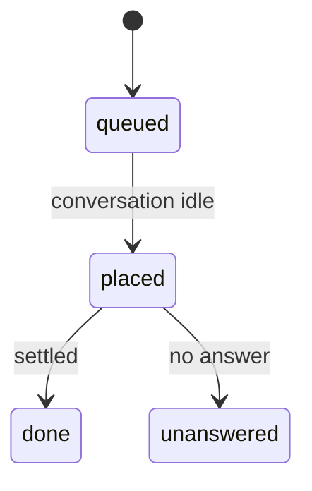
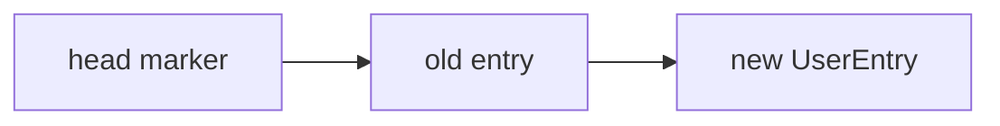
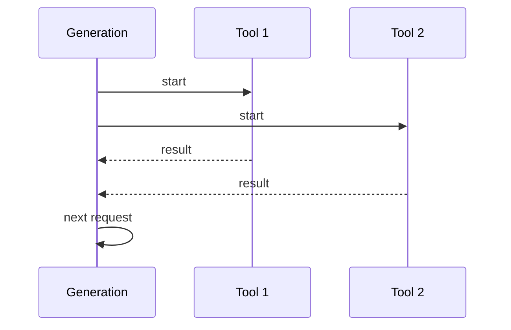
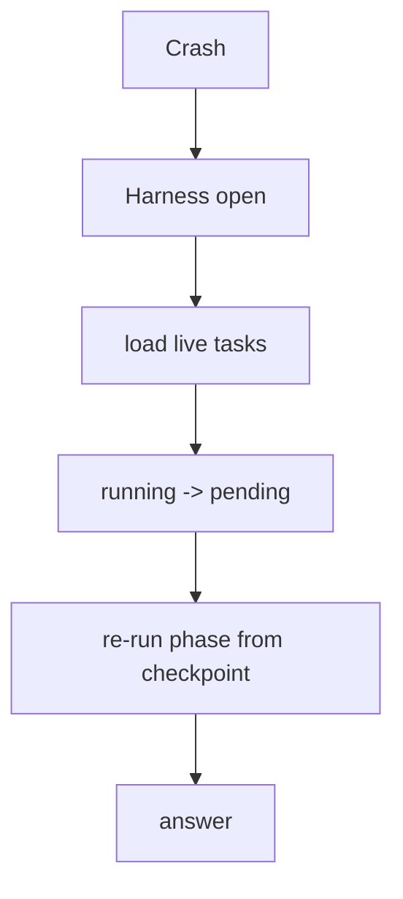

# 11 -- Data Flow: One Request End to End

This document traces one user message through every layer: submission, conversation, generation, tools, and the answer. It then shows what happens on a crash at each point.

## The Happy Path

Every box with a `commit` is a durable point. Between commits, a crash loses nothing important.

## Step 1: Submission

The user submits a message. The harness records it as a submission. A submission is an input. It starts `queued`.

A busy conversation queues the submission. An idle conversation places it. The inbox document holds the queue. Placing writes the `UserEntry` and starts a turn.

## Step 2: Entry

Placing the submission appends a `UserEntry` to the conversation. The entry is immutable. Its head marker stays unchanged, so the context window now ends at the new entry.

## Step 3: Generation

The harness schedules a `pi.generation` task. The task runs its phases: `prepare`, `request`, `tools`, then `request` again until an answer.

The generation task reads the conversation from the head forward. It builds a request with the model, settings, and context. It streams the response. `classify` decides the next move: text, tool calls, or poll.

## Step 4: Tools

A tool-calling answer starts a tool round. Each call becomes a tool task. The generation owns the tool tasks and waits on them.

A code tool runs in codemode's sandbox. The sandbox is the leaf. See [10-codemode.md](./10-codemode.md).

## Step 5: Answer

The final answer is written as an `AssistantEntry`. The generation task settles `completed`. The submission settles `done`. The conversation has one more entry.

## The Crash Trace

Here is what a crash means at each point. "Lose" means the work must re-run. "Keep" means it is already durable.

| Crash point | What is lost | What is kept |
|-------------|--------------|--------------|
| Before the submission commit | The message | Nothing new |
| After the submission commit | Nothing | The queued submission |
| During generation `prepare` | The in-flight phase | The task and its checkpoint |
| During the model stream | The in-flight call | The `request` checkpoint |
| During a tool run | The tool's uncommitted work | The `tools` checkpoint |
| After the answer commit | Nothing | The answer entry |

The Aha is that the checkpoint is the boundary. A crash loses only the current phase's in-flight work. Everything the phase already committed is safe. On resume, the phase re-runs from its checkpoint and reaches the same state.

## Resume After a Crash

Opening the harness recovers. The scheduler loads live tasks and changes `running` back to `pending`.

A generation task mid-stream resumes in `request` and re-issues the model call. A task mid-tool resumes in `tools` and re-checks its child tasks. A safe tool replays; an unsafe tool does not.

## Where the Durability Lives

Every box in the happy path that says `commit` is the same storage path explained in [05-durable-storage.md](./05-durable-storage.md). Every phase transition is the scheduler explained in [07-durable-tasks.md](./07-durable-tasks.md). The data flow is just those two mechanisms composed.

## Where to Go Next

The final document collects the cross-cutting concerns and the production-grade picture. Read [12-cross-cutting.md](./12-cross-cutting.md). For the overview, read [00-overview.md](./00-overview.md).
