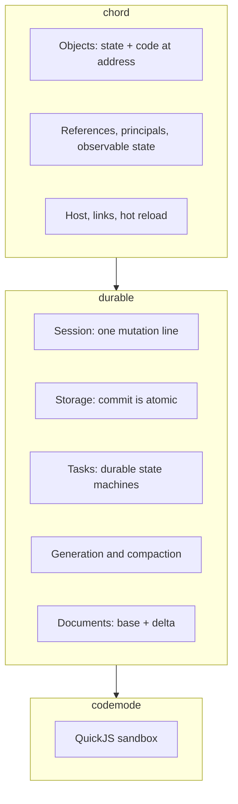

# 12 -- Cross-Cutting Concerns

This final document collects the concerns that run through every layer: cancellation, error containment, clocks, retention, and observation. It then gives the production-grade picture and a recap.

## Cancellation

Every call carries a `Context`. A context has an `AbortSignal`. Cancellation flows through the whole stack without an extra argument.

```ts
// packages/chord/src/context.ts -- context carries identity and cancellation (concept)
withAbortSignal(signal, context);
awaitWithContext(promise, context);
```

The Aha is one subtle rule. A commit is admitted with `withoutAbortSignal`. Caller cancellation must not interrupt a commit already underway, because once admitted, whether it wrote is unknown. The caller is cancelled; the commit is not.

## Error Containment

Not every error is fatal. The Session splits errors into two kinds.

```ts
// packages/durable/src/session/session.ts -- publish, abridged
for (const listener of [...this.#internalListeners]) {
  contained(() => listener(publication, context), (error) => this.fail(error));
}
for (const listener of [...this.#commitListeners]) {
  contained(() => listener(publication, context), (error) => this.report(error));
}
```

An internal listener that throws fails the Session. An external listener that throws is reported, not fatal. `contained` wraps the call so a listener never breaks the commit loop.

The Aha is the ownership rule. The Session owns its internal listeners, so their failure is the Session's failure. A caller owns its listeners, so their failure is reported and the Session continues.

## Clocks

Time is not trusted. The harness reads the current time through `safeNow`, a clock that never goes backward within a session.

```ts
// packages/durable/src/harness/harness.ts -- a monotonic clock (concept)
function safeNow(now: () => number): number {
  // never returns less than the previous value
}
```

Timers are capped at `MAX_TIMER_DELAY = 2_147_483_647` ms, the maximum a `setTimeout` accepts. This avoids overflow when a delay computes to a huge number.

## Retention

Two retention values bound memory.

| Value | Default | What it drops |
|-------|---------|---------------|
| `contextRetentionMs` | 600,000 ms | Idle context ranges |
| `documentRetentionMs` | 600,000 ms | Idle document cache entries |

An idle document is dropped from the cache and cold-loaded later. An attached document stays because a watcher holds it. See [04-durable-concepts.md](./04-durable-concepts.md).

## Observation

Committed changes publish to listeners. A `CommittedStateSource` turns a document into a chord observable. Watchers receive deltas as commits land. A retired document sends a root replace to null. The pending watch buffer is capped, so a slow watcher cannot grow memory unbounded.

## Hot Reload Interplay

durable sits on chord. A code reload swaps task definitions. The scheduler handles this with rule 5: after a phase progresses, it refreshes the registry snapshot and hands the task to a replacement definition.

```ts
// packages/durable/src/harness/scheduler.ts -- rule 5 (abridged)
state.snapshot = this.#registry.snapshot();
const next = state.snapshot.task(current.kind);
if (next !== state.task && next !== undefined && canReserve(next, current)) {
  tx.setTask(withState(current, { status: "pending", checkpoint: current.state.checkpoint }));
  return false;
}
```

The Aha is that a running task is not yanked. It finishes its current phase under the old definition, then hands over. State and code are separate, as chord guarantees.

## What a Production-Grade Harness Looks Like

The storage deep dive in [05-durable-storage.md](./05-durable-storage.md) lists five production additions. Here is the harness-level picture.

A production harness adds:

1. **Observability.** Metrics on commit latency, phase counts, and fault rates. durable exposes these as committed state; production graphs them.
2. **Multiple replicas.** The Session is single-writer per process. Production shards conversations across replicas and ships the log to followers.
3. **Backpressure.** A busy conversation already queues submissions. Production adds global admission control so one hot conversation cannot starve others.
4. **Gradual rollouts.** Hot reload plus contract fingerprints allow a canary: new code on one host family, old code elsewhere.
5. **Recovery drills.** A resilient system is one whose recovery is tested. Production kills processes on a schedule and verifies resume.

The design is already production-shaped. It just needs the operational edges.

## The Whole Picture



Three packages, one lesson. chord gives identity and live code. durable gives state and recovery. codemode gives isolation. Each owns one hard problem. Together they run an agent that survives a crash at any point.

## The Core Lesson

Durability is a strict order of operations: validate, write the log, flush, then apply. Efficiency is storing deltas, not values, and checkpointing when a full value is cheaper. Everything else is elaboration on those two ideas.

## Where to Go Next

This is the end of the deep dives. Return to [00-overview.md](./00-overview.md) for the thesis. Return to [05-durable-storage.md](./05-durable-storage.md) for the resilient-storage guide for a new engineer.
