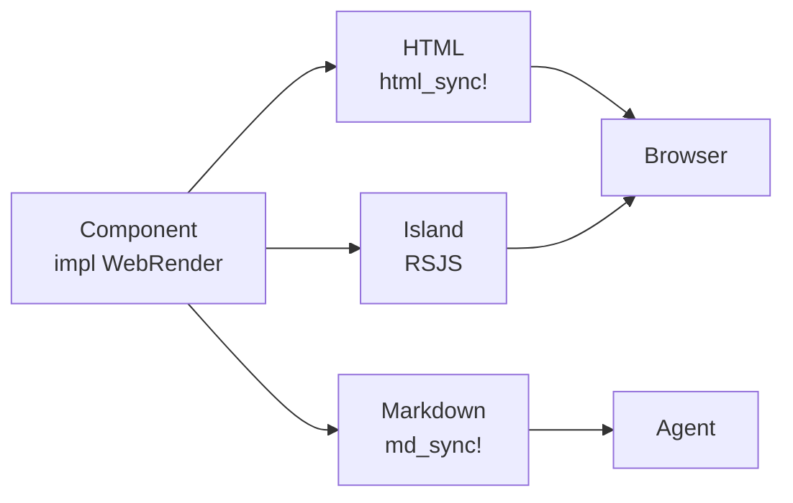
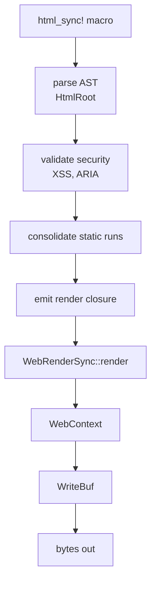

# 00 -- Overview

Proa is a Rust server-side rendering (SSR) framework. It treats rendering as a serialization
problem, not a component-tree reconstruction problem. A component is a plain Rust struct that
implements a render trait. The `html_sync!` and `html!` macros compile the template into
pre-escaped byte sequences at compile time. The runtime then writes those bytes into a reusable
buffer with almost no allocation.

## The Core Idea

Most SSR frameworks build a virtual DOM or an intermediate component tree at runtime. They walk
that tree on every request. Proa skips the tree entirely. The compiler walks the template once,
at compile time. It merges adjacent static text, applies escaping, and validates the markup.
The result is a closure that writes bytes directly into a buffer.

This is why the crate's philosophy is: emit as much HTML and as little JavaScript as possible,
as fast as possible. One typed interface layer produces the right representation for each
audience. HTML goes to browsers. Targeted JavaScript goes to interactive islands. Dense
Markdown goes to agents.



One component, three representations. The same struct renders three ways without three code
paths. This is the multi-interface vision in one diagram.

## What a Component Is

A component is any type that implements `WebRenderSync` (sync) or `WebRender` (async-capable).
The sync trait is a single method that takes a render context and returns a write result.

```rust
// proa/proa_core/src/render/web_render.rs
pub trait WebRenderSync<L: DataLoader = NoLoader, B: WriteBuf = RenderBuffer> {
    fn render(self, cx: &mut WebContext<L, B>) -> Result<(), WriteError>;
}
```

There is no base class, no `Component` supertype, no registry. The type itself is the
component. A `String`, an `i32`, a `()` all implement the trait. That is why composing is just
nesting: a parent calls `child.render(cx)`.

The async trait returns a `RenderOutcome`, which is either `Done` or `Pending` with a future.

```rust
// proa/proa_core/src/render/web_render.rs
pub trait WebRender<L: DataLoader = NoLoader, B: WriteBuf = RenderBuffer> {
    fn render(self, cx: &mut WebContext<L, B>) -> RenderOutcome<impl Future<Output = Result<(), WriteError>>>;
}
```

The sync path never allocates a future. The async path only does when the component actually
returns `Pending`. This split keeps sync rendering free of executor overhead.

## The Render Pipeline

The pipeline has two halves. The compile-time half parses and optimizes the template. The
runtime half writes bytes. Here is the full flow.



Step A through E happen when `cargo` compiles your crate. Step F through I happen on every
request. A fully static template collapses step D into a single byte literal. The runtime then
does one buffer write.

The entry points show the shape. Rendering into a `Vec<u8>` or a `String` is a two-liner.

```rust
// proa/proa_core/src/lib.rs:200
pub fn render_to_vec<R: Render>(root: R) -> Vec<u8> {
    let mut cx = WebContext::new();
    root.render(&mut cx).unwrap();
    cx.into_output().into_vec()
}
```

The same function exists async (`render_to_vec_async`, `lib.rs:264`) and into a reusable
buffer (`render_into`, `lib.rs:194`). The reusable-buffer version matters for servers: a
warmed 4 KiB buffer is reused across requests instead of reallocated.

## The Buffer Story

The render context writes into a `WriteBuf`. The default is `RenderBuffer`, an alias for
`ChainedBumpWriter<4096>`. This is a linked list of fixed 4,096-byte pages. Writes bump a
cursor inside the current page. Overflow allocates a new page and chains it. Nothing reallocates
or copies the whole buffer.

```rust
// proa/proa_core/src/shared/write_buf/mod.rs (conceptual)
pub type RenderBuffer = ChainedBumpWriter<DEFAULT_CHAINED_BUMP_PAGE_SIZE>;
pub const DEFAULT_CHAINED_BUMP_PAGE_SIZE: usize = 4096;
```

This is the first big design decision. A normal `Vec<u8>` reallocates and copies when it grows.
A chained bump buffer never moves bytes already written. Full detail is in
[04-write-buf.md](./04-write-buf.md).

## The Macro Story

The macros are the compile-time half. `html_sync!` parses the template, validates it, merges
static runs, and emits a closure. A template like this:

```rust
let node = html_sync! {
    <div class="card">
        <h1>{title}</h1>
        <p>{body}</p>
    </div>
};
```

becomes a closure that writes `<div class="card"><h1>`, then renders `title` with escaping,
then writes `</h1><p>`, then `body`, then `</p></div>`. The four static runs are each a single
`extend_static` call. The dynamic slots go through `WebRenderSync::render`. Full detail is in
[07-html-macros.md](./07-html-macros.md).

## Escaping Is Compile-Time Too

Static text is escaped when the macro expands, not at runtime. The compiler replaces `&`, `<`,
`>`, and non-breaking spaces with their entities. Dynamic values are escaped at render time,
but only because their content is not known until then. The escape policy is shared: the
compile-time validator and the runtime `AttrValue` path use the same dangerous-URL check.

This is the Aha moment of the overview.

**Aha:** Escaping is moved off the request path. A template author writes literal markup; the
compiler turns it into already-escaped bytes. The runtime does not re-escape static content on
every render. The only escaping left at runtime is for dynamic values, which cannot be escaped
sooner. The result is that a mostly-static page costs one buffer write of pre-escaped bytes, not
a tree walk plus a scan.

## The Crate Map at a Glance

Proa is a workspace of 41 members. The render pipeline core is four crates. The framework adds
HTTP adapters and routing. RSJS adds the island compiler.

| Crate | Role |
|-------|------|
| `proa_core` | Render traits, `WebContext`, `WriteBuf` hierarchy, HTML/Markdown elements |
| `proa_dsl` | Shared parser, AST, security validation, Markdown template parsing |
| `proa_macros` | The 21 proc macros (`html!`, `html_sync!`, `md!`, `text!`, derives) |
| `proa_ir` | Intermediate representation for reactive attributes and client glue |
| `proa_framework_core` | Runtime-agnostic response, route spec, metadata, bootstrap |
| `proa_framework_axum` | axum + tokio adapter: routing, static serving, CSP, caching |
| `proa_actions` | Action contracts and TypeScript codegen for events and forms |
| `proa_react` | React/JSX island interop and hydration bootstrap |
| `rsjs_*` | Rust-to-JavaScript compiler for islands, signals, memos, queries |

The dependency order is important. `proa_core` depends on nothing above it. `proa_macros`
depends on `proa_dsl`, which depends on `proa_ir` and `proa_html_policy`. The framework crates
sit on top of `proa_core`. RSJS is the largest sibling. Full crate graph is in
[01-architecture.md](./01-architecture.md).

## The Three Interfaces, in One Paragraph Each

**HTML.** `WebRenderSync`/`WebRender` render into a `WriteBuf`. The macros optimize the static
parts. This is the browser-facing path.

**Markdown.** `MdRenderSync`/`MdRender` render semantic Markdown for agents and APIs. A card
becomes a heading. A badge becomes inline code. The `md_sync!` macro drives it. Detail is in
[08-md-macros.md](./08-md-macros.md).

**Islands.** A struct annotated with `#[island]` compiles to a small JavaScript module. RSJS
turns Rust signals, memos, and handlers into JavaScript. The browser hydrates the
server-rendered HTML with only the JavaScript the island needs. Detail is in
[17-rsjs-overview.md](./17-rsjs-overview.md).

## Streaming and Suspense

The runtime supports streaming. A component can return `RenderOutcome::Pending` with a future.
The framework groups those futures into `Suspense` boundaries and streams HTML chunks as they
resolve. Out-of-order boundaries flush in completion order. In-order boundaries flush in
document order. The page pool and sink machinery from the early versions still exist as the
deprecated legacy path. Detail is in [10-streaming.md](./10-streaming.md).

## Why Read On

This overview gave the shape. The rest of the documents go deep. The next document maps the
crate dependency graph and the layering. The render traits get a full treatment in
[02-render-traits.md](./02-render-traits.md). The buffer hierarchy is the subject of
[04-write-buf.md](./04-write-buf.md). The end-to-end request path is
[25-data-flow.md](./25-data-flow.md).

Continue to [01-architecture.md](./01-architecture.md).
