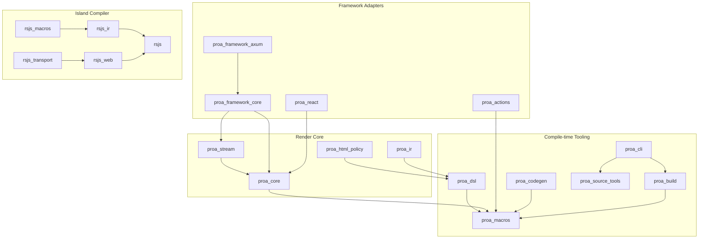
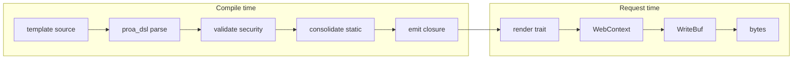
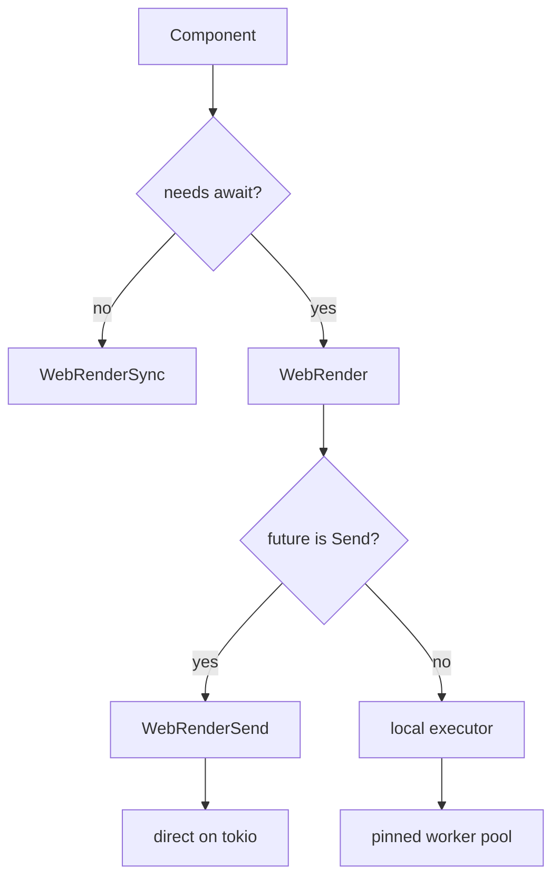

# 01 -- Architecture

Proa is a layered Rust workspace. The layers are: render core, compile-time tooling,
framework adapters, and the island compiler. The key architectural decision is where each half
runs. Template parsing, validation, and static consolidation run at compile time. Byte writing
runs at request time. This split is the whole point of the framework.

## The Crate Dependency Graph

The workspace has 41 members. They split into four layers. Here is the dependency graph,
simplified to the load-bearing edges.

The direction of every edge is "depends on." `proa_core` is the root. It depends on nothing
above it. `proa_html_policy` is a `no_std` leaf with no dependencies. Everything flows toward
`proa_core` at the bottom and the applications at the top.

## Layer 1: Render Core

This layer has four crates.

- `proa_core` holds the render traits, `WebContext`, the `WriteBuf` hierarchy, and the HTML and
  Markdown element types. It is the runtime that writes bytes.
- `proa_html_policy` holds one function: `has_dangerous_url_scheme`. It is `#![no_std]` and
  `#![forbid(unsafe_code)]`. Both the compile-time validator and the runtime attribute writer
  call it. It is a leaf so the same policy runs everywhere.
- `proa_ir` is the intermediate representation for reactive attributes and client glue. The
  macros emit references to it. It does not depend on `proa_core`.
- `proa_stream` provides the runtime for streaming renders. It depends on `proa_core`.

The interesting fact is that `proa_ir` and `proa_html_policy` do not depend on `proa_core`.
They are pure representations. This keeps them usable inside proc macros, which cannot link
against the full runtime.

## Layer 2: Compile-time Tooling

This layer parses and validates templates, then emits Rust code.

- `proa_dsl` owns the parser and the AST. It is a plain library, not a proc macro. Cargo forbids
  a normal library from importing types out of a proc-macro crate. So the shared parser lives in
  `proa_dsl`, and `proa_macros` re-exports from it.
- `proa_macros` owns the 21 proc macros. It emits `TokenStream`. It owns no parse logic.
- `proa_build`, `proa_source_tools`, and `proa_cli` drive builds and linting. Detail is in
  [15-build-tooling.md](./15-build-tooling.md) and [16-cli.md](./16-cli.md).

The separation of `proa_dsl` from `proa_macros` is deliberate. It lets `rsjs_macros` reuse the
same parser and `ConsolidationSink` walk with a different emitter. One grammar, many emitters.

## Layer 3: Framework Adapters

This layer turns render output into HTTP responses.

- `proa_framework_core` is runtime-agnostic. It defines `RouteSpec`, `RouteResponse`,
  `FrameworkResponse`, metadata, and bootstrap. It depends on `proa_stream` with default
  features off, and never on a server framework.
- `proa_framework_axum` is the axum and tokio adapter. It turns `FrameworkResponse` into an
  `axum::response::Response`. It adds routing, static serving, CSP, caching, and graceful
  shutdown.
- `proa_actions` defines action contracts and TypeScript codegen for events and forms.
- `proa_react` defines React/JSX island interop.

The key architectural decision here is portability. A route is described twice: once as the
adapter-free `RouteSpec`, once as the axum-bound `Route`. The metadata cascade is computed from
`RouteSpec` once, at router construction. The adapter materializes it. Detail is in
[12-framework-core.md](./12-framework-core.md) and [13-framework-axum.md](./13-framework-axum.md).

## Layer 4: Island Compiler

RSJS is the largest sibling. It compiles Rust into JavaScript for interactive islands.

- `rsjs_ir` is the island intermediate representation.
- `rsjs_macros` lowers Rust to `rsjs_ir` via the `#[rsjs]` macro.
- `rsjs` analyzes and plans the runtime program.
- `rsjs_web` and `rsjs_transport` produce the DOM markers and transport layer.

The island compiler is a full Rust-to-JavaScript pipeline. It is described in
[17-rsjs-overview.md](./17-rsjs-overview.md) through [20-rsjs-web-transport.md](./20-rsjs-web-transport.md).

## The Render Pipeline, Two Halves

The single most important flow is the render pipeline. It splits cleanly at the compile/run
boundary.

The left half runs once per compile. The right half runs once per request. A fully static
template emits a single byte literal in step D. The runtime then does one buffer write.

## Why Static Consolidation Is the Load-Bearing Idea

A normal template engine walks the template tree at runtime. Proa walks it at compile time.
Adjacent static text merges into one run. Escaping happens once, in the macro. The emitted
closure writes a pre-escaped static run with one `extend_static` call.

**Aha:** The compiler does not optimize the runtime; it deletes the runtime. A mostly-static
page has almost no dynamic path left. The only per-request work is writing the dynamic slots
and the pre-escaped static bytes around them. This is why the framework can claim to emit as
much HTML and as little JavaScript as possible, as fast as possible.

The consequence is visible in the buffer design. Because writes are append-only into fixed
pages, there is no tree to rebalance, no string to reallocate, no diff to compute. Detail is in
[04-write-buf.md](./04-write-buf.md).

## The Sync / Async / Send Split

Every render surface exists in three forms: sync, async, and send. Sync components implement
`WebRenderSync`. Async components implement `WebRender`, which returns `RenderOutcome`. Send
components implement `WebRenderSend` or `WebRenderSendSync`.

The `Send` distinction is structural, not a runtime flag. A `!Send` future can never be
upgraded to the direct path. The axum adapter polls `Send` streams on tokio and ships `Local`
streams to a pinned worker pool. Detail is in [02-render-traits.md](./02-render-traits.md) and
[13-framework-axum.md](./13-framework-axum.md).

## The Buffer Hierarchy Is the Performance Story

`WriteBuf` is a trait with many implementations. The default is `RenderBuffer`, a
`ChainedBumpWriter<4096>`. Each implementation trades allocation cost against flexibility.

| Buffer | Allocation | Use |
|--------|-----------|-----|
| `Vec<u8>` | heap, grows by realloc | simplest, small output |
| `WriteCursor` | zero, caller-owned stack | fixed small pages |
| `BumpWriter<N>` | zero, single fixed page | bounded single-page output |
| `ChainedBumpWriter<N>` | new page on overflow | the default `RenderBuffer` |
| `SmallBuf<N>` | inline, spill to heap | mixed small/large |
| `ZeroCopyBuf` | zero-copy static runs | pure-static output |
| `StreamingZeroCopyBuf` | flush on demand | streaming |

The hierarchy is the subject of [04-write-buf.md](./04-write-buf.md). The important idea here is
that the render traits are generic over `B: WriteBuf`. A component written once renders into
any buffer.

## Where Each Document Fits

The documents follow the dependency order. Documents 02 through 10 cover `proa_core`. Documents
07 and 08 cover the macros, which sit in `proa_dsl` and `proa_macros`. Documents 11 through 16
cover the framework and tooling. Documents 17 through 20 cover RSJS. Documents 21 through 24
cover fonts, docs, supporting crates, and applications. Document 25 traces the full request
path. Document 26 steps back for the synthesis.

Continue to [02-render-traits.md](./02-render-traits.md).
