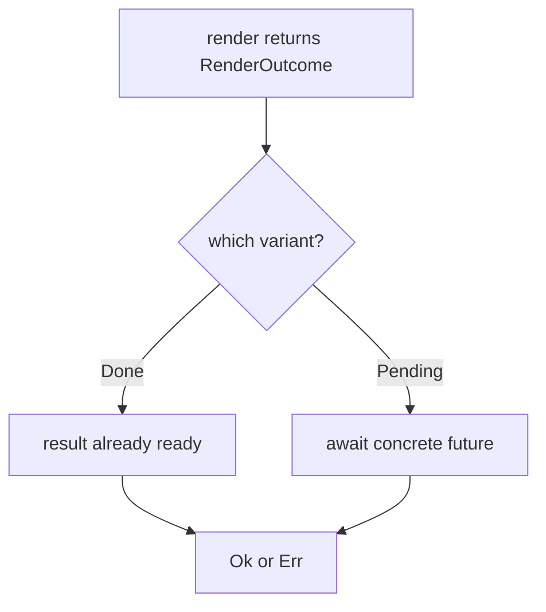
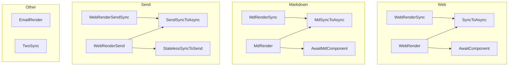

# 02 -- Render Traits

The render traits are the contract a component signs. There are three families: web (HTML),
Markdown, and send. Each family splits into sync and async. The sync trait is the zero-overhead
fast path. The async trait returns a `RenderOutcome` so sync completion never builds a future.

## The Web Family

The web family has two traits. They live in `proa_core/src/render/web_render.rs`.

```rust
// proa/proa_core/src/render/web_render.rs:92
pub trait WebRenderSync<L: DataLoader = NoLoader, B: WriteBuf = RenderBuffer> {
    fn render(self, cx: &mut WebContext<L, B>) -> Result<(), WriteError>;
}
```

`WebRenderSync` is generic first over the loader `L`, then over the buffer `B`. Both have
defaults. A simple component writes `WebRenderSync` and gets `NoLoader` and `RenderBuffer`.

```rust
// proa/proa_core/src/render/web_render.rs:130
pub trait WebRender<L: DataLoader = NoLoader, B: WriteBuf = RenderBuffer> {
    fn render(
        self,
        cx: &mut WebContext<L, B>,
    ) -> RenderOutcome<impl Future<Output = Result<(), WriteError>>>;
}
```

`WebRender` is the async-capable trait. Its return type uses RPITIT (return-position impl Trait
in trait). This makes the trait object-unsafe. The dyn-friendly erasure lives in a sibling
module, `dyn_web_render.rs`. It is described below.

Both traits carry a doc-hidden associated constant, `__PROA_RENDER_TRAIT_WITNESS`. The macro
uses it to prove an analyzed impl resolved to one of Proa's traits.

## RenderOutcome

`RenderOutcome` is the enum that lets sync and async share one return type.

```rust
// proa/proa_core/src/render/outcome.rs:25
pub enum RenderOutcome<F> {
    Done(Result<(), WriteError>),
    Pending(F),
}
```

`Done` means the render finished synchronously. No future was constructed. No allocation
happened. `Pending` wraps the future that must be awaited. The three constructors are `done_ok`,
`done_err`, and `pending`, all `const`. The async driver calls `resolve`:

```rust
// proa/proa_core/src/render/outcome.rs:53
pub async fn resolve(self) -> Result<(), WriteError> {
    match self {
        RenderOutcome::Done(r) => r,
        RenderOutcome::Pending(fut) => fut.await,
    }
}
```

The match is the whole point. Sync components hit the `Done` arm and never touch async
machinery. Async components hit `Pending` and await their concrete future.



## Crossing the Sync/Async Boundary

Two adapters cross the boundary in each direction. `SyncToAsync` lifts a sync component into the
async surface. `AwaitComponent` awaits a future and renders its result.

```rust
// proa/proa_core/src/render/web_render.rs:147
impl<T, L, B> WebRender<L, B> for SyncToAsync<T>
where
    T: WebRenderSync<L, B>,
    B: WriteBuf,
    L: DataLoader,
{
    fn render(
        self,
        cx: &mut WebContext<L, B>,
    ) -> RenderOutcome<impl Future<Output = Result<(), WriteError>>> {
        RenderOutcome::<std::future::Ready<Result<(), WriteError>>>::Done(self.0.render(cx))
    }
}
```

The free functions are the ergonomic form. They live in `proa_core/src/lib.rs`.

- `to_async(value) -> SyncToAsync<T>` at `lib.rs:313`.
- `to_send(value) -> SendSyncToAsync<T>` at `lib.rs:319`.
- `to_send_static(value) -> StatelessSyncToSend<T>` at `lib.rs:328`.
- `as_async(value)` is a doc-hidden alias for `to_async` at `lib.rs:334`.

The `Option<T>` impl renders the inner value when `Some`, and nothing when `None`. The unit type
`()` renders nothing. Both implement all three web traits. These are the composition building
blocks.

## The Markdown Family

Markdown mirrors the web split exactly. The traits live in `proa_core/src/render/md_render.rs`.

```rust
// proa/proa_core/src/render/md_render.rs:27
pub trait MdRenderSync<Loader: DataLoader = NoLoader, B: WriteBuf = RenderBuffer> {
    fn render_md(self, cx: &mut WebContext<Loader, B>) -> Result<(), WriteError>;
}

// proa/proa_core/src/render/md_render.rs:37
pub trait MdRender<Loader: DataLoader = NoLoader, B: WriteBuf = RenderBuffer> {
    fn render_md(
        self,
        cx: &mut WebContext<Loader, B>,
    ) -> RenderOutcome<impl Future<Output = Result<(), WriteError>>>;
}
```

The method is named `render_md`, and the adapters are `MdSyncToAsync` and `AwaitMdComponent`.
The `md_sync!` and `md!` macros interpolate through these traits. A card renders as a heading. A
badge renders as inline code. The mapping is described in
[08-md-macros.md](./08-md-macros.md).

The Markdown family also has doc-hidden dispatch traits, `MdRenderSyncExt` and
`MdRenderAsyncExt`. Their unique method names (`__proa_render_md_sync`, `__proa_render_md_async`)
prevent ambiguity when a caller imports both `MdRenderSync` and `MdRender`.

## The Send Family

The send family is the compiler-proved `Send` surface. A local component may use `Rc` and
request-local state. A send component proves its value and every pending continuation can move
across executor threads.

```rust
// proa/proa_core/src/render/send_web_render.rs:19
pub trait WebRenderSendSync<L: DataLoader = NoLoader, B: WriteBuf + Send = RenderBuffer>: Send {
    fn render_send_sync(self, cx: &mut SendWebContext<L, B>) -> Result<(), WriteError>;
}

// proa/proa_core/src/render/send_web_render.rs:26
pub trait WebRenderSend<L: DataLoader = NoLoader, B: WriteBuf + Send = RenderBuffer>: Send {
    fn render_send(
        self,
        cx: &mut SendWebContext<L, B>,
    ) -> RenderOutcome<impl Future<Output = Result<(), WriteError>> + Send>;
}
```

Three differences from the web family matter. The buffer bound is `WriteBuf + Send`. The context
is `SendWebContext`, which uses `Arc` instead of `Rc`. The returned future is `+ Send`.

The adapters are `SendSyncToAsync`, `StatelessSyncToSend`, and `AwaitSendComponent`.
`StatelessSyncToSend` wraps a context-independent legacy component. It renders into a stateless
temporary context and may only write output.

```rust
// proa/proa_core/src/render/send_web_render.rs:60
impl<T, L, B> WebRenderSendSync<L, B> for StatelessSyncToSend<T>
where
    T: for<'a> WebRenderSync<NoLoader, &'a mut B> + Send,
    B: WriteBuf + Send,
    L: DataLoader,
{
    fn render_send_sync(self, cx: &mut SendWebContext<L, B>) -> Result<(), WriteError> {
        cx.__proa_with_stateless_context(|local: &mut WebContext<NoLoader, &mut B>| {
            WebRenderSync::render(self.0, local)
        })
    }
}
```

The `Send` distinction is structural, not a runtime flag. The framework reads it off the type
and picks the executor path. A `!Send` stream ships to a pinned worker pool. A `Send` stream
polls directly on tokio.

## The Full Trait Map



The email trait is separate because email HTML has different rules: inline styles, table
layouts, no JavaScript.

```rust
// proa/proa_core/src/render/email_render.rs:13
pub trait EmailRender {
    fn render(self, cx: &mut EmailContext<'_>);
}
```

`TwoSync` is the sync composite that `html_sync!` emits for two-child composition.

```rust
// proa/proa_core/src/render/containers.rs:32
pub struct TwoSync<A, B> {
    pub first: A,
    pub second: B,
}
```

Its `WebRenderSync` impl calls each child's `render` directly. No enum, no future, no
allocation.

## Dyn Erasure

The RPITIT on `WebRender` makes the trait object-unsafe. The framework needs object safety at
erased boundaries, such as a route that stores `Box<dyn ...>`. So `dyn_web_render.rs` defines
explicit dyn traits and box types.

- `DynWebRenderSync` and `BoxedWebRenderSync` erase the sync surface.
- `DynRenderOutcome` is `Done` or `Pending(Pin<Box<dyn Future>>)`.
- `DynWebRender` and `BoxedWebRender` erase the async surface.
- `drive_dyn_render` drives a boxed async render.
- `DynWebRenderSend` and `DynSendRenderOutcome` erase the send surface.

The constructors are `boxed_render`, `boxed_sync_render`, `drive_dyn_render`, and
`drive_dyn_send_render`. They appear in the framework's `RoutePlan` enum. Detail is in
[12-framework-core.md](./12-framework-core.md).

## The Aha Moment

**Aha:** The sync fast path is preserved by type, not by an `if`. `WebRenderSync::render` returns
`Result<(), WriteError>` directly. It never constructs a `RenderOutcome`, a future, or a box.
The async `WebRender` returns `RenderOutcome`, so a sync component wrapped in `SyncToAsync`
returns `Done` and still never constructs a future. The match that chooses between `Done` and
`Pending` is exactly one branch. The cost of supporting async components is paid only by async
components.

The witness constants reinforce this. The macro needs to know whether a child is sync or async
at compile time. It cannot name the trait object, because the trait is dyn-incompatible. So it
reads the `__PROA_RENDER_TRAIT_WITNESS` associated constant, a zero-sized marker, to resolve the
trait identity without object dispatch.

## Where the Traits Are Used

The macros emit calls into these traits. The sync leaf is `WebRenderSync::render(#expr, cx)?`.
The async leaf is `render_child(cx, #expr).await?`. The send leaf is
`render_send_child(cx, #expr).await?`. Detail is in [07-html-macros.md](./07-html-macros.md).

The context the traits take is described next. Continue to
[03-web-context.md](./03-web-context.md).
