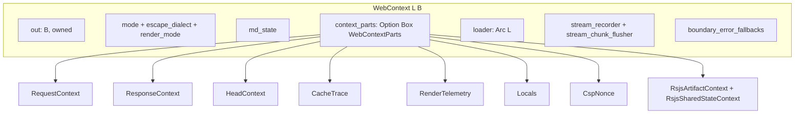
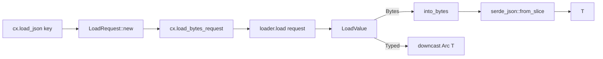

# 03 -- Web Context

`WebContext` is the request-scoped object every component renders into. It owns the output
buffer, the formatting mode, the request and response metadata, the data loader, and the
streaming hooks. It is a value you move, not an ambient global you thread. Two generics shape
it: the loader `L` and the buffer `B`.

## The Shape

`WebContext<L, B>` lives in `proa_core/src/web/context.rs`. The defaults are `NoLoader` and
`RenderBuffer`.

```rust
// proa/proa_core/src/web/context.rs:1958
pub struct WebContext<L: DataLoader = NoLoader, B: WriteBuf = RenderBuffer> {
    pub out: B,                                  // owned output
    mode: ContentMode,                           // Html, Script, Style
    escape_dialect: EscapeDialect,               // Html or Xml
    render_mode: RenderMode,                     // Static, ChunkedInOrder, ...
    pub(crate) md_state: crate::md::MdState,     // markdown line/heading state
    context_parts: Option<Box<WebContextParts>>, // side channels, boxed
    rsjs_artifact_transaction: OnceCell<Rc<RefCell<Option<Rc<RsjsArtifactTransaction>>>>>,
    rsjs_shared_state_transaction: Option<u64>,
    loader: Arc<L>,                              // request-scoped data loader
    stream_recorder: Option<Rc<dyn StreamBoundaryRecorder>>,
    stream_chunk_flusher: Option<Rc<dyn StreamChunkFlusher>>,
    boundary_error_fallbacks: Option<Rc<RefCell<BoundaryErrorFallbackStackEntries<L>>>>,
}
```

Four facts stand out. First, the output `out` is public and owned. A renderer borrows the
context, writes into `out`, and the caller recovers it with `into_output`. Second, the
formatting state (`mode`, `escape_dialect`, `md_state`) is stored inline. It changes as the
macro descends through a `<script>` or a Markdown fragment. Third, the side channels are boxed
as one `WebContextParts`. Fourth, the loader is an `Arc<L>`, so a future can outlive the borrow
and still call `load`.



## Construction

The standard constructor gives you a reusable buffer and no loader.

```rust
// proa/proa_core/src/web/context.rs:2225
impl WebContext<NoLoader, RenderBuffer> {
    pub fn new() -> Self {
        Self::with_buffer(RenderBuffer::new())
    }
}
```

`Default` is the same as `new`. The constructor family then fans out by buffer and loader:

- `with_buffer(out)` at `context.rs:2294` for a custom owned buffer.
- `with_stateless_buffer(out)` at `context.rs:2304` for transport formatting with no request
  state. It sets `context_parts` to `None`.
- `with_loader(loader)` at `context.rs:2263` for a request-scoped loader on the standard buffer.
- `with_loader_buffer(out, loader)` at `context.rs:2348` for both.
- `with_loader_buffer_and_context_parts(out, loader, parts)` at `context.rs:2357`, doc-hidden,
  for out-of-order Suspense to fork state without building a throwaway box.
- `set_loader_dyn` and `with_loader_dyn` at `context.rs:2330` and `:2335` install a
  type-erased `Arc<dyn DynDataLoader>` into a `DynLoaderHandle` context.

The stateless path matters for framing. A boundary id formatter only writes numbers. It does
not need request or response state, so it skips the boxed `WebContextParts` allocation.

## Output and Scoped Reborrow

The output accessors are one-liners: `output` (`context.rs:2388`), `output_mut` (`:2394`), and
`into_output` (`:2400`). The interesting method is `with_output` (`context.rs:2478`). It renders
through a temporary buffer of a different type while preserving every other field.

```rust
// proa/proa_core/src/web/context.rs:2478
pub fn with_output<C, R>(
    &mut self,
    out: C,
    render: impl FnOnce(&mut WebContext<L, C>) -> R,
) -> R
where C: WriteBuf,
{
    let parent = self.state_slots();
    with_scoped_web_output(parent, out, render)
}
```

`state_slots` splits the context into a mutable borrow of each non-output field. The scoped
child then takes `context_parts`, `stream_recorder`, and the other channels with `mem::take`.
On success, error, or panic, the `Drop` impl of `ScopedWebOutput` restores them. The parent
output is never moved; only the child points at the temporary type. This is how metered and
reservation-scoped buffers wrap a render without copying request state.

## The Side Channels: WebContextParts

`WebContextParts` (`context.rs:1270`) is the ~680-byte bundle of per-request state.

```rust
// proa/proa_core/src/web/context.rs:1270
pub struct WebContextParts {
    request: RequestContext,
    response: ResponseContext,
    head: HeadContext,
    cache_trace: CacheTrace,
    telemetry: RenderTelemetry,
    locals: Locals,
    csp_nonce: Option<CspNonce>,
    rsjs_artifacts: RsjsArtifactContext,
    rsjs_artifact_transaction: Option<Rc<RsjsArtifactTransaction>>,
    rsjs_shared_state: RsjsSharedStateContext,
}
```

It is boxed so the `WebContext` stays cheap to move. Each part has a `get`, a mutable `get`, a
`set`, and a builder `with_` accessor. `WebContext` mirrors them through `ensure_context_parts`.
The context delegates `request`, `response`, `head`, `cache_trace`, `telemetry`, and `locals`
to the box.

### RequestContext

`RequestContext` (`context.rs:50`) holds what the framework learned from the incoming request:
`method`, `location`, `route_params`, `headers`, `client_ip`, `original_pathname`, and
`base_path`. Every field is `Option`, so a unit test renders without faking an HTTP request.

```rust
// proa/proa_core/src/web/context.rs:84
pub fn url<'a>(&self, path: &'a str) -> super::AppUrl<'a> {
    self.base_path.url(path)
}
```

`url` composes a browser URL without allocating a string on the render path. `param` looks up a
route parameter. `cookie` parses the `Cookie` header by hand. `user_agent` reads the
`User-Agent` header. `base_path` is the mount prefix; incoming request paths stay unprefixed.

### ResponseContext

`ResponseContext` (`context.rs:232`) stages response metadata during render. It wraps a
`ResponseState` of `status`, `headers`, `streaming_started`, and `stream_flush_generation`. The
key rule is the streaming latch. `set_status`, `insert_header`, and `append_header` all return
`false` after streaming started. Once the response head ships, you cannot mutate it.

```rust
// proa/proa_core/src/web/context.rs:251
pub fn set_status(&mut self, status: StatusCode) -> bool {
    if self.state.streaming_started {
        return false;
    }
    self.state.status = Some(status);
    true
}
```

`stream_flush_generation` is a counter, not a flag. It advances every time
`flush_stream_chunk` ships bytes. Two reads that agree prove no markup left the process between
them. That proof gates rewinding rsjs shared-state seeds. The absolute value carries no meaning.

### HeadContext

`HeadContext` (`context.rs:347`) accumulates page-level head metadata. It holds an optional
`title` and a `Vec<HeadEntry>`. `HeadEntry` (`context.rs:333`) has three variants: `Meta`,
`Link`, and `RawHtml`. Methods are `set_title`, `push_meta`, `push_link`, and `push_raw_html`.
A component deep in the tree can push a `<link rel="preload">` and the finalizer renders it
once in the head.

### CacheTrace

`CacheTrace` (`context.rs:403`) records cache dependencies and dynamic-render reasons.
`depend_tag` and `depend_path` push `CacheDependency::{Tag, Path}`. `mark_dynamic` records why a
response could not be cached. `set_ttl` sets an explicit lifetime. A cache layer reads this
after render to build the response's invalidation keys.

### RenderTelemetry

`RenderTelemetry` (`context.rs:470`) is per-render observability. It stores a start `Instant`, an
optional request id, and a list of `TelemetryEvent { name, elapsed }`. `elapsed` returns time
since start. `record_event` pushes a named timestamp.

### Locals

`Locals` (`context.rs:517`) is typed request-local extension storage. It is a
`HashMap<TypeId, Arc<dyn Any + Send + Sync>>`. `insert` stores a value by its `TypeId`.
`get::<T>` downcasts and returns `Arc<T>`. A middleware can stash a database pool, and a deep
component can retrieve it without passing it through every layer.

## Formatting Modes

The macro sets the content mode when it descends into a raw-text element.

```rust
// proa/proa_core/src/web/context.rs:3851
pub fn current_mode(&self) -> ContentMode { self.mode }
```

The doc-hidden trio drives this. `__proa_enter_mode` swaps in a new mode and returns the
previous one. `__proa_restore_mode` puts it back. `html!` and `html_sync!` wrap the dynamic
children of `<script>` and `<style>` with these calls. That is how interpolated text inside a
script gets raw-text sentinel masking instead of plain HTML escaping. The escape dialect has the
same pattern: `__proa_enter_escape_dialect`, `__proa_restore_escape_dialect`, and
`__proa_current_escape_dialect` at `context.rs:3879` through `:3893`. The full escaping rules
are in [05-html-elements.md](./05-html-elements.md).

## Data Loading

`WebContext::load` is the component's door to request-scoped data. The family is thin: `load`
(`context.rs:2963`), `load_bytes` (`:2994`), `load_bytes_request` (`:2999`), `load_json`
(`:3004`), `load_json_with` (`:3012`), `load_json_request` (`:3021`), and `load_typed`
(`:3030`).

```rust
// proa/proa_core/src/web/context.rs:3004
pub async fn load_json<T>(&self, key: LoadKey) -> Result<T, LoadError>
where T: DeserializeOwned,
{
    self.load_json_request(LoadRequest::new(key)).await
}
```

Every method funnels through `load_bytes_request`, which calls `self.loader.load(&request)`.
`load_json` then runs `serde_json::from_slice`. `load_typed` returns an `Arc<T>` of an
already-materialized value. `load` and `load_json` are aliases. The deprecated `load_with` and
`load_request` remain for compatibility.



The `DataLoader` trait is the extension point.

```rust
// proa/proa_core/src/render/loader.rs:33
pub trait DataLoader: Send + Sync {
    fn load(&self, request: &LoadRequest)
        -> impl Future<Output = Result<LoadValue, LoadError>> + Send;
    // load_key and load_bytes provided
}
```

The return type is `impl Future + Send`, so a concrete loader call monomorphizes. No `Box::pin`
per call. The dyn boundary is separate. `DynDataLoader` (`loader.rs:56`) is object-safe and
auto-implemented for every `DataLoader`. `DynLoaderHandle` (`loader.rs:79`) is the concrete
type that dispatches through the erased boundary. `NoLoader` (`loader.rs:110`) is a zero-sized
sentinel whose `load` always fails with `LoadError::NoLoader`.

The value type is shape-agnostic.

```rust
// proa/proa_core/src/render/load_value.rs:17
pub enum LoadValue {
    Bytes(Bytes),
    Typed { value: Arc<dyn Any + Send + Sync>, type_name: &'static str },
}
```

`LoadValue::Typed` lets a loader cache an already-materialized Rust value. It skips serialize
plus deserialize on a hit. `into_bytes` and `downcast::<T>` convert to the shape the caller
asked for, or fail with `LoadError::TypeMismatch`.

`LoadKey` (`load_key.rs:17`) is pure identity. It has a `namespace` and a `LoadKeyKind`, either
`Named(String)` or `Hashed(u64)`. `LoadRequest` (`load_request.rs:14`) pairs a `LoadKey` with
optional `LoadHints`. Hints hold a `CacheHint` with an optional TTL and a `CacheMode`:
`UseLoaderDefault`, `Bypass`, `Refresh`, or `OnlyIfCached`. `LoadError` (`load_error.rs:8`) has
eight variants: `NetworkError`, `Timeout`, `Deserialize`, `Dropped`, `CacheMiss`,
`TypeMismatch`, `NoLoader`, and `Custom`.

`StandardDataLoader` (`standard_loader.rs:39`) is the ready-made cache. It wraps an upstream
loader with a `DashMap` keyed by `LoadKey`. Each entry has its own expiry from the request TTL
hint or the loader's `default_ttl`.

```rust
// proa/proa_core/src/render/standard_loader.rs:86
impl DataLoader for StandardDataLoader {
    fn load(&self, request: &LoadRequest)
        -> impl Future<Output = Result<LoadValue, LoadError>> + Send {
        // read cache unless Bypass or Refresh
        // return CacheMiss on OnlyIfCached
        // fetch upstream, then insert with expiry unless Bypass
    }
}
```

The cache is shape-agnostic. It stores `LoadValue`, not bytes. `invalidate` and `clear` provide
manual eviction. There is no in-flight dedupe here; request-local single-flight belongs to the
framework's `DataResolver`. The full data-loading story, including error boundaries, is
[09-data-loading.md](./09-data-loading.md).

## SendWebContext

`SendWebContext` (`web/send_context.rs:88`) is the compiler-proved `Send` variant. It exists so
a future can migrate between executor threads.

```rust
// proa/proa_core/src/web/send_context.rs:88
pub struct SendWebContext<L: DataLoader = NoLoader, B: WriteBuf + Send = RenderBuffer> {
    pub out: B,
    mode: ContentMode,
    escape_dialect: EscapeDialect,
    render_mode: RenderMode,
    parts: SendWebContextParts,
    loader: Arc<L>,
    stream_recorder: Option<Arc<dyn SendStreamBoundaryRecorder>>,
    stream_chunk_flusher: Option<Arc<dyn SendStreamChunkFlusher>>,
}
```

The differences from `WebContext` are structural. The buffer bound is `WriteBuf + Send`. The
stream hooks use `Send`-safe `Arc<dyn Send...>` traits. `SendWebContextParts`
(`send_context.rs:39`) replaces `Rc` with `Arc`: `request: Arc<RequestContext>`, and
`next_react_island_id: Arc<AtomicU64>` in place of a local allocator. There is no `RefCell` and
no `Rc`. `request_mut` uses `Arc::make_mut` for copy-on-write mutation. The type contains no
`!Send` field, so the compiler proves the whole context is `Send`. The render traits that take
this context are in [02-render-traits.md](./02-render-traits.md).

`SendWebContext` adds consumption helpers that `WebContext` lacks. `into_output_and_render_artifacts`
returns the buffer plus committed rsjs artifacts. `into_output_render_artifacts_and_response`
returns the buffer, artifacts, and `ResponseContext` for finalization without snapshot clones.

## The Aha Moment

**Aha:** The render context is a movable box, not an ambient global. `WebContext` owns
`Option<Box<WebContextParts>>`. Because that bundle is owned and boxed, two things become
trivial. A detached Suspense boundary takes the whole box and moves it into a child context
that lives across `.await`. And `with_output` uses `mem::take` to move the box into a temporary
child with a different output type, restoring it on drop even if the render panics. The context
is a value. Forking a render is moving a value, not copying a map.

The boxing is a deliberate performance choice. The box adds one allocation per ordinary context
and detached child, but it keeps the `WebContext` itself small and cheap to move. Nested
renders borrow `&mut WebContext` and never duplicate the state. The total state scales with
concurrently pending boundaries, not with render depth. Several channels go further and stay
cold: the rsjs transaction is a `OnceCell`, and the shared-state page and active stack are
`OnceCell`-backed. A request that never touches rsjs or shared state pays zero heap allocation
for those channels.

## Cross-References

- The traits that take this context: [02-render-traits.md](./02-render-traits.md).
- The buffer `out` writes into: [04-write-buf.md](./04-write-buf.md).
- The escaping rules for `mode` and `escape_dialect`: [05-html-elements.md](./05-html-elements.md).
- The full data-loading story: [09-data-loading.md](./09-data-loading.md).

Continue to [04-write-buf.md](./04-write-buf.md).
