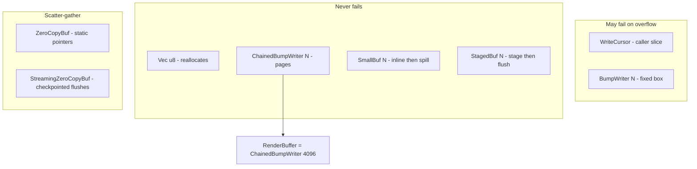

# 04 -- Write Buffer

The `WriteBuf` trait is the byte sink every component writes into. It has many implementations,
and each one trades allocation cost against flexibility. A component is generic over `B: WriteBuf`,
so the same renderer runs on any buffer. The buffer type, not the renderer, decides whether
overflow fails, chains, spills, or streams. This is the document's central idea.

## The Trait

`WriteBuf` lives in `proa_core/src/shared/write_buf.rs`. It is a small contract.

```rust
// proa/proa_core/src/shared/write_buf.rs:170
pub trait WriteBuf {
    fn capacity(&self) -> usize;
    fn len(&self) -> usize;
    fn is_empty(&self) -> bool { self.len() == 0 }
    fn remaining(&self) -> usize { self.capacity().saturating_sub(self.len()) }
    fn reserve(&mut self, _additional: usize) -> Result<(), WriteError> { Ok(()) }
    fn extend(&mut self, bytes: &[u8]) -> Result<(), WriteError>;
    fn push(&mut self, byte: u8) -> Result<(), WriteError> { self.extend(&[byte]) }
    fn extend_static(&mut self, bytes: &'static [u8]) -> Result<(), WriteError> {
        self.extend(bytes)
    }
    fn extend_shared(&mut self, bytes: &Bytes) -> Result<(), WriteError> {
        self.extend(bytes)
    }
    fn extend_with<F>(&mut self, max_len: usize, f: F) -> Result<(), WriteError>
    where F: FnOnce(&mut [u8]) -> usize, { /* 40-byte stack buffer */ }
    fn as_slice(&self) -> &[u8];
    fn to_vec(&self) -> Vec<u8>;
    fn clear(&mut self);
}
```

Three write hooks deserve attention. `extend` copies a borrowed slice. `extend_static` takes a
`&'static [u8]`; a scatter-gather buffer may store the pointer instead of copying. `extend_shared`
takes a refcounted `Bytes`; a scatter-gather buffer may bump the refcount instead of copying.
`extend_with` writes through a closure into spare capacity, with `max_len` capped at 40. The
default uses a 40-byte stack buffer; contiguous buffers override it to write in place.

`WriteBuf` is implemented for `&mut B` too. Every method forwards with `#[inline(always)]`, so a
metered writer can wrap a borrowed buffer and keep every optimized hook.

## WriteError

The error type is `WriteError` (`write_buf.rs:16`). It has ten variants.

```rust
// proa/proa_core/src/shared/write_buf.rs:16
pub enum WriteError {
    OutOfCapacity,
    OutputLimitExceeded { requested: u64, remaining: u64 },
    OutputReservationExceeded { requested: u64, reserved: u64, consumed: u64, remaining: u64 },
    OutputReservationIncomplete { reserved: u64, consumed: u64, remaining: u64 },
    InvalidAttribute(&'static str),
    InvalidCharForDialect,
    RawTextUnsupportedForDialect,
    Load(LoadError),
    StreamClosed,
    Render(std::borrow::Cow<'static, str>),
}
```

`OutOfCapacity` is the fixed-buffer failure. `OutputLimitExceeded` is the activation-wide budget
failure. `OutputReservationExceeded` and `OutputReservationIncomplete` are target-contract
violations from a reservation-scoped writer. `InvalidCharForDialect` and
`RawTextUnsupportedForDialect` come from escaping. `Load` wraps a data-load failure. `Render`
carries an interpreter failure. `From<LoadError>` converts a load failure into a write failure.

One method matters for error boundaries.

```rust
// proa/proa_core/src/shared/write_buf.rs:95
pub const fn is_boundary_catchable(&self) -> bool {
    matches!(
        self,
        Self::InvalidAttribute(_)
            | Self::InvalidCharForDialect
            | Self::RawTextUnsupportedForDialect
            | Self::Load(_)
            | Self::Render(_)
    )
}
```

`is_boundary_catchable` decides whether an `ErrorBoundary` may render fallback UI. Transport and
capacity failures are not catchable. If the sink closed or the caller's buffer is full, rendering
fallback HTML would likely fail too. The distinction is in [09-data-loading.md](./09-data-loading.md).

## Checkpoints

`CheckpointWriteBuf` (`write_buf.rs:256`) is the rewind primitive. It captures a `Checkpoint: Copy`
and restores the cursor with `rewind_to`, which returns `false` when the checkpoint is stale.

```rust
// proa/proa_core/src/shared/write_buf.rs:256
pub trait CheckpointWriteBuf: WriteBuf {
    type Checkpoint: Copy;
    fn checkpoint(&self) -> Self::Checkpoint;
    fn rewind_to(&mut self, checkpoint: Self::Checkpoint) -> bool;
}
```

For `Vec<u8>`, `WriteCursor`, and `BumpWriter`, the checkpoint is a plain `usize` length.
`ChainedBumpWriter` uses a `ChainedBumpCheckpoint { full_len, current_len }`. `SmallBuf` uses
`{ spilled, len }`. `ZeroCopyBuf` records part and owned lengths. The buffer does not know about
error boundaries; it only moves a cursor. `ErrorBoundary` builds on this in
[09-data-loading.md](./09-data-loading.md).

## The Implementations

The implementor list is the performance story. Here is the map.



Each implementation is described next, in source order.

### Vec<u8>

`Vec<u8>` (`write_buf.rs:357`) is the heap growable buffer. It never fails. `extend_with` reserves,
resizes to expose spare capacity, writes in place, then truncates. `checkpoint` is the length.
`rewind_to` truncates. It is the simplest correct answer, but the `RenderBuffer` doc comment calls
it "an easy wrong answer": it reallocates and copies as output grows, and `into_string` forces a
full UTF-8 revalidation.

### WriteCursor

`WriteCursor` (`write_buf.rs:469`) writes into a caller-provided `&mut [u8]`. It is a bump
allocator over a fixed slice. Every write bounds-checks once, then copies. Overflow returns
`OutOfCapacity`. It is zero-allocation and used for fixed small pages.

### BumpWriter<N>

`BumpWriter<N>` (`write_buf.rs:600`) is a fixed heap buffer of `Box<[u8; N]>`. The capacity is a
compile-time constant, so the bounds check compares against an immediate, not a memory load. Its
`extend` and `push` use `copy_nonoverlapping` under an `#[allow(unsafe_code)]`, the same pattern
as `Vec::extend_from_slice`. Overflow returns `OutOfCapacity`.

```rust
// proa/proa_core/src/shared/write_buf.rs:644
fn extend(&mut self, bytes: &[u8]) -> Result<(), WriteError> {
    let new_len = self.len + bytes.len();
    if new_len > N {
        return Err(WriteError::OutOfCapacity);
    }
    unsafe {
        core::ptr::copy_nonoverlapping(
            bytes.as_ptr(),
            self.buf.as_mut_ptr().add(self.len),
            bytes.len(),
        );
    }
    self.len = new_len;
    Ok(())
}
```

### ChainedBumpWriter<N> and RenderBuffer

`ChainedBumpWriter<N>` (`write_buf.rs:775`) is the default. It holds a `current: BumpWriter<N>`,
a `full: Vec<BumpWriter<N>>` of completed pages, and a `spare: Vec<BumpWriter<N>>` of recycled
pages. When `current` fills, `rotate` parks it in `full` and takes a cleared spare page. The fast
`extend` path is a single bounds check plus `copy_nonoverlapping`. The `extend_slow` and
`push_slow` paths are `#[cold]` and `#[inline(never)]` to keep the hot path small.

```rust
// proa/proa_core/src/shared/write_buf.rs:775
pub struct ChainedBumpWriter<const N: usize> {
    full: Vec<BumpWriter<N>>,
    spare: Vec<BumpWriter<N>>,
    current: BumpWriter<N>,
}
```

Two constants define the standard type.

```rust
// proa/proa_core/src/shared/write_buf.rs:734
pub const DEFAULT_CHAINED_BUMP_PAGE_SIZE: usize = 4096;
pub type RenderBuffer = ChainedBumpWriter<DEFAULT_CHAINED_BUMP_PAGE_SIZE>;
```

`RenderBuffer` is the reusable standard buffer. `clear` moves full pages into `spare`, so
steady-state rendering reuses pages instead of reallocating. `page_count` returns full plus one.
`slices` yields each written page for scatter-gather I/O. `into_pages` consumes the pages into a
`Bytes` iterator, dropping empty and spare pages. `render_into` renders a component into a
reusable context.

The ownership boundary is where the win shows. `into_vec` and `into_string` special-case the
single-page path.

```rust
// proa/proa_core/src/shared/write_buf.rs:916
pub fn into_vec(self) -> Vec<u8> {
    if self.full.is_empty() {
        let len = self.current.len;
        let ptr = Box::into_raw(self.current.buf) as *mut u8;
        unsafe { Vec::from_raw_parts(ptr, len, N) }
    } else {
        self.to_vec()
    }
}
```

When everything fit in one page, the page allocation becomes the `Vec` allocation directly. No
copy. `into_string` does the same, then `String::from_utf8_unchecked` under a debug assertion that
the bytes are valid UTF-8. Multi-page output flattens once.

### SizeHint

`SizeHint` (`write_buf.rs:1139`) learns the output size across renders. It stores an exponential
moving average in an `AtomicUsize`, so it is `Send + Sync` and can live in a `static`.

```rust
// proa/proa_core/src/shared/write_buf.rs:1157
pub fn get(&self) -> usize {
    let v = self.value.load(core::sync::atomic::Ordering::Acquire);
    v + v / 8 + 128
}
```

`get` returns the average plus 12.5% headroom plus 128 bytes. `update` mixes the new size in with
weight one quarter, so it converges quickly without over-reacting to one outlier. Pairing a
`SizeHint` with a `Vec::with_capacity` eliminates reallocation after the first render. This is a
separate concern from the buffer itself, which is why it lives beside it rather than inside it.

### SmallBuf<N>

`SmallBuf<N>` (`write_buf.rs:1216`) is a small-buffer optimization. It stores the first `N` bytes
inline on the stack. When output exceeds `N`, `spill` moves the data into a `Vec` sized to at
least `N * 2`. It is the `SmallVec` pattern applied to `WriteBuf`. The checkpoint records both
whether it spilled and the length, so rewind can un-spill back into inline storage.

### StagedBuf<N>

`StagedBuf<N>` (`write_buf.rs:1442`) batches small writes. It writes into an inline stage and
flushes the stage to a `Vec` only when full. The idea is that a bump write into a stack slice is
cheaper per call than `Vec::extend_from_slice`, so batching amortizes the Vec overhead away.
`finish` flushes the stage and returns the output. Large writes that exceed the stage go straight
to the Vec.

### ZeroCopyBuf

`ZeroCopyBuf` (`write_buf.rs:1610`) is the scatter-gather buffer. It keeps an ordered `parts:
Vec<Part>` and a single `owned: Vec<u8>`.

```rust
// proa/proa_core/src/shared/write_buf.rs:1592
pub enum Part {
    Static(&'static [u8]),
    Owned { start: u32, len: u32 },
}
```

`extend_static` stores a `Part::Static` pointer with no copy. `extend` appends to `owned` and
records a `Part::Owned` range, coalescing with an adjacent owned part. Small static slices of 256
bytes or fewer are inlined into `owned` to avoid part-count explosion. The macro emits static HTML
runs as `static BYTES: &[u8]`, so roughly 78% of output bytes become zero-copy pointer stores.
Only dynamic attribute values and escaped text copy. `flatten_into` assembles the parts into a
reused destination without allocating.

### StreamingZeroCopyBuf

`StreamingZeroCopyBuf` (`write_buf.rs:1889`) is the streaming variant. It keeps a mutable
`BytesMut` current segment plus a list of sealed `StreamingChunkPart`. A part is either
`Static(&'static [u8])` or `Owned(Bytes)`.

```rust
// proa/proa_core/src/shared/write_buf.rs:1965
pub fn mark(&mut self) -> FlushMark {
    self.seal_current();
    FlushMark {
        part_index: self.part_offset + self.parts.len(),
        total_len: self.byte_offset + self.total_len,
    }
}
```

`mark` seals the current segment and returns an absolute `FlushMark`. `flush_through(mark)` drains
everything up to the mark into a `StreamingChunk`, keeping the suffix live. `flush_all` drains
everything. `freeze` consumes the builder into one final chunk. Flushes always happen between
parts, never mid-part. `StreamingChunk` exposes `slices` for vectored I/O and `into_frames` for
transports that want `Bytes`. This is the buffer behind out-of-order streaming in
[10-streaming.md](./10-streaming.md).

### render_growable

`render_growable` (`write_buf.rs:2135`) is a page-speed helper. It renders a `Clone` component
into a `Vec` with `initial_capacity.max(4096)` bytes, and panics if output exceeds 1 GiB. It is
the one-shot convenience path; servers should use a reusable `RenderBuffer` instead.

## The Aha Moment

**Aha:** The buffer type is the failure policy. A component implements one trait, generic over
`B: WriteBuf`. Render it into a `WriteCursor` and overflow returns `OutOfCapacity`. Render it into
a `Vec<u8>` and overflow reallocates silently. Render it into a `RenderBuffer` and overflow chains
a new page with no copy and no failure. Render it into a metered buffer and overflow trips a
budget. The renderer code is byte-for-byte identical in every case. The buffer you hand in chooses
the cost model.

This is why the framework names `RenderBuffer` the obvious name. Reaching for `Vec::new()` should
be a deliberate choice, not the path of least resistance. `Vec` reallocates and copies as the
document grows. `RenderBuffer` bumps into fixed pages, never copies what it already wrote, and
recycles pages across requests.

A second consequence sits in `into_vec` and `into_string`. Because the common case is a single
page, the single-page path transfers the page allocation into the returned `Vec` or `String` with
`Vec::from_raw_parts`. Zero copy at the ownership boundary. The design pays the flatten cost only
when output actually spans pages.

## Cross-References

- The context that owns a `B: WriteBuf` as `out`: [03-web-context.md](./03-web-context.md).
- The macros that emit `extend_static` runs: [07-html-macros.md](./07-html-macros.md).
- The streaming machinery that uses `StreamingZeroCopyBuf`: [10-streaming.md](./10-streaming.md).
- The numeric formatters that write through `extend_with`: [23-supporting-crates.md](./23-supporting-crates.md).

Continue to [05-html-elements.md](./05-html-elements.md).
