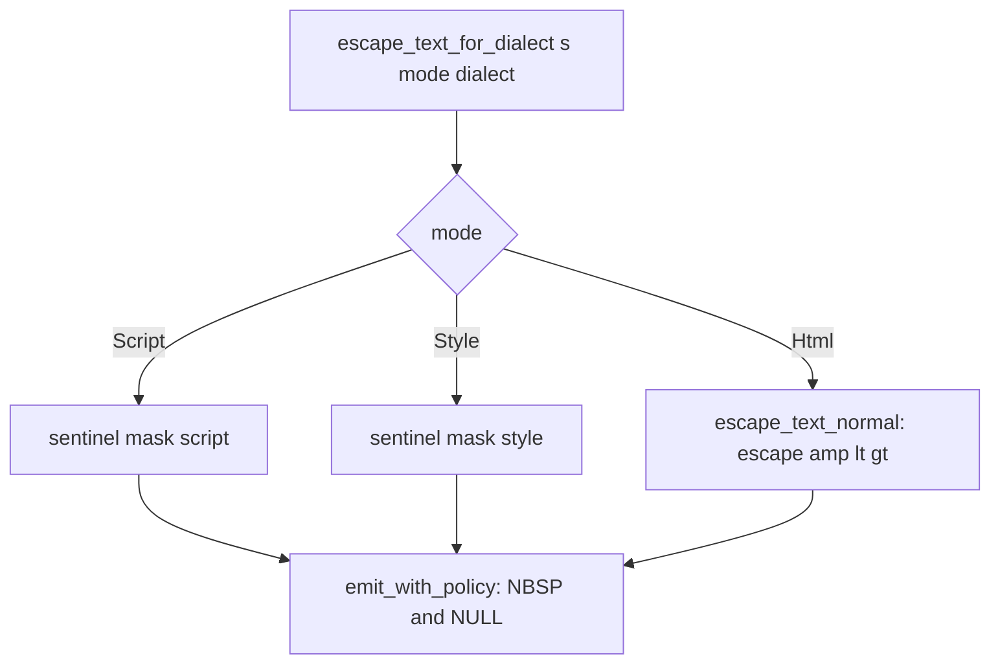

# 05 -- HTML Elements and Escaping

The element layer turns a tag, a set of attributes, and a child closure into bytes. It is the
first layer above the buffer that knows HTML. The key idea is that escaping is a policy, not a
list of `replace` calls. One sealed policy decides HTML versus XML, text versus attribute, and
raw-text sentinel masking.

## The Tag Table

`Tag` (`proa_core/src/shared/tag.rs`) is an enum of about 130 HTML, SVG, and Web Component
elements. It exposes three facts per variant: `as_str`, `is_void`, and `mode`.

```rust
// proa/proa_core/src/shared/tag.rs:353
pub fn is_void(self) -> bool {
    matches!(
        self,
        Tag::Area | Tag::Base | Tag::Br | Tag::Col | Tag::Embed | Tag::Hr
            | Tag::Img | Tag::Input | Tag::Link | Tag::Meta | Tag::Param
            | Tag::Source | Tag::Track | Tag::Wbr
            // SVG void elements
            | Tag::Path | Tag::Circle | Tag::Rect | Tag::Line | Tag::Ellipse
            | Tag::Polyline | Tag::Polygon | Tag::Stop | Tag::Use | Tag::Image
            | Tag::Animate | Tag::AnimateMotion | Tag::AnimateTransform | Tag::Set
    )
}
```

`is_void` distinguishes self-closing elements. `mode` returns `ContentMode::Script` for `Tag::Script`,
`ContentMode::Style` for `Tag::Style`, and `ContentMode::Html` otherwise. The `Elem` renderer uses
this to switch escaping when it descends into a script or style child.

The byte strings are precomputed at compile time by a macro. `open_bytes` returns `b"<tag"` and
`close_bytes` returns `b"</tag>"`, both baked into the read-only section. `AttrKey` does the same
with `attr_open_bytes` (`b" name=\""`) and `attr_bare_bytes` (`b" name"`). Because they are
`&'static [u8]`, they flow into `extend_static` and become zero-copy `Part::Static` entries on
`ZeroCopyBuf`. The buffer connection is in [04-write-buf.md](./04-write-buf.md).

## Elem: Normal and Void

`Elem` (`proa_core/src/shared/elem.rs`) wraps a tag, an inline attribute list, and a child
closure. It is generic over a `Kind` marker, `Normal` or `Void`.

```rust
// proa/proa_core/src/shared/elem.rs:30
pub struct Elem<'a, Kind, const N: usize, B: WriteBuf, F, L: DataLoader = NoLoader>
where
    F: FnOnce(&mut WebContext<L, B>) -> Result<(), WriteError>,
{
    tag: Tag,
    attrs: InlineVec<Attr<'a>, N>,
    child: F,
    _kind: PhantomData<Kind>,
    _buf: PhantomData<fn(B)>,
    _loader: PhantomData<fn(L)>,
}
```

Attributes use `heapless::Vec`, an inline buffer, so a small element carries no heap allocation.
The constructors are `el` for normal elements and `void` for void elements. Each `debug_assert`s
that the tag kind matches. A normal element renders open tag, child, close tag. A void element
renders only the open tag.

`write_element_open` does more than emit bytes. It enforces one security rule automatically.

```rust
// proa/proa_core/src/shared/elem.rs:126
pub(crate) fn write_element_open<B: WriteBuf, L: DataLoader>(
    cx: &mut WebContext<L, B>,
    tag: Tag,
    attrs: &[Attr<'_>],
) -> Result<(), WriteError> {
    // ... detect target="_blank" and an existing rel ...
    // ... if an anchor has target="_blank" without noopener, merge rel ...
}
```

If an `<a>` has `target="_blank"` and no `rel` containing `noopener`, the renderer appends
`rel="noopener noreferrer"`. If a `rel` exists, it appends the two tokens to it. This closes the
reverse-tabnabbing hole without the author remembering to. The fix is baked into the element
layer, not the macro or the author.

## Attributes

`Attr` (`proa_core/src/shared/attr.rs:796`) has three shapes.

```rust
// proa/proa_core/src/shared/attr.rs:796
pub enum Attr<'a> {
    Str { k: AttrKey, v: &'a str },
    Bool { k: AttrKey, present: bool },
    Data { name: &'a str, v: &'a str },
}
```

`Str` is a normal name and value. `Bool` renders a bare attribute only when `present` is true.
`Data` is a `data-*` attribute with a free-form name. `validate` checks that a `Data` name starts
with `data-`, has at least one character after it, and contains no ASCII uppercase.

`write_attr` routes each shape. For `Str`, it first checks the URL policy. If the key
`is_url_attr()` and `has_dangerous_url_scheme(v)` is true, it emits an empty attribute and a
debug assertion fires. Otherwise it emits the name, escapes the value, and closes the quote.

```rust
// proa/proa_core/src/shared/attr.rs:547
pub fn is_url_attr(self) -> bool {
    matches!(
        self,
        AttrKey::Href | AttrKey::Src | AttrKey::Action | AttrKey::Formaction
            | AttrKey::Poster | AttrKey::Ping | AttrKey::Cite | AttrKey::ObjectData
            | AttrKey::Background | AttrKey::Longdesc | AttrKey::Manifest
    )
}
```

The list is broader than the obvious four. `poster`, `ping`, `cite`, `data` on `<object>`, and
the legacy `background`, `longdesc`, and `manifest` all accept URLs and can execute script or
leak data on navigation. The comment references CVE-2026-32635, the Angular `i18n-href` bypass,
as the reason one missing attribute is a complete XSS hole. The check itself lives in the
`proa_html_policy` crate, re-exported here, so the compile-time validator and the runtime writer
share one implementation. The policy crate is [23-supporting-crates.md](./23-supporting-crates.md).

`AttrKey` has about 180 variants: global attributes, ARIA, microdata, form, media, table, SVG,
and Web Component attributes. Each has `as_str`, `attr_open_bytes`, and `attr_bare_bytes`. The
byte forms are compile-time constants.

## Text and Raw Nodes

Text nodes live in `proa_core/src/shared/text.rs`. They come in four flavors, ordered from
safest to least safe.

```rust
// proa/proa_core/src/shared/text.rs:12
pub struct Text<'a>(pub &'a str);       // escaped
pub struct SafeText<'a>(pub &'a str);   // pre-verified, not escaped
pub struct StaticRaw(pub &'static str); // static raw, zero-copy
pub struct UnsafeRaw<'a>(pub &'a str);  // raw, bypasses escaping
```

`Text` and the `&str` and `String` impls run the value through `escape_text_for_dialect`.
`SafeText` writes bytes directly on the promise that they contain none of `<`, `>`, `&`, `"`,
`'`. `StaticRaw` writes a `&'static str` through `extend_static`, so it is zero-copy on
scatter-gather buffers. `UnsafeRaw` writes bytes directly with no escaping; its doc comment is a
security warning pointing at the OWASP XSS Prevention Cheat Sheet.

The `safe_text!` macro verifies a literal at compile time.

```rust
// proa/proa_core/src/shared/text.rs:469
macro_rules! safe_text {
    ($s:literal) => {{
        const _: () = {
            const fn check_safe(s: &str) -> bool { /* scan for < > & " ' */ }
            assert!(check_safe($s), "safe_text! string contains characters that need escaping");
        };
        $crate::SafeText($s)
    }};
}
```

`SafeText::from_trusted` is the dynamic counterpart, and it is a `const fn`. The trust is manual
and documented. Several suppression helpers, `perf_ok`, `style_ok`, `raw_text_ok`, and
`foreign_content_ok`, are identity functions that the macro's lints recognize to silence a
specific warning for a reviewed value.

The macro-emitted wrappers also live here. `StaticHtml` is the smallest output for a fully static
tree: one byte slice plus one `extend_static`. `OptimizedHtml` and `AsyncHtml` wrap sync and async
closures, and `SendAsyncHtml` wraps the send-capable async closure. `ConstHtml` holds a function
pointer for compile-time generation. These are the shapes the `html!` family emits; the lowering
is in [07-html-macros.md](./07-html-macros.md).

## The Escape Engine

Escaping lives in `proa_core/src/shared/escape.rs`. It is driven by a sealed policy trait.

```rust
// proa/proa_core/src/shared/escape/policy.rs
pub trait EscapePolicy: sealed::Sealed {
    const ESCAPE_NBSP: bool;
    const NULL_BYTE: NullBytePolicy;
    const HAS_RAW_TEXT_ELEMENTS: bool;
}
```

`HtmlPolicy` escapes NBSP to `&nbsp;`, replaces NULL with U+FFFD, and supports raw-text elements.
`XmlPolicy` leaves NBSP as UTF-8, rejects NULL with `InvalidCharForDialect`, and rejects
script/style content modes. The trait is sealed because escape rules are a security boundary.
New dialects must be added in-tree and reviewed.

The public entry points split by content and context. `escape_text_for_dialect` handles text.
`escape_attr_value_for_dialect` handles attribute values. Each dispatches on `EscapeDialect`.



The core loop uses `memchr3(b'&', b'<', b'>', rest)` to skip runs that need no escaping in one
scan. Text mode escapes `&`, `<`, `>` to `&amp;`, `&lt;`, `&gt;`. Attribute mode additionally
escapes `"` to `&quot;` and `'` to `&#39;`. The `emit_with_policy` helper scans for NULL and NBSP
and applies the dialect rule, so normal runs still get NBSP and NULL handling.

### Raw-Text Sentinel Masking

The interesting path is `ContentMode::Script` and `ContentMode::Style`. These mask three byte
sequences that could flip the HTML tokenizer out of raw-text state. The comment ties them to the
Go `html/template` CVE series, CVE-2023-24538, CVE-2023-39318, and CVE-2023-39319.

```rust
// proa/proa_core/src/shared/escape.rs:393
fn escape_text_with_sentinel_inner<S, P>(buf: &mut S, s: &str, tag: &[u8])
    -> Result<(), WriteError>
{
    // ...
    if bytes[i] == b'<' {
        if starts_with_close_tag(&bytes[i..], tag) {
            // `</tag` + end char -> `<\/tag`
        }
        if starts_with_open_tag(&bytes[i..], tag) {
            // `<tag` + end char -> `<\tag`
        }
        if bytes[i..].starts_with(b"<!--") {
            // `<!--` -> `<\!--`
        }
    }
    // regular `&`, `<`, `>` escapes
}
```

Three masks. `</script` followed by a tag-end character becomes `<\/script`. `<script` followed by
a tag-end character becomes `<\script`. `<!--` becomes `<\!--`. Each inserts a single backslash.
In a JavaScript string literal, `\x` where `x` is not a recognized escape decodes to `x`, so the
string value is unchanged.

`starts_with_close_tag` and `starts_with_open_tag` recognize the full set of HTML5 end-tag
delimiters: space, tab, newline, carriage return, form feed, slash, and greater-than. Missing one
would leave a bypass. The tests inject `</script `, `</SCRIPT>`, and `<script src=x>` explicitly
because random proptest strings almost never produce them.

## The Aha Moment

**Aha:** The fourth sentinel needs no mask. A naive reader expects four masks: close tag, open
tag, comment start, and comment end. Proa masks only three. The comment end `-->` can never appear
in output because every bare `>` is already escaped to `&gt;`. The byte sequence `-->` cannot form
after that rewrite, and `-->` only matters once `<!--` has already entered the escaped state,
which is also masked. One ordinary escape removes the need for a whole fourth mask.

This is the shape of a good security design. Instead of enumerating every dangerous sequence and
masking each one, the engine finds the single rewrite that makes the rest unreachable. The result
is a smaller, provable surface. The tests assert all four transitions appear only in masked form,
and a biased generator ensures the mask paths are exercised.

The backslash mask is safe because of a JavaScript rule. In a string literal, `\x` for an
unrecognized escape is just `x`. The sentinel never changes decoded value. Outside a string, the
macro already warns about interpolation inside `<script>`, so the author is steered away from
that path entirely.

## Cross-References

- The buffer that receives the escaped bytes: [04-write-buf.md](./04-write-buf.md).
- The macros that drive `mode` switching and emit `extend_static`: [07-html-macros.md](./07-html-macros.md).
- The URL policy crate shared with the compiler: [23-supporting-crates.md](./23-supporting-crates.md).
- The `ClassList` and variant types that build on `Attr`: [06-classlist-recipes.md](./06-classlist-recipes.md).

Continue to [06-classlist-recipes.md](./06-classlist-recipes.md).
