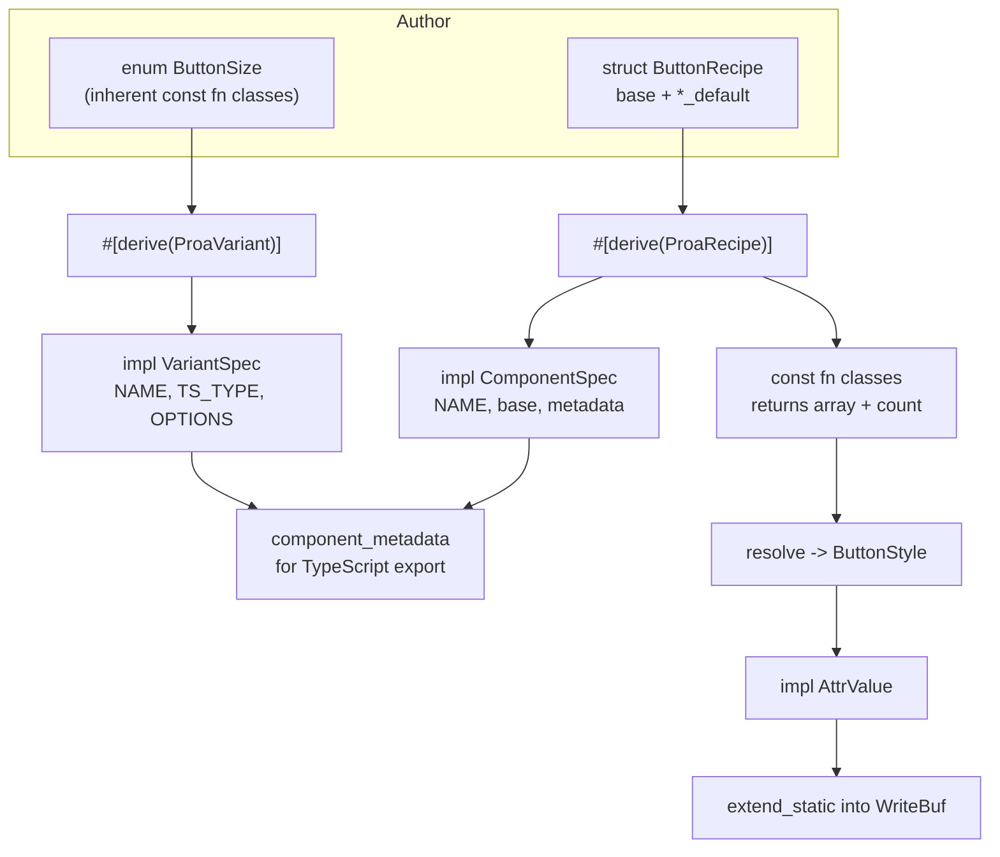

# 06 -- Class Lists and Recipes

Component styling in Proa is a compile-time string-assembly problem. The recipe system is the
source of class strings. `ClassList` is the zero-allocation sink. They meet in the `AttrValue`
trait, which streams static class fragments straight into the output buffer. No intermediate
`String` is ever built.

## ClassList

`ClassList<const N: usize>` (`proa_core/src/shared/class_list.rs:34`) is a fixed array of static
class strings plus a count. It is not a growable builder.

```rust
// proa/proa_core/src/shared/class_list.rs:34
#[derive(Clone, Copy)]
pub struct ClassList<const N: usize> {
    classes: [&'static str; N],
    count: usize,
}
```

`N` is the capacity, fixed at compile time. Every method except `add_opt` is a `const fn`, so a
known combination can be built in a `const` or `static` context. `add` pushes a class and asserts
`count < N` at compile time when called const. `add_non_empty` skips empty strings. `add_if`
adds only when a compile-time condition holds. `add_opt` is the lone runtime method; it accepts
`Option<&'static str>` for a user class the author could not know ahead of time.

The render path is a plain loop.

```rust
// proa/proa_core/src/shared/class_list.rs:118
impl<L: DataLoader, B: WriteBuf, const N: usize> WebRenderSync<L, B> for ClassList<N> {
    #[inline(always)]
    fn render(self, cx: &mut WebContext<L, B>) -> Result<(), WriteError> {
        for (i, class) in self.classes[..self.count].iter().enumerate() {
            if i > 0 {
                cx.out.extend(b" ")?;
            }
            cx.out.extend(class.as_bytes())?;
        }
        Ok(())
    }
}
```

It writes each class with a single space between segments. Because the segments are already
`&'static str`, this is a copy of fixed bytes, not a concatenation. Implementing `WebRenderSync`
means a `ClassList` can be used directly as a dynamic slot in `html!`, and the `class` attribute
writes it through `AttrValue` as described below.

## The Variant Trait

The `Variant` trait (`proa_core/src/shared/variant.rs:37`) is the smallest contract a style enum
can implement.

```rust
// proa/proa_core/src/shared/variant.rs:37
pub trait Variant: Copy + Default {
    fn classes(self) -> &'static str;
}
```

`Copy + Default` keeps variants cheap and gives every enum a fallback value. `classes` maps a
variant to its Tailwind string. A variant that contributes no classes of its own, like a `Solid`
choice that leans on a color instead, returns an empty string.

## ProaVariant

`#[derive(ProaVariant)]` (`proa_macros/src/variant_derive.rs`) turns a unit enum into a
self-describing variant axis. It requires exactly one `#[default]` variant and only unit
variants. The attribute sets the axis name and the metadata module path.

```rust
// proa_cli/src/site_scaffold/templates/origin/src/components/button/recipe.rs:115
#[derive(Debug, Clone, Copy, PartialEq, Eq, Hash, Default, proa_macros::ProaVariant)]
#[variant(name = "size", path = "crate::components::_proa::variant_spec")]
pub enum ButtonSize {
    Sm,
    #[default]
    Md,
    Lg,
}
```

The derive emits a `VariantSpec` impl. The generated body is instructive.

```rust
// proa/proa_macros/src/variant_derive.rs:87
let expanded = quote! {
    impl #variant_path::VariantSpec for #enum_name {
        const NAME: &'static str = #variant_name;
        const TS_TYPE: &'static str = #ts_type;
        const OPTIONS: &'static [#variant_path::VariantOption<Self>] = &[
            #(#options_init),*
        ];

        fn classes(self) -> &'static str {
            #enum_name::classes(self)
        }
    }
};
```

Three facts come from the enum. `NAME` is the axis name from `#[variant(name = ...)]`. `TS_TYPE`
is the Rust enum name, reused as the TypeScript enum name. `OPTIONS` is a `'static` array of
`VariantOption { variant, label, value, classes }`, one entry per variant. `value` is the
identifier kebab-cased, `label` is the identifier as written, unless a `#[variant(label = ...)]`
or `#[variant(value = ...)]` override sits on the variant.

The `classes` method is the subtle part. It uses UFCS, `#enum_name::classes(self)`, to call the
author's inherent method, not the trait method. This matters because of a Rust limitation.
Stable Rust cannot have `const fn` in a trait. The recipe system needs compile-time class
resolution, so every variant enum declares its own `pub const fn classes(self)`. The derive
wraps that inherent method behind the trait, rather than asking the trait to be const.

## ProaRecipe

`#[derive(ProaRecipe)]` (`proa_macros/src/const_recipe.rs`, registered as `ProaRecipe` in
`proa_macros/src/lib.rs:512`) turns a struct of defaults into a const class resolver. It requires
one `base: &str` field and one or more `*_default: Option<T>` fields. Each `*_default` field
names an axis, and the `Option` inner type is the variant enum.

```rust
// proa/proa_macros/src/const_recipe.rs:186
let expanded = quote! {
    impl #struct_name {
        pub const CLASS_CAPACITY: usize = #class_capacity;

        pub const fn classes(
            &self,
            #(#classes_params),*
        ) -> ([&str; Self::CLASS_CAPACITY], usize) {
            let mut result = [""; Self::CLASS_CAPACITY];
            let mut idx = 0;

            if !self.base.is_empty() {
                result[idx] = self.base;
                idx += 1;
            }

            #(#classes_body_parts)*

            (result, idx)
        }
    }

    impl crate::variant_spec::ComponentSpec for #struct_name {
        const NAME: &'static str = #component_name;
        fn base_classes(&self) -> &'static str { self.base }
        fn variant_metadata(&self) -> Vec<...VariantMetadata> {
            vec![ #(#variant_metadata_calls),* ]
        }
    }
};
```

The struct name trims its `Recipe` suffix to get the component name, so `ButtonRecipe` yields
`NAME = "Button"`. `CLASS_CAPACITY` is one plus the number of axes. `classes` takes each axis as
an `Option`, falls back to the struct default, and fills the fixed array in order. The return type
is a fixed array plus a count, never a `String`, so the compiler can evaluate known combinations
at compile time.

The generated `classes()` is `const fn`. This is the promise the recipe system builds on: for a
known `ButtonSize::Md`, the compiler folds the match and the class array into the binary. The
runtime then only streams the resulting static slices.

## The Metadata Layer

`ProaVariant` and `ProaRecipe` both emit into the per-site `variant_spec` module
(`proa_cli/src/site_scaffold/templates/origin/src/components/_proa/variant_spec.rs`). This module
is the single source of truth that feeds TypeScript generation. It defines the self-describing
traits the derives target.

```rust
// proa_cli/src/site_scaffold/templates/origin/src/components/_proa/variant_spec.rs:27
pub trait VariantSpec: Copy + Default + 'static {
    const NAME: &'static str;
    const TS_TYPE: &'static str;
    const OPTIONS: &'static [VariantOption<Self>];
    fn classes(self) -> &'static str;
    fn metadata_option(self) -> &'static VariantOption<Self> {
        Self::OPTIONS
            .iter()
            .find(|opt| opt.classes == self.classes())
            .expect("variant not found in OPTIONS")
    }
}
```

`metadata_option` locates an option by comparing class strings, not by `PartialEq`. The trait
cannot require `PartialEq` and stay broadly applicable, so the class string is the identity.
`variant_metadata` builds a `VariantMetadata` for an axis, using `T::default()` as the default.
`compound_axis_metadata` produces the same shape with empty per-option classes, used when an
axis's appearance depends on another axis.

The compound rule is the interesting case. `ButtonColor` and `ButtonVariant` interact. A solid
primary button is `bg-primary text-primary-foreground`, but an outline primary button is
`border-primary text-primary`. The color cannot be a fixed string. So the color axis exports
empty independent classes and the recipe exports the full `color x variant` matrix through
`compound_variant_metadata`.

```rust
// proa_cli/src/site_scaffold/templates/origin/src/components/button/recipe.rs:631
for color in colors {
    for variant in variants {
        compounds.push(CompoundVariantMetadata::new(
            vec![
                CompoundVariantConditionMetadata::new("color", color.as_str()),
                CompoundVariantConditionMetadata::new("variant", variant.as_str()),
            ],
            color.classes_for(variant),
        ));
    }
}
```

A compound rule is an ordered condition list plus a class string. Conditions are ordered, not a
map, so metadata output is deterministic. `ComponentSpec` carries the component name, base
classes, per-axis metadata, compound rules, and an optional anatomy. `component_metadata`
assembles these into a `ComponentMetadata` that generators can render into TypeScript or JSON.

`ComponentMetadata::validate` (`variant_spec.rs:382`) is the drift guard. It checks for empty
component names, empty or missing anatomy `root`, duplicate anatomy parts, duplicate axis names,
missing defaults, empty values, and compound rules that name unknown axes or values or duplicate
an earlier rule. It returns a `MetadataValidationError`, an enum with nineteen variants covering
every structural mistake.

## The Runtime Sink: AttrValue

Both a `ClassList` and a resolved `ButtonStyle` implement `AttrValue`
(`proa_core/src/shared/attr_value.rs:17`). That trait is how the `html!` macro writes a `class`
attribute. The macro calls `render_attr`, which writes the name, the value, and the closing quote.

```rust
// proa/proa_core/src/shared/attr_value.rs:197
impl<const N: usize> AttrValue for super::class_list::ClassList<N> {
    #[inline(always)]
    fn should_render(&self) -> bool { !self.is_empty() }

    #[inline(always)]
    fn render_attr_value<B: WriteBuf, L: DataLoader>(
        &self, cx: &mut WebContext<L, B>,
    ) -> Result<(), WriteError> {
        use crate::WebRenderSync;
        WebRenderSync::render(*self, cx)
    }
}
```

The recipe's resolved style does the same with its four static fragments.

```rust
// proa_cli/src/site_scaffold/templates/origin/src/components/button/recipe.rs:470
impl AttrValue for ButtonStyle {
    fn render_attr_value<B: WriteBuf, L: DataLoader>(
        &self, cx: &mut WebContext<L, B>,
    ) -> Result<(), WriteError> {
        cx.out.extend_static(self.base.as_bytes())?;
        cx.out.extend_static(b" ")?;
        cx.out.extend_static(self.size.classes().as_bytes())?;
        cx.out.extend_static(b" ")?;
        cx.out.extend_static(self.radius.classes().as_bytes())?;
        cx.out.extend_static(b" ")?;
        cx.out.extend_static(self.appearance.as_bytes())
    }
}
```

`extend_static` is the zero-copy hook from [04-write-buf.md](./04-write-buf.md). On a
scatter-gather buffer these become pointer stores, not copies. `AttrValue` also carries the URL
guard, `render_url_attr`, which neutralizes dangerous schemes on string values. That path is
separate from class styling and is documented in [05-html-elements.md](./05-html-elements.md).

## The Full Flow



Three consumers share the same enums. The render path reads `classes()` to stream bytes. The
metadata path reads `OPTIONS` and `variant_metadata` to emit TypeScript. The validation path
reads the same structures to reject drift. One definition, three outputs.

## The Aha Moment

**Aha:** The styling system never builds a class string. Every layer returns `&'static str`
slices or a fixed array plus count, `([&str; N], usize)`. The recipe resolves to a `ButtonStyle`
of static fragments. The renderer streams those fragments with `extend_static`. The metadata
layer walks the same enums to export TypeScript. No `format!`, no `String::push_str`, no
`join`. The entire class pipeline allocates zero bytes at render time.

This is only possible because of a deliberate trade-off. Variant class lookup cannot be a trait
method, because stable Rust does not allow `const fn` in a trait, and compile-time folding is the
whole point. So each enum declares its own `pub const fn classes(self)`, and the derive bridges
the trait to that inherent method with UFCS. The cost is that every variant enum must remember
the `const fn classes` convention. The win is that a known variant combination collapses to
literals in the binary, and the hot path is pure `extend_static`.

The `ClassList` structure shows the same discipline at a smaller scale. A `Vec<String>` of class
names is replaced by `[&'static str; N]` and a count. `N` is a capacity, overflow is a compile
error, and `add_opt` is the single door for runtime input. The buffer type and the string type
both point at the same idea: push allocation off the request path.

## Cross-References

- The zero-copy `extend_static` hook: [04-write-buf.md](./04-write-buf.md).
- The `AttrValue` URL guard and escaping rules: [05-html-elements.md](./05-html-elements.md).
- The `html!` macro that dispatches to `AttrValue`: [07-html-macros.md](./07-html-macros.md).
- The scaffold that generates these recipes and their TypeScript targets: [16-cli.md](./16-cli.md).

Continue to [07-html-macros.md](./07-html-macros.md).
