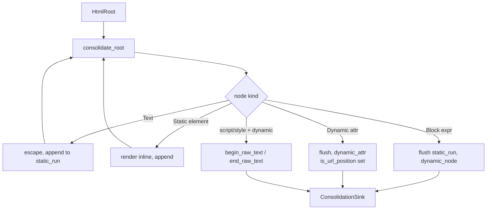
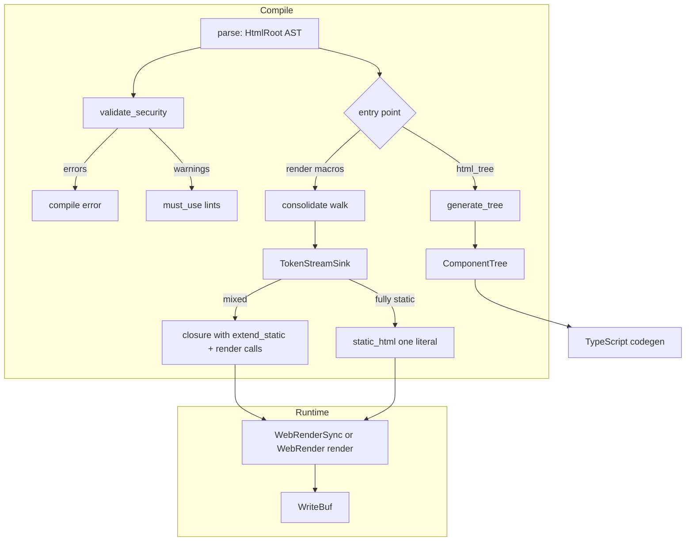

# 07 -- The HTML Macros

The `html!` family is a compile-time pipeline with four stages: parse, validate, consolidate,
emit. The key idea is a seam. A walk over the template produces a linear event sequence. A
separate sink turns that sequence into Rust code. The walk never sees tokens. The emitter never
walks. Every macro in the family is the same walk into a different sink.

## The Macro Family

Eight macros share this pipeline. They differ only in dialect, async mode, and whether they also
build a component tree.

| Macro | Entry (lib.rs) | Output type | Emit path |
|-------|----------------|-------------|-----------|
| `html!` | 116 | async `WebRender` | `generate_optimized_async` |
| `html_send!` | 139 | `WebRenderSend` | `generate_optimized_send_async` |
| `html_sync!` | 156 | sync `WebRenderSync` | `generate_optimized` |
| `xml!` | 209 | async XML | `generate_optimized_async_xml` |
| `xml_sync!` | 228 | sync XML | `generate_optimized_xml` |
| `html_with_tree!` | 425 | `(OptimizedHtml, ComponentTree)` | sync + tree |
| `html_tree!` | 468 | `ComponentTree` | tree only |
| `html_hot_sync!` | 779 | sync, dev-hot slots | `generate_optimized_hot` |

Every HTML entry point does the same two things. It parses the input into an `HtmlRoot`, then
runs `validate_security`. The validator returns either compile errors or a stream of warnings.
The entry point then hands the root to its emitter.

```rust
// proa/proa_macros/src/lib.rs:156
#[proc_macro]
pub fn html_sync(input: TokenStream) -> TokenStream {
    let root = parse_macro_input!(input as HtmlRoot);

    let warnings = match static_consolidation::validate_security(&root) {
        Err(errors) => return TokenStream::from(errors),
        Ok(w) => w,
    };

    let expanded = static_consolidation::generate_optimized(&root);

    TokenStream::from(quote::quote! { { #warnings #expanded } })
}
```

The `html!` and `html_send!` entries are identical except for the emitter call. The `xml!`
entries parse `XmlRoot` and call `validate_xml`, which skips HTML-only rules because XML
vocabularies are application-defined. The `html_hot_sync!` entry parses a `HotInput` and switches
emitter based on the `PROA_DEV_HOT_STATIC` environment variable. Without that variable it emits
the ordinary consolidated path, so hot mode has no cost outside development.

## Stage 1: Parse

The parser lives in `proa_dsl/src/parse.rs`. It turns template tokens into an AST with five node
kinds.

```rust
// proa/proa_dsl/src/parse.rs:48
pub enum Node {
    Element(Element),
    Fragment(Vec<Node>),
    Text(LitStr),
    Block(Expr),
    Doctype(String),
}
```

`Element` (line 62) holds a `MarkupName`, an attribute list, a child list, and a `self_closing`
flag. `Attribute` (line 155) has three shapes: `Static { name, value: LitStr }`, `Dynamic { name,
value: Box<Expr> }`, and `Bool { name }`. A `Block(Expr)` is a `{expr}` interpolation. A
`Fragment` is the `<>...</>` grouping form.

`MarkupName` (line 96) is the subtle type. It keeps two spellings of the same name. The first is
the raw source form, `rsjs-island` or `svg:path`. The second is a legacy identifier form where
dashes and colons become underscores. Emitters read the raw form. Older consumers read the
identifier form. This split lets hyphenated custom elements and namespaced SVG attributes survive
the parser while existing code keeps working.

Parsing is recursive descent. `parse_node` (line 215) peeks at the next token. A `<` begins an
element or fragment or doctype. A string literal is a text node. A `{` begins a block expression.
`parse_element` (line 355) reads a tag name, then attributes, then either a self-closing slash or
children until a matching closing tag. `is_void_element` (line 327) knows the void set so `<br>`
and `` both work. `parse_attribute` (line 478) distinguishes the three attribute shapes by
whether the name is followed by `=` and whether the value is a literal or a brace.

The parser is shared by every macro, which is why it lives in `proa_dsl` and not `proa_macros`.
The runtime template compiler in later documents parses the same AST.

## Stage 2: Validate

`validate_security` (`proa_dsl/src/consolidate/mod.rs:335`) is the security boundary. It returns
`Result<TokenStream, TokenStream>`. The `Err` side is a list of hard compile errors. The `Ok`
side is a stream of soft warnings. A hard error aborts compilation. A warning lets compilation
succeed but prints a lint.

The warning mechanism is worth understanding because stable Rust limits it.

```rust
// proa/proa_dsl/src/consolidate/mod.rs:96
pub struct Warning {
    pub span: proc_macro2::Span,
    pub title: String,
    pub message: String,
}
```

`Warning::into_tokens` (line 133) generates a `#[must_use = "message"]` struct at the warning's
span. When nothing consumes that struct, rustc's `unused_must_use` lint fires and prints the
message with file, line, and column. The block wraps itself in `#[warn(unused_must_use)]` so the
lint fires even if the caller crate allowed it. This is the best possible output on stable Rust,
which lacks the `proc_macro_diagnostic` API. The doc comment tracks that stabilization as issue
54140.

The validator checks several rule families. The order of names here matches the validator call
graph, not a priority ranking.

**URL schemes.** `is_url_attr_name` (line 189) matches thirteen URL-bearing attributes: `href`,
`src`, `action`, `formaction`, `poster`, `ping`, `cite`, `data`, `background`, `longdesc`,
`manifest`, `xlink:href`, and `xlink-href`. `srcset` is deliberately absent. Its comma-separated
`url descriptor` grammar is not a single URL, so a whole-string scheme check would be defeated.
A static value that `is_dangerous_url_value` flags (line 247, a re-export of
`proa_html_policy::has_dangerous_url_scheme`) is a compile error. That check blocks `javascript:`,
`vbscript:`, and executable `data:` schemes per OWASP XSS Rule #7.

**Event handlers.** `is_event_handler_attr_name` (line 236) matches `on` followed by ASCII
letters. A dynamic value in an event handler runs as script, so attribute escaping cannot make it
safe. The validator rejects dynamic values there.

**Raw text.** `is_raw_text_element` (line 320) names `textarea`, `title`, `xmp`, `noscript`, and
`noframes`. A dynamic value inside one of these can break out of the element's raw-text parsing
mode. The validator rejects that.

**Foreign content.** `is_foreign_content_root` (line 332) names `svg`, `math`, and
`foreignObject`. These are mutation-XSS vectors in browsers. The validator applies stricter rules
inside them.

**Content model and ARIA.** `validate_element` (line 884) checks nesting, child restrictions, and
child ordering. `validate_attribute_semantics` (line 846) checks attribute meanings. The ARIA
checks use `implicit_role` (line 1957) and `native_element_for_role` (line 2010) to catch a role
that contradicts the element, like a `role="heading"` on a `<button>`. Full ARIA detail is in
[05-html-elements.md](./05-html-elements.md) and the validator tables in
[23-supporting-crates.md](./23-supporting-crates.md).

**Perf hints.** The validator also flags `format!`, `vec!`, `to_string`, `to_owned`, `join`, and
`collect` inside templates. These are warnings, not errors. They steer the author toward the
zero-allocation patterns in [04-write-buf.md](./04-write-buf.md).

## Stage 3: Consolidate

The consolidation walk is in `proa_dsl/src/consolidate/walk.rs`. It walks the AST once and feeds
a sink. The sink is the `ConsolidationSink` trait.

```rust
// proa/proa_dsl/src/consolidate/sink.rs:67
pub trait ConsolidationSink {
    fn static_run(&mut self, pre_escaped: &str);
    fn dynamic_node(&mut self, expr: &Expr);
    fn dynamic_attr(&mut self, attr: DynamicAttr<'_>);
    fn begin_raw_text(&mut self, kind: RawTextKind);
    fn end_raw_text(&mut self, kind: RawTextKind);
}
```

The events arrive in document order. Static bytes between two dynamic boundaries arrive as a
single `static_run`, already escaped. A fully static template produces exactly one event. This is
the contract that lets the emitter be simple.

`consolidate_root` (walk.rs:32) holds one mutable `static_run: String`. It walks nodes. Text nodes
are escaped and appended to the run. Static elements are rendered inline. When the walk hits a
`Block(Expr)`, it flushes the accumulated run to `sink.static_run`, then calls
`sink.dynamic_node`. When it hits a dynamic attribute, it flushes and calls `sink.dynamic_attr`.
The walk also applies three fixups as it goes.

First, `noopener_rel_action` (mod.rs:2673) computes a `NoopenerAction` for `<a target="_blank">`.
If there is no `rel`, the action is `Inject`, which appends `rel="noopener noreferrer"`. If a
`rel` exists without the tokens, the action is `Merge`. Otherwise `None`. This is the same
reverse-tabnabbing defense the runtime element layer applies, but applied at compile time so the
static output already contains the attribute.

Second, the walk strips `_a11y_ok`, the opt-out marker. A historical bug leaked it into async
output. The walk now removes it unconditionally on both paths, so the sync and async emitters can
never differ on that byte.

Third, the walk detects raw-text mode. `raw_text_kind` (walk.rs:220) returns `Some(RawTextKind)`
when a `<script>` or `<style>` element has dynamic children. In that case the walk wraps the
children between `begin_raw_text` and `end_raw_text`, so the emitter can switch content mode at
runtime for sentinel masking. The masking itself is in [05-html-elements.md](./05-html-elements.md).

The walk also classifies dynamic attributes. `DynamicAttr` (sink.rs:37) carries `name_prefix`
(` name="`), `bool_form` (` name` in HTML, ` name=""` in XML), the value expression, and
`is_url_position`. The walk sets `is_url_position` using `is_url_attr_name`. The emitter must
honor it by routing through `render_url_attr` instead of `render_attr`.

Here is the whole shape.



The walk is dialect-aware only through `MarkupDialect`, an enum at mod.rs:39 with `Html` and
`Xml`. Escaping and boolean attribute spelling differ by dialect. Everything else is shared. That
is why the XML macros are a one-line dialect swap, not a separate implementation.

## Stage 4: Emit

The emitter is `TokenStreamSink` in
`proa_macros/src/static_consolidation/emit_tokens.rs`. It implements `ConsolidationSink` and
turns the event sequence into a list of Rust statements.

```rust
// proa/proa_macros/src/static_consolidation/emit_tokens.rs:71
struct TokenStreamSink {
    mode: EmitMode,
    dialect: MarkupDialect,
    hot: bool,
    hot_slot: usize,
    pending_static: String,
    statements: Vec<TokenStream>,
    raw_text_stack: Vec<RawTextFrame>,
}
```

`static_run` appends to `pending_static`. `flush_static` (line 97) emits the pending bytes. In the
normal case it writes `WriteBuf::extend_static(&mut cx.out, #bytes)?`. In hot mode it writes
`dev_hot::write_slot(..., #slot, #bytes)?` with a unique slot index, so the dev server can swap
static strings without recompiling.

`finish` (line 119) decides the shape. If no dynamic statement was ever emitted, the result is
`SinkOutput::Static(String)`, a single pre-escaped byte string. Otherwise it is
`SinkOutput::Dynamic(Vec<TokenStream>)`. The entry points exploit this.

```rust
// proa/proa_macros/src/static_consolidation/emit_tokens.rs:680
fn fully_static_tokens(root: &HtmlRoot, dialect: MarkupDialect) -> Option<TokenStream> {
    if !root.nodes.iter().all(is_static_node) {
        return None;
    }
    let mut html = String::new();
    for node in &root.nodes {
        render_static_node(node, &mut html, dialect);
    }
    Some(static_html_tokens(&html))
}
```

Before even running the sink, every entry point checks whether the whole root is static. If so,
it skips the walk and emits `static_html(#bytes)`, one byte literal with zero render calls. This
is the fast path from the overview in [00-overview.md](./00-overview.md).

The generated closure wrappers differ by mode. `generate_optimized` (line 527) wraps the
statements in `optimized_html_from_fn(|cx| { ... Ok(()) })`. `generate_optimized_async` (line 601)
wraps them in `async_html_from_fn(Box::new(|cx| Box::pin(async move { ... })))`.
`generate_optimized_send_async` (line 610) uses `send_async_html_from_fn`. The XML variants add
an enter-dialect and restore-dialect pair around the statements, so dynamic escaping switches to
XML while the fragment renders.

The dynamic-node path is where the interesting lowering lives. `dynamic_node` (line 331) first
checks whether the expression is a direct `text!(...)` call. If it is and has no placeholders,
the static text is escaped and folded into `pending_static` instead of becoming a render call.
This lets `{text!("literal")}` join the surrounding static run. If it has placeholders, it becomes
an inline text statement that binds all arguments once. If the expression is not `text!`, it goes
through control-flow lowering.

The sync lowering pushes `WebRenderSync::render` down into branches instead of wrapping the whole
expression.

```rust
// proa/proa_macros/src/static_consolidation/emit_tokens.rs:704
fn generate_block_expr(expr: &Expr, statements: &mut Vec<TokenStream>) {
    match expr {
        Expr::If(expr_if) => {
            let cond = &expr_if.cond;
            let then_body = transform_block(&expr_if.then_branch);
            let else_branch = expr_if
                .else_branch
                .as_ref()
                .map(|(_, else_expr)| generate_else_branch(else_expr));
            statements.push(quote! { if #cond { #then_body } #else_branch });
        }
        Expr::Match(expr_match) => { /* arms each wrapped in render */ }
        Expr::ForLoop(expr_for) => { /* body wrapped in render */ }
        Expr::While(expr_while) => { /* body wrapped in render */ }
        Expr::Loop(expr_loop) => { /* body wrapped in render */ }
        _ => statements.push(quote! {
            ::proa_core::WebRenderSync::render(#expr, cx)?;
        }),
    }
}
```

The reason is a type-inference problem. If the macro wrapped `{if cond { Some(x) } else { None }}`
in a single `render(...)` call, the whole expression would need one renderable type. Instead the
macro matches the branches separately. `generate_expr_as_render` (line 833) special-cases
`Expr::Path` with identifier `None` and emits nothing, so the `None` branch contributes no bytes
and no type obligation. The `Some(x)` branch renders `x` alone. The result is that conditional
rendering with `Option` compiles without the author naming a common type.

`transform_block` (line 803) handles a block's trailing expression. It wraps a trailing
expression without a semicolon in a render call. It also detects a trailing brace-delimited macro
like `html! { ... }` at statement position, which syn parses as `Stmt::Macro`, and wraps that.
Statements with semicolons pass through unchanged. The async and send-async variants
(`generate_block_expr_async` line 857, `generate_block_expr_send_async` line 999) are the same
recursion with `render_child(cx, #expr).await?` and `render_send_child(cx, #expr).await?`
respectively.

The raw-text path is the last emitter detail. `begin_raw_text` (line 469) flushes static and
pushes a frame with a fresh guard binding. `end_raw_text` (line 478) wraps the child statements
in a mode switch.

```rust
// proa/proa_macros/src/static_consolidation/emit_tokens.rs:493
EmitMode::Sync => self.push_statement(quote! {
    let #guard = cx.__proa_enter_mode(#mode_path);
    let #result: Result<(), ::proa_core::shared::write_buf::WriteError> = (|| {
        #(#child_statements)*
        Ok(())
    })();
    cx.__proa_restore_mode(#guard);
    #result?;
}),
```

The async form awaits an async block instead of a closure. A global atomic counter names the
guards `__proa_raw_text_mode_N`, so nested raw-text regions do not shadow each other. The mode
switches to `ContentMode::Script` or `ContentMode::Style`, which is what enables the sentinel
masking in [05-html-elements.md](./05-html-elements.md).

## The Tree Macros

`html_with_tree!` and `html_tree!` add a second output. `tree_codegen::generate_tree` in
`proa_macros/src/tree_codegen.rs` builds a `proa_ir::component_tree::ComponentTree` from the same
`HtmlRoot`. The tree captures structure for TypeScript and JSX generation.

`generate_element` (line 191) classifies each element. If the tag is in the `HTML_ELEMENTS` list
(line 14, about 120 lowercase names), it becomes a `TreeNode::Element`. Otherwise it becomes a
`TreeNode::Component`, and its attributes become `props`. This is the PascalCase convention: a
`<Spinner />` is a component reference, a `<div>` is an element. A `<children />` or `<slot />`
becomes a `TreeNode::ChildrenSlot`.

`generate_block_node` (line 266) applies string heuristics to `{expr}` blocks. A bare `children`
or `self.children` becomes a `ChildrenSlot`. A `cond.then(|| ...)` pattern becomes a
`ConditionalNode`. Everything else becomes an `ExpressionNode`. The `then` closure body is parsed
again as HTML so the conditional's content contributes real structure, not a string.

The tree shares the parse and validation stages with the render path. Only the sink differs. This
is the same seam the render macros use, taken one more step: one AST, many consumers.

## The Full Pipeline



## The Aha Moment

**Aha:** The walk and the emitter do not share a vocabulary. The walk produces five events
(`static_run`, `dynamic_node`, `dynamic_attr`, `begin_raw_text`, `end_raw_text`) and knows
nothing about Rust. The emitter consumes those events and knows nothing about how to walk a
template. Every macro is a different sink into the same walk.

That single seam buys every feature in this document. Sync, async, and send-async are three
`EmitMode` values in one sink. XML is a `MarkupDialect` swap. Hot mode is a boolean that changes
`extend_static` into `write_slot`. The tree macros replace the sink entirely with a
`ComponentTree` builder. None of these touch the walk. None of them touch validation. The
`ConsolidationSink` trait is the entire extension point, and it is five methods.

This is also why the fully-static path is free. Because the walk guarantees that a fully static
template produces exactly one `static_run`, the sink can detect that case before emitting a single
statement and collapse the whole template into one byte literal. The optimization is not a
special pass. It is a property of the seam's contract.

## Cross-References

- The parser AST that the consolidation walk consumes is the HTML element model in
  [05-html-elements.md](./05-html-elements.md).
- The `extend_static` and `WriteBuf` the emitter targets: [04-write-buf.md](./04-write-buf.md).
- The `AttrValue` and `render_url_attr` that `dynamic_attr` dispatches to:
  [06-classlist-recipes.md](./06-classlist-recipes.md).
- The `md!` and `md_sync!` siblings with their own emitter: [08-md-macros.md](./08-md-macros.md).
- The `ComponentTree` and its TypeScript consumer: [11-ir.md](./11-ir.md).
- The `proa_html_policy` crate behind `is_dangerous_url_value`:
  [23-supporting-crates.md](./23-supporting-crates.md).

Continue to [08-md-macros.md](./08-md-macros.md).
