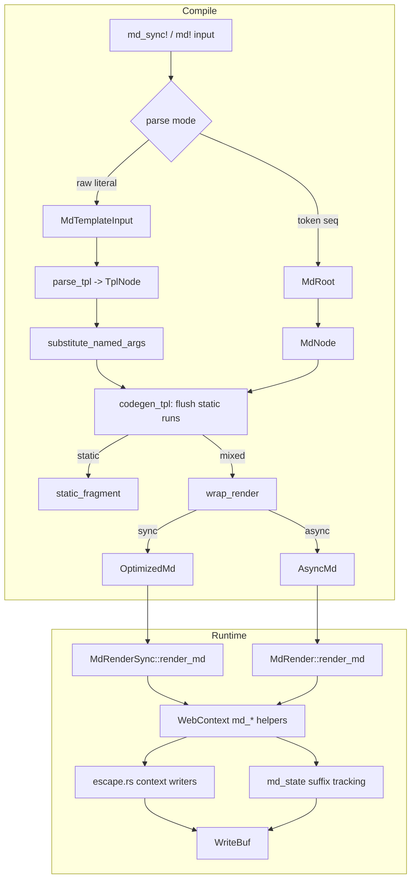

# 08 -- The Markdown Macros

Markdown is Proa's second render target. The same component struct that renders HTML implements
`MdRenderSync` or `MdRender` and renders clean semantic Markdown for agents and APIs. A card
becomes a heading. A badge becomes inline code. The `md_sync!` and `md!` macros drive this path
with the same compile-time consolidation idea as the HTML macros. The key idea is context:
Markdown is context-sensitive, so every escaping helper targets one syntactic position and adapts
its delimiters to the payload.

## The Trait Pair

`MdRenderSync` and `MdRender` mirror the web traits exactly. The sync trait is the zero-overhead
default. The async trait returns a `RenderOutcome`, so a component can return `Done` immediately
or `Pending` with a future.

```rust
// proa/proa_core/src/render/md_render.rs:27
pub trait MdRenderSync<Loader: DataLoader = NoLoader, B: WriteBuf = RenderBuffer> {
    fn render_md(self, cx: &mut WebContext<Loader, B>) -> Result<(), WriteError>;
}
```

Both traits share the loader-first context and the customizable buffer type with the HTML traits.
A Markdown component can render to a `Vec<u8>`, a `ChainedBumpWriter`, or any other `WriteBuf`.

The macro needs an unambiguous dispatch surface. When a caller imports both `MdRenderSync` and
`MdRender`, a generated call to `render_md` would be ambiguous. Two hidden extension traits solve
this with uniquely named methods.

```rust
// proa/proa_core/src/render/md_render.rs:50
#[doc(hidden)]
pub trait MdRenderSyncExt<Loader: DataLoader = NoLoader, B: WriteBuf = RenderBuffer>:
    MdRenderSync<Loader, B>
{
    fn __proa_render_md_sync(self, cx: &mut WebContext<Loader, B>) -> Result<(), WriteError>
    where Self: Sized,
    {
        MdRenderSync::render_md(self, cx)
    }
}
```

The macro emits `(#expr).__proa_render_md_sync(cx)?` in sync mode and
`(#expr).__proa_render_md_async(cx).resolve().await?` in async mode. Method syntax preserves
Rust's auto-deref, so `&&str` reaches the `&str` impl. The `MdRenderAsyncExt` counterpart
(md_render.rs:73) does the same for async. The `.resolve()` step drives the `RenderOutcome` future
to completion, exactly as the web path does.

Standard impls cover the common shapes. `()` renders nothing. `Option<T>` renders `Some`,
nothing on `None`. `&str`, `String`, and `&String` render as escaped literal text through
`cx.write_md_text`. A macro generates tuple impls from arity 2 through 12, rendering each element
in order. This matches the web tuple story in [02-render-traits.md](./02-render-traits.md).

Two adapters complete the family. `MdSyncToAsync<T>` (md_render.rs:96) lifts a sync component
into the async surface, returned by `to_md_async`. `AwaitMdComponent<F>` (md_render.rs:112)
wraps a future that resolves to a renderable child. Both are the Markdown twins of the web
adapters.

## The Macro: Two Input Modes

The `md!` and `md_sync!` entry points (proa_macros/src/lib.rs:310 and 348) both call
`expand_md`. That function tries two parses in order.

```rust
// proa/proa_macros/src/lib.rs:352
fn expand_md(input: TokenStream, mode: md::EmitMode) -> TokenStream {
    let input2 = proc_macro2::TokenStream::from(input.clone());
    if let Ok(tpl) = syn::parse2::<md::MdTemplateInput>(input2) {
        return match md::generate_template(&tpl, mode) { /* ... */ };
    }
    let root = parse_macro_input!(input as md::MdRoot);
    TokenStream::from(md::generate_tokens(&root, mode))
}
```

The first try is raw template mode: one string literal, optionally followed by `format!`-style
`name = expr` arguments. The second is token composition mode: a sequence of string literals and
`{expr}` blocks. A token-mode input starts with a literal but never has a comma after it, so the
raw-template parse failing is what routes to the fallback. Raw mode is preferred because it keeps
Markdown inline with the Rust component and renders source newlines directly.

The codegen is in proa_macros/src/md.rs. It walks parsed template nodes and flushes static runs
into a `write_md_prepared_static` call, the Markdown twin of the HTML `extend_static`.

```rust
// proa/proa_macros/src/md.rs:83
fn flush(stmts: &mut Vec<TokenStream>, run: &mut String) {
    if !run.is_empty() {
        let bytes = proc_macro2::Literal::byte_string(run.as_bytes());
        stmts.push(quote! {
            {
                static BYTES: &[u8] = #bytes;
                cx.write_md_prepared_static(BYTES)?;
            }
        });
        run.clear();
    }
}
```

`wrap_render` (md.rs:112) wraps the statement list. Sync mode builds
`OptimizedMd::new(|cx| { ... Ok(()) })`. Async mode builds `async_md_from_fn(Box::new(|cx|
Box::pin(async move { ... })))`. A fully static template short-circuits to `static_fragment`
(md.rs:135), one closure with a single static write.

Interpolated expressions use `emit_md_render` (md.rs:100). Control flow is handled like the HTML
emitter: `{for ... { ... }}` and `{if ... { ... }}` become real `for` and `if` statements, and a
template-level `{expr}` block is lowered through `gen_block_expr` (md.rs:378) with the same
if/match/for/while/loop recursion. The difference from HTML is that trailing expressions route
through `__proa_render_md_sync` or `__proa_render_md_async` instead of `WebRenderSync::render`.

### The IDE Shadow

Raw template mode has a subtle ergonomics trick. Expressions inside a string literal have no
source spans that rust-analyzer can use. `format_args_shadow` (md.rs:176) borrows them.

```rust
// proa/proa_macros/src/md.rs:210
Some(quote! {
    #[cfg(rust_analyzer)]
    let _ = ::core::format_args!(#lit #(, #names = #values)*);
})
```

rust-analyzer resolves `{ident}` placeholders inside `format_args!` string literals. It sets the
`rust_analyzer` cfg, and rustc never does. So the shadow is IDE-only: real builds compile nothing
extra, and the `Display` bound it imposes applies only inside the IDE. The shadow is emitted only
when every placeholder is a bare identifier, when the template has no control flow, and when a
brace scan agrees byte-for-byte with `format_args!` semantics. A template that interpolates a
non-`Display` value, like a nested fragment, opts out by writing `{ ident }` with spaces.
Markdown rendering trims the spaces; the shadow does not, so it is skipped. This is the mechanism
behind the go-to-definition and rename support described in the `md!` doc comment.

## The Parser

The semantic parser is in proa_dsl/src/md.rs. Its node type is richer than the HTML AST because a
Markdown template has its own control flow.

```rust
// proa/proa_dsl/src/md.rs:51
pub enum TplNode {
    Text(String),
    Expr(TemplateExpr),
    For { pat: Box<syn::Pat>, iter: Box<TemplateExpr>, body: Vec<TplNode> },
    If { branches: Vec<IfBranch> },
}
```

`IfBranch` (md.rs:65) has an `Option<TemplateExpr>` condition where `None` marks the else branch.
`parse_tpl` (md.rs:302) scans bytes and handles three cases before it treats `{` as
interpolation. Fenced code blocks and inline code spans are recognized first, so braces inside
Rust examples stay literal Markdown. `{{` and `}}` render literal braces. `fenced_code_end`
(md.rs:200) implements CommonMark's fence rules: up to three leading spaces, at least three
backticks or tildes, and a closing fence of at least the opening length. `inline_code_end`
(md.rs:274) requires matching delimiter run lengths.

`extract_braces` (md.rs:382) finds the closing brace with string and nesting awareness, so a
`{expr}` containing `"}"` or a nested struct literal parses correctly. `parse_for` (md.rs:517)
splits on ` in ` to get pattern and iterator. `parse_if` (md.rs:547) walks `if`/`else if`/`else`
chains. `bare_ident` (md.rs:185) recognizes a plain identifier expression, which is what named
argument substitution targets.

Named arguments are the other ergonomics feature. `substitute_named_args` (md.rs:131) rejects
duplicate names and unused names, then replaces each bare identifier placeholder that matches a
name with the argument's real expression, which carries a real Rust span.

### Source Mapping

Expressions inside a raw string literal start as byte ranges into the decoded value. To give them
correct spans, the parser maps decoded bytes back to the authored literal token. This is the job
of `MappedLiteral` in proa_dsl/src/md/source.rs.

`decode_ranges` (source.rs:125) walks the encoded literal token and records, for every produced
character, the source range that produced it. Raw literals map directly. Cooked literals decode
escapes like `\n`, `\u{...}`, and line continuations. `map_nodes` (source.rs:83) then converts a
`Decoded` location into a `Literal` location with a real span, or a `Rust` location for
substituted named arguments. This is why an expression written inside the string still gets a
usable diagnostic span.

Layout is the last parse concern. `dedent_template` (proa_dsl/src/md_layout.rs:35) strips a
leading newline and the common whitespace prefix of every non-blank line. The rule is: a
multiline template's shared indentation is layout, everything beyond it is content. Relative
indentation, nested lists and code blocks, survives. A template mixing tabs and spaces finds no
common prefix and is left alone. The same rule is shared with the CLI formatter, so re-indenting
a template never changes what it renders.

## The Runtime Sink

The runtime half is `WebContext`'s Markdown methods in proa_core/src/md/context.rs. They write
into the same buffer but maintain a small formatting state.

```rust
// proa/proa_core/src/md/context.rs:14
pub struct MdState {
    heading_offset: u8,
    list_depth: u8,
    inline: bool,
    trailing_line: TrailingLineState,
    pending_cr: bool,
}
```

`heading_offset` shifts heading levels for nesting, clamped at 6. `list_depth` indents list
items. `inline` suppresses block boundaries inside a link label or heading. `trailing_line` and
`pending_cr` track the output suffix so the context knows whether it needs a blank line before
the next block.

`TrailingLineState` (context.rs:41) has four values: `Start`, `Text`, `OneBreak`, and `Blank`.
The suffix tracker is `state_after_write` (context.rs:74). It looks at at most the last three
bytes of a write and derives the new suffix in constant time. A trailing run of three CR/LF bytes
is always at least two logical breaks. This matters because the buffer may be scatter-gather.
`ZeroCopyBuf` cannot expose a contiguous suffix, and a streaming buffer may have already flushed.
The state is independent of the buffer, so it stays accurate on both. The tests drive this with a
reference re-implementation across every split of every byte string up to length seven.

The write helpers split into two tiers. The `write_md_prepared` family writes trusted,
already-authored Markdown. The semantic helpers write runtime data with escaping. `write_md_text`
(context.rs:366) escapes literal text. `write_md_inline_code` (context.rs:401) writes a
delimiter-safe code span. `write_md_url` (context.rs:412) writes a sanitized link destination.
`md_heading` (context.rs:271) writes a heading with the level plus the offset. `md_block_boundary`
(context.rs:437) emits exactly the missing line breaks for the next block.

```rust
// proa/proa_core/src/md/context.rs:437
pub fn md_block_boundary(&mut self) -> Result<(), WriteError> {
    if self.md_state.inline {
        return Ok(());
    }
    let missing: &'static [u8] = match (self.md_state.trailing_line, self.md_state.pending_cr) {
        (TrailingLineState::Start | TrailingLineState::Blank, _) => return Ok(()),
        (TrailingLineState::OneBreak, false) => b"\n",
        (TrailingLineState::OneBreak, true) | (TrailingLineState::Text, _) => b"\n\n",
    };
    self.write_md_prepared_static(missing)
}
```

`md_line_boundary` (context.rs:453) is the weaker variant that never inserts a blank line, so
adjacent list items stay in one list. `md_bold`, `md_code`, and `md_link` are inline helpers.
`md_link_with` (context.rs:591) sets inline mode around the composed label so block boundaries do
not fire inside it.

One scope guard completes the picture. `MdFragmentScope` (context.rs:610) takes the context's
`MdState`, gives the child a fresh state, and restores the saved state on drop. This is how an
`OptimizedMd` renders through the `WebRender` bridge without leaking its Markdown formatting into
the caller. `ObservedMdWriteBuf` (context.rs:131) is the reverse direction: it wraps a buffer and
tracks the suffix while an HTML renderer writes, so `render_html_in_md` keeps state coherent.

## The Escaping Engine

Markdown escaping lives in proa_core/src/md/escape.rs. It is deliberately context-free for bare
text and context-specific for structured forms.

`escape_md` (escape.rs:80) handles literal text. It escapes exactly the bytes that CommonMark
assigns meaning to, and leaves the rest readable.

```rust
// proa/proa_core/src/md/escape.rs:26
const fn is_commonmark_escapable(byte: u8) -> bool {
    matches!(
        byte,
        b'\\' | b'`' | b'*' | b'_' | b'[' | b']' | b'(' | b')'
            | b'<' | b'>' | b'|' | b'~' | b'&' | b'#' | b'+' | b'-'
            | b'.' | b'!' | b'=' | b':'
    )
}
```

The doc comment splits the set. Twenty bytes are significant anywhere inline, including `&`
(because a literal value could complete an entity reference), `~` (GFM strikethrough), and `|`
(tables). A second class, `# + - . ! > =`, is significant only at line start, because they form
headings, lists, blockquotes, and setext underlines. The escaper cannot see whether a slot begins
a line, so it escapes those everywhere. The colon is also escaped: a bare `http://...` would
become a live GFM autolink otherwise. Benign punctuation like `, : ; ' " / ? @ % ^ $ { }` passes
through. Line endings and tabs become spaces so a value cannot create a new block.

The structured helpers adapt their delimiters to the payload. `write_inline_code` (escape.rs:235)
is the clearest case. Markdown has no escape character inside a code span, so you cannot escape a
backtick. Instead the helper chooses a delimiter one backtick longer than the longest run in the
value.

```rust
// proa/proa_core/src/md/escape.rs:235
pub fn write_inline_code<B: WriteBuf>(buf: &mut B, value: &str) -> Result<(), WriteError> {
    if value.is_empty() {
        return buf.extend_static(b"<code></code>");
    }
    let analysis = analyze_code_span(value);
    write_backticks(buf, analysis.delimiter_len)?;
    if analysis.needs_padding {
        buf.push(b' ')?;
    }
    write_code_span_content(buf, value)?;
    if analysis.needs_padding {
        buf.push(b' ')?;
    }
    write_backticks(buf, analysis.delimiter_len)
}
```

`analyze_code_span` (escape.rs:172) computes `delimiter_len` as the longest backtick run plus one
and `needs_padding` when the payload starts or ends with a backtick or with spaces. The empty case
uses `<code></code>` because CommonMark has no empty backtick span. Two adjacent backticks form a
delimiter run, not an opening/closing pair.

`write_fenced_code` (escape.rs:327) uses the same idea for blocks. The fence is at least three
backticks and one longer than every backtick run in the code. The info string is percent-encoded
for backticks, whitespace, and control bytes, so a malicious language label cannot break the
fence. `write_link_destination` (escape.rs:381) sanitizes a URL: dangerous schemes emit nothing,
whitespace and controls are percent-encoded, and parentheses and backslashes are escaped. Each
writer has a matching `*_len` function so a component can reserve exact buffer space before
writing, and the tests assert the lengths match the writers byte-for-byte.

## The Fragment Types

`proa_core/src/md/mod.rs` defines the output shapes and the adapters. `OptimizedMd` (mod.rs:182)
wraps a sync closure and implements both `MdRenderSync` and `MdRender`. `AsyncMd` (mod.rs:268)
wraps a type-erased async closure. `TrustedMarkdown` (mod.rs:31) renders a string as authored
Markdown instead of literal text, the escape hatch for components whose payload is already
Markdown. `MdCodeContent` (mod.rs:60) is a narrow contract that lets a component expose a raw
code payload so the renderer can pick a safe delimiter without allocating.

`FmtBuf` (mod.rs:120) bridges `std::fmt::Write` to `WriteBuf`. It lets the macros format
`Display` values directly into the buffer without an intermediate `String`. Because
`core::fmt::Error` carries no payload, `FmtBuf` stores the original `WriteError` in a side field
and returns it from `finish`.

```rust
// proa/proa_core/src/md/mod.rs:134
impl<B: WriteBuf> core::fmt::Write for FmtBuf<'_, B> {
    fn write_str(&mut self, s: &str) -> core::fmt::Result {
        if self.error.is_some() {
            return Err(core::fmt::Error);
        }
        match self.out.extend(s.as_bytes()) {
            Ok(()) => Ok(()),
            Err(error) => {
                self.error = Some(error);
                Err(core::fmt::Error)
            }
        }
    }
}
```

The `OptimizedMd` and `AsyncMd` types also implement `WebRenderSync` and `WebRender`. That is the
bridge that lets a Markdown fragment render inside an HTML tree and vice versa. The web impl
creates an `MdFragmentScope` to isolate the fragment's formatting state.

## HTML to Markdown

The `html-to-markdown` feature provides an opt-in adapter for converting a sync HTML component to
Markdown. `to_markdown` (proa_core/src/md/from_html.rs:70) returns `ToMarkdown<T>`, which
implements both Markdown traits for any `T: WebRenderSync`.

The conversion is lossy and allocation-heavy, which the doc comment states plainly. It renders
the HTML into a `RenderBuffer`, parses it into a DOM with the `htmd` crate, prepares the DOM, and
converts to a Markdown string. `capture_html_for_markdown` (web/context.rs:2493) does the capture
with a fresh scope. Metadata elements, scripts, styles, templates, SVG, and elements with
`hidden` or `aria-hidden="true"` are removed in `prepare_dom` (from_html.rs:96).

`escape_literal_entities` (from_html.rs:137) fixes a double-decoding problem. html5ever already
decodes entities, and htmd leaves ampersands alone, so Markdown would decode an entity-shaped
literal value a second time. The helper escapes those prefixes while preserving ordinary
ampersands and code.

The converter is a `LazyLock`-built `htmd::HtmlToMarkdown` (from_html.rs:213) with five custom
handlers. `preformatted` renders `<pre>` as an adaptive fenced code block using the core
`write_fenced_code`. `inline_code` renders `<code>` with `write_inline_code`. `link_or_image`
renders `<a>` and `` with the core destination escaper. `table` and `ordered_list` handle the
two most complex structures.

```rust
// proa/proa_core/src/md/from_html.rs:213
static CONVERTER: LazyLock<HtmlToMarkdown> = LazyLock::new(|| {
    HtmlToMarkdown::builder()
        .options(Options {
            bullet_list_marker: BulletListMarker::Dash,
            ul_bullet_spacing: 1,
            ol_number_spacing: 1,
            ..Options::default()
        })
        .add_handler(vec!["pre"], preformatted)
        .add_handler(vec!["code"], inline_code)
        .add_handler(vec!["a", "img"], link_or_image)
        .add_handler(vec!["table"], table::table)
        .add_handler(vec!["ol"], list::ordered_list)
        .build()
});
```

The table handler (from_html/table.rs:118) has a decision. A simple grid becomes a GFM pipe table
with a ` --- ` separator row. A table with `rowspan` or `colspan` not equal to 1, block content
in a cell, or multiple header rows becomes a nested list instead, because Markdown cannot encode
spans in a pipe cell. `complex` (table.rs:44) decides this with a conservative inline element
allowlist. `pipe_row` (table.rs:204) escapes a `|` that is not already inside code or escaped.

The ordered list handler (from_html/list.rs:37) has the same kind of decision. CommonMark
renumbers an ordered list after the first marker, so a `reversed` list, a `start` outside the
range 0 through 999,999,999, or an explicit per-item `value` cannot be represented faithfully.
The handler falls back to an unordered list with `- 5: ` style labels. Otherwise it emits
`1. `, `2. ` markers with matching indentation.

## The Full Flow



The static fast path mirrors the HTML macros. A template with only text nodes skips the render
loop and becomes one `write_md_prepared_static` call. Mixed templates alternate static writes
with render calls, and control flow lowers into real Rust `if` and `for` statements.

## The Aha Moment

**Aha:** Markdown has no escape character inside a code span, so you cannot escape a backtick the
way HTML escapes an ampersand. Proa does not try. It picks a delimiter that cannot appear in the
payload. The code span delimiter is one backtick longer than the longest backtick run in the
value. The fence delimiter is the same, with a floor of three. The info string percent-encodes
backticks and whitespace. The result is that arbitrary runtime text can never close the span it
is inside, without a single escaping pass over the payload.

This is the same shape as the HTML sentinel mask in [05-html-elements.md](./05-html-elements.md).
That engine found the one rewrite, escaping `>`, that made the fourth sentinel unreachable. Here
the engine finds the one delimiter choice that makes closing the span unreachable. Both replace
an enumeration of dangerous sequences with a single invariant.

A second insight sits in the suffix state. `state_after_write` derives the output suffix from at
most the last three bytes, in constant time, without reading the buffer. That is what lets
Markdown boundaries stay correct on a scatter-gather buffer where `as_slice()` is empty and on a
streaming buffer that already flushed its bytes. The state is a copy of the buffer's logical
suffix, decoupled from the physical bytes.

## Cross-References

- The HTML macros that this mirrors: [07-html-macros.md](./07-html-macros.md).
- The `WriteBuf` that every Markdown write lands in: [04-write-buf.md](./04-write-buf.md).
- The `WebContext` and its scoped output machinery: [03-web-context.md](./03-web-context.md).
- The HTML escaping engine with its sentinel masking: [05-html-elements.md](./05-html-elements.md).
- The data loading that a Markdown component can await: [09-data-loading.md](./09-data-loading.md).

Continue to [09-data-loading.md](./09-data-loading.md).
