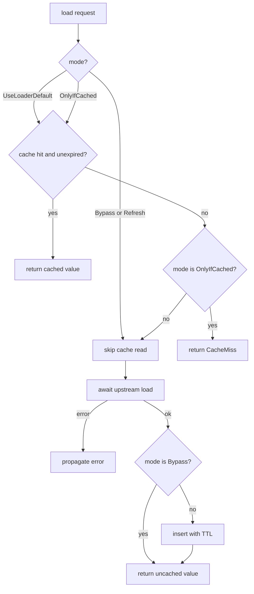
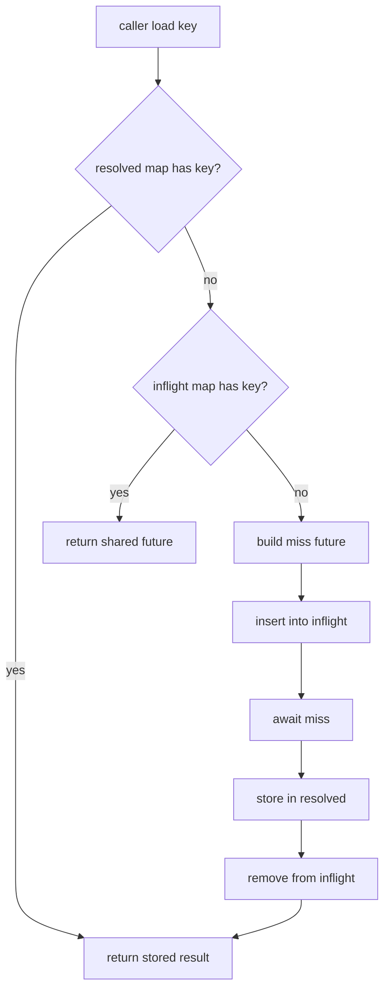
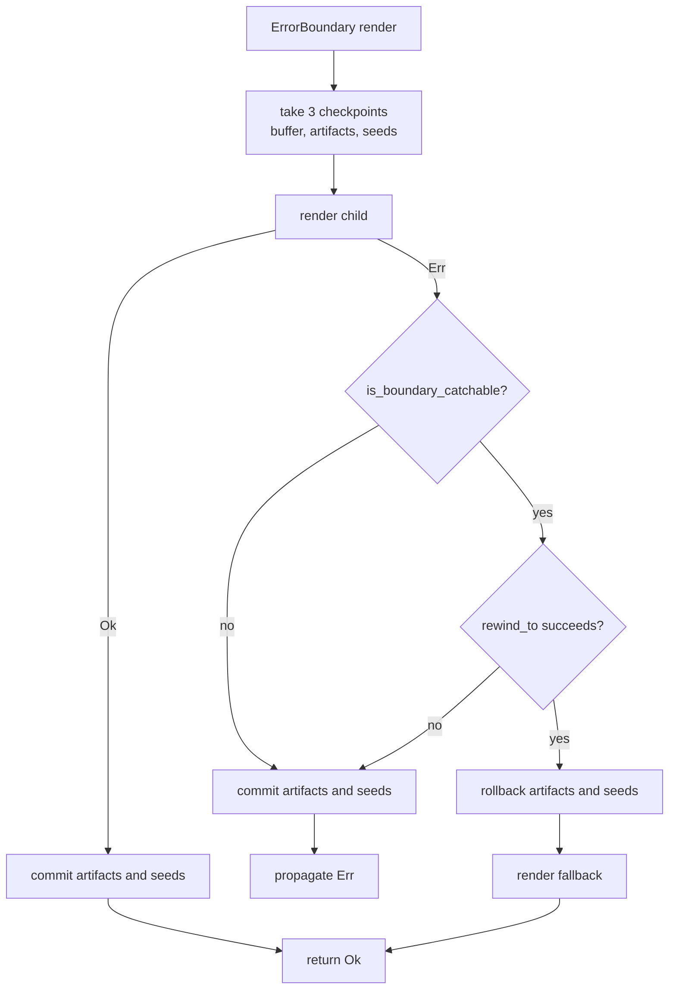

# 09 -- Data Loading, Cache, and Error Boundaries

Data loading splits one question into two. `LoadKey` answers "what data is this?". The cache
policy answers "how should it be remembered?". Proa keeps the two apart on purpose, so a loader
can dedupe by identity without trusting policy, and an error boundary can rewind a subtree as one
transaction. This document covers the key, the request, the value, the loader trait family, the
standard cache, the request-local resolver, and the error boundary.

## LoadKey: Pure Identity

`LoadKey` (`proa_core/src/render/load_key.rs:17`) is a namespace plus a kind. The namespace groups
related data. The kind is either a `Named(String)` or a `Hashed(u64)`.

```rust
// proa_core/src/render/load_key.rs:17
#[derive(Debug, Clone, PartialEq, Eq, Hash, Serialize, Deserialize)]
pub struct LoadKey {
    namespace: String,
    kind: LoadKeyKind,
}

#[derive(Debug, Clone, PartialEq, Eq, Hash, Serialize, Deserialize)]
#[serde(tag = "kind", content = "value", rename_all = "snake_case")]
pub enum LoadKeyKind {
    Named(String),
    Hashed(u64),
}
```

Two constructors build keys. `LoadKey::named` takes two strings. `LoadKey::typed` hashes any `K:
Hash` value with `DefaultHasher`.

```rust
// proa_core/src/render/load_key.rs:31
pub fn named(namespace: impl Into<String>, key: impl Into<String>) -> Self {
    Self {
        namespace: namespace.into(),
        kind: LoadKeyKind::Named(key.into()),
    }
}

pub fn typed<K: Hash>(namespace: impl Into<String>, key: K) -> Self {
    let mut hasher = DefaultHasher::new();
    key.hash(&mut hasher);
    Self {
        namespace: namespace.into(),
        kind: LoadKeyKind::Hashed(hasher.finish()),
    }
}
```

The `Display` impl shows the two forms. A named key prints as `namespace:key`. A hashed key
prints as `namespace#` followed by the hash in sixteen lowercase hex digits. The key itself holds
no cache metadata. Its doc comment is explicit: cache characteristics belong in a loader or a
separate hints layer, not inside the key.

## The Request and Its Hints

`LoadRequest` (`proa_core/src/render/load_request.rs:14`) pairs a `LoadKey` with `LoadHints`.
The key stays the identity. The hints carry advisory policy and never change what the payload is.

```rust
// proa_core/src/render/load_request.rs:14
pub struct LoadRequest {
    key: LoadKey,
    hints: LoadHints,
}
```

`LoadHints` (`load_request.rs:57`) holds one optional `CacheHint`. `CacheHint` holds an optional
TTL and a `CacheMode`. The mode is the interesting part. It has four values.

```rust
// proa_core/src/render/load_request.rs:122
pub enum CacheMode {
    #[default]
    UseLoaderDefault,
    Bypass,
    Refresh,
    OnlyIfCached,
}
```

`UseLoaderDefault` lets the loader choose its normal policy. `Bypass` skips the loader cache and
does not populate it. `Refresh` re-fetches from origin and refreshes the cached entry. `OnlyIfCached`
returns a cache miss when the key is absent, without touching origin.

The default `CacheHint` is `ttl: None` and `mode: UseLoaderDefault`. Every field is private with a
builder accessor: `with_ttl`, `with_mode`, `ttl_hint`, `mode`. `CacheHint::ttl(d)` is a shorthand
for `default().with_ttl(d)`.

## The Value: Bytes or Typed

`LoadValue` (`proa_core/src/render/load_value.rs:17`) is shape-agnostic. It is either raw `Bytes`
or a `Typed` value behind `Arc<dyn Any + Send + Sync>` plus a type name.

```rust
// proa_core/src/render/load_value.rs:17
pub enum LoadValue {
    Bytes(Bytes),
    Typed {
        value: Arc<dyn Any + Send + Sync>,
        type_name: &'static str,
    },
}
```

`Bytes` preserves the JSON and raw path. `Typed` lets a loader cache an already-materialized Rust
value without serializing and deserializing it again. `into_bytes` rejects a typed value with
`LoadError::TypeMismatch`. `downcast::<T>` rejects bytes the same way and returns `Arc<T>` on a
typed hit.

```rust
// proa_core/src/render/load_value.rs:69
pub fn downcast<T>(self) -> Result<Arc<T>, LoadError>
where
    T: Send + Sync + 'static,
{
    match self {
        Self::Typed { value, type_name } => {
            value.downcast::<T>().map_err(|_| LoadError::TypeMismatch {
                expected: std::any::type_name::<T>(),
                actual: type_name,
            })
        }
        Self::Bytes(_) => Err(LoadError::TypeMismatch {
            expected: std::any::type_name::<T>(),
            actual: "bytes",
        }),
    }
}
```

The `Debug` impl hides the typed payload and prints only `type_name`. This keeps a value with
sensitive contents out of debug logs while still naming the shape.

## The Loader Trait Family

`DataLoader` (`proa_core/src/render/loader.rs:33`) is the application extension point. It declares
one required method, `load`, plus two defaults.

```rust
// proa_core/src/render/loader.rs:33
pub trait DataLoader: Send + Sync {
    fn load(
        &self,
        request: &LoadRequest,
    ) -> impl Future<Output = Result<LoadValue, LoadError>> + Send;

    fn load_key(&self, key: &LoadKey) -> impl Future<Output = Result<LoadValue, LoadError>> + Send {
        let request = LoadRequest::from(key.clone());
        async move { self.load(&request).await }
    }

    fn load_bytes(&self, key: &LoadKey) -> impl Future<Output = Result<Bytes, LoadError>> + Send {
        async move { self.load_key(key).await?.into_bytes() }
    }
}
```

`load` returns `impl Future + Send`, so a concrete loader call monomorphizes with no per-call
`Box::pin`. Type erasure exists for the framework boundary. `LoadFuture` (`loader.rs:16`) is the
boxed alias. `DynDataLoader` (`loader.rs:56`) is the object-safe shape with one `load_boxed`
method. A blanket impl gives every `DataLoader` a `DynDataLoader` for free.

Two bridge types finish the family. `DynLoaderHandle` (`loader.rs:79`) wraps an `Arc<dyn
DynDataLoader>` and implements `DataLoader` by dispatching through the dyn boundary. It exists
because a `WebContext` is always generic over a concrete `L: DataLoader`. `NoLoader`
(`loader.rs:110`) is a zero-sized default that fails every load with `LoadError::NoLoader`.

## Errors

`LoadError` (`proa_core/src/render/load_error.rs:8`) has eight variants.

```rust
// proa_core/src/render/load_error.rs:8
pub enum LoadError {
    NetworkError(String),
    Timeout,
    Deserialize(String),
    Dropped,
    CacheMiss,
    TypeMismatch { expected: &'static str, actual: &'static str },
    NoLoader,
    Custom(String),
}
```

`NetworkError` wraps an origin failure. `Timeout` is a load that took too long. `Deserialize` is a
bad payload. `Dropped` is a request whose receiver vanished. `CacheMiss` is an `OnlyIfCached`
miss. `TypeMismatch` is a shape mismatch with both type names. `NoLoader` means no loader is
configured. `Custom` is the escape hatch. `From<serde_json::Error>` maps into `Deserialize`.

## RenderOutcome

`RenderOutcome` (`proa_core/src/render/outcome.rs:25`) is the return type of `WebRender::render`.
It is `Done(Result)` for synchronous renders and `Pending(future)` for async ones.

```rust
// proa_core/src/render/outcome.rs:25
pub enum RenderOutcome<F> {
    Done(Result<(), WriteError>),
    Pending(F),
}
```

`Done` builds no future and allocates nothing. `resolve` awaits the future only when pending. The
sync path never reaches it. The doc 03 story of the sync/async split starts here: a component
either finishes in one call or hands back a future for the driver to poll.

## StandardDataLoader: Cross-Request Cache

`StandardDataLoader` (`proa_core/src/render/standard_loader.rs:39`) wraps any upstream loader with
a `DashMap` cache keyed by `LoadKey`. Each `CachedEntry` holds a `LoadValue` and an `Instant`
expiry.

```rust
// proa_core/src/render/standard_loader.rs:39
pub struct StandardDataLoader {
    cache: Arc<DashMap<LoadKey, CachedEntry>>,
    upstream: Arc<dyn DynDataLoader>,
    default_ttl: Duration,
}
```

The `load` method is a decision tree. It reads the mode, checks the cache, misses to origin, and
populates the cache on the way out.

```rust
// proa_core/src/render/standard_loader.rs:96
async move {
    let now = Instant::now();
    let cache_mode = request_owned
        .hints()
        .cache()
        .map(|cache| cache.mode())
        .unwrap_or(CacheMode::UseLoaderDefault);

    if !matches!(cache_mode, CacheMode::Bypass | CacheMode::Refresh) {
        if let Some(entry) = cache.get(&key) {
            if entry.expires_at > now {
                return Ok(entry.value.clone());
            }
        }
    }

    if matches!(cache_mode, CacheMode::OnlyIfCached) {
        return Err(LoadError::CacheMiss);
    }

    let value = upstream.load_boxed(&request_owned).await?;

    if matches!(cache_mode, CacheMode::Bypass) {
        return Ok(value);
    }

    let ttl = request_owned
        .hints()
        .cache()
        .and_then(|c| c.ttl_hint())
        .unwrap_or(default_ttl);
    cache.insert(
        key,
        CachedEntry {
            value: value.clone(),
            expires_at: Instant::now() + ttl,
        },
    );
    Ok(value)
}
```

The TTL comes from the request hint when present, else from the loader's `default_ttl`. A hit
returns `entry.value.clone()`, which for a typed value clones only the `Arc`. The cache is
shape-agnostic. It stores `LoadValue` and leaves bytes conversion, JSON parsing, and downcasting
to `WebContext`.

`invalidate`, `clear`, `len`, and `is_empty` give manual control. Expired entries are not evicted
until a later access re-checks them, so `len` may count stale entries.



## DataResolver: Request-Local Single Flight

`DataResolver` (`proa_stream/src/resolver.rs:28`) solves a different problem. It deduplicates
repeated loads of the same key within one render, not across requests.

```rust
// proa_stream/src/resolver.rs:28
pub struct DataResolver<L: ?Sized = dyn DynDataLoader> {
    inner: Arc<L>,
    inflight: Arc<Mutex<HashMap<LoadKey, SharedLoad>>>,
    resolved: Arc<Mutex<HashMap<LoadKey, Result<LoadValue, LoadError>>>>,
}
```

Two maps do the work. `resolved` stores finished results. `inflight` stores in-progress futures so
concurrent callers share one load. `shared_load_with` checks both before starting a miss.

```rust
// proa_stream/src/resolver.rs:35
fn shared_load_with<F>(&self, key: LoadKey, miss: F) -> SharedLoad
where
    F: FnOnce() -> BoxFuture<'static, Result<LoadValue, LoadError>>,
{
    if let Some(result) = self.resolved.lock().unwrap().get(&key).cloned() {
        return futures::future::ready(result).boxed().shared();
    }

    let mut inflight = self.inflight.lock().unwrap();
    if let Some(shared) = inflight.get(&key) {
        return shared.clone();
    }

    let shared = async move {
        let result = miss().await;
        self.resolved.lock().unwrap().insert(key.clone(), result.clone());
        self.inflight.lock().unwrap().remove(&key);
        result
    }
    .boxed()
    .shared();

    inflight.insert(key, shared.clone());
    shared
}
```

`SharedLoad` is `Shared<BoxFuture<'static, Result<LoadValue, LoadError>>>`. The `Shared` future
clone means many awaiters poll one underlying future and all receive the same result, including
the same error.

`DataResolver::request_scope` returns an `Arc<Self>` and is meant to be called once per request.
The test `request_scope_is_fresh_for_each_request` proves the point: two fresh scopes trigger two
origin loads for the same key. This is intentional. `DataResolver` is not an application cache.
Its doc comment says a custom loader can still own arbitrarily large cross-request caches.

The split is the design. `StandardDataLoader` caches across requests with a TTL. `DataResolver`
deduplicates within one request with no TTL. They compose: wrap a `StandardDataLoader` in a
request-scoped `DataResolver` and you get both layers.



The full `DataResolver` treatment, including its place in the streaming stack, is in
[10-streaming.md](./10-streaming.md).

## The WebContext Surface

`WebContext` exposes load methods that call the configured loader and convert the result
(`proa_core/src/web/context.rs:2993`).

```rust
// proa_core/src/web/context.rs:2993
pub async fn load_bytes(&self, key: LoadKey) -> Result<Bytes, LoadError> {
    self.load_bytes_request(LoadRequest::new(key)).await
}

pub async fn load_bytes_request(&self, request: LoadRequest) -> Result<Bytes, LoadError> {
    self.loader.load(&request).await?.into_bytes()
}

pub async fn load_json_request<T>(&self, request: LoadRequest) -> Result<T, LoadError>
where
    T: DeserializeOwned,
{
    let bytes = self.load_bytes_request(request).await?;
    serde_json::from_slice(bytes.as_ref()).map_err(LoadError::from)
}

pub async fn load_typed_request<T>(&self, request: LoadRequest) -> Result<Arc<T>, LoadError>
where
    T: Send + Sync + 'static,
{
    self.loader.load(&request).await?.downcast::<T>()
}
```

`load_bytes` returns raw bytes. `load_json` deserializes bytes into `T`. `load_typed` downcasts a
typed value into `Arc<T>`. Each has a `_request` variant that takes a full `LoadRequest` for
hints. The older `load`, `load_with`, and `load_request` names are deprecated and forward to the
JSON methods. The context is generic over `L: DataLoader`, so these calls monomorphize against the
concrete loader installed at request start.

## ErrorBoundary: Transactional Recovery

`ErrorBoundary` (`proa_core/src/render/error_boundary.rs:20`) catches a child render failure,
rewinds the bytes written since it started, and renders a fallback.

```rust
// proa_core/src/render/error_boundary.rs:20
pub struct ErrorBoundary<C, Ef> {
    pub child: C,
    pub fallback: Ef,
}
```

It implements both `WebRenderSync` and `WebRender`. The sync impl is the clearest.

```rust
// proa_core/src/render/error_boundary.rs:113
fn render(self, cx: &mut WebContext<L, B>) -> Result<(), WriteError> {
    let checkpoint = cx.out.checkpoint();
    let artifact_checkpoint = cx.rsjs_artifact_checkpoint();
    let seed_checkpoint = cx.rsjs_shared_state_seed_checkpoint();
    let result = WebRenderSync::render(self.child, cx);
    recover_or_propagate(
        cx,
        checkpoint,
        artifact_checkpoint,
        seed_checkpoint,
        self.fallback,
        result,
    )
}
```

The boundary takes three checkpoints, not one. The buffer checkpoint is for markup bytes. The
artifact checkpoint is for RSJS islands the child registered. The seed checkpoint is for shared
state seeds. A correct recovery must rewind all three, or a fallback would ship with islands and
seeds from the discarded subtree.

`recover_or_propagate` (`error_boundary.rs:56`) is the decision point.

```rust
// proa_core/src/render/error_boundary.rs:56
match result {
    Ok(()) => {
        cx.rsjs_artifact_commit(artifact_checkpoint);
        cx.rsjs_shared_state_commit_seeds(seed_checkpoint);
        Ok(())
    }
    Err(err) if err.is_boundary_catchable() && cx.out.rewind_to(checkpoint) => {
        cx.rsjs_artifact_rollback(artifact_checkpoint);
        cx.rsjs_shared_state_rollback_seeds(seed_checkpoint);
        tracing::error!(?err, "error boundary recovered with fallback");
        WebRenderSync::render(fallback, cx)
    }
    Err(err) => {
        cx.rsjs_artifact_commit(artifact_checkpoint);
        cx.rsjs_shared_state_commit_seeds(seed_checkpoint);
        Err(err)
    }
}
```

On success it commits both checkpoints. On a catchable error it rewinds the buffer, rolls back
artifacts and seeds, and renders the fallback. On a non-catchable error it commits the artifacts
into the parent transaction and propagates. The parent transaction keeps the subtree's islands so
an outer boundary can still discard everything if it catches the same error higher up.

What is catchable is decided by `WriteError::is_boundary_catchable`
(`proa_core/src/shared/write_buf.rs:95`).

```rust
// proa_core/src/shared/write_buf.rs:95
pub const fn is_boundary_catchable(&self) -> bool {
    matches!(
        self,
        Self::InvalidAttribute(_)
            | Self::InvalidCharForDialect
            | Self::RawTextUnsupportedForDialect
            | Self::Load(_)
            | Self::Render(_)
    )
}
```

Transport and capacity failures are not catchable. `OutOfCapacity`,
`OutputLimitExceeded`, the reservation variants, and `StreamClosed` are all excluded. Rendering
fallback after the buffer filled or the sink closed is unlikely to help and hides the real system
failure. The test `error_boundary_propagates_systemic_errors` confirms `OutOfCapacity` passes
through with the partial output and child islands intact.



Nested boundaries choose the nearest fallback. The inner boundary rewinds first, so the outer
never sees the error. The test `nested_error_boundary_uses_nearest_fallback` and
`outer_error_boundary_catches_errors_outside_inner_boundary` pin both cases.

## The Aha Moment

**Aha:** A successful buffer rewind is not proof that the subtree's markup is gone. In streaming
modes a nested `Suspense` flushes the enclosing buffer mid-subtree. On a `Vec<u8>` shell the buffer
is swapped for a fresh one. The checkpoint offset then describes a buffer that no longer exists,
so `rewind_to` returns true while the earlier markup is already on the wire.

The comment in `recover_or_propagate` spells out the consequence. Bytes cannot be recalled from a
flushed stream. So the seed checkpoint stores the stream flush generation. `rsjs_shared_state_rollback_seeds`
compares that saved generation against the live one and keeps the seeds when they match. Markup
the browser already sees still hydrates. The boundary cannot undo a flush, but it can refuse to
pretend it did.

This is why the boundary is three checkpoints and not one. A buffer offset only counts bytes. The
artifact and seed checkpoints record enough state to reconcile what was actually shipped with what
must now be discarded. The buffer rewinds what it can. The artifact rollback removes islands that
never left the buffer. The seed rollback compares generations to keep what already left. Three
different kinds of state need three different recovery rules.

The same split governs the loader design. `LoadKey` is identity, `CacheHint` is policy, and
`DataResolver` keys only by identity while treating hints as advisory. Separating "what" from "how"
is the thread that runs through every structure in this document.

## Cross-References

- The `WebContext`, `DataLoader`, and `RenderOutcome` split: [03-web-context.md](./03-web-context.md).
- The `CheckpointWriteBuf`, `rewind_to`, and `WriteError` mechanics: [04-write-buf.md](./04-write-buf.md).
- The `WebRenderSync` and `WebRender` traits the boundary implements: [02-render-traits.md](./02-render-traits.md).
- `DataResolver`, `Suspense`, and the streaming drivers: [10-streaming.md](./10-streaming.md).

Continue to [10-streaming.md](./10-streaming.md).
