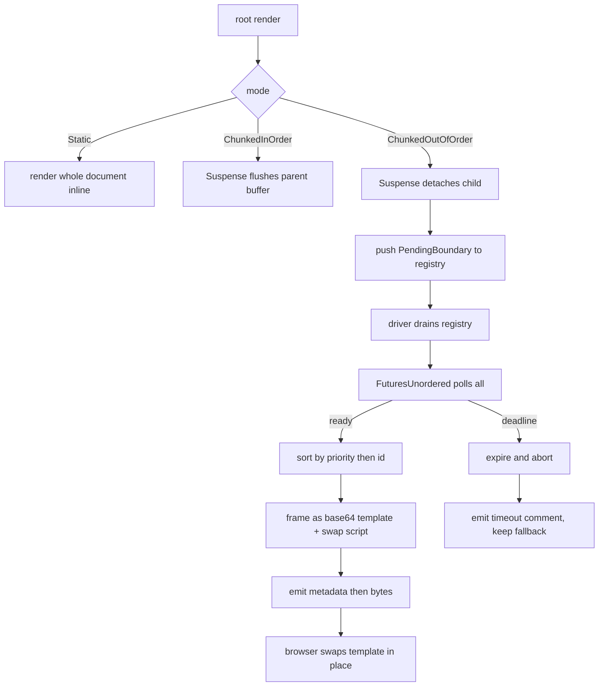

# 10 -- Streaming: Suspense, Drivers, and Page Pool

Streaming in Proa is a scheduling problem, not a serialization problem. The shell renders first. Each
deferred boundary renders into its own buffer. A driver polls all boundaries at once and emits
whichever finish first. The wire format carries boundary HTML as base64 inside an inert template, so
the browser swaps it in only when it is ready. This document covers the render mode, the boundary
types, `Suspense`, the out-of-order and in-order drivers, the runtime script, and the page pool.

## RenderMode and Priority

`RenderMode` (`proa_core/src/render/mode.rs:9`) selects how one request streams.

```rust
// proa_core/src/render/mode.rs:9
pub enum RenderMode {
    ChunkedInOrder,
    ChunkedOutOfOrder,
    #[default]
    Static,
    Agent,
}
```

`Static` renders the whole document into one buffer. `ChunkedInOrder` streams chunks in document
order. `ChunkedOutOfOrder` detaches each boundary and emits them as they complete. `Agent` targets
dense machine-readable output. `as_str` maps each to a snake_case string. `from_header` and
`from_query_param` parse friendly aliases like `in-order` or `out_of_order`.

`Priority` (`proa_core/src/render/priority.rs:14`) orders ready boundaries, not their starts.

```rust
// proa_core/src/render/priority.rs:14
pub enum Priority {
    #[default]
    Critical,
    Optional,
    Defer,
}
```

All boundaries start concurrently. Priority never delays or serializes work. When several complete
in the same driver turn, `Critical` is emitted before `Optional`, then `Defer`. Equal priorities use
their boundary id. `priority_rank` collapses the enum to 0, 1, 2 for sorting.

## The Boundary Model

The boundary types live in `proa_core` so `WebContext` and `Suspense` can schedule deferred work
without depending on `proa_stream`. `PendingBoundary` is the scheduled work.

```rust
// proa_core/src/render/stream.rs:75
pub struct PendingBoundary {
    pub id: u64,
    pub future: PendingBoundaryFuture,
    pub priority: Priority,
    pub timeout: Option<Duration>,
}
```

`PendingBoundaryFuture` is a `Pin<Box<dyn Future<Output = Result<RenderedBoundary, WriteError>> + 'static>>`.
`SendPendingBoundary` is the same shape with a `Send` future, kept as a separate type. A local
future cannot be relabeled into the send path through type erasure. This is the compiler proof the
direct streaming path relies on.

`RenderedBoundary` is the successful output of one detached branch.

```rust
// proa_core/src/render/stream.rs:27
pub struct RenderedBoundary<B = crate::RenderBuffer, N = PendingBoundary> {
    pub html: B,
    pub artifacts: RenderArtifacts,
    pub nested: Vec<N>,
}
```

The `html` and its `artifacts` travel together. A stream driver can publish exact RSJS and React
deltas only after the boundary commits. `nested` holds boundaries discovered while rendering the
detached branch. They stay speculative until their parent is published, so a nested update cannot
arrive before its placeholder exists in the DOM.

Two recorder traits schedule boundaries. `StreamBoundaryRecorder` (`stream.rs:157`) has
`next_boundary_id` and `push_boundary`. `SendStreamBoundaryRecorder` is the `Send` variant. Two
transport traits flush chunks. `StreamChunkView` (`stream.rs:174`) exposes ordered slices without a
contiguous copy. `StreamChunkFlusher` (`stream.rs:209`) has `flush_chunk` and a default
`flush_chunk_view` that flattens.

## StreamContext and Identity

`StreamContext` (`proa_stream/src/context.rs:17`) is the request-scoped registry.

```rust
// proa_stream/src/context.rs:17
pub struct StreamContext {
    handle: Arc<StreamHandle>,
    mode: RenderMode,
    pending_boundaries: Rc<RefCell<Vec<PendingBoundary>>>,
}
```

It implements `StreamBoundaryRecorder`. `next_boundary_id` delegates to the shared
`StreamHandle::next_token`. `push_boundary` appends to the `RefCell` vector. `drain_boundaries_into`
moves newly registered work into a reusable staging vector, so nested boundary admission does not
reallocate on every driver turn.

`StreamHandle` (`proa_stream/src/handle.rs:10`) pairs a `RequestId` with an `AtomicU64` counter
starting at 1. `RequestId` (`proa_stream/src/request_id.rs:8`) draws from a process-global
`AtomicU64` starting at 1. `LocalBoundaryBranch` (`context.rs:84`) is a branch-owned registry for a
detached boundary that is still speculative. Nested futures do not enter the live scheduler until
their parent commits.

`SendStreamContext` (`context.rs:114`) is the `Send` twin, using `Arc<Mutex<Vec<SendPendingBoundary>>>`
instead of `Rc<RefCell<...>>`. The `RefCell` variant is deliberately single-threaded. The `Send`
variant exists only for compiler-proved `Send` graphs.

## Suspense

`Suspense` (`proa_stream/src/suspense.rs:30`) is one type with three personalities.

```rust
// proa_stream/src/suspense.rs:30
pub struct Suspense<C, Fb> {
    pub child: C,
    pub fallback: Fb,
    pub priority: Priority,
    pub timeout: Option<Duration>,
}
```

`new` defaults to `Priority::Critical` and no timeout. `priority` and `timeout` matter only in
out-of-order HTML streaming. Buffered, in-order, and Markdown rendering preserve document order and
ignore both, because reordering would break their wire contract and cancelling a flushed in-order
child could leave partial markup on the wire.

The `WebRender` impl branches on mode. In `ChunkedOutOfOrder` with a recorder, it detaches the child.

```rust
// proa_stream/src/suspense.rs:142
if matches!(cx.render_mode(), RenderMode::ChunkedOutOfOrder) {
    if let Some(recorder) = cx.stream_recorder().cloned() {
        let boundary_id = recorder.next_boundary_id();
        let context_parts = cx.context_parts();
        let nested_stream = Rc::new(LocalBoundaryBranch::new(Rc::clone(&recorder)));
        // ...
        recorder.push_boundary(PendingBoundary::with_options(
            boundary_id,
            Box::pin(async move {
                let mut child_cx =
                    WebContext::<L, RenderBuffer>::with_loader_buffer_and_context_parts(
                        RenderBuffer::new(),
                        loader,
                        context_parts,
                    )
                    .with_render_mode(RenderMode::ChunkedOutOfOrder);
                child_cx.set_stream_recorder(child_stream);
                // render child, recover error fallback, commit artifacts
                let out = child_cx.into_output();
                let nested = nested_stream.take_boundaries();
                Ok(RenderedBoundary::with_nested(out, artifacts, nested))
            }),
            priority,
            timeout,
        ));
        // write start comment, fallback, end comment
        return RenderOutcome::Done(...);
    }
}
```

The detached child owns its `RenderBuffer` and its artifact delta. The only shared mutable state is
the boundary registry. The shell gets a start comment, the fallback, and an end comment. The child's
future is scheduled for later.

In `ChunkedInOrder` with a flusher, the child renders inline on the same context, flushing chunks.

```rust
// proa_stream/src/suspense.rs:204
if matches!(cx.render_mode(), RenderMode::ChunkedInOrder)
    && cx.stream_chunk_flusher().is_some()
{
    let pre_flush = cx.flush_stream_chunk();
    let future = Box::pin(async move {
        pre_flush?;
        let mut output_guard = ClearRenderBufferOnDrop::new(&mut cx.out);
        // render child, recover error fallback, commit or rollback
        let result = cx.flush_stream_chunk();
        output_guard.disarm();
        result
    });
    return RenderOutcome::Pending(future);
}
```

`ClearRenderBufferOnDrop` (`suspense.rs:52`) holds a raw pointer to the shared `RenderBuffer`. If the
in-order boundary is cancelled or unwinds before its final flush, the drop guard clears only the
unflushed suffix. Nested successful flushes already cleared the buffer and stay committed.

The default path ignores the fallback and renders the child inline.

```rust
// proa_stream/src/suspense.rs:257
let _ = fallback;
RenderOutcome::Pending(Box::pin(
    async move { proa_core::render_child(cx, child).await },
))
```

`let _ = fallback` marks the deliberate discard. A static or in-order render never shows the
fallback. The `MdRender` impl does the same with a `RestoreMarkdownBoundaryOnDrop` guard that restores
`MdState` on cancellation. The `WebRenderSend` impl mirrors the three branches for `SendWebContext`.

## The Out-of-Order Driver

`OutOfOrderBoundaryDriver` (`proa_stream/src/driver/out_of_order.rs:176`) is the runtime-independent
scheduler.

```rust
// proa_stream/src/driver/out_of_order.rs:176
pub struct OutOfOrderBoundaryDriver {
    in_flight: FuturesUnordered<ScheduledBoundaryFuture>,
    scheduled: BTreeMap<u64, ScheduledBoundary>,
    ready: VecDeque<BoundaryEvent>,
    deadlines: DeadlineIndex,
}
```

`in_flight` polls all admitted futures concurrently. `scheduled` maps id to priority, deadline, and
an `AbortHandle`. `ready` buffers events already produced but not yet returned. `deadlines` tracks
the earliest timeout.

The observable event is `BoundaryEvent` (`out_of_order.rs:159`).

```rust
// proa_stream/src/driver/out_of_order.rs:159
pub enum BoundaryEvent<R = RenderedBoundary> {
    Finished { id: u64, rendered: Result<R, WriteError> },
    TimedOut { id: u64 },
}
```

`push` admits a boundary, computing its deadline from `now + timeout`. It wraps the future in
`Abortable` so the driver can cancel a stalled child. `next_completed` batches every result ready in
the same poll, sorts by `(priority_rank, id)`, and returns the first. `expire` cancels every boundary
whose deadline passed and emits `TimedOut` events in the same priority order.

The deadline index switches representation at a crossover.

```rust
// proa_stream/src/driver/out_of_order.rs:35
const DEADLINE_HEAP_THRESHOLD: usize = 64;
```

Below 64 boundaries, deadlines live in a dense `Vec` scanned on each wake. Above it, the index
rebuilds as a min-heap of `(deadline, id)` pairs. Stale entries are checked against the live
`BTreeMap`, so an id whose deadline changed never produces a wrong expiry. The `rebalance` method
shrinks back to dense below half the threshold.

The non-tokio `next_event` (`out_of_order.rs:565`) has no clock. It conservatively expires every
timed boundary at admission, so a timeout never becomes an unbounded wait. Hosts that want
elapsed-time semantics drive `next_deadline` and `expire` with their own clock.

`SendOutOfOrderBoundaryDriver` (`out_of_order.rs:190`) is the structurally separate `Send` twin. A
local future cannot enter the direct path through type erasure.

## The Transport Frame

The out-of-order wire format carries HTML as base64 inside an inert template.

```rust
// proa_stream/src/driver/out_of_order.rs:770
const BOUNDARY_TEMPLATE_OPEN: &[u8] = b"<template id=\"proa-tpl-";
const BOUNDARY_TEMPLATE_ENCODING: &[u8] = b"\" data-proa-encoding=\"base64-v1\">";
const BOUNDARY_TEMPLATE_CLOSE: &[u8] = b"</template>";
const BOUNDARY_SCRIPT_OPEN: &[u8] = b"<script";
const BOUNDARY_SWAP_OPEN: &[u8] = b">$proa(";
const BOUNDARY_SWAP_CLOSE: &[u8] = b");</script>";
```

`append_boundary_template_slices` writes the open tag, encodes the HTML slices directly into the
template with a streaming `EncoderWriter`, then writes the close tag. `append_boundary_swap_script_with_nonce`
appends a script that calls `$proa(id)`. A same-ready batch writes several templates then one
`$proaBatch([ids])` script. A timeout writes `<!--proa:timeout:id-->` with no swap, preserving the
fallback already in the shell.

The drain loop ties it together.

```rust
// proa_stream/src/driver/out_of_order.rs:658
pub async fn drain_pending_boundaries_with_nonce_and_artifacts<F, Fut>(
    stream: &StreamContext,
    nonce: Option<&CspNonce>,
    mut emit: F,
) where
    F: FnMut(OutOfOrderBoundaryChunk) -> Fut,
    Fut: Future<Output = bool>,
{
    let mut driver = OutOfOrderBoundaryDriver::new();
    let mut pending_boundaries = Vec::new();
    loop {
        stream.drain_boundaries_into(&mut pending_boundaries);
        driver.extend(pending_boundaries.drain(..), Instant::now());
        let Some(event) = driver.next_event().await else { break; };
        // build OutOfOrderBoundaryChunk from Finished/TimedOut
        if !emit(chunk).await { return; }
    }
}
```

`OutOfOrderBoundaryChunk` (`out_of_order.rs:627`) is `id`, `bytes`, and `artifacts`. A successful
boundary carries its exact `RenderArtifacts`. Failures and timeouts carry an empty snapshot, because
their speculative subtree is not published. The callback must emit metadata before `bytes`. The
swap script dispatches `proa:boundary-ready` at the end of `bytes`, so metadata appended after the
frame arrives too late.

## The Runtime Script

The browser-side runtime (`proa_stream/src/runtime_script.rs:8`) is one minified script. It installs
`window.$proaBatch`, which walks comment markers `proa:start:<id>` and `proa:end:<id>`, finds the
`<template id="proa-tpl-<id>">`, decodes its base64 content, and swaps it in before the end marker.
`window.$proa(id)` is the single-id spelling.

The script refuses templates that are not exactly `data-proa-encoding="base64-v1"`, that lack both
markers, or whose markers are not siblings. The versioned encoding tag gates the decode path. `atob`
then `TextDecoder` turn the bytes into HTML, which is installed with `t.innerHTML`. After the swap it
dispatches `proa:boundary-ready`.

`inline_runtime_tag` returns the script as static bytes. `write_inline_runtime_tag` appends the
request `CspNonce` when one is configured.

## Supervised Drivers

The tokio-backed drivers (`proa_stream/src/driver/supervised.rs`) handle timed boundaries while the
HTTP body is backpressured. An untimed boundary stays inline in `FuturesUnordered`. A timed boundary
is owned by a runtime task, so its timeout can still fire and drop the child future during
backpressure.

`RuntimeOutOfOrderBoundaryDriver` (`supervised.rs:184`) is a hybrid. If a pinned local executor has
entered `LocalBoundarySupervisionGuard`, timed boundaries use `spawn_local`; otherwise they stay
inline. `supervise` races the child against `tokio::time::sleep(timeout)` with a biased select, so a
boundary ready at its deadline wins over cancellation. A panicking child is caught and surfaced as
`WriteError::render("boundary task panicked")`.

`RuntimeSendOutOfOrderBoundaryDriver` (`supervised.rs:302`) does the same with `tokio::spawn` when a
runtime is present. The `SupervisedTasks::next_events` batch sorts completed tasks by priority then
id, exactly like the inline driver.

## In-Order Markdown Driver

`InOrderMarkdownDriver` (`proa_stream/src/driver/in_order_markdown.rs:37`) renders a Markdown root to
a transport-facing flusher.

```rust
// proa_stream/src/driver/in_order_markdown.rs:69
pub async fn render_md_in_order_to_flusher<R: MdRender>(
    root: R,
    flusher: Rc<dyn StreamChunkFlusher>,
) -> Result<(), WriteError> {
    render_md_in_order_to_flusher_with_loader(root, Arc::new(NoLoader), flusher).await
}
```

The with-loader variant builds a `WebContext` with `ChunkedInOrder` mode and the flusher, renders the
root, then flushes the final chunk. `VecChunkFlusher` is the in-memory test sink. `render_md_in_order_to_vec`
wraps it to collect a `Vec<u8>`. The test `suspense_flushes_markdown_chunks_in_order` pins the
guarantee: three chunks, `before\n`, `child\n\n`, `after\n`, in that order.

## PreparedLoader and Discovery

`PreparedLoader` (`proa_stream/src/preloaded_loader.rs:64`) starts known keys before render begins.

```rust
// proa_stream/src/preloaded_loader.rs:64
pub struct PreparedLoader<L: ?Sized = dyn DynDataLoader> {
    inner: Arc<L>,
    prepared: HashMap<LoadKey, SharedLoad>,
}
```

`start_prepared` (`preloaded_loader.rs:35`) is the only runtime seam in `proa_stream`. With the
default `rt-tokio` feature it spawns the load eagerly onto the ambient runtime. Without it the future
is stored unspawned and starts on first await. The eagerness changes three user-visible behaviors:
panic handling, drop semantics, and runtime requirements. The doc comment on `start_prepared` lists
them precisely.

`CollectLoadKeys` (`proa_stream/src/discovery.rs:12`) is the discovery surface. A route root
implements it to append known keys to a vector, which the framework passes to `PreparedLoader` so
pre-send can start them before the shell renders. The full pre-send story is in
[12-framework-core.md](./12-framework-core.md).

## The Page Pool

The spec names a page pool. The source tells a more precise story. `PagePool`
(`proa_core/src/render/sink.rs:107`) exists but is deprecated.

```rust
// proa_core/src/render/sink.rs:107
#[deprecated(note = "RenderBuffer owns and recycles its pages directly")]
pub struct PagePool<const N: usize> {
    spare: RefCell<Vec<SinkPage<N>>>,
    max_idle: usize,
}
```

`PagePool` keeps a `Vec` of recycled `SinkPage` allocations, capped at 16 idle pages by default.
`SinkWriter` checks pages out, seals them when full, and returns them on flush or drop. `MemorySink`
collects flushed bytes for tests. All of these are marked `#[deprecated]`. The module doc is blunt:
standard sync, async, Markdown, and streaming rendering now use the owned `RenderBuffer`, and the
legacy types are unused by framework, `Suspense`, `ErrorBoundary`, or standard context paths.

The modern buffer is `RenderBuffer` (`proa_core/src/shared/write_buf.rs:746`), a
`ChainedBumpWriter<4096>`. `STANDARD_PAGE_SIZE` is 4096 bytes. `RenderBuffer` owns and recycles its
pages directly, with no external pool. Its page ownership and checkpoint mechanics are in
[04-write-buf.md](./04-write-buf.md). The out-of-order frame's `append_boundary_buffer_template`
encodes `RenderBuffer::slices()` without flattening, so page edges never corrupt the base64.

## The Full Flow



The shell, fallback, and start and end comments are already on the wire before the driver starts.
Each boundary commit arrives as a self-contained frame. The browser installs it exactly where the
markers say.

## The Aha Moment

**Aha:** Out-of-order streaming never streams raw HTML into the live DOM. It streams base64 inside an
inert `<template>` tag, then swaps the decoded result in with a script.

This is a deliberate security and correctness choice, not a size optimization. A raw HTML fragment
dropped mid-document is parsed immediately by the browser. An attacker-controlled string containing
`</template>` or a malformed tag could break out of the frame and rewrite the page. By base64-encoding
the fragment, the parser sees only the inert template element. The bytes inside are inert text until
the swap script decodes and installs them.

The versioned tag `data-proa-encoding="base64-v1"` closes the decode path. The runtime refuses any
template whose encoding tag is not exactly that value, then decodes with `atob` and `TextDecoder`.
The test `boundary_transport_round_trips_unicode_and_adversarial_bytes` feeds the frame unicode, a
nested balanced template, and three malformed closing-tag escapes. Every byte round-trips, and no
`<` survives in the encoded payload.

The same "inert until ready" principle appears in the shell. The start and end markers are HTML
comments, which the parser treats as inert. The fallback is real markup the browser shows
immediately. When the boundary commits, the runtime replaces the region between the markers. The
fallback is what the user sees while the real content is still in flight.

## Cross-References

- The `RenderBuffer` page ownership and `ChainedBumpWriter`: [04-write-buf.md](./04-write-buf.md).
- `DataResolver` and `PreparedLoader` in the data-loading stack: [09-data-loading.md](./09-data-loading.md).
- The `WebRender`, `WebRenderSend`, and `MdRender` traits `Suspense` implements: [02-render-traits.md](./02-render-traits.md).
- The `WebContext` fork and `context_parts` that detach a boundary: [03-web-context.md](./03-web-context.md).

Continue to [11-ir.md](./11-ir.md).
