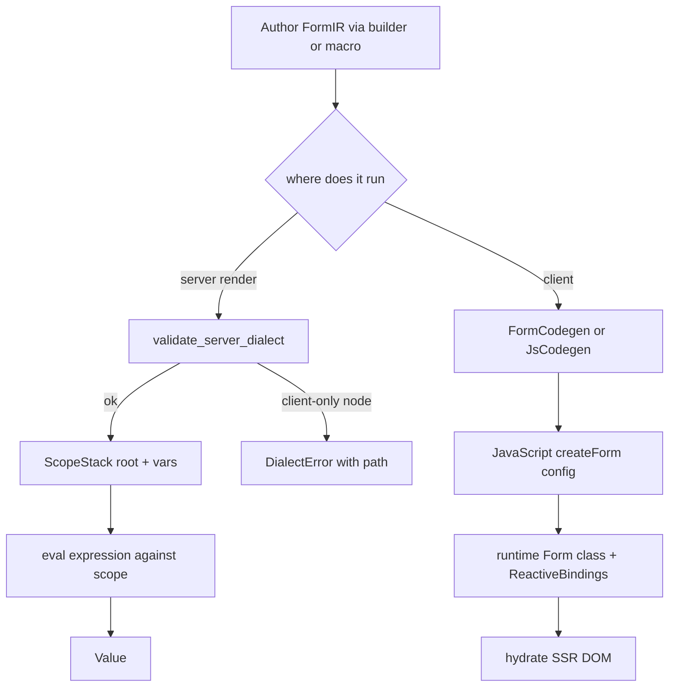
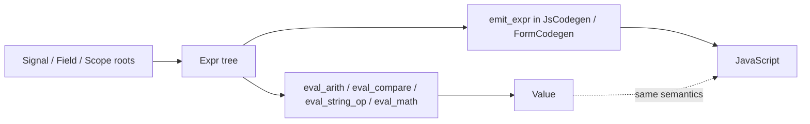

# 11 -- The IR: Expressions, Statements, Reactive Bindings, and Codegen

The `proa_ir` crate is one typed tree with a split brain. The same `Expr` tree runs two ways. On
the server it is interpreted against a data scope. On the client it is compiled to JavaScript. The
two paths must agree, so the server evaluator reimplements ECMAScript coercion and rounding
semantics exactly. This document covers every layer: identifiers, values, expressions, statements,
triggers, reactive attributes, forms, validation, the builder API, the three code generators, and
the server evaluator.

## The Layer Contract

The crate doc (`proa_ir/src/lib.rs:4`) states the design goals in four words. The IR must be
complete, type-safe, optimizable, and portable. It builds up in layers.

```rust
// proa_ir/src/lib.rs:19
// - Types: Basic identifiers (SignalId, FieldId, Selector, etc.)
// - Values: Literal values that can appear in the IR
// - Expressions: Pure computations that produce values
// - Statements: Side effects (state updates, DOM operations, fetches)
// - Triggers: Events that cause effects to run
```

Expressions are pure. Statements have side effects. Triggers schedule effects. This split is
enforced by the types themselves. `Expr` has no assignment node. `Stmt` has no value result. A
handler is a `Block` of `Stmt` run under a `Trigger`.

The crate is `#![forbid(unsafe_code)]`. `Expr` and `Value` are `Serialize + Deserialize`, so a
runtime-template compiler can store a compiled program as data. The server evaluation section
covers how those stored programs run.

## IrStr and the Identifier Types

`IrStr` (`proa_ir/src/types.rs:18`) is the string type for identifiers, property keys, and string
literals.

```rust
// proa_ir/src/types.rs:18
pub type IrStr = Cow<'static, str>;
```

Compile-time construction borrows a `&'static str`. Deserialized programs own their strings. Every
identifier is a newtype over `IrStr`. `SignalId`, `FieldId`, `VarId`, and `Selector` each have a
`const fn new(&'static str)` that borrows, an `owned(impl Into<String>)` for runtime strings, and
`as_str`. The const constructors keep the macro and builder paths allocation-free.

The small enums live here too. `Method` (`types.rs:99`) has `Get`, `Post`, `Put`, `Patch`,
`Delete`, serialized UPPERCASE. `ToastLevel` (`types.rs:111`) has `Info`, `Success`, `Warning`,
`Error`, serialized lowercase. `ContentType` (`types.rs:122`) and `ResponseType` (`types.rs:133`)
cover fetch options.

## Value

`Value` (`proa_ir/src/value.rs:23`) is the literal data type. It has seven variants.

```rust
// proa_ir/src/value.rs:23
#[serde(untagged)]
pub enum Value {
    Null,
    Bool(bool),
    Int(i64),
    Float(f64),
    String(IrStr),
    Array(Vec<Value>),
    Object(#[serde(with = "object_entries")] Vec<(IrStr, Value)>),
}
```

`Int` and `Float` are one observable "JS number" type. `Int` exists only so authoring and
serialization stay exact for integer data. `Object` keeps insertion order as a `Vec` of pairs.
Duplicate keys follow JS object-literal semantics: the last entry wins on access. The
`object_entries` serializer (`value.rs:42`) writes objects as JSON maps, not arrays of pairs, so
serialized values look like and round-trip as JS objects.

Constructors are `const fn`: `null`, `bool`, `int`, `float`, `string`. `object` is the non-const
constructor. `From` impls cover `bool`, `i32`, `i64`, `f64`, `&'static str`, `String`, `Vec<T>`,
and `Option<T>` where `T: Into<Value>`.

## Expr

`Expr` (`proa_ir/src/expr.rs:16`) is the expression language. It has 85 variants across nine
families: primitives, property access, arithmetic, comparison, logic, strings, construction and
arrays, type checks and conversion, and math. A few representative groups show the shape.

```rust
// proa_ir/src/expr.rs:16
#[serde(tag = "type", rename_all = "snake_case")]
pub enum Expr {
    Lit { value: Value },
    Signal { id: SignalId },
    Field { id: FieldId },
    Var { id: VarId },
    Scope { path: Vec<IrStr> },
    Response,
    Error,
    Event,
    Target,
    // ...
    Prop { expr: Box<Expr>, prop: IrStr },
    Index { expr: Box<Expr>, index: Box<Expr> },
    // ...
    FormatNumber { value: Box<Expr>, decimals: u8 },
    // ...
    CardType { expr: Box<Expr> },
}
```

The `Scope` variant is the server data root. Its `path` walks nested objects from the render scope.
Missing segments resolve to `Null`. `Signal`, `Field`, `Response`, `Error`, `Event`, and `Target`
are client-only roots. The `FormatNumber` variant is the money workhorse. Its doc example is
`Concat["$", FormatNumber(total_cents / 100, 2)]`.

The tree exposes a `for_each_child` walker (`expr.rs:403`). The match is exhaustive with no
wildcard arm. Adding an `Expr` variant is a compile error until the walker learns its children.
Consumers that need the whole subtree drive this with an explicit worklist, which keeps the walk
allocation-bounded and immune to stack overflow on hostile deeply nested expressions.

Convenience constructors mirror the builder. `Expr::lit`, `signal`, `field`, `var`, `scope`,
`scope_path`, `response`, `error`, `prop`, `index`, and the arithmetic, comparison, logic, and
string operators all exist. `From<bool/i32/i64/f64/&str/String>` let literals coerce into `Expr`.

## Stmt

`Stmt` (`proa_ir/src/stmt.rs:21`) is the side-effect language. `Block` is just `Vec<Stmt>`
(`stmt.rs:16`). It has 55 variants across control flow, state updates, async operations, DOM
operations, navigation, notifications, storage, and clipboard.

```rust
// proa_ir/src/stmt.rs:21
#[serde(tag = "type", rename_all = "snake_case")]
pub enum Stmt {
    Let { var: VarId, value: Expr },
    SetSignal { id: SignalId, value: Expr },
    SetField { id: FieldId, value: Expr },
    SetFieldError { id: FieldId, error: Expr },
    // ...
    If { cond: Expr, then: Block, else_: Option<Block> },
    For { var: VarId, index_var: Option<VarId>, iter: Expr, body: Block },
    // ...
    Fetch { url: Expr, options: FetchOptions, on_success: Block, on_error: Block },
    // ...
    Toast { message: Expr, level: ToastLevel, duration_ms: Option<u32> },
    // ...
    CopyToClipboard { value: Expr },
    Log { value: Expr, level: LogLevel },
}
```

`FetchOptions` (`stmt.rs:275`) carries `method`, `headers`, `body`, `content_type`,
`response_type`, `credentials`, `timeout_ms`, `cache`, `retries`, and `retry_delay_ms`.
`Credentials` (`stmt.rs:328`) is `SameOrigin`, `Include`, or `Omit`. `CacheMode` (`stmt.rs:341`)
has five values from `Default` to `OnlyIfCached`. `ScrollBehavior` (`stmt.rs:358`) and `LogLevel`
(`stmt.rs:368`) are the small enums. `Match` statements use `MatchArm` (`stmt.rs:379`) and
`Pattern` (`stmt.rs:389`), which supports `Wildcard`, `Literal`, `Binding`, and `Equals`.

## Trigger and Effect

`Trigger` (`proa_ir/src/trigger.rs:44`) has 31 variants across lifecycle, form field events, form
events, element events, reactive signals, window events, and timers.

```rust
// proa_ir/src/trigger.rs:44
pub enum Trigger {
    Mount,
    Unmount,
    Input { field: FieldId },
    Change { field: FieldId },
    Blur { field: FieldId },
    Focus { field: FieldId },
    // ...
    Click { selector: Selector },
    KeyDown { selector: Selector, key: Option<KeyFilter> },
    // ...
    SignalChange { signal: SignalId },
    SignalsChange { signals: Vec<SignalId> },
    Computed { expr: Expr },
    // ...
    Interval { ms: u32 },
    Timeout { ms: u32 },
    CustomEvent { event: &'static str },
}
```

`KeyFilter` (`trigger.rs:177`) matches a key plus optional `ctrl`, `shift`, `alt`, and `meta`
modifiers. Its constructors are `const fn`, so `KeyFilter::new("Enter").ctrl()` compiles at
const-eval time. Convenience constructors `on_input`, `on_change`, `on_blur`, `on_focus`,
`on_click`, `on_signal`, `on_key`, `on_enter`, and `on_escape` cover the common cases.

`Effect` (`trigger.rs:16`) pairs a `Trigger` with a body and an optional `when` condition. The
`when` field is `#[serde(skip_serializing_if = "Option::is_none")]`, so a bare effect serializes
to just its trigger and body.

## Reactive Attributes

`Binding` (`proa_ir/src/reactive.rs:15`) is the client computation model. It has seven variants.

```rust
// proa_ir/src/reactive.rs:15
pub enum Binding {
    Static,
    FormState { key: &'static str },
    FieldState { field: &'static str, key: &'static str },
    Not { inner: Box<Binding> },
    And { left: Box<Binding>, right: Box<Binding> },
    Or { left: Box<Binding>, right: Box<Binding> },
    Map { inner: Box<Binding>, expr: &'static str },
}
```

`ReactiveAttr<T>` (`reactive.rs:86`) holds a `default` value and a `binding`. SSR outputs the
default. If the binding is not `Static`, JS is generated to update the attribute. `static_value`,
`form_state`, and `field_state` construct the three base cases. `map_binding` wraps a binding in a
JavaScript expression where `$` is the value.

The `Not`, `BitAnd`, and `BitOr` impls for `ReactiveAttr<bool>` are the clever part. They
short-circuit at compile time.

```rust
// proa_ir/src/reactive.rs:161
impl BitAnd for ReactiveAttr<bool> {
    fn bitand(self, rhs: Self) -> Self::Output {
        ReactiveAttr {
            default: self.default && rhs.default,
            binding: match (&self.binding, &rhs.binding) {
                (Binding::Static, Binding::Static) => Binding::Static,
                (Binding::Static, _) if !self.default => Binding::Static, // false && x = false
                (_, Binding::Static) if !rhs.default => Binding::Static,  // x && false = false
                (Binding::Static, _) if self.default => rhs.binding,      // true && x = x
                (_, Binding::Static) if rhs.default => self.binding,      // x && true = x
                _ => self.binding.and(rhs.binding),
            },
        }
    }
}
```

`true && x` becomes just `x`. `false && x` becomes `Static`. `BitOr` does the dual. `negated`
eliminates double negation, so `!!is_valid` returns the original `FormState` binding. These
optimizations mean a disabled button written as `is_submitting | !is_valid` serializes to the
smallest possible client binding, not a tree of boolean nodes.

`ReactiveClass` (`reactive.rs:200`) is the reactive string form. It has a `base` class plus a list
of `(condition, class_if_true, class_if_false)` triples. `default_class` computes the SSR string.

## FormIR

`FormIR` (`proa_ir/src/form.rs:18`) is the top-level structure compiled to JavaScript.

```rust
// proa_ir/src/form.rs:18
pub struct FormIR {
    pub id: &'static str,
    pub signals: Vec<SignalDef>,
    pub fields: Vec<FieldDef>,
    pub derived: Vec<DerivedDef>,
    pub effects: Vec<Effect>,
    pub options: FormOptions,
}
```

`SignalDef` (`form.rs:45`) holds an id, an initial value, and an optional `persist` storage key.
`FieldDef` (`form.rs:79`) holds an id, an optional initial value, `rules`, `validate_on`,
`transforms`, an optional `format` mask, and optional `disabled` and `readonly` expressions.
`DerivedDef` (`form.rs:152`) is a named computed expression.

`FormOptions` (`form.rs:169`) carries the form behavior. Its defaults matter.

```rust
// proa_ir/src/form.rs:220
impl Default for FormOptions {
    fn default() -> Self {
        Self {
            action: None,
            method: None,
            validate_on_submit: true,
            scroll_to_error: true,
            focus_error: true,
            show_error_summary: false,
            error_summary_selector: None,
            disable_submit_when_invalid: false,
            disable_submit_while_loading: true,
            reset_on_success: false,
            on_submit: None,
            on_success: None,
            on_error: None,
        }
    }
}
```

Three submit-time behaviors are on by default: validate all fields, scroll to the first error, and
focus it. The submit button is disabled while loading by default, but not while invalid. A form
author turns on the rest explicitly through the builder.

## ValidationRule and InputFormat

`ValidationRule` (`proa_ir/src/validate.rs:15`) has 43 variants across presence, length, numeric,
format, date, cross-field, conditional, array, file, async, custom, and composition. The
convenience constructors cover the common ones: `required`, `email`, `min_length`, `max_length`,
`pattern`, `matches`, `async_validate`, `when`, `required_if`, `required_if_field`, and `custom`.

`ValidationTrigger` (`validate.rs:338`) is `Blur` (the default), `Input`, `Change`, or `Submit`.
`Transform` (`validate.rs:353`) is `Trim`, `Lowercase`, `Uppercase`, `DigitsOnly`, or
`NormalizeWhitespace`. `InputFormat` (`validate.rs:369`) is the display mask: `Phone`,
`CreditCard`, `Date`, `Ssn`, `ZipCode`, `Cvc`, `Name`, `Currency`, or `Custom`.

```rust
// proa_ir/src/validate.rs:369
pub enum InputFormat {
    Phone,
    CreditCard,
    Date { pattern: &'static str },
    Ssn,
    ZipCode,
    Cvc,
    Name,
    Currency { locale: &'static str },
    Custom { mask: &'static str },
}
```

`FieldValidation` (`validate.rs:322`) is the standalone validation config used by the older form
surface. It bundles a `FieldId`, rules, a trigger, and transforms.

## Server Evaluation

`eval` (`proa_ir/src/eval/mod.rs`) interprets the server dialect of `Expr` against a `ScopeStack`
and produces a `Value`. The module doc states the contract directly. The same IR compiles to JS
for the client, so evaluation semantics are pinned to the JS emitters: f64 arithmetic and
coercion, strict `===` comparison, UTF-16 string lengths, and JS method semantics.

`ScopeStack` (`eval/mod.rs:42`) is the data environment. It has a root value plus a stack of named
bindings pushed for loop variables.

```rust
// proa_ir/src/eval/mod.rs:42
pub struct ScopeStack<'a> {
    root: &'a Value,
    vars: Vec<(IrStr, Value)>,
}
```

`push_var` and `pop_var` manage bindings. `var` looks up innermost-first. The interpreter pushes a
binding for each `ForEach` style loop body and pops it after.

`EvalBudget` (`eval/mod.rs:83`) bounds evaluation. The defaults are `DEFAULT_MAX_DEPTH = 64`
(`eval/mod.rs:91`) and `DEFAULT_MAX_ITERATIONS = 10_000` (`eval/mod.rs:93`). `eval` uses the
default budget. `eval_with_budget` takes an explicit one.

`EvalError` (`eval/mod.rs:107`) has nine variants: `DepthLimit`, `IterationLimit`, `UnknownVar`,
`TypeMismatch`, `CompositeComparison`, `ClientOnly`, `Unsupported`, `InvalidRegex`, and
`InvalidDecimals`. Evaluation never panics. Malformed or over-budget input surfaces here.

The dispatcher is split into per-category handlers for a deliberate reason. The comment at
`eval/mod.rs:420` explains it.

```rust
// proa_ir/src/eval/mod.rs:420
// The evaluator is split into per-category handlers rather than one giant
// match: debug builds do not reuse stack slots across match arms, so a
// single ~85-arm function makes each recursion level cost tens of KB of
// stack and the depth budget alone cannot prevent overflow.
```

Each recursion level is a small `Cx` frame. The depth budget then keeps evaluation inside even a
2 MiB test-thread stack. `eval_inner` (`eval/mod.rs:491`) routes each variant to `eval_access`,
`eval_arith`, `eval_compare`, `eval_logic`, `eval_string_op`, `eval_construct`, `eval_array_op`,
`eval_type_op`, or `eval_math`. The match is exhaustive, so new variants fail compilation until
routed.

The semantics helpers are the heart of the JS parity. `jsnum.rs` implements `to_number`
(`jsnum.rs:13`), `display` (`jsnum.rs:33`), `number_to_string` (`jsnum.rs:61`), and `js_round`
(`jsnum.rs:252`).

```rust
// proa_ir/src/eval/jsnum.rs:252
// JS `Math.round`: half-up toward positive infinity.
pub fn js_round(x: f64) -> f64 {
    if !x.is_finite() || x.fract() == 0.0 {
        return x;
    }
    let f = x.floor();
    if x < f + 0.5 {
        f
    } else {
        f + 1.0
    }
}
```

The doc comment is explicit about why. `floor(x + 0.5)` misrounds values like
`0.49999999999999994`, because the addition itself rounds up to 1.0. The exact-midpoint version is
correct.

`number_to_string` matches ECMAScript shortest-round-trip formatting and switches to exponent form
outside `[1e-6, 1e21)`. `utf16_len`, `utf16_lt`, `utf16_slice`, and `utf16_at` make string length
and indexing match JS UTF-16 code units, not Rust `char`s. `parse_int_10` and `parse_float`
reimplement the JS leading-prefix parsing rules.

`tofixed.rs` reimplements `Number.prototype.toFixed`. The problem is subtle. ECMAScript picks the
integer closest to `x * 10^d`, choosing the larger one on exact ties. Rust's `format!("{:.d}")`
rounds ties to even, so it disagrees on exactly representable ties like `0.125`. The fix expands
the double to its exact decimal digits and rounds half-up on the digit string. `MAX_FRACTION_DIGITS`
is 100 (`tofixed.rs:16`). `EXACT_PRECISION` is 1100 (`tofixed.rs:21`), which exceeds the longest
possible exact expansion of an f64 fraction.

`date.rs` formats epoch milliseconds in UTC. `format_date` (`date.rs:19`) supports tokens `YYYY`,
`YY`, `MM`, `M`, `DD`, `D`, `HH`, `H`, `mm`, `m`, `ss`, `s`, and `SSS`. `MAX_TIME_MS` is
`8.64e15` (`date.rs:11`). Out-of-range input yields `"Invalid Date"` like JS. The day-to-date
conversion uses Howard Hinnant's `civil_from_days` algorithm (`date.rs:62`).

`Add` is special. `js_add` (`eval/mod.rs:263`) follows JS `+`: string concatenation if either
operand is a string, numeric addition otherwise. `strict_eq` (`eval/mod.rs:292`) errors on arrays
and objects, because JS compares them by reference identity and server values have no identity.
`prop_access` (`eval/mod.rs:345`) is null-propagating: `Null` bases and missing properties yield
`Null`. Duplicate object keys resolve to the last entry.

## Server Dialect Validation

`validate_server_dialect` (`proa_ir/src/dialect.rs:71`) rejects client-only nodes before a program
runs.

```rust
// proa_ir/src/dialect.rs:71
pub fn validate_server_dialect(expr: &Expr) -> Result<(), Vec<DialectError>> {
    validate_server_dialect_bounded(expr, usize::MAX)
}
```

The bounded variant stops collecting once the budget is full. `DialectErrorReason`
(`dialect.rs:23`) is `ClientOnly`, `Impure`, or `Unsupported`. `Now` is `Impure`, because server
renders must be deterministic. `ParseDate` is `Unsupported`. Everything else rejected is
`ClientOnly`.

`DialectError` (`dialect.rs:34`) carries the offending variant name, a dot path into the tree, and
the reason. The path points at the exact subexpression. An error like
`client-only expression `Signal` at `cond.left.items[2]`` tells an authoring tool precisely where
to look. The walker collects every offending node, not just the first, so a whole slot can be
fixed in one round trip.

`Stmt` is not reachable from `Expr`, so no statement-level walk is needed. Expressions are pure.

## The Builder API

The builder modules (`proa_ir/src/builder/mod.rs:8`) provide a fluent API for constructing IR by
hand. This is the ergonomic path for tooling and tests. `ExprBuilder` (`builder/expr.rs:16`) wraps
an `Expr` with chainable methods for every family: `lit`, `signal`, `field`, `var`, `scope`,
`scope_path`, `prop`, `index`, arithmetic, comparison, logic, `then_else`, `or_else`, string and
array operations, type checks, conversion, math, and validation helpers.

```rust
// proa_ir/src/builder/expr.rs:609
let expr = ExprBuilder::field("email")
    .len()
    .gt(0)
    .and(ExprBuilder::field("email").is_email())
    .build();
```

`FormBuilder` (`builder/form.rs:18`) builds a `FormIR`. `signal`, `signal_persisted`, `field`,
`field_with_rules`, `derived`, `derived_from`, `effect`, and `effect_when` add members.
`on_input`, `on_change`, `on_blur`, `on_click`, `on_submit`, and `on_signal_change` are shortcuts
for effects. `FieldBuilder` (`builder/form.rs:213`) configures one field with validation,
transforms, format masks, and disabled or readonly conditions. `BlockBuilder`
(`builder/form.rs:358`) builds statement blocks. The `block()` and `form()` free functions are the
entry points.

```rust
// proa_ir/src/builder/form.rs:555
let form = form("signup")
    .signal("loading", false)
    .field("email", |f| {
        f.required("Email is required").email("Invalid email").trim()
    })
    .field("password", |f| {
        f.required("Password is required").min_length(8, "At least 8 characters")
    })
    .derived_from("is_valid", ExprBuilder::form_valid)
    .on_submit(block().set("loading", true).build())
    .disable_submit_when_invalid()
    .build();
```

## Code Generation

The codegen module (`proa_ir/src/codegen/mod.rs`) has two generations. The legacy `JsCodegen`
(`codegen/js.rs:17`) compiles a `FormIR` to one self-contained IIFE. The newer split codegen
separates a shared runtime from a tiny per-form config.

```rust
// proa_ir/src/codegen/mod.rs:38
// Legacy full codegen (includes everything inline)
pub use js::{expr_to_js, JsCodegen};

// New split codegen
pub use form::{FormCodegen, FormCodegenConfig};
pub use runtime::{
    generate_runtime, generate_runtime_minified, runtime_url, DEFAULT_CDN_URL, RUNTIME_VERSION,
};
```

`JsCodegen` emits an IIFE with `$id`, `$s` for signals, `$f` for fields, `$e` for errors, `$t` for
touched state, `$v` for validators, and inline helper functions. Its `emit_expr` maps every `Expr`
variant to a JavaScript expression. `Signal` becomes `$s.name`. `Field` becomes `$f.name`. `Scope`
becomes `$scope["segment"]`. `FieldHasError` becomes `$e.name !== null`.

The split path has a different shape. `FormCodegen` (`codegen/form.rs:39`) emits a `<script
type="module">` that imports from the runtime CDN and calls `createForm(id, config)`.

```rust
// proa_ir/src/codegen/form.rs:55
pub fn generate_script(form: &FormIR, config: FormCodegenConfig) -> String {
    let mut gen = Self::new(config);
    gen.emit_script(form);
    gen.output
}
```

`FormCodegenConfig` (`codegen/form.rs:19`) has `cdn_url`, `minify`, and `inline`, defaulting to
`None`, `false`, and `true`. `generate_js` omits the script tag but keeps the import.

The runtime (`codegen/runtime.rs`) is a self-contained JavaScript string. `RUNTIME_VERSION` is
`"0.1.0"` (`runtime.rs:10`). `DEFAULT_CDN_URL` is `"https://cdn.proa.so"` (`runtime.rs:13`).
`runtime_url` (`runtime.rs:19`) returns a direct `.js` path when given one, otherwise
`{base}/v{version}/proa.min.js`. The runtime exports `Form`, `ReactiveBindings`, `createForm`,
`debounce`, `throttle`, `toast`, card detection, and the input formatters.

```rust
// proa_ir/src/codegen/runtime.rs:30
pub fn generate_runtime() -> String {
    RUNTIME_JS.to_string()
}
```

The runtime `Form` class holds `signals`, `fields`, `errors`, `touched`, `dirty`, `rules`,
`asyncRules`, and `formats`. It binds to the DOM, validates fields, handles submit, and manages
effects. `ReactiveBindings` (`runtime.rs:901`) discovers `data-bind-*` attributes and reevaluates
them when form state changes. `createForm` (`runtime.rs:1087`) queues forms registered before
`DOMContentLoaded` and initializes them when the DOM is ready.

`expr_to_js` (`codegen/js.rs:1414`) renders a single `Expr` as a standalone JavaScript expression
string. It is used for evaluator and emitter parity testing.

The script-context escaper matters for security. `escape_string` (`codegen/js.rs:1434`) masks the
three byte sequences that could break out of an inline script: `<` becomes `\x3C` so the HTML
tokenizer never sees `</script>` or `<!--`, and `U+2028` and `U+2029` become their `\uXXXX`
escapes so legacy parsers cannot break a string literal. The doc comment notes this mirrors the
canonical script-context masking in `proa_react/src/island.rs`.

## The Serde Bridge

`ser.rs` serializes any `Serialize` type directly into a `Value`, not through `serde_json::Value`.
There is no intermediate tree, so scope data allocates only the resulting `Value`.

```rust
// proa_ir/src/ser.rs:95
pub fn to_value<T>(value: &T) -> Result<Value, ToValueError>
where
    T: ?Sized + Serialize,
{
    value.serialize(ValueSerializer)
}
```

`ToValueError` (`ser.rs:18`) has four variants: `IntOutOfRange` when an integer does not fit in
`i64`, `BytesUnsupported` for byte arrays, `KeyMustBeString` for non-string map keys, and `Custom`.
Enums serialize externally tagged. Unit variants become strings. Newtype, tuple, and struct
variants become single-entry objects. The `MapKeySerializer` (`ser.rs:482`) accepts only strings
and chars and rejects everything else with a labeled `KeyMustBeString`.

## The Legacy FormHandle

`form_handle.rs` is the deprecated compatibility surface for older `#[derive(proa_macros::FormSchema)]`
users. The module doc points to the replacement.

```rust
// proa_ir/src/form_handle.rs:4
// New Proa forms should use the wellformed crate directly, via
// wellformed_macros::form_schema!(mod name = "schema.json", runtime =
// ::wellformed, client = ::rsjs).
```

The `FormSchema` trait (`form_handle.rs:288`) is `#[deprecated(since = "0.1.2")]`. `FormHandle<T>`
(`form_handle.rs:206`) collects field metadata and bindings during render, stored in `RefCell`s.
`FormState` (`form_handle.rs:105`) exposes `is_valid`, `is_submitting`, `is_dirty`, `is_touched`,
and `submit_count` as `ReactiveAttr`. `FieldState` (`form_handle.rs:35`) exposes `error`,
`has_error`, `touched`, `dirty`, and `value`. `FieldRegistration` (`form_handle.rs:155`) returns
the props to spread on an input.

## ComponentTree

`ComponentTree` (`proa_ir/src/component_tree.rs:12`) is the framework-owned component tree IR.
The `proa_macros::html_tree!` macro produces it without coupling the expansion to a component
library.

```rust
// proa_ir/src/component_tree.rs:19
pub enum TreeNode {
    Element(ElementNode),
    Component(ComponentNode),
    Text(TextNode),
    Expression(ExpressionNode),
    Conditional(ConditionalNode),
    Fragment(Vec<TreeNode>),
    ChildrenSlot,
}
```

`ElementNode` (`component_tree.rs:44`) has a tag, attrs, children, and a `self_closing` flag.
`TreeAttr` (`component_tree.rs:100`) is `Static`, `Dynamic`, `Bool`, `Computed`, or `Spread`.
`ComponentTree::uses_component` checks whether a tree references a name. `component_dependencies`
returns each referenced component once, in traversal order.

## dev_hot

`dev_hot.rs` holds the wire types for explicitly enabled development template updates.
`StaticManifest` (`dev_hot.rs:11`) is a `schema` version plus a map of templates keyed by an
authored ID. `StaticTemplate` (`dev_hot.rs:20`) holds a `shape` string and pre-escaped `slots`.
This is the substrate for hot-swapping static template runs in development without a recompile.

## The Full Flow



The same `Expr` tree feeds both branches. The server branch validates the dialect, then interprets
against a scope. The client branch compiles to JavaScript. The semantics agree because the server
interpreter reimplements ECMAScript rules.



## The Aha Moment

**Aha:** The server evaluator is not a separate language. It reimplements ECMAScript so the server
render and the client hydration agree digit for digit.

This is visible in three concrete places. `js_add` reimplements JS `+`, where one string operand
turns numeric addition into concatenation. `strict_eq` refuses to compare arrays and objects,
because JS compares them by reference identity and server values have no identity. `js_round`
implements half-up rounding against the exact midpoint, because `floor(x + 0.5)` misrounds values
like `0.49999999999999994`.

The `toFixed` implementation is the deepest example. ECMAScript picks the integer closest to
`x * 10^d`, choosing the larger one on exact ties. Rust rounds ties to even. So a naive Rust
`format!("{:.2}", 0.125)` disagrees with JavaScript on exactly representable ties. Proa expands the
double to its exact decimal digits, up to 1100 places, then rounds half-up on the digit string.
The result is the same string the browser would produce.

The split-brain design makes this necessary. One `Expr` tree is both a server program and a client
program. If the two paths disagreed, a value rendered server-side would differ from the value the
browser recomputes on hydration. The dialect validator keeps the boundary honest. Client-only nodes
are rejected before they reach the server interpreter, with a path to the offending subexpression.

## Cross-References

- The `Value` and `LoadValue` shape that data loading builds on: [09-data-loading.md](./09-data-loading.md).
- The `RenderBuffer` and `WriteError` types the server render path writes into: [04-write-buf.md](./04-write-buf.md).
- The RSJS island model that `proa_ir` compiles toward: [17-rsjs-overview.md](./17-rsjs-overview.md).
- The `html_tree!` macro that produces `ComponentTree`: [07-html-macros.md](./07-html-macros.md).
- The `wellformed` crate that new forms migrate to, named in the legacy surface: [23-supporting-crates.md](./23-supporting-crates.md).

Continue to [12-framework-core.md](./12-framework-core.md).
