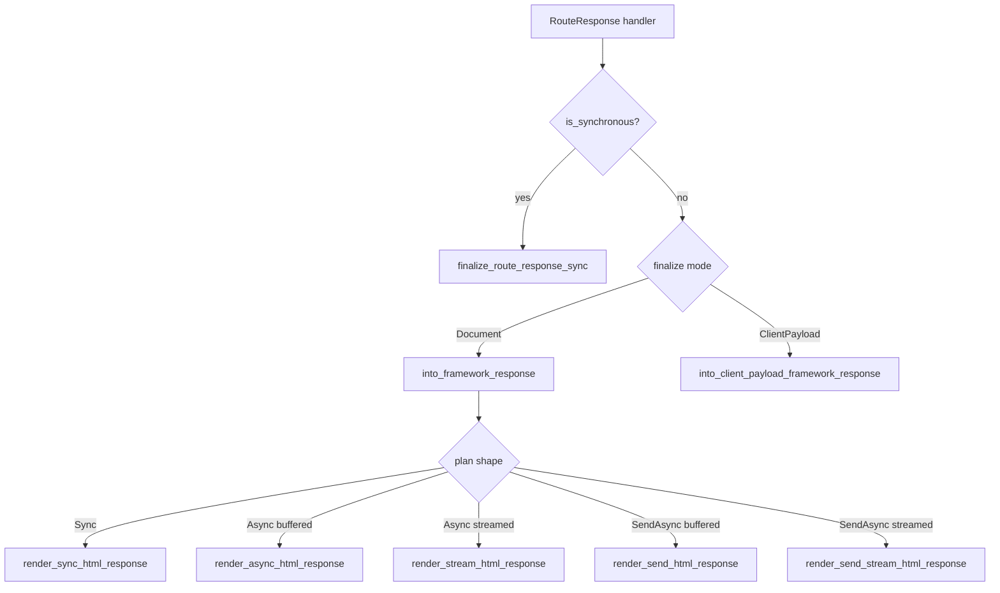
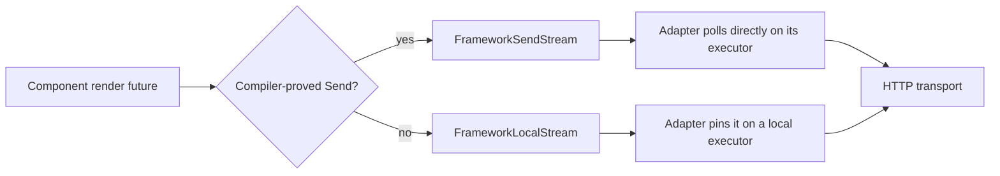

# 12 -- Framework Core: Manifest, Bootstrap, Body Finalizers, and the Send Policy

The `proa_framework_core` crate is the runtime-agnostic half of the server adapter. It does not know
about Axum, Hyper, or any specific HTTP server. It turns a compiled component into a
`FrameworkResponse` whose body is either a fully buffered byte blob or a stream of `Bytes`. Along
the way it reads an island manifest, resolves metadata from a route tree, appends the RSJS seed
tables and the island bootstrap script, and decides whether a render future may migrate between
executor threads. That last decision, the Send policy, is the crate's most important idea: the
distinction between `Send` and non-`Send` render graphs is carried by Rust's type system, not by a
runtime flag.

## The Crate Contract

The crate doc (`proa_framework_core/src/lib.rs:4`) names the job in one sentence: framework-agnostic
contracts shared by Proa server adapters. It has one feature, `rt-tokio`, on by default. That
feature is forwarded to `proa_stream` for eager parallel preloads. The crate itself never references
a runtime.

```rust
// proa_framework_core/src/lib.rs:12
#![forbid(unsafe_code)]

pub mod bootstrap;
pub mod manifest;
pub mod markdown;
pub mod metadata;
pub mod response;
pub mod route_snapshot;
pub mod route_spec;
```

Seven modules. The public surface re-exports the island bootstrap, the manifest types, the Markdown
response, the metadata cascade, the response finalizers, the route snapshot, and the route spec. Two
back-compat re-exports from `proa_core` (`drive_dyn_render`, `drive_dyn_send_render`, and the dyn
erasure trait) keep older call sites compiling.

## The Island Manifest

The manifest describes every interactive island the build produced. It is deserialized from a JSON
file at startup. The root type is `IslandManifest` (`proa_framework_core/src/manifest.rs:12`).

```rust
// proa_framework_core/src/manifest.rs:12
pub struct IslandManifest {
    pub islands: HashMap<String, IslandEntry>,
    #[serde(default)]
    pub assets: ManifestAssets,
    #[serde(default)]
    pub import_map: HashMap<String, String>,
    /// Filename of the SSR IIFE bundle (e.g. "ssr-entry.js") relative to dist dir.
    #[serde(default)]
    pub ssr_bundle: Option<String>,
}
```

`IslandEntry` (`manifest.rs:37`) holds one island. It has `module_path` (where the compiled module
lives), an optional named `export`, a `strategy`, a `module_preloads` list, a `providers` list, and
an optional `hydrate_fn`. `strategy` is `HydrationStrategyConfig` (`manifest.rs:52`), a
serde-tagged enum with five variants.

```rust
// proa_framework_core/src/manifest.rs:52
#[serde(tag = "type", rename_all = "snake_case")]
pub enum HydrationStrategyConfig {
    Immediate,
    Idle,
    Visible,
    Interaction { event: String },
    Media { query: String },
}
```

`Immediate` hydrates as soon as the script loads. `Idle` waits for the browser idle callback.
`Visible` waits for intersection with the viewport. `Interaction` waits for an event such as
`click`. `Media` waits for a media query such as `(min-width: 768px)`. Each strategy maps one to one
onto `proa_react::HydrationStrategy` in `bootstrap.rs:88`.

`ProviderSpec` (`manifest.rs:61`) is a provider module with an optional export and a JSON `props`
value. Providers supply shared client state to an island. `ManifestAssets` (`manifest.rs:24`)
carries at most one `CssAsset`, a `path` plus optional byte `size`.

### Loading and Validating a Manifest

`IslandManifest::load_from_path` (`manifest.rs:99`) reads the file, parses JSON, and calls
`validate`. `validate` (`manifest.rs:123`) walks every `module_path`, every preload, and every
provider module. It exists to stop a manifest write from becoming an arbitrary-code-serve bug.

```rust
// proa_framework_core/src/manifest.rs:141
fn validate_module_path(island: &str, module_path: &str) -> Result<()> {
    if module_path.is_empty() {
        anyhow::bail!("island {island:?} has empty module_path");
    }
    if module_path.starts_with("//") {
        anyhow::bail!(
            "island {island:?} module_path {module_path:?} is protocol-relative; \
             use an absolute https:// URL or a server-relative /path"
        );
    }
    if module_path.starts_with('/') {
        return Ok(());
    }
    if module_path.starts_with("https://") || module_path.starts_with("http://") {
        return Ok(());
    }
    anyhow::bail!(
        "island {island:?} module_path {module_path:?} must be an absolute URL \
         (https://...) or a server-relative path (/...)"
    );
}
```

Four things are accepted: a server-relative path starting with `/`, an `https://` URL, an `http://`
URL (for local dev rigs), or nothing is rejected. Three things are rejected: an empty string, a
protocol-relative `//host/x` URL, and a bare relative path such as `../evil.js`. Protocol-relative
URLs resolve against the page origin's scheme, so they are a scheme-hijack vector. Relative paths
resolve against the page origin too, which turns a manifest write into a path traversal.

`with_base_path` (`manifest.rs:77`) prefixes every application-local URL with the public mount
path. It deliberately leaves external URLs and import-map keys alone. The doc comment warns that it
must be called once, because reapplying it double-prefixes.

## Island Bootstrap

Bootstrap is the piece of HTML that wires browser React to the island markers a component rendered.
`render_bootstrap_for_islands` (`proa_framework_core/src/bootstrap.rs:16`) is the public entry. It
delegates to `render_bootstrap_for_islands_with_import_map` (`bootstrap.rs:25`), which does four
things in order.

```rust
// proa_framework_core/src/bootstrap.rs:32
let mut unique = BTreeSet::new();
let mut collected = Vec::new();

for name in islands {
    let owned = name.as_ref().to_string();
    if !unique.insert(owned.clone()) {
        continue;
    }
    let entry = manifest
        .resolve_entry(&owned)
        .with_context(|| format!("No island named '{}' in manifest", owned))?;
    collected.push((owned, entry));
}
```

First it dedupes island names through a `BTreeSet`, so an island rendered twice is bootstrapped
once. Second it resolves each name to its `IslandEntry`, failing with `No island named 'X' in
manifest` for an unknown island. Third it writes a `<link rel="modulepreload">` for each unique
preload URL. Fourth it writes the import map and calls `react_bootstrap`. The import map uses the
manifest's own `import_map` when present, or `render_react_import_map` otherwise.

`convert_entry` (`bootstrap.rs:79`) builds a `ReactModuleDescriptor` from the island name, module
path, export, and mapped strategy. The strategy mapping in `map_strategy` (`bootstrap.rs:88`) is a
straight five-arm match.

## The Metadata Cascade

Metadata (title, description, Open Graph) flows from parent layouts to child pages. The flow is a
cascade, not a simple override. The core type is `CascadeValue<T>`
(`proa_framework_core/src/metadata.rs:14`).

```rust
// proa_framework_core/src/metadata.rs:14
pub enum CascadeValue<T> {
    Set(T),
    Tombstone,
    #[default]
    Unset,
}
```

`Set(T)` overrides the parent. `Tombstone` explicitly clears the field and refuses inheritance.
`Unset` inherits the parent value. `resolve` (`metadata.rs:25`) maps these three to the final
`Option<T>`: `Set` yields `Some`, `Tombstone` yields `None`, `Unset` yields the parent.

The `Metadata` trait (`metadata.rs:55`) is implemented by page and layout metadata providers. It
defaults everything to `Unset`. A provider can return a title, flag `absolute_title`, return a
description, and return Open Graph. `TitleOnly` (`metadata.rs:38`) is the simplest provider: a
`&'static str` title with no other fields.

### Title Templates

A title such as `"%s | Base"` is a template. `ComputedRouteMeta::cascade`
(`metadata.rs:88`) walks local providers in order. When a title contains `%s`, it is stored as the
title template, not the title. When a later provider supplies a plain title like `Page`, the
template's `%s` is replaced, producing `Page | Base`. If a provider sets `absolute_title`, it
overrides the template entirely. Open Graph title and description use the same template rule,
tracked in `og_title_template` and `og_description_template`.

The final pass (`metadata.rs:219`) fills a still-empty Open Graph title from the page title when a
template and raw page title both exist. This is why a page that only sets a description template can
still inherit a complete Open Graph title.

### Rendering the Head

`render_metadata_head` (`metadata.rs:577`) writes `<title>`, then `<meta name="description">`, then
each Open Graph `<meta property="og:*">` tag. It builds tags by hand from `UnsafeRaw` scaffolding,
so every value inside a quoted attribute goes through `write_attr_value`
(`metadata.rs:564`).

```rust
// proa_framework_core/src/metadata.rs:564
fn write_attr_value(cx: &mut Ctx, value: &str) {
    let dialect = cx.__proa_current_escape_dialect();
    proa_core::shared::escape::escape_attr_value_for_dialect(&mut cx.out, value, dialect).unwrap();
}
```

This uses attribute escaping, which neutralizes the closing quote. Plain text escaping does not
escape `"`. The doc comment explains the risk: a value carrying a quote could break out of the
attribute and inject further attributes, such as an `http-equiv="refresh"` redirect. Metadata
fields are `&'static str` today, so this is defense in depth.

`render_css_link` (`metadata.rs:569`) writes a single `<link rel="stylesheet" href="..."/>` using
the same attribute escaping for the path.

## Route Specs and the Metadata Map

Routes are described once, at build or startup, as a `RouteSpec` tree. `RouteMode`
(`proa_framework_core/src/route_spec.rs:15`) has three values.

```rust
// proa_framework_core/src/route_spec.rs:15
pub enum RouteMode {
    Static,
    Server,
    #[default]
    ClientBrowser,
}
```

`Static` is SSG, pre-rendered at build time. `Server` is SSR, rendered per request. `ClientBrowser`
is CSR, where the client router handles navigation, and it is the default.

`RouteSpec` (`route_spec.rs:27`) holds a `&'static str` path, a `has_endpoint` flag, optional
`layout_metadata` and `metadata`, a `children` list, a `route_mode`, and an optional
`StaticPathsFn`. The constructors are fluent. `RouteSpec::endpoint` (`route_spec.rs:50`) makes a
leaf with an endpoint. `RouteSpec::page` (`route_spec.rs:62`) wraps a `TitleOnly` provider into a
leaked box. `RouteSpec::layout` (`route_spec.rs:76`) makes an interior node that carries layout
metadata and children. The `with_*` methods set children, metadata, layout metadata, route mode, and
static paths.

`compute_metadata_map` (`route_spec.rs:118`) walks the tree once and produces a
`HashMap<String, ComputedRouteMeta>` keyed by full path. Each node calls
`ComputedRouteMeta::cascade` against its parent, then recurses into children. `resolve_route_specs`
(`route_spec.rs:131`) produces the parallel `ResolvedRouteSpec` tree with concrete full paths and
metadata stacks.

`resolve_route_path` (`route_spec.rs:138`) joins parent and child segments. A path starting with `/`
resets to the root. A relative path extends the parent's segments. An empty segment list becomes the
single root `/`.

## Route Params

`extract_route_params` (`proa_framework_core/src/route_snapshot.rs:120`) matches a declarative
`:param` pattern against a concrete request path. It splits both on `/`, drops empty segments, and
walks them in lockstep.

```rust
// proa_framework_core/src/route_snapshot.rs:133
if let Some(name) = pattern_segment.strip_prefix(':') {
    params.push(RouteParam::new(
        name.to_owned().into_boxed_str(),
        request_segment.to_owned().into_boxed_str(),
    ));
} else if pattern_segment != request_segment {
    return RouteParams::default();
}
```

A `:name` segment captures the request segment under that name. A literal segment must match
exactly. Any mismatch returns an empty `RouteParams`. `/products/:id/reviews/:slug` matched against
`/products/42/reviews/top` yields `id = "42"` and `slug = "top"`.

`FrameworkRouteSnapshot` (`route_snapshot.rs:20`) is the per-request state an adapter stores in task
locals or extensions. It holds the manifest, a metadata provider stack, the resolved metadata cache,
the computed metadata map, the current URI, the current route params, and a client-request flag. Its
swap and restore methods (`swap_route_params`, `restore_route_params`, `swap_metadata`,
`restore_metadata`) let an adapter temporarily push and pop state as it descends into a child route
or a client request, then unwind. `resolve_metadata` (`route_snapshot.rs:104`) memoizes the stack
resolution so repeated calls do not re-walk the providers.

## The RouteResponse Plan

`RouteResponse<L>` (`proa_framework_core/src/response.rs:152`) is the opaque render plan a handler
returns. It is generic over the loader type `L`, defaulting to `NoLoader`, so `cx.load(...)` calls
monomorphize to direct calls on `L` instead of going through a dyn box. The plan is one of three
shapes.

```rust
// proa_framework_core/src/response.rs:123
enum RoutePlan<L: DataLoader> {
    Sync(Box<dyn DynWebRenderSync<NoLoader, RenderBuffer> + Send>),
    Async {
        component: Box<dyn DynWebRender<L, RenderBuffer> + Send>,
        loader: Arc<L>,
        delivery: AsyncDelivery,
        preload_keys: Vec<LoadKey>,
    },
    SendAsync {
        component: Box<dyn DynWebRenderSend<L, RenderBuffer> + Send>,
        loader: Arc<L>,
        delivery: AsyncDelivery,
        preload_keys: Vec<LoadKey>,
    },
}
```

`Sync` wraps a `WebRenderSync` component. `Async` wraps a `WebRender` component whose active future
is local (not `Send`). `SendAsync` wraps a `WebRenderSend` component whose future is compiler-proved
`Send`. The three-way split is the whole Send policy in miniature: a non-`Send` render graph goes
down the `Async` arm, a `Send` graph goes down the `SendAsync` arm, and no runtime flag upgrades one
into the other.

`AsyncDelivery` (`response.rs:92`) is a private enum with four values: `BufferedStatic`,
`BufferedAgent`, `StreamInOrder`, `StreamOutOfOrder`. It is derived from `RenderMode` by
`from_render_mode` (`response.rs:100`). `Static` maps to `BufferedStatic`, `Agent` to
`BufferedAgent`, `ChunkedInOrder` to `StreamInOrder`, and `ChunkedOutOfOrder` to
`StreamOutOfOrder`. The inverse `render_mode` method is used to stamp the request's mode during
finalization.

### Constructors

The `NoLoader` block (`response.rs:275`) has five constructors: `ssr` (sync), `ssr_async` (buffered
async), `ssr_stream` (out-of-order stream), `ssr_async_send` (buffered `Send`), and
`ssr_stream_send` (streamed `Send`). The `DynLoaderHandle` block (`response.rs:158`) and the generic
`L` block (`response.rs:362`) add `_with_loader` and `_with_loader_dyn` variants. The
`_dyn` variants use a type-erased loader, which costs one `Box::pin` per `cx.load` call. The typed
variants preserve the monomorphized fast path.

`with_loader` (`response.rs:454`) replaces the loader on an async plan and is a no-op on `Sync`.
`with_render_mode` (`response.rs:469`) sets `AsyncDelivery::from_render_mode`, so a buffered route
and a streamed route cannot be configured into an impossible mixed state. `with_islands`
(`response.rs:435`) names islands to bootstrap. `with_bootstrap` (`response.rs:444`) overrides the
React bootstrap config.

### Preload Keys

`with_preload_keys` (`response.rs:220`) and `with_preload_requests` (`response.rs:233`) install
in-order preload keys for the dyn path. They wrap the loader with a `PreparedLoader<dyn>` so the
in-order driver warms the keys without special-casing the typed path. `with_preload_requests` is
preferred when the preload needs advisory hints, because it forwards the exact `LoadRequest` instead
of recreating a key-only request.

## Response Finalization

Finalization is the step that turns a `RouteResponse` into a `FrameworkResponse`. There are three
entry points.

```rust
// proa_framework_core/src/response.rs:733
pub async fn finalize_route_response<L: DataLoader + 'static>(
    response: RouteResponse<L>,
    manifest: &IslandManifest,
    request: &FrameworkRequestContext,
    mode: RouteFinalizeMode,
) -> Result<FrameworkResponse, FrameworkError> {
    if response.is_synchronous() {
        return finalize_route_response_sync(response, manifest, request, mode);
    }
    match mode {
        RouteFinalizeMode::Document => response.into_framework_response(manifest, request).await,
        RouteFinalizeMode::ClientPayload { page_title } => Ok(response
            .into_client_payload_framework_response(page_title, manifest, request)
            .await),
    }
}
```

`finalize_route_response_sync` (`response.rs:754`) is the synchronous fast path. It requires a
`Sync` plan and never awaits an async renderer. `finalize_route_response_stream`
(`response.rs:764`) packages an unopened stream factory without polling, so adapters can defer the
first-item gate to an async service boundary. `RouteFinalizeMode` (`response.rs:728`) is either
`Document` or `ClientPayload { page_title }`. The client payload mode renders the component to HTML
and wraps it in a JSON object with an optional title, via `encode_client_payload`
(`response.rs:710`).

The finalizers inspect the plan and call one of six render functions:
`render_sync_html_response`, `render_async_html_response`, `render_send_html_response`,
`render_stream_html_response`, `render_send_stream_html_response`, or the component-to-HTML
variants for client payloads.



## Body Finalizers

Every non-streaming finalizer runs the same sequence after the component has rendered. Take
`render_sync_html_response` (`proa_framework_core/src/response.rs:975`).

```rust
// proa_framework_core/src/response.rs:994
islands.extend(render_artifacts.react_islands);
let rsjs_artifacts = render_artifacts.rsjs;
let mut buffer = buffer.into_vec();
let query_seed_table_json = rsjs_artifacts.query_seed_table_json();
let response_tail_start = buffer.len();
append_rsjs_query_seed_table_if_needed(&mut buffer, query_seed_table_json.as_deref(), request.csp_nonce.as_ref())?;
append_rsjs_shared_state_seed_table_if_needed(&mut buffer, shared_seed_table_json.as_deref(), request.csp_nonce.as_ref())?;
append_rsjs_runtime_plan_with_base_path(&mut buffer, rsjs_artifacts.rendered_islands(), request.csp_nonce.as_ref(), request.request.base_path())?;
render_bootstrap_if_needed(&mut buffer, manifest, islands, &bootstrap, request.csp_nonce.as_ref())?;
move_appended_response_tail_before_body(&mut buffer, response_tail_start);
validate_html_utf8(&buffer)?;
```

The sequence is: collect the React island names the render discovered, take the RSJS artifacts, then
append four things in order. First the query seed table, a `<script type="application/json"
id="rsjs-query-seed-table">` tag holding the server-computed query cache. Second the shared-state
seed table, `id="rsjs-shared-state-seed-table"`, holding the shared store states the render
published. Third the runtime plan, the linked RSJS scripts and preloads for the rendered islands.
Fourth the React island bootstrap. Each step is guarded by an `*_if_needed` check and skips when the
underlying data is empty.

Each seed table writer has a fragment variant. `append_rsjs_query_seed_fragment_if_needed`
(`response.rs:2045`) adds `data-rsjs-seed-scope="fragment"` to the tag. The fragment form is used
inside a streaming boundary, where a deferred child publishes a seed after the shell has already
shipped. The page form is used at the shell level.

### The Nonce

Every Proa-emitted script tag honors a per-request CSP nonce. `CspNonce::write_html_attr`
(`response.rs:2076`) writes the `nonce="..."` attribute when a nonce is present. The seed table
writers, the runtime plan, and the bootstrap all thread `Option<&CspNonce>` through. This is what
lets a strict Content-Security-Policy allow Proa's inline scripts without allowing every inline
script on the page.

### The Runtime Plan Delta

`append_rsjs_runtime_plan_delta_with_base_path` (`response.rs:2207`) keeps an
`rsjs::PageRuntimeEmissionState` across chunks. Streaming calls the delta variant once per chunk, so
a runtime script discovered in a late boundary is emitted once and never repeated. The public
`append_rsjs_runtime_plan_with_base_path` (`response.rs:2182`) creates a fresh emission state, which
is correct for a buffered response that has exactly one chunk.

```rust
// proa_framework_core/src/response.rs:2219
let manifest = rsjs::manifest();
let urls = rsjs::CanonicalRsjsAssetUrls::new(base_path.as_str());
let plan = manifest.page_runtime_plan_with_urls(rendered_islands, &urls)?;
plan.write_html_delta(buffer, emission, nonce)?;
```

It resolves the rendered island names against the canonical asset URLs, prefixed by the request's
base path, then writes only the delta.

### The Bootstrap Finalizer

`render_bootstrap_if_needed` (`response.rs:2254`) skips entirely when the island set is empty, so a
page with zero islands does not emit an empty `<script>` tag. `render_bootstrap_delta_if_needed`
(`response.rs:2288`) is the streaming variant. It tracks an `ReactBootstrapEmissionState`
(`response.rs:2281`) that remembers which island names have already been published and whether the
runtime has been emitted. It computes the delta of new names, renders only those, and flips
`runtime_emitted` so the import map is emitted once.

### Moving the Tail Before the Body

`move_appended_response_tail_before_body` (`response.rs:2332`) solves an ordering problem. The
component renders the document, including its closing `</body></html>`. The finalizers append the
seed tables and scripts after that. Those generated tags must land before `</body>`, not after
`</html>`. The function finds the document suffix and rotates the appended tail into place.

```rust
// proa_framework_core/src/response.rs:2332
fn move_appended_response_tail_before_body(buffer: &mut [u8], tail_start: usize) {
    const BODY_CLOSE: &[u8] = b"</body>";
    const HTML_CLOSE: &[u8] = b"</html>";
    // ... trims trailing ASCII whitespace, then verifies
    // rendered[..rendered_end].ends_with(HTML_CLOSE)
    // and rendered[..before_html].ends_with(BODY_CLOSE)
    let body_close_start = before_html - BODY_CLOSE.len();
    let tail_len = buffer.len() - tail_start;
    buffer[body_close_start..].rotate_right(tail_len);
}
```

It requires the structural suffix `</body></html>` with optional ASCII whitespace between and after
the tags. A fragment containing the literal bytes `</body>` inside a script string is not mistaken
for a document, because the fragment does not end with the full `</body></html>` suffix. The test
`response_tail_does_not_treat_raw_body_bytes_in_a_fragment_as_a_document` (`response.rs:2579`)
locks this down.

### UTF-8 Validation

`validate_html_utf8` (`response.rs:2378`) runs `std::str::from_utf8` over the whole assembled body
before it ships. The doc comment explains it should never fail, because the macros escape user
input and all literal writes come from `&'static str`. The only realistic failure is a custom
component calling `WriteBuf::extend` with raw non-UTF-8 bytes. The check catches that bug class at
the boundary. It is `O(n)` and sub-microsecond for a 16 KB shell, so it is always on for
non-streaming responses. Streaming per-page paths cannot run it, because a UTF-8 multi-byte
sequence may straddle a page boundary.

## Security Headers

`add_default_security_headers` (`proa_framework_core/src/response.rs:951`) installs baseline headers
on every SSR response. Each is set only if not already present.

```rust
// proa_framework_core/src/response.rs:951
pub fn add_default_security_headers(headers: &mut HeaderMap) {
    if !headers.contains_key("x-content-type-options") {
        headers.insert("x-content-type-options", HeaderValue::from_static("nosniff"));
    }
    if !headers.contains_key("x-frame-options") {
        headers.insert("x-frame-options", HeaderValue::from_static("DENY"));
    }
    if !headers.contains_key("referrer-policy") {
        headers.insert("referrer-policy", HeaderValue::from_static("strict-origin-when-cross-origin"));
    }
    if !headers.contains_key(header::CONTENT_TYPE) {
        headers.insert(header::CONTENT_TYPE, HeaderValue::from_static("text/html; charset=utf-8"));
    }
}
```

`nosniff` disables MIME sniffing. `DENY` is the clickjacking defense. `strict-origin-when-cross-origin`
prevents full-URL leakage to other origins. Apps that must be embeddable can relax `X-Frame-Options`
through the Axum layer's security headers config, which runs after this function.

`merge_response_context` (`response.rs:903`) merges the component's `ResponseContext` into the
finished response. It replaces default headers once per name, then appends every supplied value,
with cookies accumulating alongside framework-installed ones. This is why a component can set a
status, add `Link` preload headers, and append multiple `Set-Cookie` headers without the framework
dropping them.

## The Send Policy

This is the crate's centerpiece. A render stream may hold request-local, non-`Send` state. A server
whose body API requires `Send` cannot poll that stream directly. Proa does not force every component
future to be `Send`. It carries the distinction in the type system.

```rust
// proa_framework_core/src/response.rs:58
pub type FrameworkLocalStream =
    Pin<Box<dyn Stream<Item = Result<Bytes, FrameworkError>> + 'static>>;

// proa_framework_core/src/response.rs:63
pub type FrameworkSendStream =
    Pin<Box<dyn Stream<Item = Result<Bytes, FrameworkError>> + Send + 'static>>;
```

`FrameworkLocalStream` has no `Send` bound. `FrameworkSendStream` requires the complete active
future graph to be `Send`. The factory enum `FrameworkStreamFactory` (`response.rs:77`) has two
variants, `Send` and `Local`. The doc comment on `FrameworkStreamFactory` states the rule plainly:
adapters poll `Send` streams directly and place `Local` streams on a pinned local executor. No
runtime flag can upgrade a local stream into the direct path.

The `Send`-capable render functions exist because `WebRenderSend` components carry a compiler-proof
`Send` future. `render_send_stream_html_response` (`response.rs:1190`) produces a
`FrameworkSendStream`. The non-`Send` `render_stream_html_response` (`response.rs:1141`) produces a
`FrameworkLocalStream`. Both stream the same document structure. Only the type boundary differs.

The test `send_stream_moves_between_threads_without_losing_request_state` (`response.rs:2483`)
proves the `Send` path. It renders a page on one thread, moves the stream to a second thread, and
asserts the request path survives. The local path, by contrast, is driven by a local executor that
does not require the future to migrate.



## The Streaming Drivers

There are four driver types, one per combination of Send and ordering.
`OutOfOrderStreamDriver` (`response.rs:1363`) and `SendOutOfOrderStreamDriver` (`response.rs:1536`)
render the shell, then loop over boundary events from a `StreamContext`. Each finished boundary gets
its seed fragments, its runtime plan delta, its bootstrap delta, and a `<template>` buffer, then a
batch swap script. Timed-out boundaries are blanked and their fallback preserved. Failed boundaries
are blanked with an error log, and the stream keeps going rather than aborting.

`InOrderStreamDriver` (`response.rs:1707`) and `SendInOrderStreamDriver` (`response.rs:1842`) use an
unbounded mpsc channel and a `select` loop between the render future and the channel receiver. The
comment at `response.rs:1741` explains why the channel is unbounded: the producer and consumer are
sub-futures of the same task, so the flush method cannot `.await` channel capacity without
deadlocking. Backpressure against slow clients is applied one level up by the bounded bridge channel
in the Axum layer.

`FRAMEWORK_SINK_PAGE_SIZE` (`response.rs:1962`) is `4096`, the logical page size retained for tests.
`ChannelSink` (`response.rs:1966`) implements both `StreamChunkFlusher` and `SendStreamChunkFlusher`
by forwarding each flushed chunk to the channel. The test
`channel_sink_coalesces_one_logical_render_buffer_flush` (`response.rs:2543`) verifies a 9000-byte
buffer flushes as one chunk.

## The Markdown Response

`MarkdownResponse<L>` (`proa_framework_core/src/markdown.rs:64`) is the buffered Markdown analogue
of `RouteResponse`. It wraps a `DynMdRender<L>` box and a loader. The unopened plan is `Send`, even
though its active finalization future is local, which is why a `Send` handler can return it and let
the HTTP adapter drive finalization.

`finalize` (`markdown.rs:79`) installs the same request context HTML uses, drives the render, and
calls `finish_markdown`. `finish_markdown` (`markdown.rs:101`) sets `Content-Type:
text/markdown; charset=utf-8`, sets `Content-Length`, and chooses `FrameworkBody::Full` when the
output is one page or `FrameworkBody::BufferedPages` when it spans pages. `render_sync_markdown_response`
(`markdown.rs:91`) is the sync entry for `MdRenderSync` roots.

## The Aha Moment

**Aha:** The framework never asks whether a render future is `Send`. The answer is written into the
type before the handler runs, and the type picks the executor.

This is not a runtime capability flag. `RoutePlan::Async` and `RoutePlan::SendAsync` are distinct
variants. `FrameworkStreamFactory::Send` and `FrameworkStreamFactory::Local` are distinct variants.
A component that implements `WebRender` produces a local future and lands on the local path. A
component that implements `WebRenderSend` produces a compiler-proved `Send` future and lands on the
direct path. No code can promote the former to the latter.

The benefit is portability without a universal `Send` tax. Server adapters that can poll local
futures do not force every component to box and prove `Send`. Adapters that require `Send` use the
`WebRenderSend` trait for the components that can support it. The local stream's doc comment
(`response.rs:46`) says it directly: treat the local-only factory as an adapter limitation, not a
reason to impose `Send` on all component futures.

## Cross-References

- The render traits this plan dispatches on: [02-render-traits.md](./02-render-traits.md).
- The `RenderMode` values that map to `AsyncDelivery`: [03-web-context.md](./03-web-context.md).
- The streaming substrate the drivers wrap (`Suspense`, boundary drivers, page pool): [10-streaming.md](./10-streaming.md).
- The `LoadKey` and `LoadRequest` types used for preloads: [09-data-loading.md](./09-data-loading.md).
- The RSJS seed tables and runtime plan this crate appends: [17-rsjs-overview.md](./17-rsjs-overview.md).
- The Axum adapter that consumes `FrameworkResponse` and applies the local executor: [13-framework-axum.md](./13-framework-axum.md).

Continue to [13-framework-axum.md](./13-framework-axum.md).
