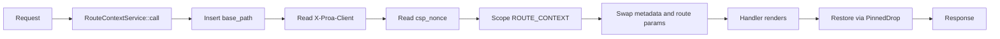

# 13 -- Framework Axum: Routing, Static Serving, HTTP Integration

The `proa_framework_axum` crate is the Axum half of the server adapter. `proa_framework_core`
produced a `FrameworkResponse` and decided, in the type system, whether a render future is `Send`.
This crate is where that response becomes real HTTP. It wraps a declarative route tree into an Axum
`Router`, runs handlers inside a task-local request context, executes non-`Send` render futures on a
pinned worker pool, and layers security and performance policy on top. Every one of those jobs is a
`tower` `Layer`. The order in which the layers wrap the router is the server's security posture, so
the build method is the most important function in the crate.

## The Layer Stack

`FrameworkBuilder` (`proa_framework_axum/src/lib.rs`) collects the server's tunable knobs. Its
`build` method then assembles the router in a fixed order. The first defaults are one MiB for the
body limit and thirty seconds for the request timeout.

```rust
// proa_framework_axum/src/lib.rs
pub const DEFAULT_BODY_LIMIT_BYTES: usize = 1024 * 1024; // 1 MiB
pub const DEFAULT_REQUEST_TIMEOUT: Duration = Duration::from_secs(30);
```

`build` applies these layers, innermost first: RSJS assets, external apps, the `/static` nest, the
dynamic route tree, `RouteContextLayer`, then the limits and security layers, then the CSP nonce
layer, then the manifest extension. Each name below is one call in `build`.

```mermaid
flowchart TD
    REQ[Incoming request] --> L1[CspNonceLayer]
    L1 --> L2[SecurityHeadersLayer]
    L2 --> L3[CatchPanicLayer]
    L3 --> L4[GlobalConcurrencyLimitLayer]
    L4 --> L5[TimeoutLayer]
    L5 --> L6[CrossOriginProtectionLayer]
    L6 --> L7[DefaultBodyLimit]
    L7 --> L8[RouteContextLayer]
    L8 --> L9[Dynamic route tree]
    L9 --> L10[/static nest]
    L10 --> L11[External apps]
    L11 --> L12[RSJS assets]
    L12 --> HAND[Handler]
```

The order matters. `CrossOriginProtectionLayer` must run before the handler so a rejected
cross-origin request never reaches render code. `DefaultBodyLimit` must wrap everything that reads a
body. `CspNonceLayer` is outermost so every response, including error responses, carries a fresh
nonce. A security decision expressed as a layer is auditable in one place.

## Configuration

`ProaConfig` (`proa_framework_axum/src/config.rs`) holds the project layout the dev server needs.
The defaults describe the standard Proa scaffold: crates under `./crates`, the server crate at
`./crates/server`, the frontend at `./apps/web`, generated code at `./apps/web/src/.generated`, the
public dir at `./apps/web/public`, and the build output at `./apps/web/dist`.

```rust
// proa_framework_axum/src/config.rs
pub struct ServerConfig {
    pub port: u16,            // 3000
    pub host: String,         // "127.0.0.1"
    pub auto_reload: bool,    // true in debug, false in release
}
```

`CodegenConfig` toggles `routes`, `components`, and `islands` generation, all true by default, with
`watch` true in debug builds. The port and host are the only values the running server strictly
needs; the rest describe where the CLI should look for generated code and assets.

## Graceful Shutdown

`serve` and `serve_with_shutdown` (`proa_framework_axum/src/server.rs`) drain in-flight requests
before the process exits. The default grace window is thirty seconds.

```rust
// proa_framework_axum/src/server.rs
pub const DEFAULT_GRACEFUL_SHUTDOWN_TIMEOUT: Duration = Duration::from_secs(30);
```

A `tokio::select!` with `biased` prefers the shutdown signal. `hyper_util`'s `GracefulShutdown`
then stops accepting connections while existing ones finish. If the deadline passes first, the
outcome is `ShutdownOutcome::DeadlineExceeded`; otherwise it is `Drained`.

## The Declarative Route Tree

Routes are declared as a nested `Route<State>` tree (`proa_framework_axum/src/route/spec.rs`). A
route carries a path, an optional endpoint, an optional layout, metadata, children, a route mode, and
an optional page cache. `Route::layout`, `Route::endpoint`, and `Route::page` build nodes;
`Route::page_with_metadata` and `with_page_cache` extend them.

```rust
// proa_framework_axum/src/route/spec.rs
let routes = vec![Route::layout(
    "/app",
    &MyLayout,
    vec![Route::page("dashboard", "Dashboard", get(dashboard_handler))],
)];
let (router, computed_metadata) = router_from_spec(routes);
```

`router_from_spec` runs in two passes. The first pass computes the metadata map and resolves route
specs. The second pass recurses into `into_router`, which nests child routers under their parents.
This is the same `RouteSpec` / `RouteMode` model documented in `proa_framework_core`, now with an
Axum endpoint attached to each node. A route mode is `Static`, `Server`, or `ClientBrowser`.

## The Route Context

`RouteContextLayer` (`proa_framework_axum/src/route/context.rs`) is the bridge between Axum and
`proa_framework_core`. It installs a `tokio::task_local` named `ROUTE_CONTEXT`, a `RefCell` holding a
`RouteContext`. That context carries the route snapshot, the request method, the request headers,
the CSP nonce, and the base path. The layer swaps metadata and route params into place before the
handler runs and restores them afterward with a `PinnedDrop` guard, so nested layouts cascade
without threading arguments.

The layer also reads two request signals. The `X-Proa-Client` header marks a client-side
(SPA-navigated) request. The base path is read once at layer construction. A `Stack<T>` tracks
nested contexts so a layout can push and pop its own metadata.



The context is per-task, not global. Two requests running on two tasks each see their own
`ROUTE_CONTEXT`. This is what makes the adapter correct under Axum's concurrent dispatch model
without passing context through every handler signature.

## Response Finalization

`RouteResponse<L>` (`proa_framework_axum/src/route/response.rs`) wraps the core crate's
`RouteResponse`. Its `IntoResponse` picks a finalizer by the plan kind. A sync render calls
`finalize_route_response_sync`. A stream calls `finalize_route_response_stream`. A `Send` stream can
go straight onto Axum's body. A local stream is handed to the local executor first.

```rust
// proa_framework_axum/src/route/response.rs (shape)
match plan {
    RoutePlan::Sync(..) => finalize_route_response_sync(..),
    RoutePlan::Async(..) => finalize_route_response_stream(..),   // local path
    RoutePlan::SendAsync(..) => finalize_route_response_stream(..), // Send path
}
```

`framework_response_to_axum` maps the core crate's three body kinds to Axum bodies. `Full` and
`BufferedPages` become `Body::from`. `Stream` becomes a `DeferredFrameworkStream`, which defers the
executor choice until the body is polled.

## The Local Stream Executor

The core crate proved some render futures are not `Send`. Axum requires `Send` bodies. The bridge is
`LocalStreamExecutor` (`proa_framework_axum/src/route/local_executor.rs`). It runs each non-`Send`
stream on a dedicated `current_thread` Tokio runtime inside a pinned worker thread, then crosses the
`Send` boundary by emitting `Bytes`.

```rust
// proa_framework_axum/src/route/local_executor.rs
pub struct LocalStreamExecutorConfig {
    pub worker_threads: usize,           // 1
    pub max_in_flight: usize,            // 1024
    pub response_buffer_bytes: usize,    // 1024 * 1024
    pub response_buffer_chunks: usize,   // 32
    pub cooperative_yield_interval: usize, // 32
}
```

`validate` rejects any zero. `prepare` admits a job through a semaphore, opens a oneshot channel for
the first frame, and an mpsc channel for the tail. A `ByteBudget` caps how many buffered bytes exist
at once; a `BufferedChunk` releases its permit when it becomes `Bytes`. Workers steal unopened jobs
with `claim_unopened_job`, so one slow stream cannot stall the pool.

## The Page Cache

`PageCacheLayer` (`proa_framework_axum/src/route/page_cache.rs`) caches finished HTML per build.
Its defaults are a one-day stale window, a thirty-second regeneration timeout, 128 entries, and a
256 KiB body cap. It varies on `Accept`, `Accept-Encoding`, `Accept-Language`, and `X-Proa-Client`.

`for_current_build` hashes the running executable once, memoized in a `OnceLock`, reading the exe in
64 KiB chunks. The cache key is a SHA-256 over the build hash, the URI, the authority, the `Host`,
the `Forwarded` value, and the vary headers. Lock striping shards the cache by `key[0] % 64`, so
64 requests can enter the cache without contending on one mutex.

A request is `MISS`, `HIT`, or `STALE`. A stale hit serves the old body and spawns a background
regeneration via `tokio::spawn`. The fetch removes `If-None-Match` and `If-Modified-Since`, sets an
`ETag`, and marks the downstream policy `public, no-cache`. Responses with a stream, a `Set-Cookie`,
or a nonce in their CSP are never cached.

## CDN Edge Policy

`PageCache` (`proa_framework_axum/src/route/cdn_cache.rs`) is the route-owned CDN policy. Unlike
`PageCacheLayer`, it stores no HTML in the process. `PageCache::new()` declares a one-year TTL
(31,536,000 seconds) as a fallback. `revalidate` sets a stale window of one day. The layer writes a
`Cache-Control` header and the CDN-specific `CDN_HEADERS` (`cdn-cache-control`,
`cloudflare-cdn-cache-control`, `vercel-cdn-cache-control`, `surrogate-control`).

```rust
// proa_framework_axum/src/route/cdn_cache.rs
const CDN_HEADERS: [&str; 4] = [
    "cdn-cache-control",
    "cloudflare-cdn-cache-control",
    "vercel-cdn-cache-control",
    "surrogate-control",
];
```

`public_html` refuses to cache a response that streams, is not `200`, is not `text/html`, carries a
`Set-Cookie`, or advertises a nonce. The route stores nothing; the CDN is the storage.

## CSP Nonces

`csp.rs` (`proa_framework_axum/src/csp.rs`) generates per-request nonces. `NONCE_BYTES` is 16, so a
nonce is 128 bits of randomness, base64-encoded without padding to 22 characters. The default policy
is `default-src 'self'`, `base-uri 'self'`, `object-src 'none'`, `frame-ancestors 'none'`, and
`style-src 'self' 'unsafe-inline'`. The script source is `'nonce-…' 'strict-dynamic'`.

`CspNonceLayer` inserts a nonce into request extensions and writes the header only if the response
does not already have one. `resolve` splits the policy around `script-src` with one exactly-sized
allocation. `CspPolicy` guards `script-src`: it can be extended but never wholesale replaced.

## Cross-Origin Protection

`CrossOriginProtectionLayer` (`proa_framework_axum/src/csrf.rs`) rejects unsafe cross-origin
requests. Safe methods (`GET`, `HEAD`, `OPTIONS`) always pass. A `Sec-Fetch-Site` of `same-origin`
or `none` passes. A `cross-site` or `same-site` value is rejected unless the `Origin` is in the
trusted set. When `Sec-Fetch-Site` is absent, the layer falls back to comparing the `Origin` host
against the `Host` header. An opaque `null` origin is always rejected.

## Security Headers

`security_headers.rs` (`proa_framework_axum/src/security_headers.rs`) applies the passive headers.
`FrameOptions` is `Deny` by default, or `SameOrigin`, or `Disabled`. `SecurityHeadersConfig` also
carries an HSTS max age and a CSP string. `apply` sets `X-Content-Type-Options: nosniff`,
`X-Frame-Options`, `Referrer-Policy`, HSTS, and CSP. It never overwrites an existing header, except
`SameOrigin` may override and `Disabled` removes.

## Static Serving

`EmbeddedStaticService` (`proa_framework_axum/src/static_service.rs`) serves files from an embedded
`include_dir::Dir`. `content_type_for` maps extensions to MIME types and falls back to
`application/octet-stream` for unknown extensions, so the browser never MIME-sniffs a file into
executable content. The service is `Clone` because Axum routers require cloneable services; the
embedded directory is `'static`, so cloning copies only references.

## Asset URL Rewriting

When a base path is configured, root-relative URLs in managed assets must be rewritten. `base_path_assets`
(`proa_framework_axum/src/asset_urls.rs`) is the middleware. It parses CSS with `cssparser` and
JavaScript with Oxc, rewrites only URL-bearing syntax, and leaves comments and other content intact.
Both the asset size and the cache are capped at 32 MiB (`MAX_ASSET_BYTES`, `CACHE_BYTES`).

```rust
// proa_framework_axum/src/asset_urls.rs
const MAX_ASSET_BYTES: usize = 32 * 1024 * 1024;
const CACHE_BYTES: usize = 32 * 1024 * 1024;
```

`rewrite_css` handles `@import`, `url(...)`, and `image-set(...)`. `rewrite_js` rewrites `fetch`,
`new URL`, `new Request`, `import(...)`, and static import/export specifiers. Dynamic arguments get
a generated `__proa_url_…` helper. `application_url` refuses protocol-relative, absolute, fragment,
and data URLs, and anything already under the base path. Rewritten results are cached by content
hash, and the layer sets a fresh `ETag` and honors `If-None-Match`.

## RSJS Assets

`rsjs_assets_router` (`proa_framework_axum/src/rsjs_assets.rs`) serves the linked RSJS runtime and
generated island modules. It builds unprefixed routes: `/rsjs-runtime.js`, `/rsjs-runtime-query.js`,
and `/rsjs/island/:file`. A reverse proxy strips the public base path before forwarding. All source
rewriting happens once, at startup, never by buffering a streamed HTML response. The JavaScript
responses carry `application/javascript; charset=utf-8`, `Cache-Control: no-cache`, and
`X-Content-Type-Options: nosniff`.

## External Apps and the Reverse Proxy

`ExternalApp` (`proa_framework_axum/src/external.rs`) mounts foreign frontends under a path. The
strategy is `Static` (pre-rendered HTML), `Ssr` (reverse proxy), or `Csr` (SPA with fallback).
`proxy_handler` (`proa_framework_axum/src/proxy.rs`) forwards `Ssr` requests upstream with four
defaults: a five-second connect timeout, a thirty-second request timeout, a 10 MiB request body cap,
and a 16 MiB response body cap.

The proxy's security work is header hygiene. Hop-by-hop headers (`Host`, `Connection`,
`Transfer-Encoding`, and friends) are stripped in both directions. Client-supplied `X-Forwarded-*`
and `Forwarded` headers are dropped and re-derived, so an attacker cannot spoof their address to the
upstream. `X-Forwarded-For` is set only when a verified peer address exists from Axum's
`ConnectInfo`. Every `ProxyError` maps to a short generic body; upstream error details go to logs,
never to the client.

## Development Live Reload

`dev_reload.rs` (`proa_framework_axum/src/dev_reload.rs`) injects a reload client into HTML. It
activates only when `proa dev` sets both `PROA_DEV_RELOAD_PORT` and `PROA_DEV_RELOAD_TOKEN`. The
token is 16 bytes of lowercase hex and is regenerated per session, so a stale export cannot switch
dev tooling on. The event stream path is `/__proa/dev-events`. `InjectBody` splices the script before
the first `</head>` as body frames pass through, keeping streaming SSR's time to first byte. A
document with no `</head>` gets the script after its final frame; fragments get nothing.

## Readiness Probes

`Readiness` (`proa_framework_axum/src/readiness.rs`) builds a `/readyz` probe. It runs a fresh
dependency check per request, with a two-second default deadline (`DEFAULT_READINESS_TIMEOUT`), and
never caches the result. `into_route` returns a GET/HEAD `MethodRouter`; `into_router` returns a
router at `/readyz`. A failed probe returns `503` with `not ready`, a timeout the same, and success
`200` with `ready`.

## Supporting Modules

`route_export.rs` serializes a route tree for TypeScript router codegen via `RouteExport` and
`export_routes`. `shard/cache.rs` provides `ShardCache`, an in-memory LRU with slab-friendly
`Arc` values and mmap support; its default config allows 32 GiB and one million entries with mmap
off. `process_manager.rs` manages dev server child processes for external apps and kills them on
drop. `route/layout.rs` defines `Layout` as `Metadata + Send + Sync + 'static`. `route/metadata.rs`
provides the O(1) metadata lookup used by handlers.

## The Aha Moment

**Aha:** A non-`Send` render future is not a dead end in Axum. The adapter runs it on a pinned
worker thread and crosses the `Send` boundary with plain `Bytes`.

The core crate proved the future cannot move between threads. Axum demands a `Send` body. The naive
answer is to box every future and force `Send`, which rejects legitimate components. The real answer
is the local executor: one `current_thread` runtime per worker, a semaphore to bound concurrency, a
byte budget to bound buffering, and work stealing so one slow stream cannot stall its peers. The
future never leaves its thread. The data it produces becomes `Bytes`, which is `Send`, and that is
what Axum polls. The type-level decision from the core crate becomes a runtime scheduling decision
here, and no component pays a `Send` tax it does not owe.

## Cross-References

- The core contracts this crate consumes: `FrameworkResponse`, the Send policy, route specs: [12-framework-core.md](./12-framework-core.md).
- The render traits that decide sync versus stream finalization: [02-render-traits.md](./02-render-traits.md).
- The metadata cascade this crate swaps into the route context: [12-framework-core.md](./12-framework-core.md).
- The streaming drivers that produce the local versus Send streams: [10-streaming.md](./10-streaming.md).
- The RSJS islands whose runtime assets this crate serves: [17-rsjs-overview.md](./17-rsjs-overview.md).
- The build tooling that generates the manifest and routes: [15-build-tooling.md](./15-build-tooling.md).

Continue to [14-actions.md](./14-actions.md).
