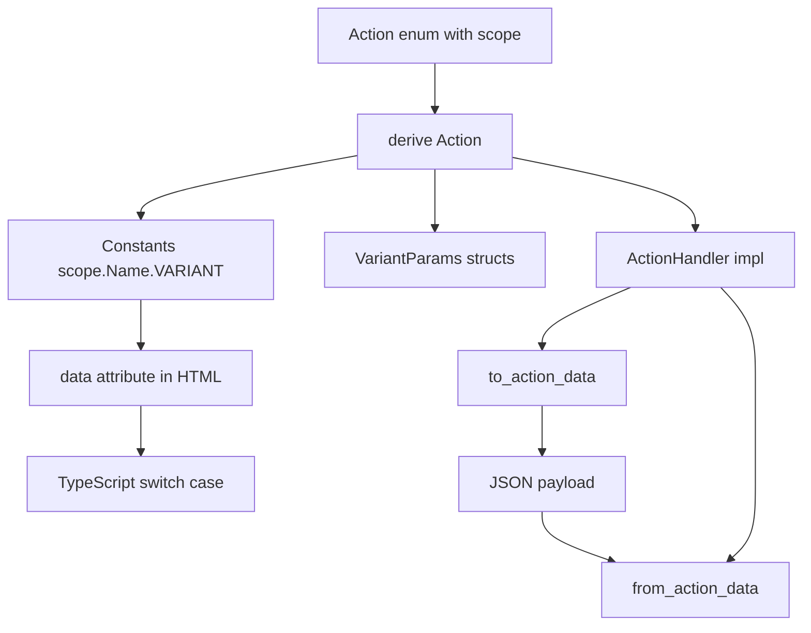

# 14 -- Actions: Event Handlers and Form Actions

The `proa_actions` crate turns Rust enums into browser event contracts. A developer writes one
action enum, derives `Action`, and gets four things for free: an HTML-embeddable data payload, a
server-side parser for that payload, a TypeScript contract of constants and parameter types, and a
runtime that delegates DOM events to registered handlers. The trick is that every action has a
single fully-qualified string name computed at compile time. The HTML attribute, the Rust constant,
and the TypeScript switch case all derive from that one string, so the wire format and the handler
lookup can never disagree.

## Two Data Shapes

Actions have two representations. `ActionDataStatic` (`proa_actions/src/static_data.rs`) is the
compile-time shape. Every field is `&'static str`, so the struct is `Copy`, const-friendly, and
zero-allocation.

```rust
// proa_actions/src/static_data.rs
#[derive(Debug, Clone, Copy, PartialEq, Eq)]
pub struct ActionDataStatic {
    pub action: &'static str,  // e.g. "handleClick"
    pub params: &'static str,  // JSON-encoded parameters
}
```

`ActionData` (`proa_actions/src/dynamic.rs`) is the runtime shape. It owns a `String` name and a
`serde_json::Value` for parameters. It is `Serialize` and `Deserialize`, so it is the wire format:
the struct is serialized to JSON and embedded in HTML, then parsed back on the server.

```rust
// proa_actions/src/dynamic.rs
#[derive(Debug, Clone, Serialize, Deserialize)]
pub struct ActionData {
    pub action: String,
    pub params: Value,
}
```

The two shapes serve different stages. `ActionDataStatic` exists for compile-time-known actions that
can be inlined into const tables. `ActionData` exists for anything that crosses a serialization
boundary, which is every real request.

## The Action Derive

`#[derive(Action)]` (`proa_macros/src/action_derive.rs`) works only on enums. It requires a scope
via `#[action(scope = "...")]`. The scope must be non-empty and contain only alphanumeric
characters, underscores, or hyphens. The scope is what keeps two enums from colliding.

For each variant the derive generates three things. First, an associated constant holding the full
name `scope.EnumName.VariantName`, with the variant name converted to `SCREAMING_SNAKE_CASE`. Second,
for variants with named fields, a `<Variant>Params` struct where every field is `Option<T>`. Third,
the `ActionHandler` impl with `to_action_data` and `from_action_data`.

```rust
// proa_actions/src/dynamic.rs
pub trait ActionHandler {
    fn to_action_data(&self) -> ActionData;
    fn from_action_data(data: ActionData) -> Result<Self, serde_json::Error>
    where
        Self: Sized;
}
```

`to_action_data` serializes the variant's fields into JSON. `from_action_data` parses them back,
reporting a missing field as a `serde_json::Error`. Unit variants carry `{}`. Tuple variants are a
compile error; the derive requires named fields for parameterized variants.



The full name is the single source of truth. `to_action_data` writes it, `from_action_data` matches
on it, and the generated TypeScript switches on it. There is no string that can drift between the
server and the client.

## Codegen Metadata

The build step extracts `ActionMetadata` (`proa_actions/src/dynamic.rs`) from each action enum. It
holds the scope, the enum name, and a list of `ActionVariant`s. Each variant records its name, its
constant, its `ActionParam` list, and an optional `ActionHandlerMetadata`. That handler metadata
describes the client signature: a DOM event name such as `click`, an element type such as
`HTMLButtonElement`, an optional explicit TypeScript event type, and a `prevent_default` flag.

`ActionParam` stores a field name and its Rust type name as a string. The codegen converts that Rust
type to a TypeScript type later, so the metadata stays a plain data record.

## The TypeScript Output

`generate_contract`, `generate_runtime`, and `generate_handler_stub` (`proa_actions/src/codegen.rs`)
produce three files. The contract is types only and is always overwritten. The runtime is wiring only
and is always overwritten. The handler stub is user-owned and is created once, never overwritten.

The contract emits one namespace per action enum, with a `const` per variant:

```text
// generated contract (shape)
export namespace ButtonAction {
    export const SUBMIT = "home_page.ButtonAction.Submit" as const;
}
```

For parameterized variants it also emits a `<Variant>Params` interface, and for every variant a
handler type alias `{Enum}{Variant}Handler`. The alias signature is `(event: E) => void |
Promise<void>`, or `(params: P, event: E) => void | Promise<void>` when the variant has fields.

The runtime registers handlers and installs document-level event delegation. It listens for a fixed
set of events and resolves the nearest element carrying a `data-on<event>` attribute.

```javascript
// proa_actions/src/codegen.rs (emitted logic)
const EVENT_TYPES = ['click', 'blur', 'focus', 'mouseover', 'mouseout', 'change', 'input'];
// For each event, find target.closest('[data-on<event>]'),
// read the action name and data-param-* attributes, then dispatch to the registered handler.
```

`rust_type_to_typescript` maps `String` and the numeric types to `string` and `number`, `bool` to
`boolean`, `Option<T>` to `T | undefined`, and `Vec<T>` to `T[]`. Anything else becomes `any`.
`default_event_type` maps `click` to `MouseEvent`, `focus` to `FocusEvent`, `keydown` to
`KeyboardEvent`, `submit` to `SubmitEvent`, and so on.

## Collision Detection

Action names must be unique across the workspace. `collision_check.rs`
(`proa_actions/src/collision_check.rs`) enforces this at build time. The registry is a plain text
file named `proa_action_registry.txt` under the target directory. Each line is one action name.

```rust
// proa_actions/src/collision_check.rs
pub fn check_action_collisions();
pub fn clear_action_registry();
```

`check_action_collisions` counts duplicate lines and panics with the offending names if any appear
more than once. The check is deliberately simple: a collision is just a repeated line. `clear_action_registry`
removes the file for a clean build. The registry path honors `CARGO_TARGET_DIR`, then falls back to
the `OUT_DIR` ancestry, then to `target`.

## The Aha Moment

**Aha:** Collision detection is not a semantic analysis. It is counting duplicate lines in a text file.

Each derive writes one canonical string per variant: `scope.Enum.Variant`. Those strings are the
action identity, and they land in the registry as one line each. Two enums that accidentally use the
same scope produce the same line twice. The build check counts lines and panics. There is no AST to
compare, no symbol table to reconcile, no cross-crate query. The identity of an action is a string,
so the check for identity is string counting. The same string that names the action in HTML is the
string that names it in the registry, and counting those strings is enough to catch every collision.

## Cross-References

- The RSJS events and signal handlers that actions sit alongside: [19-rsjs-macros.md](./19-rsjs-macros.md).
- The build tooling that extracts `ActionMetadata` and invokes codegen: [15-build-tooling.md](./15-build-tooling.md).
- The HTML element attributes that carry action data: [07-html-macros.md](./07-html-macros.md).
- The DOM marker transport that runs generated client code: [20-rsjs-web-transport.md](./20-rsjs-web-transport.md).

Continue to [15-build-tooling.md](./15-build-tooling.md).
