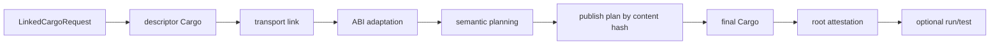
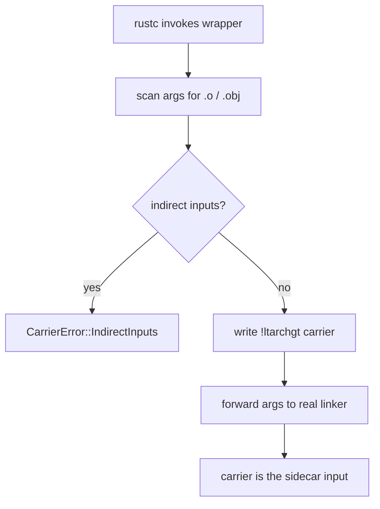
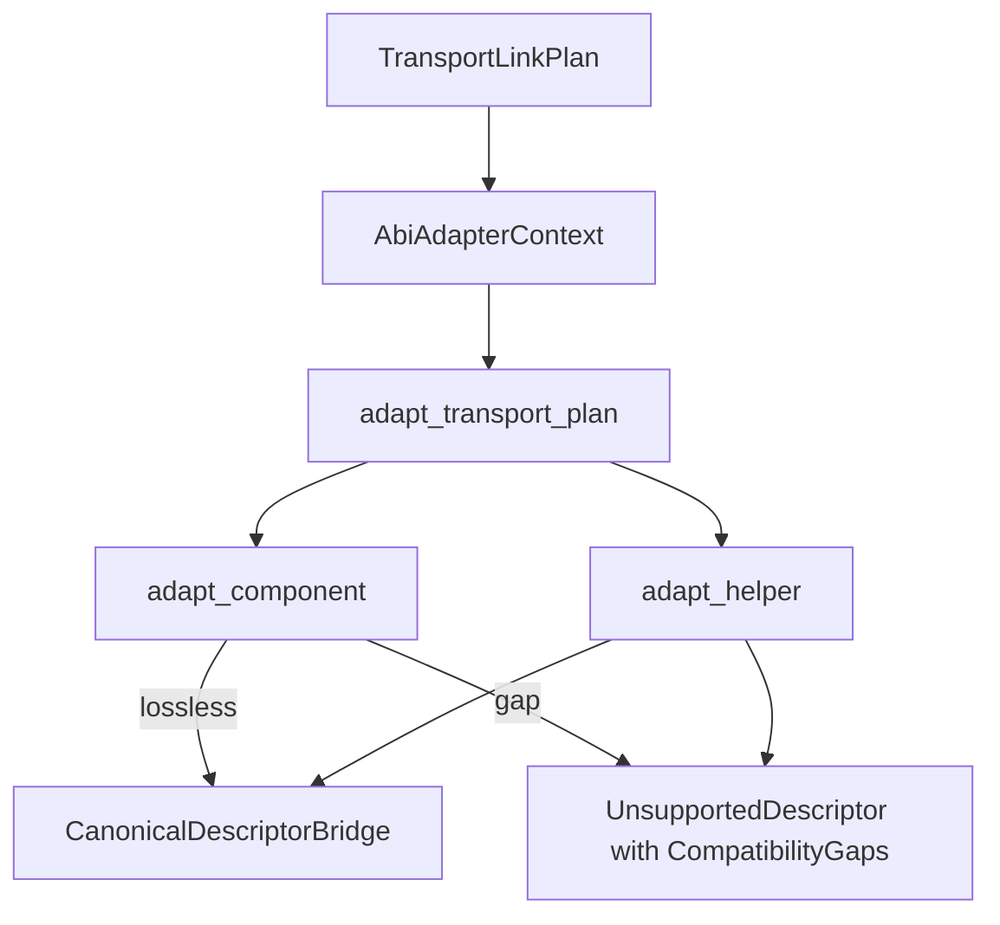
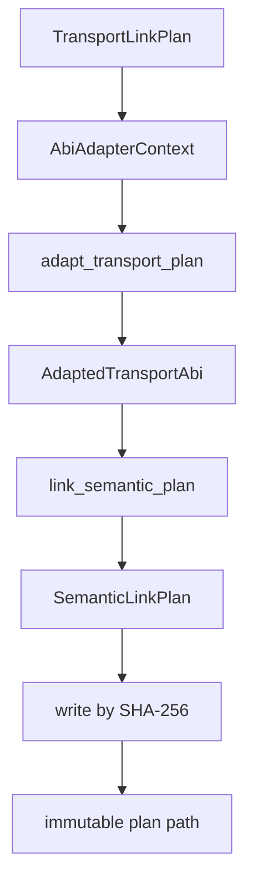
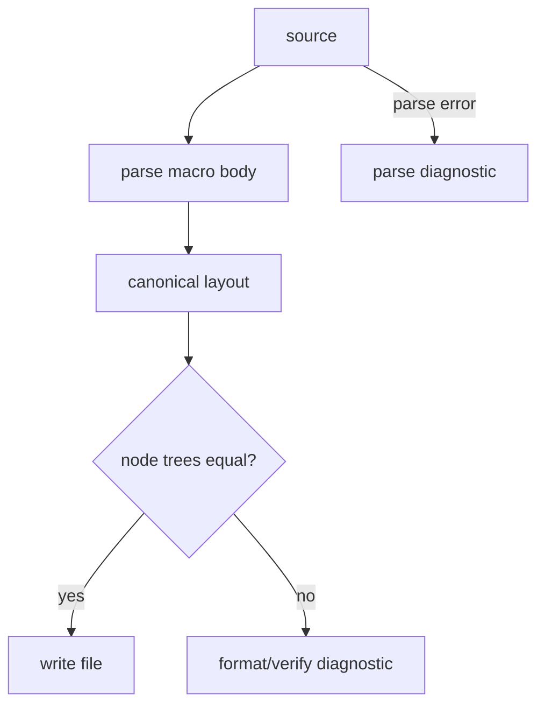
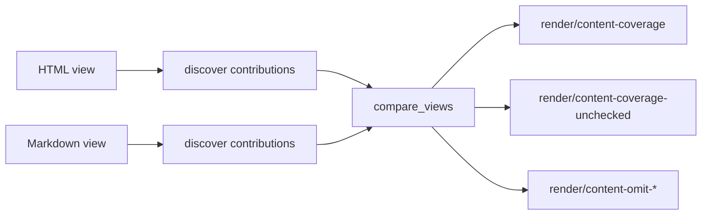

# 15 -- Build Tooling: Linked Compilation and Source Engineering

Two crates own the developer-facing tooling: `proa_build` is the linked RSJS
build engine and artifact cache; `proa_source_tools` is the source discovery,
formatting, linting, and compiler-artifact inspection engine. They are
deliberately independent. `proa_build` never reads a formatter and
`proa_source_tools` never starts a Cargo process, so each domain can be edited
without dragging in the other. The build engine is what makes a warm rebuild
fast; the source engine is what keeps the templates that feed it correct.

## The Two Crates

`proa_build` (`proa_build/src/lib.rs`) exposes seven modules:

```rust
pub mod abi_adapter;
pub mod build;
pub mod cache;
pub mod final_compile;
pub(crate) mod legacy_graph;
pub mod link;
pub mod pipeline;
pub mod semantic_link;

mod descriptor_objects;
#[doc(hidden)]
pub mod timing;
```

`proa_source_tools` (`proa_source_tools/src/lib.rs`) exposes six:

```rust
pub mod chunks;
pub mod diagnostic;
pub mod fmt;
pub mod lint;
pub mod rsjs;
pub mod source;
```

The crate split mirrors a real division of labor. `proa_build` depends on
`object`, `rayon`, `rsjs_ir`, `rsjs_transport`, `sha2`, and `syn`; it exists to
turn one exact Cargo root into a content-addressed semantic plan. `proa_source_tools`
depends on `proa_dsl`, `pulldown-cmark`, `syn`, `similar`, and `walkdir`; it
exists to find, format, and lint the Rust files those plans come from.

## The Linked Build: Three Phases, One Root

The core idea is that a Proa app is not one Cargo build but two, separated by a
linking step. `run_linked_cargo` (`proa_build/src/pipeline.rs`) orchestrates the
whole thing for one exact root selector:



The three phases are the descriptor pass, the link pass, and the final pass. The
descriptor pass compiles every unit with a special linker wrapper that captures
the object files into a carrier archive. The link pass resolves relocations,
adapts legacy producer data into a canonical ABI, and builds a semantic
owner/helper plan. The final pass recompiles with the plan injected through
environment variables so the macros can read exactly their unit's projection.

`run_linked_cargo` is deliberately small glue. It calls
`run_descriptor_cargo`, then `link_descriptor_transport`, then
`prepare_linked_cargo`, then `finish_prepared_linked_cargo`, then
`remove_successful_descriptor_staging`. Every identity in the later stages comes
from Cargo JSON messages, validated wrapper sidecars, or rustc relocations --
never from a path guess.

### The exact root selector

A build starts from one `DescriptorRootSelector` (`pipeline.rs`): a package ID,
a target name, a normalized target-kind set, a link-manifest `ArtifactRole`, and
an optional artifact path. The selector must be exact and non-empty; the role
must be a root role. When Cargo's JSON stream is joined against wrapper sidecars,
the selector is matched field-for-field. Zero matches is `MissingRoot`, more than
one is `AmbiguousRoot` -- both fail closed rather than picking a neighbor.

### Phase validation

Before anything runs, `validate_phase_cargo_arguments` proves the descriptor and
final Cargo invocations describe the same unit model. The subcommand pair must be
one of `build`/`build`, `build`/`run`, `check`/`check`, or `test`/`test`. The
subcommand token is rewritten to `<linked-phase>`, `--no-run` is normalized, and
the two argument vectors must then be byte-for-byte identical. A test lifecycle
requires exactly one descriptor-only `--no-run`. If the environments differ at
all, the error reports only the differing variable names, never the values.

```rust
// proa_build/src/pipeline.rs
pub fn run_linked_cargo(
    request: &LinkedCargoRequest,
) -> Result<LinkedCargoOutput, LinkedCargoError> {
    validate_request(request)?;
    prepare_linked_managed_directories(request)?;
    let lease =
        run_descriptor_cargo(&request.descriptor).map_err(LinkedCargoError::DescriptorCargo)?;
    let linked = link_descriptor_transport(lease, request.invocation, &request.root)?;
    let prepared = prepare_linked_cargo(request, linked)?;
    let output = finish_prepared_linked_cargo(request, prepared)?;
    remove_successful_descriptor_staging(&request.descriptor)
        .map_err(LinkedCargoError::DescriptorStagingCleanup)?;
    Ok(output)
}
```

The same flow exists in a cached form, `run_linked_cargo_cached_with_progress`,
which reuses descriptor objects admitted by the persistent cache but only after
the current Cargo JSON stream authorizes unchanged artifacts.

## The Descriptor Phase: Capturing Objects Before They Vanish

The descriptor pass (`proa_build/src/build.rs`) is the first Cargo invocation.
Its job is to obtain the exact descriptor object for every unit in the selected
root and its dependencies. The wrapper (`run_rustc_wrapper_from_env`) switches on
the unit's carrier shape. For an rlib it copies the produced
`lib{crate}{extra}.rlib` onto the object path. For a native executable or dynamic
link, the objects are temporary files rustc deletes after linking, so the wrapper
installs a linker carrier to capture them first. For a single-object carrier it
forces `-Ccodegen-units=1`.

The wrapper (`proa_build/src/descriptor_objects.rs`) forwards every argument to
the real linker unchanged and, in the same process, writes an ordinary Unix
archive of the explicit object inputs. The archive is a *carrier*, never a
replacement: it does not participate in the native link. Its mode string and
environment names are fixed:

```rust
// proa_build/src/descriptor_objects.rs
pub(super) const LINKER_MODE: &str = "descriptor-linker-v1";
pub(super) const LINKER_PROGRAM_ENV: &str = "PROA_RSJS_DESCRIPTOR_LINKER_PROGRAM";
pub(super) const LINKER_CARRIER_ENV: &str = "PROA_RSJS_DESCRIPTOR_LINKER_CARRIER";
```

The archive header is hand-written as `!<arch>\n` followed by per-member headers,
with short generated names like `o00000000.o/` so host paths and response syntax
never leak into the archive. Members are stored in rustc's argument order, and
odd-length members are padded with a newline so the archive stays parseable.
Indirect inputs -- `@response.rsp`, `-filelist`, or `-Wl,-filelist,...` -- are
rejected with `CarrierError::IndirectInputs` rather than silently producing a
partial archive. This is the fail-closed rule that recurs throughout the build:
a partial carrier is worse than a refused build.



The wrapper runs under the Cargo JSON message format. `run_descriptor_cargo`
parses `compiler-artifact` messages into `CargoCompilerArtifact` records and
joins them against the wrapper sidecars with
`join_cargo_enumerated_descriptor_units`. Each unit gets a `DescriptorCargoUnitId`
and a set of extracted objects. Managed paths -- the staging directory, the
target directory, the plan directory, and the final target root -- are validated
to be absolute and pairwise non-overlapping; two namespaces that share bytes are
one deletion away from deleting each other.

Descriptor codegen is force-pinned. The wrapper appends
`-Clink-dead-code=yes -Clto=off -Cstrip=none -Cdebuginfo=0` to every unit, falls
back to 64 codegen units in incremental mode (`DESCRIPTOR_INCREMENTAL_CODEGEN_UNITS`)
and 16 non-incremental, and forces one for the single-object carrier. The unit
sidecar is schema 11 (`DESCRIPTOR_UNIT_SIDECAR_SCHEMA_VERSION`), the descriptor
target policy is 7 (`DESCRIPTOR_TARGET_POLICY_VERSION`), and the final wrapper
policy is 8 (`FINAL_WRAPPER_POLICY_VERSION`). Pinning these options is what makes
the descriptor pass reproducible: the same source produces byte-identical
objects, which is the precondition for content-addressed caching.

## Transport Linking: A Graph Independent of Target Paths

`link_transport_manifest` (`proa_build/src/link.rs`) turns the joined units and
objects into a `TransportLinkPlan`: a relocation-resolved graph of which unit
owns which bytes. It extracts each RSJS object and rlib record, verifies every
embedded semantic hash and Cargo unit id, and joins each component, helper,
field, edge, and shared-state record to its rustc relocation resolution. The
point is to make the graph independent of target paths, so the same plan can be
reproduced from a different checkout or a different cache directory. A
process-local extraction cache, capped at 2048 entries (`EXTRACTION_CACHE_LIMIT`),
reuses parsed artifacts without re-reading them. The transport plan schema is
version 5; `write_content_addressed_transport_plan` publishes it under its
`PlanId`, byte-comparing on a pre-existing path and failing with
`ContentCollision` rather than overwriting.

## ABI Adaptation: The Fail-Closed Compatibility Bridge

`proa_build/src/abi_adapter.rs` is the largest module in the crate and the
compatibility bridge between the legacy embedded RSJS descriptors (schema 9) and
the canonical compiler ABI. Its contract is fail-closed: identity authority is
exclusively the rustc relocation the transport linker already resolved, so
`struct_name`, `self_ty`, `authored_path`, `asset_id`, and path segments are
never treated as identity. The bridge refuses any graph behavior it cannot
represent losslessly and never invents a nominal type identity or serialization
codec from source tokens.

`AbiAdapterContext` carries the migration policy and the relocation-authoritative
semantic identities. It is built either with `AbiAdapterContext::v1(producer,
runtime_protocol)` or from a linked plan with `from_transport_plan`; each
definition's `ResolvedSemanticPath` (package, crate name, module path, item) is
inserted explicitly. `adapt_transport_plan(context, plan)` then converts every
component and helper into an `AdaptedTransportAbi`, a vector of
`AbiBridgeResult`s. Each result is either `Canonical(CanonicalDescriptorBridge)`
or `Unsupported(UnsupportedDescriptor)`.



A `CanonicalDescriptorBridge` bundles the canonical `DescriptorEnvelope` with a
relocation table (`witnesses`) and, for final codegen, a
`ComponentCodegenBridge` or `HelperCodegenBridge`. Those codegen bridges are
deliberately separate from the descriptors: producer ids and legacy asset keys
are build coordinates, not semantic identity. A `HelperCodegenBridge` recomputes
its body IR hash on every access so a stale `(body, hash)` pair is
unrepresentable, and its body compares by canonical JSON -- not IEEE floats --
because client IR contains `f64` literals and `NaN != NaN` would break equality.

An `UnsupportedDescriptor` reports the precise `CompatibilityGap`s -- a missing
resolved identity, missing field witnesses, missing client-graph metadata, an
unknown view node kind -- so a schema change degrades to an explicit
unsupported list instead of a wrong plan. `AbiAdapterError` has seven variants
(`InvalidPayload`, `SemanticHashMismatch`, `SourceEdgeSetMismatch`,
`ComponentFieldRecordIdMismatch`, `DuplicateComponentFieldRecordId`,
`InvalidSemanticIdentity`, `CanonicalValidation`) and fails closed on unknown
JSON fields with "refusing to ignore possible semantic data".

## Semantic Planning: Owners, Helpers, and Sites

`link_semantic_plan` (`proa_build/src/semantic_link.rs`) builds the
`SemanticLinkPlan` from the link unit and the adapted ABI. This is where the
owner/helper split is computed. Each component and helper walks its canonical
graph and claims every relocation witness exactly once; a bridge witness no
canonical record consumed is `UnclaimedWitness`. Sites are then expanded: every
root-eligible descriptor is tried independently as a standalone root, and a
failed lexical-provider lookup rolls back the whole provisional expansion so
admitted site ids stay dense. Owner partitioning adds a `ReactiveLifecycle`
coupling for conditional sites so a browser-active descendant cannot outlive its
governing branch. Shared-state schemas are deduplicated and conflict-checked, and
NodeRef aliases are verified to land in the same final owner.

`legacy_graph` (`proa_build/src/legacy_graph.rs`) is the strict schema-9 reader
for the legacy client graph. It parses each arena in strictly increasing id
order, requires canonical-JSON round-trips for every client-IR value, and
computes reachability closures so a dead declaration never becomes a canonical
origin.

The semantic plan schema is version 15 (`SEMANTIC_LINK_SCHEMA_VERSION`). The
plan is *published* content-addressed: `write_content_addressed_semantic_plan`
writes it under its strong `PlanId`, byte-comparing on a pre-existing path and
failing with `ContentCollision`. `validate_semantic_plan` recomputes every strong
identity -- sites, graphs, owners, hashes, plan id -- so a persisted plan is
fully self-authenticating.



## The Cache: Leases, Content Addressing, Atomic Publication

`run_descriptor_cargo_cached` (`proa_build/src/cache.rs`) makes the descriptor
pass reusable. Cargo remains the freshness authority: the cache is consulted
only after the current Cargo JSON stream authorizes unchanged artifacts, and
every cached sidecar and object hash is revalidated before linking.

Three mechanisms do the work. A **lease** holds the target directory and cache
generation exclusively while a unit is hashed and linked, so no concurrent build
can replace a file mid-read. **Content addressing** keys every artifact by a
SHA-256 digest computed over freshly read bytes, with separate hash domains for
the descriptor and the link so one cannot be substituted for the other. **Atomic
publication** writes a changed record to a sibling and renames it over the old
one, so a reader never observes a half-written index; identical publications keep
their existing inode and skip the durability flush entirely.

`DESCRIPTOR_CACHE_SCHEMA_VERSION` is 5. Independent records are published in
parallel under the lease, and the cache directory is validated to not overlap the
semantic-plan or final-target directories.

## The Final Phase: Plan-Sensitive Compilation

`run_final_cargo_leased` (`proa_build/src/final_compile.rs`) runs the second
Cargo pass. Before it starts, the CLI injects a plan environment --
`RSJS_LINK_PLAN_PATH`, `RSJS_PLAN_ID`, and the `sha256:`-tagged
`RSJS_LINK_PLAN_FILE_HASH` -- plus a content-addressed unit map
(`PROA_RSJS_FINAL_UNIT_MAP_PATH` / `PROA_RSJS_FINAL_UNIT_MAP_HASH`). Per-unit,
the tracking input carries each unit's exact mapping entry, and the plan
variable carries the projection *hash* while a directory variable points at the
content-addressed projection bytes. The wrapper mode is `final-v2`, and the
final target lives under `rsjs-final/wrapper-v8/<invocation>` because the final
wrapper policy is 8.

```text
PROA_RSJS_FINAL_UNIT_INPUT_<descriptor-unit-id>   -> exact mapping entry
PROA_RSJS_FINAL_UNIT_PLAN_<descriptor-unit-id>    -> projection hash
PROA_RSJS_FINAL_UNIT_PLAN_DIRECTORY              -> content-addressed projection bytes
```

The projection is the invalidation contract. A final crate can stay fresh only if
its complete consumed selections remain compatible with the new plan, so the
mapping-entry hash alone is not enough: it cannot represent cross-unit children,
exports, helpers, or runtime protocols. The projection includes every local
component definition and occurrence, standalone admission, child calls, live
props, lexical providers, aliases, fragment generations, and exact owner modules.
The macros compare immutable projections against the current plan bytes; a hit
cannot authorize changed files or substitute units.

After compilation, `attest_final_root` proves the final root still matches the
descriptor root coordinate-by-coordinate (manifest path, target, profile, and
features), and `snapshot_final_artifact` copies the attested root into an
immutable snapshot directory so the lease can be released before the program is
spawned. For a `run` or `test` final subcommand, the attested executable is
launched directly rather than re-running Cargo target selection.

## Timing

`StageTimer` (`proa_build/src/timing.rs`) is opt-in elapsed diagnostics, gated by
the `PROA_BUILD_TIMINGS` environment variable. It prints per-stage milliseconds
to stderr and is deliberately independent of compiler freshness inputs.

## Source Discovery and Diagnostics

`proa_source_tools/src/source.rs` is the scanning substrate. `find_rust_files`
walks directories while skipping `target`, `node_modules`, `dist`, dot-directories,
generator-owned golden files, and compile-fail fixtures. `find_changed_rust_files`
shells out to `git diff` and `git ls-files`, resolving paths against the
repository root so it works from any subdirectory. `find_macros` is a hand-rolled
scanner that locates `html!`, `html_sync!`, `xml!`, `xml_sync!`, `md!`, and
`md_sync!` invocations while skipping strings, comments, and raw strings; it
distinguishes a Proa `html!` from a Yew one by inspecting `use` statements. A
`SourceMap` converts byte offsets to one-based line/column pairs and back, and a
`MacroInvocation` records the name, dialect, and span of each body.

`proa_source_tools/src/diagnostic.rs` is the renderer. A `Diagnostic` carries a
`Severity` (`Error`, `Warning`, `Info`), a code, a message, help, labels, notes,
and machine-applicable or maybe-incorrect suggestions. A `SourceLabel` retains
the surrounding source lines so output never rereads a file, and the display
draws the familiar `-->` gutter with a primary `^` underline and related `:::`/
`-` frames, using Unicode display width so a `🦀` does not misalign the caret.

## The Formatter: Render-Preserving Rewrites

`format_paths_with_options` (`proa_source_tools/src/fmt.rs`) is the whole
formatter. It parses each macro body once, re-emits a canonical layout, and then
-- this is the distinguishing step -- verifies the rewrite is render-preserving
before writing anything.

Two constants drive layout: `INDENT_WIDTH` is 4 and `INLINE_WIDTH` is 100.
Elements wider than the inline limit break their attributes one per line; struct
literals inside an interpolation break one field per line, the way `cargo fmt`
breaks an ordinary struct literal. A `format!`-style width decision recurses
through single-argument calls so `Some(BreadcrumbList { ... })` is broken even
though the literal is nested.

```rust
// proa_source_tools/src/fmt.rs
const INDENT_WIDTH: usize = 4;
const INLINE_WIDTH: usize = 100;
```

The render-preserving check (`verify_render_preserving`) is the safety net. It
re-finds every macro in the output, re-parses each body, and compares node trees
recursively: tags, attribute names and values, child counts, text, expressions
(with trailing separators stripped, since breaking a struct literal adds a comma
that `to_token_stream` would otherwise keep), and doctypes. A Markdown body has
no node tree, so its lowered text is compared instead. Any difference refuses
the write with `format/verify` and the note "this is a formatter bug; the file
was not rewritten".



The formatter is conservative about three things. A body containing a source
comment is left untouched, because comments are not represented in the parsed
tree and re-emitting would silently discard author context. A multi-line string
literal is left byte-for-byte because its interior indentation is program data.
And stranded blocks -- interpolations whose continuation lines drifted to a
column far right of their parent, observed at column 223 under a parent at 38 --
are re-anchored as a unit so the relative shape the author wrote survives.

## The Lint Engine: Predicates, Codes, and Scopes

`lint_file` and `lint_paths` (`proa_source_tools/src/lint/mod.rs`) are the entry
points. `LintOptions` carries three knobs: `include_tests`, an optional
`rsjs_strategy_cache`, and `content` coverage options. `lint_paths` lints files
in parallel with rayon, loading the sidecar cache once and sharing it read-only
so per-file re-parsing never happens.

Each macro body is located and parsed exactly once. A single parsed file feeds a
sequence of `lint_*` passes -- indentation, template accessibility, performance,
render composition, format canonicalization, route data loaders, render impls,
render functions, render helpers, RSJS items, attribute-value impls, render
component structs, and loop case conversions. Diagnostics are deduplicated on
`(line, column, code, message)`.

The rules live in two places. `proa_source_tools/src/lint/predicates.rs` is a
large library of small named predicates -- `expr_is_signal_call`,
`call_path_is_rsjs_opaque_boundary`, `expr_is_bare_uppercase_path`,
`invalid_parent_child_pair`, and dozens more -- each a self-contained fact about
a `syn` node. The lint passes compose these predicates into diagnostics. This is
the architectural idea: the linter is not a monolith but a set of reusable
facts, each of which can be tested in isolation.

The codes fall into ten families, roughly one hundred in all:

| Family | Examples |
| --- | --- |
| `attr/*` | `attr/duplicate`, `attr/data-name`, `attr/event-name` |
| `format/*` | `format/indentation`, `format/attrs`, `format/macro-body` |
| `html/*` | `html/invalid-nesting`, `html/staticraw-doctype` |
| `md/*` | `md/manual-write` |
| `parse/*` | `parse/template` |
| `perf/*` | `perf/format`, `perf/vec`, `perf/raw-html-buffer` (about 50) |
| `render/*` | `render/async-unneeded`, `render/sync-child-in-async`, `render/vec-children` |
| `route/*` | `route/direct-db-load`, `route/missing-prewarm` |
| `rsjs/*` | `rsjs/dead-client-primitive`, `rsjs/window-unchecked` |
| `slot/*` | `slot/invalid-expression` |

Because `syn::visit` stops at a macro boundary, several predicates must descend
into macro token streams manually. `tokens_mention_ident` scans raw tokens for an
identifier, and `block_contains_await` peeks inside `md!` string literals for a
`.await`. The async-render markers are `await_component`, `AwaitComponent`, and
`Suspense`; the markdown async markers are `await_md_component` and
`AwaitMdComponent`.

### Suppression and scope

A perf or render lint can be waived with a comment. `// proa-perf-ok: reason`
suppresses on the same or previous line; `// proa-perf-ok(scope): reason` placed
directly above an item suppresses across the item's whole span. A marker without
a reason is itself a diagnostic, `perf/invalid-suppression`, as is a scope marker
that never attaches to an item. The suppressible codes are perf codes plus a
handful of render/md codes where an annotated reason is the only way to express a
legitimate shape. The comment scanner is careful that a lifetime (`<'a>`) does not
flip its string-state, which would hide the `//` that follows.

### RSJS strategy cache

RSJS lints need the compiler's own answer: is this `#[rsjs(component)]` impl
really `server_only`, and which of its declared client primitives are dead? That
answer lives in a strategy sidecar written by the build. `RsjsStrategyCache`
(`proa_source_tools/src/lint/rsjs_strategy.rs`) loads those sidecars once and
matches each impl by input fingerprint, struct path, or struct name, reporting
`Missing`, `Stale`, or `Ambiguous`. The input fingerprint is a SHA-256 over the
domain string `rsjs.strategy.input.v1`, the attribute tokens, and the impl tokens
with whitespace stripped, prefixed `sha256:`.

## Content Coverage: HTML Must Match Markdown

`proa_source_tools/src/lint/content/mod.rs` is a bounded analysis that compares
two render targets of the same component -- by default the HTML view against the
Markdown view -- and reports contributions that appear in one but not the other.
`TargetDescriptor` names the traits, methods, templates, and adapters of a target;
`default_targets` registers `html` and `markdown`.

The analysis is a deliberate boundary. It discovers what each view renders as a
set of `Contribution`s with a `ContentKey` (`Value`, `Child`, `Role`, or
`Literal`), tracks `Presence` conditions, and records `Boundary`s where the
supported subset ends. `compare_views` then matches source contributions against
target contributions and emits `render/content-coverage` when a contribution is
missing, `render/content-coverage-unchecked` when a helper or unsupported path
prevents the assertion, and `render/content-omit-*` for stale or ambiguous
`omit!` markers. It can suggest the exact `proa_macros::omit!(...)` to acknowledge
an intentional omission, with `SuggestionApplicability::MaybeIncorrect`.



## Compiler-Artifact Inspection: Strategy Sidecars

`proa_source_tools/src/rsjs.rs` reads the strategy sidecars the build writes and
explains them. `explain_strategy` takes a root and a selector and returns a
`StrategyExplanation`: the render strategy (`server_only`, `ssr_hydrate`, or
`client_only_explicit`), the hydration strategy, declared versus actually-used
client modules, component fragment imports, runtime features, shared-state
dependencies, server surfaces, client crossings, dead primitives, and reachable
roots. It also computes staleness: if the anchored source's current
`#[rsjs]` impl fingerprint no longer matches the sidecar's recorded fingerprint,
the explanation prints a warning that the analysis is outdated.

The sidecar format is validated strictly: `format` must be `rsjs.strategy` and
`strategy_version` must be `1`, or the reader bails. `crossing_report` aggregates
every client crossing -- a signal initial value, a handler payload, a query key,
a mutation runner -- across all sidecars, each with a source anchor. The
strategy-dir search honors `CARGO_TARGET_DIR`, then `target/rsjs/strategy` under
the root, its parent, and the current directory, deduplicating as it goes.

## Chunks: The Consolidation Inspector

`proa_source_tools/src/chunks.rs` implements `proa chunks`. It estimates, straight
from the parsed template, how `html!` / `html_sync!` bodies segment into static
byte runs and dynamic slots. `ChunkEstimator` walks the node tree, accumulating
static bytes and breaking a run at every dynamic text or attribute slot. The
report is a `MacroChunkReport`: the number of runs, the total static bytes, the
largest run, and the text/attribute slot counts. The printed footer states the
takeaway plainly: every dynamic slot is a run boundary, so fewer, larger runs
render faster. The byte counts are explicitly estimates -- attribute escaping,
entity normalization, and void-element handling can shift them by a few percent.

## The Aha Moment

**Aha:** The cache does not trust itself; it trusts Cargo, and only after
Cargo's own JSON stream says an artifact is unchanged.

Most build caches decide "unchanged" by hashing inputs and short-circuiting the
compiler. Proa inverts that: the descriptor Cargo run happens first, every time.
Only once Cargo's `compiler-artifact` messages arrive and say "these units are
fresh" does the cache admit its stored carriers, and even then every cached
sidecar and object hash is revalidated before linking. The cache is therefore
never an authority and never a guess; it is a lease on bytes that Cargo has
already vouched for. That is why a warm template edit can drop from roughly 7
seconds to about 2.6 seconds without ever risking a stale island: the fast path
and the correct path are the same path, because freshness is delegated to the one
component that already computes it exactly.

## Cross-References

- The `ActionMetadata` the build extracts and feeds to codegen: [14-actions.md](./14-actions.md).
- The CLI commands that invoke these engines: [16-cli.md](./16-cli.md).
- The RSJS sidecars and JavaScript lowering the strategy lints reason about: [19-rsjs-macros.md](./19-rsjs-macros.md).
- The streaming substrate that consumes the final plan: [10-streaming.md](./10-streaming.md).

Continue to [16-cli.md](./16-cli.md).
