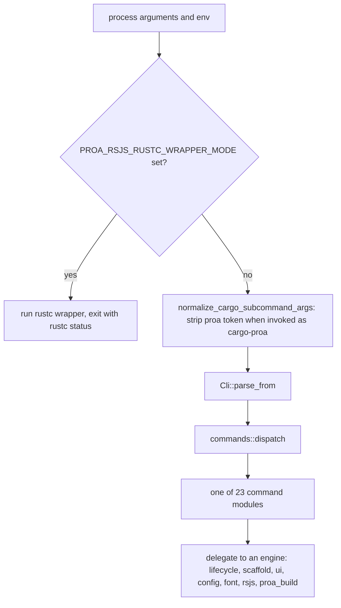
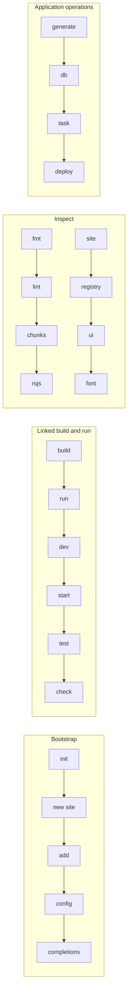
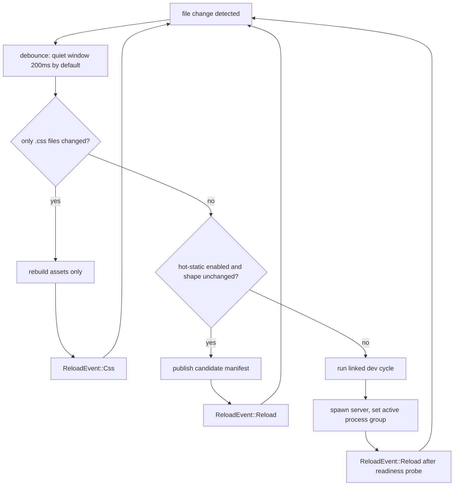

# 16 -- CLI: One Binary, Three Identities

The `proa_cli` crate ships one executable that behaves as three different programs. It is the
developer command line (`proa build`, `proa dev`), it is a Cargo subcommand (`cargo proa fmt`), and it
is the `rustc` wrapper that the linked RSJS build uses to compile descriptor units. The first
decision in `run()` picks the identity before any command-line parsing happens, because the rustc
wrapper protocol is a raw argument and environment contract that has nothing to do with clap. After
that, the command layer is deliberately thin: every subcommand module owns a small clap argument
struct and a `run` function that delegates to a reusable engine (`lifecycle`, `scaffold`,
`site_scaffold`, `ui`, `config`, `font`, `rsjs`, `hot_static`, and the `proa_source_tools` /
`proa_build` crates). Almost all of the real behavior lives in those engines, not in the command
files.

## The Entry Point

`proa_cli/src/cli.rs` holds the whole entry path. The `Cli` struct is a single clap `Parser` whose
only field is a `Command` subcommand. `run()` resolves the three identities in order.

```rust
// proa_cli/src/cli.rs
pub fn run() -> Result<()> {
    if rsjs_build::rustc_wrapper_dispatch_requested() {
        // The binary is being driven as the rustc wrapper for a linked RSJS build.
        let status = match rsjs_build::run_rustc_wrapper_from_env(std::env::args_os()) {
            Ok(status) => status,
            Err(error) => { /* emit a Cargo JSON diagnostic and exit 1 */ }
        };
        if !status.success() {
            std::process::exit(status.code().unwrap_or(1));
        }
        return Ok(());
    }

    let args = normalize_cargo_subcommand_args(std::env::args_os());
    let cli = Cli::parse_from(args);
    commands::dispatch(cli.command)
}
```

The rustc-wrapper identity is gated purely by the environment variable `PROA_RSJS_RUSTC_WRAPPER_MODE`
(`proa_build/src/build.rs`). When it is set, `run_rustc_wrapper_from_env` reads the mode value
(`"descriptor-v1"` or the linker mode `"descriptor-linker-v1"`) and the staging/target/source-exclusion
directories from the environment, then forwards to the descriptor compiler. This dispatch happens
before clap runs, so the wrapper never sees the `proa` argument grammar.

The Cargo-subcommand identity is normalized away by `normalize_cargo_subcommand_args`. When the
binary's file name is `cargo-proa` and the first argument is the token `proa`, that token is removed.
Cargo invokes subcommands as `cargo-proa <args>` and injects no `proa` token, but `cargo proa ...`
does, so the strip makes both spellings parse identically.



## The Command Tree

`proa_cli/src/commands/mod.rs` owns the `Command` enum and `dispatch`. The enum has 23 variants; the
doc strings are the one-line contract for each command. The commands fall into four families.

```rust
// proa_cli/src/commands/mod.rs (dispatch, abbreviated)
match command {
    Command::Init(args) => init::run(args),
    Command::New(args) => new::run(args),
    Command::Add(args) => add::run(args),
    Command::Config(args) => config::run(args),
    Command::Build(args) => build::run(args),
    Command::Run(args) => run::run(args),
    Command::Dev(args) => dev::run(args),
    Command::Start(args) => start::run(args),
    Command::Test(args) => test::run(args),
    Command::Check(args) => check::run(args),
    Command::Fmt(args) => fmt::run(args),
    Command::Lint(args) => lint::run(args),
    Command::Chunks(args) => chunks::run(args),
    Command::Rsjs(args) => rsjs::run(args),
    Command::Site(args) => site::run(args),
    Command::Registry(args) => registry::run(args),
    Command::Ui(args) => ui::run(args),
    Command::Font(args) => font::run(args),
    Command::Generate(args) => generate::run(args),
    Command::Db(args) => db::run(args),
    Command::Task(args) => task::run(args),
    Command::Deploy(args) => deploy::run(args),
    Command::Completions(args) => completions::run(args),
}
```



The command files are mostly argument definitions. `build.rs`, `run.rs`, `dev.rs`, `test.rs`, and
`check.rs` are each under a hundred lines of clap structs plus one `lifecycle::*` call. The engines
they reach are the substance: `lifecycle.rs` alone is 3,169 lines.

## Shared Argument Contracts

Two clap `Args` structs are flattened into several commands so their flags stay identical.

`FileSelectionArgs` (`commands/selection.rs`) is shared by `fmt`, `lint`, `check`, and `chunks`. It
carries `paths`, `--changed`, `--staged`, and `--base`, then `selected_paths` enforces the
combinations that make sense.

```rust
// proa_cli/src/commands/selection.rs
pub(crate) fn selected_paths(args: &FileSelectionArgs) -> Result<Vec<PathBuf>> {
    let changed = args.changed || args.base.is_some();
    if args.staged && changed {
        bail!("--staged cannot be combined with --changed or --base");
    }
    if (args.staged || changed) && !args.paths.is_empty() {
        bail!("explicit paths cannot be combined with --staged, --changed, or --base");
    }
    if args.staged || changed {
        crate::source::find_changed_rust_files(args.base.as_deref(), args.staged)
    } else {
        Ok(args.paths.clone())
    }
}
```

Git selection resolves through `proa_source_tools::source::find_changed_rust_files`; without it the
command falls back to the explicit `paths` (or the current directory when empty). The invariant is
simple: a command scans either exactly the paths you named, or exactly the files Git reports, never a
mix.

`LinkedExecuteArgs` (`commands/linked.rs`) is shared by `run` and `test`. It carries the Cargo
target selection the linked pipeline needs: `root`, `profile`, `package` (`-p`), `bin`, `target`,
`features` (comma-delimited), `all_features`, `no_default_features`, `locked`, and `offline`. `build`
and `check` repeat the same fields inline (plus `example` for `build`) because they call different
engine option structs. The selection is "exact": the pipeline rejects workspace-wide or ambiguous
selectors rather than guessing which binary to compile.

## Project Bootstrap

`init` (`commands/init.rs`) writes `proa.config.json` and `proa.lock.json` into an existing project
that already has a `Cargo.toml`. It calls `config::init_project_files`, which skips existing files
unless `--force`. The generated config deliberately has no `application` key and always emits
`"build": {"assets": []}` so "build no assets" is explicit.

`new site` (`commands/new.rs` → `site_scaffold::new_site`) is the full generator. The positional
path's final segment becomes the package name; `--template` selects a preset (`app`, `marketing`,
`docs`, `minimal`, `origin`, with `basic` aliasing `app`). `--database`, `--ui`, `--styling`,
`--starter`, and `--deploy` override the preset defaults, resolved by `capabilities/mod.rs`:

| Preset | database | ui | styling | starter | deploy | markdown |
|--------|----------|----|---------|---------|--------|----------|
| app | sqlite | proa | tailwind | guided | none | true |
| marketing | none | proa | tailwind | guided | none | true |
| docs | none | proa-docs | docs | guided | none | true |
| minimal | none | none | css | blank | none | false |
| origin | none | none | tailwind | guided | none | true |

The origin preset owns its application content, so only `--deploy` may override it. The docs preset
rejects `--ui proa`. `--empty`, `--tailwind`, and `--no-tailwind` are compatibility aliases rewritten
to preset selections before dispatch. The generator emits a full application-first tree
(`src/app.rs`, `src/pages/home.rs`, `src/endpoints/health.rs`, `src/routes.rs`, `build.rs`,
`.cargo/config.toml`, `rust-toolchain.toml`, `.github/workflows/ci.yml`, and the two config files),
stages everything in a hidden `.proa-stage-{pid}-{nanos}` directory, runs `format_rust` and
`refresh_component_hashes`, then renames the directory into place.

`add` (`commands/add.rs`) installs one capability into an existing project by mutating
`proa.config.json` and `proa.lock.json` as raw JSON and writing files. Capabilities: `database
sqlite`, `representation markdown`, `ui`, `docs`, `blog`, and `deploy docker|railway|coolify`. The
database capability is intentionally partial: it adds the `sqlx` dependency and `src/db.rs` but does
not wire the pool into application state, and it warns you to do so. The lock records each
capability idempotently under `scaffold.capabilities` with `status: "integrated"` or `"partial"`.

`config` (`commands/config.rs`) validates or shows the effective configuration. `validate` reports
unknown keys, an empty `dev.command` or `build.command`, a missing `registries.@proa`, malformed
registry templates, and per-asset problems. `show` prints the configuration with inferred defaults
filled in. `completions` emits shell completions through `clap_complete`.

## The Linked Build and Run Family

`build`, `run`, `dev`, `start`, `test`, and `check` all funnel into `proa_cli/src/lifecycle.rs`,
which drives the linked RSJS pipeline described in [15-build-tooling.md](./15-build-tooling.md).

`build` builds assets then runs `run_linked_cargo_cached`. `--artifact-out` copies the attested final
executable to a destination after the build. `run` is `build` followed by execution, forwarding
arguments after `--` to the binary. `start` (`commands/start.rs`) skips compilation entirely: it runs
an already-built release at `target/release/{binary}` (defaulting to `application.binary`, then
`application.package`, then `app`) with `PROA_HOST` and `PORT` set from `--host`/`--port`.

`check` runs the format and lint passes, and, unless `--source-only` or a file selection is given,
the linked `cargo check`. With `--all` it also runs the site check, builds assets, and runs the test
suite. `test` runs the linked pipeline with an isolated database (below).

### `dev`: the watch loop

`dev` compiles one exact linked server, then watches `dev.watch` for changes and restarts it. The
watch snapshot is a map of path to `FileStamp { len, modified_nanos }` — file size plus modification
time, no content hash. Directories named `target`, `node_modules`, and `.git` are skipped. The
default watch set is `["src", "styles", "Cargo.toml", "build.rs", "proa.config.json"]`; `Cargo.lock`
is deliberately excluded because `cargo run` rewrites it during the very build the watcher just
triggered, which would restart the loop forever.

A change must survive a debounce window before a rebuild starts. The default is
`DEV_WATCH_DEBOUNCE = 200ms`; `--debounce-ms` changes it, and values below the 100ms poll interval
(`DEV_WATCH_POLL`) are rejected. The `DevWatchDebouncer` wakes at the end of the quiet window rather
than rounding up to a full poll.



A change set is "CSS only" when every changed path has a `.css` extension (case-insensitive). Those
edits rebuild assets and broadcast a `Css` event that makes browser tabs re-fetch stylesheets without
a navigation, and the server process is not restarted. Anything else is a full rebuild: stop the old
server, run the linked cycle, spawn the new one.

Restarts use Unix process groups. Every dev server is spawned with `process_group(0)`; the CLI sends
`SIGTERM` to the whole group, then `SIGKILL` after two seconds. A global atomic records the active
group so the CLI's own SIGINT/SIGTERM handler can forward the signal and `_exit(128+signal)`, which
prevents a detached server from outliving the CLI and holding the port.

### Live reload and hot-static

Live reload is a Server-Sent Events stream at `/__proa/dev-events` (`lifecycle/reload.rs`). It is
authenticated by a per-session 16-byte random token supplied as `?token=`, compared in constant time,
with a `Host`-header DNS-rebinding guard. The stream sends `building`, `reload`, `css`, and `failed`
events, each carrying a monotonically increasing generation number. A reload is announced only after
a TCP readiness probe (20-second `DEV_READY_TIMEOUT`), so a tab is never reloaded into a
connection-refused page. The reload port defaults to `0` (operating-system assigned); the token and
port are passed to the server through `PROA_DEV_RELOAD_TOKEN` and `PROA_DEV_RELOAD_PORT`.

`--hot-static` opts into the experimental `html_hot_sync!` mechanism (`hot_static.rs`). The CLI scans
`src/**/*.rs` with `syn`, finds `html_hot_sync!` / `proa_macros::html_hot_sync!` invocations, and
writes a schema-versioned manifest to `target/proa-hot-static/{pid}-{nanos}/manifest.json`. The
compiled program is told where to look via the `PROA_DEV_HOT_STATIC` environment variable. A "shape"
is the whole source file with each macro token span replaced by an `(id, shape)` JSON tuple; a
text-only edit that preserves slot positions keeps the same shape and hot-updates, while any
Rust-expression, element-name, or handler change alters the shape and falls back to a full rebuild.

### The isolated test database

`test` gives each run its own SQLite database under `target/proa-tests/{nonce}/test.db`, created and
migrated by `commands/db.rs::prepare_test_database`, then exposed to the harness as
`DATABASE_URL=sqlite://{absolute path}`. `.env` then `.env.test` are merged first (later file wins,
and only for keys not already in the process environment). `--watch` re-runs tests on changes and
resets the database when a migration file changes. `--keep-database` preserves the database only when
a run failed; a passing run always cleans it up, so the flag cannot leave state behind on success.

## The Inspection Family

`fmt` (`commands/fmt.rs`) formats HTML, XML, and raw Markdown template macro bodies. Writing always
verifies render preservation (the reformatted template tree must be structurally identical);
`--check` only pays for that pass when `--verify` is passed. `lint` (`commands/lint.rs`) runs the
template lints from [15-build-tooling.md](./15-build-tooling.md), with `--deny`, `--deny-warnings`,
`--json`, `--github`, and `--min-severity` controlling exit status and output. `chunks` inspects
template consolidation (static runs, slot boundaries, reserve hints).

`rsjs` (`commands/rsjs.rs`) reads the compiler's strategy sidecars. `explain` answers why an
`#[rsjs]` impl emitted browser JavaScript or stayed server-only; `crossings` prints the redacted
public-data crossing records. Both take a selector (sidecar path, analysis id, runtime asset id,
struct name, or struct path) and resolve through `proa_source_tools::rsjs`.

`site` (`commands/site.rs` + `scaffold.rs`) validates and inspects a site. `check` and `doctor` run
the same `site_check` (required files, Markdown/SQLite contracts, component hash drift, migration
pairing). `routes` lists discovered routes. `status` prints a capability dashboard. `inspect`
explains one route. `site_check` is shared infrastructure: it also gates `check --all`, `deploy
railway`, and `deploy coolify`.

`registry list` prints the `registries` map from `proa.config.json` (defaults `@proa` →
`https://ui.proa.so/r/{name}.json`, `@proa-pro` → `https://console.proa.so/r/{name}.json`).

`ui` (`commands/ui.rs` + `ui.rs`) installs source components from those registries. `add` downloads a
JSON manifest plus its artifact files, SHA-256-verifies each against the manifest, writes them under
`paths.components` (`src/components`) or `paths.assets` (`public/proa`), merges `[dependencies]`
entries into `Cargo.toml`, and records the component in `proa.lock.json` with per-file hashes. The
install is byte-transactional: every write is staged, backed up by rename, then published by rename,
with rollback if any target changed mid-transaction. `view` is `add` with `dry_run: true`. `installed`
and `diff` compare current file hashes against the lock. `search` lists a bundled starter catalog.
Limits: manifests at most 1 MiB (`MAX_MANIFEST_BYTES`), 512 files (`MAX_COMPONENT_FILES`), 8 MiB per
file (`MAX_FILE_BYTES`), 64 MiB per transaction (`MAX_TRANSACTION_BYTES`).

`font` (`commands/font.rs`) runs the `proa_fonts` collector outside a build. `sync` vendors and locks
every font declared with `google_font!` / `local_font!`; `--offline` turns it into the verify-only CI
gate. `list` reads the TOML lock `proa-fonts.lock`. Defaults: `public/fonts` output and `/fonts` URL
prefix.

## Data, Tasks, Generate, and Deploy

`db` (`commands/db.rs`) drives the SQLite lifecycle with six subcommands: `create`, `migrate`
(optionally to a `--target` version), `rollback` (`--steps` default 1, or `--to` a version), `reset`
(recreate and migrate), `drop`, and `status`. The database URL resolves from `--database-url`, then
`DATABASE_URL`, then `.env`, then a default `sqlite://data/{package}.db`. Destructive commands refuse
to run in a production environment (`PROA_ENV`/`APP_ENV`/`RUST_ENV` equal to `production`), refuse
paths outside the project root, and require `--yes`. The pool uses WAL mode, foreign keys, five
connections, and a five-second busy timeout.

`task` (`commands/task.rs`) runs structured project tasks declared in `proa.config.json` without a
shell. Each task has a `command`, optional `depends_on`, `inputs`, `outputs`, and `env`. Tasks run in
dependency order (a depth-first traversal that errors on cycles). A task is skipped when its outputs
exist and its SHA-256 cache key — the crate version, the command, and the bytes of every matched
input file — matches the recorded key under `target/proa/tasks/{name}.sha256`. Lifecycle-owned
`before` task lists run through the same machinery with an exact child-environment overlay.

`generate` (`commands/generate.rs` + `app_generate.rs` + `scaffold.rs`) has seven subcommands.
`migration`, `page`, `endpoint`, and `model` are application-aware and write into the site's route and
module files; `component`, `layout`, and `data` are the legacy `scaffold.rs` generators. The
application generators are append-only: they insert route registrations before ownership markers
`// proa:route-specs:end` and `// proa:explicit-routes:end`, and refuse if those markers are missing
rather than rewriting arbitrary code. Migrations are versioned with a zero-padded four-digit number
scanned from existing filenames, and a `.proa-generate.lock` file serializes concurrent generation.

`deploy` (`commands/deploy.rs` + `deploy/cdn.rs`) orchestrates provider-native workflows. `railway`
runs `railway up` after a site check. `coolify` validates the Coolify contract (Dockerfile,
`.dockerignore`, `coolify.env.example`, `COOLIFY.md`). `run` executes a blocking deployment command
then triggers the configured CDN invalidation, either a Cloudflare zone purge or a shell command.

## The Aha Moment

**Aha:** The CLI encodes "you said nothing" and "you said no" as different values, and it uses Rust's
`Option` type to keep them apart.

`BuildConfig.assets` is `Option<Vec<AssetConfig>>`, not `Vec<AssetConfig>`. A missing key (`None`)
means "infer a Tailwind asset when `styles/input.css` exists". An explicit empty array
(`Some(vec![])`) means "build no assets" and is never auto-filled. `proa init` depends on this: it
writes `"build": {"assets": []}` on purpose, so the empty array cannot later grow a Tailwind step the
user never asked for. The same distinction appears elsewhere. `dev.port` fills its default only when
it is `0`; a string field fills only when empty; the `--yes` flag on `new` and `add` is parsed and
deliberately ignored because those commands have no question to answer. The CLI treats a blank value
as "please decide for me" and an explicit zero, empty array, or empty string as "I decided". That is
why the config type is full of `Option` and zero-value sentinels, and why the most subtle bugs in the
tool are about accidentally turning a deliberate "no" back into an inferred default.

## Cross-References

- The linked RSJS pipeline that `build`/`run`/`dev`/`test`/`check` drive: [15-build-tooling.md](./15-build-tooling.md).
- The `proa_source_tools` fmt/lint/chunks engines behind the inspection commands: [15-build-tooling.md](./15-build-tooling.md).
- The RSJS islands and strategy sidecars that `proa rsjs` inspects: [17-rsjs-overview.md](./17-rsjs-overview.md).
- The font pipeline behind `proa font`: [21-fonts.md](./21-fonts.md).
- The actions and events the dev reload client ships: [14-actions.md](./14-actions.md).

Continue to [17-rsjs-overview.md](./17-rsjs-overview.md).
