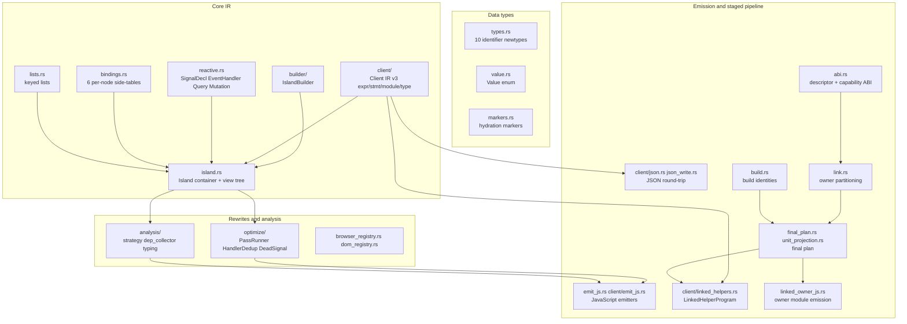
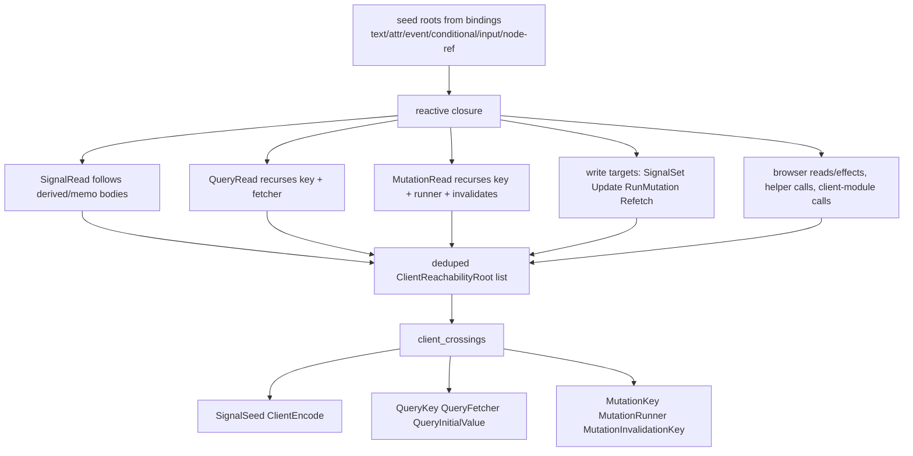

# 18 -- RSJS IR: Side-Tables, Client IR v3, and the Staged Compiler ABI

`rsjs_ir` is the intermediate representation (IR) crate at the center of the RSJS compiler. It owns
everything that sits between the author's `#[rsjs]` component and the JavaScript that ships to the
browser: the identifier types, the constrained expression language, the reactive declarations, the
per-node binding tables, the `Island` container, the optimization passes, the analysis layer, the
JavaScript emitter, and the versioned compiler ABI. One property defines the crate: it is
deliberately **independent of `syn` and `proc_macro`**. The proc-macro frontend (`rsjs_macros`)
builds an `Island` from a lifted `html_sync!` parse tree, but the IR itself carries no `syn` types.
Any future frontend -- a programmatic builder, a JSON ingestion path, an alternative authoring
surface -- can build the same IR without going through the macro. That independence is what makes
the IR testable in isolation and light to depend on for code that only inspects or transforms it.

The crate spans 38 source files and 51,537 lines. It is organized into layers that stack from data
types up to the staged compile pipeline.



## Why a separate crate

The crate root (`rsjs_ir/src/lib.rs`) states three reasons the IR lives apart from the proc macro.

First, **testability in isolation.** Unit tests construct side-tables by hand and assert the
JavaScript emitter output, with no macro expansion required. The `optimize` module's tests, for
example, build a two-button `Island` with `IslandBuilder`, run `HandlerDedup`, and assert the merged
handler count.

Second, **lighter to depend on.** Consumers that want to inspect or transform an IR do not pull in
`syn` or `proc-macro2`. The Rust `TokenStream` emitter that rewrites an authored
`WebRenderSync<L>` / `WebRender<L>` impl lives in `rsjs_macros::emit_rust`, not here, because
emitting Rust wants `quote!`, spans, and macro hygiene.

Third, **stability against the renderer.** Generated Rust targets Proa rendering contracts, but the
IR itself stays independent of the rendering implementation so a renderer change does not force
unnecessary compiler rebuilds.

The milestone status covers M1 through M9: identifiers and the expression enum (M1), the JavaScript
emitter (M2), the Rust emitter (M3), control-flow lowering (M4-M5), optimization passes (M6), the
proc-macro frontend and manifest (M7), server-driven queries (M8), and mutations (M9).

## The identifier types

Every side-table in the IR is keyed by a small, non-interchangeable integer. `types.rs` defines ten
newtypes over `u32`, each deliberately distinct so a `NodeId` cannot be passed where a `SignalId` is
expected even though the representations match.

```rust
// rsjs_ir/src/types.rs (abbreviated)
pub struct SignalId(pub u32);        // a reactive cell declaration
pub struct SharedStoreId(pub u32);   // a page-scoped shared-state acquisition
pub struct EventHandlerId(pub u32);  // an event handler declaration
pub struct CallbackSlotId(pub u32);  // a named reusable-component callback slot
pub struct NodeRefId(pub u32);       // a DOM node reference handle
pub struct NodeId(pub u32);          // a node in the lifted parse tree
pub struct ExprId(pub u32);          // a ClientExpr inside the ExprArena
pub struct LocalId(pub u32);         // a local binding inside a handler body
pub struct QueryId(pub u32);         // a server-driven query (M8)
pub struct MutationId(pub u32);      // an imperative mutation (M9)
```

The invariant is stated in the module docs: all identifiers are **dense, monotonic indices**, handed
out in allocation order starting at `0`. This lets emitters and analyses use `Vec<T>`-backed storage
for random access without a hashmap. `ExprArena` is the clearest case: an expression is a `Box`-ed
`ClientExpr` stored in a `Vec`, and an `ExprId` is its index, so shared subtrees (several text
bindings reading one signal) stay cheap. `LocalId` differs from the rest: handler locals are scoped
by the generated JavaScript function, not by the island side-tables, and descriptor remapping
rewrites child-component local ids when reusable components are inlined.

## The Value type

`Value` (`value.rs`) is the small set of primitives the emitters know how to render into either Rust
(for the server initial-state literal) or JavaScript (for the client runtime initial value). It has
exactly six variants and is `#[non_exhaustive]`.

```rust
// rsjs_ir/src/value.rs (abbreviated)
#[non_exhaustive]
pub enum Value {
    Bool(bool),
    Int(i64),      // lowered to a bare JS number literal
    BigInt(i128),  // lowered to a JS BigInt literal; wide-integer seed
    Float(f64),
    String(String),
    Null,          // maps to JS null
}
```

The `Int` vs `BigInt` split matters only to the JavaScript emitters and seed-blob writers. A
`Value::Int` lowers to a bare JavaScript number. A `Value::BigInt` lowers to a BigInt literal such as
`9007199254740993n`, and as a signal seed it uses the same JSON-string wire format that
`rsjs::client_codec::ClientEncode` uses for the wide domains (`i64`, `u64`). The analyzer produces
`BigInt` for every explicit `i64`/`u64` literal and promotes contextual unsuffixed literals when a
proven wide domain requires it. On the server the two behave identically; only the client-side
emitters care. This is the same wide-integer rule documented in the overview: `i64` and `u64` always
cross the hydration boundary as canonical decimal strings.

## Client IR v3: the constrained expression language

The `client` module holds the one representation that everything reactive lowers to. Legacy handler
IR v1 was deleted; v3 is the single expression and statement IR. It is deliberately constrained:
it is the JavaScript-lowerable subset of Rust expressions, nothing more. Every reactive expression,
every handler body, every client-helper body, and every descriptor handler body uses this IR.

### Client types and integer domains

`client/types.rs` defines `ClientType`, the closed value vocabulary, and `IntegerDomain`, the proven
Rust fixed-width integer domain.

```rust
// rsjs_ir/src/client/types.rs (abbreviated)
pub enum IntegerDomain { I32, U32, I64, U64 }

pub enum ClientType {
    Unit, Bool,
    I32, U32, I64, U64, F32, F64,
    String,
    Option(Box<ClientType>),
    Vec(Box<ClientType>),
    Object(Vec<ClientObjectField>),
    ValueObject { type_key: String, fields: Vec<ClientObjectField> },
    Struct(String),
    Enum(String),
    Event,
    DomElement,
    Signal(Box<ClientType>),
    Callback(Box<ClientType>),
    Dyn,
    Unknown,
}
```

`ClientType` has 21 variants. The leaves (`Bool` through `String`) are the codec-compatible scalars.
`Object` and `ValueObject` are the two struct shapes: `ValueObject` is the helper-internal value
object with a 64-hex-digit `type_key` and scalar-only fields. `Signal` and `Callback` are
reactive-handle types. `Dyn` and `Unknown` mark expressions whose type is dynamic or not yet
backfilled. `ClientType::of_value` infers a type from a `Value` literal; memo cells start at
`Unknown` and are backfilled by the whole-island typing pass.

### Expressions

`client/expr.rs` defines `ClientExpr`, a 39-variant enum. The variants group into reads, accessors,
operations, and calls. The leaf reads are the reactive roots:

```rust
// rsjs_ir/src/client/expr.rs (shape, abbreviated)
pub enum ClientExpr {
    Unit,
    Literal(Value),
    ArrayLit(Vec<Value>),
    QueryKey(Vec<ClientExpr>),
    Local(ClientLocalId),
    SignalRead(SignalId),
    QueryRead { id: QueryId, accessor: QueryAccessor },
    MutationRead { id: MutationId, accessor: MutationAccessor },
    EventRead(EventValue),
    EventCurrentTarget,
    DomRead { target: Box<ClientExpr>, accessor: NodeRefAccessor },
    EventCollectionLen(EventCollection),
    EventCollectionRead { collection: EventCollection, index: Box<ClientExpr>, field: EventCollectionField },
    NodeRefRead { id: NodeRefId, accessor: NodeRefAccessor },
    EventTargetWithinNodeRef { id: NodeRefId, inside: bool },
    EventAttribute { source: EventAttributeSource, attr: String },
    EventPayload { attr: String },
    CallbackPayload,
    NodePayload { attr: String, tokens: String },
    BrowserRead(ClientBrowserRead),
    Encoding { op: EncodingOp, value: Box<ClientExpr> },
    Conditional { condition: Box<ClientExpr>, then_expr: Box<ClientExpr>, else_expr: Box<ClientExpr> },
    IsNonEmpty { target: Box<ClientExpr> },
    StringToLowercase { target: Box<ClientExpr> },
    StringContains { haystack: Box<ClientExpr>, needle: Box<ClientExpr> },
    StringTransform { op: StringTransformOp, target: Box<ClientExpr> },
    StringPredicate { op: StringPredicateOp, haystack: Box<ClientExpr>, needle: Box<ClientExpr> },
    Project { target: Box<ClientExpr>, path: JsonPointer },
    AsType { target: Box<ClientExpr>, ty: AsType },
    IsPresent { target: Box<ClientExpr> },
    Eq { target: Box<ClientExpr>, value: Value },
    Neq { target: Box<ClientExpr>, value: Value },
    Coalesce { target: Box<ClientExpr>, fallback: Value },
    Unary { op: ClientUnaryOp, expr: Box<ClientExpr> },
    Binary { op: ClientBinaryOp, left: Box<ClientExpr>, right: Box<ClientExpr> },
    StructInit { type_name: String, fields: Vec<ClientStructFieldValue> },
    Field { base: Box<ClientExpr>, name: String },
    Index { base: Box<ClientExpr>, index: Box<ClientExpr> },
    Call { function: ClientFunctionRef, args: Vec<ClientExpr> },
}
```

`ClientBinaryOp` is the operator vocabulary. The numeric operators exist in two families. The
checked family (`ClientBinaryOp::Checked { op: CheckedIntegerOp, domain: IntegerDomain }`) encodes a
fixed-width operation that must keep Rust's wrapping-or-panicking semantics. The JavaScript emitter
lowers it to a `checked_int_add` / `checked_int_sub` / `checked_int_mul` / `checked_int_div` /
`checked_int_rem` runtime helper that takes the domain as a trailing string argument, for example
`checked_int_add(a, b, "i32")`; checked negation is `checked_int_neg(expr, "i32")`. There is one
helper per operator, not per `(CheckedIntegerOp, domain)` pair. The dynamic family (`DynAdd` through
`DynNe`) is used where the width is unknown. Comparison, boolean, and the unary operators round out
the surface.

`ClientFunctionRef` is the call target vocabulary: `Local(ClientFunctionId)` for a module-local
function, `Import { module, name }` for a static import, `Helper { edge, authored_path, name }` for
a relocation-resolved client helper, `Runtime(name)` for a runtime intrinsic, and `Unresolved(path)`
for a path the linker resolves later.

### Statements and blocks

`client/stmt.rs` defines `ClientStmt` (19 variants) and `ClientBlock`, a flat vector of statements.
The statements that mutate reactive state are `SignalSet` (write a value) and `SignalUpdate` (apply
a closure). The imperative ones are `RunMutation`, `QueryRefetch`, `QueryInvalidate`,
`CallbackInvoke`, `Console`, `BrowserEffect`, and `NodeRefEffect`. Control flow is `If` and
`ForRange`; `EventPreventDefault` and `EventStopPropagation` are the two event-control statements.

```rust
// rsjs_ir/src/client/stmt.rs (shape, abbreviated)
pub enum ClientStmt {
    Expr(ClientExpr),
    Let { local: ClientLocalId, name: String, ty: ClientType, value: Option<ClientExpr> },
    Assign { local: ClientLocalId, value: ClientExpr },
    AssignPlace { place: ClientPlace, value: ClientExpr },
    SignalSet { id: SignalId, value: ClientExpr },
    SignalUpdate { id: SignalId, closure: ClientSimpleClosure },
    EventPreventDefault,
    EventStopPropagation,
    Console { level: ConsoleLevel, args: Vec<ClientExpr> },
    CallbackInvoke { callback: CallbackSlotId, payload: ClientExpr },
    RunMutation { mutation: MutationId, args: Vec<ClientExpr> },
    QueryRefetch { query: QueryId },
    QueryInvalidate { query: QueryId },
    BrowserEffect(ClientBrowserEffect),
    NodeRefEffect { id: NodeRefId, effect: ClientNodeRefEffect },
    Return(Option<ClientExpr>),
    Block(ClientBlock),
    If { condition: ClientExpr, then_block: ClientBlock, else_block: Option<ClientBlock> },
    ForRange { local: ClientLocalId, name: String, integer_domain: IntegerDomain,
               start: ClientExpr, end: ClientExpr, inclusive: bool, body: ClientBlock },
}
```

`ClientBrowserEffect` (24 variants) is the browser side-effect surface: window scroll and print,
location and history navigation, document events and title, clipboard read/write, WebAuthn
ceremonies, event-file reads, storage writes, and URL search-param writes. Each carries its `Expr`
arguments inline. `ClientNodeRefEffect` (28 variants) is the node-ref imperative surface: focus,
blur, click, scroll, selection, form validity, class toggling, attribute and style writes, and the
popover/modal dialog family. `ClientPlace` is the assignment target: `Local(ClientLocalId)` or
`Field { base, name }`.

### Modules and functions

`client/module.rs` defines the module graph. A `ClientModule` holds `imports`, `exports`,
`functions`, `constants`, and a `BTreeMap<String, String>` of `metadata`. `ClientModuleKind` is one
of `Island`, `ComponentFragment`, `Route`, `ClientModule`, or `Runtime`. A `ClientFunction` holds a
dense `ClientFunctionId`, `params`, a `return_ty`, a `body` block, a `ClientVisibility` (`Private` or
`Exported`), and `captures`. The module also exposes `prune_unreachable_client_functions`, which
removes private functions unreachable from the module's exports without renumbering ids so
descriptor and module references stay stable.

`client/builder.rs` supplies the small test-side allocators that sit under those types.
`ClientFunctionBuilder` hands out dense `ClientLocalId`s and accumulates a `ClientBlock`;
`ClientModuleBuilder` hands out dense `ClientFunctionId`s and accumulates a `ClientModule`. Both are
`finish()`-style builders used by conversion spikes and fixture tests, not by the production macro
path.

### Client helper signatures and linking

`client/helper_signature.rs` owns the normalized Rust type grammar for standalone `#[rsjs::client]`
helper signatures. `parse_client_helper_type` reads the producer-normalized type spelling and returns
a `ClientType`. Supported leaves are `()`, `bool`, `i32`, `i64`, `u32`, `u64`, `f64`, `String`, and
parameter-only `&str`; `Option<T>`, `Vec<T>`, and parameter-only `&[T]` compose recursively.
Borrowed slices map to `ClientType::Vec`, direct `Option<Option<T>>` is rejected, and `f32` is
rejected because Client IR cannot preserve Rust's per-operation `f32` rounding. The five
`ClientHelperTypeError` variants (`Unsupported`, `NestedOption`, `UnsupportedFloat32`,
`BorrowedSliceReturn`, `BorrowedStringReturn`) each carry the offending type and the
`ClientHelperTypePosition` (`Parameter` or `Return`).

Two constants are part of the helper contract. `CLIENT_VALUE_OBJECT_TYPE_PREFIX` (`@rsjs_object(`)
reserves the grammar for helper-internal value objects: a 64-hex-digit `type_key` followed by
`;field=scalar-type` pairs, emitted only by the closed `#[rsjs::client] mod` frontend.
`CLIENT_HELPER_LEN_INTRINSIC_JS` is the single producer-owned runtime reference permitted inside
origin-free helper bodies, used for Rust `String`/`Vec`/slice `.len()`; it is the only spelling
`is_client_helper_runtime_intrinsic` accepts.

`client/linked_helpers.rs` is the final linker for standalone helpers. A `LinkedHelperDefinition`
carries a `LinkedHelperKey` (a content-addressed byte key), `params`, `return_ty`, a `body`
`ClientBlock`, and the caller-local `calls` it makes. `LinkedHelperProgram` is the caller-specific,
transitively closed program: a `root_calls` table plus a `helpers` table plus a private
`function_ids` table. Construction is fail-closed -- every body must have an exact local edge table,
every target must be defined, and the definition set must equal the transitive closure of
`root_calls`. Cycles are legal because emitted JavaScript function declarations are hoisted. The
emitted helper names are `__rsjs_helper_<id>`, and unresolved edges use the
`UNLINKED_HELPER_IDENTIFIER_PREFIX` (`__rsjs_unlinked_`). The two error enums are
`LinkedHelperLinkError` (15 variants, from `DuplicateBinding` through `TooManyHelpers`) and
`LinkedHelperEmitError` (7 variants, ending in `Client`), and the two call-site classifiers are
`LinkedHelperCaller` (`Root` or `Helper`) and `LinkedHelperSignaturePosition` (`Parameter` or
`Return`).

## Reactive declarations

`reactive.rs` holds the declarations that populate the island's side-tables. The most important is
`SignalDecl`, because a memo is not a separate type:

```rust
// rsjs_ir/src/reactive.rs (shape, abbreviated)
pub struct SignalDecl {
    pub id: SignalId,
    pub source_name: Option<String>,
    pub source_anchor: Option<SourceAnchor>,
    pub init: Value,
    pub derived: Option<ExprId>,          // Some(body) for a memo, None for a leaf
    pub ty: ClientType,
    pub integer_domain: Option<IntegerDomain>,
    pub shared: Option<SharedFieldRef>,   // Some(store, field) for shared-state cells
}
```

A leaf signal has `derived: None` and a real `init`. A memo has `derived: Some(ExprId)` and
`init: Value::Null`, because a derived value is never seeded; it is recomputed from the seeded source
signals. The seed-blob writers emit a `null` placeholder at a derived cell's index. A shared field
cell has `shared: Some(SharedFieldRef { store, field })` and `init: Value::Null`. All three share the
`SignalId` space so every downstream consumer -- dependency collection, binding dependency arrays,
`__sig_<id>` naming, component-inline signal remapping -- slots into the same wiring unchanged.

`EventHandler` stores an id, an optional debounce window in milliseconds, and the handler body as a
Client IR v3 `ClientBlock`. `QueryDecl` stores a structural `key_expr`, a `server_initial` value, a
`client_fetcher`, a `data_ty`, and `QueryOptions` with six knobs: `interval_ms`, `refetch_on_focus`,
`download_progress`, `stream_text`, `retry_count`, and `stale_time_ms`. `MutationDecl` stores a
`key_expr`, a `server_runner`, a `client_runner`, an `invalidates` list of query-key expression ids,
and `MutationOptions` with `InvalidationStrategy` (`Refetch` or `Reset`). `NodeRefDecl`, `IntervalDecl`,
and `CallbackSlot` complete the set; intervals carry no id because nothing else references them.

## The bindings side-tables

`bindings.rs` is where the DOM connects to reactive state. `Bindings` is a struct of six `HashMap`
fields keyed by `NodeId`, one per binding kind:

```rust
// rsjs_ir/src/bindings.rs (shape, abbreviated)
pub struct Bindings {
    pub text_bindings: HashMap<NodeId, ExprId>,                 // node -> text expr
    pub attr_bindings: HashMap<(NodeId, String), AttrBinding>,  // (node, name) -> dynamic attr
    pub event_bindings: HashMap<(NodeId, EventName), EventHandlerId>,
    pub conditional_sections: HashMap<NodeId, Vec<ConditionalSection>>,
    pub input_bindings: HashMap<NodeId, InputBinding>,          // two-way form bindings
    pub node_ref_bindings: HashMap<NodeId, NodeRefBinding>,
}
```

`text_bindings` say which text nodes display which expression. `attr_bindings` pair a dynamic
attribute with an expression and an `AttrBindingKind` (`Value`, `Boolean`, or `Url`).
`event_bindings` say which DOM event on which node invokes which handler. `conditional_sections`
hold `{ if cond { then } else { else } }` predicates as a `ConditionalSection` with `then_children`
and `else_children` node lists. `input_bindings` pair a form input with a `SignalId` via an
`InputKind` (`Value`, `Checked`, or `Selected`) for `bind_value` / `bind_checked` / `bind_selected`.
`node_ref_bindings` bind an element to an author-declared `NodeRefId`.

The event surface is a closed list. `EventName` has 57 variants spanning `Click`, `Input`, `Change`,
`Paste`, `Focus`, `Blur`, `KeyDown`, `KeyUp`, the full mouse and pointer families, `Scroll`, `Wheel`,
`BeforeInput`, the composition events, drag and drop, `Toggle`/`BeforeToggle`, the animation and
transition events, `Submit`, the document-level `DocumentClick`/`DocumentPointerDown`/`DocumentKeyDown`,
and the window-level `WindowPopState`/`WindowHashChange`/`WindowStorage`/`WindowResize`/`WindowScroll`.
The `EventName` type carries the canonical conversions: `as_dom_name()`, `as_attr_name()`,
`as_descriptor_name()`, plus `is_document_event()` and `is_window_event()` predicates.

Conditional rendering is a binding concern, not a structural one. Both branches of an `if` are
statically present in the view tree; the runtime shows one and hides the other.

## The view tree and the Island

`island.rs` defines the container and the view structure. The `ViewTree` supplies stable `NodeId`s,
and `ViewNode` is one of five shapes: `Element { tag, children, static_attrs, server_attrs,
payload_attrs }`, `ForLoop { attrs, label, pat, expr, body_prefix, children }`,
`TextBindingSlot`, `StaticText(String)`, and `ServerOnly(ServerOnlyNode)`. Only `Element` and
`ForLoop` can have children; the builder panics if a child is attached to a text slot, static text, or
server-only node.

The `Island` is a bag of side-tables, not a tree of reactive nodes:

```rust
// rsjs_ir/src/island.rs (shape, abbreviated)
pub struct Island {
    pub shared_stores: Vec<SharedStoreDecl>,
    pub signals: Vec<SignalDecl>,
    pub handlers: Vec<EventHandler>,
    pub callback_slots: Vec<CallbackSlot>,
    pub node_refs: Vec<NodeRefDecl>,
    pub bindings: Bindings,
    pub exprs: ExprArena,
    pub view_tree: ViewTreeRef,
    pub is_async: bool,
    pub client_module_imports: Vec<String>,
    pub hydration_strategy: HydrationStrategy,
    pub component_fragment_imports: Vec<String>,
    pub component_fragment_mounts: Vec<ComponentFragmentMount>,
    pub queries: Vec<QueryDecl>,
    pub mutations: Vec<MutationDecl>,
    pub intervals: Vec<IntervalDecl>,
    pub lists: Vec<ListDecl>,
}
```

`HydrationStrategy` is the client-side activation trigger: `Immediate`, `Visible`, `Idle`,
`Interaction { event: Option<String> }`, or `Media { query: String }`. `is_async` selects the
`html!` (async) Rust emission path instead of the sync `html_sync!` path. The component-fragment
fields record descriptor-backed reusable child components the island composes; a
`ComponentFragmentMount` carries the mount root, the child asset id, callback adapters, and the
signal/node aliases that wire parent cells into the child.

## The IslandBuilder

`builder/mod.rs` is the hand-author frontend. It lets tests and programmatic frontends construct an
`Island` without going through the macro. It is deliberately thin: every method either allocates a
new id and returns it, or wires an existing id into a side-table. The builder does not validate
cross-references -- misuse panics later, when an emitter or analysis dereferences a bad id.

```rust
// rsjs_ir/src/builder/mod.rs (abbreviated)
pub fn signal(&mut self, init: Value) -> SignalId;          // leaf, type inferred from init
pub fn signal_typed(&mut self, init: Value, ty: ClientType) -> SignalId;
pub fn memo(&mut self, body: ExprId) -> SignalId;           // derived cell, ty Unknown until typing
pub fn shared_store(&mut self, source_name: String, rust_type: String, ...) -> SharedStoreId;
pub fn shared_field(&mut self, store: SharedStoreId, field: String, ty: ClientType) -> SignalId;
pub fn expr(&mut self, client_expr: ClientExpr) -> ExprId;
pub fn handler_from_ir(&mut self, body_ir: ClientBlock) -> EventHandlerId;
pub fn debounce_handler_from_ir(&mut self, ms: u64, body_ir: ClientBlock) -> EventHandlerId;
pub fn interval(&mut self, ms: u64, body_ir: ClientBlock);
pub fn keyed_list(&mut self, decl: ListDecl);
pub fn callback_slot(&mut self, name: &str) -> CallbackSlotId;
pub fn node_ref(&mut self) -> NodeRefId;
pub fn element(&mut self, tag: &str, parent: Option<NodeId>) -> NodeId;
pub fn text_node(&mut self, parent: NodeId, expr: ExprId) -> NodeId;
pub fn bind_event(&mut self, node: NodeId, event: EventName, handler: EventHandlerId);
pub fn bind_input(&mut self, node: NodeId, kind: InputKind, signal: SignalId);
pub fn bind_attr(&mut self, node: NodeId, name: &str, kind: AttrBindingKind, expr: ExprId);
pub fn bind_node_ref(&mut self, node: NodeId, node_ref: NodeRefId);
pub fn query(&mut self, key_expr: ExprId, server_initial: ExprId, client_fetcher: ExprId,
             options: QueryOptions) -> QueryId;
pub fn mutation(&mut self, key_expr: ExprId, server_runner: ExprId, client_runner: ExprId,
                invalidates: Vec<ExprId>, options: MutationOptions) -> MutationId;
pub fn set_root(&mut self, id: NodeId);
pub fn build(self) -> Island;
```

Two methods deserve note. `memo` pushes a `SignalDecl` with `init: Value::Null`, `derived:
Some(body)`, and `ty: ClientType::Unknown`; the whole-island typing pass backfills the type later via
`set_signal_ty`. `set_signal_derived` exists for the component inliner: child signal declarations are
copied before the child expression arena, so a child memo's remapped body id only becomes known after
the arena copy.

The builder also separates three attribute kinds that the server and client treat differently.
`static_attr` records author attributes (`class="error"`, `id="foo"`) that the Rust emitter threads
straight back into the generated `html_sync!` body. `server_attr` records `rsjs::server_attr(...)`
tokens that only the Rust emitter consumes. `payload_attr` records a JSON-encoded dynamic payload
that delegated client handlers consume; `payload_attr_for_tokens` deduplicates the compiler-owned
attribute name so repeated template expressions on one element share one encoded DOM value.

## Keyed lists

`lists.rs` defines `ListDecl`, the client-side reconciliation of a container's children over a
`Vec`-valued signal. `ListSource` is either `Signal(SignalId)` or `Expr(ExprId)`. `ListItemExpr` and
`ListTemplateNode` describe the per-item template. The runtime pairs each server-rendered child with
its initial item using the `data-rsjs-key` marker instead of re-creating the DOM.

## Hydration markers

`markers.rs` is the single source of truth for the attribute names the JavaScript and Rust emitters
must agree on. Both emitters embed these strings into byte streams, so they are `&'static str`, not
an enum -- the cheapest representation, and it lets callers interpolate without an allocation. A
typo in one emitter produces unmatched markers, which the runtime can only report as a missing-node
warning.

| Constant | Value | Written by | Read by |
|---|---|---|---|
| `MARKER_BIND` | `data-rsjs-bind` | Rust emitter | JS emitter (`bind_text`) |
| `MARKER_ATTR` | `data-rsjs-attr` | Rust emitter | JS emitter (attr bindings) |
| `MARKER_HANDLER` | `data-rsjs-handler` | Rust emitter | JS emitter (event bindings) |
| `MARKER_REF` | `data-rsjs-ref` | Rust emitter | JS emitter (node refs) |
| `MARKER_COMPONENT` | `data-rsjs-component` | Rust emitter | fragment root lookup |
| `MARKER_COMPONENT_MOUNT` | `data-rsjs-component-mount` | Rust emitter | parent mount lookup |
| `MARKER_INPUT_VALUE` | `data-rsjs-input-value` | Rust emitter | JS emitter (two-way value) |
| `MARKER_INPUT_CHECKED` | `data-rsjs-input-checked` | Rust emitter | JS emitter (two-way checked) |
| `MARKER_INPUT_SELECTED` | `data-rsjs-input-selected` | Rust emitter | JS emitter (two-way selected) |
| `MARKER_LIST` | `data-rsjs-list` | analyser | JS emitter (keyed-list container) |
| `MARKER_LIST_KEY` | `data-rsjs-key` | Rust emitter | `bind_list` adoption pass |
| `ISLAND_WRAPPER_TAG` | `rsjs-island` | Rust emitter | `hydrate` root resolution |
| `ISLAND_ROOT_ATTR` | `data-rsjs-island-root` | Rust emitter | `hydrate` root resolution |
| `ISLAND_MARKER_ATTR` | `data-rsjs-island` | Rust emitter | dehydrated state script tag |

The island wrapper is an HTML5 custom element, `<rsjs-island>`. The asset id travels on
`data-rsjs-island-root`, not an HTML `id`, so several instances of the same island can appear in one
valid page. The runtime resolves roots with
`document.querySelectorAll('rsjs-island[data-rsjs-island-root="<asset_id>"]')`.

## Optimization passes

`optimize/mod.rs` is pure IR-to-IR rewriting. It ships two concrete passes and a fixed-point runner.
The module docs are explicit that the JavaScript emitter does not run these passes implicitly:
callers that want the optimized output construct a `PassRunner` (or use `default_passes`) and run it
before calling `emit_js::emit`. This keeps `emit_js` deterministic with respect to its input.

```rust
// rsjs_ir/src/optimize/mod.rs (abbreviated)
pub trait IslandPass {
    fn name(&self) -> &'static str;               // e.g. "handler_dedup"
    fn run(&self, island: &mut Island) -> PassResult;
}

pub struct PassResult { pub changed: bool, pub stats: PassStats }
pub struct PassStats { pub items_removed: usize, pub items_merged: usize, pub items_visited: usize }

pub fn default_passes() -> PassRunner {
    PassRunner::new()
        .add(HandlerDedup::new())
        .add(DeadSignalElimination::new())
}
```

`PassRunner::run_all` applies the passes in declared order until a fixed point, capped at `MAX_ROUNDS
= 10`. The cap is a safety net against a pass that violates the idempotence contract and oscillates;
in practice each pair converges in one or two rounds. Every pass must be idempotent: running it twice
must report `changed: false` on the second run.

`handler_dedup.rs` merges structurally-identical event handlers. Two handlers are equivalent when
their stored Client IR v3 blocks are equal under structural `PartialEq`, including the debounce
window. Equivalence is over signal ids, not values: two handlers that both write `count.set(0)` merge,
but one that writes `other.set(0)` does not. The pass picks the first (lowest-id) handler as the
canonical one, rewrites every `event_bindings` entry that pointed at a duplicate, and drops the
orphaned entries. Surviving handlers keep their original ids, so the `handlers` vector may become
sparse -- the emitters key off the stored id, not the vector position.

`dead_signal_elimination.rs` drops signals with no readers and no writers. It is deliberately
conservative: a signal that is only ever written survives, because writes may be observed through
paths not yet present in the v0.1 surface. The pass walks every arena expression (readers only, since
writes are statements), every handler and interval block (readers and writers), every keyed-list
source, every input binding (both a reader and a writer, two-way), and every component-fragment
mount's signal aliases and callback adapters. The last walk is shared with the reachability analysis
so the pass and the strategy layer cannot disagree about which signals a mount keeps alive.

## The analysis layer

`analysis/` has five modules and is re-exported at the crate root. Its core is `strategy.rs`, which
answers the question "does this island need browser JavaScript, and what must be serialized for it?"

### Render strategy and reachability

`classify_render_strategy(island)` returns a `StrategyAnalysis` with a `RenderStrategy` of
`ServerOnly`, `SsrHydrate`, or `ClientOnlyExplicit` (all `#[non_exhaustive]`). The strategy is
`ServerOnly` when the island has no reachability roots, and `SsrHydrate` otherwise. Reachability
roots are the IR facts that make browser JavaScript reachable. `client_reachability_roots` seeds
them from the binding side-tables -- text bindings, attribute bindings, event bindings, conditional
sections, input bindings, node-ref bindings, intervals, keyed lists, and component-fragment mounts --
then closes each seed reactively: signal reads follow derived and memo bodies recursively, query reads
recurse `key_expr` and `client_fetcher`, mutation reads recurse `key_expr`, `client_runner`, and each
`invalidates` entry, and write targets (`SignalSet`, `SignalUpdate`, `RunMutation`,
`QueryRefetch`, `QueryInvalidate`) pull in their destinations.



The roots feed `client_crossings`, the deterministic ledger of values serialized into
browser-visible state. Each reachable leaf signal that is neither derived nor shared produces a
`SignalInitialValue` crossing (`SignalSeed`, requirement `ClientEncode`). Each reachable query
produces `QueryKey` + `QueryFetcher` (`QueryMetadataBlob`) plus `QueryInitialValue` (`QuerySeedBlob`).
Each reachable mutation produces `MutationKey` + `MutationRunner` plus one `MutationInvalidationKey`
per `invalidates` entry. Payload attributes referenced by `EventPayload` or `NodePayload` become
`HandlerPayload` and `NodePayload` crossings.

`DeadClientPrimitive` records declarations that reachability did not use -- a dead signal, memo,
handler, node ref, query, or mutation -- each with a kind, label, and source anchor.

### Dependency collection and typing

`dep_collector.rs` owns the structural walks. `collect_deps(arena, root)` returns the signals an
expression depends on; `collect_client_block_deps`, `collect_client_block_reactive_deps`, and
`collect_client_block_helper_edges` extend it to blocks. The walks are one shared preorder traversal:
`walk_client_expr` visits an expression then every nested sub-expression, and `walk_client_stmt` /
`walk_client_block` extend it through statements, browser effects, node-ref effects, and child
blocks. Reactive collection records only reads -- `SignalRead`, `QueryRead`, `MutationRead` -- never
write destinations, in first-encounter order with dedup. External collection also records signal
writes, callback slots, node refs, helper edges, client-module calls, and five `uses_*` flags, and it
fails with `ClientBlockDependencyError::LocalFunction` or `UnresolvedFunction` for unclosable
function references.

`typing.rs` computes types on demand rather than storing them on nodes. `TypeEnv::type_of` returns a
`ClientType` per expression; leaves such as accessors and browser reads have fixed types, while
`EventPayload`, `NodePayload`, `CallbackPayload`, calls, and indexing are `Unknown`.
`TypeEnv::integer_domain_of` returns the proven `IntegerDomain`, and `numeric_width` projects a
`ClientType` to `NumberInt`, `NumberFloat`, `BigInt`, or `Dynamic`. `backfill_derived_signal_types`
writes the `ty` and `integer_domain` of memo cells whose declarations were not yet backfilled.

### Helper validation

`helper_validation.rs` and `helper_typing.rs` validate standalone `#[rsjs::client]` helper bodies.
The structural pass (`validate_client_helper_expr` / `validate_client_helper_block`) rejects too many
parameters, too many locals, non-dense local declarations, unknown or out-of-scope locals, assignment
to a parameter, invalid object field names, non-origin-free dependencies, and unsupported statements
or expressions. The typing pass (`validate_client_helper_block_types`) checks each `ClientHelperTypeSite`
-- a `Let` initializer, an assignment, a signal set/update, an `If` condition, a binary operand, a
helper argument, a return -- against the target signature, and reports `ClientHelperBodyTypeError`
variants like `TypeMismatch`, `IncompatibleConditionalBranches`, and `InvalidBinaryOperands`.

## The browser and DOM registries

`browser_registry.rs` is a declarative registry of `rsjs::<module>::<helper>` browser helpers. Each
`BrowserHelperSpec` entry declares, in one place, the `rsjs` path, argument shapes, the diagnostic
usage string, the "unknown helper" allowlist line, the client value type, the gesture/async
constraint, how it lowers into Client IR, and the `rsjs_conformance/browser_api_matrix.json` entry it
backs. The registry drives recognition and argument checking in the macro analyzer, JavaScript
emission, typing, and the SSR stub cross-check test.

```rust
// rsjs_ir/src/browser_registry.rs (abbreviated)
pub enum HelperContext { ReactiveRead, HandlerEffect }
pub enum HelperConstraint { None, UserGesture }
pub enum ArgKind { Reactive, SignalRef }
pub enum HelperLowering {
    WindowField(WindowField),
    StorageGet { area: BrowserStorageArea, value_type: StorageValueType },
    WindowScrollTo, WindowScrollBy, WindowPrint,
    ClipboardWriteText, ClipboardReadTextInto,
    StorageSetItem(StorageArea), StorageRemoveItem(StorageArea),
    DeclaredRead { js: &'static str },    // $0..$9 splice lowered args
    DeclaredEffect { js: &'static str },
}
pub static REGISTRY: &[BrowserHelperSpec] = &[ /* window, clipboard, storage, navigator, root */ ];
```

The key insight is `DeclaredRead` / `DeclaredEffect`: a simple read or effect can be added as one
`&'static str` JavaScript template with `$0`..`$9` placeholders, and the analyzer, descriptor JSON,
JavaScript emitter, typing pass, and SSR fallback all handle it generically. Only helpers that need
bespoke IR (multi-statement async protocols, signal writes) keep dedicated Client IR variants. The
template must be a self-contained JavaScript expression that survives a missing browser global, so
`navigator.language` lowers to
`((typeof navigator !== "undefined") ? (navigator.language ?? "") : "")`. The migrated families are
`window`, `local_storage`, `session_storage`, `clipboard`, `navigator`, and `root`; the remaining
families (`location`, `history`, `document`, `webauthn`, `url`, `encoding`) still live on the legacy
hand-written path and migrate opportunistically.

`dom_registry.rs` adapts the generated `rsjs_web` DOM operation registry to the existing stable
`NodeRefAccessor` variants. It exposes `find_node_ref_read`, `find_node_ref_effect`,
`find_current_target_read`, and `node_ref_accessor`, which maps a `DomOperation` plus an optional
static attribute name onto the Client IR accessor. `operation_type` derives the scalar `ClientType`
from the operation's `DomFallback`.

## The JavaScript emitters

`emit_js.rs` (the island-level emitter) and `client/emit_js.rs` (the Client IR v3 emitter) turn an
optimized `Island` into a per-island JavaScript module. The island emitter's public entry point is
`emit(island, name) -> String`, plus `try_emit_linked` for the final-link variant that never emits
symbolic helper calls, and the `emit_fragment` family for component fragments. A server-only island
returns an empty string.

The emitted module opens with a runtime import, then a `hydrate` call whose body declares signals,
node refs, queries, mutations, handlers, and bindings. The naming conventions are stable and
generated from the dense ids: signals are `__sig_<id>`, handlers `__handler_<id>`, node refs
`__ref_<id>`, DOM nodes `__node_<id>`, callback slots `__callback_<id>`, query registrations
`__rsjs_query_registration_<id>`, mutations `__rsjs_mutation_<id>`, client locals `__local_<id>`, and
client functions `__fn_<id>`.

```rust
// rsjs_ir/src/client/emit_js.rs (abbreviated)
pub struct ClientEmitContext {
    pub event_name: &'static str,      // "event"
    pub root_name: &'static str,       // "root"
    pub local_prefix: &'static str,    // "__local_"
    pub signal_prefix: &'static str,   // "__sig_"
    pub query_prefix: &'static str,    // "__rsjs_query_"
    pub mutation_prefix: &'static str, // "__rsjs_mutation_"
    pub callback_prefix: &'static str, // "__callback_"
    pub node_ref_prefix: &'static str, // "__ref_"
    pub local_names: ..., pub linked_helper_calls: ...,
}
```

The hydration function varies by strategy: `Immediate` imports `hydrate`, while `Visible`, `Idle`,
`Interaction { .. }`, and `Media { .. }` import `hydrate_when_visible`, `hydrate_when_idle`,
`hydrate_on_interaction`, and `hydrate_when_media`, wrapped as `hydrate_from_module(import.meta.url,
...)`. An `Interaction` strategy appends the event list; a `Media` strategy appends the query string.

Signal emission differs by cell kind. A leaf signal reads its seed via
`signal(signal_initial(__rsjs_signal_initials, <id>, <default>))`; an integer-domain signal uses
`integer_signal(signal_initial_integer(..., "<domain>"), "<domain>")`; a typed container uses
`signal_initial_typed`; a wide value uses `signal_initial_wide`. A derived cell becomes
`const __sig_<id> = memo(() => <body>, [deps]);` and pushes its `_dispose` onto the disposer list. A
shared field becomes `const __sig_<id> = __rsjs_shared_<store>.field("<field>");`. Node resolution
uses a static index walk: `const __node_<id> = walk_path(root, [0, 1], "data-rsjs-bind", "<id>");`,
where the leading `0` descends from the `<rsjs-island>` wrapper into the island root.

Delegated events use `bind_delegated_events(root, "click", new Map([["<nodeId>", __handler_<id>]]))`;
submit uses `bind_submit`; document and window events use `bind_document_event` and
`bind_window_event`. The island function returns `() => dispose_all(__rsjs_disposers, "rsjs bindings")`.

The Client IR v3 emitter exposes `emit_client_expr_js`, `emit_client_stmt_js`,
`emit_client_block_js`, `emit_client_module_js`, and their `_with_context` variants. It reports
`ClientEmitError` with variants such as `UnsupportedExpr`, `UnresolvedFunctionRef`,
`UnboundHelperCall`, and `ContextualIntegerLiteralOutOfRange`. Determinism is explicit: the module
doc notes the emitter sorts `HashMap` iteration so identical IR produces identical output.

## Client IR JSON

`client/json_write.rs` (write) and `client/json.rs` (parse) define the descriptor and sidecar wire
format for Client IR v3. The writer emits `{"kind": ...}`-shaped objects for every expression,
statement, type, and module, and the parser reads them back. The two are inverse: the tests round-trip
a block and an expression through `client_block_json` / `parse_client_block_json_str` and assert
equality. The module format is versioned with `CLIENT_IR_SCHEMA_VERSION` (3) and marked
`rsjs.client_module_ir`. Helper call references are explicit in the JSON, carrying their `edge` id,
`authored_path`, and `name`, so the descriptor retains the source edge even before relocation.

## The compiler ABI

`abi.rs` is the versioned public data model for the staged RSJS compiler ABI. It contains no
proc-macro or linker integration -- only the descriptor and semantic model, the content-addressed
identity tokens, the version and capability negotiation matrix, and full validation.

### Canonical encoding and identity

`CanonicalEncode` and `CanonicalEncoder` produce canonical bytes; `canonical_semantic_hash` derives a
32-byte `SemanticHash` (`HASH_BYTES = 32`) over a domain-tagged record stream. The canonical hash
domain is `proa.rsjs.compiler-abi.canonical.v1\0`. Three JSON-compat domains exist for helpers:
`helper-signature.v1`, `helper-client-ir.v3`, and `helper-codegen-ir.v1`. Seven digest ids
(`define_digest_id!`) name the pipeline stages: `InvocationId`, `CargoUnitId`, `LinkUnitId`,
`PlanId`, `FinalUnitId`, `SemanticHash`, and `DebugHash`. `FinalUnitId::for_plan` ties the last two:
a final unit's identity is the hash of its semantic unit fingerprint and its `PlanId`.

### Version and capability negotiation

`AbiVersion { major, minor }` and `ProducerVersion { major, minor, patch }` carry versions; a
`VersionRange { min, max }` checks containment. The descriptor magic is `DESCRIPTOR_MAGIC =
*"RSJSABI\0"` (8 bytes). `DESCRIPTOR_SCHEMA_V1 = AbiVersion(1, 0)` and `CLIENT_IR_V3 = AbiVersion(3, 0)`,
with `CLIENT_IR_SCHEMA_VERSION = 3`. `CapabilitySet` is a `u64` bitfield with twelve bits, from
`TOLERANT_SERVER_GRAPH` (bit 0) through `SHARED_STATE_PROVIDER_TOPOLOGY` (bit 11); the descriptor
capability set is the union of all twelve, and the runtime capability set is
`TEMPORAL_PROPS | OWNER_PARTITION_INPUTS | DOM_SPAN_CARDINALITY`. An `AbiSupport` matrix declares
what a consumer understands, and `DescriptorEnvelope::validate(&support)` fails closed on any
mismatch.

### Descriptors

`DescriptorKind` is `Component` or `Helper`. A `ComponentDescriptor` carries 25 canonical fields: the
semantic key, a defining witness, `render_kind`, `origin_permission`, the method-extraction and
site-registration ABI versions, `root_eligible`, a `client_ir_hash`, and the graph tables (`values`,
`effects`, `control_regions`, `origins`, `fields`, `crossing_hooks`, `prop_uses`, `direct_components`,
`direct_helpers`, `shared_state`, `shared_state_providers`, `dependencies`, `owner_sites`,
`region_sites`, `keyed_collection_sites`, `span`, `hydration`). A `HelperDescriptor` carries 12
fields. The descriptor body computes the required descriptor and runtime capability sets, and the
envelope carries a `semantic_hash` plus an optional `debug_hash` over debug-only source locations
excluded from the semantic hash.

The enums are the semantic vocabulary. `RenderKind` is `WebRenderSync` or `WebRender`.
`OriginKind` spans `SourceOnly` through `BrowserCapabilityWrite`; everything except `SourceOnly`
requires client permission. `EffectKind` lists the effect classes from `DomTextUpdate` through
`Serialization`. `TemporalPropMode` distinguishes `LiveRead`, `SeedOnce`, `EffectDependency`,
`QueryKeyDependency`, `ForbiddenProviderSeed`, and `ForbiddenBoundaryCrossing`. `HydrationConstraint`
(`Unconstrained`, `Eager`, `Visible`, `Idle`, `Interaction`, `Media`) is the ABI-level activation
strategy. `ComponentBindingSource` (`ServerOnly`, `StaticCallback`, `SerializedSeed`, `LiveValue`,
`LiveCallback`, `ClientHandle`, `StaticSlot`, `LiveSlot`) drives owner coupling. `AbiValidationError`
has roughly 50 variants, all fail-closed: magic mismatch, version out of range, capability under- or
over-declaration, non-dense local ids, dangling graph endpoints, and hash mismatches.

## Semantic linking and owner partitioning

`link.rs` performs deterministic owner partitioning. The input is a resolved component graph of
`ResolvedComponentInstance`s and `ResolvedComponentEdge`s. `derive_owner_partition_input` turns each
resolved field binding into a coupling relation: `LiveValue` becomes `LiveProp`, `LiveCallback`
becomes `LiveCallback`, `ClientHandle` becomes `ClientHandle`, `LiveSlot` becomes
`ReactiveLifecycle`, and `ServerOnly`/`StaticCallback`/`SerializedSeed`/`StaticSlot` do not fuse.
Forbidden temporal modes (`ForbiddenProviderSeed`, `ForbiddenBoundaryCrossing`) fail at link time.

`partition_owners` runs a `UnionFind` over the coupling edges, checks `Cut` (`IndependentIsland` /
`NestedOwner`) only after the full coupling closure so indirect coupling paths are caught with a
`coupling_path`, and numbers the active groups `LinkedOwnerId` 0..n in order of their smallest
candidate. `resolve_strategy` maps each candidate's `HydrationConstraint` to an
`OwnerActivationStrategy` (`Eager`, `Visible`, `Idle`, `Interaction { event }`, `Media { query }`),
defaulting an unconstrained candidate to `Eager` and erroring on conflicting constraints.

## The final plan and unit projection

`final_plan.rs` is pure byte validation -- it never touches the filesystem or environment. The final
plan is a content-addressed JSON document with `PLAN_FORMAT = "proa.rsjs.semantic_link_plan"` and
`PLAN_SCHEMA_VERSION = 15`. Its tables are `components`, `helpers`, `helper_codegen`,
`component_codegen`, `component_sites`, `standalone_roots`, `owners`, `candidate_to_owner`,
`component_inputs` (`live_props` / `live_callbacks`), `shared_state_providers`,
`shared_state_requirements`, and `node_ref_aliases`. `validate_component_plan_bytes` decodes and
cross-checks the plan into a `FinalComponentSelection`, then `select()` narrows it to the candidates
belonging to one macro expansion.

Runtime identities are derived, not assigned. `scope_id` is the SHA-256 of
`"proa.rsjs.runtime-root.v1\0"` plus the root semantic key; `site_id` is the SHA-256 of
`"proa.rsjs.runtime-site.v1\0"` plus the scope id, component semantic key, and structural path; and
`candidate_id` is the low 8 bytes of `site_id` as a little-endian `u64`. Collisions are rejected.

`final_plan/unit_projection.rs` re-decodes the same global plan and emits a canonical
`proa.rsjs.final_unit_plan` (schema version 1) containing only the records whose `cargo_unit_id`
matches, with candidate ids rewritten to full `{ scope, site, candidate }` coordinates. Callers
publish these bytes under their SHA-256 as a Cargo dependency. Owner ordinals are replaced at the
site boundary so they never survive in a dependency or ABI.

Content-addressed assets derive from the plan: component fragments get
`rsjs_fragment_{sha256("proa.rsjs.final-component-fragment.v1\0" + canonical_material)}`, and owner
modules get `rsjs_owner_{sha256("proa.rsjs.final-owner-module.v1\0" + site_id + uses_queries +
uses_mutations + js)}`, where `js` is the emitter output with the self-referential asset and seed
slots normalized to `OWNER_HASH_PLACEHOLDER = "rsjs_owner_content_placeholder"`. Fused-member seed
keys are `rsjs_member_{hex(site_id)}`.

`linked_owner_js.rs` emits the JavaScript for one activation boundary. Its plan is a
`LinkedOwnerModulePlan` carrying the owner asset id, the root candidate, the activation strategy, the
query and mutation flags, and the mount, signal-alias, signal-seed, callback-edge, and lifecycle
tables. `emit_linked_owner_module` validates the plan and emits a module whose fragments accept
`{ seedRoot, islandRoot, signals, signalSeeds, nodeRefs, preserveDirtyControls, expose }` and populate
`expose.signals`, `expose.nodeRefs`, `expose.payloadHandlers`, and `expose.lifecycleControls`. The
`LINKED_CANDIDATE_ATTR` is `data-rsjs-linked-candidate`.

## Build identities

`build.rs` defines the deterministic build identities that name the pipeline stages before the plan.
`InvocationSpec::invocation_id()`, `CargoUnitSpec::cargo_unit_id()`, `LinkUnitManifest::link_unit_id()`,
and `LinkPlanMaterial::plan_id()` produce content-addressed ids. `LinkArtifact::path` is excluded from
the canonical identity so moving an artifact on disk does not change its semantic identity.
`BuildIdentityError` reports the cases where an identity cannot be derived.

## The Aha Moment

**Aha:** The reactive graph has no edges stored anywhere -- and neither does the compile pipeline
store a "who owns whom" tree. Both are derived, on demand, by walking the one source of truth.

A `SignalDecl` does not store its dependents. An `EventHandler` does not store the signals it reads.
There is no `dependencies: Vec<SignalId>` field anywhere in the crate. Dependency information is
computed by analyses that walk the `ClientExpr` tree, and binding dependency arrays fall out of that
same walk. This is why the optimization passes can rewrite the IR in place without first repairing a
parallel edge list -- there is no edge list to repair.

The same discipline repeats one layer up. Owner partitioning in `link.rs` does not start from a
stored component tree. It starts from `OwnerCandidate`s and `OwnerRelation`s, computes the coupling
closure with a `UnionFind`, and derives owners, activation strategies, and content-addressed asset
ids from that closure. The final plan is a byte document that names every stage by hash, not by path
or registry entry. Treating structure as derived rather than stored keeps the IR cheap to construct,
hard to get out of sync, and deterministic to emit: the single source of truth is the expression tree
and the relation list, and everything the runtime or the linker needs falls out of walking them.

## Cross-References

- The authoring surface and reactive types this IR lowers from: [17-rsjs-overview.md](./17-rsjs-overview.md).
- The `#[rsjs]` proc macro that lifts templates into this IR and rewrites the render body:
  [19-rsjs-macros.md](./19-rsjs-macros.md).
- The DOM/event facade and the descriptor wire transport that consume the ABI: [20-rsjs-web-transport.md](./20-rsjs-web-transport.md).
- The linked build pipeline that runs descriptor compile, semantic link, and final compile:
  [15-build-tooling.md](./15-build-tooling.md).
- The core `proa_ir` that precedes RSJS in the overall pipeline: [11-ir.md](./11-ir.md).

Continue to [19-rsjs-macros.md](./19-rsjs-macros.md).
