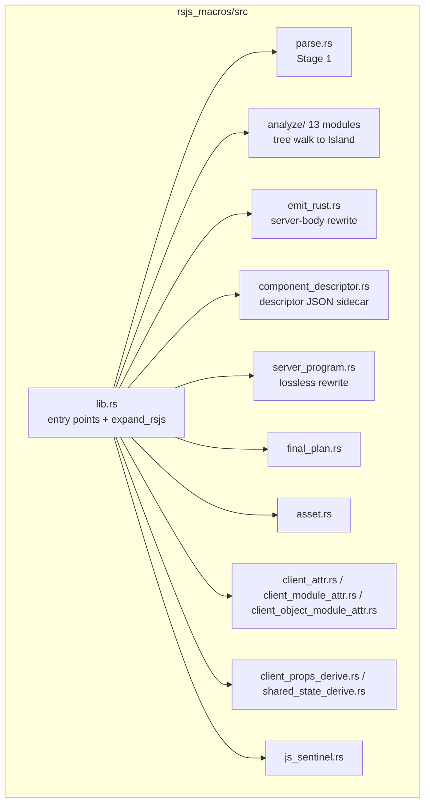
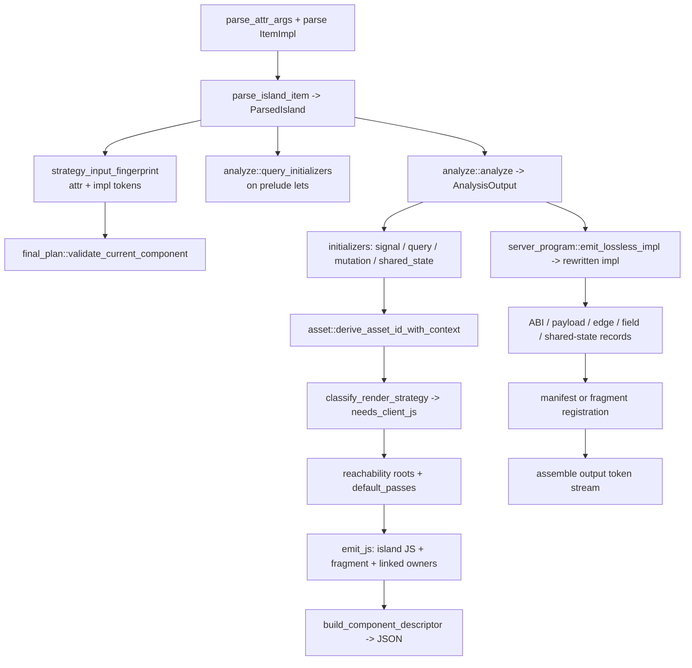

# 19 -- RSJS Macros: The Proc-Macro Frontend and the Three-Phase Build

`rsjs_macros` is the only crate in the RSJS system that depends on `syn`, `quote`, and
`proc_macro`. Every other RSJS crate -- `rsjs_ir`, `rsjs_web`, `rsjs_transport` -- is a plain
library with no macro-expansion machinery. That single fact drives the whole design: the proc macro
is a *frontend* that lifts an authored `html_sync!` / `html!` parse tree, walks it into an
`rsjs_ir::Island`, rewrites the authored render body into ordinary server Rust, and emits the
descriptor records the linker consumes. The IR crate stays pure and unit-testable because all the
messy syntax work is quarantined here. The same crate also runs one of the cleverest tricks in the
codebase: because a proc macro cannot see rustc's `--emit=metadata` versus link choice, an unstaged
`cargo build` is blocked by a deliberately-unresolvable `#[used]` linker symbol, turning the linker
itself into the phase boundary that forces deployable builds through `cargo proa build`.

## The Crate Map

`rsjs_macros/src` holds twelve modules at the crate root (plus `lib.rs`) and an `analyze/`
subcrate. The crate root is orchestration; `analyze/` is the tree-walking frontend that turns the
lifted HTML tree into IR.

| File | Lines | Role |
|------|-------|------|
| `lib.rs` | 9,044 | Entry points, `expand_rsjs` orchestration, compilation phases, component relocation records, ABI/payload/edge emitters |
| `emit_rust.rs` | 6,410 | Rewrite the authored render body into the server render (the `emit_rust` half of the split) |
| `client_attr.rs` | 6,582 | `#[rsjs::client]` expansion (helpers, value-object modules, `class` ESM boundary) plus helper relocation transport |
| `component_descriptor.rs` | 5,282 | The `ComponentDescriptor` JSON sidecar: serialize, parse, and ambient lookup |
| `client_object_module_attr.rs` | 1,924 | Value-object module lowering for `#[rsjs::client]` on a module |
| `server_program.rs` | 1,727 | Lossless server-body rewrite (the "keep authored code, swap the tail" discipline) |
| `shared_state_derive.rs` | 1,286 | `#[derive(rsjs::SharedState)]` plus shared-state relocation transport |
| `parse.rs` | 1,193 | Stage 1: validate the render signature and lift the tail `html!` / `html_sync!` |
| `client_props_derive.rs` | 787 | `#[derive(rsjs::ClientProps)]` |
| `js_sentinel.rs` | 706 | Detect unresolved helper identifiers in emitted JS (a hand-written lexer) |
| `client_module_attr.rs` | 540 | `#[rsjs::client_module]` |
| `final_plan.rs` | 485 | Final-plan validation, fragment/owner exports, Cargo invalidation, witness tokens |
| `asset.rs` | 221 | Asset-id derivation for filesystem mirrors and registrations |

The `analyze/` directory is the second half of the split, roughly 28,000 lines in thirteen modules
(`mod.rs`, `prelude.rs`, `reactive_expr.rs`, `handlers.rs`, `template.rs`, `components.rs`,
`client_lowering.rs`, `queries.rs`, `events.rs`, `browser.rs`, `ast_expr.rs`, `text.rs`,
`hir_json.rs`, plus `tests.rs`). The two largest, `template.rs` (4,075 lines) and `reactive_expr.rs`
(3,191 lines), are where the HTML tree becomes nodes and the reactive expressions become Client IR.



There are exactly five `proc_macro` entry points, all declared in `lib.rs`:

```rust
// rsjs_macros/src/lib.rs (entry points)
#[proc_macro_attribute]
pub fn rsjs(attr: TokenStream, item: TokenStream) -> TokenStream {
    match expand_rsjs(attr.into(), item.into()) {
        Ok(ts) => ts.into(),
        Err(e) => e.to_compile_error().into(),
    }
}

#[proc_macro_derive(ClientProps)]
pub fn derive_client_props(input: TokenStream) -> TokenStream {
    client_props_derive::derive_client_props(input.into()).into()
}

#[proc_macro_derive(SharedState, attributes(rsjs))]
pub fn derive_shared_state(input: TokenStream) -> TokenStream {
    shared_state_derive::derive_shared_state(input.into()).into()
}

#[proc_macro_attribute]
pub fn client(attr: TokenStream, item: TokenStream) -> TokenStream {
    client_attr::expand(attr.into(), item.into()).into()
}

#[proc_macro_attribute]
pub fn client_module(attr: TokenStream, item: TokenStream) -> TokenStream {
    client_module_attr::expand(attr.into(), item.into()).into()
}
```

One component, one struct, one `#[rsjs(component...)]` render-trait impl: that is the input. The
output is a token stream that contains the rewritten impl plus a battery of `#[used]` static records
and, for hydrated islands, a manifest registration with the baked JavaScript.

## The Three Compilation Phases

The same `#[rsjs]` attribute behaves differently depending on which stage of the linked build is
running. The phase is selected by environment variables, not by any token-level signal:

```rust
// rsjs_macros/src/lib.rs (phase selection)
const DESCRIPTOR_PHASE_ENV: &str = "RSJS_DESCRIPTOR_PHASE";
const FINAL_PHASE_ENV: &str = "RSJS_FINAL_PHASE";
const CARGO_UNIT_ID_ENV: &str = "RSJS_CARGO_UNIT_ID";
const FINAL_CARGO_UNIT_STATUS_ENV: &str = "RSJS_FINAL_CARGO_UNIT_STATUS";
const FINAL_CARGO_UNIT_STATUS_MAPPED: &str = "mapped-v1";

enum CompilationPhase { Plain, Descriptor, Final }

fn compilation_phase() -> Result<CompilationPhase, String> {
    let descriptor = phase_enabled(DESCRIPTOR_PHASE_ENV)?;
    let final_phase = phase_enabled(FINAL_PHASE_ENV)?;
    match (descriptor, final_phase) {
        (false, false) => Ok(CompilationPhase::Plain),
        (true, false)  => Ok(CompilationPhase::Descriptor),
        (false, true)  => Ok(CompilationPhase::Final),
        (true, true)   => Err("both phase markers cannot be enabled"),
    }
}
```

- **Plain** is ordinary `cargo check` and rust-analyzer. It produces the provisional expansion,
  mirrors per-island JS and diagnostics to the filesystem, and appends the linker guard (below).
  Its descriptor Cargo-unit identity is the all-zero `[0u8; 32]` placeholder, so local checking
  needs no two-compilation driver.
- **Descriptor** (`RSJS_DESCRIPTOR_PHASE=1`) is the first orchestrated pass. It requires
  `RSJS_CARGO_UNIT_ID` to carry exactly 64 lowercase hex characters (decoded to 32 bytes), emits
  the descriptor and edge records, and does *not* write filesystem mirrors -- descriptor data
  travels in validated object records.
- **Final** (`RSJS_FINAL_PHASE=1`) is the second orchestrated pass. It additionally requires
  `RSJS_FINAL_CARGO_UNIT_STATUS == "mapped-v1"`, which proves the build orchestrator mapped this
  Cargo unit back to its descriptor-pass identity. It emits wrappers, fragments, serializers, client
  modules, and the exact manifest for the linked plan.

The descriptor Cargo-unit identity is fail-closed: once either orchestrated marker is present, its
wrapper must supply the 32-byte identity, or the macro refuses to guess a component or helper
identity. Final compilation receives the *original descriptor unit* identity, not a plan-specific
artifact hash -- the two passes must agree on who authored a given unit.

## The `expand_rsjs` Pipeline

`expand_rsjs` is the whole component flow in one function (`lib.rs:327`). Read it top to bottom and
you have the crate:



The salient order of operations, distilled from the source:

1. **Phase and identity.** Compute `compilation_phase()`, `emit_plain_build_guard`, and
   `cargo_unit_id`.
2. **Parse.** `parse::parse_attr_args` reads the attribute; `syn::parse2::<syn::ItemImpl>` reads
   the item; `parse::parse_island_item` validates the render signature and lifts the `html!` /
   `html_sync!` body into a `ParsedIsland`.
3. **Fingerprint.** `strategy_input_fingerprint` folds the attribute tokens and the full impl-block
   token stream into a stable identity. The impl tokens are included so two `impl ... for Counter`
   blocks in different modules do not hash identically against the self-type path alone.
4. **Final-plan validation.** `final_plan::validate_current_component` checks the current component
   against the linked plan (no-op in Plain/Descriptor).
5. **Analyze.** `analyze::analyze(&parsed)` walks the tree and returns an `AnalysisOutput`, which is
   destructured into its fields:

```rust
// rsjs_macros/src/lib.rs (AnalysisOutput fields, destructured)
let analyze::AnalysisOutput {
    mut island,
    hir_sidecar,
    signal_initializers,
    query_initializers: child_query_initializers,
    mutation_initializers,
    shared_state_initializers,
    prelude_signal_ids,
    prelude_shared_store_ids,
    prelude_query_ids,
    prelude_mutation_ids,
    prelude_node_ref_ids,
    shared_prelude_local_indices,
    client_prelude_local_indices,
    direct_component_edges,
    shared_state_provider_sites,
    direct_helper_edges,
    server_expressions,
    direct_component_site_nodes,
    mut inbound_inputs,
    generic_static_slot,
    direct_payload_handler_values,
} = analysis;
```

6. **Initializers.** The analyzer's initializer lists are mapped onto `emit_rust`'s four structs:

```rust
// rsjs_macros/src/emit_rust.rs (initializer shapes, exact fields)
struct SignalInitializer      { id: SignalId,      expr: syn::Expr,        explicit_ty: Option<syn::Type> }
struct SharedStateInitializer { id: SharedStoreId, source_name: syn::Ident, ty: syn::Type, expected_type_key: Option<TokenStream> }
struct QueryInitializer       { id: QueryId,       expr: syn::Expr,        key_expr: Option<syn::Expr> }
struct MutationInitializer    { id: MutationId,    key_expr: syn::Expr,    invalidates_expr: Option<syn::Expr> }
```

   The `SharedStateInitializer::expected_type_key` is a `TokenStream` const expression, not a
   string: it carries the `SharedState::TYPE_KEY` a replayed inlined component's acquisition was
   compiled against, so the parent can assert type identity. It is `None` for locally-authored
   acquisitions.
7. **Asset id and strategy.** `asset::derive_asset_id_with_context` names the island;
   `rsjs_ir::classify_render_strategy(&island)` decides `ServerOnly` versus `SsrHydrate` and whether
   client JS is needed at all.
8. **Reachability and passes.** `client_reachability_roots_with_linked_roots` finds the roots
   reachable from exported signals, node refs, lifecycle expressions, and payload handlers; then
   `rsjs_ir::default_passes().run_all(&mut island)` runs the default optimization passes
   (`HandlerDedup`, `DeadSignalElimination`, and friends) before emission.
9. **Emit JS.** `rsjs_ir::emit_js::emit` produces the per-island module; the fragment emitter and
   linked-owner-module emitter produce the split fragments for the linked plan. Each emitted string
   passes `reject_unlinked_helper_sentinel`, which scans for the reserved `__rsjs_unlinked_`
   prefix.
10. **Descriptor.** `build_component_descriptor` serializes the `ComponentDescriptor` JSON.
11. **Emit Rust.** `server_program::emit_lossless_impl` produces the rewritten impl (`impl_tokens`).
12. **Records.** A long tail of `emit_*` helpers emits the ABI definition, the payload record, the
    component/helper edge records, field witnesses, generic-static-slot validation, and the
    shared-state acquisition and provider records.
13. **Registration.** Either a manifest registration (plain hydrate path), a fragment registration,
    or nothing (server-only).
14. **Assemble.** The output is the rewritten impl followed by all records, the
    `IslandSharedStores` impl, the final-plan witness tokens, and -- only in the Plain phase -- the
    linker guard.

## Stage 1: The Parser

`parse.rs` is the only stage that can reject syntax. It owns the `syn`-based lifting of the trait
impl and the location of the `html!` / `html_sync!` invocation, and it deliberately does no
type-resolution: anything beyond syntax is left to rustc's normal type checker.

The attribute grammar is tiny. `rsjs_attr_args := (strategy_arg | component_arg | client_arg)*`,
where `strategy_arg := "strategy" "=" string_lit`, `component_arg := "component"`, and
`client_arg := "client"`. An empty list defaults to immediate hydration. Four former spellings get
focused migration diagnostics instead of silent acceptance: `clients(...)` (removed -- helper
eligibility now comes from `#[rsjs::client]` on the helper definition), `render = "client"`
(reserved, needs a fallback policy), `client_only` (reserved), and `fallback = ...` (reserved).

The hydration strategy string maps onto the IR enum:

```rust
// rsjs_macros/src/parse.rs (strategy spelling -> HydrationStrategy)
"eager" | "immediate"        => HydrationStrategy::Immediate
"visible"                    => HydrationStrategy::Visible
"idle"                       => HydrationStrategy::Idle
"interaction"                => HydrationStrategy::Interaction { event: None }
"interaction:<event>"        => HydrationStrategy::Interaction { event: Some(event) }
"media:<query>"              => HydrationStrategy::Media { query }
```

The parser records whether the strategy was authored explicitly, because the semantic component ABI
distinguishes an absent constraint from an explicit `strategy = "eager"` even though both lower to
`Immediate`.

The render surface is selected from the authored return type, not from an await scan or trait-path
spelling. `Result<(), WriteError>` selects `RenderKind::Sync`; `RenderOutcome<impl Future<Output =
Result<(), WriteError>>>` selects `RenderKind::Async`. `async fn render` sugar is rejected outright.
For async components the parser requires the body to be exactly
`RenderOutcome::pending(async move { ... })` -- the `move` is mandatory so the future owns the
component and its server prelude.

`split_body` splits the block into `prelude_lets` (the `let` bindings before the tail, which the
analyzer scans for `signal(...)` / `memo(...)`), `rsjs::interval(...)` prelude statements, opaque
ordinary server statements, and the tail expression. `locate_html_macro` then drills through
`.await` -> `.resolve()` -> `.render(cx)` to the macro, and `validate_html_macro_for_render_kind`
requires `html_sync!` for sync and `html!` for async. A subtle `block_contains_await` check skips
awaits buried inside nested `async {}` blocks and closures -- those run when the future or closure
is polled, not when the surrounding function body runs, so they must not flip a sync component onto
the async path.

Finally, `validate_reserved_identifiers` walks the impl and rejects any identifier beginning with
`__rsjs_`, reserving that prefix for hygienic compiler state.

## Stage 2: The Analyzer

The analyzer is the tree-walking heart of the crate. `analyze::analyze(&parsed)` runs a fixed,
ten-step sequence: detect the optional `GenericStaticSlotField`; construct an `Analyzer` over a
fresh `IslandBuilder`; set the hydration strategy; collect prelude bindings; validate opaque server
statements; walk the HTML root; validate keyed-list containers; materialize direct payload-handler
values; set the async flag; and return the `AnalysisOutput`. The `Analyzer` is a `#[derive(Clone)]`
bag of name maps (`signals`, `queries`, `mutations`, `node_refs`, `handlers`, `shared_stores`,
`memo_cells`), a `HirSidecar`, the `IslandBuilder`, and the edge/site/inbound collections that
become the descriptor records.

Every client-originating construction is gated by `require_client_origin`, which errors unless the
component carried `#[rsjs(component, client)]`. The gate enumerates eight origins with a human
label each:

```rust
// rsjs_macros/src/analyze/mod.rs (client-origin gate)
enum ClientOriginKind {
    Signal,       // "writable local signal"
    Handler,      // "new event-handler body"
    Timer,        // "timer"
    Query,        // "query acquisition"
    Mutation,     // "mutation acquisition"
    SharedState,  // "SharedState acquisition"
    NodeRef,      // "node-ref acquisition"
    BrowserRead,  // "browser capability read"
}
```

A server-only component that reaches any of these is rejected with a message naming the origin. The
analyzer also enforces hard 2^32 limits on inbound input ids, direct component edges, conditional
section ordinals, and SharedState provider sites (all through `u32::try_from`).

The `AnalysisOutput` has two sides. The `island` side (the IR side-tables) feeds `emit_js` and the
descriptor. The `hir_sidecar` side is the *frontend* HIR -- a higher-fidelity tree serialized as
`{"format":"rsjs.hir","hir_version":1,...}` and kept for diagnostics, snapshot coverage, and
tooling (`cargo proa rsjs explain`), not for code generation. The analyzer is where reachability is
decided: a component with no reachable client roots stays server-only, and the edge and site
collections are what the linker later resolves into final owners.

### The expression bridge (`ast_expr.rs`)

Between `syn` and Client IR sits the analyzer's own expression tree, `FrontendExpr`, with 36
variants. It is lowered one-way into `rsjs_ir::ClientExpr` at the `IslandBuilder::expr` arena
boundary. The variants range from `Literal(Value)` and `SignalRead(SignalId)` through the reactive
surface (`QueryRead`, `MutationRead`, `QueryKey`), the DOM surface (`EventValue`,
`EventCurrentTarget`, `EventCollectionLen`, `EventCollectionRead`, `NodeRefRead`, `DomRead`,
`EventTargetWithinNodeRef`, `EventAttribute`, `EventPayload`, `CallbackPayload`, `NodePayload`),
the browser surface (`BrowserRead`, with five sub-variants: `Window`, `Location`, `Storage`,
`UrlSearchParam`, `Declared`), string helpers (`IsNonEmpty`, `StringToLowercase`, `StringContains`,
`StringTransform`, `StringPredicate`), numeric and comparison helpers (`BinaryOp`, `UnaryNeg`,
`Eq`, `Neq`, `Coalesce`, `AsType`, `IsPresent`, `Project`), and the `Text` intrinsic plus
`ClientCall` for direct helper calls.

`BinOp` has 18 variants. Ordinary arithmetic and comparison use `Add`/`Sub`/`Mul`/`Div`/`Rem`/
`Eq`/`Neq`/`Lt`/`Gt`/`Le`/`Ge`/`And`/`Or`; checked fixed-width arithmetic uses
`Checked { op, domain }`; integer division uses `DivInt`; and three `Dyn*` variants (`DynDiv`,
`DynEq`, `DynNe`) handle representation-pinned operands that lower to `num_div`/`num_eq`/`num_ne`
rather than a bare `===` (which is `false` for `5n === 5` while Rust `5 == 5` is `true`).

### Fixed-width integers (`reactive_expr.rs`)

The reactive-expression lowerer is where Rust's machine integers meet JavaScript's split number
model. Only four domains are supported: `IntegerDomain::{I32, U32, I64, U64}`. The 32-bit domains
are JavaScript `Number`-backed; the 64-bit domains are `BigInt`-backed. The unsupported widths
`i8`, `i16`, `i128`, `isize`, `u8`, `u16`, `u128`, `usize` are retained by name purely for
diagnostics and rejected in arithmetic. Arithmetic over a proven same-domain pair lowers to
`BinOp::Checked`, which the JS emitter renders as `checked_int_add(a, b, "i32")` and friends (see
[18-rsjs-ir.md](./18-rsjs-ir.md)). Mixed BigInt/Number arithmetic is a hard error, as is negation
of an unsigned domain. Equality over dynamic operands demotes to `DynEq`/`DynNe` so `5n == 5`
stays true across the boundary. Explicit division boundaries `rsjs::div_int(...)` and
`rsjs::div_f64(...)` are the only way to reach `DivInt` and `DynDiv`.

### The prelude (`prelude.rs`)

`collect_prelude_bindings` walks the prelude statements in order and recognizes exactly these
acquisition forms: `signal(...)`, `memo(|| ...)`, `rsjs::handler(|payload| ...)`,
`rsjs::event_handler(|event, payload| ...)`, `node_ref::<T>()`, `rsjs::shared::<T>()`, shared-field
reads, `query_with_initial(...)`, `mutation(...)` / `mutation_with_options(...)`, and
`rsjs::interval(ms, || ...)`. Path matching is deliberately narrow: only bare `signal(...)` or
`rsjs::signal(...)` (one or two segments) are recognized, so `telemetry::signal(...)` remains
ordinary server Rust. For a signal the lowerer resolves the explicit type from the turbofish, the
`Signal<T>` pattern annotation, or the initializer, computes the integer source, extracts a
`Value` fallback from a literal (else `Value::Null` plus a runtime expression), and records a
`SignalInitializer`. A `memo` is the same declaration with a derived body, sharing the `SignalId`
space.

### The template walk (`template.rs`)

`walk_root` finds the single top-level element (empty, `text`-only, and multi-sibling bodies are
rejected); `walk_element` allocates `NodeId`s top-down and processes attributes in a fixed order:
reserved-name rejection (`data-rsjs` / `data-rsjs-*`), then `ref={node_ref}` (rejected inside
loops), then `on_*` handlers, then `bind_*` input bindings (at most one per element), then ordinary
attributes. Ordinary static/boolean attributes pass through as `static_attr`; dynamic attributes
become either a server-only `rsjs::server_attr(...)` / inferred opaque SSR slot or a one-way
`bind_attr` classified `Boolean`, `Url`, or `Value` (URL via `is_dynamic_url_attr`, which covers
`href`, `src`, `action`, `formaction`, `poster`, `cite`, `data`, `longdesc`, `manifest`,
`background`, `xlink:href`, `xlink-href`). Safety-rejected dynamic attributes are `on*` event
handlers, `srcset`, `ping`, `srcdoc`, and `style`. Boolean attributes are recognized through a
25-attribute allowlist.

Conditionals allocate a condition expression and a conditional section whose `then`/`else` branches
are both statically present in the view tree (the runtime shows one and hides the other). Keyed
lists trigger only on a direct `signal.get()` iterator or a `query.data` / `.field` / `[index]`
iterator, require a `key={...}` on the single item root, and are rejected inside other loops, when
driven by a memo, or when items contain handlers, `bind_*`, `ref`, conditionals, nested loops, or
fragments; the container gets the `data-rsjs-list` static attribute. Anything inside an opaque SSR
boundary (`server_only`, `server_attr`, an explicit `rsjs::island(...)`, a `SharedStateProvider`
seed, or a static loop prefix) is walked by a `syn::Visit` visitor that rejects client-state
capture.

### Child components (`components.rs`)

A direct child component is either fully inlined into the parent island or emitted as a shared
fragment mount. Inlining reads the child's `ComponentDescriptor` (via
`component_descriptor::find_full_by_component_path`), rejects children with keyed lists or async
children in sync parents, partitions struct fields into callbacks, props, server props, and static
slots, and remaps every child id -- signals, node refs, queries, mutations, exprs, derived bodies,
handlers, intervals, view tree, and bindings -- into fresh parent ids. The fragment path is chosen
when the child can be expressed as a set of concrete parent signal aliases (the fragment can only
alias parent signal cells, not re-run arbitrary initializers), and emits a
`component_fragment_mount` with `data-rsjs-component` and `data-rsjs-component-mount` static
attributes on the mount root.

### Handlers (`handlers.rs`)

A handler attribute accepts a `move |event| ...` / `|event| ...` closure (at most one parameter), a
direct call to a local `rsjs::handler(...)` ref (`on_click={on_save(())}`), or
`rsjs::debounce(|event| ..., delay_ms)`. The statement grammar is broad but closed: `let` bindings,
`signal.set(...)` / `signal.update(|c| ...)`, `if`/`else if`/`else`, `match` (exact-bool or literal
arms with an unguarded `_` fallback), static `for` loops over array or numeric-range literals,
assignment and compound assignment, `rsjs::batch(|| ...)`, callback-slot calls, handler-ref calls,
`console.*`, browser-effect calls, event-param methods (`prevent_default`, `stop_propagation`), the
file-text browser effects, node-ref effects, and query `refetch()`/`invalidate()` and mutation
`run(...)`. The lowered statements carry the full node-ref effect vocabulary (28 variants from
`Focus` through `SetStyleProperty`) and the full browser-effect vocabulary.

### Queries and events (`queries.rs`, `events.rs`, `browser.rs`, `text.rs`)

`queries.rs` parses the `FetchRequest` struct with defaults `method` unset, `credentials =
"same-origin"`, `response = "json"`, and a required `url`, and the `QueryOptions` knobs
(`interval_ms`, `refetch_on_focus`, `download_progress`, `stream_text`, `retry_count`,
`stale_time_ms`) and mutation options (`retry_count`, `on_success_invalidate_strategy` ->
`Refetch`/`Reset`). `events.rs` owns the event-name, input-kind, boolean-attribute, and URL-attribute
vocabularies. `browser.rs` holds the legacy hand-written capability tables and the
`BrowserReadCallKind` / `BrowserEffectCallKind` enums for the location/history/document/webauthn/url
surface (new helpers are registry-first via `rsjs_ir::dom_registry` and
`rsjs_ir::browser_registry`). `text.rs` handles the `text!` intrinsic, lowering its parse plan
through `rsjs_transport::canonical_json_bytes` to a `ClientExpr::call(Runtime("format_text"))`.

## Stage 3: `emit_rust` and the Lossless Rewrite

The `emit_rust` half of the split (`emit_rust.rs`) has two modes. The `#[cfg(test)]` mode
(`emit_rust`, `emit_rust_with_prelude`, `emit_rust_with_prelude_and_asset_id`) reconstructs the
canonical `impl<L: ::proa_core::DataLoader, B: ::proa_core::WriteBuf> ::proa_core::WebRenderSync<L,
B> for ...` header itself, for hand-built fixtures and golden tests. The production mode
(`emit_rust_preserving_impl_with_prelude_and_asset_id` plus `emit_lossless_render_site`) preserves
the user's exact impl header -- `impl_generics`, `trait_path`, `self_ty`, `render_sig`, and
`context_ident` -- and splices only the *body* back in.

The production entry is `server_program::emit_lossless_impl`, which walks the authored statements
and replaces only the compiler-owned ones in place:

- a shared-state source local becomes `emit_rust::emit_lossless_shared_state_declaration`;
- a signal local becomes `emit_rust::emit_lossless_signal_declaration` (a plain leaf signal or a
  memo, distinguished by `SignalDecl.derived`);
- a query local becomes `emit_rust::emit_lossless_query_declaration`;
- a mutation local becomes `emit_rust::emit_lossless_mutation_declaration`;
- `client_prelude_local_indices` and dual-use inbound aliases (`let value = self.field;`) are
  replayed at their exact lexical position, with the inbound signal prepared from a borrow
  `&alias` rather than re-evaluating `self.field`;
- node-ref locals are kept only when in `direct_component_server_node_ref_ids`;
- handler and alias locals are dropped;
- `rsjs::interval(...)` timer statements are dropped;
- everything else -- ordinary statements, `?`, returns, drop scopes, the authored `.render(cx)`
  chain, async poll boundaries -- is preserved verbatim.

The rewritten body ends in a reconstructed `html_sync!` (sync) or `html!` (async) template. For a
non-server-only island the caller wraps the view as:

```rust
// rsjs_macros/src/emit_rust.rs (template wrapper, abbreviated)
<rsjs-island data-rsjs-island-root="<asset_id>">
    #view_tokens
</rsjs-island>
<script type="application/json" data-rsjs-island="<asset_id>" nonce={...}>
    {UnsafeRaw(__rsjs_init_state_json)}
</script>
#query_blob
#mutations_blob
```

The wrapper tag and attributes are tokenized from `rsjs_ir` marker constants (`ISLAND_WRAPPER_TAG`,
`ISLAND_ROOT_ATTR`, `ISLAND_MARKER_ATTR`) -- never hard-coded inline. The query and mutation blobs
are `data-rsjs-island-queries` / `data-rsjs-island-mutations` script tags carrying the dehydrated
query and mutation state, and are omitted entirely when no query or mutation is reachable.

`emit_view_node` walks the `ViewTree` and reconstructs each node. Elements get their static,
server, and payload attributes plus, in order, `data-rsjs-key`, `data-rsjs-attr`, `data-rsjs-ref`,
`data-rsjs-handler`, `data-rsjs-input-value` / `-checked` / `-selected`, and the conditional
markers `data-rsjs-cond-then` / `data-rsjs-cond-else`. Text bindings become
`<span data-rsjs-bind="<NodeId>">initial</span>`. For loops re-emit as an ordinary Rust `for` loop
whose body is a nested `html_sync!`. A branch initially hidden by a const-foldable conditional gets
`style="display:none"`. Static text is emitted literally, and `ServerOnly` nodes re-splice the
authored `syn::Expr` from the lossless side-table.

The dehydrated state JSON has a precise shape. Signals serialize as `{"signals":[slot0, slot1,
...]}` up to the highest reachable leaf signal id, with dead and derived slots as `null`
placeholders (a derived value is recomputed, never seeded). Wide `BigInt` seeds serialize as JSON
*strings* (the `ClientEncode` convention; a bare JSON number would round past 2^53). Shared stores
extend the object with `"shared":[{"scope_id":N,"type_key":...,"schema_hash":...,"rust_type":...}]`.
Queries become `{"<id>":{"key":<parts>?,"data":<value>,"data_updated_at":0}}`; mutations become
`{"<id>":{"key"?:...,"runner"?:...,"invalidates"?:[...],"options":{"retry_count":N,...}}}`.

For a server-only island (`RenderStrategy::ServerOnly`) all of that is skipped: no wrapper, no
`rsjs_island_used`, no seed script, no blobs -- just the shared/state/prelude/signal/query lets and
a bare `html_sync! { #view_tokens }`.

Server-side reads of client-only state have deterministic defaults, so SSR is stable: a mutation's
`status` reads `"idle"`, a query's `status` reads `"success"`, `is_loading` reads `false`, `error`
reads `Value::Null`, `fetch_count` reads `1_u32`, and so on. Literal rendering narrows integers to
`i32`/`u32`/`i64`/`u64` per `IntegerDomain`, and `push_json_string` escapes `"`, `\`, control
characters, `<`, `>`, `&`, and U+2028/U+2029 so the dehydrated state can never break out of its
script tag.

## Stage 4: The Descriptor, Relocation Records, and Final Plan

There are two distinct artifacts here, and they live in different files. `component_descriptor.rs`
is the **JSON sidecar**: it serializes, parses, and looks up a `ComponentDescriptor` -- a mechanical
dump of the rsjs IR with numeric ids preserved -- so a parent island can inline a child component,
allocate fresh ids in the parent, and remap child references without reconstructing structure from
JS. The descriptor is versioned (`DESCRIPTOR_SCHEMA_VERSION = 9`), marked with the string
`"rsjs.component_descriptor"`, and carries the top-level fields `schema_version`, `format`,
`client_ir_version` (the IR v3 marker), `asset_id`, `js_hash`, `struct_name`, `self_ty`, `is_async`,
`client_origin_permission`, `signals`, `handlers`, `view_tree`, `bindings`, `queries`, `mutations`,
`counts`, and a trailing `descriptor_hash` (`prefixed_sha256_hex` over the serialized bytes).
Ambient descriptor discovery runs only in the Plain phase, across
`RSJS_COMPONENT_DESCRIPTOR_DIRS`, `$OUT_DIR/rsjs/components`, `$CARGO_TARGET_DIR/rsjs/components`,
and `target/rsjs/components`.

The **relocation records** are `#[used]` statics in dedicated link sections, and they live in
`lib.rs` (component records), `client_attr.rs` (helper records), and `shared_state_derive.rs`
(shared-state records) -- not in `component_descriptor.rs`. A proc macro cannot force rustc to link
one object into another by name; it can only place data in a known link section and let the linker
relocate it. The component records use `__DATA,__rsjs_comp` (Apple) / `.rsjs.component` (ELF) /
`.rsjs$C` (Windows) for the definition, `.rsjs.identity` / `.rsjs$S` for the semantic identity,
`__rsjs_cpay` / `.rsjs.component_payload` / `.rsjs$P` for the descriptor payload, and
`__rsjs_sedge` / `.rsjs.shared_acquisition` / `.rsjs$K` for shared-state acquisition. Helper
records use `__rsjs_help` / `.rsjs.helper` / `.rsjs$H` plus `__rsjs_hpay` / `.rsjs.helper_payload`
/ `.rsjs$Q`. Each record carries the descriptor Cargo-unit identity so the linker can match the
descriptor-pass record to the final-pass unit.

`final_plan.rs` is the final-compilation counterpart. It gates on `RSJS_FINAL_PHASE == "1"` and
reads the linked plan from `RSJS_LINK_PLAN_PATH` (an absolute path named
`<plan_id>.semantic-plan.json`), validates the plan file hash against `RSJS_LINK_PLAN_FILE_HASH`,
and validates the unit projection (`PROA_RSJS_FINAL_UNIT_PLAN_DIRECTORY` +
`PROA_RSJS_FINAL_UNIT_PLAN_<unit-hex>`) against the advertised hash. `validate_current_component`
and `validate_current_definition` select the exact component or helper occurrence for this Cargo
unit. `witness_tokens` emits one `#[used]` static per selection,
`__RSJS_FINAL_PLAN_WITNESS_{label}`, and `cargo_invalidation_tokens` emits `env!`-based tuples so a
plan change invalidates only the crates that expand RSJS, not the whole graph. The unit projection
is cached in a `OnceLock<Mutex<VecDeque>>` LRU with `PROJECTION_CACHE_ENTRIES = 16` and
`PROJECTION_CACHE_BYTES = 8 * 1024 * 1024`.

`asset.rs` is the smallest module and the one that names everything. The asset id format is
`<lowercased_last_segment>_<hash8>`, where `hash8` is the first 8 hex characters (4 bytes) of
SHA-256 over `(path || "::" || impl_tokens)`. Folding the full impl token stream into the hash is
what separates two `impl ... for Counter` blocks in different modules that would otherwise both
lower to `"counter"` and silently collide. `js_sentinel.rs` is the lexical gate: a hand-written
JavaScript lexer (not a substring search) that scans emitted JS for the reserved
`__rsjs_unlinked_` prefix while correctly skipping string and template literals, comments, and
regexp literals, so the final pass can fail closed if a helper edge was never resolved.

## The Plain Build Guard

A proc macro cannot observe whether rustc is compiling to metadata or linking. So the Plain phase
emits a guard that type-checks fine but cannot link:

```rust
// rsjs_macros/src/lib.rs (emit_plain_cargo_build_guard, abbreviated)
#[cfg(all(not(test), not(doc)))]
const _: () = {
    unsafe extern "C" {
        #[link_name = "__RSJS_ERROR_plain_cargo_build_is_not_deployable_use_cargo_proa_build"]
        fn __rsjs_plain_cargo_build_requires_linked_pipeline();
    }
    #[used]
    #[cfg_attr(target_vendor = "apple", unsafe(link_section = "__DATA,__mod_init_func"))]
    #[cfg_attr(all(unix, not(target_vendor = "apple")), unsafe(link_section = ".init_array"))]
    #[cfg_attr(target_os = "windows", unsafe(link_section = ".CRT$XCU"))]
    static __RSJS_PLAIN_CARGO_BUILD_GUARD_<asset_id>: unsafe extern "C" fn() =
        __rsjs_plain_cargo_build_requires_linked_pipeline;
};
```

`cargo check` and rust-analyzer compile metadata only, so the missing symbol never resolves and the
build succeeds. A real `cargo build` reaches the linker, which must resolve the symbol and fails
with an actionable name. Test and rustdoc targets are excluded so normal tooling can still exercise
provisional code; `cargo proa build` omits the guard in descriptor and final compilation.

## The Helper and Derive Attributes

The four remaining entry points handle the non-component surfaces.

`#[rsjs::client]` (`client_attr.rs`) is three surfaces in one attribute. On a free function it
marks a reusable client-side helper and replaces the function with (1) a `#[doc(hidden)]`
`__rsjs_client_<name>_meta` struct carrying `NAME`, `PARAMS`, `RETURN_TY`, `BODY_HIR_VERSION = 1`,
`BODY_HIR_JSON`, `BODY_IR_VERSION = CLIENT_IR_SCHEMA_VERSION`, `BODY_IR_JSON`, and an `eval_server`
method, plus a `META: &'static ClientHelperMeta` const, and (2) a re-emitted Rust function with the
same signature whose body delegates to `::rsjs::__runtime::run_client_helper` -- so the same code
runs on the server (for SSR) and lowers to JavaScript (for the browser). The body must conform to
the constrained v0.1 Expr IR: literals, parameter reads, binary operators, `.is_non_empty()`,
`.len()`, `.to_lowercase()`, `.contains()`, and calls to other `#[rsjs::client]` helpers. Integer
widths are tracked through `IntegerDomain`; `i8`/`i16`/`u8`/`u16`/`i128`/`u128`/`isize`/`usize` and
`f32` are rejected outright. On an inline visible module the same attribute provides the
value-object authoring slice (named-field structs, `new(...) -> Self` constructors, borrowed
read/mutation methods, scalar `let`/`let mut` locals, assignment-oriented `if`/`else`).
`#[rsjs::client(class)]` applies the same lowering to an explicit ESM interoperability boundary,
turning each public struct into an exported JavaScript class with `new`, `instanceof`, and
per-instance mutation.

`#[rsjs::client_module]` (`client_module_attr.rs`) groups `#[rsjs::client]` helpers into one
client-loadable bundle. It collects every `pub fn` in the module and emits a sibling
`pub const __rsjs_client_module_<name>_meta: &'static rsjs::ClientModuleMeta`, plus a
`#[linkme::distributed_slice(::rsjs::CLIENT_MODULE_REGISTRY)]` entry pointing at each helper's
`META`. Consuming components call the helpers through ordinary Rust paths; reachable edges are
resolved through rustc, so no component allowlist is needed.

`#[derive(rsjs::ClientProps)]` (`client_props_derive.rs`) generates `ClientEncode`/`ClientDecode`
impls and a `pub const __rsjs_codec_meta_<TypeIdent>: &'static rsjs::ClientPropsMeta` for a struct
or fieldless enum. The closed vocabulary is `bool`, `i32`/`i64` (and their unsigned and wide
counterparts), `f32`/`f64`, `String`, `Option<T>`, `Vec<T>`, `&[T]`, and nested client-props
structs. Narrow integers (`i8`/`i16`/`i32`, `u8`/`u16`/`u32`) cross as JSON numbers; wide integers
(`i64`/`i128`/`isize`, `u64`/`u128`/`usize`) cross as JSON *strings* to survive the 2^53 rounding
boundary. Fieldless enums use their Rust variant identifiers as stable JSON string tags; explicit
numeric discriminants do not cross.

`#[derive(rsjs::SharedState)]` (`shared_state_derive.rs`) generates the object codec (reusing
`expand_client_props`), a `<T>Handle` accessor struct, the `SharedStateMeta` const, an ABI witness,
and the definition and payload relocation records. The `type_key` comes from `#[rsjs(type_key =
"...")]`, must be non-empty, whitespace-free, and contain a dot (e.g. `acme.workbench`). The
protocol identity is two-fold: a canonical semantic schema ABI (type key plus a
`SharedStateSchemaCodec` per field, with `NestedClientProps` fields marking the schema unresolved),
and a build-local join id that ties the definition record to its inline payload within one Cargo
unit without ever being emitted as schema bytes.

## The Aha Moment

**Aha:** The linker is the phase boundary, not a flag.

A proc macro has no way to ask rustc "are you linking or just checking?". So the crate never tries
to. Instead it emits a `#[used]` static whose initializer is an `extern "C"` function declared with a
deliberately missing `#[link_name]`. Metadata-only compilation (the `--emit=metadata` rust-analyzer
and `cargo check` perform) never resolves that symbol, so the provisional expansion is freely
usable in the editor and in tests. Any attempt to *link* the provisional code -- a plain
`cargo build` -- must resolve the symbol, fails, and the symbol's name is the error message:
`__RSJS_ERROR_plain_cargo_build_is_not_deployable_use_cargo_proa_build`. The build orchestrator
simply omits the guard in descriptor and final compilation, so the same macro, the same authored
code, flows through three different phases with no token-level branching on "is this a deploy?".
The phase is inferred from environment variables the orchestrator sets, and the one thing that
cannot be faked -- actually linking -- is the one thing that enforces the rule. It is the same
discipline that puts the relocation records in `#[used]` link sections and the descriptor identity
in a validated Cargo-unit id: put the invariant somewhere it cannot be violated, and derive
everything else.

## Cross-References

- The side-table IR and JavaScript emitter that this frontend produces and consumes:
  [18-rsjs-ir.md](./18-rsjs-ir.md).
- The island model, signals, memos, handlers, and queries at authoring level:
  [17-rsjs-overview.md](./17-rsjs-overview.md).
- The DOM/event facade and descriptor wire transport this crate emits records for:
  [20-rsjs-web-transport.md](./20-rsjs-web-transport.md).
- The linked build pipeline that sets the phase environment variables and runs the two staged
  compilations: [15-build-tooling.md](./15-build-tooling.md).
- The `proa_macros` crate that owns `html_sync!` / `html!`, whose parse tree this frontend lifts:
  [07-html-macros.md](./07-html-macros.md).

Continue to [20-rsjs-web-transport.md](./20-rsjs-web-transport.md).
