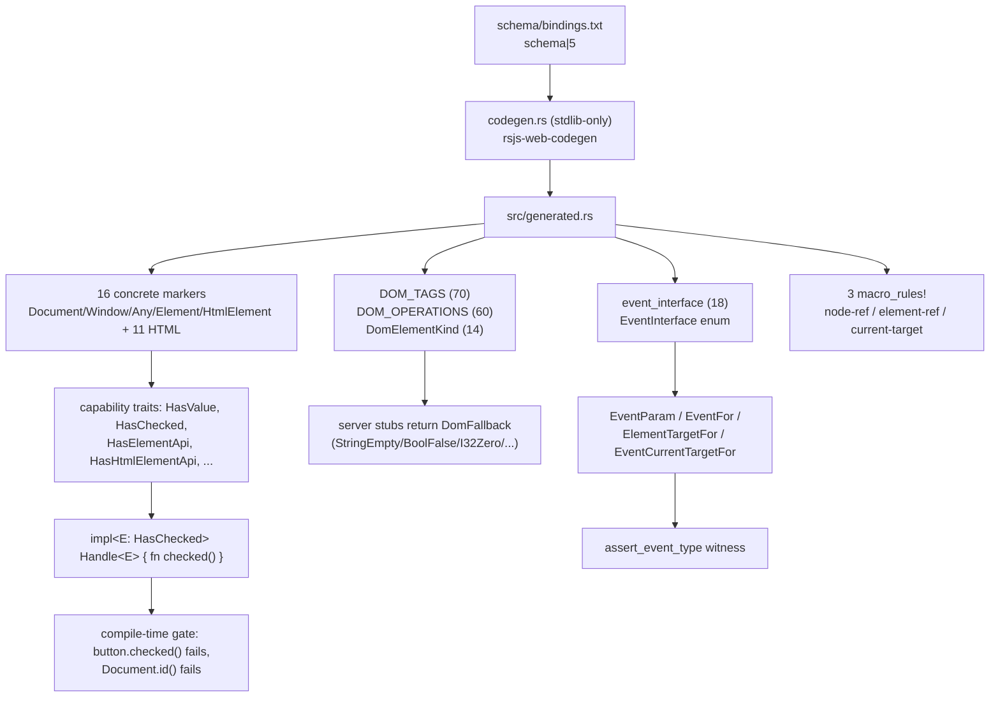
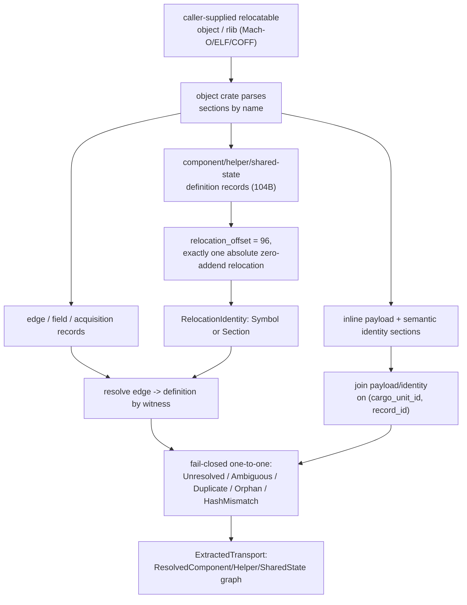

# 20 -- RSJS Web & Transport: The Static Capability Facade and the Object-Section Wire

RSJS is a compiler, not a runtime, and these two crates are the two surfaces where the compiler's
"closed vocabulary" becomes concrete. `rsjs_web` is the typed browser facade an island author writes
against: a generated set of zero-sized marker types (`dom::Button`, `dom::HtmlInputElement`, ...) and
zero-sized handles (`ElementRef`, `CurrentTarget`) whose only job is to carry Rust types through the
frontend so capability misuse fails at compile time instead of at runtime. `rsjs_transport` is the
wire format the other end of the compiler writes: a target-independent, versioned, fixed-layout set
of object-section records that carries component/helper/edge/shared-state claims through the
two-compilation build, plus the exact-artifact extractor that reconstructs the graph by following
relocations. The through-line is the same discipline on both sides -- encode every fact as data and
every permission as a type, never as a runtime branch -- so the browser needs no DOM import and the
linker needs no Rust metadata decoder.

## The Crate Map

| File | Lines | Role |
|------|------:|------|
| `rsjs_web/Cargo.toml` | -- | crate `rsjs_web` 0.2.0; `[[bin]]` `rsjs-web-codegen` |
| `rsjs_web/codegen.rs` | 1196 | stdlib-only generator binary that emits `generated.rs` |
| `rsjs_web/schema/bindings.txt` | 201 | reviewed bootstrap policy (targets, capabilities, elements, tags, operations, events) |
| `rsjs_web/src/lib.rs` | 262 | crate root, `compile_fail` doctests, `#![forbid(unsafe_code)]` |
| `rsjs_web/src/handles.rs` | 47 | `ElementRef<E>` and `CurrentTarget<E>` zero-sized handles |
| `rsjs_web/src/generated.rs` | 2723 | machine-generated marker hierarchy, registries, macros |
| `rsjs_transport/Cargo.toml` | -- | crate `rsjs_transport` 0.1.0; `extract` feature (default) |
| `rsjs_transport/src/lib.rs` | 77 | crate root, module wiring, re-exports |
| `rsjs_transport/src/canonical_json.rs` | 108 | feature-independent canonical JSON for transport hashes |
| `rsjs_transport/src/wire.rs` | 2948 | the fixed-layout wire ABI and link-section constants |
| `rsjs_transport/src/extract.rs` | 4296 | `extract` feature: exact-artifact object-section extractor |

`rsjs_web` is generated: `codegen.rs` is a standard-library-only binary that reads
`schema/bindings.txt`, checks it against the checked-in `generated.rs`, and rewrites that file. The
schema pins `schema|5`, matching `BINDING_SCHEMA_VERSION = 5` in `generated.rs`. `rsjs_transport` is
hand-written but feature-split: `wire` + `canonical_json` need only `serde_json` and `sha2`, while
`extract` pulls in the `object` crate and `thiserror` (feature `extract = ["dep:object",
"dep:thiserror"]`, on by default). The proc-macro and runtime side can depend on the wire ABI without
pulling the object reader into every tool.

# Part 1 -- rsjs_web: The Zero-Cost DOM Facade

## Values Are Compiler Handles, Not Runtime Objects

Every value in `rsjs_web` is a zero-sized compiler witness. `ElementRef<E>` is a typed reference to
an element captured during RSJS hydration; `CurrentTarget<E>` is the DOM target an event binding is
matched against (`Document`, `Window`, or an element). Neither holds a pointer, an id, or a vtable --
just a `PhantomData<fn() -> E>` that pins the marker type `E` in the type system.

```rust
// rsjs_web/src/handles.rs
#[derive(Debug, Clone, Copy, Default)]
pub struct ElementRef<E: ElementMarker = Element>(PhantomData<fn() -> E>);

#[derive(Debug, Clone, Copy, Default)]
pub struct CurrentTarget<E: DomTargetMarker = Element>(PhantomData<fn() -> E>);

impl<E: ElementMarker> ElementRef<E> {
    #[doc(hidden)]
    #[inline(always)]
    pub const fn __compiler_stub() -> Self {
        Self(PhantomData)
    }
}
```

The crate root asserts the cost is exactly zero and that the surface is closed by construction:

```rust
// rsjs_web/src/lib.rs (compile_fail doctests, abbreviated)
// fn read(target: CurrentTarget<dom::HtmlButtonElement>) -> bool {
//     target.checked()          // ERROR: HtmlButtonElement does not impl HasChecked
// }

// fn read(target: CurrentTarget<dom::Document>) -> String {
//     target.id()               // ERROR: Document is not an element marker
// }
```

The crate is `#![forbid(unsafe_code)]`, and its tests verify `size_of::<ElementRef<_>>() == 0`,
`size_of::<CurrentTarget<_>>() == 0`, and `!needs_drop` for both. There is nothing to run, allocate,
or drop on the server: `element.id()` returns `""`, `element.checked()` returns `false`, and
`element.click()` is a no-op, because the methods are compiler stubs that return the registry's
`DomFallback` value for each operation.

## The Marker Hierarchy Is the Capability Check

`generated.rs` declares a sealed hierarchy of zero-sized unit-struct markers. The root trait carries
exactly one associated item -- the browser interface string -- and every narrower trait is a
supertrait chain:

```rust
// rsjs_web/src/generated.rs (shape, abbreviated)
pub trait DomTargetMarker: private::Sealed + Copy + 'static {
    const INTERFACE: &'static str;
}
pub trait NodeMarker: DomTargetMarker {}
pub trait ElementMarker: NodeMarker {}
pub trait HtmlElementMarker: ElementMarker {}

// capability markers, all `: ElementMarker`
pub trait HasElementApi: ElementMarker {}
pub trait HasHtmlElementApi: ElementMarker {}
pub trait HasValue: ElementMarker {}
pub trait HasChecked: ElementMarker {}
pub trait HasConstraintValidation: ElementMarker {}
pub trait HasValidationState: ElementMarker {}
pub trait HasTextSelection: ElementMarker {}
pub trait HasFiles: ElementMarker {}
pub trait HasFormActions: ElementMarker {}
pub trait HasDialogActions: ElementMarker {}
```

There are 16 concrete markers. Two are event targets that are deliberately *not* elements
(`Document`, `Window`, each implementing only `DomTargetMarker`), and 14 are element markers (`Any`,
`Element`, `HtmlElement`, plus 11 concrete HTML elements). Each concrete marker implements its
applicable capability traits -- for example `HtmlInputElement` implements `HasValue + HasChecked +
HasConstraintValidation + HasValidationState + HasTextSelection + HasFiles`, while
`HtmlButtonElement` implements `HasValue + HasConstraintValidation + HasValidationState` but not
`HasChecked`. The `Any` marker is the broad element escape hatch: it implements `ElementMarker +
HasElementApi` only, so an `Any` handle sees common geometry/attribute operations but never
`value()`, `checked()`, or the `HasHtmlElementApi` click/focus/popover surface.

Capability gating falls out of method placement, not runtime dispatch. The operation methods are
stamped onto a handle by a macro that wraps each method in an `impl` bounded by the owning capability
trait, so `checked()` exists only inside `impl<E: HasChecked> Handle<E>`:

```rust
// rsjs_web/src/generated.rs (macro-generated shape, abbreviated)
impl<E: $crate::dom::HasChecked> $handle<E> {
    #[inline(always)]
    pub fn checked(&self) -> bool { false }   // server fallback: DomFallback::BoolFalse
}
```

A `CurrentTarget<dom::HtmlButtonElement>` therefore has no `checked()` method to call -- the
compile-time trait bound *is* the permission check. The `#[diagnostic::on_unimplemented]` attributes
on the bridge traits (below) turn that missing method into an actionable message instead of a bare
"method not found".

## Elements, Tags, and Operations Are Registries, Not Code

Three parallel generated registries give the compiler and runtime a shared, string-keyed identity for
every element, tag, and operation:

- `DOM_TAGS` maps markup tags to element kinds. 70 entries; 11 map to concrete HTML elements
  (`button` -> `HtmlButtonElement`, `input` -> `HtmlInputElement`, `textarea`, `select`, `form`,
  `a`, `div`, `span`, `label`, `option`, `dialog`) and 59 map SVG tags (`svg`, `circle`, `path`,
  `rect`, `feBlend`...`feTurbulence`, `filter`, `linearGradient`, ...) to `DomElementKind::Element`.
  `find_dom_tag("INPUT")` matches case-insensitively and returns `DomElementKind::HtmlInputElement`;
  unlisted custom tags resolve to `HtmlElement`.
- `DomElementKind` has 14 variants (one per element marker; `Document`/`Window` are not element
  kinds) with `as_rust_marker_name()` -> `"HtmlInputElement"` and `interface()` -> `"HTMLInputElement"`.
- `DOM_OPERATIONS` has 60 entries, one per `DomOperation` variant, each a `DomOperationSpec`
  carrying `operation`, `method`, `aliases`, `kind`, `capability`, `args`, `fallback`, and `origins`.

`find_dom_operation("value")` -> `DomOperationKind::Read` supporting all three origins;
`find_dom_operation("click")` -> `DomOperationKind::Effect` supporting only node/element origins:

```rust
// rsjs_web/src/lib.rs (tests, abbreviated)
let value = find_dom_operation("value").expect("value operation");
assert_eq!(value.kind, DomOperationKind::Read);
assert!(value.supports(DomHandleOrigin::NodeRef));
assert!(value.supports(DomHandleOrigin::CurrentTarget));

let click = find_dom_operation("click").expect("click operation");
assert_eq!(click.kind, DomOperationKind::Effect);
assert!(click.supports(DomHandleOrigin::NodeRef));
assert!(!click.supports(DomHandleOrigin::CurrentTarget));
```

`DomOperationKind` has two variants (`Read`, `Effect`); `DomHandleOrigin` has three (`NodeRef`,
`CurrentTarget`, `ElementRef`). Every one of the 32 reads is exposed on all three origins; every one
of the 28 effects is exposed only on `NodeRef` and `ElementRef`, never `CurrentTarget` -- you cannot
imperatively click an event target, only read it. Argument kinds are `Reactive`, `StaticAttribute`,
and `StaticStyleProperty`; fallbacks are `Unit`, `StringEmpty`, `BoolFalse`, `BoolTrue`, `I32Zero`,
`U32Zero`, `F64Zero`.

The registry is how the whole surface stays data-driven. Adding `HasChecked` to a new element, or a
new read on an existing one, is a one-line schema edit plus regeneration -- the marker impls, the
`DomOperation` variant, the `DOM_OPERATIONS` entry, and the stamped method all derive from the same
line in `bindings.txt`.

## Event Interfaces and the Bridge Traits

The event vocabulary is a second closed set: 18 interface-family markers (`Event`, `MouseEvent`,
`InputEvent`, `ChangeEvent`, `ClipboardEvent`, `KeyboardEvent`, `WheelEvent`, `CompositionEvent`,
`DragEvent`, `ToggleEvent`, `AnimationEvent`, `TransitionEvent`, `PointerEvent`, `TouchEvent`,
`PopStateEvent`, `HashChangeEvent`, `StorageEvent`, `SubmitEvent`) plus an `EventInterface` enum with
the same 18 variants and `as_rust_marker_name()`. `ChangeEvent` and `SubmitEvent` are RSJS
policy-level families rather than literal WebIDL interfaces.

The bridge traits connect an authored event handle to a concrete binding target without a proc macro
owning the name tables. `rsjs`'s rich event handles (`rsjs::MouseEvent<elem::Button>`) implement
`rsjs_web::EventParam` and `rsjs_web::EventFor`, while two relational traits gate assignability:

```rust
// rsjs_web/src/generated.rs (shape, abbreviated)
pub trait EventParam {
    type CurrentTarget: dom::DomTargetMarker;
}
pub trait EventFor<Interface>: EventParam where Interface: event_interface::Interface {}

pub trait ElementTargetFor<Target>: dom::ElementMarker where Target: dom::ElementMarker {}
pub trait EventCurrentTargetFor<Target>: dom::DomTargetMarker where Target: dom::DomTargetMarker {}
```

`ElementTargetFor` relates a node-ref marker to a bound element (with blanket impls letting
`dom::Element`/`dom::Any` stand in for any element target), and `EventCurrentTargetFor` relates an
authored current-target marker to the concrete target. The subtle rule enforced here is that
`dom::Any` is element-local only: it can stand in for `HtmlButtonElement` but not for `Document` or
`Window`, so a global binding must name its exact `Document`/`Window` target. A hidden witness
`assert_event_type<Target, Interface, E>()` closes the loop with bounds `Target: DomTargetMarker`,
`Interface: event_interface::Interface`, `E: EventFor<Interface>`, and `E::CurrentTarget:
EventCurrentTargetFor<Target>`.



# Part 2 -- rsjs_transport: The Object-Section Wire

## Canonical JSON Is the One Non-Negotiable Hashed Form

Every transport hash that spans a JSON boundary goes through one function, and it exists because of a
real foot-gun: `serde_json::Map` changes iteration order when the `preserve_order` feature is
enabled, and proc-macro crates and the standalone linker can acquire that feature through different
dependency graphs. Hashing `Value` with `serde_json::to_vec` directly would therefore produce
different digests for the same semantic identity. The fix is a hand-rolled canonical writer that
sorts object keys recursively and keeps array order:

```rust
// rsjs_transport/src/canonical_json.rs (abbreviated)
pub fn canonical_json_bytes(value: &Value) -> Result<Vec<u8>, serde_json::Error> {
    let mut bytes = Vec::new();
    write_canonical_json(&mut bytes, value)?;
    Ok(bytes)
}

fn write_canonical_json(bytes: &mut Vec<u8>, value: &Value) -> Result<(), serde_json::Error> {
    match value {
        Value::Array(values) => { /* push '[', recurse each element, push ']' */ }
        Value::Object(object) => {
            let mut entries = object.iter().collect::<Vec<_>>();
            entries.sort_unstable_by_key(|(key, _)| *key);   // the one rule that matters
            for (index, (key, value)) in entries.into_iter().enumerate() {
                if index != 0 { bytes.push(b','); }
                serde_json::to_writer(&mut *bytes, key)?;
                bytes.push(b':');
                write_canonical_json(bytes, value)?;
            }
        }
        scalar => serde_json::to_writer(bytes, scalar)?,     // numbers/strings via serde_json
    }
}
```

Scalars delegate to `serde_json` so number and string escaping stay identical to ordinary
serialization; only object ordering is normalized. The test harness deliberately enables
`preserve_order` in dev-dependencies to prove the two insertion orders produce identical canonical
bytes.

## The Wire Is a Fixed-Layout Record Stream, Not a Serde Format

The relocation records are emitted directly as `#[repr(C, align(8))]` Rust structs into object
sections. There is no bincode and no serde on the record path -- the header is self-describing so an
extractor reads raw bytes without decoding Rust native layout. Every fixed record starts with the
same 32-byte `RecordHeader`:

```rust
// rsjs_transport/src/wire.rs (shape, abbreviated)
#[repr(C, align(8))]
pub struct RecordHeader {
    pub magic: [u8; 8],             // TRANSPORT_FORMAT_MAGIC = *b"RSJSTRN\0"
    pub format_version_le: [u8; 2], // TRANSPORT_FORMAT_VERSION = 3
    pub record_kind_le: [u8; 2],    // RecordKind (repr(u16))
    pub header_size_le: [u8; 2],    // 32
    pub record_size_le: [u8; 2],    // 104
    pub relocation_offset_le: [u8; 2], // 96
    pub pointer_width: u8,          // 4 or 8
    pub flags_le: [u8; 4],
    pub reserved: [u8; 9],
}
```

`RecordKind` has seven variants: `ComponentDefinition = 1`, `ComponentEdge = 2`, `HelperDefinition =
3`, `HelperEdge = 4`, `ComponentField = 5`, `SharedStateDefinition = 6`, `SharedStateAcquisition =
7`. The relocation records all share one size -- `TRANSPORT_RECORD_SIZE = 104`, enforced by `const
_: () = assert!(TRANSPORT_RECORD_SIZE == 104);` -- and differ only in which id field they carry. Each
pairs a SHA-256 record id with a relocation slot that rustc resolves to the real witness:

```rust
// rsjs_transport/src/wire.rs (shape, abbreviated)
#[repr(C)]
pub struct RelocationSlot<T: 'static> { pub target: &'static T }
#[repr(C)]
pub struct FunctionRelocationSlot { pub target: *const () }   // never dereferenced; unsafe impl Sync

pub struct ComponentDefinitionRecord<T: 'static> {
    pub header: RecordHeader,
    pub cargo_unit_id: TransportRecordId,
    pub component_record_id: TransportRecordId,
    pub witness: RelocationSlot<T>,
}
// ComponentEdgeRecord, HelperDefinitionRecord, HelperEdgeRecord, ComponentFieldRecord,
// SharedStateDefinitionRecord, SharedStateAcquisitionRecord all share the 104-byte layout.
```

`TransportRecordId` is a 32-byte array; `UNASSIGNED_CARGO_UNIT_ID` is `[0; 32]`, the sentinel for a
producer that had no orchestrator-assigned identity. Component definitions also encode their ABI in
the header flags: `COMPONENT_DEFINITION_FLAG_ASYNC = 1 << 0` and
`COMPONENT_DEFINITION_FLAG_ORIGIN_CAPABLE = 1 << 1` (known set `0x3`), and `from_flags` fails closed
on any unknown bit.

Every record id is a SHA-256 over a domain-separated prefix plus the defining bytes, so ids never
collide across record kinds and can be recomputed deterministically:

| Function | Domain prefix (exact) |
|---|---|
| `component_record_id` | `proa.rsjs.transport.component-record.v1\0` |
| `component_source_edge_id` | `proa.rsjs.transport.component-edge.v3\0` |
| `component_helper_source_edge_id` | `proa.rsjs.transport.client-helper-edge.v1\0` |
| `helper_direct_call_source_edge_id` | `proa.rsjs.transport.client-helper-direct-call.v1\0` |
| `shared_state_provider_source_edge_id` | `proa.rsjs.transport.shared-state-provider-site.v1\0` |
| `component_field_record_id` | `proa.rsjs.transport.component-field.v1\0` |
| `semantic_payload_hash` | `proa.rsjs.transport.semantic-payload.v1\0` |
| `component_lifecycle_predicate_graph_commitment` | `proa.rsjs.transport.lifecycle-predicate-graph.v1\0` |
| `shared_state_schema_abi_hash` | `proa.rsjs.transport.shared-state-schema-abi.v1\0` |

Variable-length records sit beside the fixed ones: `PayloadRecord` (a 128-byte header with inline
bytes, carrying `PayloadKind::{ComponentDescriptor = 1, StandaloneHelperDescriptor = 2,
SharedStateDefinition = 3}` and a `semantic_payload_hash`) and `SemanticIdentityRecord` (a 96-byte
header with inline `package\0crate\0module_path\0item` text, carrying `SemanticIdentityKind::{Component
= 1, Helper = 2}`).

## The Link Sections Are a Three-Format ABI

The `#[used]` records from `rsjs_macros` land in named link sections, and `wire.rs` is the single
source of truth for every spelling. Mach-O sections live in `__DATA` and use short 8-character names;
ELF and COFF use dotted names:

| Kind | Mach-O (`__DATA`) | ELF | COFF |
|---|---|---|---|
| component definition | `__rsjs_comp` | `.rsjs.component` | `.rsjs$C` |
| component edge | `__rsjs_edge` | `.rsjs.edge` | `.rsjs$E` |
| component field | `__rsjs_field` | `.rsjs.component_field` | `.rsjs$F` |
| helper definition | `__rsjs_help` | `.rsjs.helper` | `.rsjs$H` |
| helper edge | `__rsjs_hedge` | `.rsjs.helper_edge` | `.rsjs$I` |
| component payload | `__rsjs_cpay` | `.rsjs.component_payload` | `.rsjs$P` |
| helper payload | `__rsjs_hpay` | `.rsjs.helper_payload` | `.rsjs$Q` |
| shared-state definition | `__rsjs_state` | `.rsjs.shared_state` | `.rsjs$J` |
| shared-state acquisition | `__rsjs_sedge` | `.rsjs.shared_acquisition` | `.rsjs$K` |
| shared-state payload | `__rsjs_spay` | `.rsjs.shared_state_payload` | `.rsjs$R` |
| semantic identity | `__rsjs_ident` | `.rsjs.identity` | `.rsjs$S` |

The extractor reads these by name (and requires the Mach-O `__DATA` segment), so a host tool can read
cross-compiled artifacts for a different target without executing target code.

## SharedState Gets a Separately Versioned Canonical ABI

SharedState schemas cross a JSON-serialization boundary, so they get their own sub-format with
strict validation. The schema record carries a `type_key` plus complete canonical ABI bytes; the
canonical ABI is a 32-byte header (`RSJSCAB`, version 1) with 24-byte field headers and recursive
codec tags capped at depth 64:

```rust
// rsjs_transport/src/wire.rs (shape, abbreviated)
pub enum SharedStateSchemaCodec {
    Bool, I32, U32, I64, U64, F32, F64, String,
    Option(Box<Self>), Vec(Box<Self>),
}
pub struct SharedStateSchemaField {
    pub id: u32,
    pub name: String,
    pub equality: SharedStateSchemaEquality,   // ObjectIs
    pub codec: SharedStateSchemaCodec,
}
pub struct SharedStateSchemaAbi {
    pub runtime_abi_version: u32,               // SHARED_STATE_RUNTIME_ABI_VERSION = 1
    pub resolution: SharedStateSchemaAbiResolution,
    pub fields: Vec<SharedStateSchemaField>,
}
pub enum SharedStateSchemaAbiResolution {
    Resolved,
    Unresolved(SharedStateSchemaUnresolvedReason),   // NestedClientProps
}
```

`encode_resolved_shared_state_schema_abi` validates non-empty dense ids, unique non-empty names, and
codec depth, then emits the header plus field/name/codec bytes; `decode_shared_state_schema_abi` is
the strict mirror that rejects bad magic/version/flags, forged huge field counts, duplicate names, and
trailing bytes. A schema whose Rust type contains a nested `ClientProps` field is deliberately
`Unresolved(NestedClientProps)` rather than half-encoded, so a SharedState schema is always either a
complete closed ABI or an explicitly typed "cannot encode" marker. `encode_shared_state_schema_payload`
wraps `type_key` + ABI under a 72-byte `RSJSSCH` header and requires the `type_key` to be non-empty,
namespaced (contains `.`), and whitespace-free.

## The Extractor Follows Relocations, Never Demangled Symbols

`extract_exact_artifact` (one path) and `extract_exact_artifacts` (a list) read caller-supplied
relocatable objects and rlibs, decode every record from its dedicated section, and resolve the graph.
`ArtifactLocation` is a struct (not an enum) pinpointing one record:

```rust
// rsjs_transport/src/extract.rs (shape, abbreviated)
pub struct ArtifactLocation {
    pub artifact_path: PathBuf,
    pub archive_member: Option<String>,
    pub archive_member_index: Option<usize>,
    pub section: String,
    pub record_offset: u64,
}

pub fn extract_exact_artifact(path: impl AsRef<Path>) -> Result<ArtifactRecords, ExtractionError>;
pub fn extract_exact_artifacts<I, P>(paths: I) -> Result<ExtractedTransport, ExtractionError>
where I: IntoIterator<Item = P>, P: AsRef<Path>;
```

The object reading delegates to the `object` crate -- it does not hand-parse headers. Supported
formats are exactly `MachO | Elf | Coff`, and the object kind must be `Relocatable` (executables and
linked dylibs are rejected). Thin archives are refused; rlib metadata members with no native object
sections are ignored. For each fixed record it reads the 32-byte header, checks
`relocation_offset == 96`, and requires the 8-byte slot there to carry exactly one relocation. The
relocation must be an absolute, generic, zero-addend reference whose width matches the architecture
address size; its target is either a linker-visible symbol name or a same-object section offset,
represented as:

```rust
// rsjs_transport/src/extract.rs (shape, abbreviated)
pub enum RelocationIdentity {
    Symbol(String),
    Section {
        artifact_path: PathBuf,
        archive_member: Option<String>,
        archive_member_index: Option<usize>,
        section_index: usize,
        offset: u64,
    },
}
```

The doc comment is explicit that a symbol name here is "the linker-visible target of the relocation,
not an identity reconstructed from Rust source tokens." Identity comes from the dedicated inline
`.rsjs.identity` section, whose `module_path!()` crate prefix must equal the recorded `crate_name`.

Resolution is fail-closed and one-to-one. Definitions, payloads, and identities join on
`(cargo_unit_id, record_id)`; edges, fields, and acquisitions resolve to definitions by *witness*
(relocation), not by key. Every edge must resolve to exactly one definition (`UnresolvedWitness` /
`AmbiguousWitness` otherwise), every component/helper definition must have exactly one payload and
one semantic identity, every SharedState definition exactly one schema payload, and a SharedState
witness that collides with a component or helper definition is rejected as
`WrongKindSharedStateDefinitionWitness`. Duplicate, orphan, and hash-mismatched records all fail.
The one tolerated excess is an unreferenced definition -- nothing requires every definition to be
referenced by an edge.

`ExtractionError` documents the full failure surface with 35 variants, grouped by stage:

- **Read / parse**: `ReadArtifact`, `UnsupportedArtifact`, `ThinArchive`, `ParseArchive`,
  `ParseObject`, `UnsupportedObjectFormat`, `UnsupportedObjectKind`, `ReadSection`.
- **Record layout**: `InvalidSection`, `InvalidRecord`, `RelocationCount`, `UnsupportedRelocation`.
- **Witness resolution**: `UnresolvedWitness`, `AmbiguousWitness`, `UnresolvedComponentFieldWitness`,
  `AmbiguousComponentFieldWitness`, `UnresolvedHelper`, `AmbiguousHelper`,
  `AmbiguousSharedStateWitness`, `WrongKindSharedStateDefinitionWitness`,
  `UnresolvedSharedStateWitness`, `WrongKindSharedStateAcquisitionWitness`.
- **Key uniqueness**: `DuplicateComponentFieldRecordId`, `ComponentFieldCargoUnitMismatch`,
  `DuplicateSharedStateDefinitionRecordId`, `DuplicateSharedStateAcquisitionRecordId`,
  `DuplicateDefinitionRecordId`.
- **Payload / identity joins**: `MissingDefinitionPayload`, `DuplicateDefinitionPayload`,
  `OrphanDefinitionPayload`, `MissingSemanticIdentity`, `DuplicateSemanticIdentity`,
  `OrphanSemanticIdentity`.
- **Integrity**: `SharedStateSchemaAbiHashMismatch`, `PayloadHashMismatch`.

The `Resolved*` types (`ResolvedComponentDefinition`, `ResolvedComponentEdge`,
`ResolvedComponentField`, `ResolvedHelperDefinition`, `ResolvedHelperEdge`,
`ResolvedSharedStateAcquisition`, `ResolvedSharedStateDefinition`) pair each raw record with the
payload or definition it resolved against, so the caller never has to re-join by hand.



# The Aha Moment

**Aha:** Neither half of this system has a runtime object for what it manipulates. `rsjs_web`'s
entire value surface is zero-sized types and `&'static` tables, so "does this button have `checked()`"
is answered by whether the marker implements `HasChecked` -- a fact the compiler already knows, with
no method table, no dispatch, and no DOM import to consult. `rsjs_transport`'s records are
self-describing bytes whose edges point at *relocations*, not at names or token paths, so the linker
can prove "this edge resolves to that definition" from object sections alone, without ever decoding a
symbol's demangled identity or trusting a call-site token path. On both sides the permission or the
identity is carried as data (a trait bound, a relocation slot, a domain-separated hash) rather than
reconstructed later, which is what lets the browser skip a DOM runtime and the linker skip a Rust
metadata reader. The same move recurs in the one hashed JSON form: identity is canonicalized once, at
the boundary, so every downstream consumer hashes the same bytes -- derive the invariant at the edge
instead of re-deriving it everywhere.

# Cross-References

- The `#[rsjs]` proc macro that emits these `#[used]` link-section records and descriptor JSON:
  [19-rsjs-macros.md](./19-rsjs-macros.md).
- The IR side-tables and identifiers that the descriptors and edge records carry through the build:
  [18-rsjs-ir.md](./18-rsjs-ir.md).
- The island model and authoring surface (`rsjs::NodeRef`, `rsjs::event_handler`, `MouseEvent<elem::Button>`)
  that these handles and bridge traits back: [17-rsjs-overview.md](./17-rsjs-overview.md).
- The linked build pipeline (`cargo proa`) that consumes the extracted transport graph:
  [15-build-tooling.md](./15-build-tooling.md).

Continue to [21-fonts.md](./21-fonts.md).
