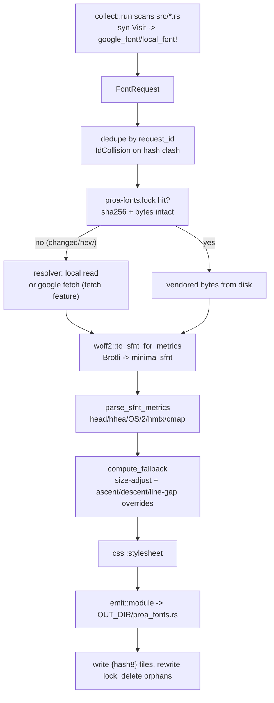

# 21 -- Fonts: Declare in Code, Vendor at Build Time, Render Without JavaScript

Proa's font story is the same idea Next.js's `next/font` popularized, transplanted onto a Rust SSR
pipeline: a `google_font!` / `local_font!` call in your render code expands to a `const Font` that a
`build.rs` step has already vendored, self-hosted, content-hashed, and -- the part that matters --
paired with a **metric-matched fallback**. The key idea is that the declaration is the identity. The
proc macro performs no I/O: it parses the call tokens, derives an 8-hex id from the *normalized
declaration*, and expands to `crate::__proa_fonts_generated::FONT_<id>`. The build collector parses
the same tokens through the *same* parser, derives the *same* id, vendors the files, and emits that
`FONT_<id>` const into `OUT_DIR`. Two processes that never see each other's code agree because the id
is a pure function of one shared grammar -- and the fallback means `font-display: swap` lands in a box
identical to the webfont, so the swap causes zero layout shift with zero JavaScript.

## The Four Crates

| Crate | Lines | Role |
|---|---|---|
| `proa_fonts` | 957 | runtime: `Font`, `FontFace`, descriptors, zero-alloc `<head>` renderer |
| `proa_fonts_parse` | 262 | shared `google_font!`/`local_font!` grammar -> `FontRequest` |
| `proa_fonts_macros` | 90 | `google_font!`/`local_font!` expand to a generated const reference |
| `proa_fonts_build` | 3722 | build pipeline: collect, fetch, vendor, metrics, css, emit, lock |

The dependency direction is deliberate: `proa_fonts` has no build dependency (its `render` feature
pulls `proa_core` for the `<head>` renderer, and is the only thing that is optional). `proa_fonts_parse`
depends on `proa_fonts` for the `FontRequest` type and on `syn` for the tokens. `proa_fonts_macros`
depends on `proa_fonts_parse` + `quote`/`syn`. `proa_fonts_build` depends on all three, plus `brotli`
(WOFF2 decode), `byteorder` (sfnt parsing), `reqwest` (behind the default `fetch` feature), `sha2`,
`toml`, `walkdir`, and `thiserror`. Only the runtime crate is a dependency of application code.

# Part 1 -- The Declaration Is the Identity

## One Parser, Two Sides

`proa_fonts_parse` is a `syn` grammar for the two macros: a family literal followed by `key = value`
options. It exists so the macro and the collector can never drift apart -- there is no second grammar.

```rust
// proa_fonts/proa_fonts_parse/src/lib.rs (shape, abbreviated)
pub fn parse_google_font(tokens: TokenStream) -> syn::Result<FontRequest> {
    parse(RequestSource::Google, tokens)
}
pub fn parse_local_font(tokens: TokenStream) -> syn::Result<FontRequest> {
    parse(RequestSource::Local, tokens)
}
// FontMacroInput { family: LitStr, options: Vec<(Ident, Expr)> }
// options: subsets, weights, styles, variable_font, variable, generic,
//          display, fallback | fallback_local, extra_stack, files, preload, license
```

The accepted options are `subsets`, `weights`, `styles`, `variable_font`, `variable`, `generic`,
`display`, `fallback`/`fallback_local`, `extra_stack`, `files`, `preload`, and `license`.
`local_font!` additionally requires `files = ["..."]` with at least one path. Unknown options produce
a compile error listing every valid one. `styles` accepts `normal`, `italic`, or `oblique`; `generic`
accepts `sans`/`sans-serif`, `serif`, `mono`/`monospace`.

The proc macro turns the parsed `FontRequest` into a reference and nothing else:

```rust
// proa_fonts/proa_fonts_macros/src/lib.rs (abbreviated)
const GENERATED_MODULE: &str = "__proa_fonts_generated";

#[proc_macro]
pub fn google_font(input: TokenStream) -> TokenStream {
    expand(proa_fonts_parse::parse_google_font(input.into())).into()
}

fn expand(parsed: syn::Result<FontRequest>) -> TokenStream2 {
    match parsed {
        Ok(request) => {
            let ident = syn::Ident::new(&request.const_ident(), proc_macro2::Span::call_site());
            let module = syn::Ident::new(GENERATED_MODULE, proc_macro2::Span::call_site());
            quote! { crate::#module::#ident }
        }
        Err(err) => err.to_compile_error(),
    }
}
```

A consumer wires the generated file in with one boilerplate line -- `include!(concat!(env!("OUT_DIR"),
"/proa_fonts.rs"))` inside `mod __proa_fonts_generated` -- and `google_font!("Geist", weights =
[400])` becomes `crate::__proa_fonts_generated::FONT_9F2C1A3B`. The macro does no I/O; it only names
the const the build step must produce.

## The Request Id Is a Pure Function of the Declaration

`FontRequest` is the contract. Its id derives from the *declaration*, not the font bytes (which do
not exist at macro-expansion time). Order-insensitive fields are sorted so cosmetic reordering does
not change the id; `files` and `extra_stack` order is preserved because it is meaningful.

```rust
// proa_fonts/proa_fonts/src/request.rs (abbreviated)
pub fn request_id(&self) -> String {
    let hash = fnv1a64(self.canonical_key().as_bytes());
    format!("{:08x}", (hash & 0xffff_ffff) as u32)
}
pub fn const_ident(&self) -> String {
    format!("FONT_{}", self.request_id().to_ascii_uppercase())
}
// fnv1a64: offset basis 0xcbf2_9ce4_8422_2325, prime 0x0000_0100_0000_01b3
```

`canonical_key()` joins every normalized field with a unit-separator character (`\u{1f}`, which
cannot appear in the inputs): `subsets` lowercased/sorted/deduped, `weights` sorted/deduped, `styles`
sorted/deduped, `preload` sorted/deduped, but `files` and `extra_stack` kept as written. The id is
FNV-1a 64-bit truncated to the low 32 bits and formatted as 8 lowercase hex.

Two distinct ids come out of a generated font. The `const_ident` id (`FONT_9F2C1A3B`) is the
declaration's id; the CSS class name's 8-hex suffix is a *different* id derived from the vended bytes
(`short_hash` over the family name joined with each face's full SHA-256), so the class name changes
only when the actual font files change. The declaration id names the const; the byte id names the
class.

```mermaid
flowchart TD
    CALL["google_font!(\"Geist\", weights=[400], variable=\"--font-geist\")"] --> MACRO["proa_fonts_macros"]
    CALL --> COLLECT["proa_fonts_build collect"]
    MACRO --> PARSE1["proa_fonts_parse::parse_google_font"]
    COLLECT --> PARSE2["proa_fonts_parse::parse_google_font"]
    PARSE1 --> REQ["FontRequest (same fields)"]
    PARSE2 --> REQ
    REQ --> ID["request_id() = fnv1a64(canonical_key) & 0xffffffff"]
    ID --> CONST["FONT_9F2C1A3B"]
    MACRO --> REF["crate::__proa_fonts_generated::FONT_9F2C1A3B"]
    COLLECT --> EMIT["emits pub const FONT_9F2C1A3B: Font"]
    REF --> AGREEMENT["reference and definition always agree"]
    EMIT --> AGREEMENT
```

# Part 2 -- The Runtime Font

## Descriptors Are `const`-Constructible and `Copy`

The runtime crate defines a small set of copyable descriptor enums and a `Font` whose every field is
`&'static`, so a `Font` is `Copy` and free to reference from any render path:

- `FontFormat::{Woff2, Truetype, Opentype}` -- the vended container, with `mime()`, `css_format()`,
  and `extension()` const accessors. Proa prefers WOFF2 everywhere.
- `FontStyle::{Normal, Italic}` and `FontWeight::{Fixed(u16), Variable { min, max }}`.
- `FontDisplay::{Auto, Block, Swap, Fallback, Optional}` -- default `Swap`, "no block period,
  infinite swap period" so the metric-matched fallback shows immediately and swaps without shift.
- `FontFace { url, format, weight, style, preload }` -- one vended file plus the identity of the
  `@font-face` it backs. `url` is always leading-slash absolute so it is immune to `<base href>`
  rewriting.
- `Font { family, class_name, variable, family_stack, faces, css }` -- the generated family, its
  identifiers, its vended files, and its pre-rendered stylesheet.

The value proposition is baked into the module docs: fonts are optimized, self-hosted, preloaded, and
metric-matched, all at build time, with no runtime request to a third party and no JavaScript.

## `Font::head` Is a Zero-Allocation `<head>` Renderer

`head()` is `preload_links()` followed by `style()`, generic over the output buffer:

```rust
// proa_fonts/proa_fonts/src/lib.rs (abbreviated)
pub fn preload_links<B: WriteBuf>(&self, cx: &mut WebContext<impl DataLoader, B>) -> Result<(), WriteError> {
    for face in self.faces {
        if !face.preload { continue; }
        StaticRaw("<link rel=\"preload\" as=\"font\" type=\"").render(cx)?;
        StaticRaw(face.format.mime()).render(cx)?;
        StaticRaw("\" href=\"").render(cx)?;
        proa_core::shared::attr_value::AttrValue::render_attr_value(&cx.request().url(face.url), cx)?;
        StaticRaw("\" crossorigin=\"anonymous\">").render(cx)?;
    }
    Ok(())
}
```

Preload hints are always `crossorigin="anonymous"` -- even for same-origin files -- because omitting
it makes the browser fetch the file twice. `style()` wraps the pre-rendered `css` in a single
`<style>` element. When the request is mounted under a base path, it streams the CSS while
substituting the prefix into known `src:url(...)` face URLs only (never touching fallbacks or
unrelated bytes), and escapes the prefix as a CSS url token -- including `<` as `\3c ` so a mount
containing `</style>` cannot terminate the raw-text element. The result composes inside any
`WebRenderSync` head, allocation-free.

# Part 3 -- The Build Pipeline

## Collect: Scan, Dedupe, Vendor, Lock, Emit

The build-time entry point is `collect::run`, which a consumer's `build.rs` calls with a
`CollectOptions { crate_root, out_dir, fonts_out_dir, url_prefix, lock_path }`.
`CollectOptions::from_build_env()` reads `CARGO_MANIFEST_DIR` and `OUT_DIR` and defaults
`fonts_out_dir` to `public/fonts`, `url_prefix` to `/fonts`, and `lock_path` to `proa-fonts.lock`.

The collector walks `src/` with `walkdir`, keeps only `.rs` files, `syn::parse_file`s each, and visits
macro calls, matching the last path segment against exactly `google_font` and `local_font`:

```rust
// proa_fonts/proa_fonts/proa_fonts_build/src/collect.rs (shape, abbreviated)
fn visit_macro(&mut self, mac: &'ast syn::Macro) {
    match mac.path.segments.last().map(|s| s.ident.to_string()).as_deref() {
        Some("google_font") => {
            if let Ok(req) = proa_fonts_parse::parse_google_font(mac.tokens.clone()) {
                self.requests.push(req);
            }
        }
        Some("local_font") => { /* parse_local_font */ }
        _ => {}
    }
    syn::visit::visit_macro(self, mac);
}
```

Because it matches only the last segment, fully-qualified `proa_fonts_macros::google_font!` calls
also match. A call whose arguments fail to parse is silently dropped -- the proc macro owns the
authoritative compile error -- and an unreadable or unparseable file is recorded as `skipped`, not
fatal, so a mid-edit tree still collects.

Deduplication is by `request_id`. A `BTreeMap` maps id to canonical key: the same id with the same
key is a duplicate and skipped; the same id with a *different* key (a genuine 8-hex hash collision
between two distinct declarations) is `BuildError::IdCollision`, not a silent alias. Each surviving
request gets a lock key `{family_slug}_{id}` (e.g. `geist_9f2c1a3b`).

For each request the collector either regenerates from a prior `proa-fonts.lock` entry plus intact
vendored bytes (the fast path, no network), or runs a `FaceResolver`: local files are read from the
crate; Google sources are fetched through `google::resolve` when the `fetch` feature is on. It writes
the content-hashed files into `fonts_out_dir`, rewrites the lock, deletes vended files orphaned by
removed/refreshed declarations, and emits `proa_fonts.rs` into `out_dir`. `sync` is the same core in
a verify-only mode that writes nothing and errors on any drift; `CARGO_NET_OFFLINE=true` turns a
needed Google fetch into `BuildError::Offline`.

## The Lock Is the Reproducibility Contract

`proa-fonts.lock` records the resolved, content-hashed result so rebuilds are reproducible and
offline. `FontsLock { fonts: BTreeMap<String, LockEntry> }` maps lock keys to `LockEntry { family,
request_id, const_name, class_name, css_variable, family_stack, files, metrics, fallback, license }`.
Each `LockFile` carries `filename`, `url`, `sha256` (full), `bytes`, `stem`, `weight`, `style`,
`display`, `unicode_range`, and `preload` -- everything needed to regenerate the `Font` const from the
vendored bytes without refetching. An entry whose `request_id` no longer matches any scanned
declaration is stale and cleaned up. `LockMetrics` (`units_per_em`, `ascent`, `descent`, `line_gap`,
`x_width_avg`) and `LockFallback` (the four override strings) are recorded for auditability.

# Part 4 -- The Metric-Matched Fallback

## The Problem Layout Shift Is, and the CSS Answer

A webfont swap causes layout shift because the browser first lays out text in the fallback font's
advance widths and line box, then reflows when the webfont lands. The fix is not to measure anything
at runtime -- it is to express the webfont's metrics as percentages of a *known* local fallback, so
the fallback face is already scaled to the webfont's geometry from the first paint. The CSS Fonts
`@font-face` descriptors `size-adjust`, `ascent-override`, `descent-override`, and `line-gap-override`
do exactly this, and they need no JavaScript.

Proa measures the webfont once at build time and emits the overrides against one of three fixed
fallback metrics, chosen by generic category (`sans` -> Arial, `serif` -> Times New Roman, `mono` ->
Courier New). The fallback numbers are published constants copied from `@capsizecss/metrics`, so the
build never needs the fallback font file:

```rust
// proa_fonts/proa_fonts/proa_fonts_build/src/metrics.rs (constants, exact)
pub const ARIAL: FallbackMetrics            = FallbackMetrics { local: "Arial",            units_per_em: 2048.0, x_width_avg: 904.0 };
pub const TIMES_NEW_ROMAN: FallbackMetrics  = FallbackMetrics { local: "Times New Roman",  units_per_em: 2048.0, x_width_avg: 821.0 };
pub const COURIER_NEW: FallbackMetrics      = FallbackMetrics { local: "Courier New",      units_per_em: 2048.0, x_width_avg: 1229.0 };
```

The webfont side is measured live from the primary face (normal style, weight nearest 400):
`FontMetrics { units_per_em, ascent, descent, line_gap, cap_height, x_height, x_width_avg }`. The
`x_width_avg` is a weighted-average advance width over 27 characters -- space plus a-z weighted by
English lowercase letter frequency -- normalized by the sum of the weights that actually resolved, so
it is comparable to the published fallback constants.

## The Override Arithmetic

The match is a single closed-form normalization, not a search or a scored comparison:

```rust
// proa_fonts/proa_fonts/proa_fonts_build/src/metrics.rs (compute_fallback, arithmetic)
let upm = f64::from(webfont.units_per_em);
let size_adjust = match webfont.x_width_avg {
    Some(x_avg) if x_avg > 0.0 => {
        let webfont_ratio  = x_avg / upm;
        let fallback_ratio = fallback.x_width_avg / fallback.units_per_em;
        if fallback_ratio > 0.0 { webfont_ratio / fallback_ratio } else { 1.0 }
    }
    _ => 1.0,
};
let ascent_override   = (f64::from(webfont.ascent)  / upm) / size_adjust;
let descent_override  = (f64::from(webfont.descent).abs() / upm) / size_adjust;
let line_gap_override = (f64::from(webfont.line_gap) / upm) / size_adjust;
// each rendered via percent(ratio) = format!("{:.2}%", ratio * 100.0)
```

`size-adjust` is the ratio of the webfont's normalized average width to the fallback's, scaling the
fallback horizontally; the three vertical overrides then scale ascent, descent, and line gap so the
fallback's line box matches the webfont's. `descent` is taken `.abs()` because CSS `descent-override`
is positive. When `x_width_avg` is unavailable or non-positive, `size-adjust` collapses to `1.0` and
the overrides reduce to the raw normalized metrics -- a safe degenerate case. Every value is emitted
to two decimal places, no clamping.

## Reading Metrics From a Font File by Hand

`parse_sfnt_metrics` hand-parses the sfnt binary with `byteorder` (no `ttf-parser`/`fontations`
dependency), reading five tables: `head` (unitsPerEm at offset 18), `hhea` (ascent 4, descent 6,
lineGap 8, numberOfHMetrics 34), `OS/2` (sTypoAscender 68, sTypoDescender 70, sTypoLineGap 72,
sxHeight 86, sCapHeight 88), `hmtx` (advance widths), and `cmap` (formats 4 and 12). The `fsSelection`
bit `0x0080` (`USE_TYPO_METRICS`) selects OS/2 typo metrics over `hhea`; x/cap-height require OS/2
version >= 2 and length >= 90. A `ttcf` collection uses its first font's offset table.

For WOFF2, `woff2::to_sfnt_for_metrics` first Brotli-decompresses the file and reconstructs a minimal
sfnt containing only the metric tables (`head`, `hhea`, `OS/2`, `maxp`, `hmtx`, `cmap`) -- no `glyf`
/`loca` reconstruction and no outlines, because metric extraction needs none of it. WOFF2 is detected
by the signature `0x774F4632` (`wOF2`), with a 48-byte header and a base128-encoded table directory.

# Part 5 -- Fetch, Vendor, Emit

## Google Sources: One CSS2 URL, Then Per-Subset WOFF2

`google::css_url` builds `https://fonts.googleapis.com/css2?family={family}{axis}&display={display}`
(spaces replaced with `+`; static weights sorted/deduped defaulting to `400`, variable fonts using
the `100..900` axis; `display` defaulting to `swap`), and requests it with a Chrome-120 Windows UA so
Google serves WOFF2. `parse_google_css` splits the response into `GoogleFace { subset, style, weight,
url, unicode_range }` records -- a `/* subset */` comment sets the current subset (default `latin`),
and each `@font-face` block yields one face, skipping any block without a weight or url. `select_faces`
keeps the requested subsets and `resolve` downloads each face's per-subset WOFF2. No glyph subsetting
happens anywhere: Google serves pre-subset files per `unicode-range`, and Proa vendors them as-is.

## Emit: One `const Font` Per Declaration

`emit::module` renders the committed Rust source -- it does not inline font bytes, which live in
`ResolvedFace.bytes` for the orchestrator to write to `public/fonts`. The generated item is a
`pub const {const_name}: Font` plus two private companions:

```rust
// proa_fonts/proa_fonts/proa_fonts_build/src/emit.rs (generated shape, abbreviated)
// @generated by proa_fonts_build - do not edit by hand.
use proa_fonts::{Font, FontFace, FontFormat, FontStyle, FontWeight};

pub const GEIST: Font = Font {
    family: "Geist",
    class_name: "__proa_font_geist_9f2c1a3b",
    variable: "--font-geist",
    family_stack: "'Geist','Geist Fallback',system-ui,sans-serif",
    faces: GEIST_FACES,
    css: GEIST_CSS,
};
const GEIST_FACES: &[FontFace] = &[
    FontFace { url: "/fonts/geist-latin-400-normal.9f2c1a3b.woff2", format: FontFormat::Woff2,
               weight: FontWeight::Fixed(400), style: FontStyle::Normal, preload: true },
];
const GEIST_CSS: &str = "@font-face{font-family:'Geist';...}...";
```

`css::stylesheet` assembles the deterministic stylesheet in a fixed order: every real `@font-face`
(`font-family`, `font-style`, `font-weight`, `font-display`, `src`, optional `unicode-range`), then the
synthesized fallback face, then the utility class and the `:root` custom property:

```
@font-face{font-family:'Geist';font-style:normal;font-weight:400;font-display:swap;src:url(/fonts/geist-latin-400-normal.9f2c1a3b.woff2) format('woff2');unicode-range:U+0000-00FF}
@font-face{font-family:'Geist Fallback';src:local('Arial');ascent-override:95.02%;descent-override:24.02%;line-gap-override:0.00%;size-adjust:101.00%}
.__proa_font_geist_9f2c1a3b{font-family:'Geist','Geist Fallback',system-ui,sans-serif}
:root{--font-geist:'Geist','Geist Fallback',system-ui,sans-serif}
```

`generate_font` ties the pieces together: resolve faces (sniff the container from the first four
bytes -- `wOF2`, `OTTO`, `true`/`typ1`/`ttcf`/`0x00010000` -- hash, name `{stem}.{hash8}.{ext}`),
pick the primary face, parse metrics, compute the fallback overrides, name the class/variable/stack,
assemble the stylesheet, and emit the module.



# The Aha Moment

**Aha:** Layout shift is not prevented by measuring the fallback at runtime -- it is prevented by
expressing the webfont's metrics as percentages of a known local fallback, so the browser lays out in
the fallback already scaled to the webfont's advance widths and line box, and the swap lands in an
identical box.

The `@font-face` metric-override descriptors apply to the *fallback* face with no JavaScript and no
first-paint reflow. Proa only has to measure one number per family -- the English-lowercase
frequency-weighted average advance width, normalized by units-per-em -- and divide it by the same
quantity for a fixed fallback (Arial/Times New Roman/Courier New, whose numbers are published
constants). That single ratio becomes `size-adjust`; the webfont's ascent, absolute descent, and
line gap, normalized by units-per-em and divided by that same ratio, become the three vertical
overrides. The residual mismatch is bounded by how well the fallback's per-glyph widths track its
measured average, which the English-frequency basis is chosen to minimize. The same "derive it from
one shared fact, never store a second copy" discipline appears again in the declaration id: two
processes that never see each other's code agree on `FONT_<id>` because the id is a pure function of
one shared grammar, not a value coordinated between them.

# Cross-References

- The `proa_core` `WebContext`/`WriteBuf`/`StaticRaw` primitives that `Font::head` renders through:
  [03-web-context.md](./03-web-context.md) and [04-write-buf.md](./04-write-buf.md).
- The build tooling and the `cargo proa font sync` command that drive this pipeline:
  [15-build-tooling.md](./15-build-tooling.md) and [16-cli.md](./16-cli.md).
- The docs/MDX rendering pipeline, the next subject: [22-docs.md](./22-docs.md).

Continue to [22-docs.md](./22-docs.md).
