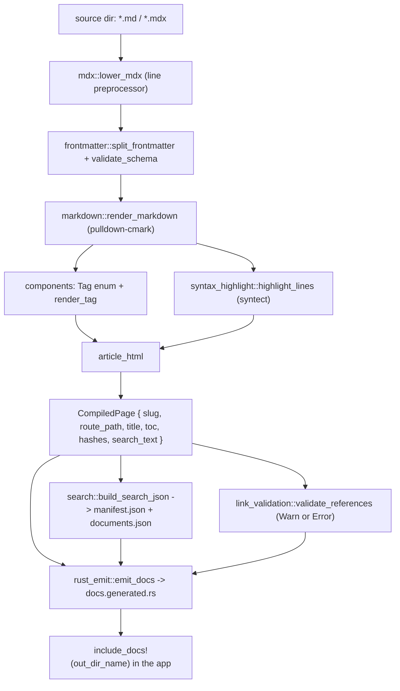
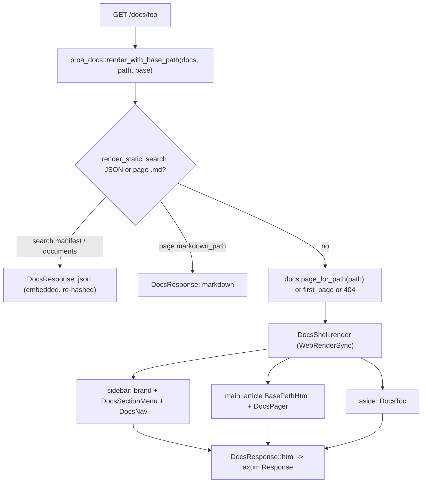

# 22 -- Docs: Compile Markdown and MDX to a Static Rendering Registry

Proa's docs are the same shape as the framework they document: do every expensive step once, at build
time, so the request path is a single zero-copy render. The build crate `proa_docs_build` walks a
directory of Markdown/MDX, lowers MDX component tags to static HTML, syntax-highlights code with
Syntect, validates links, and serializes a search index -- then emits one `docs.generated.rs` whose
article HTML, source Markdown, and search JSON are all `include_str!`ed into the binary. The runtime
crate `proa_docs` owns nothing but a `&'static`-only data model (`Docs`, `DocPage`, `NavItem` -- no
`String`, no `Vec`, no `Box` anywhere) and renders the navigation shell around pre-baked article HTML.
At request time there is no Markdown to parse, no code to highlight, no JSON to read from disk:
`render_with_base_path` matches the path, hands the right `DocPage` to `DocsShell`, and streams the
finished document through the same `WebRenderSync` trait every component in the framework uses.

## The Two Crates

| Crate | Lines | Role |
|---|---|---|
| `proa_docs_build` | ~8,100 | build-time compiler: Markdown/MDX, components, highlight, search, link check, Rust emit |
| `proa_docs` | ~1,900 | runtime: `&'static` data model, `DocsShell` renderer, assets, axum adapter |

Only `proa_docs` is a dependency of application code, and it is pulled into a build only through
`include_docs!` and its own tiny dependency set (`proa_core`, `proa_macros`, `serde_json`, `sha2`,
`base16ct`, plus optional `axum`/`http`). `proa_docs_build` carries the heavy lifters -- `pulldown-cmark`
(Markdown), `syntect` (highlighting), `latex2mathml` (math), `thiserror`, `serde`/`serde_json`, `sha2`,
`base16ct` -- and never runs in the serving binary. The dependency direction is the same discipline as
the fonts pipeline: the compiler is the only process that does real work, and the runtime is a thin,
infallible renderer over data the compiler already made correct.

# Part 1 -- The Runtime Data Model Is Zero-Copy

## `Docs`, `DocPage`, `Frontmatter`

The entire runtime model is `&'static` references and `Copy` structs. `Docs` is the root aggregate; a
page is a `DocPage` whose body is one pre-rendered HTML string and whose table of contents is a static
slice of `TocItem`s:

```rust
// proa_docs/proa_docs/src/model.rs (abbreviated)
pub struct Docs {
    pub config: DocsConfig,                 // base_path, site_name
    pub nav_title: &'static str,
    pub nav_icon: Option<&'static str>,
    pub pages: &'static [DocPage],
    pub nav: &'static [NavItem],
    pub search: Option<SearchArtifacts>,
}

pub struct DocPage {
    pub slug: &'static str,
    pub route_path: &'static str,
    pub markdown_path: &'static str,
    pub title: &'static str,
    pub description: Option<&'static str>,
    pub frontmatter: &'static Frontmatter,
    pub article_html: &'static str,   // the compiled body
    pub markdown: &'static str,       // the raw source, served at markdown_path
    pub toc: &'static [TocItem],
    pub prev: Option<PageLink>,       // nearest non-hidden predecessor
    pub next: Option<PageLink>,       // nearest non-hidden successor
}

pub struct Frontmatter {
    pub title: Option<&'static str>,
    pub description: Option<&'static str>,
    pub icon: Option<&'static str>,
    pub slug: Option<&'static str>,
    pub sidebar_title: Option<&'static str>,
    pub nav_order: Option<i32>,
    pub hidden: bool,
    pub draft: bool,
    pub search: Option<bool>,
    pub toc: Option<bool>,
    pub last_modified: Option<&'static str>,
}
```

`Frontmatter` is eleven fields: five display/slug strings, `nav_order` for explicit ordering,
`hidden`/`draft` toggles, `search`/`toc` overrides, and `last_modified`. `Docs::find_page` and
`Docs::page_for_path` normalize a slug through `path_to_slug` (strip the base path, a trailing
`index.html`, and `.html`/`.md` suffixes) and binary-search-free `.iter().find(...)` over `pages`.

## Navigation Is a Static Tree

`NavItem` is recursive and every kind is one of four `NavItemKind` variants -- `Page`, `Group`,
`Root`, `Separator` -- with `as_str()` emitting `"page"`/`"group"`/`"root"`/`"separator"` for the
`data-nav-kind` attribute:

```rust
// proa_docs/proa_docs/src/model.rs (abbreviated)
pub struct NavItem {
    pub kind: NavItemKind,
    pub title: &'static str,
    pub icon: Option<&'static str>,
    pub path: Option<&'static str>,
    pub children: &'static [NavItem],
}

pub enum NavItemKind { Page, Group, Root, Separator }
```

A `Root` item is a top-level content section; `has_nav_roots` drives whether the sidebar shows a
section switcher, and `active_nav_root(path)` walks the tree to find the `Root` whose subtree contains
the current page so the sidebar can swap between sections.

## `include_docs!` Pulls the Registry Into the Binary

The generated registry is pulled in by a macro, not a module path the author hand-writes. The compiler
emits `docs.generated.rs` into `OUT_DIR`, and the app opts in with one literal -- the source output
directory name:

```rust
// proa_docs/proa_docs/src/lib.rs (verbatim)
#[macro_export]
macro_rules! include_docs {
    ($name:literal) => {
        include!(concat!(
            env!("OUT_DIR"),
            "/proa_docs/",
            $name,
            "/docs.generated.rs"
        ))
    };
}
```

`include_docs!("docs")` expands to `include!(concat!(env!("OUT_DIR"), "/proa_docs/docs/docs.generated.rs"))`,
so the generated `proa_docs::Docs { ... }` value is compiled into the crate as an ordinary static. This
is the single seam between the build crate and the runtime crate: the compiler's only obligation is to
produce a valid `proa_docs::Docs` expression at exactly that path.

# Part 2 -- The Build Compiler

## Configuration Is a Builder, Not a File

There is no config file format in `proa_docs_build`. `Config` is a Rust builder aggregate of
`DocsSource`s, `CollectionSource`s, and `Plugin`s, threaded through `build.rs`. `DocsSource` carries the
per-site settings with these defaults:

```rust
// proa_docs/proa_docs_build/src/config.rs (defaults, abbreviated)
// DocsSource::new(root) defaults:
//   out_dir_name: "docs"      base_path: "/docs"      site_name: "Docs"
//   schema: PageSchema::default()                     meta_schema: MetaSchema::default()
//   postprocess: Postprocess::default()               markdown: MarkdownPipeline::default()
//   search: SearchConfig::orama_client()              link_validation: LinkValidation::default() // Warn
//   include_drafts: false
```

`base_path` is normalized to always start and not end with `/` (empty and `"/"` both become `"/"`).
The `MarkdownPipeline` bundles six sub-configs: `CodeHighlight` (Syntect, `hl-*` classes, no theme),
`MathMode` (`Disabled` | `MathMl`), `ComponentIndexing`, `MermaidConfig` (off by default),
`MdxConfig` (a pile of normalization flags), and `TypeScriptDocgen`. `MdxConfig::proa()` is the opinionated
preset: it turns on `remove_layout_divs`, `lower_paragraph_tags`, `cards`, `files`, `agent_terminal`,
and image prefix rewriting (`/images/` → `/static/images/`). `SearchConfig` is `Disabled | OramaClient |
StaticClient | Server | Custom(String)`; `LinkValidation` defaults to `Warn` mode with internal-route and
hash checks on and external checks off, and `strict()` flips it to `Error`.

## The Compile Pipeline

The real entry point is `try_compile_to`, which `try_compile` calls after requiring an `OUT_DIR`:

```rust
// proa_docs/proa_docs_build/src/compiler.rs (pipeline, abbreviated)
pub fn try_compile_to(config: Config, out_dir: &Path) -> Result<(), CompileError> {
    // 1. touch every collection and plugin (currently no-ops)
    // 2. if any source wants highlighting, build HighlightCache at out_dir/.proa-docs-highlight-cache
    // 3. for each source: compile_source(source, cache, out_dir.join("proa_docs").join(source.out_dir_name))
}
```

`compile_source` is where the per-site work happens:



Model building has two branches. If the source root has a `meta.json`, `compile_folder_nav` builds the
navigation and page list from it, then `append_unlisted_pages` compiles any discovered Markdown files
not already named. Otherwise `collect_markdown_files` finds every `.md`/`.mdx`, compiles each, and sorts
pages by `nav_order` then `slug`; the nav is then just the non-hidden pages. `meta.json` is a `Meta {
title, icon, root, pages }` whose `pages` are untagged `MetaEntry`s: a string (`Item`), a
`{ "separator": "...", "icon": "..." }` object, or a `Group { title, pages }` -- so navigation order,
grouping, separators, and top-level roots are all authored in one file.

Per page, `compile_page_rel` runs a fixed sequence: read the file, lower MDX if the extension is
`.mdx` and MDX is enabled, split and validate frontmatter, resolve it (skipping `draft` pages unless
`include_drafts`), derive the `slug` from frontmatter or the relative path, compute `route_path` and
`markdown_path`, render the Markdown, infer a title/description when frontmatter leaves them empty, and
emit `pages/{slug}.html` plus `pages/{slug}.md` fragments. The result is a `CompiledPage` carrying
`slug`, `route_path`, `markdown_path`, `title`, `description`, `sidebar_title`, the resolved frontmatter,
`article_html`, `markdown`, `toc`, `hashes`, `search_text`, and the two include paths. The slug of the
index file is the empty string, so `route_path` collapses to the base path and `markdown_path` becomes
`{base}/index.md`.

Compile-time failures are a nine-variant `CompileError` (`thiserror`): `Io`, `MissingOutDir`,
`Frontmatter`, `Metadata`, `MdxLowering`, `SearchJson`, `LinkValidation(usize)` (the number of broken
links when mode is `Error`), `TypeScriptDocgenMissing(usize)` (type-table requests with no configured
TS command), and `UnknownNavIcon(String)`. Most component problems are not hard errors -- they surface
as `cargo:warning=docs components:` diagnostics and the compiler proceeds with the offending block
dropped or escaped.

# Part 3 -- Markdown, MDX, Frontmatter

## Markdown Is a Hand-Rolled `Event` Writer

`render_markdown` parses with `pulldown-cmark` and writes a flat HTML `String` directly from the event
stream -- there is no intermediate IR:

```rust
// proa_docs/proa_docs_build/src/markdown.rs (abbreviated)
// Parser::new_ext(markdown, Options::ENABLE_TABLES | ENABLE_STRIKETHROUGH | ENABLE_TASKLISTS
//   | if pipeline.math.is_enabled() { Options::ENABLE_MATH } else { Options::empty() })
pub struct RenderedMarkdown {
    pub html: String,
    pub toc: Vec<TocEntry>,          // depth, id, title
    pub hashes: Vec<String>,         // every heading id, for link validation
    pub search_text: String,
    pub links: Vec<LinkReference>,   // every href, for link validation
    pub type_table_requests: Vec<TypeTableRequest>,
}
```

Heading ids are `slugify`ed -- lowercase ASCII alphanumerics kept, every other run collapsed to one
`-`, empty becomes `"section"` -- and deduplicated with `-2`, `-3`, ... suffixes. Every heading id is
pushed to `hashes`, but only headings deeper than H1 are pushed to the TOC, so the on-page menu starts
at `h2`. Links record their href for later validation and pass the destination through `safe_url`,
which lowercases the scheme and blanks `javascript:`/`vbscript:`; images take their `alt` text from the
image `title` field. Task-list markers become `<input type="checkbox" checked disabled />`.

The one custom syntax layered on CommonMark is TeX math: `$...$`/`$$...$$` are compiled to MathML at
build time with `latex2mathml::latex_to_mathml` (+ `DisplayStyle` for display math), re-escaped by
`normalize_mathml`, and fall back to escaped source with a `cargo:warning=docs math:` when the
conversion fails.

## MDX Is a Line Preprocessor That Lowers Markdown to Markdown

`mdx::lower_mdx` is not a JSX parser and never evaluates expressions. It is a line-oriented transform
that returns the input unchanged when `config.enabled` is false, and otherwise rewrites a fixed set of
constructs. Line-oriented components become plain Markdown:

```rust
// proa_docs/proa_docs_build/src/mdx.rs (lowerings, abbreviated)
// <Cards> <Card title href description/> </Cards>      -> "- [title](href): description"
// <Files> <Folder name/> <File name/> </Files>         -> a ```proa-filetree fence
// <AgentTerminal/>                                     -> a ```text fence
//                                        ->  after prefix_rewrites
// <p>...<strong/>...<code/>...</p>                     -> **...** and `...`
```

Container components (`Callout`, `Tabs`, `Steps`, `CodeExplorer`, `Accordions`, `Demo`) are deliberately
*not* lowered: `end_block` forces each tag onto its own block with a trailing blank line so pulldown-cmark
parses the Markdown between open and close tags as ordinary children instead of swallowing it into an
HTML block. The brace grammar is narrowed to four special cases -- `{'{'}`/`{'}'}` escapes, `{/* ... */}`
comment stripping, `items={['a','b']}` → `data-items="a|b"`, and `style={{...}}` → `style="kebab: value"`
-- while any other `{expr}` passes through as literal text. Hard lowering errors are only `"unsupported
MDX export statement"`, `"unclosed <Cards> block"`, `"unclosed <Files> block"`, and `"unclosed fenced
code block"`.

## Frontmatter Is Hand-Parsed Simple YAML

`split_frontmatter` requires the document to start with `---\n`, scans for the closing `\n---`, and
parses `key: value` lines by hand (no `serde_yaml`). `parse_scalar` maps `true`/`false` to `Bool`, an
integer to `Number(i64)`, and a matching `"..."`/`'...'` pair to `String`, so a flow list like `[a, b]`
stays a single string that `get_string_list` later splits on commas. `ParsedFrontmatter` is a
`BTreeMap<String, Value>` with no hardcoded keys; the concrete keys (`title`, `description`, `icon`,
`slug`, `sidebar_title`, `nav_order`, `hidden`, `draft`, `search`, `toc`, `last_modified`, `keywords`)
are resolved into `ResolvedFrontmatter` in `compiler.rs`. An optional `PageSchema`/`MetaSchema`
enforces required-ness and scalar type per key, with messages like `missing required frontmatter field
`title`` and `frontmatter field `nav_order` must be a boolean`.

# Part 4 -- The Component System

## Dispatch Is a `Tag` Enum, Not a Registry

There is no trait, macro, or runtime name registry for components. Dispatch is two plain stages: a
`Tag` enum whose `parse` string-matches the exact tag text, and a `match tag { ... }` in `render_tag`
that routes each variant to its renderer, appending raw HTML to a `&mut String`:

```rust
// proa_docs/proa_docs_build/src/components/tag.rs (variants, abbreviated)
pub enum Tag {
    TabsOpen(Vec<String>), TabsClose, TabOpen(Option<String>), TabClose,
    ExplorerOpen, ExplorerClose, CodeFileOpen(String), CodeFileClose,
    AccordionsOpen { exclusive: bool }, AccordionsClose, AccordionOpen { title: String, id: Option<String> }, AccordionClose,
    StepsOpen, StepsClose, StepOpen, StepClose,
    CalloutOpen { kind: CalloutKind, emoji: Option<String> }, CalloutClose,
    Demo(Demo),
}
```

`open_tag_body` requires the name to be followed by whitespace, `/`, or `>` so `<TabsFoo>` never
matches `<Tabs>`. Container components keep their children as Markdown (parsed by the normal event loop
and appended into the same buffer), while three line-oriented components -- `Cards`, `Files`,
`AgentTerminal` -- are consumed earlier in `lower_mdx` and re-emitted as Markdown. `CodeBlock` (fenced
code) and `TypeTable` (deferred docgen) are handled directly in `markdown.rs`. `ComponentState` tracks
the open container, the tab/explorer group counters, and per-page diagnostics.

The components and their exact output:

- **Callout** -- `<Callout type="info|warning|error">` (unknown type falls back to `Default`). Renders
  `<div class="proa-docs-callout" data-type="..." role="note">` with an `aria-hidden` icon column; the
  four `CalloutKind`s are `Default`/`Info`/`Warning`/`Error` with lightbulb/info-circle/warning-triangle/
  cross-circle SVGs. An optional `emoji` attribute overrides the icon.
- **Cards / Card** -- `<Card title href description?/>` lowers to a Markdown list item.
- **Tabs / Tab** -- `<Tabs data-items="a|b">` plus optional `<Tab value="...">`. Emits radio inputs
  named `proa-docs-tabs-{group}` (first checked), a `role="tablist"` label row, and panels
  `<div class="proa-docs-tabs-panel" role="tabpanel">`. `MAX_STYLED_TABS` is 8; more than that warns.
- **Accordions / Accordion** -- `<Accordions type="single|multiple">` (single is the default, and the
  `exclusive` flag means `type != "multiple"`). Exclusive groups get a shared
  `name="proa-docs-accordion-group-{group}"` on each `<details class="proa-docs-accordion">`, so the
  browser's native single-open behavior applies with no JavaScript.
- **Steps / Step** -- `<div class="proa-docs-steps">` / `<div class="proa-docs-step">`.
- **CodeExplorer / CodeFile** -- `<CodeExplorer>` with `<CodeFile name="...">` children. A radio-group
  tab row shared with `Tabs`, a language-icon file label, and per-file breadcrumb paths; the language is
  inferred from the filename.
- **Demo** -- `<Demo src="/..." title="..." height?/>`. Height clamps to `[80, 1600]` with a `320`
  default, and the tag renders an `<iframe>` plus an "open in a new tab" link. A non-same-origin `src`
  or a missing `title` drops the tag with a `cargo:warning`.
- **Files / Folder / File** -- a ` ```proa-filetree ` fence rendered to
  `<div class="proa-docs-filetree" role="tree">` rows with `data-kind="folder"|"file"`.
- **AgentTerminal** -- a fixed ` ```text ` fence.
- **TypeTable** -- parsed from an inline HTML directive whose name is the configurable
  `component_name` (default `auto-type-table`), turned into a `TypeTableRequest` and a
  `<div data-proa-docs-type-table-pending>` placeholder for later TypeScript docgen.
- **LanguageIcon** -- the code-block header icon, an inline 14×14 SVG colored `currentColor`.

Every component emits trusted static HTML; authored labels and attributes are escaped through
`escape_attr`/`escape_text` before insertion. Authoring mistakes are warnings, not errors -- an unclosed
container, a dropped `<Demo>`, an overflowing `<Tabs>`, or content inside a tag without surrounding
blank lines each produce a precise `cargo:warning=docs components:` message.

# Part 5 -- Syntax Highlighting

## Syntect Scopes, Hand-Mapped to Semantic `hl-*` Classes

Highlighting is build-time Syntect with no theme and no inline styles. `highlight_lines(code, language)`
returns `Ok(None)` for unknown or plain-text languages and otherwise a `Vec<HighlightedLine>`, where
each line carries its HTML body and its exact line terminator (so the source round-trips losslessly):

```rust
// proa_docs/proa_docs_build/src/syntax_highlight.rs (abbreviated)
// static HIGHLIGHTER: OnceLock<SemanticHighlighter> = ... SyntaxSet::load_defaults_newlines()
pub(crate) fn highlight_lines(code: &str, language: &str)
    -> Result<Option<Vec<HighlightedLine>>, syntect::Error>
```

`SemanticHighlighter` maps Syntect scopes through 24 hand-written `Rule`s into a private 24-variant
`HighlightClass` enum, then `css_class()` emits a stable `hl-*` literal -- `Keyword → hl-keyword`,
`StringSpecial → hl-string-special`, `FunctionMacro → hl-function-macro`, `PunctuationBracket →
hl-punctuation-bracket`, and so on, ending with `Variable → hl-variable` as the final fallback. Because
the colors are owned by the site stylesheet, a theme change is pure CSS: swap the `hl-*` rules and
never re-highlight.

Language aliasing normalizes the info string before lookup: `rs → rust`,
`shell`/`shellscript`/`zsh → bash`, `js`/`jsx`/`ts`/`tsx`/`typescript → javascript` (Syntect ships no
TypeScript grammar, so the JS grammar stands in), `py → python`, `rb → ruby`, `md → markdown`,
`yml → yaml`, and `""`/`text`/`txt`/`plain`/`plaintext` are treated as plain text. Multi-line spans are
handled correctly for classification (the parse state and scope stack persist across lines), but
emission is strictly per-line: every open `<span>` is force-closed at the end of its line, so spans
never cross line boundaries.

Rust gets a second pass. `markdown_template::rust_ranges` finds the byte spans of Rust embedded inside
`md!`/`md_sync!` string literals -- the ordinary bytes are Markdown, the `{...}` slots and control-flow
headers are Rust -- so those regions re-highlight as Rust, and two fallbacks fill Syntect's gaps:
identifiers that look like Rust types (ASCII-uppercase first byte, then either length 1 or containing a
lowercase) become `hl-type`, and unclassified `{ } ( ) [ ]` become `hl-punctuation-bracket`.

## The Highlight Cache Is Disposable and Never Fails the Build

`HighlightCache` memoizes per `(code, language)` highlighted output as one JSON file per key. The key is
SHA-256 of `language.len() ++ language ++ code`, hex-encoded, and the cache root itself is hashed from
the build script's own executable (`"proa.docs.highlight-cache.v1\0" ++ executable bytes`), so any
change to the compiler or its dependencies invalidates the whole cache even if Cargo reuses the same
`OUT_DIR`. There is no eviction, LRU, or size limit -- the cache is meant to be deleted and regenerated
-- and a corrupt or misplaced entry is silently recomputed. Writes go through a `.{pid}-{nonce}.tmp`
temp file and an atomic `rename`, and cache I/O can never fail the build.

## Icons and TypeScript Docgen

A fenced block's header icon comes from `code_icon::for_language`, a case-insensitive table of inline
SVG path data (`rs`/`rust → rust`, `tsx`/`jsx → react`, `ts`/`typescript → typescript`, the shell family,
`md`/`mdx` → markdown, `docker`/`dockerfile` → docker, `nginx`, `json*`, and a generic `file` fallback).
`typescript.rs` holds no generation logic -- it is the request model for TypeScript type tables:
`TypeScriptDocgen` carries `tsconfig_path` (`"tsconfig.json"`), `cache_dir`
(`"target/proa-docs/typescript"`), `component_name` (`"auto-type-table"`), `hide_internal` (`true`), and
the four `Annotation`s `@internal`/`@fumadocsType`/`@remarks`/`@fumadocsHref`, so the `<auto-type-table
path="..." type="..."/>` directive is deferred into a placeholder and replaced after docgen runs.

# Part 6 -- Search and Link Validation

## Search Is an Embedded Orama Index

`search::build_search_json` returns `(manifest_json, documents_json)`, both serialized with `serde_json`.
The manifest is `{ version: 1, engine: "orama", basePath, hash, documents }` where `documents` points at
`{base_path}/_search/documents.json` and `hash` is `sha256-{hex}` of the documents JSON. Each
`SearchDocument` records the page's `id` (slug), `url` (route), `title`, `description`, full
`search_text`, `section`, `breadcrumbs`, `headings`, `keywords`, and a fixed `rank: 100`. The `section`
is computed by `nav_sections`: each navigated page inherits the title of the nearest preceding
`Separator` in the nav tree. Pages with `frontmatter.search` set to `false` are excluded.

The subtle part is what happens to those two strings. The compiler writes them to disk as
`search/manifest.json` and `search/documents.json`, but `rust_emit` then `include_str!`s them into the
generated `SearchArtifacts`, whose `manifest_path`/`documents_path` are the *public* URLs
`{base_path}/_search/manifest.json` and `{base_path}/_search/documents.json`:

```rust
// proa_docs/proa_docs_build/src/rust_emit.rs (output shape, abbreviated)
// proa_docs::SearchArtifacts {
//     manifest_path:   "{base_path}/_search/manifest.json",
//     manifest_json:   include_str!("search/manifest.json"),
//     documents_path:  "{base_path}/_search/documents.json",
//     documents_json:  include_str!("search/documents.json"),
// }
```

So the runtime never reads a file to answer a search request -- it serves the embedded JSON, and when
the docs are mounted under a deployment base path it re-prefixes the `url`/`basePath`/`documents`
fields and recomputes the SHA-256 hash on the fly in `mounted_search_response`.

## Link Validation Builds a Route-and-Hash Graph

`validate_references` walks a `LinkGraph` of `LinkGraphPage { source_path, route_path, hashes }` against
every collected `PageLinkReferences`, and only when `mode` is not `Off`. It skips `mailto:`, `tel:`,
`http://`, and `https://` (external checks are configured but not implemented here), then for each href
either checks a same-page `#hash` against the page's heading ids or splits the href into path + hash and
resolves the path against the current route. Failures are `unknown hash `#{hash}` on current page`,
`unknown internal route `{resolved}``, and `unknown hash `#{hash}` on `{resolved}``. In `Warn` mode the
diagnostics print; in `Error` mode the compiler returns `CompileError::LinkValidation(n)` with the count.

# Part 7 -- The Request Path Is One Render

## `render_with_base_path` Dispatches, `DocsShell` Renders

At runtime the whole surface is `render`/`render_with_base_path`, which return a `DocsResponse { status,
content_type, body: Cow<'static, str> }`. `render_static` first answers the non-page routes -- the two
search JSON documents and each page's Markdown source -- and then the page path falls through to
`page_for_path` (or `first_page`, then a 404):

```rust
// proa_docs/proa_docs/src/response.rs (abbreviated)
pub fn render_with_base_path(docs: &'static Docs, path: &str, base_path: &BasePath) -> DocsResponse {
    // 1. render_static: search manifest/documents JSON, or page markdown at markdown_path
    // 2. let page = docs.page_for_path(path).or_else(|| docs.first_page()) else { 404 };
    // 3. DocsResponse::html(render_page_to_string_with_base_path(docs, page, base_path))
}

pub fn render_page_to_string_with_base_path(docs: &'static Docs, page: &'static DocPage,
                                            base_path: &BasePath) -> String {
    let mut cx = WebContext::new();
    cx.request_mut().set_base_path(base_path.clone());
    DocsShell { docs, page }.render(&mut cx).expect("render docs shell");
    cx.into_output().into_string()
}
```

`DocsShell` is a single `WebRenderSync` component that writes the full HTML document -- doctype, `<head>`
with charset/viewport/`{title} - {site_name}`/meta description, and a `body.proa-docs-body` holding a
three-column `data-proa-docs` grid:



The sidebar renders the brand link, an optional `DocsSectionMenu` (only when the nav has `Root` items --
a `<details>`/`<summary>` switcher listing each root section), and `DocsNav`, whose items emit
`data-nav-kind` and an `aria-hidden` icon via `nav_icon_svg`. `nav_icon_svg` resolves one of 17 inline
14×14 stroke icons (`ArrowRightLeft`, `BookOpen`, `Braces`, `Bot`, `Brain`, `Cpu`, `Database`,
`FileText`, `Layers`, `LifeBuoy`, `Palette`, `Rocket`, `Route`, `Settings`, `ShieldCheck`, `Terminal`,
`Zap`) with `FileText` as the default. The main column wraps the article in `BasePathHtml`, so links
inside the pre-baked body are re-prefixed for the deployment mount, and appends a `DocsPager` of prev/next
links. The right column renders `DocsToc`, whose depth classes run `proa-docs-toc-depth-1` through
`-5` (anything deeper clamps to `-6`) and whose anchor links are a custom `AttrValue` that prepends `#`.

## The Theme and Behavior Are Bundled Assets

`DocsAssets` inlines the default stylesheet and script, or the site can serve `DEFAULT_STYLESHEET`/
`DEFAULT_SCRIPT` as cacheable static files, or ship neither and style the documented markup contract
itself. The stylesheet is plain CSS -- no Tailwind, no `@apply`, no build step -- and drives every color
from 15 custom properties on `.proa-docs-body` (the accent, background, foreground, line, rail, and
surface families, overridden under `.dark .proa-docs-body`) plus three layout widths
(`--docs-sidebar-width`, `--docs-toc-width`, `--docs-content-width`). The script is progressive
enhancement: a delegated `click` handler wires the code-block and page-Markdown copy buttons, with a
Clipboard API fast path and a `textarea` fallback for insecure origins, flipping the button to
`data-copied="true"` for 1.6 s. Tabs, the code explorer, and accordions are CSS-only and need no script.
The optional `axum` feature wraps this in `adapter::axum::response`/`response_with_base_path`, mapping a
`DocsResponse` onto an `axum::response::Response<Body>`.

# The Aha Moment

**Aha:** A documentation site does not need a server-side renderer at all -- it needs a compiler that
happens to emit one Rust expression. Every expensive step in the docs pipeline (Markdown parsing, MDX
lowering, Syntect highlighting, TeX-to-MathML, link validation, search serialization) is a build step
whose output is flattened into `docs.generated.rs`, and the "server" is a ~1,900-line crate that holds
that expression as `&'static` slices and writes it out through the same `WebRenderSync` trait as any
other component. The search index is the clearest witness: it is written to disk only so
`include_str!` can fold it into the binary, and the runtime recomputes its SHA-256 hash on the fly when
a base path changes -- at no point does a request touch a file. The compiler is the site; the runtime
is just the frame it gets mounted in.

# Cross-References

- The `WebContext`/`WebRenderSync`/`WriteBuf`/`StaticRaw`/`AttrValue` primitives the shell renders
  through: [03-web-context.md](./03-web-context.md), [04-write-buf.md](./04-write-buf.md), and
  [02-render-traits.md](./02-render-traits.md).
- The build-time philosophy shared with the fonts pipeline, and the `OUT_DIR`/`include_str!` discipline
  it inherits from the build tooling: [21-fonts.md](./21-fonts.md) and [15-build-tooling.md](./15-build-tooling.md).
- The optional axum adapter and the `BasePath` it composes against:
  [13-framework-axum.md](./13-framework-axum.md).

Continue to [23-supporting-crates.md](./23-supporting-crates.md).
