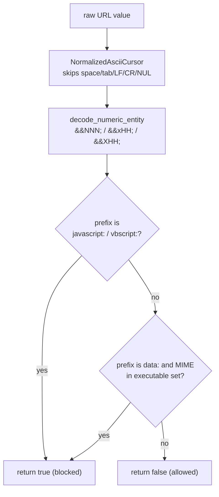
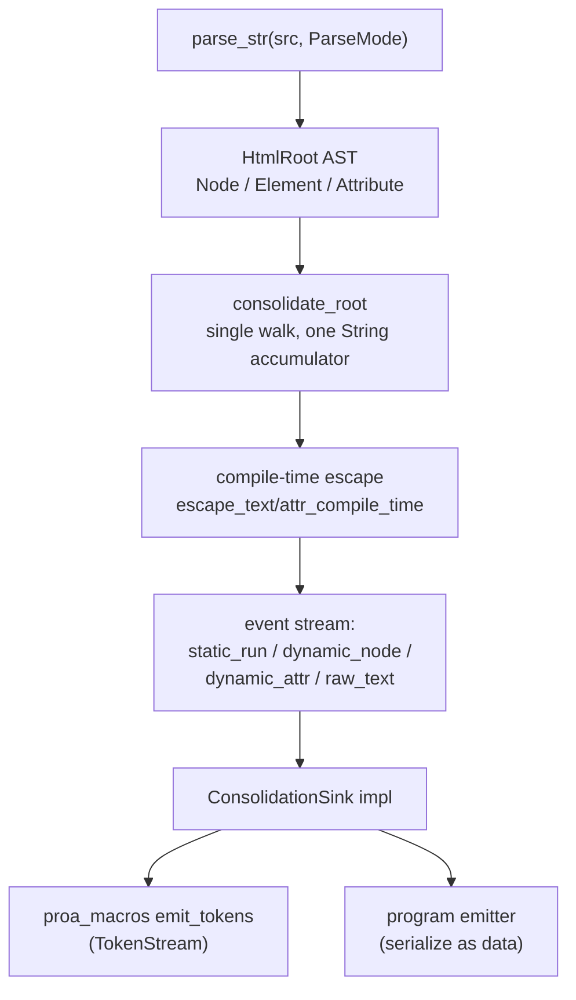
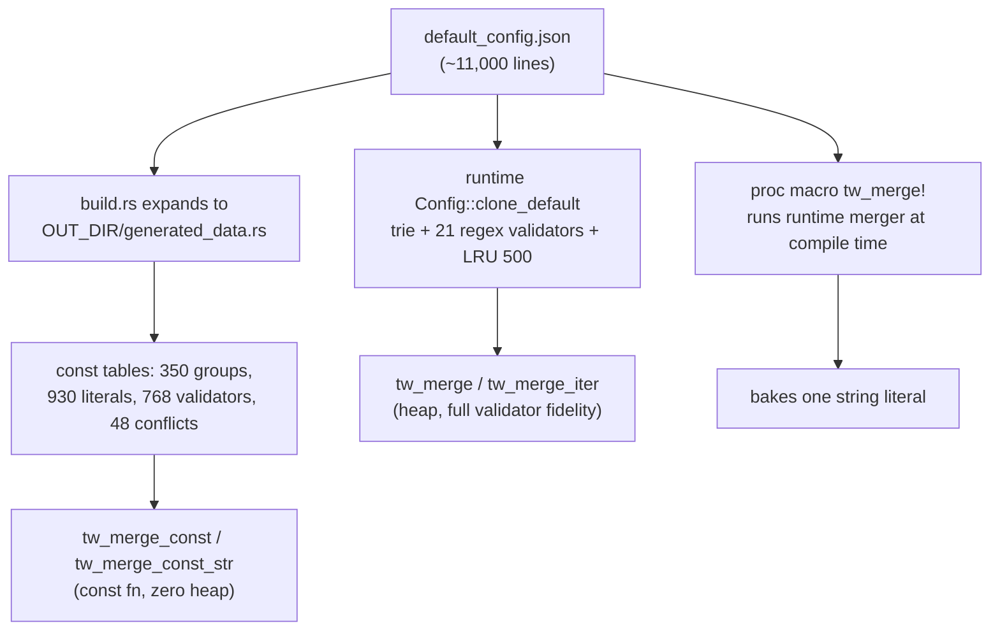

# 23 -- Supporting Crates: The Belt, the Bridge, and the Bake Step

Proa's "render is serialization" discipline does not stop at the render core. The six supporting crates
apply the same build-time-vs-runtime split to everything that surrounds a component: harden the markup
boundary at compile time (`proa_html_policy` plus the validation pass inside `proa_dsl`), generate the
JavaScript half of an island from a single component definition (`proa_codegen` and `proa_react`), and
bake class merging and JSON serialization into `const fn` so they never run on a request
(`proa_tailwind_merge` and `proa_const_json`). None of them is a render trait, yet each one removes
work from the hot path: the belt rejects XSS before any byte is emitted, the bridge turns one manifest
into matching server markup and client modules, and the bake step turns runtime computation into
static data embedded in the binary.

| Crate | Lines | Role |
|---|---|---|
| `proa_html_policy` | ~430 | one `#![no_std]` URL-scheme XSS filter: `has_dangerous_url_scheme` |
| `proa_dsl` | ~6,300 | shared HTML/XML parser, AST, consolidation walk, security/a11y/perf validation |
| `proa_codegen` | ~1,030 | TypeScript/React component codegen from a JSON component manifest |
| `proa_react` | ~1,500 | React island bootstrap: hydration script and server-side island markup |
| `proa_tailwind_merge` (+ proc macro) | ~2,300 | tailwind-merge in three flavors: runtime, `const fn`, and proc macro |
| `proa_const_json` (+ proc macro) | ~1,140 | `const fn` JSON serialization plus a zero-copy, allocation-free parser |

The dependency direction is the same discipline as the fonts and docs pipelines: crates that do real
work (`proa_dsl`, `proa_codegen`) run at build time and are dependencies of `proa_macros`, while crates
that sit in the serving binary (`proa_html_policy`, `proa_react`, the `const` halves of the last two)
are small, `#![no_std]`-friendly, and infallible.

# Part 1 -- `proa_html_policy`: One Function, Three Escapes

The entire public surface of `proa_html_policy` is one function. It is `#![no_std]`, `#![forbid(unsafe_code)]`,
marked `#[inline]` so release builds fold it into `elem::write_attr`, and it exists because a naive
`starts_with("javascript:")` check is defeated three distinct ways. The function returns `true` when a
URL value is dangerous and should never be written to `href`, `src`, `action`, or any other URL-bearing
attribute:

```rust
// proa_html_policy/src/lib.rs (shape, abbreviated)
#[inline]
pub fn has_dangerous_url_scheme(url: &str) -> bool {
    // 1. javascript: / vbscript:  (ASCII case-insensitive)
    // 2. data: whose MIME is one of the executable set:
    //    text/html, application/xhtml+xml, application/xhtml,
    //    application/xml, image/svg+xml   (svg can carry <script>)
    // 3. all checks run on a normalized cursor that skips ASCII
    //    whitespace + NUL and decodes numeric character references
}
```

The three escapes it defends against, each with a source reference in the doc comment:

1. **Scheme case.** `JavaScript:`, `VBScript:` — matched case-insensitively.
2. **Control characters in the scheme prefix.** WHATWG URL §4.3 directs browsers to strip tab, LF, and
   CR before parsing, so `java\tscript:alert(1)` and `\njavascript:alert(1)` still navigate. A
   `NormalizedAsciiCursor` skips ASCII whitespace (space, tab, LF, CR) *and* NUL throughout the prefix,
   not just at the leading edge.
3. **Numeric character references.** The HTML5 parser decodes `&#NNN;` and `&#xHH;` in attribute values
   *before* URL parsing, so `&#106;avascript:alert(1)` smuggles past a string-prefix check. This is the
   exact bypass behind CVE-2026-39315 (Unhead `hasDangerousProtocol()`). `decode_numeric_entity` runs
   one pass with no digit cap, optional semicolon, saturating arithmetic, and maps `0`, `>0x10FFFF`,
   and surrogates to U+FFFD; a non-ASCII decoded code point is treated as a non-match because it cannot
   spell an ASCII scheme or MIME type.



The function is called from `elem::write_attr` on every URL-bearing attribute in the hot render path,
which is why the whole crate is `#![no_std]` and `#[inline]`: the security check must not allocate and
must not survive as a function call the optimizer cannot see through.

# Part 2 -- `proa_dsl`: The Template Language Shared by Both Macro Families

`proa_dsl` is the front end every Proa template macro (`html!`, `html_sync!`, `md!`, `md_sync!`) shares.
It owns the grammar, the AST, the consolidation walk that folds adjacent static markup into byte runs,
and the validation pass that turns template mistakes into compile errors or `#[must_use]` warnings. The
entry point is `parse_str`, which returns a `HtmlRoot`; the node grammar is deliberately small:

```rust
// proa_dsl/src/ast.rs (shape, abbreviated)
pub enum Node {
    Element(Element),
    Fragment(Vec<Node>),
    Text(LitStr),
    Block(Expr),          // a {dynamic} expression in child position
    Doctype(String),
}

pub struct Element {
    pub name: MarkupName,
    pub attrs: Vec<Attribute>,   // Static | Dynamic | Bool
    pub children: Vec<Node>,
    pub self_closing: bool,
    pub opening_end: proc_macro2::Span,
}

pub enum Attribute {
    Static { name: MarkupName, value: LitStr },
    Dynamic { name: MarkupName, value: Box<Expr> },
    Bool { name: MarkupName },
}
```

Parsing is parameterized by a `ParseMode { Html, Xml }` that changes case handling, boolean-attribute
spelling, and void-element lists (HTML void elements vs the SVG void set). What the parser produces is
then walked once by `consolidate::walk::consolidate_root`, which emits a representation-neutral event
sequence into a `ConsolidationSink` rather than directly producing `TokenStream`:

```rust
// proa_dsl/src/consolidate/sink.rs (shape, abbreviated)
pub trait ConsolidationSink {
    fn static_run(&mut self, pre_escaped: &str);          // one run per static region
    fn dynamic_node(&mut self, expr: &Expr);              // a {expr} in child position
    fn dynamic_attr(&mut self, attr: DynamicAttr<'_>);    // name={expr}
    fn begin_raw_text(&mut self, kind: RawTextKind);      // <script> / <style>
    fn end_raw_text(&mut self, kind: RawTextKind);
}
```

This seam is what lets one walk drive two emitters: the `TokenStream` emitter in
`proa_macros::static_consolidation::emit_tokens` for the macro path, and any downstream program emitter
that serializes the same events as data. `DynamicAttr` carries four fields — `name_prefix`, `bool_form`,
`value`, and `is_url_position` — so emitters never re-derive dialect rules; the walk decides that
`href`/`src`/`action` is a URL position and the emitter must apply runtime dangerous-scheme validation
(CVE review Gap O). The walk accumulates static bytes in one `String` and flushes exactly at dynamic
boundaries, so a fully static template produces exactly one `static_run`.



The validation pass (`validate_security` / `validate`) walks the same AST and enforces four rule
families. URL attributes are whitelisted in `URL_ATTR_NAMES` (13 entries — `href`, `src`, `action`,
`formaction`, `poster`, `ping`, `cite`, `data`, `background`, `longdesc`, `manifest`, plus both
`xlink:href` and `xlink-href`; `srcset` is deliberately excluded because its comma-separated grammar
is not a single URL). Any `<a target="_blank">` without an explicit rel gets `noopener` injected or
merged. Raw-text content (`textarea`, `title`, `xmp`, `noscript`, `noframes`) and foreign-content roots
(`svg`, `math`, `foreignObject`) trigger content-mode switching and mutation-XSS warnings. ARIA is
checked against `VALID_ARIA_ROLES` (82), `ABSTRACT_ARIA_ROLES` (12), `VALID_ARIA_ATTRS` (51), and six
prohibited elements (`meta`, `head`, `style`, `script`, `col`, `colgroup`) that may carry no role or
attribute. A performance pass (gated by the `no-perf-hints` feature, each warning suppressible with
`perf_ok(...)`) flags nine allocation patterns in the render hot path — `format!()`, `vec![]`,
`.to_string()`, `.to_owned()`, `.join()`, `.collect()`, `String::from()`, a string literal in braces,
and a dynamic attribute holding a literal value.

# Part 3 -- The JavaScript Bridge: `proa_codegen` and `proa_react`

Where `proa_dsl` handles the server side of a component, `proa_codegen` and `proa_react` handle the
client side. `proa_codegen` takes a JSON manifest of component definitions and emits a TypeScript
tree — a CVA-style recipe plus a typed React component per component. The manifest shape is the four
structs below; `ComponentType` selects the rendered element (`Button` by default, or `Svg`):

```rust
// proa_codegen/src/types.rs (shape, abbreviated)
pub struct ComponentDef {
    pub name: String,
    pub base_classes: String,
    pub variants: Vec<VariantDef>,
    pub component_type: ComponentType,   // Button (default) | Svg
}

pub struct VariantDef {
    pub name: String,          // e.g. "size"
    pub enum_name: String,     // e.g. "Size"
    pub default_value: String,
    pub options: Vec<VariantOption>,
    pub optional: bool,
}

pub struct VariantOption {
    pub name: String,          // "sm"
    pub value: String,         // "sm"
    pub classes: String,       // "text-sm px-2"
}
```

`TsGenerator` lowers each `ComponentDef` into `lib/utils.ts` (a `cn` helper over `clsx`), a
`metadata.json`, a `manifest.ts`, a per-component directory holding `recipe.ts` (the CVA recipe),
`{Name}.tsx` (the component), and `index.ts` re-exports. The component props interface extends
`React.ComponentPropsWithoutRef<'button' | 'svg'>` plus `VariantProps<typeof {lower}Variants>`, and the
component body branches on `ComponentType` for `Spinner`/`Button` special cases. `CodegenConfig`
controls React version and two flags, with three presets: `react_18()` (`forwardRef`), `react_19()`
(ref-as-prop, named functions), and `shadcn_v4()` (the shadcn/ui v4 pattern). The CLI is
`proa-codegen --input <manifest.json|-> [--output generated] [--react 18|19] [--no-data-slot]`.

`proa_react` renders the runtime half. `ReactBootstrapConfig`'s defaults show the design intent — an
external React runtime behind an import map for cross-page caching, and a single global trigger:

```rust
// proa_react/src/bootstrap.rs (shape, abbreviated)
impl Default for ReactBootstrapConfig<'_> {
    fn default() -> Self {
        Self {
            selector: "[data-island]",
            react_import: "react",
            react_dom_client_import: "react-dom/client",
            hydrate_fn: "hydrateRoot",
            auto_run: true,
            expose_global: Some("__proaHydrateIslands"),
            use_external_runtime: true,
            react_module_url: DEFAULT_REACT_URL,      // esm.sh, version + ts query
            react_dom_module_url: DEFAULT_REACT_DOM_URL,
        }
    }
}
```

The `ReactBootstrap` value implements `WebRenderSync` and emits a `<script type="module" nonce>` whose
body is `include_str!("../js/bootstrap.js")` filled from five placeholders: the module descriptor map
(`ReactModuleDescriptor { island, module_path, export, strategy }`), the hydration strategy, and the
runtime URLs. The bootstrap script defines `__proaReactState`, `parseProps`, `loadComponent` (a dynamic
`import()`), `hydrateIsland`, `scheduleHydration`, and `unmountAll`. Each island is server-rendered by
`ReactIsland { island_name, stable_id, props_json, inner_html, error_config }` as a `<div
data-island data-props-id>` whose props ride in an adjacent `<script type="application/json">`, with
`</` and U+2028/U+2029 masked so the JSON cannot break out of the script. `HydrationStrategy` offers
five triggers — `Immediate`, `Idle`, `Visible`, `Interaction { event }`, `Media { query }` — and the
builder adds an `ErrorBoundaryConfig { retry_count: 3, retry_delay_ms: 1000, error_fallback,
report_errors: true }`.

# Part 4 -- The Bake Step: `proa_tailwind_merge` and `proa_const_json`

The last two crates move runtime computation into `const` context. `proa_tailwind_merge` implements
tailwind-merge three ways over the same 11,000-line `default_config.json`:

1. **Runtime** (`tw_merge`, `tw_merge_iter`, `TailwindMerge`): a dash-part trie of `ClassPartNode`s plus
   21 regex validators, a modifier sorter, and a 500-entry LRU cache (`cacheSize: 500`), configurable
   through `Config::from_json` or `Config::clone_default`.
2. **Const** (`tw_merge_const`, `tw_merge_const_str`, `ConstMergeResult`): a zero-heap `const fn`
   reimplementation of the same last-wins reverse-iteration pipeline, backed by tables that `build.rs`
   expands from the JSON into `OUT_DIR/generated_data.rs` (350 group-id constants, 930 literal entries,
   768 prefix validators, 48 conflict sets, `MAX_CONFLICTS = 14`, capped at `DEFAULT_MAX_CLASSES = 128`
   and `MAX_MODIFIERS = 6`).
3. **Proc macro** (`tw_merge!("px-2", "px-4", "text-sm", "text-lg")`): runs the *runtime* merger inside
   the compiler and bakes the result into one string literal — a bridge for string-literal use sites.

```rust
// tailwind-merge/src/compile_time/mod.rs (shape, abbreviated)
pub const MAX_MODIFIERS: usize = 6;
pub const DEFAULT_MAX_CLASSES: usize = 128;

pub const fn tw_merge_const<const CAP: usize, const N: usize>(
    class_lists: [&'static str; N],
) -> [&'static str; CAP];

pub const fn tw_merge_const_str(class_list: &'static str) -> ConstMergeResult;
```

The const merge mirrors the runtime algorithm exactly: split on whitespace, iterate in reverse so the
last occurrence of a class (or any class in its conflict set) wins, canonicalize modifiers with an
insertion sort that never reorders order-sensitive modifiers (the leading-`[` arbitrary ones plus the
config's 12, including `*`, `after`, `before`, `placeholder`, `selection`), hash the
modifier+group signature with FNV-1a into a fixed `SeenSet`, and push surviving classes onto a
stack-only buffer. Arbitrary-value matching is coarser in `const` (every `is_arbitrary_*` collapses to a
bracket or paren shape check), which is the trade for running with no allocator.

`proa_const_json` applies the same idea to JSON. Its runtime crate is `#![no_std]` and every builder is
`const fn`, so a struct can serialize itself at compile time into a fixed buffer:

```rust
// const_json/src/buffer.rs and src/ser.rs (shape, abbreviated)
pub struct JsonBuffer<const N: usize> {
    buf: [u8; N],
    len: usize,
}

pub const fn write_unsigned<const N: usize>(
    buf: &mut JsonBuffer<N>, value: u128,
);  // plus write_signed, write_string, write_bool, write_key, begin/end_object, ...
```

`#[derive(ConstJson)]` with a mandatory `#[const_json(capacity = N)]` generates `pub const fn
to_json() -> JsonBuffer<N>` for bools, all integer widths, `&str`, nested `ConstJson` structs, and
`[T; N]` arrays. A separate zero-copy parser (`JsonValue { Null, Bool(bool), Number(i64),
String(&str), Object(JsonObject), Array(JsonArray) }`, with `JsonObject { json: &str }` as a lazy,
zero-copy view) lets const-built JSON be read back without ever owning a `String`. Neither crate is yet
consumed by another workspace member — they are infrastructure for embedding config and class strings
in the binary instead of building them on the request path.



# The Aha Moment

**Aha:** A "supporting crate" in Proa is not a utility bag — it is a place where a single source of
truth is *lowered into the cheapest available representation*. `proa_dsl` parses a template once and
walks it into a representation-neutral event stream so the macro path and any future program emitter
share the same semantic decisions. `proa_codegen` turns one JSON manifest into both server-side
metadata and a full TypeScript component tree. `proa_tailwind_merge` lowers one 11,000-line config into
a runtime trie *and* a set of `const` tables *and* a proc macro, so the same conflict rules run with a
heap, with no heap, or entirely inside the compiler. `proa_const_json` makes `const fn` JSON a
first-class thing rather than a `build.rs` side effect. The shared move is the same one the render
core makes: do the expensive, fallible work where the compiler lives, and leave the serving binary
holding only static data and infallible writes.

# Cross-References

- `has_dangerous_url_scheme` is folded into `elem::write_attr`, and the escaping it complements lives
  with the element model: [05-html-elements.md](./05-html-elements.md).
- `proa_dsl` is the front end behind `html!`/`html_sync!` and the markdown macros, whose lowering is
  covered in [07-html-macros.md](./07-html-macros.md) and [08-md-macros.md](./08-md-macros.md).
- The island bootstrap this document's Part 3 renders feeds the RSJS client, so it composes with
  [17-rsjs-overview.md](./17-rsjs-overview.md) and [20-rsjs-web-transport.md](./20-rsjs-web-transport.md).
- The `OUT_DIR`/`include_str!` and `build.rs`-generated-table discipline in Part 4 is the same as the
  build tooling and fonts pipelines: [15-build-tooling.md](./15-build-tooling.md) and
  [21-fonts.md](./21-fonts.md).

Continue to [24-applications.md](./24-applications.md).
