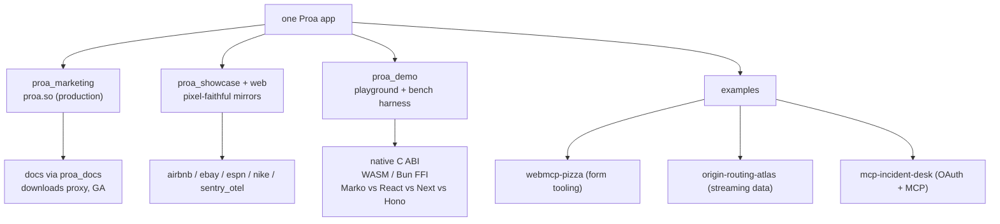

# 24 -- Applications: Proa's Own Apps Are the Benchmark

Proa's applications are not throwaway demos — they are the evidence the framework works in production.
`proa_marketing` is the live proa.so site, deployed on Railway and serving its own docs, a showcase
playground, and a production GitHub-Releases download proxy. `proa_showcase` recreates Airbnb, eBay,
ESPN, Nike, and a Sentry/OTel page pixel-for-pixel so Proa can be benchmarked against Marko 6 and
React 19 on *identical* DOM. `proa_demo` exposes a zero-allocation C ABI and a three-tier benchmark
harness (native, wire-size, browser) with comparison servers for Marko, React, Next, and Hono. And
three standalone examples each prove one production capability end to end: WebMCP form tooling, a
streaming RIPEstat atlas, and an OAuth-plus-MCP incident desk. Together they demonstrate the thesis the
whole framework is built on — one typed, compiled source of truth that renders as HTML for people,
Markdown for agents, and JSON for machines, from the same data.

| Application | Lines | What it is |
|---|---|---|
| `proa_marketing` | ~13,100 | the proa.so site: landing, ecosystem, 101-page docs, showcase, downloads proxy |
| `proa_showcase` | ~13,800 | pixel-faithful Airbnb / eBay / ESPN / Nike / Sentry mirrors + benchmark bins |
| `proa_showcase_web` | ~500 | the shared Axum routes and static-asset handlers for showcase pages |
| `proa_demo` | ~16,800 | interactive playground, reference UIs, and the native/WASM/browser bench harness |
| `examples/webmcp-pizza` | ~1,000 | pizza-order form: Wellformed + RSJS islands + WebMCP |
| `examples/origin-routing-atlas` | ~12,900 | "ORIGIN", a live BGP routing atlas over RIPEstat data |
| `examples/mcp-incident-desk` | ~11,000 | OAuth authorization server + MCP tool server + SQLite, over TLS |

The comparison companions (`proa_demo/marko-server`, `react-ssr`, `next-ssr`, `hono-ssr`,
`bench/lean-page`) are separate reference implementations used only by the benchmark harness, so the
Rust crates stay honest: every number they print is reproducible against a pinned competitor.

# Part 1 -- `proa_marketing`: The Site Is Its Own Demo

`proa_marketing` is the production marketing site, and its architecture is a live tour of the framework.
`src/main.rs::app()` assembles roughly two dozen routes and then merges three sub-routers — the
downloads proxy, the mounted playground (`proa_demo::playground::marketing_router()`), and the mounted
showcase (`proa_showcase_web::router()`):

```rust
// proa_marketing/src/main.rs (abridged)
let app = Router::new()
    .route("/", get(pages::home::handler))
    .route("/docs", get(pages::docs::handler))
    .route("/docs/*path", get(pages::docs::path_handler))
    .route("/api/search", get(endpoints::search::handler).post(endpoints::search::post_handler))
    // ...
    .merge(endpoints::downloads::router())
    .merge(proa_demo::playground::marketing_router())
    .merge(proa_showcase_web::router())
    .nest_service("/static", static_service())
    .layer(CompressionLayer::new().compress_when(compression_predicate()))
    .layer(TraceLayer::new_for_http())
```

Every page is a compile-time-checked `WebRenderSync` tree wrapped by `layout.rs::render_page`, which
shares one `Document` renderer that emits `PageHead`, `PageBody`, the `SearchModal`, and finally
`RsjsRuntimeTags` — the last snapshots hydrated islands and injects the RSJS runtime plan via
`rsjs::manifest().page_runtime_plan(...)`. The only hydrated client code on most shells is a theme
toggle and the search modal, both tiny `#[rsjs(component, client)]` islands; the docs' search index
itself is app-owned JavaScript (`public/search.mjs`) kept deliberately outside the RSJS surface. The
docs are `static DOCS: Docs = proa_docs::include_docs!("docs")` — 101 Markdown/MDX files compiled at
build time — and the quantity-stepper demo proves progressive enhancement: it renders an
`<input type="hidden" name="qty" value={...}>` server-side, so its POST works even if hydration never
runs.

The machine-facing endpoints are first-class, not afterthoughts. `/.well-known/proa-site.json`,
`/openapi.json`, and `/llms-full.txt` provide discovery; `/docs/*path` advertises its Markdown source
via `Link: rel="alternate"; type="text/markdown"` and token-count headers; and `endpoints/downloads.rs`
(3,050 lines) is a read-through GitHub Releases proxy with a real filename whitelist (an asset must
include `x86_64-unknown-linux-gnu.tar.gz` and `SHA256SUMS`), proxy-vs-302 mode switching, and per-path
cache TTLs — release metadata 300 s, archives `immutable` for a year, `MAX_CACHE_ENTRIES = 128`,
`MAX_METADATA_BYTES = 4 MB`.

# Part 2 -- `proa_showcase`: Pixel-Faithful Mirrors and the Finalize Seam

`proa_showcase` is a library whose five site modules are "comparison targets for proa-rsjs vs Marko 6 /
React 19 SSR" — each page recreates a real site so benchmarks measure identical application DOM. The
per-site modules each exercise a different slice of the framework: Airbnb's `listing.rs` keeps the
legacy `proa_react` React-island path alive (`Island::new("DatePicker")` / `"BookingCard"` plus
`react_bootstrap`) while its `parity.rs` (2,643 lines, 51 `event_handler`, 30 `signal`, 2 `memo`) runs
all interactivity through a single RSJS island with no React/Turbo/Tailwind CDN. eBay's `srp.rs` is the
"fully optimized" zero-allocation mirror (`OnceLock` cache, custom `AttrValue`, `SafeText::from_trusted`
skipping escape SIMD), and its `srp_chrome_real.rs` is generated from a captured 699 KB eBay page
serialized as `CHUNK_0..CHUNK_8` static strings with typed dynamic slots — "exactly the form
`html_sync!` compiles to." Nike's `catalog.rs` renders 120 product cards with no islands at all, as a
pure bulk-SSR workload. Sentry/OTel renders `DEFAULT_ROW_COUNT = 400` trace-log rows through a
hydration-independent `render_benchmark_rows` that both Proa and React SSR time, so transport is
excluded from the comparison.

The crate's most instructive mechanism is `finalize_rsjs_document`, which shows how a fully rendered
document gets its client runtime injected without double-buffering:

```rust
// proa_showcase/src/lib.rs (abridged)
const DOCUMENT_END: &str = "</body></html>";
let body_end = html
    .strip_suffix(DOCUMENT_END)
    .expect("showcase document must end with </body></html>")
    .len();
html.truncate(body_end);
html.push_str(std::str::from_utf8(&tags).expect("rsjs runtime plan must be valid UTF-8"));
html.push_str(DOCUMENT_END);
```

The plan comes from `rsjs::manifest().page_runtime_plan(artifacts.rendered_islands())`, written to a
`Vec` first so the HTML string is never reallocated. Only response owners that own the completed
document call it — component and `render_into` paths deliberately do not, which is what makes `render`
vs `render_into` semantics compose without finalizing twice. `proa_showcase_web` wraps this in a
reusable HTTP boundary: nine `SHOWCASE_ROUTES`, the RSJS runtime/island asset routes, and static roots
resolved in order `SHOWCASE_PUBLIC_DIR` → `STATIC_DIR` → crate `public/` → `proa_marketing/public/` →
`espn/data`, with canonical-path containment checks. Feature flags gate the interactive pages
(`rsjs-pages` = `["sentry-otel"]`) so Criterion benchmarks can still link the non-RSJS pages without
tripping cargo-proa's deployable-build guard on interactive pages.

# Part 3 -- `proa_demo`: The Playground and the Honesty Harness

`proa_demo` is three things in one crate. The **playground** (`src/playground.rs`, 5,371 lines) is a
live in-browser IDE — a JSON props editor, an iframe preview, and HTML/Markdown/results tabs — that
renders Proa in-process and reaches every other engine (Node React, Bun React, Marko, React SSR, Next)
over HTTP through proxy handlers with link rewriting. The **reference UIs** exercise specific hot
paths: `streaming_airbnb_home.rs` renders the same home page four ways (sync, buffered async, chunked
in-order, chunked out-of-order) with immediate futures to isolate async/streaming cost;
`ebay_srp_islands.rs` contrasts 60 per-card `WatchHeart` islands against one `WatchListings60` island
wrapping 60 cards — byte-for-byte identical DOM, but 60 wrappers, seed JSON blobs, and hydration cycles
collapsed into one. The **benchmark harness** measures three tiers: native in-memory render
(`bench_native.rs`, `WARMUP = 1_000`, `ITERATIONS = 10_000`; `ebay_srp_paths_bench.rs`, `ITERS = 5_000`),
wire size (`bundle_size.mjs` walking script/modulepreload refs, with a
`PROA_RSJS_TOTAL_MIN_GZIP_BUDGET = 12_000` gate), and browser metrics under CDP CPU throttling
(TTFB/FCP/LCP/script-CPU/transfer bytes via `PerformanceObserver`).

The crate's load-bearing proof is its zero-allocation FFI surface. `src/lib.rs` exports
`#[no_mangle] extern "C"` functions so Bun FFI and Node WASM can drive the same renderer without
copying, using `into_boxed_slice` so `len == capacity` for safe cross-language deallocation:

```rust
// proa_demo/src/lib.rs (abridged)
unsafe fn render_into_out(html: String, out_ptr: *mut *mut u8, out_len: *mut usize) -> i32 {
    let boxed = html.into_bytes().into_boxed_slice();   // len == capacity
    let len = boxed.len();
    let ptr = Box::into_raw(boxed) as *mut u8;
    unsafe { *out_ptr = ptr; *out_len = len; }
    0
}

#[no_mangle]
pub unsafe extern "C" fn proa_free(ptr: *mut u8, len: usize) { /* drop(Box::from_raw(...)) */ }
```

The `render_*_into` variants write into a caller-provided buffer and return `-1` when it is too small.
`bench/RESULTS.md` is the honesty contract: it refuses to publish numbers until fixture revision,
output byte counts, machine/runtime versions, and raw samples are recorded, and warns against comparing
render-time, loopback, browser-script, and wire-size measurements across categories.

# Part 4 -- Three Examples, Three Production Capabilities

The three `examples/` crates are each a complete deployable app that isolates one capability.

**`webmcp-pizza`** (7 routes) is a single form layered over four technologies: Proa SSR, Wellformed
schema-driven validation, RSJS islands, and WebMCP. The one schema `schemas/pizza-order.json` drives
server validation, the HTML `label`/`required` metadata, *and* the WebMCP parameter array, so the three
contracts cannot drift. The form handler branches on validation:

```rust
// examples/webmcp-pizza/src/lib.rs (abridged)
async fn create_order(Form(fields): Form<HashMap<String, String>>) -> Response {
    let submitted = serde_json::to_value(fields).expect("string form fields serialize to JSON");
    match pizza_order::validate_form(submitted) {
        Ok(values) => {
            let normalized_order = serde_json::to_string_pretty(&values)
                .expect("generated Wellformed values serialize to JSON");
            (StatusCode::CREATED, render_document(ReceiptPage { normalized_order })).into_response()
        }
        Err(errors) => {
            let state = pizza_order::state_with_errors(errors);
            (StatusCode::UNPROCESSABLE_ENTITY, render_document(PizzaPage::from_state(&state)))
                .into_response()
        }
    }
}
```

The `webmcp-bridge.js` script exists to fix a real gap: declarative WebMCP writes control values but
does not promise `input`/`change` events, so the bridge replays `toolactivated` events to keep RSJS
`bind_value` signals reconciled. The form deliberately omits `toolautosubmit` — the agent configures,
the person confirms the mutation.

**`origin-routing-atlas`** ("ORIGIN") is a live BGP/RIPEstat routing atlas. Its one `AppState` field is
`Arc<AtlasLoader>`, and the whole app hangs off `proa_core::DataLoader` with two dedup layers: the
request-scoped `DataResolver` collapses ~7 pane requests into one fan-out (a test pins
`origin_loads() == 1`), and a cross-request cache holds successful, non-degraded dossiers for
`DOSSIER_TTL` (60 s) up to 256 entries. Degraded dossiers are never cached, and the receipt labels a
cache hit `cached · Ns` instead of stale fetch latency:

```rust
// examples/origin-routing-atlas/src/loader.rs (abridged)
async fn fetch_with_cache(...) -> Result<Dossier, RipeError> {
    if let Some(hit) = cache_lookup(&cache, ttl, query) {
        return Ok(hit);
    }
    let dossier = client.dossier(query).await?;
    origin_loads.fetch_add(1, Ordering::SeqCst);
    if !dossier.degraded {
        cache_insert(&cache, ttl, query, &dossier);
    }
    Ok(dossier)
}
```

`api.rs` fans out six RIPEstat widgets with `tokio::join!`, each under an 8 s budget, soft-degrading
per widget; every component renders both HTML and Markdown from one Rust source, content-negotiated on
`Accept: text/markdown` and surfaced as an "agent surface" with copyable `curl` commands. The page
streams through `proa_stream::Suspense` around each pane, and the 30 s argument to
`proa_framework_axum::serve` is the graceful-shutdown drain deadline, not a request timeout.

**`mcp-incident-desk`** is the deepest example: a full-stack incident desk that runs two TLS servers in
one process — an app on port 5570 and an OAuth authorization server (issuer) on 5571 — so it can model
a realistic cross-origin split between a protected resource and its authorization server, with separate
`__Host-` cookie domains:

```rust
// examples/mcp-incident-desk/src/main.rs (abridged)
let app = axum_server::bind_rustls(
    std::net::SocketAddr::from(([127, 0, 0, 1], config.app_port)),
    tls.clone(),
)
.serve(routes::router(state.clone()).into_make_service());
let issuer = axum_server::bind_rustls(
    std::net::SocketAddr::from(([127, 0, 0, 1], config.issuer_port)),
    tls,
)
.serve(routes::issuer(state).into_make_service());
tokio::try_join!(app, issuer)?;
```

Three seeded accounts (`alice`, `ben`, `casey`) hold scoped OAuth grants; access tokens are RS256 JWTs
with a 5-minute lifetime, refresh tokens rotate with replay-revocation (using a spent refresh token
revokes the whole grant), and an `rmcp` Streamable-HTTP MCP server at `/mcp` exposes six tools
(`whoami`, `search_issues`, `get_issue_brief`, `get_issue_data`, `create_issue`, `resolve_issue`) behind
a middleware that enforces `issues:read` and, for writes, `issues:write`. The `IssueProjection` is
loaded once and rendered as HTML, Markdown, or JSON — the `/lab` page shows the token counts side by
side, and the `DataResolver` dedup is surfaced as "keyed SQL reads / logical loads." A background job
prunes expired `pending`/`sessions`/`codes`/`refresh_tokens` rows every 60 s.



# The Aha Moment

**Aha:** Proa's applications are where "render is serialization" stops being a slogan and becomes a
measurement. The same Airbnb home page compiles to four render modes so streaming overhead can be timed
independently of the network; the same eBay results page renders 60 tiny islands or one big island with
byte-identical DOM so island granularity can be priced per byte; the same Sentry trace-log component
produces a hydration-independent document so Proa and React SSR are timed on identical application DOM
with transport excluded. The three examples push the same idea further: one Rust type renders HTML,
Markdown, and JSON, so an "agent surface" is not a separate endpoint but a content negotiation on the
same handler. The benchmark is not a separate program — it is the app, compiled without the parts you
want to exclude, and the numbers refuse to exist until the fixture, byte count, and runtime version are
recorded.

# Cross-References

- The render core these apps build on — `WebContext`, `WebRenderSync`, `WriteBuf`, `StaticRaw`,
  `DataLoader` — is covered in [02-render-traits.md](./02-render-traits.md),
  [03-web-context.md](./03-web-context.md), and [04-write-buf.md](./04-write-buf.md).
- Streaming (`Suspense`, in-order/out-of-order, `DataResolver` dedup) and the RSJS islands these apps
  exercise: [10-streaming.md](./10-streaming.md), [17-rsjs-overview.md](./17-rsjs-overview.md), and
  [20-rsjs-web-transport.md](./20-rsjs-web-transport.md).
- The framework-axum routing, `BasePath`, and content negotiation the examples compose against, and the
  docs pipeline marketing embeds: [13-framework-axum.md](./13-framework-axum.md) and
  [22-docs.md](./22-docs.md).
- The fonts (`proa_fonts`) and build tooling the atlas and marketing sites lean on:
  [21-fonts.md](./21-fonts.md) and [15-build-tooling.md](./15-build-tooling.md).

Continue to [25-data-flow.md](./25-data-flow.md).
