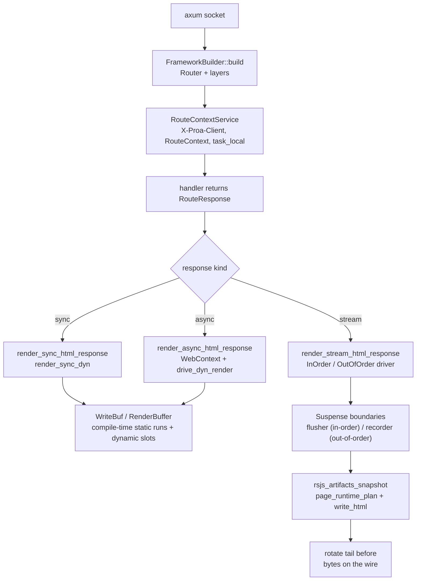
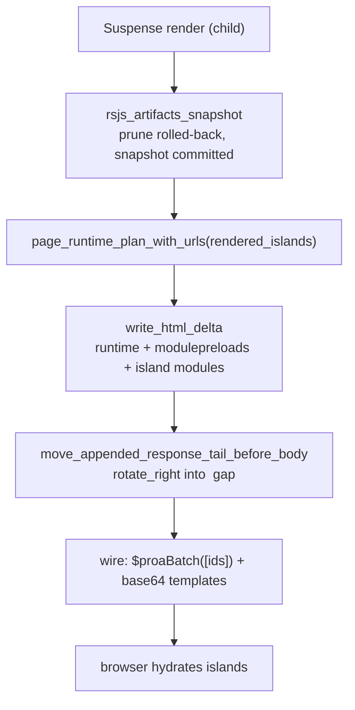

# 25 -- Data Flow: One Request, One Buffer, One Plan

A Proa request is not a component tree that gets walked at runtime — it is a single
compile-time-consolidated render into one `WriteBuf`, with every data read deduplicated per request and
every interactive island accounted for by one runtime plan spliced in before the terminal body tag. The
pipeline has five stages. The axum adapter turns a socket into a `RouteContext` and dispatches on the
handler's response kind. A component renders either synchronously (`WebRenderSync::render`) or into a
`RenderOutcome::{Done, Pending}` future (`WebRender::render`), with a compiler-proved `Send` variant for
futures that may cross threads. Data reads go through `cx.load_typed`, which on the dynamic path is
wrapped in a request-scoped `DataResolver` that collapses concurrent reads of the same `LoadKey` into
one upstream call. Streaming is `Suspense` boundaries rendered as detached buffers — flushed in order by
a `StreamChunkFlusher`, or recorded and drained out of order by a `StreamBoundaryRecorder`. Finally the
rendered island ids are snapshotted, turned into a runtime plan, and rotated into the gap before
`</body>`. Every stage is already documented in detail; this document is the trace that ties them
together in the order they actually happen.



# Part 1 -- The Request Becomes a Render

`proa_framework_axum::server::serve_with_shutdown` accepts sockets, wraps each in a hyper connection via
`TowerToHyperService`, and hands the merged `Router` (built by `FrameworkBuilder::build`) to axum. The
layers, outermost to innermost, are `RouteContextLayer`, `DefaultBodyLimit` (1 MiB), CSRF, `TimeoutLayer`
(30 s), concurrency, `CatchPanicLayer`, `SecurityHeadersLayer`, `CspNonceLayer`, and an
`Extension(manifest)`. `RouteContextService::call` reads the `X-Proa-Client` header, builds a
`RouteContext`, and scopes the request future in a `tokio::task_local!` (`ROUTE_CONTEXT`) so downstream
code can read routing state without threading it through every signature.

A handler returns `RouteResponse<L>`; its `IntoResponse` reads `ROUTE_CONTEXT`, builds a
`FrameworkRequestContext` (defaulting to `RenderMode::Static`), and dispatches on the response kind:
sync responses go to `finalize_route_response_sync`, streamed documents to
`finalize_route_response_stream`, and everything else through `block_on_current_runtime` (which uses
`block_in_place` on the multi-thread runtime). A `FrameworkBody::Full` becomes `Body::from`, a
`BufferedPages` becomes `Body::from_stream`, and a `Stream` carries a `DeferredFrameworkStream`
extension so the first item can be prepared before the response is returned.

# Part 2 -- Sync, Async, and Send: Three Render Paths

The render-trait split is the hinge of the whole pipeline. `WebRenderSync<L, B>::render` writes directly
into a `&mut WebContext` and never constructs a future; it is the zero-allocation fast path for fully
static trees. `WebRender::render` returns `RenderOutcome<impl Future>` — either `Done(res)` or
`Pending(fut)` — and the driver calls `resolve()` to return immediately or `.await`:

```rust
// proa_core/src/render/web_render.rs (shape, abbreviated)
pub enum RenderOutcome<F> {
    Done(Result<(), WriteError>),
    Pending(F),
}

impl<F: Future> RenderOutcome<F> {
    pub async fn resolve(self) -> Result<(), WriteError> {
        match self {
            RenderOutcome::Done(res) => res,
            RenderOutcome::Pending(fut) => fut.await,
        }
    }
}
```

`SyncToAsync` wraps a sync component as `Done(self.0.render(cx))`, and `AwaitComponent` awaits a future
that yields a child. The async future has **no blanket `Send` bound**, which is the exact reason the
local vs Send split exists: a component that reads data returns `RenderOutcome::Pending(async move { ...
cx.load_typed::<T>(key).await? ... })`, and that future is not provably `Send` in general. The local
path therefore uses `Rc<dyn StreamBoundaryRecorder>` and `spawn_local`, while the compiler-proved
`WebRenderSendSync`/`WebRenderSend` traits use `Arc` and `tokio::spawn`, driven by `drive_dyn_send_render`
and `render_in_send_context`.

# Part 3 -- Data Loading Is Request-Scoped and Deduplicated

`cx.load_typed::<T>(key)` lowers to `self.loader.load(&request).await?.downcast::<T>()`. A `LoadKey` is
`{ namespace, kind }` with `LoadKeyKind::{Named, Hashed}` (typed keys hash via `DefaultHasher`), and a
`LoadValue` is either `Bytes` or `Typed` (downcast by type). On the dynamic path the framework wraps the
upstream loader in a `DataResolver` (`build_dyn_request_loader_handle`), which holds two
`HashMap<LoadKey, Shared<BoxFuture>>` — `inflight` and `resolved`:

```rust
// proa_stream/src/resolver.rs (shape, abbreviated)
pub struct DataResolver {
    inflight: HashMap<LoadKey, Shared<BoxFuture<'static, Result<LoadValue, LoadError>>>>,
    resolved: HashMap<LoadKey, Shared<BoxFuture<'static, Result<LoadValue, LoadError>>>>,
}

// shared_load_with: a cache hit clones the resolved Shared; an in-flight
// miss clones the in-flight Shared; a true miss runs inner.load(&request)
// and inserts it into BOTH maps so concurrent readers share one upstream call.
```

The dedup is request-scoped, not global: it guarantees that seven panes asking for the same
`ripestat:dossier:<query>` key inside one render fan out exactly once (the atlas test pins
`origin_loads() == 1`). A typed `Arc<L>` loader skips the resolver unless the app opts in via
`DataResolver::new_typed` or `request_scope` — otherwise `cx.load_typed` hits the raw loader with no
dedup.

# Part 4 -- Streaming: Boundaries Are Detached Renders

`Suspense<C, Fb>` branches on `cx.render_mode()`. In `ChunkedOutOfOrder` with a recorder it takes
`recorder.next_boundary_id()`, forks the context, builds a `LocalBoundaryBranch`, and pushes a
`PendingBoundary` whose boxed future creates a detached `WebContext`, calls
`proa_core::render_in_context_async` on the child, commits or rolls back its artifact branch, and
returns a `RenderedBoundary`. The parent writes `<!--proa:start:ID-->`, the fallback, then
`<!--proa:end:ID-->`, returning `Done`. In `ChunkedInOrder` with a flusher it instead calls
`flush_stream_chunk()` before and after the awaited child, with a `ClearRenderBufferOnDrop` guard and
seed/artifact checkpoints committed or rolled back.

The two sink types are easy to conflate but do different jobs. `StreamBoundaryRecorder` is the *registry*
written by the `Suspense` render impl; `StreamChunkFlusher` is the *in-order sink* written by
`flush_stream_chunk`. The out-of-order driver polls a `FuturesUnordered` and emits
`BoundaryEvent::{Finished, TimedOut}`, priority-sorted `Critical (0) → Optional (1) → Defer (2)` then by
id, with a `DEADLINE_HEAP_THRESHOLD = 64` cutoff and `INLINE_BOUNDARY_ERROR_FALLBACKS = 8`. On a pinned
local executor the runtime driver hybrid-schedules timed boundaries via `spawn_local`, with `supervise`
wrapping each in `catch_unwind` and a `tokio::select!` against the deadline.

# Part 5 -- The Island Tail: Snapshot, Plan, Splice

After rendering, `rsjs_artifacts_snapshot()` prunes rolled-back branches and snapshots the committed
island ids — so a cancelled or timed-out boundary never publishes its speculative islands.
`append_rsjs_runtime_plan_delta_with_base_path` then calls
`rsjs::manifest().page_runtime_plan_with_urls(rendered_islands, ...)` and `plan.write_html_delta(...)`,
with a `PageRuntimeEmissionState` deduping runtime/preload/eager-module/deferred-island URLs so a shell
and its boundaries never double-emit. The final splice is a rotation, not a reallocation:

```rust
// proa_framework_core/src/response.rs (shape, abbreviated)
// move_appended_response_tail_before_body
// requires the document to end with "</body></html>", finds body_close_start,
// then rotates the appended island scripts/tags from the end of the buffer
// into the gap between </body> and </html>:
buffer[body_close_start..].rotate_right(tail_len);
```

Out-of-order boundaries emit their own metadata *before* each swap frame (metadata after the frame would
arrive too late for `proa:boundary-ready`), and the wire ends with
`<script>$proaBatch([ids]);</script>` plus Base64-encoded `<template id="proa-tpl-N"
data-proa-encoding="base64-v1">` fragments that the browser hydrates. The React bootstrap
(`render_bootstrap_for_islands`) is generated only when hydrated islands are present. Buffered responses
follow the same tail: `render_sync_html_response` renders the component, appends query/shared-state seed
tables, appends the runtime plan, renders the bootstrap if needed, then
`move_appended_response_tail_before_body` and `validate_html_utf8`.



# The Aha Moment

**Aha:** The compile-time and runtime halves of the framework meet at exactly one seam — the `WriteBuf`.
The `html!` macro consolidates adjacent static segments into a `pending_static` buffer and emits a single
`WriteBuf::extend_static` only when a dynamic slot forces a boundary, and at runtime `extend_static` can
keep the `&'static [u8]` zero-copy rather than copying it into the buffer. So the "fastest possible
render" is not a special code path — it is the degenerate case where a whole template was one static run,
written once as a pointer. The rest of the pipeline exists to make that case common and to make the
non-static parts (data reads, suspense, islands) pay only when they are actually used: request-scoped
dedup makes seven panes one upstream call, detached boundary renders keep the shell and the slow panes on
separate buffers, and the `rotate_right` splice injects the island plan without ever reallocating the
document.

# Cross-References

- The render traits (`WebRenderSync`/`WebRender`/`RenderOutcome` and the `Send` family):
  [02-render-traits.md](./02-render-traits.md).
- `WebContext`, `DataLoader`, `LoadKey`/`LoadValue`, and the `DataResolver`:
  [03-web-context.md](./03-web-context.md) and [09-data-loading.md](./09-data-loading.md).
- The `WriteBuf` hierarchy, `StaticRaw`, and static-run consolidation:
  [04-write-buf.md](./04-write-buf.md) and [07-html-macros.md](./07-html-macros.md).
- `Suspense`, in-order/out-of-order drivers, and page pools:
  [10-streaming.md](./10-streaming.md).
- The RSJS manifest, runtime plan, and island hydration:
  [17-rsjs-overview.md](./17-rsjs-overview.md) and [20-rsjs-web-transport.md](./20-rsjs-web-transport.md).

Continue to [26-cross-cutting.md](./26-cross-cutting.md).
