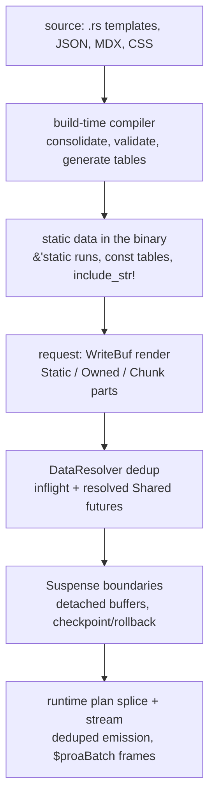

# 26 -- Cross-Cutting: The Idioms, the Gaps, and Building It from Scratch

Everything in Proa reduces to one move, repeated at every layer: do the expensive, fallible work where the
compiler lives, and leave the serving binary holding static data and infallible writes. That move shows
up as `#![no_std]` URL filters, `&'static`-only data models, `const fn` JSON serializers, build-generated
lookup tables, and a `WriteBuf` that can hand back a `&'static [u8]` without copying. This final document
collects the Rust idioms that make the move possible, names what a production-grade version would still
need to add, and reconstructs the design of a resilient, zero-copy "storage" system from first
principles — because a renderer is, at bottom, a storage system for bytes that happen to be HTML.

# Part 1 -- The Rust Idioms

**Compile-time everything.** The workspace is `edition 2021` with `#![deny(unsafe_code)]`, and the
security-sensitive crates go further: `proa_html_policy` is `#![no_std]` *and* `#![forbid(unsafe_code)]`,
so its single `#[inline] pub fn has_dangerous_url_scheme` cannot allocate and cannot hide an unsafe
escape. `proa_const_json` and `proa_tailwind_merge`'s `compile_time` module make their entire serializers
`const fn`, running with no heap and no allocator:

```rust
// const_json/src/ser.rs (shape, abbreviated)
pub const fn write_unsigned<const N: usize>(buf: &mut JsonBuffer<N>, value: u128);
// ...and write_signed, write_string, write_bool, write_key, begin/end_object
```

`proa_react` even builds its CDN URLs at compile time with `const` concatenation, so the exact
`https://esm.sh/react@19.0.0?ts=…` string exists before the binary runs.

**`&'static`-only data models.** `proa_docs` owns no `String`, `Vec`, or `Box` anywhere: `Docs`,
`DocPage`, and `NavItem` are `&'static` references and `Copy` structs, with article HTML, source
Markdown, and search JSON all `include_str!`ed by a build-time compiler. The runtime crate is a thin,
infallible renderer over data the compiler already made correct. The same discipline appears in the
fonts pipeline (metrics vendored at build time) and in `proa_showcase`'s `srp_chrome_real.rs`, which
serializes a captured 699 KB eBay page as `CHUNK_0..CHUNK_8` static strings with typed dynamic slots.

**Build-generated tables.** `proa_tailwind_merge`'s `build.rs` expands an 11,125-line JSON config into
`OUT_DIR/generated_data.rs` — 350 group-id constants, 930 literal entries, 768 prefix validators, 48
conflict sets — so `tw_merge_const` does a binary search over sorted `CLASS_ENTRIES` instead of walking
a runtime trie. `proa_marketing`'s `build.rs` stamps an FNV-1a hash of eight public assets into a
`?v=` query string. The rule is uniform: a JSON/DSL file is the source of truth, and Rust code is its
compiled form.

**Zero-copy buffers as the ABI.** The `WriteBuf` hierarchy is the storage layer: a `RenderBuffer` is a
`ChainedBumpWriter<4096>` for fast owned growth, a `WriteCursor` writes into a caller-owned slice and
returns `-1` on overflow, and a `ZeroCopyBuf` holds static/owned/chunk parts so a static run is
referenced by pointer, not copied. `extend_static` keeps a `&'static [u8]` zero-copy, and
`ZeroCopyBuf::extend_static` inlines statics up to 256 bytes. The FFI surface leans on the same idea:

```rust
// proa_demo/src/lib.rs (shape, abbreviated)
let boxed = html.into_bytes().into_boxed_slice();   // len == capacity
let len = boxed.len();
let ptr = Box::into_raw(boxed) as *mut u8;
// caller frees via proa_free(ptr, len) -> drop(Box::from_raw(...))
```

`into_boxed_slice` guarantees `len == capacity`, which is what makes cross-language deallocation safe
without a length mismatch.

**Unsafe confined to a named seam.** Where `unsafe` does appear, it is a single audited line with a
reason: `JsonBuffer::as_str` uses `unsafe from_raw_parts` over a buffer only `const fn`s have written;
`slice::from_raw_parts` appears in `ConstMergeResult::as_slice` over a fixed-size array; `Box::into_raw`
pairs with `proa_free`. The rest of the tree is safe Rust, and the security surface is documented with
its CVE lineage (`proa_html_policy` cites CVE-2026-39315, React v16.9 facebook/react#16382, OWASP Rule
#7, WHATWG URL §4.3).

# Part 2 -- What a Production-Grade Version Adds

The codebase already names its own gaps, which is itself a production signal. The benchmark harness is
an **honesty contract**: `proa_demo/bench/RESULTS.md` refuses to publish numbers until fixture revision,
output byte counts, machine/runtime versions, and raw samples are recorded, and warns against comparing
render-time, loopback, browser-script, and wire-size measurements across categories. The security passes
carry explicit "CVE review gap" markers (Gap O: URL-position attribute classification; Gap E: foreign
content) that point at what a hardening pass must still close. `proa_const_json`'s `ParseError` ships a
`UnsupportedValue` variant that is not yet constructed, and the crate is consumed by no other member —
it is infrastructure staged for a future where JSON is baked into the binary rather than parsed at
request time. The pizza example's `WebMcp` module is a deliberately local prototype, not framework API,
experimenting with two composition rules before either is promoted. Progressive enhancement is treated
as a requirement, not a fallback: the quantity-stepper demo renders an `<input type="hidden"
name="qty">` so its POST works with JavaScript disabled, and its test asserts exactly that.

The production gaps a hypothetical 1.0 would close: a formal threat model for the remaining "CVE review
gap" seams, fuzzing of the URL-scheme and ARIA validators, a published benchmark run under the honesty
contract, promotion or removal of the staged `const_json`/`WebMcp` prototypes, and SLO instrumentation on
the streaming drivers (boundary timeouts, page-pool reuse, and `$proaBatch` replay under slow networks).

# Part 3 -- Building a Resilient Storage System from First Principles

Strip the "web framework" framing and Proa is a storage system with an unusual read path: bytes are
authored as source, compiled into static runs and tables, deduplicated per request, and streamed as
detached fragments that a client reassembles. The design rules generalize:

1. **Separate the compiler from the runtime.** Anything that can fail, parse, validate, or highlight runs
   once at build time and emits data the runtime only reads. `proa_docs_build` is ~8,100 lines of heavy
   work; `proa_docs` is ~1,900 lines that hold `&'static` slices and write them out.
2. **Bake, don't parse.** `include_str!`, `include_docs!`, `include_css!`, and build-generated tables
   turn JSON/MDX/CSS into Rust literals, so the request path never touches a file or a parser.
3. **Give buffers an ownership lattice.** Static (pointer), owned (contiguous), and chunk (scatter) parts
   let the hot path choose the cheapest representation per run instead of one `Vec` for everything.
4. **Deduplicate at the request scope.** The `DataResolver`'s `inflight`/`resolved` maps of
   `Shared<BoxFuture>` make seven panes one upstream call, while cross-request `OnceLock`/TTL caches (the
   eBay listing cache, the atlas's 60 s non-degraded dossier cache) amortize across requests — and
   degraded results are deliberately never cached.
5. **Make speculative work revocable.** Streaming boundaries render into detached buffers with a
   checkpoint/rollback for render artifacts; `prune_rolled_back` + `snapshot` keep cancelled or
   timed-out islands off the wire.
6. **Dedup emission, not just computation.** `PageRuntimeEmissionState` tracks which runtime/preload/
   island URLs are already emitted so a shell and its boundaries never double-write a script.



The resilience comes from the invariants, not the algorithms: every byte on the wire is either a
compile-time-escaped static run or an explicitly typed dynamic write; every data read is keyed and
deduplicated; every speculative fragment is revocable until it is flushed; and every number in the
benchmark is reproducible against a pinned competitor. A storage system built this way does not need a
clever cache layer — it needs a compiler that does the work once and a runtime that only ever reads.

# The Aha Moment

**Aha:** The most surprising thing Proa does is not render fast — it is that the "database" is the
binary. The docs site, the Tailwind config, the fonts, and the showcase chrome are all sources compiled
into Rust literals and embedded via `include_str!`/generated tables, so the request path has no parser,
no file I/O, and no cache invalidation to reason about. The runtime "storage engine" is a `WriteBuf` with
an ownership lattice and a `DataResolver` that collapses concurrent reads — and the discipline of
`#![deny(unsafe_code)]` with named `unsafe` seams means the parts that must touch raw pointers are few
enough to audit by hand. What looks like a framework is really a small, honest storage system whose read
path was moved into the compiler.

# Cross-References

- The render-trait and buffer primitives the idioms build on:
  [02-render-traits.md](./02-render-traits.md) and [04-write-buf.md](./04-write-buf.md).
- The compile-time pipeline: the HTML macros, build tooling, fonts, and docs:
  [07-html-macros.md](./07-html-macros.md), [15-build-tooling.md](./15-build-tooling.md),
  [21-fonts.md](./21-fonts.md), and [22-docs.md](./22-docs.md).
- The streaming and data-loading resilience mechanisms:
  [09-data-loading.md](./09-data-loading.md) and [10-streaming.md](./10-streaming.md).
- The supporting crates that carry the `const`-fn and zero-copy patterns:
  [23-supporting-crates.md](./23-supporting-crates.md).
- The end-to-end trace that ties it together: [25-data-flow.md](./25-data-flow.md).

Continue to [README.md](./README.md).
