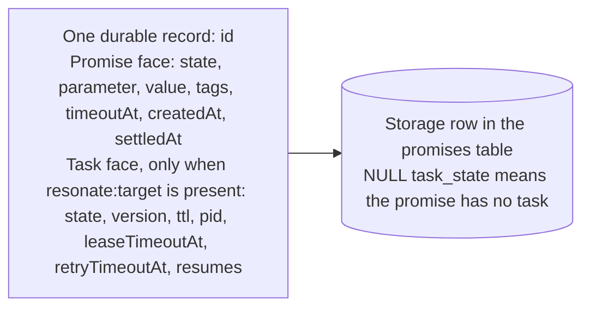
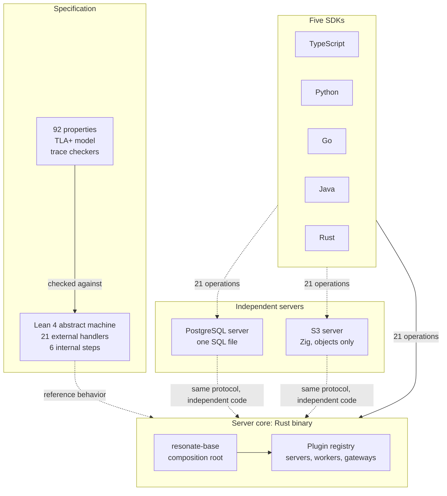
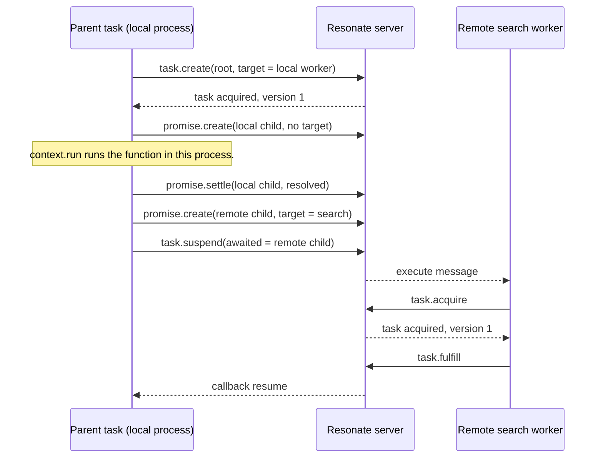
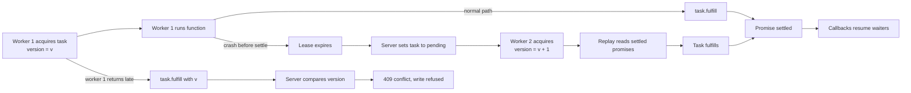
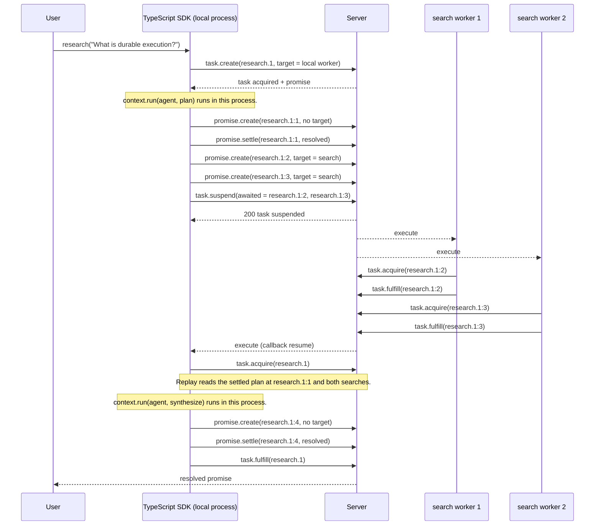

# Overview: durable execution built on durable promises and durable tasks

Resonate is a durable execution platform. *Durable execution* means a program keeps its progress across a process crash, a network partition, and a machine restart. Its thesis is one sentence long: a function call should survive those failures, and the caller should not write a state machine to make that true. The platform achieves this with two primitives. The first is the *durable promise*. The second is the *durable task*. A *schedule* is a third primitive, but a schedule produces promises. It does not add a new record type.

Source: `README.md:15-16`, `spec/spec/02-abstract/state.lean:28-38`

This document explains the thesis, the two primitives, the one-row model that joins them, the component map, and the two terms that the project uses to describe the result: location transparent and failure transparent. It ends with one worked example, the research agent. The later documents take each part apart.

## Terms used in this document

The protocol and the model use a small vocabulary. This table defines each term before the text uses it.

| Term | Meaning |
|------|---------|
| Durable promise | A named record with a state, a parameter, a value, a set of tags, and a deadline |
| Durable task | The executable face of a promise. It exists only when the promise is runnable. |
| Schedule | A recurring source of promises. It stores a cron expression and a promise template. |
| Settle | To move a promise from `pending` to `resolved`, `rejected`, `rejected_canceled`, or `rejected_timedout` |
| Runnable | The promise carries `resonate:target`, so it has a task |
| Awaitable | Another task may wait on the promise. It carries `resonate:target`, `resonate:timer`, `resonate:scope = global`, or `resonate:external = true`. |
| Tag | A string key and a string value stored with the promise. Tags carry the semantics. |
| Origin | The part of an identifier before the first colon. `a:1.2` has origin `a`. |
| Version | A counter on the task. It increases on each acquire. A write must present the current value. |
| Lease | A time-bounded right to execute a task. It has a time to live, a process identifier, and an expiry time. |
| Replay | Re-execution of a function from its start. Settled promises return their stored values, so finished work is not repeated. |
| Abstract machine | The executable Lean 4 model in `spec/`. It is the reference behavior. |
| Envelope | The outer JavaScript Object Notation (JSON) object that carries `kind`, `head`, and `data` |
| Execute message | An outbound message that tells a worker that a task may be acquired |
| Unblock message | An outbound message that tells a registered listener that a promise settled |
| Callback | A stored record that ties an awaiting task to an awaited promise |
| Listener | A stored address that receives an unblock message when a promise settles |

The abbreviations in this document are: Software Development Kit (SDK), Amazon Simple Storage Service (S3), Hypertext Transfer Protocol (HTTP), Hypertext Transfer Protocol Secure (HTTPS), Structured Query Language (SQL), Temporal Logic of Actions (TLA+), Remote Procedure Call (RPC), time to live (TTL), and process identifier (`pid`). Google Cloud Pub/Sub appears as `gcps` in an address scheme.

Source: `spec/spec/01-protocol/types.lean:19-61`, `spec/spec/02-abstract/state.lean:74-159`, `impl/server/core/crates/resonate-core/src/types.rs:11-20`

## The problem with an ordinary Promise

An ordinary `Promise` in JavaScript is a placeholder for a value that will arrive later. It has three states: pending, fulfilled, and rejected. It lives in the memory of one process. If that process exits, the `Promise` exits with it. The code that was waiting on it has no record to resume from.

A durable promise has a similar shape, but it lives in storage. It is a named record. The state is one of `pending`, `resolved`, `rejected`, `rejected_canceled`, or `rejected_timedout`. The parameter is the input. The value is the result. The deadline is the time at which the server settles a pending promise if nobody else has settled it. A promise with a `resonate:timer` tag is resolved at the deadline. A promise without that tag is rejected as `rejected_timedout`.

Source: `spec/spec/01-protocol/types.lean:19-40`, `impl/server/core/crates/resonate-core/src/types.rs:11-20`, `impl/server/core/crates/resonate-core/src/types.rs:240-253`

| Property | In-memory `Promise` | Durable promise |
|----------|---------------------|-----------------|
| Owner | One process | The server and its storage |
| Lifetime | Until the process exits | Until the record is deleted. A resolved promise remains. |
| States | pending, fulfilled, rejected | pending, resolved, rejected, rejected_canceled, rejected_timedout |
| Input | Captured by a closure | Stored in the parameter field |
| Result | Held in memory | Stored in the value field |
| Named | No | Yes, by an identifier |
| Waiters | In-process callbacks | Stored callbacks and stored listeners |
| Recovery | None | The next server or worker reads the record |

Source: `spec/spec/01-protocol/types.lean:19-40`, `spec/spec/02-abstract/state.lean:74-84`

The two rejected states have different causes. `rejected_canceled` records an explicit cancellation. `rejected_timedout` records an expired deadline on a promise that is not a timer. The distinction matters because a retry policy may treat a timeout as retryable and a cancellation as final.

Source: `spec/spec/01-protocol/types.lean:19-25`, `spec/spec/02-abstract/state.lean:317-330`

The difference from an in-memory `Promise` is not only persistence. The durable promise has a *name*. Two processes that never share memory can agree on that name. That agreement is what makes a remote call possible without a message queue.

## The task half

A promise stores a result. It does not run code. The executable half is the *task*. A task is not a separate record in the abstract machine. It is a second face of the same record. The machine's `Object` type holds one identifier, one promise, and an optional task.

```lean
structure Object where
  id      : Ident
  promise : PromiseObject
  task    : Option TaskObject := none
```

Source: `spec/spec/02-abstract/state.lean:155-159`

A task exists exactly when the promise carries a `resonate:target` tag. The tag names an address. The address has a scheme, such as `http`, `https`, `poll`, `gcps`, or `bash`. Each worker plugin registers the schemes it serves. The router keeps a map from scheme to worker, so the scheme selects the worker. A promise without that tag is not runnable. It is a placeholder that another process, such as a client or a parent task, will settle.

Source: `spec/spec/01-protocol/validation.lean:24-32`, `impl/server/core/crates/resonate-core/src/types.rs:624-642`, `impl/server/core/crates/resonate-core/src/address.rs:21-33`, `impl/server/core/crates/resonate-base/src/router.rs:43-99`

The task has five states.

| Task state | Meaning |
|------------|---------|
| `pending` | Ready to be acquired |
| `acquired` | A worker holds a lease and may execute |
| `suspended` | The worker is waiting on one or more promises |
| `halted` | The task is stopped and is not dispatched |
| `fulfilled` | The task is complete. The promise is settled. |

A worker acquires a pending task with a lease. The lease is a time limit. The acquisition also increments the task version. The worker can then run the function, suspend while it waits for other promises, and finally fulfill the promise. If the worker dies, the lease expires and the task returns to `pending`, where another worker can acquire it. The version fence prevents the dead worker from settling the promise after a new worker has taken the task.

Source: `spec/spec/01-protocol/types.lean:27-49`, `spec/spec/02-abstract/external.lean:176-197`, `spec/spec/02-abstract/internal.lean:64-77`

The task also has two timing fields. `retryTimeoutAt` is the time at which the retry step should dispatch the task again. `resumes` is the list of awaited identifiers that settled while the task was not suspended. The wire protocol exposes the length of `resumes` as a number. Document [03-durable-promises-and-tasks.md](03-durable-promises-and-tasks.md) gives the full rules.

Source: `spec/spec/02-abstract/internal.lean:25-40`, `impl/server/core/crates/resonate-core/src/types.rs:277-288`

The word *durable task* therefore means two things at once. It means the task record survives a crash. It also means the right to execute the task is a bounded lease, not a permanent claim.

## The schedule

A schedule is a recurring source of promises. It stores a cron expression, a promise identifier template, a promise timeout, a promise parameter, promise tags, a next run time, a last run time, and a creation time.

| Field | Meaning |
|-------|---------|
| `id` | Schedule identifier |
| `cron` | Cron expression |
| `promiseId` | Identifier template for each fired promise |
| `promiseTimeout` | Timeout for each fired promise |
| `promiseParam` | Parameter for each fired promise |
| `promiseTags` | Tags for each fired promise |
| `nextRunAt` | Next due time |
| `lastRunAt` | Last fired time |
| `createdAt` | Creation time |

Source: `spec/spec/01-protocol/types.lean:51-61`, `impl/server/core/crates/resonate-core/src/types.rs:290-308`

The server fires a schedule in one internal step on its internal loop. It computes every occurrence between `nextRunAt` and `now`. For each occurrence, it calls `createIfAbsent` with an expanded identifier and a timeout of `t + promiseTimeout`. `createIfAbsent` is idempotent: if the identifier already exists, it returns the existing promise and does not create a second one. The step then advances `nextRunAt` and `lastRunAt`. Document [11-schedules-timers-and-time.md](11-schedules-timers-and-time.md) covers the cron dialect and the missed-run policy.

```lean
def fireOccurrence (s : Schedule) (t : Nat) : H Unit :=
  createIfAbsent
    { id := expand s.promiseId s.id t, timeoutAt := t + s.promiseTimeout,
      param := s.promiseParam, tags := s.promiseTags } t
```

In this fragment, `H` is the state monad of the abstract machine, `Nat` is a natural number, and `t` is the current time in milliseconds. The fragment shows one occurrence. The loop that calls it is in the same file.

Source: `spec/spec/02-abstract/internal.lean:119-140`

A schedule therefore does not run code. It creates promises. Each promise can carry a target, so each firing can become a task. A one-off timer is a different mechanism: it is a single promise with a deadline and a `resonate:timer` tag. The same promise machinery handles both a one-off timer and a recurring job.

Source: `spec/spec/01-protocol/validation.lean:11-12`, `spec/spec/02-abstract/internal.lean:119-140`

## The one-row model

The most important structural decision is that a promise and its task are one row. The abstract machine states the reason in its header comment. The model first used two separate lists, one for promises and one for tasks. That design made every task read return an optional pair. Eleven handlers had to dismiss the impossible case where a task existed without its promise. Fusing the row deletes that case, and it makes the promise and task joins into predicates on one record.

Source: `spec/spec/02-abstract/state.lean:28-45`



Source: `spec/spec/02-abstract/state.lean:28-45`, `impl/server/core/crates/resonate-server-sqlite/migrations/0001_initial.sql:46-57`

The shipped SQLite schema confirms the model. The `promises` table holds the task columns directly. A comment marks the block as the former `tasks` table. The `task_state` column is the task state. A `NULL` value in `task_state` means the promise has no task. PostgreSQL does the same. Its comment records the rule that a `NULL task_state` is equivalent to the promise not carrying a `resonate:target` tag. That equivalence is a schema convention, not a database constraint: the server writes the task columns only when the tag is present.

Source: `impl/server/core/crates/resonate-server-sqlite/migrations/0001_initial.sql:46-57`, `impl/server/core/crates/resonate-server-postgres/migrations/0001_initial.sql:94-105`

The one-row model has a second consequence. A promise and its task share one identifier. A request that names a task names the same identifier as the promise it settles. There is no join key to get wrong and no orphan task table to clean up. The task columns remain on the row when the task is fulfilled, because they record how the promise was settled.

## The component map

The repository is specification first and implementation second. Four groups matter for the overview: the specification, the Rust server core, the independent server implementations, and the five SDKs.



Source: `README.md:69-84`, `spec/README.md:5-10`

| Component | Path | What it is |
|-----------|------|------------|
| Specification | `spec/` | An executable abstract machine in Lean 4, a catalogue of 92 properties, a TLA+ model, and Go trace checkers |
| Server core | `impl/server/core/` | A Rust single binary built from a plugin registry |
| PostgreSQL server | `impl/server/postgres/` | The whole server as one SQL file on PostgreSQL 16 or later |
| S3 server | `impl/server/s3/` | A Zig server whose only durable state is objects in an S3 bucket |
| TypeScript SDK | `impl/sdk/ts/` | Two execution engines: a generator engine and an async engine |
| Python SDK | `impl/sdk/py/` | A protocol client |
| Go SDK | `impl/sdk/go/` | A protocol client |
| Java SDK | `impl/sdk/java/` | A protocol client |
| Rust SDK | `impl/sdk/rs/` | A protocol client |

Source: `README.md:69-84`, `spec/README.md:5-10`

The PostgreSQL server and the S3 server are independent implementations. They are not plugins of the Rust core. All three servers answer the same 21 operations. The five SDKs are separate implementations that share the protocol. Document [02-the-protocol.md](02-the-protocol.md) lists every operation.

The 92 properties are statements about runs of the abstract machine. The TLA+ model restates the same rules in a second formalism. The Go trace checkers replay a server's recorded traffic and ask whether the machine can explain it. The machine's 21 external handlers accept the same 21 request kinds that the wire protocol defines.

Source: `spec/spec/02-abstract/system.lean:38-59`, `spec/spec/02-abstract/system.lean:123-145`, `README.md:69-79`

## How a task reaches a worker

A promise with a target is runnable. When a runnable task is ready, the server emits an `execute` message. The worker transport delivers it. An HTTP push worker receives a POST request. A poll worker asks for work and receives the message in the reply. A Google Cloud Pub/Sub worker receives the message through a topic. A bash worker runs a local command.

Delivery does not mean execution. The message only says that a task may be acquired. The worker must still send `task.acquire`, receive the lease and the version, and only then run the function. The router selects the worker by the address scheme. The address is stable while the worker moves, because the worker plugin registers the scheme, not one host.

Source: `impl/server/core/crates/resonate-base/src/router.rs:43-99`, `impl/server/core/crates/resonate-core/src/worker.rs:8-18`, `impl/server/core/crates/resonate-core/src/address.rs:21-33`

## Location transparent

*Location transparent* means the same program does not need to know where a function runs. A call to a local function and a call to a function on another machine have the same shape.

The TypeScript async engine shows the difference. `context.run` creates a local child promise with no target, runs the function in the same process, and settles the promise with the result. `context.rpc` creates a global promise with a target and waits for a worker to acquire it. Both return a handle. Both are awaited in the same way. The call site does not branch on the location.

Source: `impl/sdk/ts/src/async/context.ts:326-430`, `impl/sdk/ts/src/async/context.ts:522-545`



Source: `impl/sdk/ts/src/async/resonate.ts:240-351`, `impl/sdk/ts/src/async/context.ts:326-430`, `impl/server/core/crates/resonate-core/src/types.rs:183-228`

The root is runnable because it has a target. The local child has no target, so it has no task; the same process settles it. The remote child has a target, so it has a task. The key is that the local path is not a shortcut. A local child still creates a durable promise. The result is still persisted. The only difference is whether the promise has a task, and which process acquires it. That is why a worker can be moved, restarted, or replaced without changing the caller.

Source: `impl/sdk/ts/src/async/context.ts:326-430`, `spec/spec/01-protocol/validation.lean:24-32`

## Failure transparent

*Failure transparent* means a failure does not change the program's logic. A crash is a pause. The program does not need a separate recovery path.

Three mechanisms produce that property. First, every state change is stored before it is acted on. The store applies an acquire as a conditional update, so two workers cannot both take the same pending task. Second, the task lease bounds the claim. If a worker dies, the lease expires, and the task returns to `pending`. Third, callbacks record who waits on what. A callback is stored with the awaiting task and the awaited promise. When the awaited promise settles, the server removes the callback and resumes the task.

Source: `spec/spec/02-abstract/state.lean:8-15`, `spec/spec/02-abstract/internal.lean:25-77`, `impl/server/core/crates/resonate-server-sqlite/src/lib.rs:1023-1142`



Source: `spec/spec/02-abstract/internal.lean:64-77`, `spec/spec/02-abstract/internal.lean:42-51`, `impl/server/core/crates/resonate-server-sqlite/src/lib.rs:1023-1142`

The version fence is essential. A worker that lost its lease still has the old version. When it tries to settle, the server compares the version and refuses the request with status 409. The stale worker discards its result. The new worker's result stands. The same comparison protects the lease, the suspend, and the release operations.

Source: `spec/spec/02-abstract/external.lean:307-327`, `impl/server/core/crates/resonate-server-sqlite/src/lib.rs:1209-1295`

## Worked example: the research agent

The repository uses one example throughout. A research agent accepts a question. It plans searches, fans them out, and synthesizes the results. The whole orchestration is a few lines. `agent` and `search` are function references. The SDK registers them as workers, and the server addresses them by name.

```typescript
async function research(context: Context, question: string): Promise<string> {
  const queries: string[] = await context.run(agent,
    `Plan the searches for: ${question}`
  );
  const results = await Promise.allSettled(
    queries.map((q: string) => context.rpc(search, q))
  );
  return await context.run(agent,
    `Write a cited report. ${question}: ${results}`
  );
}
```

Source: `README.md:26-43`, `impl/server/core/README.md:24-52`



Source: `impl/sdk/ts/src/async/context.ts:326-430`, `impl/sdk/ts/src/async/context.ts:567-580`, `impl/sdk/ts/src/async/core.ts:265-315`

The SDK turns one `context.rpc` call into two messages: `promise.create` with a target, then part of one `task.suspend`. When several promises are awaited at once, the SDK collects their identifiers and sends one suspend with the whole list. That is why the diagram shows one suspend for two searches.

The timeline shows the two halves. The plan and the synthesis are `context.run` calls. They persist their results. The searches are `context.rpc` calls. They create global promises with a target and suspend the task. The suspend returns 200 when every awaited promise is still pending. The server then sends a callback resume after the searches settle. A 300 on the suspend reply is the other case: at least one awaited promise was already settled, so the task did not stay suspended. Document [02-the-protocol.md](02-the-protocol.md) gives that rule.

If the local process dies after the plan, the next process replays the root. It calls `context.run(agent, plan)` again. The SDK creates `research.1:1` with `createIfAbsent`, receives the settled promise, and returns its stored value. The model is not called a second time. The replay then reads `research.1:2` and `research.1:3`, which are also settled, and continues to synthesis. That is the cost saving that the README calls out: "you never pay for the same tokens twice."

Source: `impl/server/core/README.md:44-52`, `impl/sdk/ts/src/async/context.ts:326-401`

If a search dies, its lease expires. The server sets the task to `pending`. A worker acquires it again and the search runs again. The caller's `Promise.allSettled` still receives a result for every branch. The program text did not change. If the plan or the synthesis dies, the root task is retried the same way, and replay skips every promise that already settled.

Source: `spec/spec/02-abstract/internal.lean:64-77`, `impl/server/core/crates/resonate-server-sqlite/src/lib.rs:1023-1142`

## What durability costs

Durability is not free. The system pays for it in four places.

| Cost | Why |
|------|-----|
| A storage write per state change | The promise, the task, and the callback must be stored before they are used. The outbound message is re-derived from the stored retry deadline. |
| An identifier discipline | Child identifiers extend the origin. The server validates the prefix rules. |
| A version on every task mutation | A stale worker must be refused |
| A deadline on every pending promise | A forgotten promise must settle itself |

Source: `impl/server/core/crates/resonate-core/src/types.rs:333-400`, `spec/spec/02-abstract/state.lean:204-231`

The design accepts those costs because they replace larger ones. There is no separate queue to operate, no workflow definition table, and no scheduler process. A schedule is an internal step in the same server, not a separate service. The storage engine is the queue.

## Aha: the task is the promise, seen from the worker's side

The mental model that unlocks the whole system is this. A promise and a task are not two objects that reference each other. They are one object with two views. The promise view answers "what is the result?" The task view answers "who may produce it, and until when?" The storage schema puts both views in one row.

Source: `spec/spec/02-abstract/state.lean:28-45`, `impl/server/core/crates/resonate-server-sqlite/migrations/0001_initial.sql:46-57`

That is why there is no task identifier separate from the promise identifier. It is why a task request can settle the promise directly. It is also why the resume logic can read the task and the promise in one lookup. The one-row model is not a storage optimization. It is the reason the state machine has no impossible states to reason about.

## Related documents

- [01-architecture.md](01-architecture.md) — the three ports and the plugin registry.
- [02-the-protocol.md](02-the-protocol.md) — the 21 operations and the envelope.
- [03-durable-promises-and-tasks.md](03-durable-promises-and-tasks.md) — the promise and task state machines in detail.
- [11-schedules-timers-and-time.md](11-schedules-timers-and-time.md) — cron, timers, leases, and retry deadlines.
- [14-patterns.md](14-patterns.md) — the same primitives applied to sagas and fan-out.
- [17-glossary.md](17-glossary.md) — every term and abbreviation.
