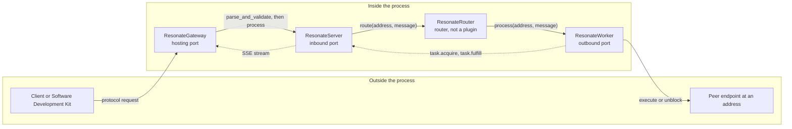
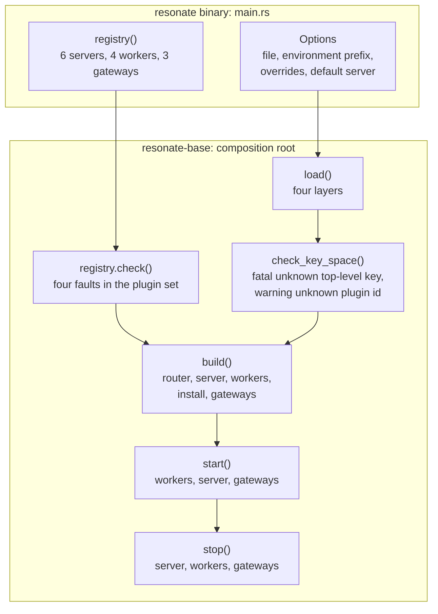
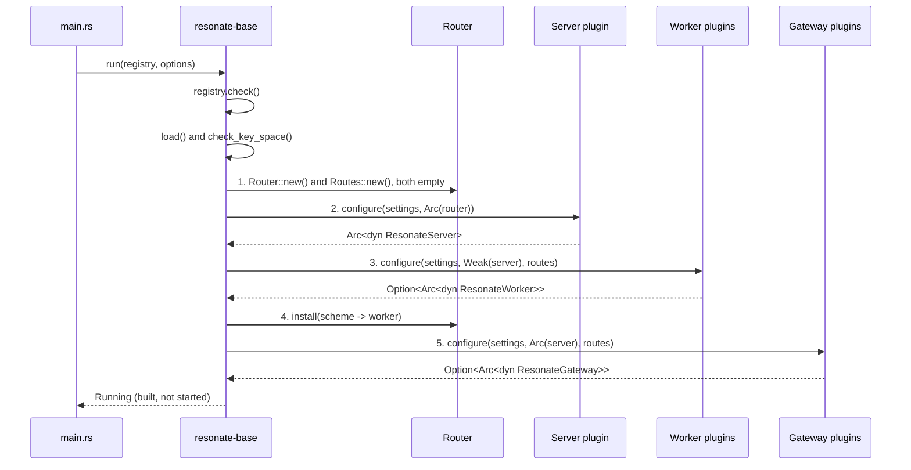
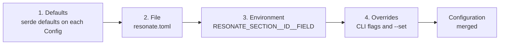

# Architecture: four ports, one registry, one composition root

A Resonate server is built from three kinds of plugin. A *server* answers protocol requests. A *worker* delivers messages to the far end of an address. A *gateway* accepts requests from the outside. Every plugin is a descriptor in a registry. The composition root turns the registry into a running process.

The design has one sentence: the composition root names no plugin, and the binary names every plugin. That split is what lets a custom build carry four plugins instead of four hundred.

Source: `impl/server/core/crates/resonate-base/src/lib.rs:1-11`, `impl/server/core/src/main.rs:63-83`

## Terms used in this document

The abbreviations in this document are: command-line interface (CLI), Tom's Obvious, Minimal Language (TOML), Hypertext Transfer Protocol (HTTP), Hypertext Transfer Protocol Secure (HTTPS), Server-Sent Events (SSE), JavaScript Object Notation (JSON), Google Cloud Pub/Sub (GCP), Uniform Resource Identifier (URI), and Software Development Kit (SDK). Status 503 is Service Unavailable. Status 500 is Internal Server Error.

| Term | Meaning |
|------|---------|
| Plugin | A static descriptor with an identifier, a `configure` function, and metadata. It is not a trait object. |
| Port | A trait that a plugin implements. This document uses *port* only for the trait. A network port is called a *socket*. |
| Router | The routing port. One object that maps an address scheme to a worker. It is a trait, but it is not a plugin. |
| Descriptor registry | The static list of plugins passed to `build`. |
| Built set | The plugins that `configure` returned, stored in the running process. |
| Composition root | `resonate-base`, the crate that loads configuration, builds, starts, and stops the plugins. |
| Envelope | The outer JSON object with `kind`, `head`, and `data`. |
| Address scheme | The part before `://`, such as `http` or `poll`. |
| Transport | A worker plugin that moves messages to or from a remote endpoint. |
| Proxy worker | A worker that hands a message to a remote endpoint and returns. It does not run the work itself. |
| Route table | A shared table of HTTP routes. Plugins add routes; the gateway with a listener merges them. |
| `Running` | The value returned by `build`: every plugin is built and started. |
| Sweep | The server's periodic loop that fires timers, expires leases, and retries tasks. |
| Seeded timer | A timer that `init` creates before any request arrives. |
| Drain | Stop accepting new work and finish the work already in flight. |
| `Arc` | A Rust reference-counted pointer that keeps a value alive. |
| `Weak` | A Rust pointer that does not keep a value alive. It must be upgraded to an `Arc` before use. |
| `Unavailable` | The error type that means "there is no answer". A caller may retry. |

Source: `impl/server/core/crates/resonate-core/src/server.rs:1-38`, `impl/server/core/crates/resonate-core/src/gateway.rs:1-33`, `impl/server/core/crates/resonate-plugin/src/plugin.rs:53-247`

## The four ports

A port is a trait that the composition root or another plugin uses to talk to a plugin. There are four ports: server, worker, gateway, and router. The router is a trait, but it is not a plugin: it is one object, and nothing about it varies per deployment.

| Interface | Trait | Direction | What it does |
|-----------|-------|-----------|--------------|
| Inbound port | `ResonateServer` | Request in, response out | Applies one protocol request |
| Outbound port | `ResonateWorker` | Message out | Delivers one message to an address |
| Hosting port | `ResonateGateway` | Requests in | Accepts requests from a transport |
| Router | `ResonateRouter` | Address in, worker out | Selects a worker by address scheme. Not a plugin. |

Source: `impl/server/core/crates/resonate-core/src/server.rs:1-8`, `impl/server/core/crates/resonate-core/src/worker.rs:1-13`, `impl/server/core/crates/resonate-core/src/gateway.rs:1-9`, `impl/server/core/crates/resonate-core/src/router.rs:1-13`



Source: `impl/server/core/crates/resonate-core/src/gateway.rs:8-9`, `impl/server/core/crates/resonate-core/src/router.rs:8-13`, `impl/server/core/crates/resonate-core/src/server.rs:89-94`, `impl/server/core/crates/resonate-core/src/worker.rs:66-76`

The gateway is the trust boundary. It applies `parse_and_validate` before it calls `process`. The dashed callback edge is how a proxy worker does real work: it receives a message, returns, and later sends protocol requests back to the server. The other dashed edge is a long-lived SSE response, which is why the gateway stops last.

## The inbound port: `ResonateServer`

The inbound port has four methods. `init`, `stop`, and `ready` have default bodies. `process` does not, because every server must answer a request.

```rust
#[async_trait]
pub trait ResonateServer: Send + Sync {
    async fn init(&self, debug: bool) -> Result<(), Unavailable> { ... }
    async fn stop(&self) -> Result<(), Unavailable> { ... }
    async fn ready(&self) -> bool { true }
    async fn process(&self, req: &RequestEnvelope)
        -> Result<ResponseEnvelope, Unavailable>;
}
```

Source: `impl/server/core/crates/resonate-core/src/server.rs:39-95`

Three properties matter.

1. **`init` acquires resources.** A connection pool, a schema, a session, or a seeded timer belongs in `init`, not in construction. A failure to start is a startup error. It is not a request answered wrongly later.
2. **`process` returns a response for every well-formed request.** A non-success status such as 404 or 409 is still `Ok`. The `Err` case is reserved for "there is no answer". A caller then knows that a retry is meaningful.
3. **Envelope validation happens before `process`.** The gateway applies `parse_and_validate`. A message that does not parse, has no `kind`, has no object `data`, or names an unsupported version is answered at the edge. It never arrives at the trait.

Source: `impl/server/core/crates/resonate-core/src/server.rs:41-57`, `impl/server/core/crates/resonate-core/src/server.rs:89-94`, `impl/server/core/crates/resonate-core/src/server.rs:24-34`

The trust boundary is therefore the gateway, not the server. Inside the boundary, envelopes are built in code, not parsed. A remote client's HTTP request is parsed at the gateway. An in-process worker that builds an envelope with an empty `kind` is a plugin bug, not untrusted input. That is the sense in which the server port has no way to report a malformed envelope.

## The outbound port: `ResonateWorker`

The worker is the dual of the server. A server receives requests and returns responses. A worker receives messages and delivers them.

```rust
async fn process(&self, address: &str, msg: &Message) -> Result<(), Unavailable>;
```

Source: `impl/server/core/crates/resonate-core/src/worker.rs:66-76`

The word `process` has a narrow meaning here. It means **accepted for delivery**. It does not mean **executed**. Most workers are proxies. HTTP push, poll with Server-Sent Events (SSE), and Google Cloud Pub/Sub each hand the message off and return. One worker, `bash`, runs the work in process. That is a special case, not the contract.

Source: `impl/server/core/crates/resonate-core/src/worker.rs:8-18`

The worker trait also has `init` and `stop`, both with default bodies. `init` is where a worker opens its connection pool, starts its delivery queue, and starts the dispatcher task that drains it. The delivery queue is the worker's own buffer between `process` returning and the remote send. `stop` drains that queue.

Source: `impl/server/core/crates/resonate-core/src/worker.rs:39-64`

A worker declares the address schemes that it claims. A plugin can claim several schemes. In the shipped binary, the HTTP push worker claims `http` and `https`, the poll worker claims `poll`, the Google Cloud Pub/Sub worker claims `gcps`, and the bash worker claims `bash`. A worker that returns `None` from `configure` is disabled and logged.

Source: `impl/server/core/crates/resonate-plugin/src/plugin.rs:144-165`, `impl/server/core/src/main.rs:76-79`

## The hosting port: `ResonateGateway`

The gateway is thinner than the worker. A worker is called with each message, so it has a natural `process`. A gateway is driven by its own transport, so the framework has nothing to invoke per request. What is left is lifecycle: `init` and `stop`.

```rust
#[async_trait]
pub trait ResonateGateway: Send + Sync {
    async fn init(&self, debug: bool) -> Result<(), Unavailable> { ... }
    async fn stop(&self) -> Result<(), Unavailable> { ... }
}
```

Source: `impl/server/core/crates/resonate-core/src/gateway.rs:62-86`

A gateway that owns a listener binds its socket in `init`, not in construction. Binding can fail. Serving is a background task. Both belong in `init`, so a failure to listen is a startup failure.

Source: `impl/server/core/crates/resonate-core/src/gateway.rs:64-74`

Not every gateway binds a socket. Every plugin that serves HTTP puts its routes in the shared route table. A gateway that owns a listener merges that table into its own router. The web console only contributes routes. In the shipped binary, the HTTP gateway and the metrics gateway each own a listener; the web console does not. This is why the build step passes the same route table to workers and gateways: a worker such as the poll transport may serve an SSE route, and a listener gateway publishes it.

Source: `impl/server/core/crates/resonate-base/src/lib.rs:313-320`, `impl/server/core/crates/resonate-base/src/lib.rs:349-387`

### A gateway starts last and stops last

The ordering is deliberate and asymmetric.

- **Last to start**, because accepting a request that the rest of the process cannot yet serve is worse than not accepting it.
- **Last to stop**, because the alternative is refusing connections while in-flight work drains. A client would rather receive a 503 than a closed socket.

There is also a deadlock argument. A long-lived response, such as an SSE stream that a poll transport is writing into, ends when the transport stops and drops its sender. If the gateway stopped first, its graceful drain would wait on a stream that only a worker can release. The worker has not stopped yet, and it will not stop until the stop order reaches it. The gateway waits on the worker; the stop sequence waits on the gateway. Stopping the gateway last lets the worker stop and close the stream first.

Source: `impl/server/core/crates/resonate-core/src/gateway.rs:39-61`

## The router

The router knows one thing about an address: its scheme. It parses the address as a Uniform Resource Identifier (URI), reads the scheme, and hands the untouched address to the worker registered for that scheme.

```rust
let scheme = scheme_of(address)
    .ok_or_else(|| Unavailable::unroutable(...))?;
let worker = self.workers().and_then(|w| w.get(&scheme))
    .ok_or_else(|| Unavailable::unroutable(...))?;
worker.process(address, msg).await
```

Source: `impl/server/core/crates/resonate-base/src/router.rs:90-99`

That narrow knowledge is the reason a new scheme is a registration and never a change to the core. The router is also the one place that sees every message, so it records a delivery counter. The label distinguishes `success`, `dropped` (unroutable), and `error` (a worker failure).

Source: `impl/server/core/crates/resonate-base/src/router.rs:100-129`

The router is not a plugin. There is one of it, it is small, and nothing about it varies per deployment. It is built first, because the server's `configure` receives it as a dependency.

Source: `impl/server/core/crates/resonate-base/src/router.rs:33-53`

## The plugin registry

A plugin is a `static` descriptor value with a constructor function. There is no plugin trait and no `impl` block for the plugin itself. The descriptor carries its crate name, its `configure` function, and, for a worker, its schemes. The `configure` function returns a trait object for the port.

| Plugin kind | Descriptor struct | `configure` returns | Can be disabled |
|-------------|-------------------|---------------------|-----------------|
| Server | `ServerPlugin` | `Arc<dyn ResonateServer>` | No |
| Worker | `WorkerPlugin` | `Option<Arc<dyn ResonateWorker>>` | Yes |
| Gateway | `GatewayPlugin` | `Option<Arc<dyn ResonateGateway>>` | Yes |

Source: `impl/server/core/crates/resonate-plugin/src/plugin.rs:53-109`, `impl/server/core/crates/resonate-plugin/src/plugin.rs:123-189`, `impl/server/core/crates/resonate-plugin/src/plugin.rs:198-247`

A server plugin has no `Option`. A binary carries exactly one active server, selected by name from the servers it registers. Switching it off is not a thing to express. A worker or a gateway can return `None` from its own configuration, and then the built set does not contain it.

Source: `impl/server/core/crates/resonate-plugin/src/plugin.rs:86-89`, `impl/server/core/crates/resonate-plugin/src/plugin.rs:156-160`, `impl/server/core/crates/resonate-plugin/src/plugin.rs:220-223`

The plugin identifier comes from the crate name. The prefix `resonate-` is removed and each hyphen becomes an underscore. So `resonate-transport-http-poll` becomes `transport_http_poll`. A crate outside the naming keeps its whole name.

Source: `impl/server/core/crates/resonate-plugin/src/plugin.rs:29-43`

The registry has three lists: servers, workers, and gateways. It has one check. The check runs before any configuration is read and before anything is built. It reports four faults:

1. Two plugins of the same kind with the same identifier.
2. A worker with no scheme.
3. Two workers that claim the same scheme.
4. A registry with no server.

Source: `impl/server/core/crates/resonate-plugin/src/registry.rs:30-35`, `impl/server/core/crates/resonate-plugin/src/registry.rs:86-143`

The word *registry* has two senses in this code. The descriptor registry is the static list passed to `build`. The built set is what `Running` holds after `configure` returns. The check is on the descriptor registry. A disabled worker is absent from the built set but still present in the descriptor list, so its schemes are still checked for duplicates.

The check is on the plugin set, not on the operator's file. A bad plugin set is a problem of the binary. A bad configuration key is a problem of the operator. The two checks are separate for that reason.

## The composition root

`resonate-base` names no plugin. It reads the configuration, builds the server, the workers, and the gateways in that order, starts them, waits for a signal, and stops them.

Source: `impl/server/core/crates/resonate-base/src/lib.rs:1-11`, `impl/server/core/crates/resonate-base/src/lib.rs:170-209`

The binary names every plugin. In this repository the list is one function.

```rust
fn registry() -> Registry {
    Registry::new()
        .server(&resonate_server_sqlite::PLUGIN)
        .server(&resonate_server_postgres::PLUGIN)
        .server(&resonate_server_mysql::PLUGIN)
        .server(&resonate_server_scylladb::PLUGIN)
        .server(&resonate_server_blob::PLUGIN)
        .server(&resonate_server_neo4j::PLUGIN)
        .worker(&resonate_transport_http_push::PLUGIN)
        .worker(&resonate_transport_http_poll::PLUGIN)
        .worker(&resonate_transport_gcps::PLUGIN)
        .worker(&resonate_worker_bash::PLUGIN)
        .gateway(&resonate_gateway_http::PLUGIN)
        .gateway(&resonate_gateway_web::PLUGIN)
        .gateway(&resonate_gateway_metrics::PLUGIN)
}
```

Source: `impl/server/core/src/main.rs:68-83`

That is six registered servers, four workers, and three gateways. Exactly one server is active. The shipped default is `server_sqlite`. A build with a different set changes this function and its dependencies and nothing else.

Source: `impl/server/core/src/main.rs:85-86`, `impl/server/core/src/main.rs:110-123`



Source: `impl/server/core/crates/resonate-base/src/lib.rs:171-209`, `impl/server/core/crates/resonate-base/src/lib.rs:313-394`, `impl/server/core/crates/resonate-base/src/lib.rs:411-474`

The diagram is a reading order, not one unbroken pipeline. `build` returns a `Running` value. `start` and `stop` are methods on that value. The edge from `BUILD` to `START` means "the caller starts the result", not "build calls start".

## Build order

Build order answers one question: who must *exist* before whom? It is not the order in which things work.



Source: `impl/server/core/crates/resonate-base/src/lib.rs:304-394`

The five steps are:

1. Create the router, empty, and the route table, empty. Every plugin that serves HTTP puts its routes in the table instead of binding a socket. A gateway with a listener merges them.
2. Select the server and call its `configure`. The server is not connected yet. Opening the database is the job of `init`. The server receives the router, because it must be able to route messages before it is started.
3. Build each worker. Each one receives a weak handle to the server that now exists, and the route table. A worker that returns `None` is disabled and logged.
4. Install the scheme map into the router. The router is complete from here and never changes again.
5. Build each gateway. Each one receives a strong handle to the server, and the route table. Nothing is bound yet.

Source: `impl/server/core/crates/resonate-base/src/lib.rs:318-387`

Step 2 uses a registry lookup, not a constant. The rule is: if the registry carries exactly one server, use it. Otherwise read `servers.active`. If that key is absent, use `Options.default_server`, which is `server_sqlite`. Asking the registry keeps a build with only PostgreSQL from failing because a constant still says SQLite.

Source: `impl/server/core/crates/resonate-base/src/lib.rs:324-343`, `impl/server/core/src/main.rs:85-86`

The router is the only participant that is constructed incomplete. It exists before the server, and it receives its workers after the server exists. That is what breaks the construction cycle. The alternative was a handle to a server that did not exist yet, or interior mutability inside every server plugin.

Source: `impl/server/core/crates/resonate-base/src/router.rs:43-53`

## Start order

Start order answers a different question: who must *work* before whom? The two orders disagree about the server.

1. **Workers first.** The server's `init` arms its timer and starts its sweep, and both of them route messages. A message that reaches a worker which has not started is a delivery lost to a race that nobody can see.
2. **Server second.** It can now receive the requests that workers may send.
3. **Gateways last.** Accepting a request that the rest of the process cannot serve is worse than refusing it.

Source: `impl/server/core/crates/resonate-base/src/lib.rs:396-437`

A failure during startup stops what already started, with a five-second drain. That is a separate path from the normal shutdown. A caller never holds a half-started `Running`.

Source: `impl/server/core/crates/resonate-base/src/lib.rs:409-417`

## Stop order

Stop order is not the reverse of start order.

1. **Server first.** Its timer is the only thing that can still hand it work of its own. Stopping it makes the rest of the drain finite.
2. **Workers second.** They drain their delivery queues.
3. **Gateways last.** They stop accepting and release the transport.

Source: `impl/server/core/crates/resonate-base/src/lib.rs:439-474`

The server's `stop` contract states the consequence. A gateway is still accepting requests and still calling `process` after the server's `stop` returns. A server must halt what it started, but it must not close what answers. A pool torn down at that moment becomes 500 responses for the length of the drain. The storage and connection pools are released when the last strong reference to the server is dropped, which is after the gateways stop.

Source: `impl/server/core/crates/resonate-core/src/server.rs:59-73`, `impl/server/core/crates/resonate-core/src/gateway.rs:17-33`

Nothing in the stop path is fatal. The process is going down. One plugin that refuses to drain is no reason to leave the others running. The normal drain is bounded by the shutdown timeout, which defaults to 10,000 milliseconds. The startup-failure drain uses a separate five-second limit.

Source: `impl/server/core/crates/resonate-base/src/lib.rs:450-474`, `impl/server/core/crates/resonate-base/src/lib.rs:114-116`, `impl/server/core/crates/resonate-base/src/lib.rs:409-417`

## The weak and strong reference rule

The rule is simple and it has one exception.

| Plugin | Server handle | Why |
|--------|---------------|-----|
| Worker | `Weak<dyn ResonateServer>` | It is inside a reference cycle |
| Gateway | `Arc<dyn ResonateServer>` | It is outside the cycle |

A worker sits inside a cycle. The router holds its workers. The server holds its router. A strong handle from the worker back to the server would close the ring. Nothing in the ring would ever be dropped: not the server, not its storage, not its background tasks.

So a worker upgrades its weak handle on each message. If the upgrade fails, the server is gone and there is no work worth doing.

Source: `impl/server/core/crates/resonate-core/src/worker.rs:20-38`, `impl/server/core/crates/resonate-plugin/src/plugin.rs:113-130`

A gateway is not in the ring. It holds the server, and nothing holds it except the composition root. A strong handle is both simpler and the truthful statement: a gateway keeps its server alive for exactly as long as it can still accept a request.

Source: `impl/server/core/crates/resonate-core/src/gateway.rs:17-33`, `impl/server/core/crates/resonate-plugin/src/plugin.rs:193-204`

That difference is visible in the types. `WorkerDependencies::new` takes a `Weak`, and `GatewayDependencies::new` takes an `Arc`. The compiler enforces the type of the handle. It does not prevent a plugin from calling `upgrade()` and storing the result. The rule is a dependency-type convention that the code makes hard to miss, not a proof.

Source: `impl/server/core/crates/resonate-plugin/src/plugin.rs:132-136`, `impl/server/core/crates/resonate-plugin/src/plugin.rs:206-210`

## Configuration layering

Configuration has four layers. Each layer wins over the one before it.



Source: `impl/server/core/crates/resonate-plugin/src/config.rs:20-27`, `impl/server/core/src/serve.rs:17-29`

1. **Defaults.** Each plugin's `Config` carries `#[serde(default)]`. The defaults live in one place, inside the plugin's own `Config`. There is no second copy in the composition root. A plugin with no section is read as an empty section, so its own defaults apply.
2. **File.** A TOML file, `resonate.toml` by default. A missing file is not an error.
3. **Environment.** The `Options` value carries the prefix; the default is `RESONATE_`. A double underscore means a nested key. So `RESONATE_SERVERS__ACTIVE` sets `servers.active`.
4. **Overrides.** `--set key=value` has the highest precedence. The key space is the configuration's own key space, so `--set` covers every plugin that exists or ever will.

Source: `impl/server/core/crates/resonate-plugin/src/config.rs:29-88`, `impl/server/core/crates/resonate-base/src/lib.rs:274-281`

The named command-line flags are shorthand for one configuration key each. `--server-port 3000` is exactly `gateways.gateway_http.bind = "0.0.0.0:3000"`. `--set gateways.gateway_http.bind=0.0.0.0:3000` says the same thing.

Source: `impl/server/core/src/serve.rs:1-29`

The value in `--set` is parsed as TOML. A value such as `20` produces a number, and `true` produces a boolean. If the value does not parse as TOML, it is quoted and treated as a string. So `--set servers.active=server_sqlite` sets a string.

Source: `impl/server/core/crates/resonate-plugin/src/config.rs:57-80`

### The key space check

After the layers merge, the composition root checks the keys. The check has two halves with different severities.

- A top-level key that is not one of `level`, `debug`, `shutdown_timeout`, `servers`, `workers`, or `gateways` is **fatal**. No binary could mean it.
- An unknown plugin identifier under `servers`, `workers`, or `gateways` is a **warning** that names the plugins this binary carries. One file may serve several binaries, and the binary that does not carry `worker_kafka` should not refuse to start over a section that another binary needs. The key `servers.active` is not a plugin identifier and is skipped.

Source: `impl/server/core/crates/resonate-base/src/lib.rs:126-133`, `impl/server/core/crates/resonate-base/src/lib.rs:227-272`

This check exists because of an old bug. A key at the top level was read by nobody and reported by nobody. The server started on the default backend and said nothing.

Source: `impl/server/core/crates/resonate-base/src/lib.rs:211-220`

## Aha: build order and start order disagree, and the disagreement is the design

The composition root builds the server before the workers. It starts the workers before the server. A reader who expects one order to be the reverse of the other will find three different orders in one file: build, start, and stop.

The reason is that each order answers a different question.

- **Build order** is about existence. The router must exist before the server. The server must exist before a worker can hold a weak handle to it. The workers must exist before the router can install them.
- **Start order** is about work. A worker must be ready before the server's timer can route a message to it. The server must be ready before a gateway can pass a request to it.
- **Stop order** is about draining. The server's timer must stop first, or it keeps producing work. The gateways must stop last, or a drain deadlocks on a stream that only a worker can release.

Source: `impl/server/core/crates/resonate-base/src/lib.rs:304-313`, `impl/server/core/crates/resonate-base/src/lib.rs:396-410`, `impl/server/core/crates/resonate-base/src/lib.rs:439-453`

That is why the same three plugin lists appear in three different orders in one file. A single order cannot satisfy all three purposes. If build order also had to start work, it would start a worker before the server exists. If start order also had to build, it would build a gateway before the server it needs. The three orders are the cost of getting all three right.

## Related documents

- [00-overview.md](00-overview.md) — the thesis and the one-row model.
- [02-the-protocol.md](02-the-protocol.md) — the requests that flow through these ports.
- [03-durable-promises-and-tasks.md](03-durable-promises-and-tasks.md) — the state machine behind the server port.
- [05-the-server-core.md](05-the-server-core.md) — a deeper look at `resonate-base` and the shipped binary.
- [06-storage-engines.md](06-storage-engines.md) — the six server plugins.
- [07-transports-and-workers.md](07-transports-and-workers.md) — the four worker plugins.
- [08-gateways-console-and-metrics.md](08-gateways-console-and-metrics.md) — the three gateway plugins.
- [15-observability-and-operations.md](15-observability-and-operations.md) — configuration and deployment.
