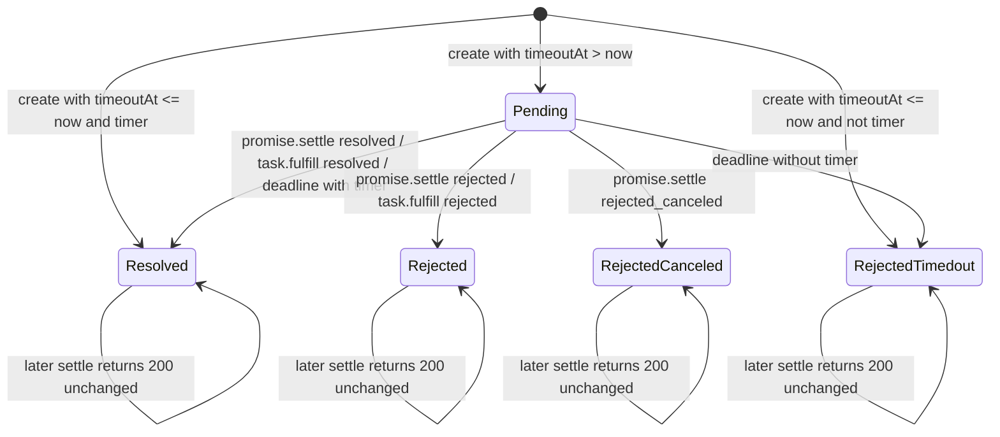
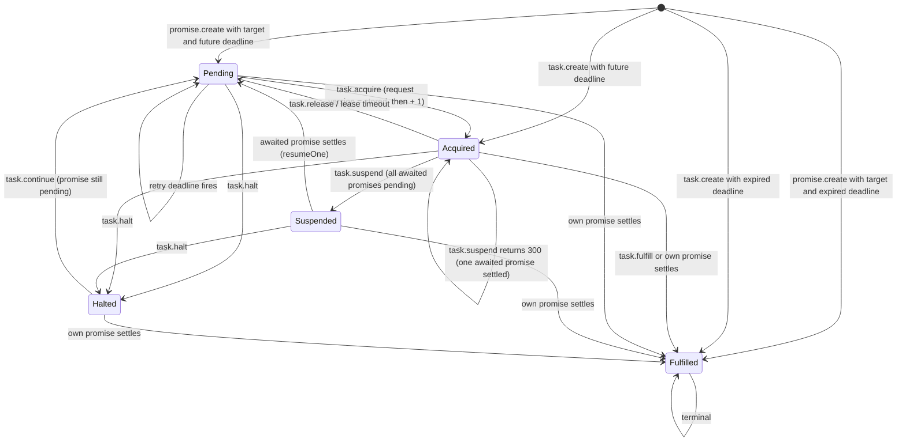
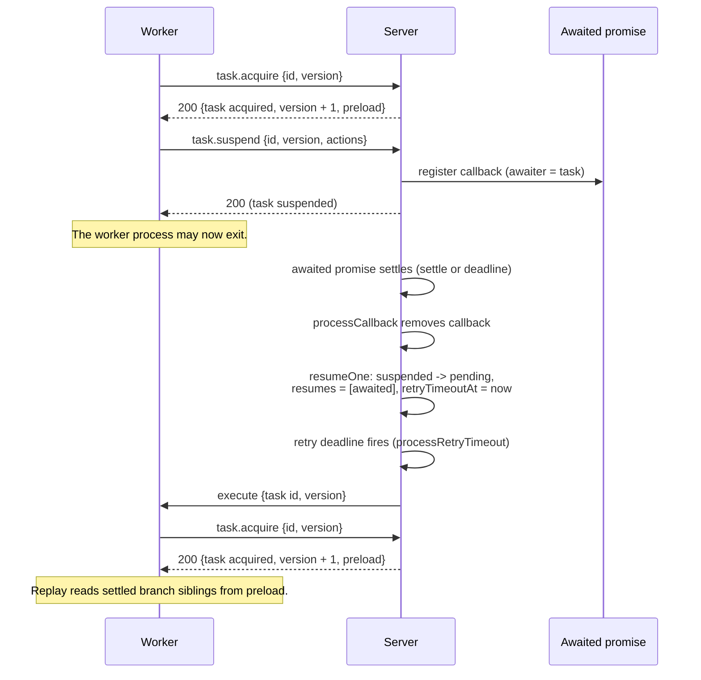

# Durable promises and tasks: two state machines on one row

A durable promise has five states. A durable task has five states. The two state machines live on one record. The promise answers "what is the result?" The task answers "who may produce it, and until when?"

This document follows both machines through every transition. It explains the tags that decide the transitions, the version that fences a stale worker, the lease that bounds a claim, and the suspend and resume mechanism that lets a task wait without holding a process.

Source: `spec/spec/02-abstract/state.lean:28-45`, `spec/spec/02-abstract/state.lean:74-146`

## The one row

A durable promise is a named record for a result that may not exist yet. A durable task is the same record seen from a worker's side. It says who may produce the result and until when. The record has one identifier and two faces.

```lean
structure Object where
  id      : Ident
  promise : PromiseObject
  task    : Option TaskObject := none
```

The promise face holds `state`, `param`, `value`, `tags`, `timeoutAt`, `createdAt`, `settledAt`, `callbacks`, and `listeners`. The task face holds `state`, `version`, `ttl`, `pid`, `leaseTimeoutAt`, `retryTimeoutAt`, and `resumes`.

An identifier is a string. Its origin is the text before the first colon. An identifier with no colon is its own origin. The promise deadline is `timeoutAt`, the lease deadline is `leaseTimeoutAt`, and the retry deadline is `retryTimeoutAt`. This document uses the protocol status codes. For example, 200 is success, 400 is a malformed request, 404 is a missing record, 409 is a state or version conflict, and 422 is a semantic refusal. Code 300 means that the request did not suspend the task.

Source: `spec/spec/02-abstract/state.lean:74-97`, `spec/spec/02-abstract/state.lean:127-146`, `spec/spec/02-abstract/state.lean:155-159`, `spec/spec/01-protocol/types.lean:31-49`

## The tags are the semantics

A tag is a string key with a string value. The caller supplies the tags, and the server stores them with the promise. The server stores no field for "is this runnable?" and no field for "is this awaitable?" Both answers are derived from tags on every read. That removes a second place where a stored value could disagree with the tags.

Source: `spec/spec/02-abstract/state.lean:93-103`

| Tag | Value | What it changes |
|-----|-------|-----------------|
| `resonate:target` | a worker address | Makes the promise runnable. A runnable promise has a task. Also makes the promise awaitable. |
| `resonate:timer` | `"true"` | A deadline resolves the promise instead of rejecting it. |
| `resonate:scope` | `"global"` | Makes the promise awaitable. A task in the same origin may await it. |
| `resonate:external` | `"true"` | A general escape hatch for the same external rule. |
| `resonate:origin` | an identifier | The lineage root. The promise identifier must start with it. |
| `resonate:branch` | an identifier | A branch ancestor. The identifier must start with it. |
| `resonate:parent` | an identifier | A parent. The identifier must start with it. |
| `resonate:prefix` | an identifier | A prefix rule for generated identifiers. |
| `resonate:delay` | a millisecond timestamp | The first time the task may be dispatched. Requires `resonate:target`. |

Source: `spec/spec/01-protocol/validation.lean:24-45`, `impl/server/core/crates/resonate-core/src/types.rs:333-400`, `impl/server/core/crates/resonate-core/src/types.rs:618-642`

Two rules are worth stating on their own.

1. **A timer may not be a target.** `promise.create` with both `resonate:timer` and `resonate:target` returns 400. A timer and a task would be two owners for one deadline.
2. **A delay is an absolute instant.** `resonate:delay` is a timestamp in milliseconds, not a duration. It must be smaller than `timeoutAt`, and it must have a target. The server sets the task's first retry deadline to that instant, raised to the current time when it is in the past.

Source: `spec/spec/02-abstract/external.lean:35-37`, `impl/server/core/crates/resonate-core/src/types.rs:381-398`, `spec/spec/02-abstract/state.lean:307-314`

The awaitable rule is one disjunction, not a hierarchy. A promise is awaitable if any one of these is true:

- It has `resonate:scope = global`.
- It has `resonate:external = true`.
- It has `resonate:target`.
- It has `resonate:timer = true`.

The protocol layer calls this `external`. An awaitable promise may be awaited, and the server keeps a callback or a listener on it. A promise that is not awaitable keeps neither, so it carries no extra state.

Source: `spec/spec/01-protocol/validation.lean:20-32`, `impl/server/core/crates/resonate-core/src/types.rs:573-594`

## The promise state machine



Source: `spec/spec/01-protocol/types.lean:19-25`, `spec/spec/02-abstract/state.lean:301-330`, `spec/spec/02-abstract/external.lean:45-58`

| State | Meaning | State changes on a later settle |
|-------|---------|-------------------------------|
| `pending` | No result yet | Yes |
| `resolved` | A value is available. A timer resolution keeps the default empty value. | No. The handler returns 200 with the current record. |
| `rejected` | An error is available | No. The handler returns 200 with the current record. |
| `rejected_canceled` | The work was canceled | No. The handler returns 200 with the current record. |
| `rejected_timedout` | The deadline passed without a result | No. The handler returns 200 with the current record. |

Source: `spec/spec/01-protocol/types.lean:19-25`, `spec/spec/01-protocol/validation.lean:47-49`

### Creation

`createPromise` has two branches.

- If `timeoutAt > now`, the promise is created `pending`. If it is runnable, the server also creates a task in `pending` with version 0 and a retry deadline. The deadline is `max(delay, now)` when a delay tag is present, and `now` otherwise.
- If `timeoutAt <= now`, the promise is created already settled. A timer becomes `resolved`. Everything else becomes `rejected_timedout`. The settlement time is `timeoutAt`, not `now`. A runnable promise in this branch gets a task in `fulfilled` with version 0.

Source: `spec/spec/02-abstract/state.lean:301-330`

The second branch is why a call with an expired deadline does not create work. It records the correct outcome immediately. A timer resolution has no value, so the record keeps the default empty value.

### Settlement

`promise.settle` accepts only three states: `resolved`, `rejected`, and `rejected_canceled`. A request for any other state returns 400. The handler reads the promise. If it is `pending`, the handler writes the new state, the value, and the settlement time. If it is already settled, the handler returns 200 with the existing record and changes nothing.

Source: `spec/spec/02-abstract/external.lean:45-58`

Settlement is idempotent on purpose. A retried request must not fail because the first attempt succeeded. The caller learns the current truth either way. A later request for a different state does not change a settled promise; the handler returns the stored state.

`setSettled` writes both faces in one step. It writes the promise, and it fulfills the task on the same row if the task is not already fulfilled.

```lean
def setSettled (o : Object) (p : PromiseObject) : H Unit := do
  setPromise o.id p
  if p.state != .pending then
    match o.task with
    | some t => if t.state != .fulfilled then setTask o.id t.fulfill
    | none   => pure ()
```

In these snippets, `H` is the state monad of the machine, `H Unit` returns no value, and `Nat` is a natural number. `ask` reads the server configuration.

Source: `spec/spec/02-abstract/state.lean:291-299`

That is the one-row model doing real work: the task is not looked up in a second table but is already in the object the handler read. One step is one transaction: the machine collects the writes of a step and commits them together, and a read inside the step cannot see them.

Source: `spec/spec/02-abstract/state.lean:1-20`

### Deadlines and projection

A pending promise whose deadline has passed is projected on every read. The projection is a pure function of the record and the current time.

```lean
def PromiseObject.project (p : PromiseObject) (now : Nat) : PromiseObject :=
  if p.state == .pending ∧ p.timeoutAt ≤ now then
    if p.isTimer then
      { p with state := .resolved, settledAt := some p.timeoutAt }
    else
      { p with state := .rejectedTimedout, settledAt := some p.timeoutAt }
  else
    p
```

Source: `spec/spec/02-abstract/state.lean:118-125`

The same rule appears in Rust as `PromiseRecord::project`. The important property is that no observation depends on whether the storage engine has written the expiry down. A lazy read, a background check, and an eager write must all return the same record. Every read projects, including the read that `promise.settle` and `task.acquire` make. A handler never sees a pending promise whose deadline has passed.

Source: `impl/server/core/crates/resonate-core/src/types.rs:255-275`

The internal step `processPromiseTimeout` forces that projection and persists it. It is the background half of the same rule. In the abstract machine, an internal step is a step type, not a thread. The environment chooses when to run it.

Source: `spec/spec/02-abstract/internal.lean:22-23`

## The task state machine



Source: `spec/spec/01-protocol/types.lean:27-29`, `spec/spec/02-abstract/external.lean:125-379`, `spec/spec/02-abstract/internal.lean:25-77`

| State | Meaning | Lease held |
|-------|---------|------------|
| `pending` | Ready to be acquired, or waiting for a retry deadline | No |
| `acquired` | One worker holds the lease | Yes |
| `suspended` | Waiting on one or more promises | No |
| `halted` | Paused by an explicit request | No |
| `fulfilled` | Terminal. The promise is settled. | No |

Source: `spec/spec/01-protocol/types.lean:27-29`, `spec/spec/02-abstract/state.lean:127-146`

### Task creation

There are two creation paths, and they differ.

- `promise.create` with a target creates a `pending` task with version 0. It does not acquire the task. A worker must still call `task.acquire`.
- `task.create` creates the promise and the task in one request. If the deadline is in the future, the promise starts `pending`, the task starts `acquired` with version 1, and the caller holds the lease. If the deadline has passed, the task starts `fulfilled` with version 0, and the promise starts `rejected_timedout`.

Source: `spec/spec/02-abstract/state.lean:301-330`, `spec/spec/02-abstract/external.lean:125-174`

`task.create` also refuses a delay tag on its action. A task created and acquired in one step cannot be delayed, because the caller already holds it. The action must be runnable, and a target plus a timer is refused, so the expired branch always produces `rejected_timedout`.

Source: `impl/server/core/crates/resonate-core/src/types.rs:474-484`

### Acquire and the version fence

`task.acquire` is the transition from `pending` to `acquired`. It checks three things:

1. The task is `pending`.
2. The promise is `pending`.
3. The request version equals the stored version.

If all three hold, the task becomes `acquired`, the version becomes `version + 1`, and the lease fields are written.

Source: `spec/spec/02-abstract/external.lean:176-197`

The version is the fence. Acquire, release, fence, heartbeat, suspend, and fulfill all compare the request version with the stored version. Halt and continue do not. A worker that lost its lease still holds the old number. Its `task.fulfill` compares the version and receives 409. The new worker's result stays.

Source: `spec/spec/02-abstract/external.lean:307-327`, `impl/server/core/crates/resonate-server-sqlite/src/lib.rs:1209-1295`

The SQLite implementation makes the same check inside one transaction. It locks the row, acquires the task, and asserts that the new version is exactly `request version + 1`. A lost acquire returns 409 because the task is not pending, or because the version does not match.

Source: `impl/server/core/crates/resonate-server-sqlite/src/lib.rs:1023-1142`

### Fence

`task.fence` is the odd operation. It does not change the task state. It proves that the caller still holds the lease, and then it performs one action: create a promise or settle a promise.

The checks are the three acquire checks, with the task in `acquired` in place of `pending`, plus two request checks:

- The action target must not be the task identifier.
- The action target must have the same origin as the task.

The Lean model applies the origin rule without an exception. The Rust validation adds one exception. Creating a root promise from a task in another origin is allowed. A root promise is an identifier with no colon, so its origin is itself. The source comment calls this the start of a detached computation.

Source: `spec/spec/02-abstract/external.lean:199-224`, `impl/server/core/crates/resonate-core/src/types.rs:705-726`

The fence is how a worker writes a child promise without a second acquisition. A child promise is a promise created by a fence action. The fence is one round trip that both proves ownership and records the new work.

### Heartbeat and the lease

The task row carries these four fields.

| Field | Meaning |
|-------|---------|
| `ttl` | The lease time to live (TTL), in milliseconds. The worker chooses it. |
| `pid` | The process identifier of the holder. |
| `leaseTimeoutAt` | The instant at which the lease expires. |
| `retryTimeoutAt` | The instant at which a pending task should be dispatched again. This is the server's retry clock, not part of the lease. |

Source: `spec/spec/02-abstract/state.lean:127-135`, `impl/server/core/crates/resonate-core/src/types.rs:277-288`

`task.heartbeat` extends the lease. It processes each listed task. A task is renewed only when all of these are true:

- The task is `acquired`.
- The task version matches the request.
- The `pid` matches the request.
- The promise is still `pending`.

Otherwise the task is skipped silently, and the response is still 200. A heartbeat is a maintenance call, not a state transition. A stale task is not an error; it is simply not renewed. The lease deadline is not one of the conditions. A heartbeat that arrives before `processLeaseTimeout` runs renews the lease even when the deadline has passed.

Source: `spec/spec/02-abstract/external.lean:226-247`

When the lease deadline passes and the promise is still `pending`, `processLeaseTimeout` returns the task to `pending`. It clears `pid`, `ttl`, and `leaseTimeoutAt`, and it sets `retryTimeoutAt` to `now`. The task is then eligible for another worker.

Source: `spec/spec/02-abstract/internal.lean:64-77`

### Release, halt, and continue

Three operations give the caller control outside the normal completion path. They do not need a running worker.

- `task.release` returns an `acquired` task to `pending`. It requires the promise to still be `pending` and the version to match. It clears the lease fields and sets `retryTimeoutAt` to `now`. The task can be acquired again.
- `task.halt` moves a task to `halted` from any state except `fulfilled`. It clears the lease fields and the retry deadline. It is idempotent when the task is already halted.
- `task.continue` moves a `halted` task back to `pending`. It requires the promise to still be `pending`. It sets `retryTimeoutAt` to `now`. If the promise is not `pending`, the response is 409.

Source: `spec/spec/02-abstract/external.lean:329-379`

Release says "I could not finish; offer this work again." Halt says "stop offering this work." Continue says "start offering it again." These operations leave registered callbacks in place.

### Fulfill

`task.fulfill` is the normal end. Its action carries the promise state (`resolved`, `rejected`, or `rejected_canceled`) and the value. It checks that the task is `acquired`, the promise is `pending`, and the version matches. It then settles the promise through the same `setSettled` path. That writes the promise and fulfills the task in one step.

Source: `spec/spec/02-abstract/external.lean:307-327`, `spec/spec/02-abstract/state.lean:291-299`

The task does not remain `acquired` after the promise settles. The promise and the task cannot disagree in a committed state, because one step writes both.

## The suspend and resume mechanism

A durable task can wait for other promises without holding a process, a connection, or a thread.

### Suspend

`task.suspend` carries a list of actions. Each action names an awaited promise and an awaiter. The awaiter must be the task itself. The awaited promise must be in the same origin. The list must not be empty, and it must not repeat an awaited identifier.

Source: `spec/spec/02-abstract/external.lean:271-280`, `impl/server/core/crates/resonate-core/src/types.rs:516-571`

The handler then does four checks and one branch.

1. The task must be `acquired`.
2. The promise must be `pending`.
3. The version must match.
4. Every awaited promise must exist and be awaitable.

An empty action list, a repeated awaited identifier, the task as its own awaiter, or an awaited promise in another origin returns 400. If any awaited promise fails the last check, the response is 422.

Source: `spec/spec/02-abstract/external.lean:271-297`

Then the branch:

- If **any** awaited promise is already settled, the server clears `resumes` and returns **300**. The task stays `acquired`, and the lease stays in force. The caller continues without suspending.
- If **all** awaited promises are pending, the server registers a callback on each one, moves the task to `suspended`, clears `pid`, `ttl`, `leaseTimeoutAt`, `retryTimeoutAt`, and `resumes`, and returns 200.

Source: `spec/spec/02-abstract/external.lean:295-305`

The SQLite implementation follows the same shape. It locks the task row before checking timeouts, so a concurrent timeout of the task's own promise cannot fulfill the task between the check and the suspend. A successful suspend returns 200 with empty data.

An immediate resume returns 300 with a preload. The preload is a list of promise records from the same branch as the task, excluding the task's own promise, up to a server limit. A branch sibling is one of those records. Replay can read them without a separate request.

Source: `impl/server/core/crates/resonate-server-sqlite/src/lib.rs:1297-1413`, `impl/server/core/crates/resonate-server-sqlite/src/lib.rs:3409-3433`

### Resume

The resume is not a call from the server to the worker. It is a state transition.

When an awaited promise settles, the callback step runs. It reads the awaited promise. If the promise is no longer `pending`, and the awaiter is in the callback list, it removes the callback and calls `resumeOne`. The step takes the same awaited promise and awaiter pair that `task.suspend` registered. The request type is named for the registration it processes, not for a new registration.

```lean
def processCallback (req : PromiseRegisterCallbackReq) (now : Nat) : H Unit := do
  match ← touchObject req.awaited now with
  | none => pure ()
  | some o =>
      if o.promise.state == .pending then
        pure ()
      else if o.promise.callbacks.contains req.awaiter then
        setPromise o.id { o.promise with
                          callbacks := o.promise.callbacks.filter (· != req.awaiter) }
        resumeOne o.id req.awaiter now
```

Source: `spec/spec/02-abstract/internal.lean:42-51`

`resumeOne` has these cases:

- If the task is `suspended`, it becomes `pending`. `resumes` becomes a list with the awaited identifier. `retryTimeoutAt` becomes `now`.
- If the task is `pending`, `acquired`, or `halted`, the awaited identifier is appended to `resumes` if it is not already there. The state does not change.
- If the task is `fulfilled`, nothing happens.

Source: `spec/spec/02-abstract/internal.lean:25-40`

The `resumes` list records "this promise settled while the task was not suspended." The wire field `TaskRecord.resumes` is a count. The internal `TaskObject.resumes` is the list of identifiers. Acquire and suspend clear the list. The SQLite schema derives the count from the ready callbacks for the task. A ready callback is a callback whose promise has settled.

Source: `spec/spec/02-abstract/state.lean:137-139`, `impl/server/core/crates/resonate-server-sqlite/src/lib.rs:3387`

### The retry clock does the dispatch

A pending task with a `retryTimeoutAt` in the past is dispatched by `processRetryTimeout` when its promise is still `pending`. It sets the next deadline to `now + config.retryTimeout`, then emits an `execute` message at the promise's `resonate:target` address with the current task version.

```lean
setTask o.id { t with retryTimeoutAt := some (now + (← ask).config.retryTimeout) }
setMessage ((o.promise.tags.get? "resonate:target").getD "")
  (.execute o.id t.version)
```

Source: `spec/spec/02-abstract/internal.lean:102-117`

The interval is the server's dial, not the worker's `ttl`. The Lean model sets `retryTimeout` to 5,000 milliseconds. The shipped SQLite plugin defaults to 30,000 milliseconds.

Source: `spec/spec/02-abstract/state.lean:249-251`, `impl/server/core/src/serve.rs:143-145`

The distinction matters. `ttl` is how long a holder asked to keep its lease. `retryTimeout` is how long the server waits before re-offering a task that nobody has claimed. Using `ttl` for both would re-offer a dead worker's task on the dead worker's schedule. It would also fail for a task that has never been acquired, which has no `ttl`.

Source: `spec/spec/02-abstract/internal.lean:79-101`



Source: `spec/spec/02-abstract/internal.lean:25-51`, `spec/spec/02-abstract/internal.lean:102-117`

## Aha: the callback does not resume the task; it makes the task resumable

The callback does not call the worker. `processCallback` removes the callback and calls `resumeOne`. `resumeOne` moves the task to `pending` and sets a retry deadline. The retry step later emits an `execute` message.

Source: `spec/spec/02-abstract/internal.lean:42-51`, `spec/spec/02-abstract/internal.lean:102-117`

That indirection is the durability. If the server dies between the callback and the dispatch, the task is already `pending` with a retry deadline in storage. A new server reads the row, sees the deadline, and dispatches. If the callback had called the worker directly, a crash in that window would lose the wake-up. The wake-up is not an event that must be delivered. It is a state that must be read.

The same reasoning explains why `resumes` exists. An awaited promise may settle while the waiting task is `acquired`. The state cannot change, because the worker still holds the lease. So the server appends the identifier to `resumes`. The next `task.get` or `task.acquire` shows the count. The information survives even when the state could not change.

Source: `spec/spec/02-abstract/internal.lean:36-38`

## The task lifecycle in one table

| Operation | From | To | Version | Lease |
|-----------|------|----|---------|-------|
| `promise.create` with target (future) | none | `pending` | 0 | none |
| `promise.create` with target (expired) | none | `fulfilled` | 0 | none |
| `task.create` (future deadline) | none | `acquired` | 1 | `ttl`, `pid`, `leaseTimeoutAt` |
| `task.create` (past deadline) | none | `fulfilled` | 0 | none |
| `task.acquire` | `pending` | `acquired` | checked, then +1 | set |
| `task.heartbeat` | `acquired` | `acquired` | checked | extended, or unchanged when skipped |
| `task.fence` | `acquired` | `acquired` | checked | unchanged |
| `task.suspend` (all pending) | `acquired` | `suspended` | checked | cleared |
| `task.suspend` (one settled) | `acquired` | `acquired` | checked | unchanged |
| awaited promise settles / `resumeOne` | `suspended` | `pending` | unchanged | cleared |
| own promise settles / `setSettled` | any but `fulfilled` | `fulfilled` | unchanged | cleared |
| `task.release` | `acquired` | `pending` | checked | cleared |
| lease timeout | `acquired` | `pending` | unchanged | cleared |
| `task.fulfill` | `acquired` | `fulfilled` | checked | cleared |
| `task.halt` | any but `fulfilled` | `halted` | not checked | cleared |
| `task.continue` | `halted` | `pending` | not checked | none |

Source: `spec/spec/02-abstract/external.lean:125-379`, `spec/spec/02-abstract/internal.lean:25-77`

In the Version column, "checked" means the request must equal the stored version. Halt and continue do not check it. A heartbeat renews only when its four conditions hold; otherwise it leaves the row unchanged.

## Related documents

- [00-overview.md](00-overview.md) — the thesis and the one-row model.
- [01-architecture.md](01-architecture.md) — the ports that carry these operations.
- [02-the-protocol.md](02-the-protocol.md) — the request and response shapes.
- [04-the-formal-specification.md](04-the-formal-specification.md) — the machine that proves these transitions.
- [09-the-typescript-sdk.md](09-the-typescript-sdk.md) — the client side of suspend and resume.
- [11-schedules-timers-and-time.md](11-schedules-timers-and-time.md) — deadlines, cron, and time.
- [14-patterns.md](14-patterns.md) — fan-out and saga patterns built from these primitives.
