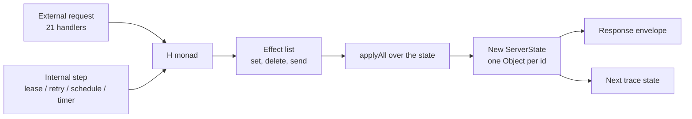
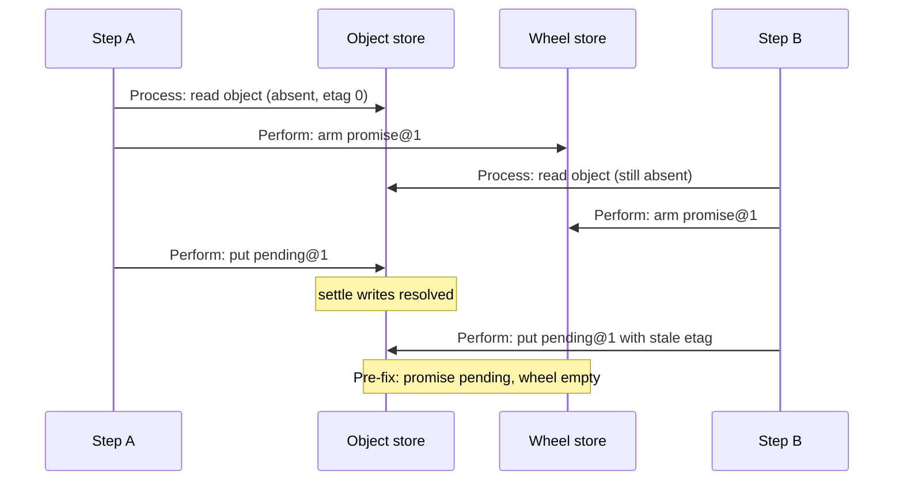
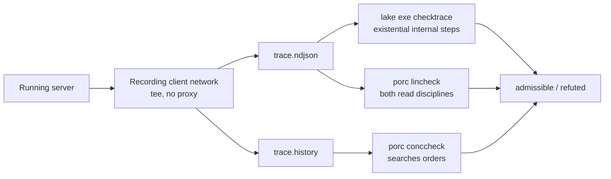

# The formal specification: one machine, four independent checks

Resonate does not treat the protocol as a document that the code should follow. It treats the protocol as a program that the code must equal. The centre of the repository is an executable abstract machine written in Lean 4. Lean 4 is a programming language and proof assistant. The machine takes one step and one clock value and returns one response and one new state. The specification around that function is checked in four different ways, and one of them tests a real server's recorded traffic. Each way removes a different doubt.

| Check | Question it answers | Where it lives |
|-------|--------------------|----------------|
| Lean theorems | Does every step that the machine permits keep the catalogue true? | `spec/spec/04-theorems/` |
| Enumerated scripts | Does the catalogue hold over 1,464 concrete scripts? | `spec/spec/02-abstract/properties-check.lean`, `properties-step.lean` |
| Temporal Logic of Actions model | Does an executor with real interleaving refine the atomic machine? | `spec/tlap/` |
| Trace checkers | Can the machine explain the traffic of a real server? | `spec/valid/` |

Source: `spec/README.md:23-54`, `spec/valid/README.md:3-10`

The four checks do not repeat each other. The Lean theorems speak about all traces. The enumerated scripts speak about a large finite set. The Temporal Logic of Actions model, called TLA+ below, speaks about concurrency and two stores. The checkers speak about recorded traffic from a running server. A defect must pass all four to remain hidden.

## The Lean 4 machine

The machine is in `spec/spec/02-abstract`. The design has one unusual rule that shapes everything else. A promise and its task are one record, not two.

### One object, two faces

The machine stores a `ServerState` that maps an identifier to an `Object`. The `Object` record holds an identifier, a promise, and an optional task.

```lean
structure Object where
  id      : Ident
  promise : PromiseObject
  task    : Option TaskObject := none
```

Source: `spec/spec/02-abstract/state.lean:155-159`

This is not a convenience. It makes the strongest invariant cheap. If a step writes one object, then the promise and the task can never disagree, because one write moves both. The TLA+ model later tests exactly this claim with an invariant called `UnitCoherent`.

A `Promise` has one of five states: `pending`, `resolved`, `rejected`, `rejected_timedout`, and `rejected_canceled`. A `Task` has its own state and a version. The version is the fence, meaning the guard that a write must match. To settle a promise means to resolve or reject it; a worker that holds an old version cannot settle the promise.

### Effects, not side effects

A handler does not change the state directly. It returns a list of effects. An effect is a declarative command: set this promise, set this task, set or delete this schedule, or send this message.

```lean
inductive Effect where
  | setPromise  (id : Ident) (p : PromiseObject)
  | setTask     (id : Ident) (t : TaskObject)
  | setSchedule (s : Schedule)
  | delSchedule (id : Ident)
  | setMessage  (address : String) (msg : Message)
```

Source: `spec/spec/02-abstract/state.lean:204-210`

The function `Effect.apply` and its fold `applyAll` interpret the list against the server state. They take no time argument. The handler receives `now` as its own argument and computes the state change from it. The separation matters. A handler can decide what to do without knowing when the decision lands. The executor decides when to land it, and the temporal model questions that choice.

### The H monad and the environment

Handlers are written in a small monad called `H`. `H` is a shorthand for a function from an `Env` to a value and a list of effects. The `Env` carries the server state, the materialisation flag, and the configuration.

```lean
structure Env where
  state  : ServerState
  mat    : Bool
  config : ServerConfig := {}

abbrev H (α : Type) : Type := Env → α × List Effect
```

Source: `spec/spec/02-abstract/state.lean:253-258`

The bind operator `>>=` threads the environment. `runWith` starts a handler with a given environment and returns the final value and the final state. It applies the emitted effects to the state before it returns.

Source: `spec/spec/02-abstract/state.lean:258-277`

The default retry timeout is a concrete number, `5000` milliseconds. It is part of `ServerConfig`, not a hidden constant in a handler.

Source: `spec/spec/02-abstract/state.lean:249-251`

### Materialisation: the same step at two strengths

One parameter changes the meaning of a read. The parameter is called `mat`, short for materialisation. A materialised read returns an object and also records that the step touched it. An unmaterialised read returns a view and records nothing. The functions `withMat`, `touchObject`, and `viewObject` select the behaviour.

Source: `spec/spec/02-abstract/state.lean:336-390`

This is the mechanism behind the two read disciplines. A strict backend reads the current record. A snapshot backend reads a view at the step's instant. The same handler code runs under both. The property catalogue is checked under both, and the trace checkers also answer under both.

## A step and a valid trace

The system definition composes external requests and internal steps into one transition relation.

- A `Request` is one of the 21 protocol operations. The list includes `promise.get`, `promise.create`, `promise.settle`, the two registration operations, the search operation, and the task and schedule operations.
- An `InternalStep` is one of six events that the server generates on its own: lease timeout, retry timeout, schedule due, and the timer and message variants.
- A `Step` is either an external request or an internal step.
- A `Trace` is an infinite sequence of state actions, indexed by natural numbers. Each action pairs a request or an internal step with a response and a time.
- `Valid mat tr` states that every consecutive pair of states is related by some step under materialisation `mat`.

Source: `spec/spec/02-abstract/system.lean:38-60`, `spec/spec/02-abstract/system.lean:94-107`, `spec/spec/02-abstract/system.lean:162-187`



The handler table is small and complete. `stepOf` maps a request kind to its handler. There is no default that silently accepts an unknown operation. An unknown kind has no step.

Source: `spec/spec/02-abstract/system.lean:123-164`

The external handlers are in `external.lean`. For example, `promiseGet` returns the promise or a not-found response. `promiseCreate` is idempotent: a duplicate returns status 200 with the existing promise. `promiseSettle` checks that the requested state is settable and that the existing promise is pending; it has no version check. `promiseRegisterCallback` checks six conditions: the awaited promise is not the awaiter, both promises share an origin, both exist, the awaiter is runnable, the awaited promise is awaitable, and the awaited promise is pending before the model records the callback. The search operation returns a fixed `501` response in the abstract machine. That is a deliberate omission, not an accident.

Source: `spec/spec/02-abstract/external.lean:21-114`

The internal steps are in `internal.lean`. `processLeaseTimeout` and `processRetryTimeout` use the clock and the configured retry timeout. `processSchedule` creates the promised invocation when a cron entry is due.

Source: `spec/spec/02-abstract/internal.lean:64-140`

## The catalogue of 92 properties

The catalogue is a list of named predicates. Each entry has a kind and a function.

- A `.state` predicate takes `now` and one state. It must hold at every state of a valid trace.
- A `.trans` predicate takes `now`, a state, and the next state. It must hold at every consecutive pair.

The functions `legalAt` and `stateHolds` fold the whole catalogue, or only its state half, into one Boolean. `stateCount` and `transCount` count the halves.

Source: `spec/spec/02-abstract/properties.lean:1312-1329`

The repository states that the catalogue holds 92 properties. The breakdown is 42 state properties and 50 transition properties. The count is repeated in the specification guide and in the theorem file.

Source: `spec/README.md:25`, `spec/spec/04-theorems/system.lean:19-25`

Two facts make the catalogue more than a list of wishes.

First, 31 entries are proved as theorems in `holds.lean`. The proof is by induction along a trace, through the theorem `invariant_along_trace`. Each entry is a separate theorem. The file also contains a `sneaky` counterexample that shows why a careless strengthening fails.

Source: `spec/spec/04-theorems/holds.lean:52`, `spec/spec/04-theorems/holds.lean:350-367`

Second, the other 61 entries are checked by enumeration. Two generated Lean files contain 1,464 scripts. Each script applies the catalogue to a concrete trace and reduces the result with `decide`. `decide` is the Lean kernel's evaluator, so the check runs at build time and produces a proof, not a test log.

Source: `spec/README.md:51-54`, `spec/spec/04-theorems/system.lean:22-24`

### The proof obligation that is still open

The conformance story rests on one theorem. It says that every valid trace is legal. The statement is:

```lean
theorem valid_implies_legal
    (mat : Bool) (tr : Trace)
    (hv : Valid mat tr)
    (h0 : (tr 0).state = AbstractModel.ServerState.init) :
    Legal tr := sorry
```

Source: `spec/spec/04-theorems/system.lean:62-70`

The body is `sorry`. Lean accepts the file, but the theorem is not proved. The repository is explicit about this. The 31 theorems and the 1,464 scripts are evidence at two different strengths. They do not replace the missing induction.

This is an honest position, and it is also a live risk. A property that is true of every script but false of some unenumerated trace would pass today. The TLA+ model exists partly to search that gap with a different method.

### The count does not agree with itself

Three numbers appear in the source, and they are not equal.

| Source | Claim |
|--------|-------|
| `spec/README.md:25` | 92 properties |
| `spec/spec/04-theorems/system.lean:19-25` | 92 entries; 31 proved, 61 open |
| `spec/tlap/README.md:126-132` | 95 entries: 45 `.state` and 50 `.trans` |
| `spec/spec/02-abstract/properties.lean:1103-1289` | the literal list: 93 entries, 43 `.state` and 50 `.trans` |

Source: `spec/README.md:25`, `spec/spec/04-theorems/system.lean:19-25`, `spec/tlap/README.md:126-132`, `spec/spec/02-abstract/properties.lean:1103-1289`

The difference between 92 and 93 is one entry. The difference between 92 and 95 is three entries. The transition half is stable at 50 in all counts. The state half is reported as 42, 43, and 45 in different places. This exploration uses the number 92 because two primary documents state it, and it records the disagreement rather than hiding it.

The likely cause is drift. Entries were added to the list, and the prose counts were not updated. The `tlap` guide also describes the list as carrying "the known gaps, the two provenance properties and the liveness file". Those extra categories may explain its larger figure.

## The TLA+ model: atomicity removed

The Lean machine applies an effect list at one instant. A real server does not. It reads, decides, and writes in separate operations, and another step can run between them. The TLA+ model removes the atomicity and asks what breaks.

The model has two machines that share one protocol.

- `Abstract` is the Lean machine. One step is one atomic transition. The identifier set `Rid` has one element, so no two steps overlap.
- `Concrete` splits a step into a `Process` phase and one or more `Perform` phases. `Process` reads the objects and computes a decision. Each `Perform` applies one effect. The store is chunked by origin, meaning the first half of an identifier; one origin holds several objects. Every write is fenced on the etag that the decision was read under. The etag, or entity tag, is the store's version stamp.

Source: `spec/tlap/README.md:90-101`, `spec/tlap/README.md:212-220`

The handlers, the alphabet, and the invariants are imported from `Abstract` into both machines. A behavioural difference is therefore a difference in the executor, not in the protocol.



Source: `spec/tlap/README.md:243-256`

### The result table

TLC is the TLA+ model checker. It explored the complete reachable state graph of both machines.

The table records the final machine, after the concrete executor was given its fence. The trace in the next section is the earlier, unfenced failure that motivated that fence.

| Property | `Abstract` | `Concrete` |
|----------|------------|------------|
| 9 ported state catalogue entries | hold | hold |
| `UnitCoherent` | holds | holds |
| `WheelSound` | not applicable, no wheel | fails |
| `WheelComplete` | not applicable, no wheel | holds |
| `T_consistent_promise_settlement_stamp` | fails | not checked |
| `preserved_settled_promise_record` | fails without a fence | holds |
| `Spec => A!Safety` | not checked | holds |
| `SpecStable => A!Spec` | not checked | holds |

Source: `spec/tlap/README.md:212-234`

`Concrete` closes over 425,506 distinct states for the liveness form and 716,353 states for the invariants. Both graphs are complete. The run takes a few minutes for each.

Source: `spec/tlap/README.md:233-235`

The fence is sufficient for exactly the two failures that were real. It does not remove `WheelSound`. Arming a deadline before writing the object admits an entry for an object that does not yet exist. That is noise, and no fence removes it.

### The finding that matters: ordering is not atomicity

The obvious defence of "arm before write" is crash-local. If the server crashes between the two operations, the wheel holds an entry for an object that was never written. A later sweep removes it. That is noise, not loss.

The model shows that this reasoning is incomplete. Ordering protects a step against being interrupted. It does nothing about a different step's disarm landing between this step's arm and this step's put.

In the pre-fix trace above, step A arms, step B arms, step A writes, a settle disarms, and then step B writes its stale decision. The promise is pending with a deadline, and the wheel is empty. The promise will never time out. `WheelComplete` and `preserved_settled_promise_record` fail in the same trace, from the same cause.

Source: `spec/tlap/README.md:243-266`

`WheelComplete` was predicted to hold before the run. The prediction was recorded so that a confirmed prediction could be told from a surprise. In the unfenced run, the prediction was wrong, and the reason is the difference between a step and a schedule.

Source: `spec/tlap/README.md:195-210`

### What the model changed in the specification

The refinement check found three things that were not in the concrete model.

1. **A hole in the specification.** The first check failed when a refused compare-and-swap sent a step back from `perform` to `process`. The abstract machine had no action that moved backwards, so every behaviour with a retry was outside the specification. The fix was not to add a backward step. It was to remove `steps` from the abstract machine. A retry is then not a smaller abstract step. It is no abstract step at all.
2. **A missing fence on the clock.** An etag says nothing about time. A decision made at `now = 0` can land at `now = 1`. The handler would then produce a different answer. A decision is valid only at the instant it was made.
3. **A scheduling obligation.** Liveness failed under an unfair scheduler. A scheduler that always prefers client work can starve a due timeout forever. The model fixes this with strong fairness on `SubmitInternal`, which names the event, not the worker.

Source: `spec/tlap/README.md:267-300`

The liveness claim needs one more condition. Crashes must stop. The model states this without a counter:

```tla
EventuallyStable == <>[][ \A r \in Rid : ~Crash(r) ]_vars
SpecStable       == Init /\ [][Next]_vars /\ Fairness /\ EventuallyStable
```

Source: `spec/tlap/README.md:361-373`

Safety is claimed with crashes possible. Liveness is claimed only after crashes stop. The guide is explicit that a fairness condition over a worker identifier cannot express "this attempt completes", because a worker identifier is recycled and a throwaway request can discharge the fairness obligation. Fairness over an internal event works, because the event has a name.

Source: `spec/tlap/README.md:383-431`

### Two findings about the model itself

Two later counterexamples were not findings about Resonate. They were findings about `Concrete` drifting away from the executor it claims to model.

- `Concrete` performed several document writes per step, because it consumed the abstract effect list one entry at a time. The executor emits one `PutDocument` for the whole workflow.
- `Concrete` recorded messages outside the document. The executor stores the outbox as a field of the workflow, so one put carries both the state and the messages.

Source: `spec/tlap/README.md:300-340`

The guide keeps this failure in the record. A refinement against a hand-written abstraction function is a fidelity check on the lower machine. It fails when the executor model stops being the executor. No state invariant catches that, because both errors are about when states change, not about which states are reachable.

### The same-origin door

The Lean `promiseRegisterCallback` checks four things and says nothing about where the two promises live. A client may therefore register a callback whose awaited promise is in one origin and whose awaiter is in another. TLC found the case in three steps.

Source: `spec/tlap/README.md:466-493`

The TLA+ model adds a same-origin rule to both machines. With the rule, `SameOrigin` holds over two origins, across 3,025 distinct states. Without the rule, the one-document-per-origin executor was sound but incomplete. It declined the cross-origin registration as a stutter. With the rule, it serves everything the protocol admits.

The `taskFence` operation has since received the same door in the Lean specification. `taskHeartbeat` has not, and the guide records the contradiction: a heartbeat may span origins, but the partition checker cannot represent an operation that belongs to two partitions at once.

Source: `spec/tlap/README.md:493-520`

## The trace checkers

The theorems speak about the specification. The checkers ask whether a real server's traffic is a legal trace.

Both checkers read one format: Newline-Delimited JavaScript Object Notation, or NDJSON, with one external call per line. The fields are `kind`, `now`, `req`, and `res`. Internal steps are not in the file, by design. The specification leaves that schedule open, and the checkers recover it by search.

Source: `spec/valid/README.md:12-37`

### The Lean checker

`lake exe checktrace < trace.ndjson` asks whether any schedule of internal steps explains the recorded external events, against the specification itself. The search is existential. The checker does not ask whether the server made a particular choice. It asks whether some legal choice is consistent with every observation.

Source: `spec/valid/README.md:3-10`

The checker needs one clock. The `now` field and the deadlines inside the promises must come from the same clock. Against a live Resonate server, the recorder sends `debug.start` and stamps `resonate:debug_time` on every request. Without this, the server's background loops judge small deadlines against a wall clock value near 1.7 × 10¹² milliseconds, and expire everything that is pending. The `work/go` guide names that mismatch as the entire cause of the one refuted capture in the original corpus.

Source: `spec/valid/README.md:29-37`, `spec/work/go/README.md:52-58`

### The Go checker

`spec/valid/porc` is a Go port of the abstract machine, connected to the Porcupine linearizability checker. `lincheck < trace.ndjson` answers under both read disciplines. `conccheck < trace.history` searches orders rather than verifying the recorded one.

Source: `spec/valid/README.md:3-10`, `spec/work/go/README.md:38-40`

Porcupine checks linearizability. A trace is linearizable if some order of the operations is both legal and consistent with the real-time order of call and return. The port partitions the history by origin. That partition is sound because every await edge stays inside one origin. Without the partition, the check is exponential in the history. With it, 2,200 events take 145 milliseconds.

Source: `spec/valid/porc/README.md:113-143`

The checker treats an operation that received a `500` response as pending. A pending operation may or may not have applied. The checker constrains it only existentially. This is evidence-weakening, not tolerance of arbitrary behaviour: a pending operation is not a wildcard, and an observation that neither branch explains still refutes the trace.

Source: `spec/valid/porc/README.md:317-344`

The checker has a fuel bound. When a rule closure hits the bound, the verdict is `3`, which means inconclusive, not pass.

Source: `spec/valid/porc/README.md:25`



## The traffic generators

The checkers are only as good as their input. Two generator suites produce traces with known shapes.

The Go suite in `spec/work/go` drives the Go Software Development Kit (SDK) through four workflow shapes: `simple-run`, `simple-rpc`, `simple-sleep`, and `fan-out`. Every numeric flag accepts an interval, such as `2..5` or `5..50ms`, so one binary produces many shapes. Each run writes an NDJSON trace and a `.history` file.

Source: `spec/work/go/README.md:1-41`

The recorder is a decorator on the SDK's network interface. Every call passes through one method, `Send(ctx, body)`. The decorator tees the conversation. There is no proxy and no packet capture, so the recorder cannot record a request that the kit did not send.

Source: `spec/work/go/README.md:43-58`

The TypeScript suite in `spec/work/ts` contains three canonical workloads. `W1` uses `ctx.run` for every child call. `W2` uses `ctx.rpc`. The two programs differ in one word, so diffing their traces isolates what that word costs. `W3` uses both in one tree, alternating by parity.

Source: `spec/work/ts/README.md:1-15`

`W1` creates a local child with no target. The server creates no task and dispatches nothing. `W2` creates a child with a target. The server creates a task and dispatches an execution, so the parent suspends and resumes. The identifiers are identical in both. The difference is dispatch, not identity.

Source: `spec/work/ts/README.md:33-63`

## Aha: ordering is necessary and not sufficient

The deepest result in the specification is not a theorem. It is a counterexample that kills an intuition.

The intuition says: if the server arms the timer before it writes the promise, then a crash leaves a harmless extra wheel entry. A later sweep removes it. The promise is never lost. This reasoning is correct about one step. It is wrong about two.

A second step can read the object while it is still absent, decide to create it, and then write after the first step has settled it. The first step's settle disarms the timer. The second step's stale write then recreates a pending promise with no timer. The object exists. The wheel does not know it. Nothing will ever expire it.

Source: `spec/tlap/README.md:243-266`

So the ordering of effects inside a step cannot replace a fence across steps. In that first run, `WheelComplete` was predicted to hold and failed. The model guide calls this the difference between protecting a step from interruption and protecting it from interleaving.

This is the reason the server backends use compare-and-swap or an equivalent serialisation point on every write. The property is not decoration. It is the answer to a counterexample that the specification itself produced.

## What this chapter establishes

The formal layer gives four things to the rest of the exploration.

- A precise state machine, with 21 external operations and six internal steps, that the server chapters can cite instead of paraphrasing.
- A catalogue of 92 properties, split into state and transition predicates, checked by proof, enumeration, and model checking.
- A named set of defects that a real executor can have: the lost update, the missing fence on the clock, the starved timeout, and the cross-origin registration that a one-document-per-origin executor declined until the same-origin rule arrived.
- Two checkers that turn recorded traffic into a verdict, and two generators that produce traffic with a known shape.

The next chapters move from the specification to the Rust server that implements it. The server keeps the same vocabulary: origin, promise, task, version, deadline, and wheel.

## Unresolved source questions

- The property count is reported as 92 in `spec/README.md` and in the theorem file, as 93 by the literal list in `spec/spec/02-abstract/properties.lean:1103-1289`, and as 95 in `spec/tlap/README.md:126-132`. This exploration uses 92 and records the conflict.
- `T_consistent_promise_settlement_stamp` fails on `Abstract` in the TLA+ results table with no stated cause in the file. The table records the failure but does not explain it.
- `taskHeartbeat` still has no origin door, and the guide states that closing it would contradict the partition checker's rule that an operation belongs to one partition. The source does not resolve which rule should change.

## Related documents

- [03-durable-promises-and-tasks.md](03-durable-promises-and-tasks.md) — the state machine that this machine formalises.
- [05-the-server-core.md](05-the-server-core.md) — the Rust composition root that implements the machine.
- [06-storage-engines.md](06-storage-engines.md) — the compare-and-swap and fencing rules that answer the counterexample.
- [07-transports-and-workers.md](07-transports-and-workers.md) — the delivery paths that the trace checkers observe.
- [08-gateways-console-and-metrics.md](08-gateways-console-and-metrics.md) — the edge that records the traffic.
- [README.md](README.md) — the reading order and the document map.
