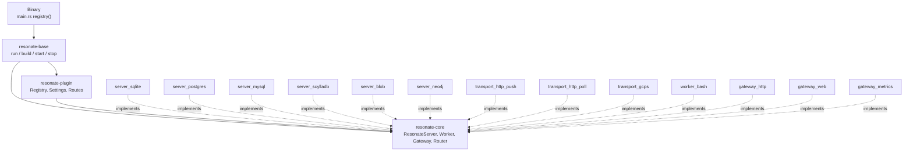
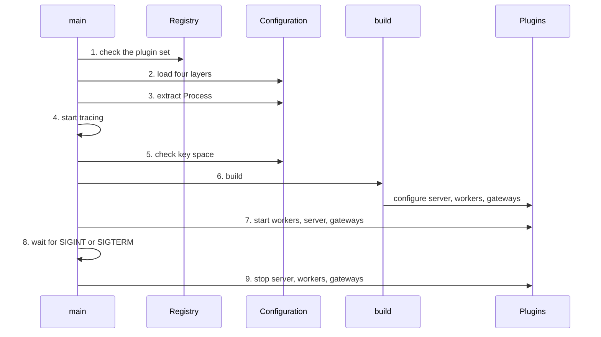

# The server core: a composition root and four ports

The Rust server is not one program with a storage switch. It is a small framework that assembles plugins. The framework carries no storage engine, no network listener, and no Hypertext Transfer Protocol (HTTP) client. It carries the order in which those parts are built, started, and stopped. Everything that touches the outside world is a plugin that a binary names for itself.

This chapter follows the framework from the binary entry point to the moment a request reaches a storage engine. The next three chapters follow the plugins it assembles.

One request takes a short path. The HTTP gateway parses a request envelope and calls the `ResonateServer` port. The selected server plugin receives that envelope and turns it into storage calls. The response returns along the same path. The framework owns none of those three steps. It decides which implementations take them, in what order those implementations start, and in what order they stop.

## The crate map

Four crate layers carry the server.

| Crate | Role | Knows about |
|-------|------|-------------|
| `resonate-core` | The port traits and the protocol types | No plugin, no database, no socket |
| `resonate-plugin` | The plugin descriptors, the registry, and the configuration loader | The port traits |
| `resonate-base` | The composition root: build, start, stop, and signal handling | The registry and the ports |
| `resonate` binary | Client subcommands for promises, tasks, schedules, invoke, tree, and Model Context Protocol (MCP) | The server over HTTP |

Source: `impl/server/core/crates/resonate-core/src/lib.rs:1-20`, `impl/server/core/crates/resonate-plugin/src/lib.rs:1-30`, `impl/server/core/crates/resonate-base/src/lib.rs:1-40`, `impl/server/core/src/main.rs:1-30`

The dependency direction is one-way. A plugin depends on `resonate-core` and `resonate-plugin`. It does not depend on another plugin of its own kind: no server plugin depends on a server plugin, and no gateway depends on a gateway. A shared library is different. Every Structured Query Language (SQL) server plugin depends on `resonate-sql`, which is a library and not a plugin. The repository is explicit about the naming rule: the name `resonate-server-*` means a server plugin, and a server plugin depends on no other plugin. A shared library for a family of servers is deliberately named `resonate-sql`, not `resonate-server-sql`, so that a server outside the family does not reach into it by mistake.

Source: `impl/server/core/crates/resonate-sql/src/lib.rs:16-20`



## The plugin descriptor

A plugin is a `static` value, not a trait implementation. `ServerPlugin` and `GatewayPlugin` have two fields: the crate name and a `configure` function. `WorkerPlugin` has three fields: the crate name, the address schemes it claims, and a `configure` function.

```rust
pub struct ServerPlugin {
    pub krate: &'static str,
    pub configure:
        fn(&Settings<'_>, ServerDependencies)
            -> Result<Arc<dyn ResonateServer>, ConfigError>,
}
```

Source: `impl/server/core/crates/resonate-plugin/src/plugin.rs:64-109`

The identifier comes from the crate name. The function `id_from_crate` removes the `resonate-` prefix and replaces each hyphen with an underscore. Thus `resonate-transport-http-poll` becomes `transport_http_poll`, and a crate outside the naming convention keeps its whole name.

Source: `impl/server/core/crates/resonate-plugin/src/plugin.rs:29-43`

The identifier is the configuration key and the log name. There is no second name to keep in step with the first. That is the reason for deriving it.

The three dependency structs carry only what a plugin cannot read from its own settings.

- `ServerDependencies` carries the router.
- `WorkerDependencies` carries a weak reference to the server and a shared `Routes` value.
- `GatewayDependencies` carries a strong reference to the server and the same `Routes` value.

Source: `impl/server/core/crates/resonate-plugin/src/plugin.rs:47-160`

The weak reference on the worker side is load-bearing. A router holds its workers. A server holds its router. A strong handle from a worker back to the server would close a reference cycle, and nothing in the cycle would ever be dropped. The worker upgrades the weak handle for each message. A failed upgrade means the server is gone, and there is no work worth doing.

Source: `impl/server/core/crates/resonate-core/src/worker.rs:30-40`, `impl/server/core/crates/resonate-plugin/src/plugin.rs:111-136`

The `configure` function is synchronous and side-effect free. Opening a database, binding a port, and starting a background task belong to `init`, not to construction. A bad setting therefore fails at build time, and an unreachable resource fails at startup. Neither failure appears later as a request that quietly does nothing.

Source: `impl/server/core/crates/resonate-plugin/src/plugin.rs:76-90`

## The registry

A binary names its own plugins. The `Registry` holds three vectors and provides one builder method for each kind.

Source: `impl/server/core/crates/resonate-plugin/src/registry.rs:30-67`

The repository gives a reason for explicit registration. Link-time collection crates such as `inventory` and `linkme` appear to remove the list. They do not. A dependency whose items are never referenced contributes no object code to the link, so the crate must be named in the binary in any case. The mechanism buys nothing and can fail silently when dead-code elimination strips it.

Source: `impl/server/core/crates/resonate-plugin/src/registry.rs:11-29`

`Registry::check` runs before any configuration is read. It reports four kinds of problem that are visible from the plugin set alone.

| Error | Meaning |
|-------|---------|
| Duplicate identifier | Two plugins of the same kind share an id |
| No schemes | A worker claims no address scheme, so nothing can reach it |
| Duplicate scheme | Two workers claim one scheme, so routing is a coin flip |
| No server | The binary carries no server plugin |

Source: `impl/server/core/crates/resonate-plugin/src/registry.rs:86-143`

`select_server` is separate from `check`. It turns a requested server identifier into a plugin, or it returns an error that names both the requested identifier and the identifiers that the binary does carry. A backend that is not compiled in is a different problem from a misspelled backend, and neither should fall through to another backend.

Source: `impl/server/core/crates/resonate-plugin/src/registry.rs:69-84`

### What the shipped binary registers

The default binary registers thirteen plugins.

| Kind | Plugins |
|------|---------|
| Server | `server_sqlite`, `server_postgres`, `server_mysql`, `server_scylladb`, `server_blob`, `server_neo4j` |
| Worker | `transport_http_push`, `transport_http_poll`, `transport_gcps`, `worker_bash` |
| Gateway | `gateway_http`, `gateway_web`, `gateway_metrics` |

Source: `impl/server/core/src/main.rs:68-83`

Each worker claims the address schemes it serves. The push transport claims `http` and `https`. The poll transport claims `poll`. The Google Cloud Pub/Sub transport claims `gcps`. The bash worker claims `bash`. The bash worker is a worker and not a transport: the other end of a `bash://` address is a shell command, not a message service.

Source: `impl/server/core/crates/resonate-transport-http-push/src/lib.rs:8-13`, `impl/server/core/crates/resonate-transport-http-poll/src/lib.rs:21-26`, `impl/server/core/crates/resonate-transport-gcps/src/lib.rs:10-16`, `impl/server/core/crates/resonate-worker-bash/src/lib.rs:12-18`

The default server identifier is `server_sqlite`.

Source: `impl/server/core/src/main.rs:86`

Build order chooses the server differently when the binary carries one server. In that case the only server is the fallback, and the constant is not consulted. This keeps a binary that carries only PostgreSQL from failing to start because the constant still says SQLite.

Source: `impl/server/core/crates/resonate-base/src/lib.rs:324-337`

## Configuration in four layers

The configuration system has one key space. A plugin's identifier is a section in that key space, so one file, one environment prefix, and one command-line override syntax serve every plugin that exists or will exist.

The loader merges four layers. Each layer wins over the one above it.

| Precedence | Layer | Example |
|------------|-------|---------|
| 1, lowest | The binary's own defaults | `level = "info"` |
| 2 | A Tom's Obvious, Minimal Language (TOML) file, `resonate.toml` by default | `[servers.server_postgres] url = "..."` |
| 3 | Environment variables with prefix `RESONATE_`, double underscore for nesting | `RESONATE_SERVERS__SERVER_POSTGRES__URL=...` |
| 4, highest | `--set key=value` flags, and the typed flags that lower to them | `--storage-type postgres` |

Source: `impl/server/core/crates/resonate-plugin/src/config.rs:19-32`, `impl/server/core/crates/resonate-base/src/lib.rs:274-281`

TOML is the file format. The loader does not know the registry. A plugin's defaults are the `#[serde(default)]` attributes on its own `Config` struct. `Settings::extract` reads an absent section as an empty table, so serde's defaults fill it in. There is one source of truth per default, not a struct plus a snapshot.

Source: `impl/server/core/crates/resonate-plugin/src/config.rs:144-186`

`--set` parses its value as TOML. Thus `8` arrives as a number, `true` as a Boolean, and `["a", "b"]` as a list. If parsing fails, the loader quotes the value and tries again. That fallback makes `--set level=debug` mean the string `debug`, not a syntax error.

Source: `impl/server/core/crates/resonate-plugin/src/config.rs:57-82`

The typed flags do not rely on the fallback. A string flag is quoted before it reaches the loader. The reason is concrete: a Google Cloud project identifier of `123456789` or a bearer token of `12345` parses as an integer, and the loader would then report a type error at a key the operator did write correctly.

Source: `impl/server/core/src/serve.rs:256-284`

### Key-space checking

`check_key_space` runs after the log subscriber starts and before anything is built. It has two halves.

- An unknown top-level key is fatal. Nothing could ever read it, so a typo such as the old `storage.type` would otherwise leave the server running on the default backend and saying nothing.
- An unknown plugin identifier under `servers`, `workers`, or `gateways` is a warning. One `resonate.toml` may serve several binaries, and a binary that does not carry `worker_kafka` should not refuse to start over a section meant for the binary that does.

Source: `impl/server/core/crates/resonate-base/src/lib.rs:211-272`

This distinction is one of the better small decisions in the code. It treats a configuration file as shared infrastructure without giving up typo detection.

## The process settings

Three settings belong to the process, not to any plugin.

| Setting | Default | Meaning |
|---------|---------|---------|
| `level` | `info` | Log filter: `trace`, `debug`, `info`, `warn`, `error` |
| `debug` | `false` | The clock belongs to the caller |
| `shutdown_timeout` | `10,000` ms | How long to wait for in-flight work at stop |

Source: `impl/server/core/crates/resonate-base/src/lib.rs:103-151`

The `debug` flag is the one process-wide value that reaches every plugin. It is passed to `init` on the server, every worker, and every gateway. Under it, a plugin must not start work that runs on wall time. A test then drives time with `debug.tick`. This is the switch that makes the trace checkers possible: a promise with a small deadline is not expired by a background sweep against a wall clock near 1.7 × 10¹² milliseconds.

Source: `impl/server/core/crates/resonate-core/src/server.rs:47-58`, `impl/server/core/crates/resonate-core/src/worker.rs:50-58`

## The run sequence

`run` is the whole of a binary's `main`. It executes nine steps in a fixed order.



Source: `impl/server/core/crates/resonate-base/src/lib.rs:170-209`

The order of steps 1 and 2 is deliberate. What is wrong with a set of plugins is knowable from the plugins alone, before any configuration is read. The order of steps 4 and 5 is also deliberate. The key-space check runs after the subscriber because half of its output is a warning, and before anything is built because the other half is fatal.

Source: `impl/server/core/crates/resonate-base/src/lib.rs:171-191`

## Build order

`build` constructs everything and connects nothing.

1. **The router and the routes.** Both start empty. A worker that serves HTTP adds routes to the shared `Routes` value. It never binds its own socket. A gateway may own a listener, but it binds in `init`, not in `configure`.
2. **The server.** The active server plugin is selected and configured. It receives the router. It is not connected.
3. **The workers.** Each worker receives a weak handle to the server and the shared routes. A worker whose configuration disables it is skipped. Two collections are built: one list of workers, and one map from scheme to worker. A worker that claims two schemes appears twice in the map and once in the list, so it starts once.
4. **Install.** The scheme map is installed into the router. From this point the router is complete and never changes.
5. **The gateways.** Each gateway receives a strong handle to the server and the shared routes. Nothing is bound during build. Each gateway binds in its own `init`, which runs during start.

Source: `impl/server/core/crates/resonate-base/src/lib.rs:313-394`

Step 1 is why the graph is not a cycle. The router is the only participant that starts incomplete. Step 4 closes the loop. No plugin is handed a value that does not exist, and every `configure` call is cheap and free of side effects.

Source: `impl/server/core/crates/resonate-base/src/lib.rs:304-312`

The `Routes` value is a one-listener model. A worker that needs an inbound HTTP endpoint, such as a long-poll connection or a callback, registers a route. A gateway that owns a listener merges the shared routes into its own server. This is how the poll worker serves `GET /poll/:group/:id` on the HTTP gateway's port without opening a second port.

Source: `impl/server/core/crates/resonate-plugin/src/routes.rs:1-60`

## Start order is not build order

`start` uses a different order, and the difference is the point. Build order is about which value must exist before which. Start order is about which part must work before which.

| Phase | Order | Reason |
|-------|-------|--------|
| Start | workers, server, gateways | The server's `init` arms its timer and spawns its sweep, and both route messages. A message that reaches a worker that has not started is a lost delivery. |
| Start | gateways last | Accepting a request that the rest of the process cannot serve is worse than not accepting it. |
| Stop | server, workers, gateways | The server's timer is the only thing that can still hand it work of its own. |
| Stop | gateways last, not first | A gateway drain can wait on a long-lived Server-Sent Events stream that only a worker's stop releases. |

Source: `impl/server/core/crates/resonate-base/src/lib.rs:396-474`

The stop order is the most surprising part of the framework. The natural choice is the reverse of start: gateways, server, workers. That choice deadlocks. An HTTP long-poll or Server-Sent Events stream is a response that the gateway is still writing. The stream ends only when the worker clears its connection registry. If the gateway stops first and waits for in-flight responses, it waits for a stream that nothing will end.

So the gateways stop last, after the workers. The cost is a window in which a request is still accepted but a message it emits has nowhere to go. The repository calls this the ordinary best-effort delivery contract: an execute message is re-emitted at its retry deadline. That is a better failure than a refused connection.

Source: `impl/server/core/crates/resonate-core/src/lib.rs:1-35`

A start failure part-way through calls `stop` with a fixed five-second timeout, so a caller never holds a half-started process. That number is not `shutdown_timeout`; it is a separate bound for a process that never reached service.

Source: `impl/server/core/crates/resonate-base/src/lib.rs:409-417`

Nothing in `stop` is fatal. The process is on its way down, and one plugin that refuses to drain is no reason to leave the others running. The whole drain is bounded by the timeout given to `stop`. The run sequence passes `shutdown_timeout`, which defaults to 10,000 milliseconds. If the bound expires, the process logs a warning and exits.

Source: `impl/server/core/crates/resonate-base/src/lib.rs:454-474`

## The four ports

The ports are the contract between the framework and every plugin.

### `ResonateServer`

The server port has four methods.

| Method | Contract |
|--------|----------|
| `init(debug)` | Open resources, start background work. Called once, before `process`. |
| `stop()` | Halt spawned work. Called first. A gateway still calls `process` after this returns. |
| `ready()` | Whether the server can serve now. Defaults to `true`. |
| `process(req)` | Apply one request and return a response. |

Source: `impl/server/core/crates/resonate-core/src/server.rs:40-90`

Two details matter. First, `stop` must not close what answers. A pool torn down there becomes `500` responses for the length of the drain. Second, a non-2xx protocol outcome is still `Ok`. `Err` is reserved for "there is no answer". A not-found promise is a completed exchange with a `404` status in the response head.

### `ResonateWorker`

The worker port has three methods: `init`, `stop`, and `process(address, message)`.

`process` returns `Result<(), Unavailable>`. Success means the worker accepted the message for delivery. It does not mean the message reached its destination. That distinction is in the trait documentation, and it is what makes the router a hand-off point rather than a result channel.

Source: `impl/server/core/crates/resonate-core/src/worker.rs:40-77`

### `ResonateGateway`

The gateway port has `init` and `stop`. A gateway accepts requests and calls the server. It does not call workers directly.

Source: `impl/server/core/crates/resonate-core/src/gateway.rs:63-86`

### `ResonateRouter`

The router port has `init`, `stop`, and `route(address, message)`.

The base `Router` does not implement `init` or `stop`; it uses the no-op defaults from the trait. It holds the workers, but holding a value is not owning its lifecycle. The composition root starts each worker once from the list it built. Driving start from the scheme map would start a worker that claims two schemes twice.

Source: `impl/server/core/crates/resonate-base/src/router.rs:99-112`

The router's knowledge of an address stops at the scheme. It parses the string as a Uniform Resource Identifier, reads the scheme, and hands the whole untouched address to the worker registered for that scheme.

Source: `impl/server/core/crates/resonate-core/src/router.rs:1-38`

The `Router` implementation counts delivery outcomes under one metric, `resonate_deliveries_total`, with three values: `success`, `dropped`, and `error`.

Source: `impl/server/core/crates/resonate-base/src/router.rs:1-80`

## `Unavailable`: two causes, two retry policies

A failed delivery returns `Unavailable`, which carries a message and a `Cause`.

| Cause | Meaning | Retry |
|-------|---------|-------|
| `Unroutable` | The address did not parse, or no worker is registered for its scheme | Will not succeed on its own |
| `Delivery` | A worker accepted the address and could not deliver | May succeed on a later attempt |

Source: `impl/server/core/crates/resonate-core/src/lib.rs:43-80`

`Unavailable` never crosses the wire. At the HTTP edge it becomes a `503` response. The contract also states that a connection refused before the first byte and a timeout after the last byte are both `Unavailable`, and the caller cannot tell them apart. Retries must therefore be idempotent.

Source: `impl/server/core/crates/resonate-core/src/lib.rs:35-43`

## Address validation is deliberately shallow

`is_valid_address` returns true when the string parses as a Uniform Resource Identifier (URI) with a scheme. It does not know what `poll://` or `gcps://` means.

Source: `impl/server/core/crates/resonate-core/src/address.rs:7-23`

The shallowness is a requirement, not a shortcut. Validation must be a pure function of the string, identical on every deployment. The reference model has no workers at all. A server's enabled transports must never change which requests it accepts. A scheme-aware check would make both statements false.

The consequence is stated plainly: syntax errors after the scheme surface at delivery, not at admission. A malformed `poll://` address is a valid URI, and the poll worker rejects it when the router hands it over.

Source: `impl/server/core/crates/resonate-core/src/address.rs:7-23`, `impl/server/core/crates/resonate-core/src/address.rs:40-62`

## The command-line interface (CLI) surface

The binary has eight subcommands.

| Subcommand | Purpose | Backing |
|------------|---------|---------|
| `serve` | Run the server with a durable store | SQLite file `resonate.db` by default |
| `dev` | Run the server for development | SQLite in memory `:memory:` by default |
| `promises` | Inspect promises | Calls the server over HTTP |
| `tasks` | Inspect tasks | Calls the server over HTTP |
| `schedules` | Inspect schedules | Calls the server over HTTP |
| `invoke` | Invoke a function through a durable promise | Calls the server over HTTP |
| `tree` | Show a promise tree | Calls the server over HTTP |
| `mcp` | Run the Model Context Protocol server | Calls the server over HTTP |

Source: `impl/server/core/src/main.rs:38-110`, `impl/server/core/src/serve.rs:500-557`

`serve` and `dev` differ in one default. `serve` writes a SQLite file at `resonate.db`. `dev` uses `:memory:` so the state does not outlive the process. Every other flag is shared.

Source: `impl/server/core/src/serve.rs:500-557`

The shared flags cover the process, the server, the storage backends, authentication, the WorkOS identity provider, task timeouts, the three transports and the bash worker, the console, and metrics. Each typed flag lowers to a configuration key. The mapping is written once, because the CLI has no flag per plugin field: `--set` covers the whole key space, and the typed flags are conveniences over it.

Source: `impl/server/core/src/serve.rs:31-235`, `impl/server/core/src/serve.rs:288-500`

A flag that was not supplied writes no override. This matters because a typed flag is an `Option`. An absent flag leaves the file, the environment, or the plugin's own default in charge. Document 07 records one place where the help text and the effective default disagree.

## The read model

The `ui.*` operations are a read-only projection for the web console. They are not part of the 21-operation protocol. Their limits live in one module so that every backend applies the same rule.

| Constant | Value | Use |
|----------|-------|-----|
| `DEFAULT_LIMIT` | 50 | Page size when the request gives none |
| `MAX_LIMIT` | 200 | Largest accepted page size |
| `DEFAULT_MAX_NODES` | 500 | Default node budget for a tree |
| `MAX_MAX_NODES` | 5,000 | Largest accepted node budget |
| `FUNC_SCAN_LIMIT` | 2,000 | Scan budget for function grouping |
| `UNSETTLED_KEY` | `i64::MAX` | Sort key for a promise that has not settled |

Source: `impl/server/core/crates/resonate-core/src/ui.rs:70-94`

The module is explicit that the limit must not differ between backends. A limit that one backend clamps and another refuses would be a protocol with two meanings. The `resonate-sql` family therefore shares one resolve function for `ui.*` requests.

Source: `impl/server/core/crates/resonate-sql/src/lib.rs:71-90`

## Aha: the framework's most important decision is the order it refuses to reverse

Every plugin system has a build order. Few make the start order differ from it, and fewer still make the stop order differ from both.

Resonate does, and each difference answers a specific failure:

- Workers start before the server because the server's timer routes messages on its first tick.
- Gateways start after the server because a request must not arrive before an answer exists.
- The server stops first because its timer is the only internal source of new work.
- Gateways stop last because a drain can wait on a stream that only a worker can end.

The framework is therefore not a bag of plugins with a `main` function around it. It is a small set of facts about time and dependence, written down once, that every plugin inherits. A plugin author does not need to know when to start. The plugin author needs to know only what `init` must open and what `stop` must release.

Source: `impl/server/core/crates/resonate-base/src/lib.rs:396-474`

The cost is visible too. The window between the workers stopping and the gateways stopping accepts requests whose messages may not land. The repository accepts that cost because a retry deadline re-emits the message, and a refused connection is a worse failure. This is the kind of trade that a framework must make explicitly, and this one does.

## Related documents

- [01-architecture.md](01-architecture.md) — the ports and the plugin model in overview.
- [04-the-formal-specification.md](04-the-formal-specification.md) — the machine that the server implements.
- [06-storage-engines.md](06-storage-engines.md) — the server plugins that the registry selects.
- [07-transports-and-workers.md](07-transports-and-workers.md) — the worker plugins and their delivery schemes.
- [08-gateways-console-and-metrics.md](08-gateways-console-and-metrics.md) — the gateway plugins that bind the ports.
- [README.md](README.md) — the reading order and the document map.
