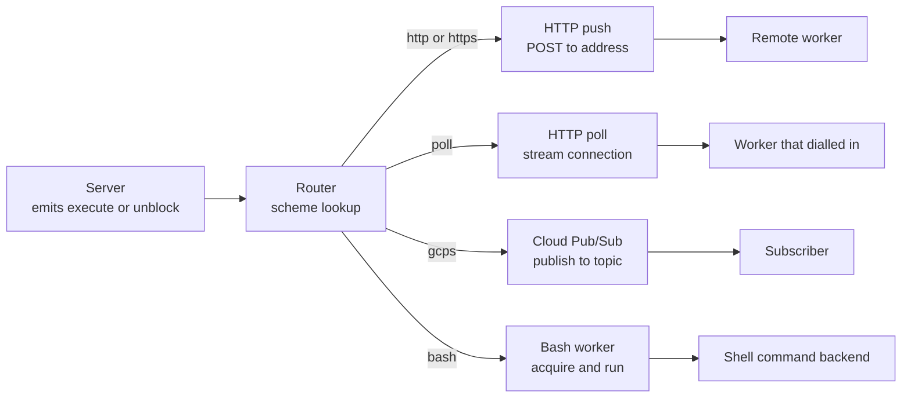
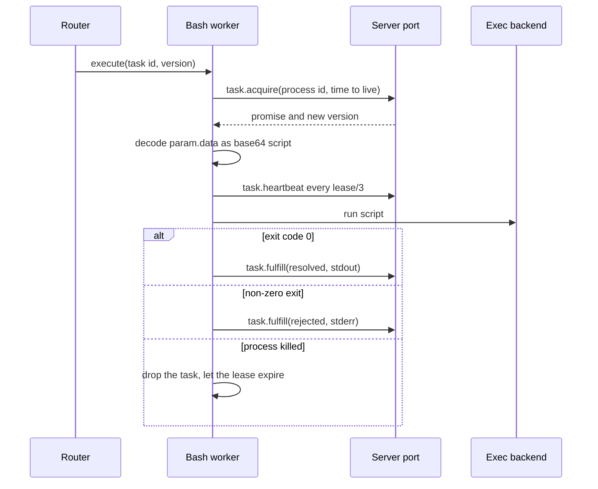

# Transports and workers: four ways to reach a task

A durable promise can carry a target. The target is an address. When the server creates the promise's task and wants it to run, it emits an execute message to that address. The server does not know what the address means past its scheme. A worker plugin owns the rest.

This chapter follows four worker plugins. A transport moves the message to another process. A worker executes the task itself. Three plugins are transports, and one is the bash worker. Together they claim five address schemes: `http` and `https` for push, `poll` for poll, `gcps` for Google Cloud Pub/Sub, and `bash` for the bash worker. Those five are the complete set that the shipped binary registers.

| Plugin | Scheme | Kind | Enabled by default |
|--------|--------|------|--------------------|
| `transport_http_push` | `http`, `https` | Transport, server dials the worker | Yes |
| `transport_http_poll` | `poll` | Transport, worker dials the server | Yes |
| `transport_gcps` | `gcps` | Transport, publish to Google Cloud Pub/Sub | No |
| `worker_bash` | `bash` | Worker, runs a script in a local child process, a Docker container, or a Tensorlake sandbox | No |

Source: `impl/server/core/src/main.rs:76-79`, `impl/server/core/crates/resonate-transport-http-push/src/lib.rs:8-13`, `impl/server/core/crates/resonate-transport-http-poll/src/lib.rs:21-26`, `impl/server/core/crates/resonate-transport-gcps/src/lib.rs:10-16`, `impl/server/core/crates/resonate-worker-bash/src/lib.rs:13-18`

Two transports use the Hypertext Transfer Protocol (HTTP): push and poll. The other two claim the `gcps` scheme and the `bash` scheme.

## What the router guarantees, and what it does not

The router knows only the scheme. It parses the address as a Uniform Resource Identifier, reads the scheme, and hands the whole untouched address to the registered worker.

Source: `impl/server/core/crates/resonate-core/src/router.rs:1-20`

The worker parses everything after the scheme. A malformed `poll://` or `gcps://` address is a valid Uniform Resource Identifier, so it passes admission and is rejected at delivery. That is deliberate: validation must not depend on which transports are enabled.

Source: `impl/server/core/crates/resonate-core/src/address.rs:7-23`

A worker's `process` returns `Result<(), Unavailable>`. Success means the worker accepted the message for delivery. It does not mean the destination received it. The distinction is in the trait documentation, and it is why the router is a hand-off point rather than a result channel.

Source: `impl/server/core/crates/resonate-core/src/worker.rs:40-77`

`Unavailable` carries a cause. `Unroutable` means the address did not parse or no worker claims its scheme. `Delivery` means a worker accepted the address and could not deliver. The first will not succeed on its own. The second may.

Source: `impl/server/core/crates/resonate-core/src/lib.rs:43-80`

## HTTP push

The HTTP push transport is the default transport. The server sends a `POST` request to the worker's Uniform Resource Locator (URL), with the message as a JavaScript Object Notation (JSON) body.

### Configuration

| Setting | Default | Meaning |
|---------|---------|---------|
| `enabled` | `true` | Serve the `http` and `https` schemes |
| `concurrency` | 100 | Deliveries in flight at once |
| `connect_timeout` | 5,000 ms | Time to establish the connection |
| `request_timeout` | 30,000 ms | Time for the whole request |
| `auth` | `None` | Outbound authorization mode |

Source: `impl/server/core/crates/resonate-transport-http-push/src/lib.rs:39-74`

A zero concurrency is refused at configuration time. Zero permits would size the delivery semaphore to nothing, so the dispatcher could never acquire a slot. Every message would queue and then block the loop that feeds it, forever.

Source: `impl/server/core/crates/resonate-transport-http-push/src/lib.rs:20-29`

The authorization mode has three values: `None`, `Bearer`, and `Gcp`. `Bearer` sends a static token. `Gcp` obtains an OpenID Connect identity token from the Google Cloud metadata server. The header name defaults to `Authorization`.

Source: `impl/server/core/crates/resonate-transport-http-push/src/lib.rs:91-160`

### The delivery queue and backpressure

`send` does not perform a network call. It puts a job on an in-memory queue and returns. The queue has capacity equal to `concurrency`. The dispatcher takes one job at a time, waits for a semaphore permit, and spawns the actual delivery.

Source: `impl/server/core/crates/resonate-transport-http-push/src/lib.rs:299-330`, `impl/server/core/crates/resonate-transport-http-push/src/lib.rs:333-365`

The code comment states the intended chain. A full in-flight set parks the dispatcher on the semaphore. The queue then fills. A full queue parks `send`. `send` is called from the claim loop that feeds the router. The database is the durable buffer at the end of that chain.

Source: `impl/server/core/crates/resonate-transport-http-push/src/lib.rs:309-316`

That is the correct place for backpressure. The server does not drop work when workers are slow. It stops claiming new work, and the pending tasks remain durable with their retry deadlines.

A delivery outcome is logged, not returned. A non-success status is a warning. A connection error is a warning with a kind of `connect`, `timeout`, or `other`. The message is not retried by this transport. An execute message returns through the task's retry deadline. An unblock message does not return, and the server documents that as the same behaviour the old outbox had.

Source: `impl/server/core/crates/resonate-transport-http-push/src/lib.rs:430-456`, `impl/server/core/crates/resonate-sql/src/server.rs:186-198`

`init` builds the HTTP client and starts the dispatcher. `stop` closes the queue and waits for the dispatcher to drain. Nothing in this transport runs on wall time except the request timeout, so the debug flag changes nothing.

Source: `impl/server/core/crates/resonate-transport-http-push/src/lib.rs:367-390`

## HTTP poll with Server-Sent Events (SSE)

Some workers cannot be dialled. They sit behind a firewall or a network address translation device, or they have no stable address. HTTP poll inverts the direction: the worker opens a long-lived connection to the server, and the server pushes messages down it.

Source: `impl/server/core/crates/resonate-transport-http-poll/src/lib.rs:1-16`

### One listener, shared routes

This transport has an inbound half. Workers connect to `GET /poll/:group/:id` and receive Server-Sent Events.

The transport does not bind a socket. It registers the route with the shared `Routes` value. The HTTP gateway that owns the listener serves the route. One listener serves the protocol and every plugin that has put a route on it.

Source: `impl/server/core/crates/resonate-transport-http-poll/src/lib.rs:1-16`, `impl/server/core/crates/resonate-transport-http-poll/src/lib.rs:58-70`

That design removes a dependency that used to exist. The route was once hosted by the HTTP gateway, which meant the gateway named the poll registry, and one plugin reached into another plugin's concrete type. The shared route table removes that edge.

Source: `impl/server/core/crates/resonate-transport-http-poll/src/lib.rs:385-392`

### Configuration

| Setting | Default | Meaning |
|---------|---------|---------|
| `enabled` | `true` | Serve the `poll` scheme |
| `max_connections` | 1,000 | Concurrent Server-Sent Events connections |
| `buffer_size` | 100 | Per-connection message buffer |
| `keepalive_interval_ms` | unset | Send a comment frame when idle |

Source: `impl/server/core/crates/resonate-transport-http-poll/src/lib.rs:75-118`

The configuration has no `bind` and no authentication setting. The gateway owns the listener, so the gateway owns the address and the policy that admits a connection. One door, one lock.

Source: `impl/server/core/crates/resonate-transport-http-poll/src/lib.rs:95-100`

Three values are refused. A zero buffer would panic the channel constructor. A zero connection limit would accept nothing while still claiming the scheme. A zero keepalive would be a timer that fires as fast as it can. The last one is expressed as unset, not zero.

Source: `impl/server/core/crates/resonate-transport-http-poll/src/lib.rs:33-56`

Authentication for the inbound connection is the gateway's. The route handler receives the gateway's `AuthMode` and calls `check_token` before it registers the connection.

Source: `impl/server/core/crates/resonate-transport-http-poll/src/lib.rs:394-415`

### Address syntax

The address is `poll://<cast>@<group>[/<id>]`.

- `cast` is `uni` for one specific connection or `any` for any connection in the group.
- `group` is the routing group.
- `id` is optional and names a specific worker.

A dispatch target from the Software Development Kit has no process identifier. It is `poll://any@group`. A worker's own address is `poll://<cast>@<group>/<pid>`. An address parser must accept both forms.

Source: `impl/server/core/crates/resonate-transport-http-poll/src/lib.rs:140-165`, `spec/work/ts/README.md:136-147`

### The registry and stop

`PollRegistry` holds a map from group name to a list of connections. Each connection owns the sending half of a channel. The handler owns the receiving half and turns it into a Server-Sent Events stream.

Source: `impl/server/core/crates/resonate-transport-http-poll/src/lib.rs:174-240`

The registry owns every sender deliberately. `stop` clears the map, which drops every sender, which ends every stream. This is what makes the gateway shutdown order work: the gateways stop after the workers, and a gateway drain can wait for a stream that a worker has now ended.

Source: `impl/server/core/crates/resonate-transport-http-poll/src/lib.rs:338-365`

If a caller held its own `Arc` to a connection, its sender would stay alive and the stream would never see the channel close. The registry returns a connection identifier, not the connection, so no caller can keep a sender alive by accident.

Source: `impl/server/core/crates/resonate-transport-http-poll/src/lib.rs:219-230`

## Google Cloud Pub/Sub

The `gcps` transport publishes messages to a topic. The address is `gcps://project/topic`. The address must carry the project. The configuration declares a `project` setting, but no code reads it.

Source: `impl/server/core/crates/resonate-transport-gcps/src/lib.rs:1-10`, `impl/server/core/crates/resonate-transport-gcps/src/lib.rs:92-115`

| Setting | Default | Meaning |
|---------|---------|---------|
| `enabled` | `false` | Serve the `gcps` scheme |
| `project` | unset | Declared but not read; the address must carry the project |
| `concurrency` | 100 | Concurrent publishes |
| `timeout` | 30,000 ms | Publish timeout |

Source: `impl/server/core/crates/resonate-transport-gcps/src/lib.rs:39-72`

Authentication uses Application Default Credentials, or ADC. The transport obtains credentials from the environment in which the server runs. Publishers are cached per topic, so a repeated delivery to the same topic reuses the client.

Source: `impl/server/core/crates/resonate-transport-gcps/src/lib.rs:1-7`, `impl/server/core/crates/resonate-transport-gcps/src/lib.rs:204-220`

The delivery shape is the same as HTTP push: a queue, a dispatcher, and a semaphore. `send` blocks only when the queue is full, never on the publish remote procedure call.

Source: `impl/server/core/crates/resonate-transport-gcps/src/lib.rs:177-194`

The transport is disabled by default because it requires cloud credentials and a topic. A server that enabled it without them would fail at startup or, worse, at the first delivery.

## The bash execution worker

The bash worker is not a transport. The other end of a `bash://` address is a script backend that the server starts. The worker does not deliver the message to another message service. It acquires the task, runs a script, and settles the promise. Every state change goes through the `ResonateServer` port, which is the same path that a remote worker's HTTP request takes.

Source: `impl/server/core/crates/resonate-worker-bash/src/lib.rs:1-10`

One scheme has three backends.

| Address | Backend | Where the script runs |
|---------|---------|-----------------------|
| `bash://` | Local | A child process of the server |
| `bash://docker/<image>` | Docker | A container from the image |
| `bash://tensorlake/<image>` | Tensorlake | A sandbox from the image |

Source: `impl/server/core/crates/resonate-worker-bash/src/lib.rs:9-10`, `impl/server/core/crates/resonate-worker-bash/src/lib.rs:140-195`

### Configuration

| Setting | Default | Meaning |
|---------|---------|---------|
| `enabled` | `false` | Serve the `bash` scheme |
| `lease_timeout` | 15,000 ms | Lease time requested at acquire, and the heartbeat basis |

Source: `impl/server/core/crates/resonate-worker-bash/src/lib.rs:43-68`

A lease time below 1 is refused, because `task.acquire` validates a time to live of at least 1. A non-positive value would make every acquire fail with a `400`, and the worker would silently never run anything.

Source: `impl/server/core/crates/resonate-worker-bash/src/lib.rs:28-36`

The lease must outlast the script. If it expires, the task is redispatched to another worker while this one is still running.

The setting has its own default. It used to be unset-means-follow `tasks.lease_timeout`, which was a cross-section read that no other plugin makes. Configuration stops at a plugin's own edge.

Source: `impl/server/core/crates/resonate-worker-bash/src/lib.rs:48-58`

### The task lifecycle

`process` receives a message. Only an `execute` message gives the worker something to run. An `unblock` message is a notification for a waiting worker and has no local counterpart, so it is accepted and ignored.

Source: `impl/server/core/crates/resonate-worker-bash/src/lib.rs:225-240`

The worker then spawns `run_task`, which executes five steps.

Source: `impl/server/core/crates/resonate-worker-bash/src/lib.rs:361-530`

**Step 1, acquire.** The worker calls `task.acquire` with a process identifier and the lease time. A `409` means another worker won the race, which is normal. Any other non-`200` is a warning, and the worker drops the task rather than settling the promise.

Source: `impl/server/core/crates/resonate-worker-bash/src/lib.rs:374-415`

**Step 2, decode.** The script is the base64 decoding of `param.data`. If the field is missing, or is not valid base64 text, the worker rejects the promise with a message that names the problem.

Source: `impl/server/core/crates/resonate-worker-bash/src/lib.rs:416-430`

**Step 3, heartbeat.** The worker sends `task.heartbeat` every `lease_timeout / 3` milliseconds, with a floor of 1,000 ms. The beat starts only when the debug flag is off. Under debug, the clock belongs to the caller, and a beat against wall time would renew a lease that a test is trying to let expire.

Source: `impl/server/core/crates/resonate-worker-bash/src/lib.rs:432-460`

**Step 4, run.** The backend receives the script, the task identifier, the created time, and the timeout time. The local backend starts a child process. The Docker backend starts a container. The Tensorlake backend starts a sandbox.

Source: `impl/server/core/crates/resonate-worker-bash/src/lib.rs:462-480`

**Step 5, settle.** The outcome has four branches.

- A backend error rejects the promise.
- Exit code 0 resolves the promise with the trimmed standard output.
- A non-zero exit code rejects the promise with the trimmed standard error, or with `exit code N` when the error stream is empty.
- A killed process is neither. The worker drops the task without settling, so the lease expires and the message is redispatched to a fresh worker.

Source: `impl/server/core/crates/resonate-worker-bash/src/lib.rs:482-530`

The killed-process branch is the important one. A signal, a container exit code of 137 or 143, or a sandbox report of `signaled` is an infrastructure failure, not a task failure. Settling the promise would make a transient failure permanent.

### Environment and credentials

The exec backend receives three environment variables:

| Variable | Value |
|----------|-------|
| `RESONATE_PROMISE_ID` | The task identifier |
| `RESONATE_PROMISE_CREATED_AT` | The promise creation time |
| `RESONATE_PROMISE_TIMEOUT_AT` | The promise deadline |

Source: `impl/server/core/crates/resonate-worker-bash/src/lib.rs:110-120`

The Tensorlake backend reads `TENSORLAKE_API_KEY` from the environment. `init` builds the backend, and a delivery that arrives before `init` returns an `Unavailable` error that names the missing start.

Source: `impl/server/core/crates/resonate-worker-bash/src/lib.rs:282-290`, `impl/server/core/crates/resonate-worker-bash/src/lib.rs:631-670`

## Command-line interface (CLI) defaults that disagree with the code

The `serve` command has a typed flag for each transport setting. The help text states a default for some of them.

| Flag | Help text | Effective default |
|------|-----------|-------------------|
| `--transports-http-push-concurrency` | 16 | 100 |
| `--transports-http-push-connect-timeout` | 10,000 ms | 5,000 ms |
| `--transports-http-push-request-timeout` | 180,000 ms | 30,000 ms |

Source: `impl/server/core/src/serve.rs:152-164`, `impl/server/core/crates/resonate-transport-http-push/src/lib.rs:39-74`

The effective default is the one in the transport configuration. Each flag is an `Option`, and an absent flag writes no override. The transport's own `#[serde(default)]` value therefore applies. The help text is stale.

This matters to an operator who reads `--help` and expects 180 seconds for a request. The server will use 30 seconds. The correct source for a default is the plugin configuration, not the command-line help.

## Aha: the two directions of backpressure meet at the database

The four plugins look different, but they answer one question the same way. What happens when the destination is slower than the server?

HTTP push answers with a semaphore, a bounded queue, and a blocked `send`. Google Cloud Pub/Sub uses the same shape. The blocked `send` propagates to the claim loop. The claim loop stops claiming new tasks. The durable tasks remain pending, and their retry deadlines bring them back.

HTTP poll answers with a bounded channel per connection. A slow consumer fills its buffer. The send attempt fails, and the message is not delivered. The task stays pending, and its retry deadline brings it back.

The bash worker answers by acquiring the task first. A task that is already acquired cannot be acquired again. The lease and the retry deadline are the flow control.

In every case, the database is the buffer. No transport owns a durable queue. No transport needs one. The promise table already holds every task that is waiting, and the retry timeout re-emits every execute message that did not land. An unblock message is the exception: it is not re-emitted, and the source accepts that loss as the same behaviour the old outbox had.

Source: `impl/server/core/crates/resonate-transport-http-push/src/lib.rs:309-316`, `impl/server/core/crates/resonate-transport-http-poll/src/lib.rs:286-320`, `impl/server/core/crates/resonate-worker-bash/src/lib.rs:374-391`

This is the same idea as the timer wheel in the storage chapter. The durable record is the truth. The in-memory structure is an optimisation with a bounded error. The sweep or the retry deadline closes the gap.

## Related documents

- [05-the-server-core.md](05-the-server-core.md) — the router, the ports, and the start and stop order.
- [06-storage-engines.md](06-storage-engines.md) — the durable state that backs the retry deadlines.
- [08-gateways-console-and-metrics.md](08-gateways-console-and-metrics.md) — the listener that serves the poll route.
- [11-schedules-timers-and-time.md](11-schedules-timers-and-time.md) — retry and lease deadlines in depth.
- [15-observability-and-operations.md](15-observability-and-operations.md) — delivery metrics and failure handling.
- [README.md](README.md) — the reading order and the document map.
