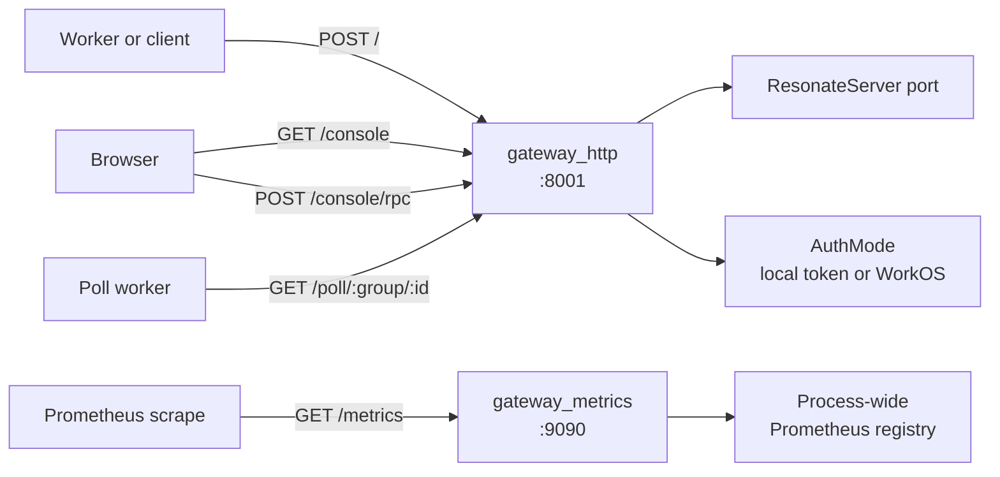
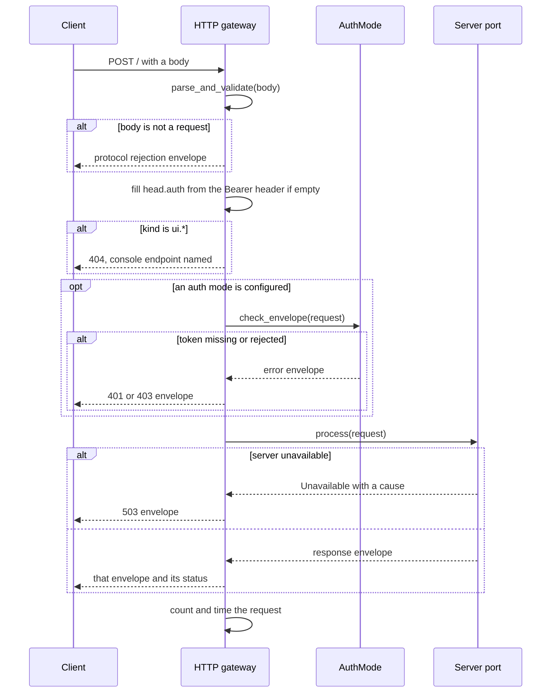

# Gateways, console, and metrics: the three doors

The server has three gateway plugins. One serves the protocol to workers and clients. One serves a web console to a person with a browser. One serves Prometheus metrics to a monitoring system.

The Hypertext Transfer Protocol (HTTP) gateway owns the socket on port 8001 and serves the protocol. The web console adds its routes to that same listener. The metrics gateway owns a separate socket on port 9090.

A gateway plugin is a Rust crate compiled into the binary and configured at startup. A request envelope is a JavaScript Object Notation (JSON) object with a top-level `kind`, a `head`, and a `data` body. The `head` carries the authentication token, a correlation identifier, a protocol version, and an optional debug time. In this chapter, port also names the trait boundary, such as `ResonateServer`, not only a Transmission Control Protocol port.

| Gateway | Default bind | Own listener | Serves |
|---------|--------------|--------------|--------|
| `gateway_http` | `0.0.0.0:8001` | Yes | The protocol route, readiness, and routes registered by other plugins |
| `gateway_web` | None | No, it adds routes to the HTTP gateway | The embedded console at `/console` and its `/console/rpc` endpoint |
| `gateway_metrics` | `0.0.0.0:9090` | Yes | `GET /metrics` in the Prometheus text format |

Source: `impl/server/core/crates/resonate-gateway-http/src/lib.rs:62-121`, `impl/server/core/crates/resonate-gateway-web/src/lib.rs:85-120`, `impl/server/core/crates/resonate-gateway-metrics/src/lib.rs:47-76`

The HTTP gateway on port 8001 merges its own routes with the poll route and the console, with authentication between it and the server port. The metrics gateway on port 9090 reads the process-wide registry and makes no server calls.

## The HTTP gateway

The Hypertext Transfer Protocol (HTTP) gateway is an adapter. It speaks one wire format and knows nothing about promises, tasks, or schedules. Requests arrive as bytes, become envelopes, and go to a `dyn ResonateServer`. What comes back becomes a status and a body.

Source: `impl/server/core/crates/resonate-gateway-http/src/lib.rs:1-9`

### Configuration

| Setting | Default | Meaning |
|---------|---------|---------|
| `enabled` | `true` | Serve at all |
| `bind` | `0.0.0.0:8001` | Listen address |
| `cors_allow_origins` | empty | Origins allowed by Cross-Origin Resource Sharing |
| `auth` | unset | Local JavaScript Object Notation (JSON) Web Token verification |
| `workos` | unset | WorkOS Application Programming Interface (API) key validation |
| `abort_on_panic` | `false` | Abort the process on a handler panic |

Source: `impl/server/core/crates/resonate-gateway-http/src/lib.rs:62-121`

An empty origin list disables Cross-Origin Resource Sharing (CORS) headers. Same-origin requests, including the console, still work. `*` allows every origin; with bearer tokens, that exposes the token to any page that can read it, so list origins instead.

The `bind` setting is one string. The module documentation notes that it used to be a host and a port in two fields, unlike the other listening plugins, for no reason anybody could name.

Source: `impl/server/core/crates/resonate-gateway-http/src/lib.rs:71-76`

`auth` and `workos` are mutually exclusive. A gateway verifies tokens one way, and naming both is a startup error rather than a silent precedence.

Source: `impl/server/core/crates/resonate-gateway-http/src/lib.rs:84-91`, `impl/server/core/crates/resonate-gateway-http/src/lib.rs:251-264`

`abort_on_panic` is for a single-process store. For SQLite, a panic in the middle of a transaction can leave in-memory state that the next request would read. Aborting is the safer failure. A server whose state is in a database elsewhere answers `500` and carries on.

Source: `impl/server/core/crates/resonate-gateway-http/src/lib.rs:93-100`

### Routes

The gateway serves five route groups across five rows: the protocol route, readiness, and the three legacy prefixes. Each legacy prefix has two registrations, one for the exact path and one for the wildcard path, so the table holds eight registrations in all. The poll route is registered by another plugin and merged into this listener, so it is not one of the five.

| Route | Method | Purpose |
|-------|--------|---------|
| `/` | `POST` | The protocol envelope |
| `/ready` | `GET` | Readiness probe |
| `/promises`, `/promises/*path` | any | Legacy path, answers `410` |
| `/schedules`, `/schedules/*path` | any | Legacy path, answers `410` |
| `/tasks`, `/tasks/*path` | any | Legacy path, answers `410` |

Source: `impl/server/core/crates/resonate-gateway-http/src/routes.rs:82-106`

The legacy paths answer `410 Gone` with a message that tells the caller to update the Software Development Kit (SDK).

There is one readiness probe, at `/ready`. An earlier `/health` said the same thing, so the code keeps one. The server trait decides the answer: its `ready` method defaults to true, and a backend that can tell, such as the blob server asking whether its bucket answers, reports for itself. A pod whose storage went away returns `503` rather than taking traffic it cannot serve.

Source: `impl/server/core/crates/resonate-gateway-http/src/routes.rs:108-123`

### The request path

`handle_api` is the whole translation. It runs six steps.

1. **Parse and validate at the edge.** A body that is not a request never reaches the server. The function `parse_and_validate` decides what the protocol admits. When it fails, `salvage_context` extracts whatever kind and correlation identifier it can from the bytes, so even the rejection can be correlated.
2. **Fill the token.** If the envelope left `head.auth` empty and the request carries `Authorization: Bearer <token>`, the gateway copies the token into the envelope. Nothing downstream can tell the two origins apart.
3. **Refuse the console namespace.** Any `ui.*` kind receives a `404` with a message that the console has its own endpoint.
4. **Authorize.** When an auth mode is configured, `check_envelope` runs. A rejection is returned as an envelope, counted, and timed.
5. **Process.** The server port receives the envelope. An `Unavailable` error, meaning the server cannot answer because it is stopped or its storage failed, becomes a `503` envelope with the error text.
6. **Observe.** The gateway increments `resonate_request_total` with the kind and status, and observes `resonate_request_duration_seconds` with the kind.

Source: `impl/server/core/crates/resonate-gateway-http/src/routes.rs:147-269`

Only an authentication rejection and a processed request reach the counters. A body that fails validation and a `ui.*` refusal return before either metric is touched.

The bearer parser is exact. It accepts only the `Bearer ` prefix, and the match is case-sensitive, so lowercase `bearer` is not accepted. A different scheme returns `None` rather than a guess. `Bearer ` with nothing after it is an empty string, and the auth check rejects it like any other bad token.

Source: `impl/server/core/crates/resonate-gateway-http/src/routes.rs:131-145`

The `ui.*` refusal is a boundary, not a missing implementation. The engines would answer the requests. The worker endpoint refuses them so that an SDK cannot come to depend on a request that exists to draw a table. The read model can then change without touching the protocol that workers speak.

Source: `impl/server/core/crates/resonate-gateway-http/src/routes.rs:183-199`

### Layers and shared routes

Every plugin that registers an HTTP route puts it in the shared `Routes` value. The HTTP gateway merges those routes into its own application before it applies its layers.

The order matters. A registered route receives the same panic guard, the same tracing, and the same Cross-Origin Resource Sharing policy as the protocol route. A route served here is served on the same terms, not through a hole beside them.

Source: `impl/server/core/crates/resonate-gateway-http/src/lib.rs:163-214`

The panic guard catches a panic, logs it, and either aborts the process or returns a `500` envelope with the message. The trace layer logs a span and the response at the information level, and a failure at the error level.

Source: `impl/server/core/crates/resonate-gateway-http/src/lib.rs:176-207`

The poll route depends on this order. The poll transport registers `GET /poll/:group/:id`, and the HTTP gateway serves it on the same port. One port, one process, one authentication policy.

Source: `impl/server/core/crates/resonate-transport-http-poll/src/lib.rs:58-70`

### Startup

`init` reads the key material, builds the extra routes now that the auth policy exists, builds the application, and binds the listener.

The order is deliberate: a route that must authenticate like the protocol cannot be built before the key is read. By the time any gateway starts, every plugin is configured, so nothing can register a route after the list is drained.

Source: `impl/server/core/crates/resonate-gateway-http/src/lib.rs:267-300`

A bad key path stops the process at startup. It does not surface later as a request that nobody can authenticate.

## Authentication and authorization

Authentication is envelope-based, not transport-based. The check reads `head.auth`. The source comment names an HTTP gateway, a NATS gateway, and an in-process caller; because the check reads only the envelope, every caller authorizes in the same way. What the check needs beyond the envelope is policy, which is why authentication is its own crate rather than part of the core.

Source: `impl/server/core/crates/resonate-auth/src/lib.rs:1-10`

The gateway picks exactly one state at startup: no authentication, local token verification, or WorkOS validation. With neither `auth` nor `workos`, every request is accepted.

| Mode | Authenticates with | Authorizes against |
|------|--------------------|--------------------|
| Local JSON Web Token | A public key | A prefix claim and an optional admin role |
| WorkOS | A remote API call per request | The organization the key is scoped to: the owner organization for an organization-owned key, or the user's organization for a user-owned key |

Source: `impl/server/core/crates/resonate-auth/src/lib.rs:39-90`

### Local JSON Web Token verification

The local mode reads a small settings section.

| Setting | Default | Meaning |
|---------|---------|---------|
| `publickey` | empty | Path to a Public-Key Cryptography Standards key file, or `"none"` for unsigned tokens |
| `iss` | unset | Required issuer |
| `aud` | unset | Required audience |

Source: `impl/server/core/crates/resonate-auth/src/lib.rs:105-170`

The key family is detected from the key file.

| Key family | Accepted algorithms |
|------------|---------------------|
| Rivest-Shamir-Adleman (RSA) | RS256, RS384, RS512, PS256, PS384, PS512 |
| Elliptic Curve | ES256, ES384 |
| Ed25519 | EdDSA |

Source: `impl/server/core/crates/resonate-auth/src/lib.rs:186-225`

The token header algorithm must be in the accepted set for the loaded key. A token that names a different algorithm is rejected before the signature check.

Source: `impl/server/core/crates/resonate-auth/src/lib.rs:390-400`

The expiration claim (`exp`) is always required and always validated. The issuer claim (`iss`) is required when an issuer is configured, and the audience claim (`aud`) is required when an audience is configured. When no audience is configured, audience validation is disabled, so a token minted for another service is accepted if its signature and issuer match.

Source: `impl/server/core/crates/resonate-auth/src/lib.rs:405-423`

A configuration value of `publickey = "none"` accepts unsigned tokens. This is explicitly for debug and test use. In that mode the signature check is disabled, but the claims checks still apply.

Source: `impl/server/core/crates/resonate-auth/src/lib.rs:143-161`, `impl/server/core/crates/resonate-auth/src/lib.rs:399-407`

### Prefix authorization

After authentication, a token with a value of `admin` in its `role` claim bypasses every prefix check. The value comparison is case-insensitive.

Source: `impl/server/core/crates/resonate-auth/src/lib.rs:283-290`

A non-admin token must carry a `prefix` claim.

- An absent claim is forbidden.
- A null claim is forbidden.
- A non-string claim is forbidden.
- An empty string is a wildcard and grants access to everything.
- A non-empty string must be a prefix of the request's resource identifier. A claim of `tenant-a:` matches `tenant-a:order-1` but not `xtenant-a:order-1`.

Source: `impl/server/core/crates/resonate-auth/src/lib.rs:294-383`

The resource identifier comes from the operation's data, and the mapping is explicit.

| Operation family | Resource identifier |
|------------------|---------------------|
| Promise get, create, and settle, schedule get, and most task operations | `data.id` |
| Promise register callback and register listener | `data.awaited` |
| `schedule.create` | `data.promiseId` |
| `task.create` | `data.action.data.id` |
| `task.heartbeat` | Every task identifier in `data.tasks` must match |
| Searches | An empty string, which no non-empty prefix can match |

Source: `impl/server/core/crates/resonate-auth/src/lib.rs:322-346`, `impl/server/core/crates/resonate-auth/src/lib.rs:438-481`

An unknown operation kind fails closed. `extract_resource_id` returns an empty string for a kind it does not know, and an empty string starts with no non-empty prefix. A newly added command is therefore denied to every prefix-restricted token until the mapping is extended. The wildcard exception remains: an empty prefix is checked before the kind matters, so it still reaches everything.

Source: `impl/server/core/crates/resonate-auth/src/lib.rs:475-481`

A known kind whose identifier field is absent is a different case. `extract_resource_id` returns `None` when `data.id`, `data.awaited`, `data.promiseId`, or `data.action.data.id` is missing, and `auth_check` treats `None` as allowed. A prefix-restricted token that sends `promise.settle` without an `id` is not stopped by the prefix check; the server port rejects the malformed request later for its own reasons.

Source: `impl/server/core/crates/resonate-auth/src/lib.rs:354-368`

One heartbeat request names a set of tasks, so every identifier in the set is checked, and a single mismatch rejects the whole request.

Source: `impl/server/core/crates/resonate-auth/src/lib.rs:322-345`

| Outcome | Status |
|---------|--------|
| No token, or a token that fails verification | `401 Unauthorized` |
| A valid token with a missing, null, wrong-typed, or non-matching prefix | `403 Forbidden` |

Source: `impl/server/core/crates/resonate-auth/src/lib.rs:247-383`

### WorkOS authentication

WorkOS mode uses two keys with two roles.

| Key | Owner | Purpose |
|-----|-------|---------|
| Server secret key, prefix `sk_` | The application | Authenticate to the WorkOS API |
| Client API key | The end user | Sent as the bearer token on each request |

Source: `impl/server/core/crates/resonate-auth/src/workos.rs:1-16`

The server key never leaves the server; the client key arrives on every request.

| Setting | Default | Meaning |
|---------|---------|---------|
| `api_key` | required | The server's own WorkOS secret key |
| `org_id` | required | The organization every client key must belong to |
| `base_url` | `https://api.workos.com` | The WorkOS Application Programming Interface (API) base address |

Source: `impl/server/core/crates/resonate-auth/src/workos.rs:40-96`

A missing `api_key` or `org_id` stops the process at startup. The mode is not silently weakened to a mode that accepts everything.

#### The validation call

For each request, the server calls `POST /api_keys/validations` on the WorkOS API. It sends the server secret key as bearer authentication and the client key in the request body as `{"value": "<client key>"}`.

Source: `impl/server/core/crates/resonate-auth/src/workos.rs:163-180`

The HTTP client has a five-second timeout. It is stateless: the client holds the configuration and the HTTP connection pool.

Source: `impl/server/core/crates/resonate-auth/src/workos.rs:145-160`

The response names an owner. An organization-owned key carries the organization identifier directly. A user-owned key carries the organization that the user belongs to.

Source: `impl/server/core/crates/resonate-auth/src/workos.rs:118-135`, `impl/server/core/crates/resonate-auth/src/workos.rs:205-216`

#### The decisions

| Condition | Status |
|-----------|--------|
| No token | `401 Unauthorized` |
| WorkOS returns `401`, meaning the server key is invalid | `401 Unauthorized` |
| WorkOS call fails, or the response cannot be read | `401 Unauthorized` |
| The key is valid but is not scoped to an organization | `403 Forbidden` |
| The key belongs to a different organization than the configured one | `403 Forbidden` |

Source: `impl/server/core/crates/resonate-auth/src/workos.rs:180-205`, `impl/server/core/crates/resonate-auth/src/workos.rs:226-285`

The three `401` rows are one status with three causes: an invalid client key, an invalid server key, and a network failure all return `401` with the same `Unauthorized` text. Only the server log distinguishes them, so an operator cannot tell a bad token from a WorkOS outage from the response alone.

WorkOS mode authenticates and matches the organization. It does not perform prefix authorization: a WorkOS key carries no prefix claim and no role, so there is nothing further to authorize against.

Source: `impl/server/core/crates/resonate-auth/src/lib.rs:57-64`

The two modes therefore enforce different things. A local token can be restricted to a namespace of identifiers. A WorkOS key is all-or-nothing within one organization. An operator who needs per-identifier restriction must use the local mode.

## The web console

The console is a built single-page application, embedded in the binary. `cargo build` alone produces the shipping binary, because the built assets are committed: no Node.js on the build machine, no network, and nothing to install. Node.js is needed only to run `make console`, which regenerates the assets after a change to the user interface. A build from a clean checkout never runs it.

Source: `impl/server/core/crates/resonate-gateway-web/src/lib.rs:24-36`

The assets are committed. Fonts are vendored. The crate documentation gives the reason: the console has to work on an air-gapped install.

### Routes

The console has one remote procedure call (RPC) route and a set of asset routes.

| Setting | Default | Meaning |
|---------|---------|---------|
| `enabled` | `true` | Add the console routes to the host gateway |
| `redirect_root` | `true` | Answer `GET /` with a redirect to `/console/` |

Source: `impl/server/core/crates/resonate-gateway-web/src/lib.rs:89-120`

The console has no `bind`, no `auth`, and no `abort_on_panic` setting. It contributes routes to whichever gateway owns the listener, so that gateway owns the address, the policy, and the panic guard. With `redirect_root` off, `GET /` is left to the protocol route, which answers `405` because the protocol route only admits `POST`. With `enabled` off, `routes` returns no router at all and `/console` is a `404`.

| Route | Result |
|-------|--------|
| `GET /` | `303` redirect to `/console/` |
| `GET /console`, `/console/` | The application shell |
| `GET /console/<anything>` | An embedded asset, or the shell for a client-side route |
| `POST /console/rpc` | One envelope in, one envelope out |

Source: `impl/server/core/crates/resonate-gateway-web/src/lib.rs:16-23`, `impl/server/core/crates/resonate-gateway-web/src/lib.rs:137-153`

The console does not own a listener. It contributes routes, and the HTTP gateway serves them. Turning the console off leaves the API where it was and `/console` a `404`. There is no second port to notice.

Source: `impl/server/core/crates/resonate-gateway-web/src/lib.rs:1-11`

The mount point is a constant. It is baked into the built application by SvelteKit's `paths.base` setting, so it cannot be a runtime setting.

Source: `impl/server/core/crates/resonate-gateway-web/src/lib.rs:71-77`

### The asset fallback rule

A request for an unknown path under `/console` is a client-side route. The path `/console/executions/checkout.order-8842` is a page, and the browser router resolves it. Such a request receives the shell.

A request for a file that the build should have produced is different. Answering Hypertext Markup Language (HTML) to a request for a script is the failure that costs an hour to diagnose. The handler tests the extension against the set the build emits: `js`, `mjs`, `css`, `map`, `json`, `svg`, `woff`, `woff2`, `png`, `webp`, `ico`, `html`, and `txt`. A missing file with one of those extensions is a `404`. Everything else falls back to the shell. `html` is in the set because the shell itself is a real file: a request for a named page that the build did not produce must fail rather than receive a second copy of the shell under the wrong address.

Source: `impl/server/core/crates/resonate-gateway-web/src/lib.rs:166-205`

Caching follows the same logic. Everything under `app/immutable` is content-hashed by the build, so it is cached for one year with the `immutable` directive. The shell is not hashed, so it is served with `no-cache`.

Source: `impl/server/core/crates/resonate-gateway-web/src/lib.rs:207-223`

### The console boundary

`ui.*` is a read model shaped for one screen at a time. It reaches a server only through `/console/rpc`. The worker route refuses the whole namespace.

Source: `impl/server/core/crates/resonate-gateway-web/src/lib.rs:12-19`, `impl/server/core/crates/resonate-gateway-http/src/routes.rs:183-199`

The console route does not restrict itself to `ui.*`. The console's write action is `promise.settle`, which is the real protocol request, not a console-shaped alias. So the two routes differ in what they accept: the worker route accepts protocol kinds and refuses `ui.*`, while the console route accepts both `ui.*` read kinds and protocol kinds such as `promise.settle`. Neither route invents a kind that the server port does not already implement. The crate documentation is explicit: there is no console-only way to change anything, and no second code path to keep honest.

Source: `impl/server/core/crates/resonate-gateway-web/src/lib.rs:36-44`, `impl/server/core/crates/resonate-gateway-web/src/lib.rs:243-254`

`/console/rpc` performs the same translation as the worker route, with a different set of kinds.

Source: `impl/server/core/crates/resonate-gateway-web/src/lib.rs:243-296`

### Authentication and the honest gap

The console applies the same auth check as the worker route when auth is configured. A console request carries `head.auth` like any other.

There is no login and no session. The token is typed into the Settings screen and kept in the browser. A server with auth enabled therefore serves a console that works only after an operator supplies a token. The source calls this the honest state of it, not a design.

Source: `impl/server/core/crates/resonate-gateway-web/src/lib.rs:45-56`

That sentence is worth pausing on. A browser-based console normally manages a session. This one deliberately does not. The consequence is that the token is kept in browser storage and the server holds no session to revoke. The token works until its own expiration claim passes. Closing the browser does not shorten that time.

The console route also accepts real protocol writes from anyone the auth policy admits. Hiding a button would not change that, which is why the button is not hidden.

Source: `impl/server/core/crates/resonate-gateway-web/src/lib.rs:36-44`

## The metrics gateway

The metrics gateway owns its own socket on port `9090`. It makes no call to the server port.

What it serves is the process-wide default Prometheus registry. Every plugin in the binary declares its counters and histograms into that registry through the re-export from `resonate-plugin`. The metrics crate needs no list of counters and no wiring to the plugins that declare them.

Source: `impl/server/core/crates/resonate-gateway-metrics/src/lib.rs:1-14`

| Setting | Default | Meaning |
|---------|---------|---------|
| `enabled` | `true` | Serve at all |
| `bind` | `0.0.0.0:9090` | Listen address |

Source: `impl/server/core/crates/resonate-gateway-metrics/src/lib.rs:47-76`

The endpoint is enabled by default. The crate documentation gives a practical reason: an endpoint that nobody scrapes costs a socket, and one that is off when an operator expects it costs an incident.

Source: `impl/server/core/crates/resonate-gateway-metrics/src/lib.rs:50-54`

`GET /metrics` encodes the default registry with the Prometheus text encoder. If encoding fails, it returns `500` with a short message.

Source: `impl/server/core/crates/resonate-gateway-metrics/src/lib.rs:86-101`

The metrics are declared by the plugins that own them. The HTTP gateway declares `resonate_request_total` and `resonate_request_duration_seconds`. The Structured Query Language (SQL) server declares delivery and message counters. The storage engines declare their own. The metrics gateway only gathers.

Source: `impl/server/core/crates/resonate-gateway-http/src/routes.rs:31-50`, `impl/server/core/crates/resonate-sql/src/server.rs:186-249`

Keeping metrics on a separate port isolates the route from the protocol. It is not by itself an access control: the default bind is `0.0.0.0:9090` and the endpoint has no authentication. Anyone who can reach the port can read every metric. The separation keeps metrics off the protocol port and out of the bearer-token policy; the network around the process must restrict who reaches port `9090`.

Source: `impl/server/core/crates/resonate-gateway-metrics/src/lib.rs:3-6`, `impl/server/core/crates/resonate-gateway-metrics/src/lib.rs:56-66`

## Aha: the console is a client, not a second API

Most systems with an administrative console grow a second API. By that I mean console-shaped endpoints outside the protocol: the console needs a list of executions, so the server grows a list endpoint; the console needs a detail view, so the server grows a detail endpoint. The endpoints are not in the protocol, but they are reachable, and soon a client depends on them.

Resonate refuses that path in two directions.

First, the read model is a separate namespace, `ui.*`, and the worker endpoint refuses it with a `404`. An SDK cannot reach it by accident, and cannot come to depend on it. The read model can change without touching the protocol.

Second, the console does not get its own write endpoints. When it cancels a promise, it sends `promise.settle`. When it invokes a function, it sends `promise.create`. These are the real requests, and they pass through the same validation, the same authorization, and the same server port as any worker's request.

Source: `impl/server/core/crates/resonate-gateway-web/src/lib.rs:36-44`, `impl/server/core/crates/resonate-gateway-http/src/routes.rs:183-199`

The result is one protocol and one read model, with a hard boundary between them. The console is a client of both. It is not a second API.

The boundary has a cost: the console route accepts protocol writes from anyone the auth policy admits, so the user interface cannot hide a dangerous action. If the policy admits a token, the token can cancel a promise through `/console/rpc` whether or not the button is visible. The policy is the control.

Source: `impl/server/core/crates/resonate-gateway-web/src/lib.rs:36-44`

## Related documents

- [05-the-server-core.md](05-the-server-core.md) — the gateway port and the start and stop order.
- [06-storage-engines.md](06-storage-engines.md) — the read model and its limits.
- [07-transports-and-workers.md](07-transports-and-workers.md) — the poll route served on the same listener.
- [15-observability-and-operations.md](15-observability-and-operations.md) — metrics, logs, readiness, and deployment.
- [16-critical-assessment.md](16-critical-assessment.md) — the limits of the authentication model.
- [README.md](README.md) — the reading order and the document map.
