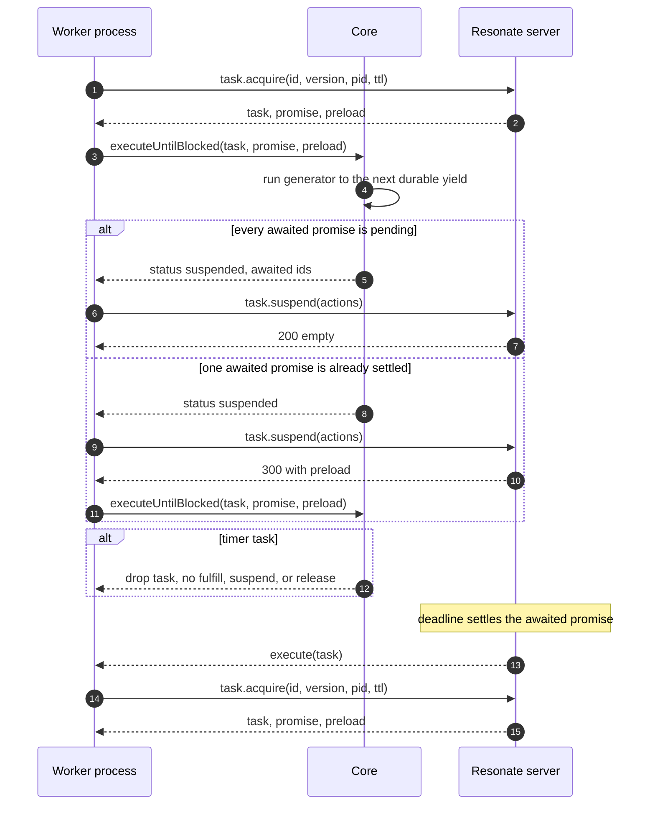
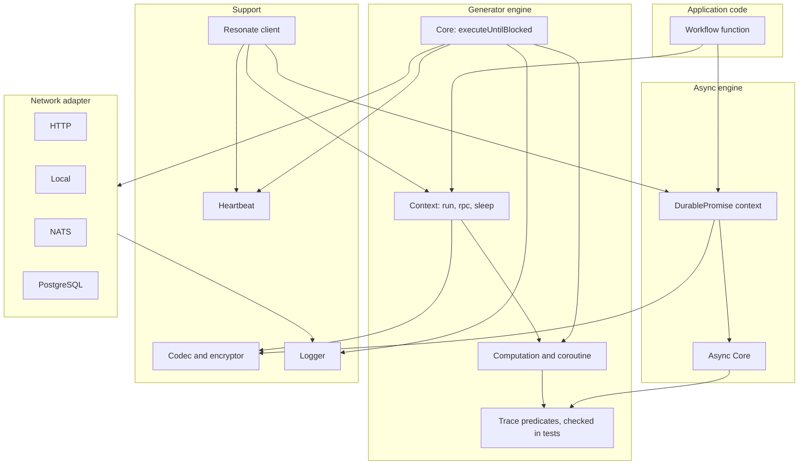

# The TypeScript SDK

The TypeScript Software Development Kit (SDK) is the reference client of the Resonate protocol. Resonate is a durable execution system: a server stores durable promises, and a worker runs registered functions that create and settle those promises. This repository uses the SDK to exercise the protocol. It runs on Node.js 22 or later. It has one package name, `@resonatehq/sdk`, and two execution engines. The first engine writes workflows as generator functions. The second engine writes workflows as `async` functions.

Both engines create the same durable promises and send the same wire messages. A *resume* starts a new task lease after a suspension. A *replay* runs the workflow function again from its first line. Replay is correct only when each run computes the same child identifiers and reads the recorded results of settled children.

Source: `impl/sdk/ts/package.json:98-100`

## The package surface

| Entry point | Module | Purpose |
|---|---|---|
| `@resonatehq/sdk` | `src/index.ts` | The generator engine and the common types |
| `@resonatehq/sdk/async` | `src/async/index.ts` | The `async`/`await` engine |
| `@resonatehq/sdk/nats` | `src/network/nats.ts` | The NATS message broker adapter || `@resonatehq/sdk/postgres` | `src/network/postgres.ts` | The PostgreSQL adapter |

Source: `impl/sdk/ts/package.json:17-38`

The NATS and PostgreSQL adapters are optional peer dependencies. A peer dependency is declared but not installed, so a program that imports one adapter must install `@nats-io/transport-node` or `pg`.

Source: `impl/sdk/ts/package.json:69-80`

A request envelope has three fields: `kind` names the operation, `head` carries a correlation identifier, an optional authentication string, and the protocol version, and `data` carries the arguments. The protocol version is not a task version. A task version is the counter that fences one task lease against an older worker.

The SDK sends this operation set. The table is the wire vocabulary that the rest of this document uses.

| Operation | Purpose |
|---|---|
| `promise.get` | Read one promise |
| `promise.create` | Create a promise, and a task when it has a target |
| `promise.settle` | Resolve, reject, or cancel a promise |
| `promise.register_callback` | Record a wait edge |
| `task.acquire` | Take a lease |
| `task.suspend` | Suspend and record wait edges |
| `task.fulfill` | Settle the promise and end the task |
| `task.release` | Give up without settling |
| `task.heartbeat` | Extend a lease |
| `task.fence` | Create or settle under lease checks |
| `schedule.create`, `schedule.get`, `schedule.delete` | Maintain a cron schedule |

Source: `impl/sdk/ts/src/network/types.ts:77-308`, `impl/sdk/ts/src/util.ts:20`, `impl/sdk/ts/src/util.ts:203`

```typescript
export const VERSION = "2026-04-01";
```

Source: `impl/sdk/ts/src/util.ts:20`, `impl/sdk/ts/src/util.ts:203`

## Two engines, one model

The generator engine is the default entry point. A workflow is a `function*`, and a durable call is a `yield*` on a context method. The engine keeps a coroutine for each root promise. A coroutine is a paused function frame that the engine advances one durable step at a time, until the coroutine blocks on a pending child.

The async engine is the subpath entry point. A workflow is an `async` function, and a durable call is an `await` on a context method. Each method returns a `DurablePromise`, which also implements the standard JavaScript `Promise` interface.

| Concern | Generator engine | Async engine |
|---|---|---|
| Workflow form | `function*` with `yield*` | `async` with `await` |
| Root start | `resonate.run` returns the result; `resonate.beginRun` returns a handle | `resonate.run` returns a handle before the result |
| Call handle types | `LFC`, `RFC`, `LFI`, `RFI` | `DurablePromise<T>` |
| Child without waiting | `context.beginRun`, `context.beginRpc`, `context.detached` | Every call returns before settlement |
| Default retry policy | `Exponential` for plain functions, `Never` for generators | `Never` |
| Trace predicates | All eleven | Ten, without `awaitThenResumeOrSuspend` |

Source: `impl/sdk/ts/src/context.ts:193-258`, `impl/sdk/ts/src/async/context.ts:142-166`, `impl/sdk/ts/src/computation.ts:101-106`, `impl/sdk/ts/src/async/core.ts:88-97`

The four generator handle types encode three choices. The first letter is `L` for local or `R` for remote. The second letter is `F`, the future-handle marker: the handle carries a `Future` object. The third letter is `C` for a call that yields the result, or `I` for an invocation that yields the `Future`. `DIE` is a dropped invocation with an error; `panic` and `assert` return one and stop the root.

In the generator engine, `resonate.beginRun` starts a root and returns a handle, and `resonate.run` awaits that handle. Inside a workflow, `context.beginRun` is the local invocation form and `context.beginRpc` is the remote form. The async engine has no separate root method, because `resonate.run` already returns a handle.

`Computation` resolves the generator defaults. A plain registered function gets `Exponential`, because a retry runs only that leaf. A generator gets `Never`, because a retry would repeat the whole workflow body. The async engine resolves every function to `Never` unless the registration supplies a policy.

Source: `impl/sdk/ts/src/computation.ts:101-106`, `impl/sdk/ts/src/async/core.ts:88-97`

## The context object

Both engines give the workflow a context object, the supported way for workflow code to create a child operation. A child operation is a durable promise that the workflow creates: a run, a remote procedure call (RPC), a sleep, a detached call, a bare promise, or a `beginRun` or `beginRpc` child. A bare promise has no function. A raw request through the `Network` interface bypasses the identifier counter and the replay rules. A direct call to `fetch`, or to another function, is not durable: the SDK cannot record it, replay it, or protect it from a crash.

The generator context has these members.

| Member | Kind | Effect |
|---|---|---|
| `run(fn, ...args)` | `LFC<T>` | Create a local child and wait |
| `rpc(fn, ...args)` | `RFC<T>` | Create a remote child and wait |
| `sleep(ms)` | `RFC<void>` | Create a timer promise |
| `detached(fn, ...args)` | `RFI<T>` | Create a fire-and-forget child |
| `promise(opts)` | `RFI<T>` | Create a bare promise |
| `beginRun(fn, ...args)` | `LFI<T>` | Create a local child without waiting |
| `beginRpc(fn, ...args)` | `RFI<T>` | Create a remote child without waiting |

Source: `impl/sdk/ts/src/context.ts:193-258`, `impl/sdk/ts/src/context.ts:284-287`

`sleep` returns an `RFC` handle, but its promise names no function. The handle type says only how the context returns the call; the `resonate:timer` and `resonate:target` tags decide what the server does.

`beginRun` creates a normal child with the next numeric identifier. The parent can yield its handle later. `detached` creates a child under a hashed identifier below the origin, so a recursive detached call stays one segment below the origin. The parent can ignore the handle. The hash input is the full next sequence identifier, so two detached calls from one parent differ.

The async context exposes the same operations with `DurablePromise` return types. Each operation returns a `DurablePromise` immediately and does the network work in the background. An error appears when the workflow awaits the promise.

Source: `impl/sdk/ts/src/async/context.ts:31-114`, `impl/sdk/ts/src/async/context.ts:326-452`

### Fan-out

A workflow often starts several children and waits for all of them. The generator engine has no promise combinator. `yield* ctx.beginRpc(...)` starts the child, creates its promise, and returns a `Future` handle without waiting for the child result. The program holds both handles, then yields each handle in the return expression.

```typescript
const f1 = yield* ctx.beginRpc<number>("fibRpc", n - 1);
const f2 = yield* ctx.beginRpc<number>("fibRpc", n - 2);
return (yield* f1) + (yield* f2);
```

Source: `impl/sdk/ts/examples/generator/fibonacci.ts:20-22`

The async engine accepts `Promise.allSettled` directly, because `DurablePromise` implements the standard JavaScript promise interface. A rejected child is a settled durable promise and a normal workflow outcome. `Promise.all` would reject at the first failure and discard the other results.

Source: `impl/sdk/ts/src/async/context.ts:831-848`

The async engine drains its started operations. A root function can return while continuations are still walking toward their next durable call. The engine waits until the set of started handles stops growing, yields the JavaScript microtask queue sixteen times (`DRAIN_YIELDS = 16`). Each yield lets a queued continuation pass through a combinator or an `await`. A started operation still parked on a timer throws an error, because it would race `task.suspend` or `task.fulfill`.

Source: `impl/sdk/ts/src/async/context.ts:806`, `impl/sdk/ts/src/async/context.ts:831-862`

## What a durable promise is on the wire

A durable promise has an identifier, a state, a parameter, a value, tags, and a deadline. The parameter is the encoded input and the value is the encoded result. The state is `pending`, `resolved`, `rejected`, `rejected_canceled`, or `rejected_timedout`. `resolved` is success; `rejected` is a failure; `rejected_canceled` is a cancellation; `rejected_timedout` is a missed deadline. The deadline is the instant in `timeoutAt`. The identifier has two parts, an origin and a lineage. The origin is everything before the first `:`. The lineage is everything after it, and its segments join with `.`. For `root:p`, the origin is `root` and the lineage is `p`. For `root:p.0`, the child is one segment below its parent. The SDK always builds an identifier with a colon. The schedule template is not a promise identifier; the server expands it into one.

```typescript
export const ORIGIN_SEP = ":";
export const LINEAGE_SEP = ".";
```

Source: `impl/sdk/ts/src/ids.ts:27-30`, `impl/sdk/ts/src/ids.ts:46-60`, `impl/sdk/ts/src/network/types.ts:16`

The SDK sends `promise.create` to make a promise. `context.run` builds a local create request with the identifier, the `timeoutAt` deadline, the encoded parameter, and four base tags. `resonate:scope` is `local` or `global`. `resonate:parent` names the parent, `resonate:origin` the root, and `resonate:branch` the branch that the identifier must extend. A remote request adds `resonate:target`, the worker group. A sleep adds `resonate:timer` to the remote form. A bare promise adds `resonate:external` and has no target.

Source: `impl/sdk/ts/src/context.ts:661-694`, `impl/sdk/ts/src/context.ts:775-807`

The server reads the tags at creation. A promise with a `resonate:target` tag is runnable and gets a task; one without it is not runnable. The SDK adds the target tag to `run`, `rpc`, `beginRun`, `beginRpc`, `detached`, and `sleep` requests. A bare `promise` request carries `resonate:external` instead and has no task, so it waits for another client to send `promise.settle`. A timer is external even with a target: the target makes the server arm the deadline and dispatch a task, and the worker drops that functionless task so the deadline can fire.

Source: `spec/spec/01-protocol/validation.lean:24-32`, `impl/sdk/ts/src/context.ts:700-807`

## The suspension cycle

The central method is `Core.executeUntilBlocked`. An acquired task is one that a worker holds under a lease: the worker sent `task.acquire` with its process identifier, a task version, and a time to live. A preload list is a set of settled promise records that the server returns so the workflow does not read them again. The method takes the task, its root promise, and an optional preload list, then runs the workflow until a durable call cannot continue.

Source: `impl/sdk/ts/src/core.ts:77-150`



The first branch is the normal suspension. The coroutine reaches a `yield*` on a handle whose promise is not settled. The computation returns the awaited identifiers. `suspendTask` sends one `task.suspend` request, where each action is a `promise.register_callback` with the waiter and the awaited identifier. The server records one resume per awaited promise. The task becomes suspended and loses its lease. A settle later moves it back to pending, and the server sends an `execute` message to its target.

Source: `impl/sdk/ts/src/core.ts:125-129`, `impl/sdk/ts/src/core.ts:174-202`, `impl/sdk/ts/src/coroutine.ts:200-252`, `spec/spec/02-abstract/internal.lean:25-51`

The second branch saves a round trip. A child promise may settle between the task read and the `task.suspend` request. The server detects this, answers status 300, and includes a `preload` array. Status 300 is not an error; it means "already settled, resume immediately". The SDK keeps the lease, clears the task resume records, and runs the workflow again with the settled promises in the preload list.

Source: `impl/sdk/ts/src/network/local.ts:886`, `impl/sdk/ts/src/network/local.ts:903-907`, `impl/sdk/ts/src/core.ts:127-129`

The local adapter is an in-process server. Its comment names the second branch: "Immediate resume — stay acquired, clear all resumes, no callbacks registered".

The third path is the timer path. A timer promise names no function, so a worker that receives a timer task must not run it. The engine checks the `resonate:timer` tag. If the promise is pending, the worker drops the task and lets the deadline fire. If it is settled, the worker fulfills the task with the settled value. Dropping means no `task.fulfill`, `task.suspend`, or `task.release`; a release would cause an immediate re-dispatch and a loop.

Source: `impl/sdk/ts/src/core.ts:87-117`

> Aha: a worker does not poll for work. It holds no lease while it is suspended and has no timer for the task. Only a settle event on a child promise resumes it: the settle cascade moves the parent task back to pending, and the server sends an `execute` message. The HTTP and PostgreSQL adapters hold a receive connection open or tick to collect messages, but the worker acts only on a message. The wake-up order is therefore a consequence of the promise state machine, not a second subsystem.

Source: `spec/spec/02-abstract/internal.lean:25-40`, `impl/sdk/ts/src/core.ts:174-202`

## Deterministic identifiers

A replay runs the workflow from the top after a resume. Replay is only correct if each run computes the same identifiers. The SDK uses a counter per context, and the identifier is the parent identifier joined with the counter value.

```typescript
seqid(): string {
  return joinId(this.id, `${this.seq}`);
}
```

Source: `impl/sdk/ts/src/context.ts:809-813`

The counter increments after each use, so the first child of `root:p` is `root:p.0` and the second is `root:p.1`. A detached child uses a different form: `detachedId` joins the origin with `d` and a 14-digit hexadecimal hash of the next sequence identifier. A numeric child segment cannot have a leading `d`, so the forms cannot collide. The hash also keeps a recursive detached call one segment below the origin.

Source: `impl/sdk/ts/src/context.ts:374`, `impl/sdk/ts/src/context.ts:570`, `impl/sdk/ts/src/util.ts:116-125`

This rule is the reason a crash is safe for durable effects. A worker that crashes after it creates child 3 creates child 3 again on the next attempt. The create is idempotent, and the replay sends the same parameter and tags, so the server returns the existing promise. A side effect outside a durable call still repeats. A settled child yields its stored value; a pending child blocks the replay.

Source: `impl/sdk/ts/src/context.ts:661-694`, `impl/sdk/ts/src/network/local.ts:1442-1456`

## Trace rules

The generator engine records a trace of every event. The async engine also emits trace events, but it cannot emit `await` or `resume`. The trace is a data structure for tests, not a log for operators. A computation produces a sequence of nine event kinds.

| Event | Meaning |
|---|---|
| `run` | The root calls a local child |
| `rpc` | The root calls a remote child |
| `spawn` | A local child starts |
| `block` | A remote child starts and the root waits |
| `await` | The coroutine waits on a handle |
| `resume` | A settled child continues the coroutine |
| `suspend` | The root cannot continue and stops |
| `return` | A promise finishes |
| `dedup` | A child was already settled |

Source: `impl/sdk/ts/src/trace.ts:7-16`

The SDK exports eleven predicates and checks every trace against them in tests. The load-bearing rules are: the root spawns first; one child identifier spawns once; a promise has at most one of `spawn`, `block`, and `dedup`; a blocked or deduplicated promise has no other event; a spawned promise has exactly one `return` or `suspend`, and it is last; and an `await` is followed by `resume` or `suspend`.

`isWellFormed` combines all eleven. The async tests use `isWellFormedLifecycle`, which omits `awaitThenResumeOrSuspend` because the JavaScript runtime, not a coroutine object, holds the waiting state.

Source: `impl/sdk/ts/src/trace.ts:39-265`, `impl/sdk/ts/src/async/index.ts:1-22`

## Retry policies

A retry policy is a function from attempt number to delay. `next(attempt)` returns a delay in milliseconds, or `null` to stop. Attempt numbering starts at zero. Attempt zero is the first try, so every policy returns zero for it. `maxRetries` is the number of retries after the first try; after it, `next` returns `null`. The SDK ships four policies.

| Policy | Delay before attempt `n` | Default parameters |
|---|---|---|
| `Never` | 0 at attempt 0, then `null` | none |
| `Constant` | 0 at attempt 0; `delay` after it | `delay = 1000` ms, `maxRetries = Number.MAX_SAFE_INTEGER` |
| `Linear` | `delay * n` | `delay = 1000` ms, `maxRetries = Number.MAX_SAFE_INTEGER` |
| `Exponential` | 0 at attempt 0; `min(delay * factor^n, maxDelay)` after it | `delay = 1000` ms, `factor = 2`, `maxDelay = 30000` ms, `maxRetries = Number.MAX_SAFE_INTEGER` |

Source: `impl/sdk/ts/src/retries.ts:11-135`

A workflow supplies a policy in its registration options. The async context reads `opts.retryPolicy` and falls back to `Never`; the generator context falls back to `Exponential` or `Never` as described above.

The policy is encoded in the promise parameter of each created promise (`retry: opts.retryPolicy?.encode()`) and read from that promise on replay (`impl/sdk/ts/src/context.ts:471`, `impl/sdk/ts/src/computation.ts:90`, `:101-106`). The registry stores no retry policy. A registration change therefore does not change the policy of an existing promise. A suspended task keeps the policy recorded in its promise.

Source: `impl/sdk/ts/src/registry.ts:1-51`, `impl/sdk/ts/src/context.ts:471`, `impl/sdk/ts/src/computation.ts:90-106`

A retry also stops at the attempt deadline: the promise deadline, `ctx.info.timeout`. The loop returns the last error when `now + delay` is at or after that instant. A retry policy cannot extend the promise deadline.

`maxDelay` is the important safety value. Without it, an exponential policy at attempt 20 would wait about 12 days. The 30,000 ms cap limits the maximum wait to half a minute.

Source: `impl/sdk/ts/src/retries.ts:45-86`

## Network adapters

The SDK sends requests through a `Network` interface. `send` carries one request and returns its response, and `recv` registers a callback for pushed messages. `unicast()` returns the worker's own address, `anycast()` returns the address of any process in its group, and `match(target)` maps a target name to an address. `init` and `stop` start and stop the adapter. The engine does not know which adapter is in use.

Source: `impl/sdk/ts/src/network/network.ts:1-20`

| Adapter | Transport | Receive path | Address form |
|---|---|---|---|
| HTTP | `fetch` POST | Server-Sent Events stream | `poll://uni@group/pid`, `poll://any@group/pid` |
| Local | In-process function calls | Direct callback | `local://uni@group/pid`, `local://any@group/pid`; `match` returns `local://any@target` |
| NATS | NATS request and reply | NATS subscription | `nats://` subject |
| PostgreSQL | `resonate.resonate_rpc` function | `LISTEN` and `NOTIFY` | `poll://uni@group/pid`, `poll://any@group` |

Source: `impl/sdk/ts/src/network/http.ts:51-178`, `impl/sdk/ts/src/network/local.ts:1640`, `impl/sdk/ts/src/network/nats.ts:1-80`, `impl/sdk/ts/src/network/postgres.ts:1-80`

The Hypertext Transfer Protocol (HTTP) adapter accepts six protocol statuses; any other status is a platform failure.

| Status | Meaning |
|---|---|
| 200 | Success |
| 300 | Immediate resume with a preload list |
| 404 | Not found |
| 409 | Conflict |
| 422 | Unprocessable entity |
| 501 | Not implemented |

Source: `impl/sdk/ts/src/network/http.ts:120`, `impl/server/postgres/resonate.sql:1024-1030`

A non-protocol status, a connection error, or a malformed response becomes a `ResonateTimeoutException`. The Hypertext Transfer Protocol (HTTP) layer still carries a 500 or a 401, but the SDK treats any status outside the six as a platform failure because the protocol cannot explain it. The adapter does not retry a request. It reconnects the Server-Sent Events stream with a backoff of 1,000 ms, doubled on each attempt and capped at 30,000 ms, with no attempt limit.

Source: `impl/sdk/ts/src/network/http.ts:165-190`, `impl/sdk/ts/src/network/http.ts:372-378`

The `poll://` address has three parts for HTTP. `uni` means one process and `any` means any process in the group. `group` is the worker group. `pid` is the process identifier. The PostgreSQL form omits the pid for `any`, because every worker listens on the shared channel. A worker opens `GET /poll/{group}/{pid}`, and the server pushes messages through that connection.

Source: `impl/sdk/ts/src/network/http.ts:275-430`, `impl/server/core/crates/resonate-transport-http-poll/src/lib.rs:1-14`

The PostgreSQL adapter calls one function, `resonate.resonate_rpc($1::jsonb)`. It calls `resonate.outbox_channel(address)` for each of its two addresses and listens on the channel names that the function returns. Those names are `resonate_q_` plus the MD5 hash of the address; the function name itself is not a channel. `LISTEN` delivers a message when the transaction that wrote it commits. The adapter also ticks every 250 milliseconds as a fallback for a missed notification and for timer work that has no notification.

Source: `impl/sdk/ts/src/network/postgres.ts:1-80`, `impl/sdk/ts/src/network/postgres.ts:202-208`

The local adapter is a full in-memory server. It implements the promise and task state machine, including the 300 path and the preload list, and the SDK test suite uses it as the server.

Source: `impl/sdk/ts/src/network/local.ts:151-163`, `impl/sdk/ts/src/network/local.ts:1458-1481`

## The supporting layers

| Module | Job | Default |
|---|---|---|
| `codec.ts` | Encode and decode values | Base64 JavaScript Object Notation (JSON). `Infinity` becomes `__INF__`, negative infinity `__NEG_INF__`, and an `Error` becomes `__type: "error"` |
| `encryptor.ts` | Transform the encoded value | `NoopEncryptor` returns it unchanged |
| `heartbeat.ts` | Extend a task lease | `task.heartbeat` every `ttl / 2`, where `ttl` is the time to live |
| `logger.ts` | Record SDK events | JSON-line console logger, default level `warn` |

Source: `impl/sdk/ts/src/codec.ts:1-80`, `impl/sdk/ts/src/encryptor.ts:3-16`, `impl/sdk/ts/src/heartbeat.ts:1-60`, `impl/sdk/ts/src/logger.ts:1-60`

The codec replaces the sentinels in the JavaScript value, serializes the result as JSON, and then base64-encodes the JSON text. The encryptor runs after the codec and before transmission; its default does nothing.

The heartbeat interval is not a separate setting. The `Resonate` constructor wires `ttl / 2` into the `AsyncHeartbeat` class. `MIN` is 60,000 milliseconds, and the default lease is `1 * MIN`, so the heartbeat runs every 30,000 milliseconds. It uses the same ttl that the SDK sends on acquire. A failed heartbeat is logged, and the server keeps the lease until the lease deadline passes without a heartbeat.

Source: `impl/sdk/ts/src/resonate.ts:106`, `impl/sdk/ts/src/resonate.ts:178`



Source: `impl/sdk/ts/src/core.ts:21-150`, `impl/sdk/ts/src/computation.ts:1-229`, `impl/sdk/ts/src/resonate.ts:57-240`, `impl/sdk/ts/src/async/core.ts:1-120`

## Schedules from the SDK

`resonate.schedule(name, cron, fn, ...args)` creates a cron schedule. `cron` is the server's cron expression; document 11 explains the parser and firing rules. The SDK sends one `schedule.create` request with the name, the cron expression, the template `"{{.id}}-{{.timestamp}}"`, the promise timeout, the encoded function and arguments, and the tags. The encoded function is the parameter of each fired promise.

Source: `impl/sdk/ts/src/resonate.ts:455-500`

The hyphen in the template is deliberate. A schedule name cannot contain a colon. The Amazon Simple Storage Service (S3) server stamps the whole expanded identifier onto the fired promise's `resonate:origin` tag, and an origin tag cannot contain a colon. The hyphen keeps each fired identifier as its own root. The Structured Query Language (SQL) server does not stamp the tag.

Source: `impl/sdk/ts/src/resonate.ts:483-494`, `impl/server/s3/src/schedules.zig:617-650`, `impl/server/postgres/resonate.sql:949-953`

Both engines re-register their promise listeners every 60,000 ms. A listener is the worker's delivery address on a promise; the server sends an `unblock` message to that address when the promise settles. The refresh keeps the address current after a reconnect. The generator engine writes `60 * 1000`; the async engine writes `util.MIN`.

Source: `impl/sdk/ts/src/resonate.ts:138`, `impl/sdk/ts/src/async/resonate.ts:117`

## What the SDK does not do

The SDK does not retry a workflow by itself after a process crash. A retry policy retries one failed attempt inside one task, within the promise deadline. After a crash, the server re-dispatches the task at its retry deadline, and the workflow starts again from the top.

The server owns the lease record, the retry deadline, and the resume decision. The SDK extends the lease, reacts to the `execute` message, sends schedule requests, and opens a receive stream in the HTTP adapter. It does not choose when a task runs.

The SDK does not hide the protocol. A raw `Network` request bypasses the context and replay rules.

Source: `impl/sdk/ts/src/util.ts:143-175`, `impl/sdk/ts/src/heartbeat.ts:1-60`, `impl/sdk/ts/src/encryptor.ts:3-16`, `impl/sdk/ts/src/network/network.ts:1-20`

## Related documents

- [00-overview.md](00-overview.md) — the thesis and the component map.
- [02-the-protocol.md](02-the-protocol.md) — the request and response envelopes.
- [03-durable-promises-and-tasks.md](03-durable-promises-and-tasks.md) — the promise and task state machines.
- [10-the-other-sdks.md](10-the-other-sdks.md) — the Python, Go, Java, and Rust clients.
- [11-schedules-timers-and-time.md](11-schedules-timers-and-time.md) — deadlines, leases, and cron.
