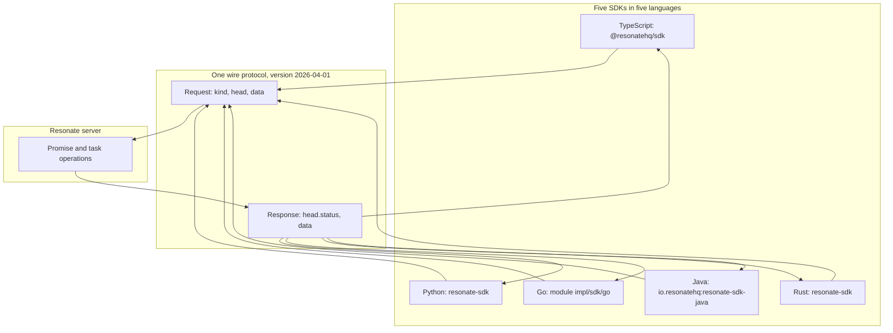
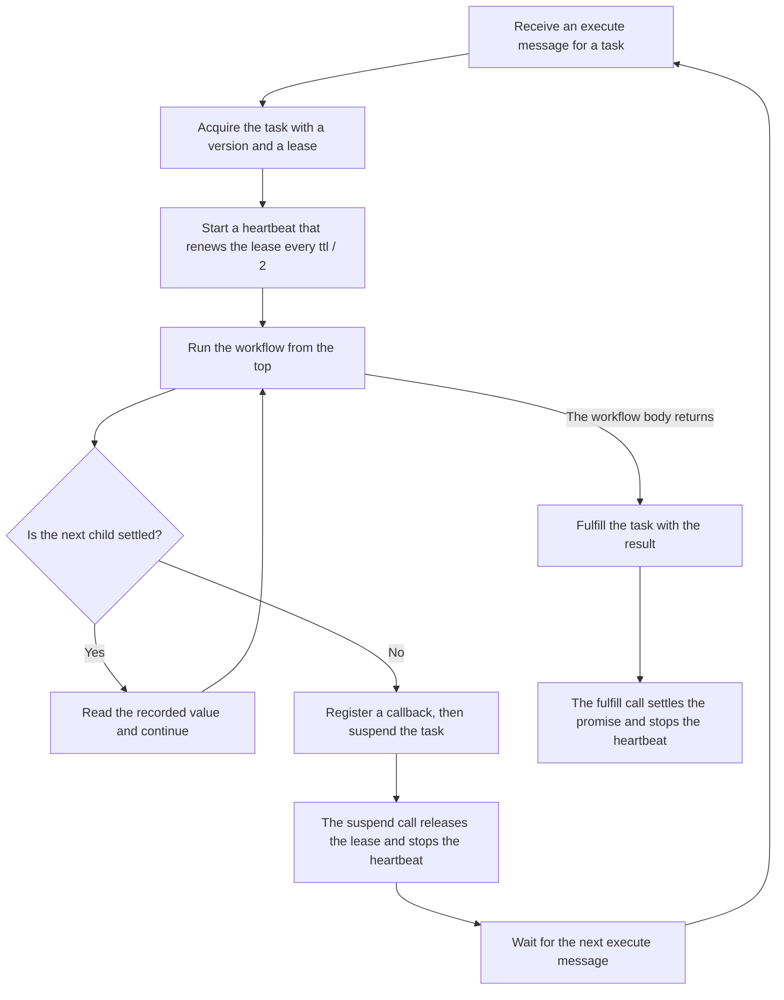

# The other SDKs

Resonate is a durable execution system. A server stores durable promises. A worker process registers functions and runs one when the server sends an *execute message* for a task. The execute message names the task identifier and version; the worker then sends `task.acquire`. The promise records the result, so a later *replay* reads that result instead of running the function again.

Resonate ships five Software Development Kits (SDKs). The TypeScript SDK is the reference client and has its own document. This document covers the Python, Go, Java, and Rust SDKs. It compares all five clients and shows what they share on the wire.

Source: `impl/sdk/py/README.md:1-40`, `impl/sdk/go/README.md:1-40`, `impl/sdk/java/README.md:1-40`, `impl/sdk/rs/README.md:1-40`, `impl/sdk/ts/README.md:1-40`, `spec/spec/02-abstract/internal.lean:25-40`

## What the five clients share

The five SDKs live under `impl/sdk/` in this repository. Most directories are copies of separate upstream repositories. A copy here is a snapshot. It is not a link to the upstream repository, and it can be older than the upstream code. The source in this exploration is commit `9c72d818`.

Source: `impl/sdk/ts/package.json:40-43`, `impl/sdk/java/README.md:10`, `impl/sdk/rs/README.md:1-6`

The Go SDK is the exception. Its module path is `github.com/resonatehq/resonate/impl/sdk/go`. The `go get` command fetches the module from this repository, not from a separate one. Its README still points to an issue tracker named `resonate-sdk-go`.

Source: `impl/sdk/go/go.mod:1-3`, `impl/sdk/go/README.md:10-13`, `impl/sdk/go/README.md:40-44`

These terms appear in every section that follows.

| Term | Meaning here |
|---|---|
| Durable promise | A record with an identifier, a state, a parameter, a value, and tags |
| Task | The execution record of a runnable promise: state, version, lease, and target |
| Settled | The promise is resolved, rejected, rejected canceled, or rejected timed out. These are four terminal states |
| Lease | A time-limited claim on a task. A worker acquires it and sends heartbeats to keep it |
| Heartbeat | A `task.heartbeat` request that extends a lease by its time to live |
| Task version | A counter that increases when the task state changes. It fences a stale worker |
| Target | The value of the `resonate:target` tag. It routes the execute message to a worker group |
| Execute message | A server message that names a task identifier and version and tells a worker to acquire it |
| Worker | A process that registers functions and acquires tasks |
| Workflow | A durable function whose body creates at least one durable call. It can suspend |
| Leaf | A durable function whose body creates no durable call. It runs to completion as one unit |
| Context | The per-execution object that creates durable children |
| Bare promise | A promise with no function and no task. An outside process settles it |
| Timer promise | A promise with `resonate:timer` and a deadline. The deadline settles it without a function |
| Preload | The promise records that the server returns with an acquire response or a status 300 response |
| Durable call | A child promise created through the context. Its result is recorded, so a replay reads it. A side effect outside one repeats on replay |

Source: `spec/spec/01-protocol/types.lean:19-95`, `impl/sdk/ts/src/network/types.ts:455-470`

### One request envelope

Every client builds the same request envelope. The envelope has three fields: `kind`, `head`, and `data`. The `kind` field names the operation, such as `promise.create` or `task.acquire`. The `head` field carries an optional authorization string, a correlation identifier in `corrId`, and the protocol version. The `data` field carries the operation arguments. The task version is not in the envelope; it is an argument of `task.acquire`, `task.heartbeat`, and the other task actions.

Source: `impl/sdk/ts/src/network/types.ts:70-76`, `impl/sdk/ts/src/network/types.ts:80-90`

The response has the same shape. Its `head.status` is a number, and its `data` object carries the result. A client treats six protocol statuses as valid answers: 200 success, 300 immediate resume with a preload list, 404 not found, 409 conflict, 422 unprocessable entity, and 501 not implemented. A 500 or a 401 still arrives over Hypertext Transfer Protocol (HTTP), but the SDK classifies any status outside the six as a transport failure, not a protocol answer.

Source: `impl/sdk/ts/src/network/types.ts:80-90`, `impl/sdk/ts/src/network/http.ts:118-120`

The correlation identifier connects a request to its response. It is not a promise identifier. A client can generate any unique value for it, and the server returns the same value in the response head.

The protocol version in this commit is `2026-04-01`.

Source: `impl/sdk/ts/src/util.ts:20`, `spec/spec/01-protocol/types.lean:1-3`

The envelope is shared, but the payload codec is not identical. Each SDK serializes a value as JavaScript Object Notation (JSON), applies an optional encryptor, and then base64-encodes the result. Every default encryptor passes the bytes through unchanged. Go, Java, and Rust use the JSON encoder of their runtime or of the SDK. Python uses `msgspec` and adds a `__py_pickle` field to an error value; Java has an equivalent native-error field. TypeScript adds sentinels for `Infinity`, negative infinity, and `Error`. Plain JSON-compatible values therefore cross languages. Special values and rejected-promise errors do not.

Source: `impl/sdk/ts/src/codec.ts:1-80`, `impl/sdk/py/src/resonate/codec.py:1-217`, `impl/sdk/go/codec.go:1-80`, `impl/sdk/java/src/main/java/io/resonatehq/resonate/Codec.java:20-40`



Source: `impl/sdk/ts/src/network/types.ts:70-90`

### The identifier rule

A root identifier is any non-empty string without a colon, such as `countdown.1` or `greet-1`. The root becomes the origin. The first child appends `:` and a sequence number, so `greet-1` becomes `greet-1:0` in the TypeScript SDK. Each deeper child appends `.` and its own next number, so a child of `greet-1:0` is `greet-1:0.0`. The call order in the workflow supplies the number. The origin is everything before the first colon, and the lineage is everything after it. A detached child uses `d` plus a hash of the full next sequence identifier instead of a number, and it consumes one sequence value.

Source: `impl/sdk/ts/src/ids.ts:27-73`

Replay runs the workflow from the top. The same call order must therefore produce the same child identifier. A random identifier breaks this rule. A replay then creates a second child instead of reading the first result.

A client must implement four properties to be correct.

| Requirement | What it means |
|---|---|
| Deterministic child identifiers | A replay must compute the same identifier for the same child |
| Durable calls only | A side effect must run in a leaf function under its own promise, not in the workflow body between child calls |
| Suspend on a pending child | A workflow must stop and release its lease |
| Resume from preload | A resumed workflow must read settled children without a second call |

Source: `impl/sdk/py/src/resonate/context.py:181-260`, `impl/sdk/go/context.go:370-430`, `impl/sdk/rs/resonate/src/context.rs:66-130`, `impl/sdk/java/src/main/java/io/resonatehq/resonate/Context.java:42-53`, `impl/sdk/ts/src/core.ts:77-150`

### The worker loop

All five clients run the same loop. The names differ. The shape does not.



Source: `impl/sdk/py/src/resonate/context.py:181-260`, `impl/sdk/go/core.go:45-120`, `impl/sdk/ts/src/core.ts:77-150`, `impl/sdk/rs/resonate/src/core.rs:143-153`

The task `version` in an acquire request is a counter. It changes on each state change of the task record. It is not the registration version of the function. The registration version selects one implementation among several registered under one name. The heartbeat carries the task identifier and that same version, so a heartbeat from a stale lease does not renew the current one.

Source: `spec/spec/01-protocol/types.lean:37-40`, `impl/sdk/py/src/resonate/resonate.py:471-478`, `impl/sdk/py/src/resonate/heartbeat.py:1-60`

The workflow body runs again from the top after every resume. The SDK does not save a program counter. A settled child is read from the promise record that the server returns in the acquire response or the preload list. A pending child causes the worker to send `task.suspend`; the server later sends a new execute message when the child settles.

Source: `impl/sdk/go/context.go:370-383`, `impl/sdk/ts/src/core.ts:226-261`

## Python

The Python client is `resonate-sdk` version 0.8.1. It requires Python 3.12 or later. A program installs it with `pip install resonate-sdk`.

Source: `impl/sdk/py/pyproject.toml:1-7`, `impl/sdk/py/README.md:56`

A durable function is an `async` function. The first parameter is a `Context`. A function becomes a workflow when its body creates a durable call; a body that creates none is a pure leaf and can retry as one unit. The decorator registers the function and returns it unchanged.

```python
import asyncio
from datetime import timedelta

from resonate.context import Context
from resonate.resonate import Resonate

resonate = Resonate(url="http://localhost:8001")


@resonate.register
async def countdown(ctx: Context, count: int, delay: int) -> None:
    for i in range(count, 0, -1):
        await ctx.run(ntfy, i)
        await ctx.sleep(timedelta(seconds=delay))


async def ntfy(ctx: Context, i: int) -> None:
    print(f"Countdown: {i}")


async def main() -> None:
    resonate.register(ntfy)
    handle = resonate.run("countdown.1", countdown, 5, 1)
    await handle.result()


asyncio.run(main())
```

Source: `impl/sdk/py/README.md:62-95`, `impl/sdk/py/src/resonate/resonate.py:498-523`

The registration method accepts a name, a version, and a retry policy. The name defaults to the function `__name__`. The version defaults to 1. The retry policy defaults to the SDK-wide policy. The decorator form accepts the same keywords.

Source: `impl/sdk/py/src/resonate/resonate.py:471-520`

| Member | Signature | Effect |
|---|---|---|
| `ctx.run` | `run(fn, *args, **kwargs) -> ResonateFuture` | Create and await a child |
| `ctx.rpc` | `rpc(fn, *args, **kwargs) -> ResonateFuture` | Create a remotely dispatchable child |
| `ctx.sleep` | `sleep(duration: timedelta) -> ResonateFuture[None]` | Create a timer promise |
| `ctx.promise` | `promise(timeout: timedelta \| None = None) -> ResonateFuture` | Create a bare promise |
| `ctx.detached` | `detached(fn, *args, **kwargs) -> ResonateFuture[str]` | Create a fire-and-forget child |

Source: `impl/sdk/py/src/resonate/context.py:530-545`, `impl/sdk/py/src/resonate/context.py:714-729`, `impl/sdk/py/src/resonate/context.py:770-817`

The `rpc` member is a remote procedure call (RPC). It creates a child that a worker other than the caller can run. A `ResonateFuture` is the handle to a durable call; awaiting it yields the value or raises the rejection.

The root API is the `Resonate` object. `resonate.register` adds a function to the registry. `resonate.run(id, fn, *args)` creates or reads the root promise and returns a handle, and `handle.result()` waits for the value. The first argument is the root promise identifier, not a function name.

Python-specific feature: the client uses `asyncio` as its suspension mechanism. A pending child raises the `Suspended` exception, which extends `BaseException` so ordinary `except Exception` blocks do not swallow it. The engine catches it at the workflow boundary and sends `task.suspend`. The `Sleeper` type is a callable that returns an awaitable. A test can inject a recorder in place of `asyncio.sleep` and observe each delay.

Source: `impl/sdk/py/src/resonate/timing.py:1-43`, `impl/sdk/py/src/resonate/context.py:181-260`, `impl/sdk/py/src/resonate/error.py:171-180`

The Python package family has separate connectors. `resonate-base` is the connector seam. It defines the `Network` and `Source` protocols. `resonate-nats` is a connector for the NATS (a message broker) system. `resonate-pg` is a PostgreSQL connector. `resonate-sdk-aws` is an Amazon Web Services (AWS) Lambda worker shim. The connectors depend on `resonate-base`, not on `resonate-sdk`.

Source: `impl/sdk/py/README.md:25-40`

## Go

The Go client is a module, `github.com/resonatehq/resonate/impl/sdk/go`. It requires Go 1.22. A program installs it with `go get github.com/resonatehq/resonate/impl/sdk/go@latest`. No semantic version tag exists yet. The `@latest` form resolves to a pseudo-version pinned to the latest `main` commit.

Source: `impl/sdk/go/go.mod:1-3`, `impl/sdk/go/README.md:40-44`

A durable function is an ordinary function. A workflow function takes a `*Context` and calls `ctx.Run`, `ctx.RPC`, `ctx.Sleep`, or `ctx.Promise`. A leaf takes `*Info` and holds no such methods. The program registers the function with `resonate.Register`.

```go
type GreetArgs struct {
    Name string `json:"name"`
}

func greet(_ *resonate.Context, args GreetArgs) (string, error) {
    return fmt.Sprintf("hello, %s!", args.Name), nil
}

func main() {
    r, err := resonate.New(resonate.Config{URL: "http://localhost:8001"})
    if err != nil {
        log.Fatal(err)
    }
    greetFn, err := resonate.Register(r, "greet", greet)
    if err != nil {
        log.Fatal(err)
    }
    h, err := greetFn.Run(context.Background(), "greet-1", GreetArgs{Name: "world"})
    if err != nil {
        log.Fatal(err)
    }
    out, err := h.Result(context.Background())
    if err != nil {
        log.Fatal(err)
    }
    fmt.Println(out)
}
```

Source: `impl/sdk/go/README.md:52-80`, `impl/sdk/go/resonate.go:684`

| Member | Signature | Effect |
|---|---|---|
| `ctx.Run` | `Run(fn any, args any, opts ...RunOpts) (*Future, error)` | Create a child |
| `ctx.RPC` | `RPC(funcName string, args any, opts ...RPCOpts) (*Future, error)` | Create a remote child |
| `ctx.Sleep` | `Sleep(d time.Duration) (*Future, error)` | Create a timer promise |
| `ctx.Promise` | `Promise(opts ...PromiseOpts) (*Future, error)` | Create a bare promise |
| `ctx.Detached` | `Detached(funcName string, args any, opts ...DetachedOpts) (string, error)` | Create a fire-and-forget child |

Source: `impl/sdk/go/context.go:384-390`, `impl/sdk/go/context.go:490-497`, `impl/sdk/go/context.go:516-535`, `impl/sdk/go/context.go:561-569`

Go-specific feature: the client uses goroutines and a `Future.Await` method. A pending dependency makes `Await` panic with a private `suspendSignal{}` value. The `executeLocal` function recovers that panic, drains the child's remote todos into the parent, and reports the parent as suspended; the worker then sends `task.suspend`. A remote todo is a child promise that the parent must await. The client also has a `NoopHeartbeat` for local mode, where the server does not enforce the lease. The default child timeout is 24 hours.

The top-level API has three steps. `resonate.New` builds the client. `resonate.Register(r, "greet", greet)` returns a function handle. `greetFn.Run(ctx, "greet-1", args)` creates the root promise and returns a `Future`; `h.Result(ctx)` waits for the value. The first argument of `Run` is the root identifier. The `httpnet` subpackage supplies the HTTP and Server-Sent Events (SSE) transport, and the in-process local network serves tests.

Source: `impl/sdk/go/futures.go:80-95`, `impl/sdk/go/context.go:419-450`, `impl/sdk/go/context.go:12-14`, `impl/sdk/go/heartbeat.go:28-34`

The comment on `Context.Run` states the replay rule directly. It says: "Whenever a workflow suspends and is later resumed, the entire workflow body runs again from the top." It adds a second rule: "every Run call repeats." The durable promise layer short-circuits a child that has already settled by identifier. A side effect before that boundary runs again.

Source: `impl/sdk/go/context.go:370-383`

## Java

The Java client is `io.resonatehq:resonate-sdk-java` version 0.1.1. It requires Java 21 or later. A Gradle project adds `implementation("io.resonatehq:resonate-sdk-java:0.1.1")`.

Source: `impl/sdk/java/README.md:16-20`, `impl/sdk/java/README.md:50-54`

A leaf is a `static` method that performs no durable operation. A workflow is a `static` method that calls a durable operation through `Context`. Both take `Context` in the README example; the difference is the body, not the signature. The program registers a method with `resonate.register`, which overloads `Fn.F0` to `Fn.F5` and derives the registered name from the method reference.

```java
public static String formatGreeting(Context ctx, String name) {
    return "hello, " + name + "!";
}

public static String greet(Context ctx, String name) {
    return ctx.run(Main::formatGreeting, name).await();
}

Resonate r = Resonate.builder().url("http://localhost:8001").build();
r.register(Main::greet);
ResonateHandle<String> handle = r.run("greet-1", Main::greet, "world");
System.out.println(handle.result());
```

Source: `impl/sdk/java/README.md:87-115`, `impl/sdk/java/src/main/java/io/resonatehq/resonate/Resonate.java:358-440`

| Member | Signature | Effect |
|---|---|---|
| `ctx.run` | Six overloads from `run(Fn.F0<R>, ...)` to `run(Fn.F5<A,B,C,D,E,R>, ...) -> ResonateFuture<R>` | Create a local child |
| `ctx.rpc` | The same six overloads, returning `ResonateFuture<R>` | Create a remote child |
| `ctx.sleep` | `sleep(Duration) -> ResonateFuture<Void>` | Create a timer promise |
| `ctx.promise` | `promise(Duration) -> ResonateFuture<Object>`, or `promise()` with no argument | Create a bare promise |
| `ctx.detached` | `detached(String, Object...) -> ResonateFuture<String>` | Create a fire-and-forget child |

Source: `impl/sdk/java/src/main/java/io/resonatehq/resonate/Context.java:400-420`, `impl/sdk/java/src/main/java/io/resonatehq/resonate/Context.java:528-631`

Java-specific feature: the client runs each durable execution on a virtual thread. This is a Java 21 feature. A blocking `await` parks that virtual thread and does not block a platform thread. A pending dependency completes the operation with a `Suspended` error; `await` rethrows it, and `runAfterCreate` catches it at the child boundary. The root runner then sends `task.suspend`. An ordinary exception instead rejects the child. The `Fn.F0` to `Fn.F5` interfaces give typed overloads for zero to five arguments. The typed overload returns `ResonateFuture<R>`, so the caller does not cast. The `promise(Duration)` argument is a timeout, not a lifetime.

Source: `impl/sdk/java/src/main/java/io/resonatehq/resonate/Context.java:98-160`, `impl/sdk/java/src/main/java/io/resonatehq/resonate/Context.java:440-500`, `impl/sdk/java/src/main/java/io/resonatehq/resonate/Context.java:597-613`, `impl/sdk/java/README.md:16-20`

The Java README separates two stabilities. It calls the internal protocol stable. It calls the Java Application Programming Interface (API) surface unsettled. The version is 0.1.1 and the text marks it pre-release.

Source: `impl/sdk/java/README.md:14`

The Java client has two transports. `LocalNetwork` is an in-process server simulation. `HttpNetwork` uses a real server over the Hypertext Transfer Protocol (HTTP).

Source: `impl/sdk/java/src/main/java/io/resonatehq/resonate/Network.java:1268`, `impl/sdk/java/src/main/java/io/resonatehq/resonate/Network.java:1597`

## Rust

The Rust client is the crate `resonate-sdk`. The README shows the dependency `resonate-sdk = "0.1"`. The workspace package version in this mirror is 0.6.0. The two numbers disagree. A new project should use the version that its own build resolves. This document reports both and cannot recommend one from this source.

Source: `impl/sdk/rs/README.md:30`, `impl/sdk/rs/Cargo.toml:5-7`

A workflow is an `async` function. The first parameter is a `&Context`. The program annotates the function with the attribute macro `#[resonate_sdk::function]`. The prelude supplies the `Result` alias.

```rust
use resonate_sdk::prelude::*;

#[resonate_sdk::function]
async fn format_greeting(name: String) -> Result<String> {
    Ok(format!("hello, {}!", name))
}

#[resonate_sdk::function]
async fn greet(ctx: &Context, name: String) -> Result<String> {
    let greeting = ctx.run(format_greeting, name).await?;
    Ok(greeting)
}

#[tokio::main]
async fn main() -> Result<()> {
    let r = Resonate::new(ResonateConfig {
        url: Some("http://localhost:8001".into()),
        ..Default::default()
    });
    r.register(greet)?;
    let out: String = r.run("greet-1", greet, "world".to_string()).await?;
    println!("{out}");
    Ok(())
}
```

Source: `impl/sdk/rs/README.md:45-77` for the quick example and `:86-100` for the parallel example. This block is adapted: the README registers both functions and returns `()`, while this example registers only `greet` and returns `Result<()>`.

| Member | Signature | Effect |
|---|---|---|
| `ctx.run` | `run(func, args) -> RunTask<'_, D, Args, T>` | Create a local child builder |
| `ctx.rpc` | `rpc::<T>(func: &str, args: impl Serialize) -> RpcTask<'_, T>` | Create a remote child |
| `ctx.sleep` | `sleep(duration: Duration) -> SleepTask<'_>` | Create a timer promise |
| `ctx.promise` | `promise::<T>() -> PromiseTask<'_, T>` | Create a bare promise |
| `ctx.detached` | `detached(func: &str, args: impl Serialize) -> DetachedTask<'_>` | Create a fire-and-forget child |

Source: `impl/sdk/rs/resonate/src/context.rs:273`, `impl/sdk/rs/resonate/src/context.rs:342`, `impl/sdk/rs/resonate/src/context.rs:372-399`, `impl/sdk/rs/resonate/src/context.rs:451`

The Rust table returns builders, not futures. `RunTask` implements `IntoFuture`, so `.await` starts the child and waits for it. `.spawn()` starts the child at once and returns a `DurableFuture` handle. On a multi-thread Tokio runtime the child can run on another thread. On a current-thread runtime it interleaves with the caller.

Source: `impl/sdk/rs/resonate/src/context.rs:650-690`, `impl/sdk/rs/resonate/src/context.rs:788-800`

Rust-specific feature: the macro reads the first parameter type and decides the function kind at compile time. A first parameter of `&Context` makes a workflow. A first parameter of `&Info` makes a leaf with read-only metadata, and `Info` is the metadata type. No first parameter makes a pure leaf. A pure leaf performs no durable operation of its own, so it can retry as one unit. A workflow can create children, so it suspends instead. The macro generates a durable function handle, so a type error appears at build time, not at run time.

Source: `impl/sdk/rs/resonate-macros/src/lib.rs:22-35`, `impl/sdk/rs/resonate-macros/src/lib.rs:94-104`

The Rust workspace has three members: `resonate`, `resonate-macros`, and `resonate-postgres`. The last is a PostgreSQL transport crate. The `resonate` crate also supplies an HTTP network and an in-process local network.

Source: `impl/sdk/rs/Cargo.toml:1-3`

## The comparison

| Language | Package | Execution model | Transport client | Notable difference |
|---|---|---|---|---|
| TypeScript | `@resonatehq/sdk` 0.11.5 | Generator coroutine or `async` engine | HTTP, local, NATS, PostgreSQL | Two engines in one package |
| Python | `resonate-sdk` 0.8.1 | `async`/`await` on `asyncio` | HTTP, SSE, local; connectors separate | Connectors are separate packages |
| Go | `impl/sdk/go` module, Go 1.22 | Goroutines and `Future` | HTTP, SSE, local | `NoopHeartbeat` for local mode |
| Java | `io.resonatehq:resonate-sdk-java` 0.1.1 | Virtual threads, `ResonateFuture` | HTTP, local | Typed `Fn.F0` to `Fn.F5` overloads |
| Rust | `resonate-sdk` (README 0.1, workspace 0.6.0) | `tokio` futures and `.spawn()` | HTTP, local, PostgreSQL | Attribute macro decides the function kind |

Source: `impl/sdk/ts/package.json:2-3`, `impl/sdk/py/pyproject.toml:1-7`, `impl/sdk/go/go.mod:1-3`, `impl/sdk/java/README.md:14`, `impl/sdk/rs/README.md:30`, `impl/sdk/rs/Cargo.toml:1-7`, `impl/sdk/go/transport.go:1-30`, `impl/sdk/java/src/main/java/io/resonatehq/resonate/Network.java:1268-1636`, `impl/sdk/py/README.md:25-30`

The Python row needs one note. The SDK package includes the HTTP, Server-Sent Events (SSE), and local transports. The NATS and PostgreSQL transports are separate connector packages. The table lists them in the same row because they serve the same SDK.

Source: `impl/sdk/py/README.md:25-40`

The language determines the suspension mechanism. The protocol determines the identifiers, the states, and the operation set.

| Suspension mechanism | SDK |
|---|---|
| Coroutine state | TypeScript generator engine |
| `Promise` race and drain | TypeScript async engine |
| Suspend exception | Python |
| Panic-based signal | Go |
| Blocking virtual thread | Java |
| Lazy builder that returns `Suspended` | Rust |

Source: `impl/sdk/ts/src/core.ts:77-150`, `impl/sdk/ts/src/async/context.ts:816-877`, `impl/sdk/py/src/resonate/context.py:181-260`, `impl/sdk/go/futures.go:80-95`, `impl/sdk/java/src/main/java/io/resonatehq/resonate/Context.java:42-53`, `impl/sdk/rs/resonate/src/context.rs:650-690`

> Aha: the five SDKs are five front ends to one durable promise graph. The request envelope has `kind`, `head`, and `data`. The `data` object carries the promise identifier, and the task operations carry a task version in their arguments. The envelope carries no language field. The server dispatches a task to a target name, and registration binds that name to a function. A worker of another SDK that registers the same name can therefore receive the task. The language is a property of the worker process, not of the workflow state.

Source: `impl/sdk/ts/src/network/types.ts:70-76`, `impl/sdk/go/resonate.go:684`, `impl/sdk/py/src/resonate/resonate.py:471-478`, `spec/spec/02-abstract/internal.lean:102-117`

## What every client must get right

The source names the same hazards in several clients. These are the places where a client can be wrong even when it compiles.

| Hazard | Why it breaks durability |
|---|---|
| A non-deterministic child identifier | A replay creates a second child instead of reading the first |
| A side effect outside `ctx.run` | A replay repeats the side effect |
| A non-durable sleep | The process dies and the wait is lost || A missing heartbeat | The lease expires while the workflow still runs |

Source: `impl/sdk/ts/README.md:160-166`, `impl/sdk/go/context.go:370-383`, `impl/sdk/py/src/resonate/context.py:181-260`

The TypeScript README states one rule in one line: "Only await durable promises inside a workflow." The Go comment states the replay rule in detail. The Python documentation states that a function body which performs a durable operation is a workflow. Such a body does not retry as one unit. Only a pure leaf retries under the retry policy.

Source: `impl/sdk/ts/README.md:166`, `impl/sdk/go/context.go:370-383`, `impl/sdk/py/src/resonate/resonate.py:498-514`

## Related documents

- [00-overview.md](00-overview.md) — the thesis and the component map.
- [02-the-protocol.md](02-the-protocol.md) — the shared wire surface.
- [03-durable-promises-and-tasks.md](03-durable-promises-and-tasks.md) — the state machines every client speaks to.
- [09-the-typescript-sdk.md](09-the-typescript-sdk.md) — the reference client in detail.
- [11-schedules-timers-and-time.md](11-schedules-timers-and-time.md) — the deadlines that every client depends on.
