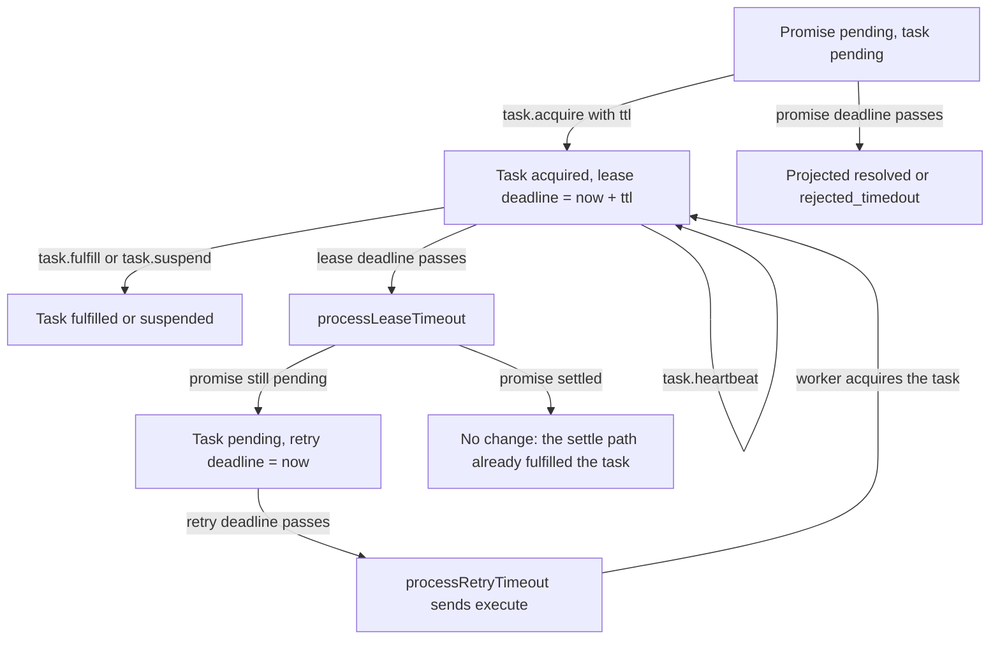
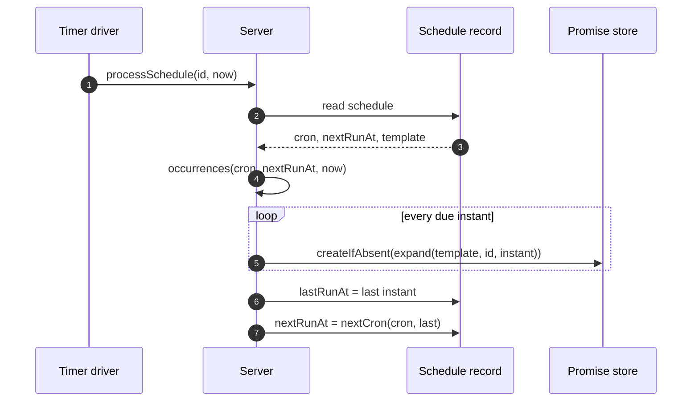

# Schedules, timers, and time

Resonate is a durable promise protocol. A server stores promises and tasks. A worker acquires a task and runs user code. A client Software Development Kit (SDK) sends protocol requests to the server.

Time in Resonate is data, not a shared service. The protocol has no central scheduler process and no queue that holds one delayed job for every future instant. Each backend has a local driver. The PostgreSQL server uses the `pg_cron` extension, which runs Structured Query Language (SQL) commands on a schedule inside the database. The Zig S3 server uses an in-memory queue of deadline keys. The Rust server uses a timer wheel and a backstop sweep. The TypeScript local network uses a one-second interval. A backend still gives correct answers when its driver is late. A read *projects* a deadline that has passed: it computes the state implied by `now` without writing it. A sweep *materialises* that state by writing it.

The abstract model takes an instant named `now`, in milliseconds since the Unix epoch, for each step. Concrete servers use their own clock. The PostgreSQL server calls `clock_timestamp()`, and the Zig S3 server uses its clock, with `resonate:debug_time` as a test override.

Source: `spec/spec/02-abstract/state.lean:79-90`, `spec/spec/02-abstract/state.lean:127-134`, `spec/spec/01-protocol/types.lean:51-61`, `impl/server/postgres/resonate.sql:1063-1064`, `impl/server/s3/src/handle.zig:1755-1757`

## Terms

| Term | Meaning here |
|---|---|
| Promise | A durable record with an identifier, a state, a parameter (input), a value (result), tags, and a deadline |
| Promise states | `pending`, `resolved`, `rejected`, `rejected_canceled`, `rejected_timedout` |
| Task | A durable work record attached to one promise. States are `pending`, `acquired`, `suspended`, `halted`, `fulfilled` |
| Worker | A process that acquires a task, runs code, and settles the promise |
| Tag | A string key and value on a promise. Keys that start with `resonate:` are protocol tags |
| Settle | Move a promise from `pending` to a terminal state |
| Workflow | User code whose durable calls create child promises |
| Child | A promise that a workflow creates. It is one lineage segment below its parent |
| Target | The value of the `resonate:target` tag. It is the address that receives an execute message |
| Runnable | A promise with a target. The server gives it a task |
| External | A promise that a process outside the server settles. Global scope (`resonate:scope=global`), the external tag (`resonate:external=true`), or the timer tag (`resonate:timer=true`) makes a promise external. A target makes it runnable instead |
| Awaitable | Runnable or external; the server accepts a callback only on one |
| Origin and lineage | The origin is the part before the first `:`; the lineage is the part after it. In `wf:1.2` they are `wf` and `1.2` |
| Deadline | The `timeoutAt` field, in milliseconds. Every promise has one |
| Arm | Write a deadline record that a driver can fire; the promise deadline applies with or without one |
| Sweep | Call the internal timeout steps for due records |
| Timer driver | The local loop that runs a sweep |
| Version | A counter on a task. Acquire raises it, and an old value is refused |
| pid | Process identifier. A heartbeat must name the same value as the acquire |
| ttl | Time to live. The lease length in milliseconds |
| Schedule | A cron record with an identifier template for the promises it fires |

Source: `spec/spec/02-abstract/state.lean:105-113`, `spec/spec/02-abstract/state.lean:127-134`, `spec/spec/01-protocol/validation.lean:24-32`, `spec/spec/02-abstract/internal.lean:64-77`, `impl/sdk/ts/src/ids.ts:1-22`

## Clock one: the promise deadline

Every promise record has a `timeoutAt` field. The field is required. A caller supplies it in the create request. A promise is pending until it settles, until its deadline passes, or until a workflow settles it as `rejected_canceled`. The parent is the promise one level above it in the lineage.

Source: `spec/spec/02-abstract/state.lean:79-90`, `spec/spec/01-protocol/types.lean:72-77`

The deadline does not need a background job to take effect. It is a projection. A reader that sees a pending promise with a deadline at or before `now` must read it as settled. The projection is part of the state machine, not an optimisation.

```lean
if p.state == .pending ∧ p.timeoutAt ≤ now then
  if p.isTimer then
    { p with state := .resolved, settledAt := some p.timeoutAt }
  else
    { p with state := .rejectedTimedout, settledAt := some p.timeoutAt }
```

Source: `spec/spec/02-abstract/state.lean:118-125`

| Tag on the promise | Projected state at the deadline |
|---|---|
| `resonate:timer` is the text `true` | `resolved` |
| anything else | `rejected_timedout` |

Source: `spec/spec/02-abstract/state.lean:118-123`

`isTimer` is not a stored field. It is the timer tag compared with the text `true`. A tag with the value `false` does not make a timer. The tag and the predicate cannot disagree.

Source: `spec/spec/02-abstract/state.lean:89-91`, `spec/spec/01-protocol/validation.lean:24-32`

A create request can also arrive after its own deadline. The creation path applies the same rule. A promise born late is born settled. Its `createdAt` is the deadline, not the arrival time. Its `settledAt` is also the deadline. A promise born on time has `createdAt` equal to the arrival time.

Source: `spec/spec/02-abstract/state.lean:302-323`

The internal step `processPromiseTimeout` does not decide the outcome. It only materialises the projection with a read-modify-write at the sweep instant. The step calls `touchObject`, which reads and persists the object at the `now` of the request that fired it.

Source: `spec/spec/02-abstract/internal.lean:22-23`, `spec/spec/02-abstract/state.lean:380-381`

The write matters even though the projection is enough for one reader. A read cannot send an execute message, wake a waiter, or fulfil the promise's task. The materialised row is what the next sweep and the next reader see. A backend with no sweep still answers reads correctly, because every read projects the same state. It does not settle the task or send the wake message until a sweep runs.

Source: `spec/spec/02-abstract/state.lean:145-147`, `spec/spec/02-abstract/internal.lean:64-77`

## Clock two: the task lease

A task record has two deadline fields. `leaseTimeoutAt` is live while the task is acquired. `retryTimeoutAt` is live while the task is pending. The task is never in both states at once, so one call site sets one of the two fields. The record also stores the task state, the version, the ttl, the pid, and the resume list.

Source: `spec/spec/02-abstract/state.lean:127-135`

A worker acquires a task with a lease. The request carries a ttl in milliseconds. The server checks that the task is pending, that the promise is pending, and that the task version matches. It then sets the task state to `acquired`, raises the version by one, stores the ttl and the pid, sets `leaseTimeoutAt` to `now + ttl`, and clears `retryTimeoutAt`.

Source: `spec/spec/02-abstract/external.lean:176-197`

The default lease timeout on the Rust server is 15,000 ms. The command-line flag is `--tasks-lease-timeout`.

Source: `impl/server/core/src/serve.rs:139-141`

The worker extends the lease with `task.heartbeat`. The request names the pid and a list of task identifiers with their versions. It does not carry a ttl. A heartbeat extends a lease only when four conditions hold. The task is acquired. The version matches. The pid matches. The promise is still pending. The new deadline is `now` plus the ttl that the task already stores. The check does not compare the lease deadline with `now`; `processLeaseTimeout` frees an expired task, and a later heartbeat is refused because the task is no longer acquired.

Source: `spec/spec/02-abstract/external.lean:226-247`, `impl/sdk/ts/src/heartbeat.ts:1-60`

The TypeScript SDK default lease is 60,000 ms and it sends that ttl on every acquire, so 15,000 ms applies only to a client that omits the field. Its heartbeat interval is half that, 30,000 ms.

Source: `impl/sdk/ts/src/resonate.ts:106`, `impl/sdk/ts/src/resonate.ts:178`

The version is the guard against a stale holder. It is a per-task counter that starts at zero. The acquire response returns the new value. An acquire raises it. A heartbeat or a task action from an older value is refused with status 409. Two workers cannot both believe that they hold the same lease.

Source: `spec/spec/02-abstract/external.lean:186-196`

The lease timeout step is `processLeaseTimeout`. It checks four conditions. The task must exist. It must be acquired. Its lease deadline must be at or before now. Its promise must still be pending. If all four hold, the task returns to pending, loses its pid and ttl, clears `leaseTimeoutAt`, and gets a retry deadline of `now`. That value means "offer this task again at once".

Source: `spec/spec/02-abstract/internal.lean:64-77`

A settled promise leaves no acquired task to return. `setSettled` writes the promise, then fulfils the promise's own task if that task is not already fulfilled.

Source: `spec/spec/02-abstract/state.lean:291-299`



Source: `spec/spec/02-abstract/internal.lean:64-117`, `impl/server/s3/src/handle.zig:1526-1585`

## Clock three: the retry deadline

A pending task that nobody acquires must be offered again. The interval is the server's setting, not the worker's. The Lean specification states the reason in a comment. The retry interval is `config.retryTimeout`, read from the server configuration. It is not `TaskObject.ttl`. The ttl is the worker's number. Using it would re-offer a dead worker's task on the dead worker's schedule.

Source: `spec/spec/02-abstract/internal.lean:79-101`

The first retry deadline is set when the task is created. The server creates a task for a runnable promise. The task starts pending, with version 0. Its first deadline is `now`, or the `resonate:delay` value when that value is later. The delay tag is a millisecond instant for the first offer.

Source: `spec/spec/02-abstract/state.lean:302-323`

The `processRetryTimeout` step checks that the task is pending, that its retry deadline is due, and that its promise is still pending. It then sets the next retry deadline to `now + config.retryTimeout` and sends an `execute` message to the promise's target tag. The execute message is an outbox record with the address, the task identifier, and the version. It does not carry a copy of the promise; that copy belongs to the `unblock` message. The transport delivers it, and the worker then sends `task.acquire`.

Source: `spec/spec/02-abstract/internal.lean:102-117`, `spec/spec/01-protocol/validation.lean:62-81`

The default retry timeout on the Rust server is 30,000 ms. The command-line flag is `--tasks-retry-timeout`.

Source: `impl/server/core/src/serve.rs:143-145`

The PostgreSQL server uses a different value. Its `_retry_timeout()` function returns 5,000 ms. This function is the SQL backend's fixed configuration value.

Source: `impl/server/postgres/resonate.sql:175-176`

The PostgreSQL create path also differs in sequence. With a target and no delay tag, it emits the first execute at once and sets the deadline to `now + 5,000`. The abstract step sets the deadline to `now`, and the next sweep emits the execute.

Source: `impl/server/postgres/resonate.sql:414-422`, `spec/spec/02-abstract/state.lean:307-313`

The Zig S3 server uses 30,000 ms, which the validation plan says matches the oracle and the Rust SQL engines. The PostgreSQL server uses 5,000 ms instead. The plan records that the Rust blob storage engine defaults to 60,000 ms, so the differential test sets it to 30,000 ms before comparing the answers of two servers.

Source: `impl/server/s3/src/protocol.zig:24`, `impl/server/s3/docs/validation-plan.md:255-258`

## Durable sleep

A sleep is a promise with a timer tag. The SDK builds a create request whose identifier is the next lineage segment, whose deadline is the wake instant, and whose tags include `resonate:timer`, `resonate:target`, and the parent and origin tags.

Source: `impl/sdk/ts/src/context.ts:775-807`

The SDK adds a target, and the target creates a task. The server creates a task for a promise when the promise is runnable. A promise is runnable when it has a target tag. A worker receives an execute message for a task with no function to run.

Source: `spec/spec/01-protocol/validation.lean:24-28`, `impl/sdk/ts/src/context.ts:775-807`

The SDK comment says a target is necessary because the server arms a deadline only for an addressed promise. The backends disagree. The S3 server arms only with a target. Lean and PostgreSQL sweep a timer promise without one, because the timer tag makes it external.

Source: `impl/sdk/ts/src/context.ts:775-807`, `impl/server/s3/src/handle.zig:670-688`, `impl/server/postgres/resonate.sql:201-207`

The Zig test that creates a timer with only the timer tag is not a counter-example. Its deadline is already in the past, so the create path settles it at once. It does not test a future deadline with no target.

Source: `impl/server/s3/src/handle.zig:1935-1942`

The worker handles the functionless task by dropping it. A normal task's promise parameter carries the function name, the arguments, and the version. A sleep carries no parameter, so there is nothing to run. The SDK engine checks the timer tag. If the promise is still pending, the worker sends no fulfill, no suspend, and no release. The lease simply lapses. A release would make the server dispatch the task again at once, and the worker would spin.

Source: `impl/sdk/ts/src/core.ts:83-101`

The retry step offers the task again while the promise is pending. A delivery before the wake is dropped again. When the deadline passes, the projection makes the promise resolved. The settle path fulfils the task. A delivery that is already in flight takes the settled branch and fulfils the task with the promise result. The timer promise stores no function result, so the workflow observes only that the sleep finished.

Source: `impl/sdk/ts/src/core.ts:103-116`, `spec/spec/02-abstract/internal.lean:102-117`

> Aha: a durable sleep is not a special primitive. It is a promise that resolves instead of rejecting. The timer tag is the only difference between "this deadline is a failure" and "this deadline is the result". That is why the same deadline machinery serves both timeouts and sleeps, and why a worker needs no sleep state of its own.

Source: `spec/spec/02-abstract/state.lean:118-123`, `impl/sdk/ts/src/context.ts:775-807`

## Clock four: the schedule

A schedule has an identifier, a cron expression, a promise identifier template, a promise timeout in milliseconds, a parameter, a tag set, a next run instant, an optional last run instant, and a creation instant. The PostgreSQL parser accepts five cron fields and works in Coordinated Universal Time (UTC); it sets the first `nextRunAt` to the next match after the creation instant.

Source: `spec/spec/01-protocol/types.lean:51-61`

The abstract machine treats three cron functions as opaque. `nextCron(cron, after)` returns the next instant. `occurrences(cron, since, now)` returns every instant in the interval. `expand(template, id, timestamp)` builds the promise identifier for one occurrence.

Source: `spec/spec/01-protocol/validation.lean:83-87`

`processSchedule` calls `occurrences` with the schedule's `nextRunAt` and the request's `now`. It filters to instants at or before now. It fires each one. It then sets `lastRunAt` to the last fired instant and `nextRunAt` to `nextCron(cron, last)`. If no instant is due, it changes nothing.

Source: `spec/spec/02-abstract/internal.lean:130-140`

Firing one occurrence is `fireOccurrence`, which calls `createIfAbsent` with the expanded identifier, a deadline of `timestamp + promiseTimeout`, the template's parameter and tags, and `now` equal to the scheduled timestamp. `createIfAbsent` reads the promise. If it exists, it does nothing. If it does not exist, it creates it.

Source: `spec/spec/02-abstract/internal.lean:119-122`, `spec/spec/02-abstract/state.lean:302-323`

Because the create compares `timeoutAt` with the scheduled instant, a late fire is not a late create. The new promise is pending with `createdAt` equal to the schedule's instant. The exception is a promise timeout of zero. Then the deadline equals the scheduled instant, so the late-create rule makes the promise settled at birth with the same `createdAt`.

Source: `spec/spec/02-abstract/internal.lean:119-122`, `spec/spec/02-abstract/state.lean:317-323`

The template has an identifier pattern, and the schedule owns the parameter, the tags, and the promise timeout. `expand` supplies only the identifier. The parameter and tags are copied unchanged into every fired promise.

Source: `spec/spec/01-protocol/types.lean:51-61`, `impl/server/postgres/resonate.sql:370-373`

This idempotence is what makes the schedule safe across a crash. The schedule and the fired promise are two objects. A crash between them leaves the schedule pointing at an instant it already fired. The next sweep fires it again, and the create does nothing. One occurrence stays one occurrence. The PostgreSQL server does all the work in one transaction, but it still uses the create-if-absent rule. The S3 server has no multi-object transaction, so it relies on that rule alone.

Source: `impl/server/s3/src/schedules.zig:8-16`, `impl/server/postgres/resonate.sql:939-959`

The TypeScript SDK uses the template `"{{.id}}-{{.timestamp}}"`. The separator is a hyphen and not a colon. The S3 server stamps the whole expanded identifier onto the `resonate:origin`, `resonate:branch`, `resonate:parent`, and `resonate:prefix` tags of the fired promise. An origin tag cannot contain a colon. A colon in the template would split the identifier at the colon, so every firing would share one origin and differ only below it. A hyphen keeps each fired identifier as its own root. The SQL server does not stamp these tags; it stores the schedule tags unchanged.

Source: `impl/sdk/ts/src/resonate.ts:483-494`, `impl/server/s3/src/schedules.zig:617-650`, `impl/server/s3/src/schedules.zig:945-966`, `impl/server/postgres/resonate.sql:949-953`



Source: `spec/spec/02-abstract/internal.lean:130-140`

The S3 server bounds catch-up. One round fires at most 256 overdue runs. It leaves the next instant in the past if more remain, so the timer driver wakes at once and fires again. A schedule that missed a year drains in bounded rounds. The PostgreSQL server has no such bound. Its loop fires every due occurrence in one transaction.

Source: `impl/server/s3/src/schedules.zig:18-23`, `impl/server/s3/src/schedules.zig:40-41`, `impl/server/postgres/resonate.sql:947-956`

## How each backend stores and fires a deadline

| Implementation | Promise deadline | Task deadlines | Firing mechanism |
|---|---|---|---|
| Lean model | `timeoutAt` on the promise object | `leaseTimeoutAt` and `retryTimeoutAt` | Internal timeout steps |
| PostgreSQL | `promises.timeout_at`, partial index on pending rows | `tasks.timeout_at`, partial index on pending or acquired rows | `pg_cron` calls `process_timeouts()` every 5 s |
| S3 server, Zig | `timeout_at` and `timeout_armed` in the promise record | One `timeout_at` field in the task record | A zero-byte object per deadline, plus an in-memory queue |
| S3 server, Rust | Durable row plus timer wheel cache | Durable row plus timer wheel cache | Sweep is the truth; wheel is latency |
| TypeScript local | In-memory promise map | In-memory task map | A 1-second `setInterval` tick plus a logical projection |

Source: `impl/server/postgres/resonate.sql:46-60`, `impl/server/postgres/resonate.sql:961-1015`, `impl/server/s3/src/doc.zig:209-233`, `impl/server/core/crates/resonate-sql/src/deadlines.rs:1-46`, `impl/sdk/ts/src/network/local.ts:1458-1481`, `impl/sdk/ts/src/network/local.ts:1647-1672`

The PostgreSQL tables are built for the sweep. A partial index on `promises(timeout_at) WHERE state = 'pending'` covers only rows that can time out. The same pattern covers `tasks(timeout_at) WHERE state IN ('pending','acquired')`. The task row has one deadline column because its state says which clock is live: pending is retry, acquired is lease. The sweep orders by `timeout_at, id` for a stable order, and `process_timeouts` calls three sweeps in one transaction: promise, task, and schedule deadlines.

Source: `impl/server/postgres/resonate.sql:46-61`, `impl/server/postgres/resonate.sql:997-1012`

The S3 server takes the opposite approach. A deadline is the name of an empty object. A deadline key is `t/<NN>/<20-digit deadline>_<enc(target)>@<generation>`. A promise deadline uses the origin as the target. A task deadline uses the task identifier. A schedule deadline adds the raw text `sched:` before the target. `<NN>` is a shard number from a hash of the target. `enc` is the key escaping function. The deadline is zero-padded so that lexicographic order is time order inside one shard. The shard spreads the writes, because a monotone key prefix is the access pattern that object stores handle worst. The generation is the commit number that armed the key, so a writer removes only the key that its own commit wrote.

Source: `impl/server/s3/src/store.zig:258-317`, `impl/server/s3/docs/on-s3.md:32-52`, `impl/server/s3/src/applier.zig:921-938`

The S3 server keeps an in-memory queue of near deadlines, ordered by instant. Every writer adds a key as soon as its object lands. Normal operation fires from the queue alone: the driver sleeps until the nearest deadline, wakes, and sweeps. The startup listing reads the whole `t/` prefix, loads every key across all shards, and selects the nearest in memory. The listing also serves `debug.tick`, when the caller owns the clock. A failed sweep re-arms its key after 1,000 ms. The driver fires up to 16 deadlines at once. A `debug.tick` stops after 64 rounds.

Source: `impl/server/s3/src/timerd.zig:1-33`, `impl/server/s3/src/timerd.zig:47-59`, `impl/server/s3/src/timerd.zig:201-235`, `impl/server/s3/src/timerd.zig:398-432`

The Rust SQL engine keeps a timer wheel in front of the durable row. The wheel is not the truth. Its own module comment says that nothing there is load-bearing for correctness. The sweep closes every gap: a missing entry, a restart, or a full wheel that drops the farthest deadlines. The backstop sweep interval defaults to 60,000 ms.

Source: `impl/server/core/crates/resonate-sql/src/deadlines.rs:1-20`, `impl/server/core/crates/resonate-sql/src/sweep.rs:1-66`, `impl/server/core/crates/resonate-server-postgres/src/lib.rs:4748-4750`

## Every time constant and bound

| Constant | Value | Where |
|---|---|---|
| Promise deadline | caller-supplied `timeoutAt` | `spec/spec/01-protocol/types.lean:72-77` |
| Default child timeout, TypeScript | 24 hours | `impl/sdk/ts/src/options.ts:18` |
| Default child timeout, Go | 24 hours | `impl/sdk/go/context.go:12-14` |
| Default task lease ttl, TypeScript SDK | 60,000 ms | `impl/sdk/ts/src/resonate.ts:106` |
| Default lease timeout, Rust server | 15,000 ms | `impl/server/core/src/serve.rs:139-141` |
| Default retry timeout, Rust server | 30,000 ms | `impl/server/core/src/serve.rs:143-145` |
| Retry timeout, PostgreSQL server | 5,000 ms | `impl/server/postgres/resonate.sql:175-176` |
| Retry timeout, Zig S3 server | 30,000 ms | `impl/server/s3/src/protocol.zig:24` |
| Retry timeout, Rust blob server | 60,000 ms | `impl/server/s3/docs/validation-plan.md:255-258` |
| Heartbeat interval | lease ttl divided by 2 | `impl/sdk/ts/src/resonate.ts:178` |
| `pg_cron` schedule | every 5 seconds | `impl/server/postgres/resonate.sql:1211` |
| Schedule catch-up limit, S3 | 256 occurrences per round | `impl/server/s3/src/schedules.zig:40-41` |
| Deadline retry after a failed sweep, S3 | 1,000 ms | `impl/server/s3/src/timerd.zig:53-54` |
| Deadline fire concurrency, S3 | 16 at once | `impl/server/s3/src/timerd.zig:47-51` |
| `DEBUG TICK` maximum rounds, S3 | 64 | `impl/server/s3/src/timerd.zig:56-59` |
| Backstop sweep interval, Rust SQL | 60,000 ms | `impl/server/core/crates/resonate-server-postgres/src/lib.rs:4748-4750` |
| HTTP poll keepalive | unset by default | `impl/server/core/crates/resonate-transport-http-poll/src/lib.rs:110-116` |

Source: the table rows above.

The child timeout is the default deadline for a child promise that a workflow creates without its own timeout. The HTTP poll keepalive is the idle limit on a held poll connection. `DEBUG TICK` sweeps with a caller-supplied clock.

The TypeScript lease is a client value and the Rust lease is a server fallback. The retry values differ by backend by design. The Rust blob default is 60,000 ms, and the differential test overrides it to 30,000 ms to match the Zig server.

## What time does not do

The S3 server does not offer work for a run that is already over. A sweep that reaches a schedule occurrence after its deadline inserts the promise already timed out. It compares the deadline with the request's `now`, not with the scheduled instant. The validation plan records that this comparison was a bug fix: a late occurrence was once offered to a worker for work that was already over.

Source: `impl/server/s3/src/handle.zig:1609-1631`, `impl/server/s3/docs/validation-plan.md:307-310`

The Lean model takes a different path. `fireOccurrence` passes the scheduled instant as the create request's `now`. The promise is therefore created pending, with `createdAt` equal to the scheduled instant and a deadline still in the future. A later read projects the timeout. Both paths agree on the projected state at the real instant, and on `createdAt` and `settledAt`. They differ in whether the settled state is written at fire time or at the first read or sweep.

Source: `spec/spec/02-abstract/internal.lean:118-122`, `impl/server/s3/src/handle.zig:1616-1628`

The model does not order requests by the instant they carry. A recorder is a test client that stamps an instant and then sends the request. Several recorders run at once, so a request with an earlier instant can arrive after one with a later instant. The linearizability checker for a recorded history therefore does not require instants to be non-decreasing.

Source: `impl/server/s3/docs/validation-plan.md:347-355`

The Lean model does not contain a calendar. `nextCron`, `occurrences`, and `expand` are opaque. A checker that uses the Lean model cannot check a schedule answer. The concrete cron parsers live in the SQL file and in the Zig server. For this reason, Porcupine refuses a history that mentions schedules. Porcupine is an external linearizability checker that the validation plan drives with the Lean model.

Source: `spec/spec/01-protocol/validation.lean:83-87`, `impl/server/s3/docs/validation-plan.md:360-366`, `impl/server/s3/docs/validation-plan.md:428-431`

## Related documents

- [00-overview.md](00-overview.md) — the thesis and the component map.
- [03-durable-promises-and-tasks.md](03-durable-promises-and-tasks.md) — the state machine that the deadlines act on.
- [09-the-typescript-sdk.md](09-the-typescript-sdk.md) — the client that sends sleeps and leases.
- [12-the-postgres-server-in-one-file.md](12-the-postgres-server-in-one-file.md) — `pg_cron` and the timeout functions.
- [13-the-s3-server-in-zig.md](13-the-s3-server-in-zig.md) — deadlines as object keys.
