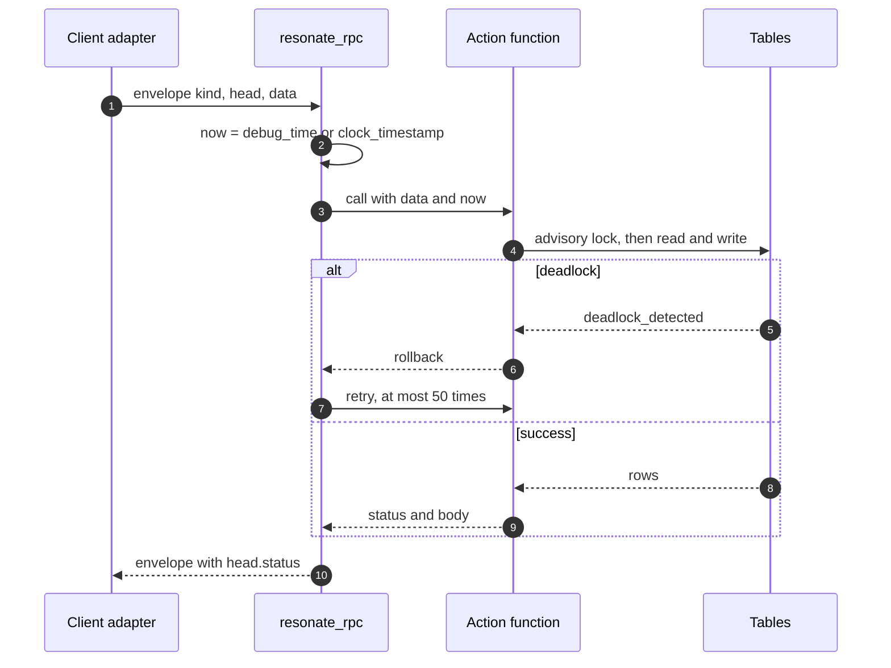
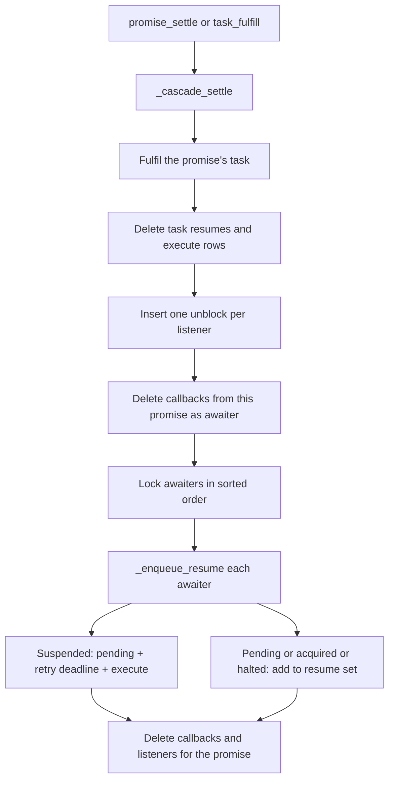

# The PostgreSQL server in one file

The PostgreSQL server is one file of Structured Query Language (SQL). The file is `impl/server/postgres/resonate.sql`, and it has 1,333 lines. A user applies it to a PostgreSQL 16 or later database with `psql -d yourdb -f resonate.sql`.

Resonate is a durable execution system. A server stores durable promises and the tasks that run them, and workers execute *registered functions*: functions in a worker's in-process registry, keyed by the name that the promise parameter carries. This file is that server, expressed as SQL. To *project* a record is to compute its state at `now` without writing it; the read paths do this for deadlines.

Source: `impl/server/postgres/README.md:34-40`, `impl/server/postgres/resonate.sql:1-9`, `spec/spec/02-abstract/internal.lean:25-40`

The file is not a network listener; it is the protocol state machine, the storage, and the timer logic. A worker runs the user code, a client adapter carries envelopes, and inside PostgreSQL `pg_cron` or a connected worker calls the timeout function.

## Terms

| Term | Meaning |
|---|---|
| Promise | A durable result slot with state, parameter, value, tags, and deadline |
| Task | A work item for a promise; one row exists for each promise with a target |
| Target | The `resonate:target` tag. Its value is the address that receives an execute message |
| External | A promise driven by a process outside the database; a target, timer tag, or external tag makes it external |
| Lease | The window in which an acquired task may run; the task `ttl` (time to live) holds its length |
| Origin | The root of a promise lineage. The `resonate:origin` tag holds its identifier |
| Awaiter | A promise with a task that waits on another promise; a callback names it in `awaiter_id` |
| Callback | A wait edge `(awaited_id, awaiter_id)` that makes the server resume the awaiter when the awaited promise settles |
| Preload | A settled promise returned with a response so a replay can short-circuit it; this server returns an empty list |
| Fence | A task-version check on a nested promise action; an old version returns status 409 |
| Envelope | The request or response object with fields `kind`, `head`, and `data` |
| Outbox | The table of messages ready for delivery; a key deduplicates, and a sequence orders the drain |

Source: `impl/server/postgres/resonate.sql:22-109`, `impl/server/postgres/resonate.sql:179-207`, `impl/sdk/ts/src/network/postgres.ts:62-68`

## What the file contains

The file has eleven sections: schema, helpers, promise actions, task actions, schedule actions, internal transitions, dispatcher, cron driver, drain, retention, and authorization.

Source: `impl/server/postgres/resonate.sql:1-1333`

## The schema

Seven tables hold the state.

### Promises and tasks

A promise has five states: `pending` (no result yet), `resolved` (success), `rejected` (error), `rejected_canceled` (a client canceled it), and `rejected_timedout` (its deadline passed). A task also has five states: `pending` (runnable), `acquired` (leased), `suspended` (waiting on a child), `halted` (paused by an operator), and `fulfilled` (done).

Source: `impl/server/postgres/resonate.sql:22-26`, `impl/server/postgres/resonate.sql:52-56`

| Promise column | Type | Purpose |
|---|---|---|
| `id` | `TEXT` | Primary key |
| `state` | `TEXT` | One of the five states |
| `param_headers`, `param_data` | `JSONB`, `TEXT` | The input |
| `value_headers`, `value_data` | `JSONB`, `TEXT` | The output |
| `tags` | `JSONB` | The protocol tags |
| `target` | generated `TEXT` | `tags->>'resonate:target'` |
| `origin_id` | generated `TEXT` | `tags->>'resonate:origin'` |
| `parent_id` | generated `TEXT` | `tags->>'resonate:parent'` |
| `branch_id` | generated `TEXT` | `tags->>'resonate:branch'` |
| `is_timer` | generated `BOOLEAN` | True when `tags->>'resonate:timer'` is the text `true` |
| `external` | generated `BOOLEAN` | True when a target, a timer tag, or an external tag is present |
| `timeout_at` | `BIGINT` | The promise deadline, in ms since the epoch |
| `created_at` | `BIGINT` | The creation instant |
| `settled_at` | `BIGINT` | The settlement instant, or null |

Source: `impl/server/postgres/resonate.sql:22-45`

A tag object can hold `resonate:target`, `resonate:origin`, `resonate:parent`, `resonate:branch`, `resonate:timer`, `resonate:external`, `resonate:scope`, and `resonate:delay`. The generated columns read the first six.

Source: `impl/server/postgres/resonate.sql:29-41`, `impl/sdk/ts/src/network/postgres.ts:62-68`

The generated columns are stored, so a query can filter on a tag without a JavaScript Object Notation (JSON) expression, and the column cannot disagree with the tag.

Source: `impl/server/postgres/resonate.sql:29-41`

A promise is external when it has a target, a true timer tag, or a true external tag. The Lean specification calls the same predicate `otype.awaitable`. Only an external promise is awaitable, and only an external promise gets a timeout sweep.

Source: `impl/server/postgres/resonate.sql:36-41`, `spec/spec/01-protocol/validation.lean:24-32`, `impl/server/postgres/resonate.sql:204-207`

The `tasks` table has `id`, `state`, `version`, `ttl` (time to live), `pid` (process identifier), and `timeout_at`. The foreign key is `tasks.id REFERENCES promises(id) ON DELETE CASCADE`, so the task identifier equals the promise identifier.

Source: `impl/server/postgres/resonate.sql:52-59`

`promise_create` inserts a pending task, version 0, with `timeout_at` at the first retry instant when the promise has a target. `task_create` inserts promise and task in one call, with the task `acquired` at version 1 and a lease deadline.

Source: `impl/server/postgres/resonate.sql:393-440`, `impl/server/postgres/resonate.sql:550-575`

A worker acquires a task with `task.acquire`. The function requires a pending task, a pending promise that is not timed out, and a matching task version. It sets the task to `acquired`, raises the version by one, and sets `timeout_at` to `now + ttl`.

Source: `impl/server/postgres/resonate.sql:600-622`

`task_get` projects the task state: if the promise is settled or past its deadline, it reports the task as `fulfilled` with no lease.

Source: `impl/server/postgres/resonate.sql:531-548`

### The wait graph

`callbacks` holds `(awaited_id, awaiter_id)`. Both columns name promises. `awaiter_id` must name a promise with a target, so a task exists with the same identifier. The callback is therefore a promise-to-promise edge, and the task is reachable by its shared identifier.

Source: `impl/server/postgres/resonate.sql:70-75`, `impl/server/postgres/resonate.sql:471-499`

`task_resumes` holds `(task_id, awaited_id)`. It is the set of settled promises that a task has not yet consumed. The set is deleted when the task acquires or suspends, and it is replaced when a suspended task wakes. It is internal bookkeeping: the task JSON reports only the count in `resumes`, and the dispatcher returns an empty preload list.

Source: `impl/server/postgres/resonate.sql:63-67`, `impl/server/postgres/resonate.sql:245-267`, `impl/server/postgres/resonate.sql:600-622`

`listeners` holds `(awaited_id, address)`. A listener is a notification destination, not a task.

Source: `impl/server/postgres/resonate.sql:77-81`

### Schedules and the outbox

A schedule row has an `id`, a `cron` expression of five fields, a `promise_id` template, a `promise_timeout`, a parameter, tags, `created_at`, `next_run_at`, and `last_run_at`.

Source: `impl/server/postgres/resonate.sql:84-96`

The `outbox` table has `key`, `kind`, `address`, `task_id`, `version`, `promise`, `seq`, and `created_at`. `kind` is `execute` or `unblock`. `seq` is an identity column, and the dispatcher index is `(kind, address, seq)`.

Source: `impl/server/postgres/resonate.sql:99-109`

Five indexes serve hot paths: two partial deadline indexes (`promises.timeout_at` and `tasks.timeout_at`), one partial settlement-retention index (`promises.settled_at`), and two partial lineage indexes (`origin_id` and `branch_id`). Other indexes cover callbacks, schedules, and the outbox.

Source: `impl/server/postgres/resonate.sql:46-49`, `impl/server/postgres/resonate.sql:61`, `impl/server/postgres/resonate.sql:75`, `impl/server/postgres/resonate.sql:96`, `impl/server/postgres/resonate.sql:109`

## The function surface

Every protocol action is a PostgreSQL function. The file names each one with a letter and a number: P for promise, T for task, S for schedule. Each action function takes an explicit instant in a parameter named `p_now`, which the tables below write as `now`.

Source: `impl/server/postgres/resonate.sql:376-882`

### Promise actions

| Identifier | Function and signature | Behavior |
|---|---|---|
| P-01 | `promise_get(id, now)` | Return status 404 or 200 with the projected promise |
| P-02 | `promise_create(id, timeout_at, param, tags, now)` | Return the existing promise if the id exists. Otherwise insert. A late create is born settled. A target creates a pending task |
| P-03 | `promise_settle(id, state, value, now)` | Accept only `resolved`, `rejected`, or `rejected_canceled`. Settle a pending promise and run the cascade |
| P-04 | `promise_register_callback(awaited, awaiter, now)` | Add a wait edge. Both promises must be pending, the awaiter must have a target, and the awaited must be external |
| P-05 | `promise_register_listener(awaited, address, now)` | Add a listener. The address must be `http://`, `https://`, or a `poll://` address with an `@` |

Source: `impl/server/postgres/resonate.sql:384-520`

### Task actions

| Identifier | Function and signature | Behavior |
|---|---|---|
| T-01 | `task_get(id, now)` | Project the task. Report `fulfilled` when the promise is no longer live |
| T-02 | `task_create(pid, ttl, action, now)` | Create a promise and an acquired task in one call, or acquire an existing pending task |
| T-03 | `task_acquire(id, version, pid, ttl, now)` | Acquire a pending task with the matching version |
| T-04 | `task_fence(id, version, action, now)` | Run a nested `promise.create` or `promise.settle` under task checks |
| T-05 | `task_heartbeat(pid, tasks, now)` | Extend the lease for each acquired task with the matching pid and version |
| T-06 | `task_suspend(id, version, actions, now)` | Record callbacks, set the task to `suspended`, and return status 300 if any awaited promise already settled |
| T-07 | `task_fulfill(id, version, action, now)` | Settle the promise and run the cascade |
| T-08 | `task_release(id, version, now)` | Return the task to `pending`, set a retry deadline, and emit execute |
| T-09 | `task_halt(id, now)` | Set the task to `halted` |
| T-10 | `task_continue(id, now)` | Set a halted task to `pending`, set a retry deadline, and emit execute |

The three search actions are `promise.search`, `task.search`, and `schedule.search`; all return status 501. `task_halt` and `task_continue` check no task version; they are control operations, not worker operations.

Source: `impl/server/postgres/resonate.sql:531-882`

### Schedule actions

| Identifier | Function and signature | Behavior |
|---|---|---|
| S-01 | `schedule_get(id, now)` | Return status 404 or 200 with the schedule |
| S-02 | `schedule_create(id, cron, promise_id, timeout, param, tags, now)` | Return the existing schedule, or parse the cron and insert |
| S-03 | `schedule_delete(id, now)` | Delete the schedule |

Source: `impl/server/postgres/resonate.sql:830-882`

## The envelope dispatcher

`resonate_rpc(req jsonb)` is the one function that a client adapter calls. It accepts one envelope and returns one envelope.

```json
{"kind": "promise.get",
 "head": {"corrId": "c-1", "version": "1"},
 "data": {"id": "order-42"}}
```

```json
{"kind": "promise.get",
 "head": {"corrId": "c-1", "status": 200, "version": "1"},
 "data": {"promise": {"id": "order-42", "state": "pending"}}}
```

Source: `impl/server/postgres/resonate.sql:1055-1064`, `impl/server/postgres/resonate.sql:1151-1154`

The `head.status` field is a protocol status, not a Hypertext Transfer Protocol (HTTP) status. The values are 200, 300, 400, 404, 409, 422, 500, and 501. The Python conformance shim always sends HTTP 200 when `resonate_rpc` returns, and uses HTTP 500 only for a shim or database failure.

Source: `impl/server/postgres/resonate.sql:1024-1030`, `impl/server/postgres/test/conformance.py:73-102`

`head.version` is echoed back unchanged. It is not the task version. Each task operation reads its own `version` from `data`; that is the concurrency guard. `head.resonate:debug_time`, when present, replaces the server clock for the whole request.

Source: `impl/server/postgres/resonate.sql:1061`, `impl/server/postgres/resonate.sql:1096-1107`

A `CASE` statement maps every kind to one function. An unknown kind returns 501. A `debug.*` kind goes to an optional `resonate._debug` function, or returns 501 when that function is absent; the conformance shim handles the three debug kinds in Python.

Source: `impl/server/postgres/resonate.sql:1071-1134`, `impl/server/postgres/test/conformance.py:31-51`

A deadlock retries the whole body, up to 50 times. The retry is safe because PostgreSQL rolls back the failed attempt before the exception handler runs, so no partial write remains. This is a statement about rollback, not about idempotence: an operation with the same version after a successful commit returns 409, not a duplicate result.

Source: `impl/server/postgres/resonate.sql:1069-1070`, `impl/server/postgres/resonate.sql:1155-1163`

Any other error maps to status 400 when the SQLSTATE starts with `22` or equals `23502`, and to status 500 otherwise.

Source: `impl/server/postgres/resonate.sql:1158-1162`

`task.fence` is the one operation with a nested envelope. The inner envelope goes in `data.action`, and the outer correlation identifier is copied into the inner head.

Source: `impl/server/postgres/resonate.sql:1138-1146`



Source: `impl/server/postgres/resonate.sql:1055-1165`

## Row locking

Two transactions can touch one promise at the same time. The server prevents a lost update with an advisory transaction lock.

```sql
CREATE OR REPLACE FUNCTION _lock(id text) RETURNS void
  LANGUAGE sql AS $$ SELECT pg_advisory_xact_lock(hashtextextended(id, 0)); $$;
```

Source: `impl/server/postgres/resonate.sql:381-382`

The lock is keyed by the identifier. It is an `xact` lock, so PostgreSQL releases it when the transaction ends. There is no unlock call and no lock row to clean.

`promise_register_callback` locks `LEAST(awaited, awaiter)` first and `GREATEST(awaited, awaiter)` second, so two registrations for one pair take the same order and cannot deadlock.

Source: `impl/server/postgres/resonate.sql:471-479`

`task_heartbeat` and `task_suspend` lock a set of identifiers in sorted order. They use a subquery with `ORDER BY lid`.

Source: `impl/server/postgres/resonate.sql:655-670`, `impl/server/postgres/resonate.sql:690-699`

Schedules use a different key space: `'sched:' || id`. The prefix keeps a schedule lock away from a promise lock with the same text.

Source: `impl/server/postgres/resonate.sql:848`, `impl/server/postgres/resonate.sql:873`, `impl/server/postgres/resonate.sql:943`

Ordered locks prevent one class of deadlock, not all deadlocks. A settlement locks a promise and then its awaiter task; a task action locks the task and then its awaited promises. The 50-attempt retry handles that order.

Source: `impl/server/postgres/resonate.sql:269-298`, `impl/server/postgres/resonate.sql:673-699`, `impl/server/postgres/resonate.sql:997-1012`

## The settlement cascade

A settlement is not one row change. `_cascade_settle(p promises, now)` runs five steps in the caller's transaction.

| Step | Action |
|---|---|
| 1 | Set the promise's own task to `fulfilled`, and clear its pid and ttl |
| 2 | Delete the task resume rows and the execute outbox rows for that task |
| 3 | Insert one unblock message per listener, keyed by promise and address |
| 4 | Delete callbacks where this promise is the awaiter and the awaited promise is still pending |
| 5 | Lock each awaiter in sorted order, call `_enqueue_resume`, then delete the callbacks and listeners for the settled promise |

Source: `impl/server/postgres/resonate.sql:269-298`

Step 3 builds the unblock key as `<promiseId>:notify:<address>`. Step 2 finds execute rows by `task_id`, because the execute key is the task identifier. Step 4 removes wait edges that a settled promise can no longer use. Step 5 resumes the tasks that wait on this promise.

Source: `impl/server/postgres/resonate.sql:274-296`

`_enqueue_resume(awaited, awaiter, now)` reads the task row for the awaiter. If no task exists, it returns. The action depends on the task state.

| Awaiter state | Action |
|---|---|
| `suspended` | Set to `pending`, set `timeout_at = now + _retry_timeout()`, clear the resume set, add this promise, and emit execute to the target |
| `pending` | Add this promise to the resume set |
| `acquired` | Add this promise to the resume set |
| `halted` | Add this promise to the resume set |
| `fulfilled` | Do nothing |

Source: `impl/server/postgres/resonate.sql:245-267`

The suspended branch replaces the resume set; callbacks to other pending promises stay, and a later settlement adds them.

Source: `impl/server/postgres/resonate.sql:252-263`, `impl/server/postgres/resonate.sql:673-737`



Source: `impl/server/postgres/resonate.sql:269-298`

> Aha: the wake-up path is not a timer scan. A settlement walks the callback edge and changes the waiting task inside the same transaction. The retry deadline it sets is a consequence, not the trigger. Time enters the wake path only as `now + 5000`, which tells the sweeper when to offer the task again.

Source: `impl/server/postgres/resonate.sql:245-267`, `impl/server/postgres/resonate.sql:269-298`

## Notifications and the outbox

The outbox is a keyed map and an ordered queue: the key deduplicates an offer, and the sequence orders a drain. A second offer of one task updates the row, and the `AFTER INSERT OR UPDATE` trigger fires again.

Source: `impl/server/postgres/resonate.sql:99-109`, `impl/server/postgres/resonate.sql:165-167`

| Message | Key | Address | Payload |
|---|---|---|---|
| Execute | Task identifier | The promise target | `task_id` and `version` |
| Unblock | `<promiseId>:notify:<address>` | The listener address | The projected promise |

Source: `impl/server/postgres/resonate.sql:236-243`, `impl/server/postgres/resonate.sql:279-289`

The trigger has two delivery paths.

| Address form | Delivery |
|---|---|
| `http://` or `https://` | `net.http_post` from `pg_net`, or `http_post` from `pgsql-http` in another schema |
| Any other form, such as `poll://` | `pg_notify` on `resonate_q_<md5(address)>` |

Source: `impl/server/postgres/resonate.sql:115-163`

The HTTP body is built by `_outbox_http_body`: an execute body has kind `execute`, an empty head, and `data.task` with `id` and `version`; an unblock body has kind `unblock`, an empty head, and `data.promise`.

Source: `impl/server/postgres/resonate.sql:128-135`

For an HTTP address, a successful post deletes the outbox row. A failed post raises a warning and leaves the row. The trigger does not retry. For a poll address, the row stays until a worker dequeues it.

Source: `impl/server/postgres/resonate.sql:137-163`

The outbox drain is destructive and addressed. `dequeue_execute(target, limit)` deletes execute rows for that address in `seq` order with `FOR UPDATE SKIP LOCKED`. `dequeue_unblock(address, limit)` does the same for unblock rows. The execute address is the promise target; the task identifier is inside the deleted row.

Source: `impl/server/postgres/resonate.sql:1235-1265`

The TypeScript PostgreSQL adapter is the normal network edge. `send` calls `resonate_rpc`; `recv` opens a `LISTEN` connection on the unicast and anycast channels, and a 250 ms tick calls `process_timeouts()` and drains both queues.

Source: `impl/sdk/ts/src/network/postgres.ts:130-136`, `impl/sdk/ts/src/network/postgres.ts:93-112`, `impl/sdk/ts/src/network/postgres.ts:147-177`

The adapter calls its delivery at-least-once. If a process crashes after it dequeues an execute row but before the task is acquired, the task stays pending, and the retry timeout emits a new execute row. A stale duplicate then fails acquire with status 409.

Source: `impl/sdk/ts/src/network/postgres.ts:162-169`

## The cron driver

The README says `pg_cron` is required because it drives all timers. If the extension is absent, the install block warns but continues; timers then wait for an external caller of `process_timeouts()`.

Source: `impl/server/postgres/README.md:42-45`, `impl/server/postgres/resonate.sql:1200-1203`

The TypeScript adapter is such an external caller. Its drain calls the zero-argument `process_timeouts()` on every notification and on every 250 ms fallback tick. So a deployment can run without `pg_cron` if a worker is always connected. A deployment with no worker and no `pg_cron` has no timer.

Source: `impl/sdk/ts/src/network/postgres.ts:147-161`, `impl/sdk/ts/src/network/postgres.ts:202-207`

The install tries `cron.schedule_in_database` with `'5 seconds'`, then `cron.schedule` with `'5 seconds'`, then the five-field form `'* * * * *'`, which is one minute.

Source: `impl/server/postgres/resonate.sql:1210-1221`

The job calls `process_timeouts()`. The zero-argument form reads the clock and calls the one-argument form. The one-argument form calls three sweeps in order.

| Sweep | Selects | Calls |
|---|---|---|
| `process_promise_timeouts` | External promises with `timeout_at <= now` | `_on_promise_timeout` |
| `process_task_timeouts` | Pending or acquired tasks with `timeout_at <= now` | `_on_task_retry_timeout` or `_on_task_lease_timeout` |
| `process_schedule_timeouts` | Schedules with `next_run_at <= now` | `_on_schedule_timeout` |

Source: `impl/server/postgres/resonate.sql:961-1012`

The promise sweep uses `_promise_timed`, which tests `state = 'pending' AND external`. An internal promise is not swept. Its own execution settles it.

Source: `impl/server/postgres/resonate.sql:204-207`, `impl/server/postgres/resonate.sql:961-971`

Each sweep orders by deadline and then by identifier. The order is stable, so a test can predict it. No sweep has a batch limit. A large backlog runs in one cron tick.

Source: `impl/server/postgres/resonate.sql:965-967`, `impl/server/postgres/resonate.sql:976-978`, `impl/server/postgres/resonate.sql:991-993`

The schedule sweep has an unbounded `WHILE` loop. It fires every due occurrence in one call. There is no catch-up limit, unlike the S3 server, which stops at 256 occurrences per round.

Source: `impl/server/postgres/resonate.sql:939-958`

One occurrence calls `promise_create` with `now = cron_time`, not the current instant. A late occurrence is therefore created with `created_at = cron_time` and a deadline of `cron_time + promise_timeout`; a read later projects the timeout against the real clock. This matches Lean and differs from the Zig S3 server, which checks the real instant before insertion.

Source: `impl/server/postgres/resonate.sql:939-958`, `spec/spec/02-abstract/internal.lean:118-122`

`promise_create` gives the schedule its create-if-absent behavior. If the id exists, it returns the existing promise with status 200. A concurrent insert that loses a unique race is caught and returns the existing row.

Source: `impl/server/postgres/resonate.sql:393-419`, `impl/server/postgres/resonate.sql:436-439`

The cron parser accepts five fields. It supports `*`, a number, a range, a list, and a step. It searches in UTC and gives up after nine years. When both the day-of-month and day-of-week fields are restricted, it accepts a match on either field.

Source: `impl/server/postgres/resonate.sql:301-368`

`_expand` replaces `{{.id}}` and `{{.timestamp}}` in the template. No other placeholder exists.

Source: `impl/server/postgres/resonate.sql:370-373`

## Retention

`gc(settled_before, limit)` deletes a bounded number of settled promises. It selects promises with `settled_at <= cutoff` and orders by `settled_at`. It refuses a promise when a pending promise has `id` equal to its `origin_id`. The origin promise is the anchor for the lineage, so the collector keeps the whole lineage while the origin is pending.

Source: `impl/server/postgres/resonate.sql:1271-1280`

The function deletes unblock outbox rows whose `promise->>'id'` is in the deleted set, and task resume rows whose `awaited_id` is in the set. Tasks, callbacks, and listeners follow through `ON DELETE CASCADE`. Schedules are independent and are not deleted.

Source: `impl/server/postgres/resonate.sql:1280-1289`, `impl/server/postgres/resonate.sql:52-54`, `impl/server/postgres/resonate.sql:63-81`

The README shows a daily job at 03:00 that collects workflows finished more than seven days ago. It states the reason for the horizon: an identifier is idempotent only while the row exists. A client retry after collection can create a new promise with the same id.

Source: `impl/server/postgres/README.md:57-67`

## Installation and testing

The install is one command on PostgreSQL 16 or later. `pg_cron` drives timers, and `pg_net` or `pgsql-http` optionally enables HTTP push.

```bash
psql -d yourdb -f resonate.sql
```

Source: `impl/server/postgres/README.md:34-48`

The file revokes all schema privileges from `PUBLIC`, creates the `resonate_worker` role, marks `resonate_rpc`, `dequeue_execute`, and `dequeue_unblock` as `SECURITY DEFINER`, pins `search_path = resonate, pg_temp` on every schema function, and grants execute on six functions: `resonate_rpc`, `get_schema_version`, `invoke`, `dequeue_execute`, `dequeue_unblock`, and `outbox_channel`.

Source: `impl/server/postgres/resonate.sql:1293-1333`

`get_schema_version()` returns the text `0.1.0`. `invoke(id, func, args, target, version, timeout)` is a convenience wrapper. It builds an invocation parameter as base64 JSON, builds the tags, and calls `promise_create`. The default timeout is 86,400,000 ms, which is one day.

Source: `impl/server/postgres/resonate.sql:18-20`, `impl/server/postgres/resonate.sql:1167-1189`

The conformance test is a small Python HTTP shim. It translates an HTTP request into `SELECT resonate.resonate_rpc(%s::jsonb)`, listens on port 8001, and uses a connection pool from 2 to 16 connections.

Source: `impl/server/postgres/test/conformance.py:1-27`, `impl/server/postgres/test/conformance.py:73-102`

The shim handles three debug operations itself, in Python, not in SQL.

| Debug operation | Test action |
|---|---|
| `debug.reset` | Truncate the seven tables with `CASCADE` |
| `debug.snap` | Read promises, tasks, and callbacks as JSON |
| `debug.tick` | Call `process_timeouts(time)` for the supplied instant |

Source: `impl/server/postgres/test/conformance.py:23-51`

The reset list names child tables first, but `CASCADE` makes the order unnecessary; `schedules` is not a child of `promises`.

Source: `impl/server/postgres/test/conformance.py:23-27`

The shim lets the standard conformance harness treat a database as a server. A real deployment uses the SQL functions through an adapter such as `PostgresNetwork`, or through the shim as an HTTP edge.

Source: `impl/server/postgres/test/conformance.py:1-10`, `impl/sdk/ts/src/network/postgres.ts:1-17`

## Limits of the one-file server

| Cost | Reason |
|---|---|
| Time needs `pg_cron` or a connected worker | The SQL file cannot wake itself |
| The retry timeout is fixed at 5,000 ms | `_retry_timeout()` is a constant |
| A schedule can fire an unbounded backlog in one sweep | The `WHILE` loop has no catch-up limit |
| HTTP push has no retry | A failed post raises a warning and leaves the row |
| A deadlock can still occur | Ordered locks cover pairs and sets, not every cross-tree order. The dispatcher retries 50 times |
| One connection is held per in-flight request | Each function runs synchronously inside one transaction |
| Collection breaks idempotence after the horizon | An identifier is idempotent only while its row exists |

Source: `impl/server/postgres/resonate.sql:175-176`, `impl/server/postgres/resonate.sql:939-958`, `impl/server/postgres/resonate.sql:137-163`, `impl/server/postgres/resonate.sql:997-1012`, `impl/server/postgres/README.md:57-67`

The design has no binary, no cache, and no timer wheel. PostgreSQL does the work.

## Related documents

- [00-overview.md](00-overview.md) — the thesis and the component map.
- [02-the-protocol.md](02-the-protocol.md) — the operations that `resonate_rpc` dispatches.
- [06-storage-engines.md](06-storage-engines.md) — the other storage backends.
- [11-schedules-timers-and-time.md](11-schedules-timers-and-time.md) — deadlines and the cron driver.
- [13-the-s3-server-in-zig.md](13-the-s3-server-in-zig.md) — the same protocol over object storage.
