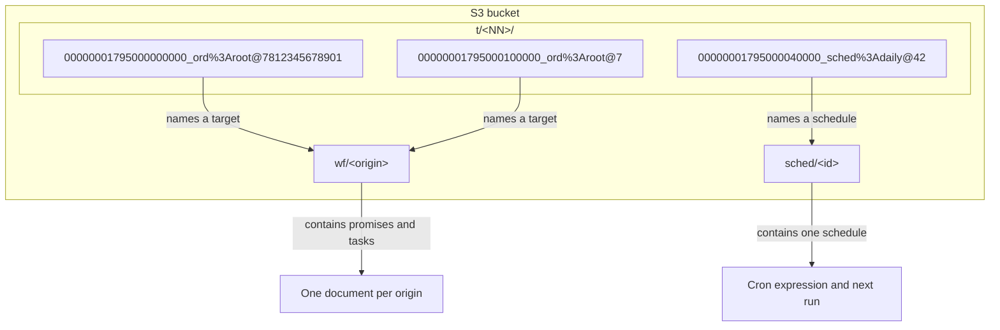
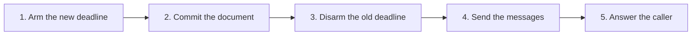

# The S3 server in Zig

Resonate is a durable execution system: a server stores durable promises and the tasks that run them, and workers execute registered functions, functions in a worker's in-process registry keyed by the name in the promise parameter. The S3 server is a Resonate protocol server, not an S3-compatible storage service. It is the third independent server implementation in this repository, after the Rust server core and the PostgreSQL server, and it is written in Zig. Its only durable state is objects in an Amazon Simple Storage Service (S3) bucket. It has no database, no write-ahead log, no consensus protocol to agree among replicas, no object that represents a lock, no object that represents a lease, and no background compaction. The repository describes it as twenty-three thousand lines of Zig with nothing outside the standard library.

In this document, a promise is a durable result slot. A task is the runnable record of a promise that has a target. To settle a promise is to write its final state. A lease is the time-limited claim that an acquired task holds, and a worker is a process that registers functions. The *Lean specification* is the formal protocol model under `spec/`.

Source: `impl/server/s3/README.md:1-6`, `spec/spec/02-abstract/internal.lean:25-40`

This document explains the key space, the single-origin property, the conditional write, the commit order, the actor model, the deadline keys, the caches, and the validation plan. It also states plainly what the server does not contain.

## Build and run

The build command is `zig build`. The build defaults to `ReleaseSafe`. That mode keeps `unreachable` as a panic, and every assertion in the code is an `unreachable`. The build comment says `ReleaseFast` and `ReleaseSmall` are not shipping modes, because those modes turn a check into a promise to the optimizer.

Source: `impl/server/s3/README.md:9-20`, `impl/server/s3/build.zig:5-20`

```bash
zig build
zig-out/bin/resonate serve --store s3 --endpoint http://127.0.0.1:9000 --bucket resonate
zig-out/bin/resonate serve --store memory --debug --port 8021
```

Source: `impl/server/s3/README.md:9-11`

The server has one request route. It is `POST /`. The body is one protocol envelope with a `kind`, a `head`, and a `data` object. The server also answers `GET /ready` and `GET /metrics`. There are twenty-four operation kinds across `promise.*`, `task.*`, `schedule.*`, and `debug.*`.

Source: `impl/server/s3/README.md:31-43`

| Flag | Meaning | Default |
|---|---|---|
| `--store` | `memory` or `s3` | `memory` |
| `--endpoint` | Object store Uniform Resource Locator (URL) | `http://127.0.0.1:9000` |
| `--bucket` | Bucket name | `resonate` |
| `--port` | HTTP port | 8001 |
| `--timer-shards` | Number of shard prefixes across which deadlines spread | 4 |
| `--cache-entries` | Number of documents held in memory | 4,096 |
| `--cache-bytes` | Bytes of cached documents | 67,108,864 bytes (64 mebibytes) |
| `--sole-writer` | Assume no other process writes the bucket | off |
| `--debug` | The caller owns the clock | off |
| `--shutdown-timeout` | Milliseconds allowed for in-flight work after `SIGTERM` | 2,000 |

Source: `impl/server/s3/src/main.zig:35-60`, `impl/server/s3/src/applier.zig:64-92`

## The key space

The bucket has three prefixes. The keys are the schema.

| Key | Holds | Written by |
|---|---|---|
| `wf/<enc(origin)>` | Every promise and task of one origin, as one document | The commit loop |
| `sched/<enc(id)>` | One schedule | The schedule service |
| `t/<NN>/<20-digit deadline>_<enc(target)>@<token>` | A deadline, as a zero-byte object | Whoever armed it |

`enc` is percent-encoding: letters, digits, `.` and `-` stay, and every other byte becomes `%XX` with uppercase hexadecimal digits. `NN` is the two-digit shard number, from 00 to 03 with the default of four shards. The deadline is milliseconds since the epoch. The token is the arm token described below.

Source: `impl/server/s3/README.md:45-53`, `impl/server/s3/src/store.zig:196-320`, `impl/server/s3/src/store.zig:413-425`



Source: `impl/server/s3/src/store.zig:258-320`, `impl/server/s3/docs/on-s3.md:32-53`

The origin document is one header line and then one JavaScript Object Notation (JSON) line per promise and per task. The header is `{"v":1,"og":<origin hash>,"cl":<clock>,"gn":<generation>}`, with optional `ta` and `tgn` fields when a deadline is armed. The encoding is canonical: American Standard Code for Information Interchange (ASCII) only, minimal escapes, fixed key order, integers without exponents, and omission of empty fields rather than `null` or `[]`.

Source: `impl/server/s3/src/doc.zig:1-20`, `impl/server/s3/src/doc.zig:532-560`

The canonical form does two jobs. It lets the commit loop compare bytes and decide whether a write is necessary. It also lets a writer recognise its own write after a lost response.

Source: `impl/server/s3/src/doc.zig:17-22`

The document records two counters. `generation` counts commits and names the timer object under which this document's deadline is armed; a generation belongs to exactly one commit. `timer_generation` is the generation whose commit wrote the timer object now on the store. The store's entity tag (ETag) is the compare-and-swap token: it is the object version returned with each read and used in `If-Match`. The timer token is unique to the arm, not to the commit: a retry that arms the same deadline must produce a different name, or its orphan collector can delete the live object. The code names the timer-key parameter `generation`, but `fresh_arm` supplies this token.

Source: `impl/server/s3/src/doc.zig:338-374`, `impl/server/s3/src/applier.zig:921-938`

The document also records a clock value. The clock is a monotonicity hint. It is excluded from the comparison that decides whether to write, because paying a write to advance a hint would make every read a write.

Source: `impl/server/s3/src/doc.zig:355-360`, `impl/server/s3/src/doc.zig:488-510`

## The single-origin property

The whole design rests on one property of the protocol. Every operation is single-origin. An origin is everything before the first `:`, or the whole identifier when it contains no colon.

| Operation | What it names | Why it is single-origin |
|---|---|---|
| `promise.create`, `promise.get`, `promise.settle` | One promise | The identifier is the whole argument |
| `task.*` | One task | A task identifier is a promise identifier |
| `promise.register_callback` | An awaited and an awaiter | The protocol refuses the pair unless the origins match |
| `promise.register_listener` | An awaited and an address | An address is not state |
| `task.fence` | A task and a nested action | The action identifier must share the task origin |
| `schedule.*` | A template | The schedule has no promises of its own |

Source: `impl/server/s3/docs/on-s3.md:6-30`, `impl/server/s3/src/handle.zig:1277-1290`

Everything an operation reads and everything it writes therefore lives in one object. One conditional write of that object commits a whole transition. That is where atomicity comes from on a store that has no transactions.

The `schedule.*` operations fit this rule because they touch only the schedule object. Firing is an internal loop, not a request: it creates the due promise objects and then commits the schedule. The code therefore describes firing as two commits, and each commit is single-origin.

Source: `impl/server/s3/src/doc.zig:1-10`, `impl/server/s3/README.md:55-60`

The searches and `debug.snap` are the exception. They read many objects one at a time. They are surveys, not atomic steps, and the protocol never promised otherwise. The scan module says this directly.

Source: `impl/server/s3/src/scan.zig:1-19`

## Conditional writes

The store port has six uses over four verbs (`get`, `put`, `delete`, `list`). It can read with a version, create if absent, replace if unchanged, write blindly, delete, and list in key order. Two preconditions matter.

| Operation | Header | Meaning |
|---|---|---|
| Create | `If-None-Match: *` | The first writer of an origin wins |
| Replace | `If-Match: <etag>` | Replace what was read, and only that |
| Read validation | `If-None-Match: <etag>` | Send the body only if it changed |

Source: `impl/server/s3/src/store.zig:69-90`, `impl/server/s3/src/s3.zig:118-135`

A conditional write has three failure outcomes. They are not interchangeable.

| Store answer | What is known | Required action |
|---|---|---|
| `412` precondition failed | The write did not land, and the state moved | Re-decide against a fresh read |
| `409` conflict | Nothing; the store could not order the write | Retry the same conditional write |
| No answer | Nothing; the write may have landed | Answer 503 and let the caller retry |

Source: `impl/server/s3/src/store.zig:1-27`, `impl/server/s3/docs/on-s3.md:55-73`

Re-deciding is the important case. A decision made against a state that no longer exists cannot be replayed. The promise that the decision was going to create may now exist. The task that it was going to acquire may be held by another worker. A replay would produce an answer that no sequential execution can produce.

Source: `impl/server/s3/src/applier.zig:33-45`, `impl/server/s3/docs/on-s3.md:69-73`

The store port keeps the two write failures as separate union variants. Collapsing them into one "write failed" flag is the classic way to lose a write. The source says this in the module comment.

Source: `impl/server/s3/src/store.zig:9-25`

The code handles the outcomes in three places. The commit loop re-decides on `precondition_failed`. It retries the same write on `conflict`. It answers 503 on `unavailable`. Each path invalidates or updates the cache in the way its outcome requires.

Source: `impl/server/s3/src/applier.zig:634-690`

## The commit order

A commit runs five steps in a fixed order.



Source: `impl/server/s3/README.md:83-87`, `impl/server/s3/src/applier.zig:1-30`

The order is chosen so that every crash window leaves a state that something repairs.

| Crash after | State left | Repair |
|---|---|---|
| Arming | A timer object with no document that points at it | It fires into a sweep with nothing due and is collected |
| Committing | The transition is durable, and the old deadline is still armed | The old deadline fires into a document that moved on and is collected |
| Disarming | The transition is durable, and the messages did not go | The task's retry deadline was committed before the message left, so it re-sends |
| Sending | The caller was told nothing | The caller retries, and every operation is idempotent |

Source: `impl/server/s3/docs/on-s3.md:89-107`, `impl/server/s3/README.md:83-87`

The arm step is unconditional. The key carries the whole meaning of the write. Arming the same deadline twice writes the same object. Arming a different deadline writes a different object. A racing writer cannot lose it.

Source: `impl/server/s3/src/applier.zig:601-632`, `impl/server/s3/src/timerd.zig:1-12`

The disarm step is best effort. If it fails, the old object remains. It fires later, the sweep finds that the document has moved on, and the object is collected. The collector is the same code path as a real deadline.

Source: `impl/server/s3/src/applier.zig:710-732`

> Aha: the commit order is not a performance choice. It removes one unrecoverable state. A committed document whose deadline was never armed is a promise that never times out and a task that is never offered again, and no other process can detect it. Every other crash window leaves an orphan or a duplicate that some later step repairs. The arm therefore comes first, and a failed arm fails the request instead of committing the document anyway.

Source: `impl/server/s3/docs/on-s3.md:103-107`, `impl/server/s3/src/applier.zig:624-632`

## The token on a deadline key

The last part of a timer key is a token. The document records the token of the object it armed.

Two operations need the token.

First, disarm. A writer removes the object that its own predecessor wrote, and nothing else. Without the token, the key would name only the target and the deadline. A deadline that becomes the nearest one again, such as a promise timeout after a shorter lease disappears, could then be removed by another writer's disarm.

Source: `impl/server/s3/docs/on-s3.md:109-123`

Second, collection. Whatever fires an orphan deletes it by name afterwards. An attempt that armed an object and then failed to commit leaves that object behind. A retry that loads the same document version computes the same deadline. If the token came from the document counter, the retry would compute the same name, and the collector for the orphan would delete the live object.

Source: `impl/server/s3/src/applier.zig:921-960`

The token is therefore unique to the arm, not to the commit. It is 63 bits from the server's own random stream. Zero means "no deadline armed", so it is not a valid token. When no random source is available, `fresh_arm` returns `loaded_generation + 1`, and the source states that this fallback weakens the guarantee.

Source: `impl/server/s3/src/applier.zig:938-960`

## One actor per origin

A request does not commit. It enqueues work on one actor per origin in that process. The event loop drains the actor, so every request that arrived in one poll rides one conditional write. Each request still sees the one before it, because the actor decides them in order against one document.

Source: `impl/server/s3/src/applier.zig:1-30`, `impl/server/s3/src/applier.zig:788-900`

This buys more than throughput. A burst of operations on one origin is the common shape of a durable execution. A task acquires, settles a child, and suspends. If each of those were its own read-modify-write against S3, they would contend for the same object. The actor turns that contention into one write.

Source: `impl/server/s3/docs/on-s3.md:129-139`

The actor has six phases: idle, loading, arming, committing, disarming, and waiting. A phase change is an assertion target, so an unexpected callback panics in `ReleaseSafe`.

Source: `impl/server/s3/src/applier.zig:294-330`

The actor re-decides the whole batch after a failed precondition. It does not replay the batch. The version checks and identifier checks run again against the fresh document.

Source: `impl/server/s3/src/applier.zig:634-660`

A contended actor backs off. The maximum is eight retries after the first attempt (`max_cas_retries = 8`), nine attempts in total. After that, the caller receives 503 with the message "the origin was contended for too long".

Source: `impl/server/s3/src/applier.zig:66-72`, `impl/server/s3/src/applier.zig:680-690`

## One request, end to end

A `promise.create` arrives at `POST /`. `protocol.parse_envelope` checks the envelope, so a malformed body never reaches a subsystem. The server computes `now` and derives the origin from the promise identifier: everything before the first `:`. `Applier.submit` queues the work on that origin's actor, and `drain` runs the loop once. The actor takes the document from cache or reads it, re-decides every queued request in order, arms a new deadline if one exists, commits the document under `If-Match`, disarms the old deadline, sends the messages, and answers. A second create of the same identifier sees the first one in the same document, so it returns the existing promise instead of a duplicate.

Source: `impl/server/s3/src/server.zig:121-170`, `impl/server/s3/src/applier.zig:1-30`, `impl/server/s3/src/main.zig:219-304`

## Deadlines as keys

A deadline object is zero bytes. Its name is the record. The 20-digit deadline field is zero-padded so that lexicographic order is time order inside one shard. A capped ascending list therefore returns the nearest deadlines in that shard.

Source: `impl/server/s3/src/store.zig:186-192`, `impl/server/s3/src/store.zig:258-286`

The `NN` field spreads the keys across four shards by default. Deadlines only increase, and a monotone key prefix is the access pattern that object stores handle worst. The shard number is a hash of the target.

Source: `impl/server/s3/src/store.zig:196-207`, `impl/server/s3/src/store.zig:296-320`

The deadline poller keeps an in-memory queue of near deadlines. Normal operation wakes on the queue and costs no store operations. The listing path exists for startup and for `debug.tick`. Startup lists the whole `t/` prefix, which covers every shard, and seeds the queue from all parsed keys.

Source: `impl/server/s3/src/timerd.zig:1-30`

A fired key is deleted only after its sweep commits. If the sweep fails, the key is the only record that the deadline exists. Deleting it would lose the deadline for good. A failure re-arms the deadline in memory and tries again after 1,000 ms.

Source: `impl/server/s3/src/timerd.zig:22-34`, `impl/server/s3/src/timerd.zig:52-54`

The sweep is the `drain` function in the state machine. It collects expired promises, expired leases, and due retries in one pass. It settles each expired promise by projection, returns each lost lease to pending, and re-offers each due retry.

Source: `impl/server/s3/src/handle.zig:1526-1585`

The state machine applies the same timeout rule as the Lean model. A promise with a timer tag resolves. A promise without the tag receives `rejected_timedout`. The rule is in the protocol module.

Source: `impl/server/s3/src/protocol.zig:331-340`

## Schedules

A schedule is not origin-scoped. It has no promises of its own, only a template for the promises it fires. It therefore gets its own key under `sched/`.

Source: `impl/server/s3/src/schedules.zig:1-6`

Firing is two commits. The service first creates the promises that are due, and then moves the schedule forward. A crash between the two leaves the schedule pointing at an instant that it already fired. It fires again, and creating a promise that exists is a no-op. One run stays one run.

Source: `impl/server/s3/src/schedules.zig:6-13`

Catch-up is bounded. One round fires at most 256 overdue occurrences. If more remain, the next instant stays in the past, and the deadline fires again at once. A long backlog drains in bounded rounds rather than one unbounded round.

Source: `impl/server/s3/src/schedules.zig:14-24`, `impl/server/s3/src/schedules.zig:40-41`

A deleted schedule leaves a tombstone. The tombstone is what makes two concurrent deletes report one success and one 404. The object stays, and a create with the same identifier reclaims it.

Source: `impl/server/s3/src/schedules.zig:460-475`, `impl/server/s3/src/schedules.zig:1145-1165`

## Bounded caches

The document cache is bounded twice. It has an entry limit and a byte limit. The defaults are 4,096 documents and 64 mebibytes.

Source: `impl/server/s3/src/applier.zig:73-82`

Two bounds are necessary because a count alone does not bound memory. An origin document grows with every promise in it, so 4,096 of them is a number of bytes that nobody chose. Whichever bound binds first evicts the oldest read.

Source: `impl/server/s3/src/applier.zig:76-81`, `impl/server/s3/docs/on-s3.md:82-87`

The cache holds canonical bytes, not a decoded document. A re-decide after a lost race must start from what the store says. One entry is always kept, however heavy, because the batch that just committed it is what reads it next.

Source: `impl/server/s3/docs/on-s3.md:82-87`

A cached read is validated with `If-None-Match: <etag>` before it is used. The store answers "not modified" and sends no body, so a cache hit costs one round trip and no transfer. Without this validation, two servers over one bucket serve stale reads.

Source: `impl/server/s3/src/applier.zig:83-92`, `impl/server/s3/src/applier.zig:459-480`

`--sole-writer` turns the validation off. The flag says in its name what it assumes. It is sound only where one process writes the bucket, and nothing in the code can check that condition. The validation plan makes the unsafe case a negative control: two servers with `--sole-writer` must be refuted by both checkers.

Source: `impl/server/s3/src/main.zig:56-60`, `impl/server/s3/docs/validation-plan.md:495-510`

## How it is validated

The README describes eight checks and lists the eight commands that run them.

| Check | Question | Tool |
|---|---|---|
| Unit tests | Does each part do what it says? | `zig build test`, 211 tests (the validation plan says 210) |
| Simulation | Is the concurrency sound? | `simulator run` and `soak` |
| Differential | Is this the same protocol as another server? | `differ` |
| Recorded history | Was a real run sound? | `simulator check` |
| Restart | Does a deadline outlive the process? | `tools/deadline-survives-a-restart.sh` |
| Memory | Does answering cost memory? | `tools/memory-stays-flat.sh` |
| Foreign checker | Does an independent model accept it? | Porcupine, from the specification repository |
| Two processes | Do two servers over one bucket agree? | `tools/two-servers-one-bucket.sh` |

Source: `impl/server/s3/README.md:142-156`, `impl/server/s3/docs/validation-plan.md:1-16`

The simulator is a miniature deterministic model checker. One seed produces a byte-identical run. The simulator owns the clock and the store. It injects five faults:

- no answer,
- a write that lands and reports failure,
- two writes whose order cannot be decided,
- completions out of order,
- a server crash at an arbitrary point.

Source: `impl/server/s3/docs/validation-plan.md:24-52`, `impl/server/s3/src/simulator.zig:22-50`

The specification used by the search is the server itself, stepped one operation at a time over an in-memory store. The search asks whether a concurrent history has a sequential explanation in the same state machine, ending in the state that the bucket actually holds. That is a linearizability check.

Source: `impl/server/s3/docs/validation-plan.md:53-84`, `impl/server/s3/src/sim/model.zig:1-60`

Two invariants are checked against the bucket after every operation. Every deadline that a document records must have an object of that name. Nothing runnable may be stranded: a pending task must owe a retry deadline, and an acquired task must owe a lease.

Source: `impl/server/s3/docs/validation-plan.md:85-110`

`fakes3` is a stand-in S3. It implements the six operations that the store port needs, with real conditional writes. It runs as a library and as a process. The simulator drives the in-memory store; the checks over the S3 path use `fakes3`. It is not S3, and it has no signing, no policies, no multipart, and no versioning.

Source: `impl/server/s3/src/fakes3.zig:1-16`, `impl/server/s3/src/fakes3.zig:25-37`

The differential tool sends one seeded trajectory to two servers and compares both the answers and the state snapshot. Both servers must run in debug mode, so time is an input and nothing runs on wall time. A difference is a protocol difference, because no faults are injected.

Source: `impl/server/s3/src/differ.zig:1-27`

The Porcupine check hands a recorded history to a checker that nobody in this directory wrote. The script first alters one answer in a real history and requires the checker to refuse it. A checker that cannot be made to fail is not evidence.

Source: `impl/server/s3/docs/validation-plan.md:357-385`

The simulator found eight bugs. The README lists all eight. Three of them are these. A cached read served stale state. A disarm removed another writer's deadline. An arm left an orphan under the name that the retry would use. The differential found two more. One is an outbox key collision for one address that listens on two promises. The other is a late schedule occurrence offered to a worker for work that was already over. A further problem, an arena leak of about five kilobytes per request, was found by the memory check.

Source: `impl/server/s3/README.md:180-208`, `impl/server/s3/docs/validation-plan.md:296-315`

## What is not there

The server states its omissions as clearly as its features.

| Not present | Reason or consequence |
|---|---|
| `ui.*` console read model | Refused with 404, like any server built without it |
| Transport Layer Security (TLS) | A proxy terminates it |
| Authentication and authorization | A proxy performs them |
| Wall time under `--debug` | The clock belongs to the caller, which makes a differential comparable |
| A real bucket test | The process-level checks use `fakes3`, and the simulator uses the in-memory store; neither is a real bucket |
| Store retry | A 503 from the store is a 503 to the caller; the caller retries |

Source: `impl/server/s3/README.md:210-231`, `impl/server/s3/docs/validation-plan.md:518-532`

The missing real bucket test is the largest gap. If the shared reading of the S3 documentation is wrong about `If-Match`, both the client and the fake are wrong together, and no check in the repository would notice. The Rust tree has the test that this needs, in `resonate-server-blob/tests/live.rs`, and it is skipped unless a bucket is configured.

Source: `impl/server/s3/README.md:220-225`, `impl/server/s3/docs/validation-plan.md:518-532`

The searches are the other stated limit. A search reads every document in the prefix, one object at a time. It is O(origins) reads per query. The scan module names this as the seam where a secondary index would go, and states that adding one would not touch the state machine or the commit loop.

Source: `impl/server/s3/src/scan.zig:1-10`

The server also does not retry the store on a `503 SlowDown`. The source gives the reason. Backing off inside the store would hide from the caller how long the request has been outstanding. Every operation is idempotent. The retry therefore belongs where the deadline is known.

Source: `impl/server/s3/README.md:226-231`

`SIGTERM` stops the server gracefully. It stops accepting connections and waits up to `--shutdown-timeout` milliseconds for work in flight. The wait is not needed for safety, because every transition is committed before it is answered. It exists for the caller that was about to receive an answer.

Source: `impl/server/s3/README.md:232-236`

## Related documents

- [00-overview.md](00-overview.md) — the thesis and the component map.
- [03-durable-promises-and-tasks.md](03-durable-promises-and-tasks.md) — the state machine the Zig code implements.
- [06-storage-engines.md](06-storage-engines.md) — the other backends.
- [11-schedules-timers-and-time.md](11-schedules-timers-and-time.md) — deadlines in every backend.
- [12-the-postgres-server-in-one-file.md](12-the-postgres-server-in-one-file.md) — the same protocol with a database as the durable state.
