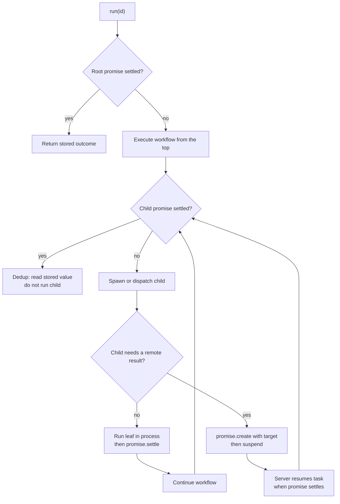
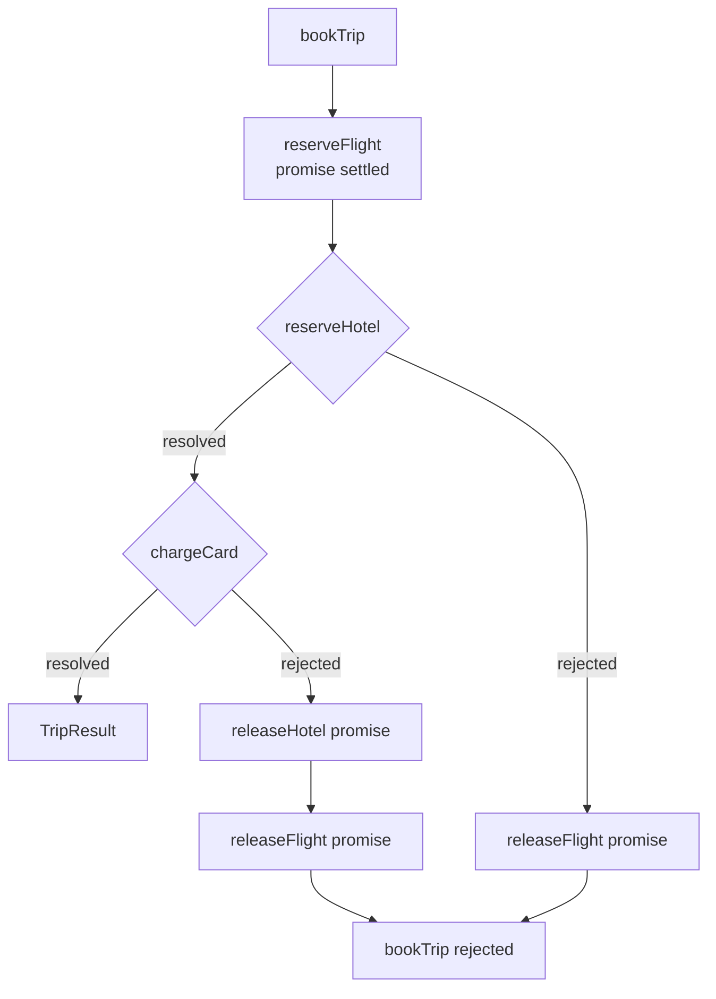
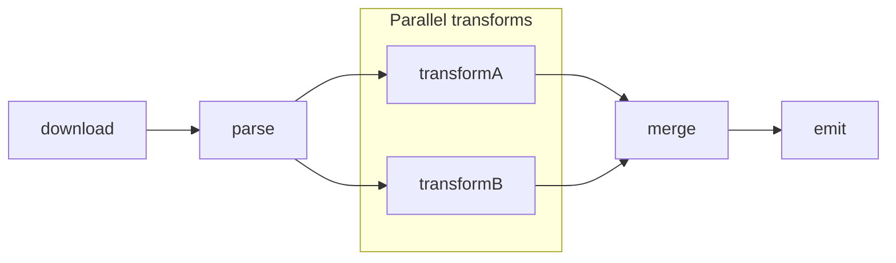

# Patterns: durable promise graphs in the TypeScript SDK

The Resonate repository teaches its model through runnable examples. Each example is the smallest correct program for a common distributed pattern. Each uses the same two primitives, the durable promise and the durable task, and each survives a crash without a recovery branch.

This document reads the TypeScript (TS) examples in `impl/sdk/ts/examples/async/`. It states what each pattern persists, what the runtime re-executes after a crash, and which protocol operations carry the pattern. The TypeScript Software Development Kit (SDK) has two engines. This document uses the async/await engine because it shows the mechanics without a generator driver. The generator engine uses the same protocol and promise graph.

Source: `impl/sdk/ts/examples/async/README.md:1-40`, `impl/sdk/ts/src/async/context.ts:326-560`

## The one rule that makes every pattern work

A durable function is one of two kinds. A *leaf* does its work and returns. It performs no durable operation. A *workflow* performs at least one durable operation. The async context object (`ctx`) has five durable operations: `ctx.run` runs a child in the same worker, `ctx.rpc` makes a remote procedure call (RPC) to another worker, `ctx.sleep` waits on a timer, `ctx.promise` opens a latent promise, and `ctx.detached` starts an independent root. The distinction controls retries. Resonate retries a leaf. It never retries a workflow. A workflow is recovered by replay.

Source: `impl/sdk/ts/examples/async/retries.ts:1-10`, `impl/sdk/ts/examples/async/README.md:12-35`

Three terms recur. A pass is one run of a workflow body, from first line to return. An anycast group is a name that any worker in the group can receive. A callback is the row that names the task to resume when a promise settles.

Replay has one mechanism. Every durable operation first creates a durable promise with a deterministic identifier. If the promise is already settled, the operation returns the stored value and does not run the callee again. If the promise is pending, the operation runs the callee or suspends. The runtime calls this branch `dedup`.

```typescript
const rec = await this.createSlotted(createReq, func.name, slot);
this.trace.emit({ kind: "run", id: this.id, callee: id });
if (rec.state !== "pending") {
  // Replay: the child is already settled -> dedup, no spawn/return.
  const state = rec.state === "resolved" ? "resolved" : "rejected";
  this.trace.emit({ kind: "dedup", id, state, value: rec.value?.data });
  return recordOutcome(rec);
}
```

Source: `impl/sdk/ts/src/async/context.ts:368-382`

`slot` is the positional index that mints the child identifier. `recordOutcome` turns the stored record into a resolved value or a rejection.

That branch is the whole recovery model. The runtime does not store a program counter. It re-runs the program from the top, and settled promises act as a memo table.

## What each example demonstrates

| Example | Pattern | File |
|---------|---------|------|
| Hello world | Register, run, read the result | `hello.ts` |
| Recovery | Re-run the same identifier; settled work is not repeated | `recovery.ts` |
| Retries | Retry a leaf with a policy | `retries.ts` |
| Saga | Compensate completed steps in reverse order | `saga.ts` |
| Detached work | Spawn work that outlives the caller | `detached.ts` |
| Pipeline | A directed acyclic graph of stages | `pipeline.ts` |
| Structured concurrency | Drain children the caller never awaited | `structured-concurrency.ts` |
| Human in the loop | Suspend on a promise that a person settles | `human-in-the-loop.ts` |
| Polling | Observe many handles without blocking | `polling.ts` |
| Remote procedure call | Dispatch by name to another worker group | `rpc.ts` |
| Versioning | Run two versions of one function side by side | `versioning.ts` |
| Recursion | Recursive fan-out by `run`, by `rpc`, or mixed | `fibonacci.ts` |
| Error handling | Preserve a failure across the durability boundary | `error-handling.ts` |

Source: `impl/sdk/ts/examples/async/README.md:5-40`

Recursion follows the same rules. Each level appends one lineage segment, so the identifier stays deterministic. Error handling follows the same rule: a stored rejection makes a replay see the same failure.

Source: `impl/sdk/ts/examples/async/fibonacci.ts`, `impl/sdk/ts/examples/async/error-handling.ts`

## Hello world: one task, one promise, one result

The smallest program registers a leaf and invokes it under a caller-supplied identifier.

```typescript
async function greet(_info: Info, name: string): Promise<string> {
  return `hello, ${name}!`;
}

const resonate = new Resonate({ url: process.env.RESONATE_URL ?? "http://localhost:8001" });
const greetFn = resonate.register("greet", greet);

const id = `hello-${Date.now()}`;
const handle = await greetFn.run(id, "world");

console.log(await handle.result());
```

Source: `impl/sdk/ts/examples/async/hello.ts:14-24`

The root call is not a shortcut. `resonate.run` sends `task.create`. The action inside that request is a `promise.create` with the identifier, the timeout, the parameter, and the tags. The tags make the promise runnable and place it in the local anycast group. The server returns an acquired task, a task under a lease, at version 1.

Source: `impl/sdk/ts/src/async/resonate.ts:246-293`

The worker runs the function locally. When the function returns, the worker sends `task.fulfill` with the task version. The server settles the promise and emits any `unblock` messages, notifications that a promise settled, for waiters. `handle.result()` reads the settled promise.

Source: `impl/sdk/ts/src/core.ts:77-140`, `impl/sdk/ts/src/core.ts:204-224`

| Question | Answer for hello world |
|----------|------------------------|
| What is persisted | One promise row: state, param, value, tags, timeout, settle time |
| What re-executes on recovery | Nothing, if the promise settled. The function runs again only if the task was acquired but not fulfilled. |
| Protocol operations | `task.create`, `task.fulfill`, and `promise.get` through the handle |

## Recovery: the same identifier is the recovery switch

The recovery example runs a two-step checkout once. It then runs the same identifier again. The second run prints no leaf output. The value comes from the durable promise.

```typescript
async function checkout(ctx: Context, items: string[]): Promise<Receipt> {
  const cart = await ctx.run(summarize, items);
  return await ctx.run(pay, cart);
}

const receipt = await (await resonate.run(id, checkout, ["apple", "pear", "plum"])).result();
const again = await (await resonate.run(id, checkout, ["apple", "pear", "plum"])).result();
```

Source: `impl/sdk/ts/examples/async/recovery.ts:46-68`

The second `task.create` finds a fulfilled task. The server returns the existing promise and a fulfilled task record. The SDK does not execute the function again. If the first process had crashed between `summarize` and `pay`, the second run would re-enter `checkout`, find the `summarize` promise settled, skip the child call or the side effect, and run only `pay`.

Source: `spec/spec/02-abstract/external.lean:150-170`, `impl/sdk/ts/src/async/context.ts:368-382`



Source: `impl/sdk/ts/src/async/context.ts:368-420`, `impl/sdk/ts/src/async/context.ts:522-560`

Node H is the `ctx.run` versus `ctx.rpc` choice: a local child runs here, a remote child needs a target and a suspension.

The identifier is an idempotency key. Callers that share an identifier share one execution; if they race, the server stores the first parameter and both observe it. This is a hazard if two logical jobs share an identifier by accident.

## Retries: retry the leaf, never the workflow

The example uses a fake gateway that fails twice, then succeeds.

```typescript
const POLICY = new Constant({ delay: 0, maxRetries: 5 });

async function charge(info: Info, key: string, amount: number): Promise<string> {
  return info.getDependency<Gateway>("gateway")!.charge(key, amount);
}

async function checkout(ctx: Context): Promise<string> {
  const viaRun = await ctx.run(charge, "ctx.run", 300, ctx.options({ retryPolicy: POLICY }));
  const viaRpc = await ctx.rpc<string>("charge", "ctx.rpc", 400, ctx.options({ retryPolicy: POLICY }));
  return `${viaRun} | ${viaRpc}`;
}
```

Source: `impl/sdk/ts/examples/async/retries.ts:18-46`

The retry loop sits inside the worker, around the leaf. Each attempt gets a fresh child context, but the child identifier is positional, so it stays the same and replay stays deterministic. The workflow itself is not retried. If the workflow fails after a successful leaf, a replay reads the leaf result and does not charge the card again.

Source: `impl/sdk/ts/src/async/context.ts:384-397`, `impl/sdk/ts/src/async/context.ts:570-610`

| Policy | Delay for attempt *n* (*n* starts at 0) | Default |
|--------|------------------------------------------|---------|
| `Never` | 0 for attempt 0, then stop | Async engine default |
| `Constant` | 0 at attempt 0; `delay` after it | Not default |
| `Linear` | `delay * n` | Not default |
| `Exponential` | 0 at attempt 0; `min(delay * factor^n, maxDelay)` after it | Generator engine default for a function with no explicit policy |

Source: `impl/sdk/ts/src/retries.ts:11-135`, `impl/sdk/ts/src/computation.ts:100-112`

`factor` and `maxDelay` are fields of the policy.

A retried leaf may perform its side effect more than once. A real charge needs an idempotency key at the payment provider. Resonate cannot make the external service idempotent.

## Saga: compensation is a durable branch

The saga example books a trip in three steps. Each step is a remote procedure call, so each step is a durable promise. If a later step fails, the workflow calls the inverse operations in reverse order.

```typescript
const flightRef = await ctx.rpc<string>("reserveFlight", customer, from, to);

let hotelRef: string;
try {
  hotelRef = await ctx.rpc<string>("reserveHotel", customer, to, failAt === "hotel");
} catch (err) {
  await compensate(ctx, "", flightRef);
  throw new Error(`reserveHotel: ${(err as Error).message}`);
}

let chargeRef: string;
try {
  chargeRef = await ctx.rpc<string>("chargeCard", customer, amount, failAt === "charge");
} catch (err) {
  await compensate(ctx, hotelRef, flightRef);
  throw new Error(`chargeCard: ${(err as Error).message}`);
}
```

Source: `impl/sdk/ts/examples/async/saga.ts:86-105`

`failAt` injects a failure at `"hotel"` or `"charge"`. The empty string in `compensate(ctx, "", flightRef)` means that no hotel booking needs a release.



Source: `impl/sdk/ts/examples/async/saga.ts:78-129`

Recovery is the important property. Suppose the worker crashes after `reserveHotel` settles but before `chargeCard` starts. The task's lease expires, the retry timeout re-dispatches it, and the next worker replays `bookTrip`. `reserveFlight` and `reserveHotel` dedup from their promises. `chargeCard` runs. If it fails, both compensations run. The compensation promises are also durable, so a crash during rollback resumes at the first compensation that did not settle.

The example logs a compensation failure and continues. It does not surface that failure to the caller, because the saga has already failed and the goal is best-effort rollback. A production saga must decide whether a failed compensation is an alert, a retry, or a manual repair.

Source: `impl/sdk/ts/examples/async/saga.ts:110-128`

## Fan-out and join: `Promise.allSettled` over durable branches

The canonical fan-out in the repository is the research agent. It plans searches, runs them in parallel, and synthesizes the results.

```typescript
async function research(context: Context, question: string) {
  const queries = await context.run(agent, `Plan the searches for: ${question}`);
  const results = await Promise.allSettled(
    queries.map((q) => context.rpc(search, q))
  );
  return await context.run(agent, `Write a cited report. ${question}: ${results}`);
}
```

Source: `README.md:26-43`

In the async engine, `ctx.rpc` is eager. Calling it starts the operation and returns a handle. The map creates every branch before the first await. The parent then blocks on the set of awaited promises. The server resumes the task when the set settles.

`Promise.allSettled` is the correct join for this pattern. It waits for every branch and reports both values and failures. `Promise.all` rejects on the first failure. The other branches still exist and still run, because their promises were already created and dispatched. The caller simply stops observing them.

| Join | Behavior | Use when |
|------|----------|----------|
| `Promise.all` | Rejects on the first rejection | A failure makes the whole result useless and early exit is safe |
| `Promise.allSettled` | Waits for every branch; returns status per branch | Every branch matters, including failures |
| Manual loop with `await` | One branch at a time | Order matters, or the next input depends on the previous result |

Source: `impl/sdk/ts/src/async/context.ts:522-548`, `impl/sdk/ts/src/async/context.ts:831-852`

## Pipeline: a directed acyclic graph of stages

The pipeline example runs `download`, then `parse`, then two transforms in parallel, then `merge`, then `emit`.

```typescript
const body = await ctx.rpc<string>("download", url);
const words = await ctx.rpc<string[]>("parse", body);

const fA = ctx.rpc<number>("transformA", words);
const fB = ctx.rpc<string>("transformB", words);

const wordCount = await fA;
const upper = await fB;

const merged = await ctx.rpc<Merged>("merge", wordCount, upper);
return ctx.rpc<string>("emit", merged);
```

Source: `impl/sdk/ts/examples/async/pipeline.ts:66-80`



Source: `impl/sdk/ts/examples/async/pipeline.ts:66-80`

Each stage is a registered function and a durable promise. A crash after `parse` replays the workflow. `download` and `parse` dedup. `transformA` and `transformB` are created again with the same identifiers: settled ones dedup, and unsettled ones are dispatched again. The merge waits for both. No stage runs twice after it settles.

The pipeline has a cost. The parent suspends while the transforms run. The worker holds no thread and no memory for the suspended task. The server holds the callback records, the rows that name the waiting task. That is the durable-sleep property applied to a fan-out: waiting costs a row, not a process.

Source: `spec/spec/02-abstract/external.lean:270-305`, `spec/spec/02-abstract/internal.lean:25-77`

## Structured concurrency: children cannot be orphaned

The structured-concurrency example spawns two children and never awaits them.

```typescript
async function foo(ctx: Context): Promise<number> {
  ctx.run(bar, 1);
  ctx.run(bar, 2);
  return 5;
}
```

Source: `impl/sdk/ts/examples/async/structured-concurrency.ts:35-39`

A naive runtime would settle `foo` with 5 and leave the children in flight. Resonate does not. Before the pass ends, the runtime drains every started operation. It uses `Promise.allSettled` in rounds, because a settled operation can start another operation from a continuation, the code after an `await`. When the set stops growing, the pass closes and `foo` fulfills.

```typescript
while (settled.length < ctx.spawnedHandles.length) {
  settled.push(...(await Promise.allSettled(ctx.spawnedHandles.slice(settled.length))));
}
```

Source: `impl/sdk/ts/src/async/context.ts:831-852`

The child identifiers are positional. `foo`'s first child is `{fooId}:0` and the second is `{fooId}:1`. The example attaches to both promises by identifier and asserts that each resolved. That assertion is the proof that the runtime awaited them.

Source: `impl/sdk/ts/examples/async/structured-concurrency.ts:45-66`

There is one hard rule. A durable operation must not follow a non-durable await in a workflow. A non-durable await is an `await` on ordinary JavaScript, such as a timer or an input/output (I/O) call. The pass may already be closed. A durable operation then panics instead of letting a stale task race `task.suspend` or `task.fulfill`.

Source: `impl/sdk/ts/src/async/context.ts:255-270`

## Detached work: a root that outlives its parent

`ctx.detached` creates a durable root and returns a handle as soon as the server stores the create. It does not wait for the result and it does not suspend the parent.

```typescript
const audit = await ctx.detached("writeAuditLog", customer, sku, amount, stockRef, chargeRef);
console.log(`  [placeOrder] dispatched audit id=${audit.id} (not waiting on it)`);

return [stockRef, chargeRef, audit.id];
```

Source: `impl/sdk/ts/examples/async/detached.ts:83-90`

The detached identifier is one lineage segment below the origin, as `${origin}:d${hash}`. Each recursive level adds one segment, so the identifier cannot reuse a parent identifier. It is a real durable identifier. Another process can attach to it later with `resonate.get`.

Source: `impl/sdk/ts/src/async/context.ts:446-500`, `impl/sdk/ts/src/async/context.ts:470-485`

The parent does not add the detached child to its remote set, the child promises that the parent waits on, so the parent never suspends on it. The server still owns the child. If the parent finishes first, the child continues on whichever worker acquires it.

Use detached work for an audit log, a notification, or a cleanup that must survive the caller. Do not use it for the critical path. A detached failure is not delivered to the caller, so the caller must attach to the identifier and handle the result separately.

## Human in the loop: a durable sleep on a person

The human-in-the-loop example opens a promise, tells a reviewer its identifier, and waits. The reviewer can settle the promise minutes or days later.

```typescript
const approval = ctx.promise<Decision>();
await ctx.run(notifyReviewer, orderId, amount, approval.id);

const decision = await approval;

if (decision.approve) return await ctx.run(shipOrder, orderId, decision.note);
return await ctx.run(cancelOrder, orderId, decision.note);
```

Source: `impl/sdk/ts/examples/async/human-in-the-loop.ts:69-81`

`ctx.promise` mints the identifier from the parent and the call position, so it is stable across replays. The reviewer receives `approval.id`; the settle script calls it `approvalId`.

The external settle uses the ordinary promise interface.

```typescript
await resonate.promises.resolve(approvalId, { data: codec.encode(decision).data });
```

Source: `impl/sdk/ts/examples/async/human-in-the-loop.ts:104-108`

The `ctx.promise` call creates a latent promise. It has a global identifier, so an external system can address it. The awaiting workflow registers a callback and suspends. No worker process waits. The server holds one callback row. When the resolve arrives, the server resumes the task.

Source: `impl/sdk/ts/src/async/context.ts:502-520`, `spec/spec/02-abstract/external.lean:270-305`

Two safety rules apply. First, the approval identifier is a capability. Anyone who can call the server and knows the identifier can settle it. Protect it with authentication and a prefix policy, a rule that limits a client to identifiers with a given prefix. Second, give the promise a deadline. A pending promise with no deadline can wait forever if the person never answers.

## Polling: observe many executions without blocking

The polling example starts three render workflows and scans their handles on a timer. The snippet is the body of the timer loop.

```typescript
const states = await Promise.all([...handles].map(async ([frame, h]) => [frame, await h.done()] as const));
const doneCount = states.filter(([, s]) => s).length;
if (doneCount === handles.size) break;

for (const [frame, handle] of handles) {
  const result = await handle.result();
}
```

Source: `impl/sdk/ts/examples/async/polling.ts:64-80`

`handle.done()` is a non-blocking observation. It asks the server whether the promise has settled. The dashboard can scan every handle on every tick. This pattern is useful when a user interface must show progress, or when one process watches many independent roots.

Polling is not recovery; recovery happens inside the durable function. It is an observation pattern for a caller outside the workflow. A caller that can receive a callback should use one; a caller that cannot should poll.

Source: `impl/sdk/ts/src/async/resonate.ts:404-430`

## Remote procedure call: dispatch by name to another group

The remote-procedure-call example runs two clients against one server. The backend registers `greet`. The frontend registers nothing.

```typescript
const backend = new Resonate({ url, group: "backend" });
backend.register("greet", greet);

const frontend = new Resonate({ url, group: "frontend" });

const handle = await frontend.rpc(id, "greet", "world", frontend.options({ target: "backend" }));
const result = await handle.result();
```

Source: `impl/sdk/ts/examples/async/rpc.ts:29-40`

The call dispatches by name, so the caller does not need the function object. The target selects the backend group's anycast address. The server emits an `execute` message. A worker subscribed to that address acquires the task, runs `greet`, and fulfills the promise. The caller's task was suspended and resumes when the promise settles.

Source: `impl/sdk/ts/src/async/context.ts:405-440`, `impl/sdk/ts/examples/async/rpc.ts:1-14`

| Call | Runs where | Needs a local registration | Uses a target tag |
|------|------------|----------------------------|-------------------|
| `ctx.run` | Same worker | Yes | No |
| `ctx.rpc` | Any worker in the target group | No | Yes |
| `resonate.run` | The calling process, as a root task under a lease | Yes | Yes, to the local anycast group |
| `resonate.rpc` | Any worker in the target group | No | Yes |

Source: `impl/sdk/ts/src/async/context.ts:326-440`, `impl/sdk/ts/src/async/resonate.ts:246-351`

`resonate.run` targets the caller's local worker group. `ctx.run` targets no group because it runs in the same worker.

## Versioning: the promise records the version

The versioning example registers two implementations under one name.

```typescript
resonate.register("charge", chargeV1, { version: 1 });
resonate.register("charge", chargeV2, { version: 2 });

const v1 = await (await resonate.run(`charge-run-v1-${ts}`, chargeV1, 100)).result();
const v2 = await (await resonate.run(`charge-run-v2-${ts}`, chargeV2, 100)).result();

const rpcV1 = await (await resonate.rpc(`charge-rpc-v1-${ts}`, "charge", 100)).result();
const rpcV2 = await (await resonate.rpc(`charge-rpc-v2-${ts}`, "charge", 100, resonate.options({ version: 2 }))).result();
```

Source: `impl/sdk/ts/examples/async/versioning.ts:38-53`

`run` receives a function object. The registry is keyed by function identity, and registration attaches the version to that identity. `rpc` receives a name, so the version comes from `options`. The default is 1. The version is written into the promise parameter at create time. A replay resolves the same version even if a newer version is registered.

Source: `impl/sdk/ts/src/async/context.ts:337-347`, `impl/sdk/ts/src/async/context.ts:393-396`, `impl/sdk/ts/src/async/resonate.ts:311-351`

The version rule makes a rolling deploy safe. Keep version 1 registered while its work is in flight, and register version 2 for new work. Remove version 1 only after its promises settle or are garbage collected. The repository exposes no "latest" alias. The version is explicit.

## Pattern-to-protocol matrix

| Pattern | What is persisted | Protocol operations | Behavior on replay |
|---------|-------------------|---------------------|--------------------|
| Hello world | Root promise and task | `task.create`, `task.fulfill` | Nothing, when settled |
| Recovery | Every step result | `task.create`, `promise.create`, `promise.settle` | Settled steps dedup |
| Retries | One leaf promise; attempts run inside the worker | Same as the call, repeated | The leaf runs again only if its promise is pending |
| Saga | One promise per step and per compensation | `promise.create`, `promise.settle`, suspend and resume | Completed steps and compensations dedup |
| Fan-out | One promise per branch | `promise.create` per branch; one suspend set (the promises that one suspension waits on) | Settled branches dedup; pending branches re-dispatch |
| Pipeline | One promise per stage | Same as fan-out | The first unsettled stage runs again |
| Structured concurrency | One promise per child | `promise.create`, `promise.settle`; drain before fulfill | Children dedup; the drain repeats |
| Detached | Independent root promise | `promise.create` with a target; no suspend | The child continues independently |
| Human in the loop | Latent promise plus callback | `promise.create`, callback registration, suspend, external `promise.settle` | The task stays suspended; the callback resumes it when the promise settles |
| Polling | The promises being observed | `promise.get` | Not a recovery mechanism |
| Remote call | One promise with a target | `promise.create`, `execute`, `task.acquire`, `task.fulfill` | The callee dedups or runs again |
| Versioning | Version in the promise parameter | `promise.create` with version | The recorded version is used |

Source: `impl/sdk/ts/src/async/context.ts:326-560`, `spec/spec/02-abstract/external.lean:66-428`

## Rules and anti-patterns

1. Put a side effect in a leaf. A leaf settles once. A workflow replays.
2. Do not retry a workflow. Retry the leaf that failed.
3. Do not perform a durable operation after a non-durable await in a workflow. The pass may be closed. The runtime panics by design.
4. Use a deterministic root identifier. Use a new identifier for a new logical job.
5. Let child identifiers stay positional. `${parent}:0` and `${parent}:1` are stable across replays. A random child identifier loses the dedup path.
6. Make compensation idempotent. A crash can leave a rollback partly done, so a compensation can run again.
7. Give every promise a deadline. A pending promise with no deadline has no upper bound.
8. Treat a detached call as an independent job. Attach to its identifier to learn its result.
9. Keep a version registered until its in-flight work drains. A replay needs the recorded version.
10. Do not use `Promise.all` when every branch must be observed. Use `Promise.allSettled`.

Source: `impl/sdk/ts/examples/async/README.md:12-40`, `impl/sdk/ts/src/async/context.ts:255-270`, `impl/sdk/ts/examples/async/saga.ts:110-128`

## Aha: recovery is replay with a memo table, not a saved program counter

The examples look like ordinary asynchronous programs. That is the point. A workflow has no state machine, no checkpoint calls, and no recovery branch. The runtime re-runs it from the first line. Each durable operation is a memoized call, and the promise table is the memo table. A settled promise returns its value; a pending promise causes a spawn or a suspend.

Source: `impl/sdk/ts/src/async/context.ts:368-420`, `impl/sdk/ts/examples/async/recovery.ts:1-11`

That design decision explains the rules. Side effects belong in leaves, because a workflow body re-runs. Identifiers must be deterministic, because the memo lookup uses them. Retries belong to leaves, because a workflow is recovered by replay. Versions are explicit, because the memo entry records the implementation. The saga, the fan-out, and the human wait are not special features; they are the same replay rule on different promise graphs.

## Related documents

- [02-the-protocol.md](02-the-protocol.md) — the operations that carry every pattern.
- [03-durable-promises-and-tasks.md](03-durable-promises-and-tasks.md) — the state machine behind replay and suspend.
- [09-the-typescript-sdk.md](09-the-typescript-sdk.md) — the async engine, the generator engine, and the context object.
- [11-schedules-timers-and-time.md](11-schedules-timers-and-time.md) — deadlines, timers, and durable sleep.
- [15-observability-and-operations.md](15-observability-and-operations.md) — how to see these patterns at run time.
- [17-glossary.md](17-glossary.md) — every term used here.
