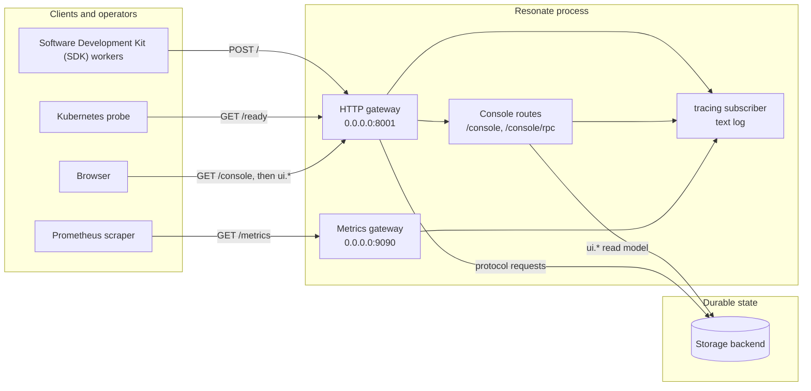

# Observability and operations: running a Resonate server

A Resonate server is one process with three kinds of plugin: a server plugin (the storage server), worker plugins, and gateway plugins. Operations therefore means four things. First, know which sockets the process opens. Second, know what it writes to the log. Third, know how it stops. Fourth, know how the durable state is backed up and pruned. This document covers each item and ends with a complete flag reference.

Source: `impl/server/core/crates/resonate-base/src/lib.rs:1-18`, `impl/server/core/src/serve.rs:1-9`

Three terms recur. A promise is a durable record with a state. A task is the executable face of a promise. A transition is one change from one state to another.

## The four observability surfaces

The edge speaks the Hypertext Transfer Protocol (HTTP).



Source: `impl/server/core/crates/resonate-gateway-http/src/lib.rs:62-120`, `impl/server/core/crates/resonate-gateway-metrics/src/lib.rs:48-101`, `impl/server/core/crates/resonate-gateway-web/src/lib.rs:74-153`

The process has two sockets and one shared route set. The HTTP gateway owns the protocol socket. The metrics gateway owns a second socket. The console contributes routes to the HTTP gateway's socket. The log is the fourth surface, and it is not a socket.

## The console: an embedded read model

The console is a built SvelteKit single-page application. The build is committed under `assets/`, so `cargo build` produces the shipping binary with no Node.js on the build machine and no network access. Fonts are vendored. The console works on an air-gapped host.

Source: `impl/server/core/crates/resonate-gateway-web/src/lib.rs:24-34`, `impl/server/core/README.md:138`

| Route | Answer |
|-------|--------|
| `GET /` | 303 redirect to the console, when the web gateway's `redirect_root` setting is true |
| `GET /console`, `/console/` | The application shell |
| `GET /console/<anything>` | An embedded asset, or the shell as a single-page-application fallback |
| `POST /console/rpc` | One request envelope in, one response envelope out |

Source: `impl/server/core/crates/resonate-gateway-web/src/lib.rs:17-22`, `:74-83`

`redirect_root` is a web-gateway setting, not a command-line flag.

The console does not read the database through a private path. It sends `ui.*` requests to `/console/rpc`. Three kinds exist: `ui.executions.search`, `ui.execution.get`, and `ui.schedules.search`. The HTTP gateway refuses the whole `ui.` namespace on the `POST /` worker route, so a worker cannot reach the read model.

Source: `impl/server/core/crates/resonate-core/src/ui.rs:43-55`, `impl/server/core/crates/resonate-gateway-http/src/routes.rs:183-198`

The read model has bounded work by design.

| Limit | Value | Meaning |
|-------|-------|---------|
| Default page size | 50 | Rows returned when the client does not ask |
| Maximum page size | 200 | Larger requests are refused |
| Default tree nodes | 500 | Nodes in one execution tree (the parent and its child promises) |
| Maximum tree nodes | 5,000 | Larger trees are refused, not truncated |
| Function scan limit | 2,000 | Rows read to fill one page filtered by function name |

Source: `impl/server/core/crates/resonate-core/src/ui.rs:70-94`

These limits are constants in the read model, not flags.

The console is read-mostly, but not read-only. Cancel is a `promise.settle`. Invoke is a `promise.create`. It uses the worker protocol's own requests, so there is no console-only write path. The same authentication policy admits the request. Hiding a button in the application does not change the authority of the route.

Source: `impl/server/core/crates/resonate-gateway-web/src/lib.rs:35-41`

The console is on by default. `--console-enabled false` removes the routes and leaves `/console` as a 404. The console is also specific to the core server. The Zig Amazon Simple Storage Service (S3) server refuses `ui.*` with a 404 and says the console has its own endpoint.

Source: `impl/server/core/src/serve.rs:221-223`, `impl/server/s3/src/server.zig:148-153`

## Prometheus metrics

The metrics gateway serves `GET /metrics` in the Prometheus text exposition format. It reads the process-wide default Prometheus registry, the registry that the Prometheus client library provides. A plugin that has a counter declares it into that registry, and the endpoint gathers it without a central list. The default bind address is `0.0.0.0:9090`. The endpoint is on by default.

Source: `impl/server/core/crates/resonate-gateway-metrics/src/lib.rs:1-14`, `:48-59`, `:86-101`

The HTTP gateway declares two request metrics.

| Metric | Type | Labels | Meaning |
|--------|------|--------|---------|
| `resonate_request_total` | Counter | `kind`, `status` | Requests by protocol request kind and response status |
| `resonate_request_duration_seconds` | Histogram | `kind` | Request latency by protocol kind |

Source: `impl/server/core/crates/resonate-gateway-http/src/routes.rs:30-48`

The metrics gateway's configuration has two fields only: `enabled` and `bind`. It has no authentication layer. Put it on a private interface, a network policy, or a proxy. Do not expose it to the public internet.

Source: `impl/server/core/crates/resonate-gateway-metrics/src/lib.rs:48-76`

## Traces: what the code provides and what it does not

The repository README says that an existing observability stack gets "Prometheus metrics and OpenTelemetry traces."

Source: `impl/server/core/README.md:222-224`

The server code does not initialize an OpenTelemetry exporter. It initializes a text `tracing` subscriber with an environment filter. The HTTP gateway adds a `tower-http` `TraceLayer`, which emits request spans and events through that same subscriber. A search of the server source finds no `opentelemetry`, `tracing_opentelemetry`, or `Otlp` symbol. The OpenTelemetry crates in `Cargo.lock` are transitive dependencies of the Google Cloud client library (`google-cloud-gax-internal`), not a configured trace pipeline.

Source: `impl/server/core/crates/resonate-base/src/lib.rs:185-187`, `impl/server/core/crates/resonate-gateway-http/src/lib.rs:202`, `Cargo.lock:2386-2414`

| Claim | Status in this tree |
|-------|---------------------|
| Structured logs through `tracing` | Implemented |
| HTTP request spans through `tower-http` | Implemented |
| Prometheus metrics endpoint | Implemented |
| OpenTelemetry Software Development Kit (SDK) initialization | Not present |
| OpenTelemetry Protocol (OTLP) exporter or collector configuration | Not present |
| A flag to select a trace exporter | Not present |

An operator who needs OpenTelemetry traces must add an exporter, a subscriber layer, or a sidecar that converts the logs. The repository does not supply one. This is an operational gap between the README and the code, and it is stated here as a finding, not as a feature.

## Logging and debug mode

`--level` sets the log filter. The values are `trace`, `debug`, `info`, `warn`, and `error`. The default is `info`. The process reads `RUST_LOG` first. When `RUST_LOG` is set, it wins over `--level`. `RUST_LOG` belongs to the `tracing` library, so the general flag precedence does not apply to it.

Source: `impl/server/core/src/serve.rs:45-51`, `impl/server/core/crates/resonate-base/src/lib.rs:185-187`

`--debug` is not a log level. It changes the clock. In debug mode the clock belongs to the caller. The server answers `debug.*` requests, honours the `debug_time` value in the request head (the `head` object of the request envelope), and uses no wall-clock time. This mode exists so that a differential test and a recorded history are comparable. Do not use it in production, because timers read the caller's clock instead of the operating system clock and no longer fire from real time.

Source: `impl/server/core/crates/resonate-base/src/lib.rs:104-116`, `:197-205`

| Setting | Effect | Safe in production |
|---------|--------|--------------------|
| `--level info` | Standard operational log | Yes |
| `--level debug` | Per-request and per-plugin detail | Yes, with higher volume |
| `RUST_LOG` | Overrides `--level` | Yes, if set deliberately |
| `--debug` | Caller-owned clock; timers do not follow wall time | No |

## Health and readiness

There is one probe: `GET /ready`. It returns 200 when the server reports ready. It returns 503 when the server reports not ready. The server decides the answer. The default is ready. A server plugin can override the default with a storage test. The blob backend asks its bucket, so a pod whose storage is gone reports 503 instead of taking traffic it cannot serve.

Source: `impl/server/core/crates/resonate-gateway-http/src/routes.rs:80-123`

There is no `/health` route. The code comments say that `/health` and `/ready` said the same thing twice, so the process kept one. Use `/ready` for both liveness and readiness. For liveness, also alert when the process is alive but `/ready` stays 503, because it cannot reach storage.

The legacy paths `/promises`, `/schedules`, and `/tasks` return 410 GONE. They are not health routes, but a monitor or an old client may still call them. A 410 is a deliberate answer, not a routing error.

Source: `impl/server/core/crates/resonate-gateway-http/src/routes.rs:85-108`

## Graceful shutdown and stop order

The process handles the interrupt signal (SIGINT) and the termination signal (SIGTERM). It stops the server plugin first, then the workers, then each gateway in turn. The default timeout is 10,000 milliseconds. The timeout wraps the whole drain. A watchdog ends the process when `stop()` does not return before the timeout.

Source: `impl/server/core/crates/resonate-base/src/lib.rs:171-207`, `:454-475`, `:477-500`

```mermaid
sequenceDiagram
    participant OS as Operating system
    participant P as Process
    participant S as Server plugin
    participant W as Workers
    participant G as Gateways
    OS->>P: SIGINT or SIGTERM
    P->>P: Start drain with timeout (default 10,000 ms)
    P->>S: stop()
    S-->>P: Timers and execute dispatch stopped
    P->>W: stop() for each worker
    W-->>P: In-flight deliveries drained
    P->>G: stop() for each gateway
    G-->>P: New requests refused; responses drained
    alt Drain finishes in time
        P->>P: Log "Resonate Server stopped"
    else Timeout expires
        P->>P: Log warning, force exit
    end
```

Source: `impl/server/core/crates/resonate-base/src/lib.rs:440-475`

The order is not the reverse of the start order. Start order is workers, then server, then gateways. Stop order is server, then workers, then gateways. The code gives three reasons.

1. The server's timer is the only thing that can still hand work to the process after shutdown begins.
2. A gateway drain can wait on a long-lived Server-Sent Events stream that only a worker stop releases. Stopping the gateway first would deadlock.
3. A client should get a 503 rather than a closed socket while in-flight work drains.

Source: `impl/server/core/crates/resonate-base/src/lib.rs:405-438`, `impl/server/core/crates/resonate-core/src/gateway.rs:45-62`

The gateway stays open while the server plugin drains, so a new request receives a 503 rather than a closed socket. The gateway listener closes only at the last step.

The Zig S3 server has the same contract. The termination signal stops new connections and allows up to `--shutdown-timeout` milliseconds for in-flight work. Its README notes that safety does not depend on the drain, because every transition is committed before the answer. The drain is for the caller that was about to be told something.

Source: `impl/server/s3/README.md:230-236`

## Deployment shapes

| Shape | Command | Notes |
|-------|---------|-------|
| Homebrew | `brew install resonatehq/tap/resonate` then `resonate serve` | One binary, no cluster |
| Docker | Clone the repository, then `docker-compose up` | The repository ships a compose file |
| From source | `cargo build --release`, then `./target/release/resonate serve` | Rust toolchain required |
| PostgreSQL server | `psql -d yourdb -f impl/server/postgres/resonate.sql` | PostgreSQL 16 or later; pg_cron required |
| S3 server (Amazon Simple Storage Service) | `zig build`, then `zig-out/bin/resonate serve --store s3 --endpoint ... --bucket ...` | Separate Zig implementation; it uses its own flags, not `--storage-type` |

Source: `impl/server/core/README.md:286-320`, `impl/server/postgres/README.md:36-45`, `impl/server/s3/README.md:8-14`

MySQL, ScyllaDB, Neo4j, and blob use the core binary with `--storage-type`. The core binary carries the console. It does not need a content delivery network, a separate web server, or a network call at start. That property is the reason the assets are committed rather than downloaded.

## Configuration reference

Every `serve` and `dev` flag is an override on one configuration key. The `dev` subcommand starts the same server with `:memory:`. Precedence is defaults, then the configuration file, then the environment, then the flags. The environment prefix is `RESONATE_` by convention. For example, `--server-port` becomes `RESONATE_SERVER_PORT`. `--set KEY=VALUE` is the general form and reaches any plugin field, including a plugin this binary has never heard of. The value is passed to the plugin's own configuration deserializer.

Source: `impl/server/core/src/serve.rs:18-41`, `impl/server/core/crates/resonate-base/src/lib.rs:50-86`

### Process, server, and storage

| Flag | Default | Key or note |
|------|---------|-------------|
| `--config PATH` | `resonate.toml` | Configuration file |
| `--set KEY=VALUE` | none | Repeatable; value read as Tom's Obvious Minimal Language (TOML) |
| `--level LEVEL` | `info` | `trace`, `debug`, `info`, `warn`, `error` |
| `--debug` | `false` | Caller-owned clock |
| `--server-host HOST` | `localhost` | `server_url` defaults to `http://<host>:<port>` |
| `--server-port PORT` | `8001` | Gateway port |
| `--server-bind ADDR` | `0.0.0.0` | Gateway bind address |
| `--server-shutdown-timeout ms` | `10000` | Whole-process drain timeout in milliseconds (ms) |
| `--server-url URL` | `http://localhost:8001` | Uniform Resource Locator (URL) stamped into `execute` messages |
| `--server-cors-allow-origin ORIGIN` | empty | Repeatable; empty disables Cross-Origin Resource Sharing (CORS); `*` is permissive |
| `--storage-type TYPE` | `sqlite` | `sqlite`, `postgres`, `mysql`, `scylladb`, `blob`, `neo4j` |
| `--storage-sqlite-path PATH` | `resonate.db` for `serve`; `:memory:` for `dev` | SQLite file |
| `--storage-postgres-url URL` | none | Required when PostgreSQL is active |
| `--storage-postgres-pool-size N` | `10` | Connection pool |
| `--storage-mysql-url URL` | none | Required when MySQL is active |
| `--storage-mysql-pool-size N` | `10` | Connection pool |
| `--storage-neo4j-uri URI` | `bolt://localhost:7687` | Neo4j Bolt address |
| `--storage-neo4j-user USER` | `neo4j` | Neo4j user |
| `--storage-neo4j-password PASSWORD` | none | Neo4j password |
| `--tasks-lease-timeout ms` | `15000` | Lease time for the bash worker; it is the only worker that takes its lease time from this flag |
| `--tasks-retry-timeout ms` | `30000` | Redispatch delay for a pending task |

Source: `impl/server/core/src/serve.rs:31-145`, `:284-340`, `:502-545`

### Authentication

| Flag | Default | Note |
|------|---------|------|
| `--auth-publickey PATH` | absent | Enables JSON Web Token (JWT) verification; `none` means unsigned mode |
| `--auth-iss ISS` | absent | Expected issuer claim |
| `--auth-aud AUD` | absent | Expected audience claim |
| `--workos-api-key KEY` | absent | Enables WorkOS authentication |
| `--workos-org-id ORG` | absent | Required organization identifier |
| `--workos-base-url URL` | `https://api.workos.com` | Base Uniform Resource Locator (URL) for the WorkOS application programming interface |

Source: `impl/server/core/src/serve.rs:112-137`, `impl/server/core/crates/resonate-gateway-http/src/lib.rs:80-101`

### Transports

| Flag | Default | Note |
|------|---------|------|
| `--transports-http-push-enabled BOOL` | `true` | HTTP push delivery |
| `--transports-http-push-concurrency N` | `16` | Concurrent deliveries |
| `--transports-http-push-connect-timeout MS` | `10000` | Connection timeout |
| `--transports-http-push-request-timeout MS` | `180000` | Whole-request timeout |
| `--transports-http-push-auth-mode MODE` | `none` | `none`, `bearer`, or `gcp` (a Google Cloud identity token) |
| `--transports-http-push-auth-token TOKEN` | none | Static token for `bearer` |
| `--transports-http-push-auth-aud URL` | none | Audience for `gcp`; defaults to the target URL |
| `--transports-http-push-auth-header HEADER` | `Authorization` | Outbound header name |
| `--transports-http-poll-enabled BOOL` | `true` | HTTP poll with Server-Sent Events |
| `--transports-http-poll-max-connections N` | `1000` | Concurrent poll connections |
| `--transports-http-poll-buffer-size N` | `100` | Buffered messages per poll connection |
| `--transports-http-poll-keepalive-interval MS` | none | Keepalive interval |
| `--transports-gcps-enabled BOOL` | `false` | Google Cloud Pub/Sub transport |
| `--transports-gcps-project PROJECT` | none | Google Cloud project identifier |
| `--transports-gcps-concurrency N` | `16` | Concurrent deliveries |
| `--transports-gcps-timeout MS` | `10000` | Per-publish timeout |
| `--transports-bash-exec-enabled BOOL` | `false` | Bash execution worker; runs a configured shell command for a task |

Source: `impl/server/core/src/serve.rs:147-218`, `:341-412`

### Gateways and observability

| Flag | Default | Note |
|------|---------|------|
| `--console-enabled BOOL` | `true` | Console routes on the HTTP gateway |
| `--observability-metrics-bind ADDR` | `0.0.0.0:9090` | Metrics listener |
| `--observability-metrics-enabled BOOL` | `true` | Prometheus endpoint |

Source: `impl/server/core/src/serve.rs:220-233`, `:438-456`

## Authentication and authorization

The HTTP gateway accepts requests in one of three modes. The mode is a property of the gateway, so the console and the poll transport inherit it. They do not carry separate policies.

Source: `impl/server/core/crates/resonate-gateway-http/src/lib.rs:80-95`, `:251-260`

| Mode | Configuration | Behaviour |
|------|---------------|-----------|
| Open | No `auth` and no `workos` section | Every request is accepted |
| JWT | `--auth-publickey PATH` | Verify the bearer token against a public key |
| Unsigned | `--auth-publickey none` | Accept `alg: none` tokens; debug and testing only |
| WorkOS | `--workos-api-key` and `--workos-org-id` | Validate the client API key with WorkOS |

Source: `impl/server/core/crates/resonate-auth/src/lib.rs:31-65`, `:106-160`, `:391-421`

A JWT public key may be Rivest-Shamir-Adleman (RSA), Elliptic Curve (EC) (P-256 or P-384), or Ed25519. The key loader detects the type. The issuer and audience are optional checks. When both are absent, the signature and expiry still apply, but any issuer or audience is accepted.

Source: `impl/server/core/crates/resonate-auth/src/lib.rs:186-228`, `:400-421`

Authorization uses two claims. A token with the role `admin` bypasses prefix checks. Every other token must carry a `prefix` string. The resource identifier in the request must start with that prefix. For `task.heartbeat`, every task identifier in the batch must match the prefix. A missing or null prefix is forbidden.

Source: `impl/server/core/crates/resonate-auth/src/lib.rs:247-373`

WorkOS works differently. The client sends a WorkOS API key as the bearer token. The server calls `POST /api_keys/validations` with its own secret key. The answer names the organization. The key is accepted only when that organization matches `--workos-org-id`. A WorkOS key carries no role and no prefix, so the prefix rule does not apply; the organization match is the only scope check.

Source: `impl/server/core/crates/resonate-auth/src/workos.rs:1-18`, `:165-220`, `:226-278`

The authentication and WorkOS configurations are mutually exclusive. Naming both is a startup error, not a silent precedence.

Source: `impl/server/core/crates/resonate-gateway-http/src/lib.rs:251-259`

## Backups and retention

A completed workflow stays in the database. The server does not delete a settled promise, a promise with a final state. That is what makes a repeated identifier idempotent, and it is why retention is an operator decision.

Source: `impl/server/postgres/README.md:57-67`

The PostgreSQL server ships one garbage-collection function.

```sql
CREATE OR REPLACE FUNCTION gc(p_settled_before bigint, p_limit int DEFAULT 10000)
```

The function is defined unqualified in the `resonate` schema. Callers use the schema-qualified name `resonate.gc`.

Source: `impl/server/postgres/resonate.sql:1271`

`p_limit` caps the rows deleted in one call.

The documented schedule runs it daily and deletes workflows that finished more than seven days ago.

```sql
select cron.schedule('resonate-gc', '0 3 * * *',
  $$select resonate.gc((extract(epoch from now())*1000 - 7*86400000)::bigint)$$);
```

Source: `impl/server/postgres/README.md:59-65`

Keep the retention window longer than any period in which an external caller might resend the same workflow identifier. Identifiers are idempotent only while the row exists. After a garbage collection, the same identifier starts a new execution.

Source: `impl/server/postgres/README.md:67`

| Backend | Durable state | Backup guidance | Retention in the repository |
|---------|---------------|-----------------|-----------------------------|
| SQLite | One database file | Copy the file with SQLite's backup mechanism while the server is stopped or paused | No shipped garbage-collection command |
| PostgreSQL | Tables and functions | Use PostgreSQL's native backup | `resonate.gc` plus a pg_cron schedule |
| MySQL | Tables | Use MySQL's native backup | No shipped garbage-collection command |
| ScyllaDB | One `promises` table partitioned by origin | Use the cluster's native backup | No shipped garbage-collection command |
| Blob | One conditional-write object per origin (an origin is the identifier prefix) | Back up the bucket with the object store's tools | No shipped garbage-collection command |
| Neo4j | One node per promise plus edges | Use the supported backup procedure for the Neo4j edition | No shipped garbage-collection command |
| S3 server (Zig) | Objects in one bucket | Back up the bucket; the bucket is the only state | No shipped garbage-collection command |

Source: `impl/server/postgres/README.md:57-67`, `impl/server/core/crates/resonate-server-scylladb/src/lib.rs:1-10`, `impl/server/s3/README.md:45-60`, `impl/server/core/crates/resonate-server-neo4j/README.md:1-20`

For the blob and S3 servers, the bucket is the whole state. There is no write-ahead log and no second copy. A bucket backup is a complete backup. A bucket restore is a complete restore. That simplicity is also the risk: a deletion in the bucket is a deletion of the record.

Source: `impl/server/s3/README.md:1-6`, `impl/server/core/crates/resonate-server-blob/README.md:1-12`

## Capacity notes per backend

| Backend | Shape | Capacity note |
|---------|-------|---------------|
| SQLite | Embedded, one file, one process | Best for development and a single small deployment. The gateway offers `abort_on_panic` because a panic mid-transaction in a single-process store can leave in-memory state that the next request would read. |
| PostgreSQL | Relational, one statement per request, pool default 10 | Timers are driven by pg_cron. A single round trip per request is the design goal. The pool size bounds concurrent database work. |
| MySQL | Relational, pool default 10 | Same relational shape. The differential suite includes it when `TEST_MYSQL_URL` is set. |
| ScyllaDB | One `promises` table partitioned by origin | A transition and its fan-out messages are one single-partition lightweight transaction or conditional batch (a grouped conditional write). Timeout queues (the buckets that hold pending deadlines) are bucketed and sharded. Every pending promise, including an internal promise (a promise with no target), gets an eager deadline. |
| Blob | One conditional-write object per origin | Each transition reads and rewrites the origin document. The document grows with every promise in the origin, so memory and write size grow with the origin. |
| Neo4j | One node per promise; `AWAITS` and `CHILD_OF` edges | Every transition locks the nodes it will decide on, then writes. Neo4j community edition is the documented target. |
| S3 server (Zig) | Objects in one bucket | One conditional write commits a transition. The server is stateless between requests. Every check runs against `fakes3`, an in-repository Amazon S3 emulator, not a real bucket. |

Source: `impl/server/core/crates/resonate-gateway-http/src/lib.rs:96-110`, `impl/server/postgres/README.md:42-45`, `impl/server/core/diff/differential.rs:5-10`, `impl/server/core/crates/resonate-server-scylladb/src/lib.rs:1-10`, `impl/server/core/crates/resonate-server-blob/src/plugin.rs:49-75`, `impl/server/core/crates/resonate-server-neo4j/README.md:1-30`, `impl/server/s3/README.md:45-70`

`abort_on_panic` is a gateway setting (`impl/server/core/crates/resonate-gateway-http/src/lib.rs:100`). `--sole-writer` is a command-line flag of the S3 server (`impl/server/s3/src/main.zig:56`, `:115`). Neither is a plugin configuration option.

The console adds read load. A search reads a bounded page. A function-filtered search can read up to 2,000 rows to fill one page. A large execution tree can return up to 5,000 nodes. Size the console limits for the database, not for the browser.

Source: `impl/server/core/crates/resonate-core/src/ui.rs:70-86`

## Aha: the console is a read model of the same durable records, not a separate telemetry store

Many systems ship a console that reads a second copy of the data: an event stream, a search index, or a metrics store. That copy drifts. The Resonate console reads the promise and schedule records directly through `ui.*`. The read model is bounded, read-mostly, and authenticated by the same edge as the worker protocol. What the operator sees is the durable state, not a projection that another pipeline built.

Source: `impl/server/core/crates/resonate-gateway-web/src/lib.rs:11-22`, `impl/server/core/crates/resonate-core/src/ui.rs:1-60`

That design has two consequences. First, the console cannot show a record that the server did not persist. Second, the console's cost is a database cost. There is no separate index to scale and no second consistency model to explain. The same property explains why the console is absent from the S3 server: that server has no `ui.*` implementation, so it refuses the namespace instead of pretending.

Source: `impl/server/s3/src/server.zig:148-153`

## Operational checklist

1. Bind the metrics endpoint to a private address. It has no authentication.
2. Set an authentication mode. With no `auth` and no `workos` section, every request is accepted.
3. Use `/ready` for the probe. A 503 means the server cannot serve its storage.
4. Set `--server-shutdown-timeout` above the longest expected in-flight request.
5. Send the termination signal and wait for the drain. Do not send the kill signal (SIGKILL) during a rolling restart.
6. Set a retention window and schedule `resonate.gc` on PostgreSQL. Keep the window longer than the identifier reuse window.
7. Back up the storage backend, not the console.
8. Do not enable `--debug` in production. Timers stop following wall time.
9. Treat the OpenTelemetry claim as unimplemented. Add an exporter if traces are required.
10. Keep each function version registered until its in-flight promises settle during a deploy.

Source: `impl/server/core/src/serve.rs:220-233`, `impl/server/core/crates/resonate-base/src/lib.rs:454-500`, `impl/server/postgres/README.md:57-67`

## Related documents

- [01-architecture.md](01-architecture.md) — plugins, the registry, and the start and stop order.
- [05-the-server-core.md](05-the-server-core.md) — the composition root in detail.
- [06-storage-engines.md](06-storage-engines.md) — the six backends and their trade-offs.
- [07-transports-and-workers.md](07-transports-and-workers.md) — HTTP push, HTTP poll, Google Cloud Pub/Sub, and bash.
- [08-gateways-console-and-metrics.md](08-gateways-console-and-metrics.md) — the HTTP edge, authentication, the console, and metrics.
- [12-the-postgres-server-in-one-file.md](12-the-postgres-server-in-one-file.md) — pg_cron and the garbage-collection function.
- [16-critical-assessment.md](16-critical-assessment.md) — the risks behind these operational limits.
- [17-glossary.md](17-glossary.md) — every term and abbreviation.
