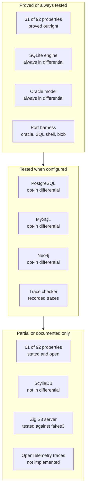
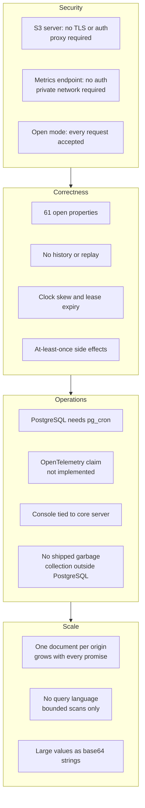

# Critical assessment: what Resonate proves, what it tests, and what it leaves open

Resonate makes a large claim. A function call should survive a crash, a network partition, and a machine restart, and the caller should not write a state machine. The repository supports that claim with an executable specification, a differential test harness, six storage backends, and a separate Zig server for Amazon Simple Storage Service (S3). The support is real but uneven.

This document separates three questions. What is proved? What is tested? What is only documented? The answers differ by component, and the differences matter more than a single score.

Source: `README.md:15-16`, `spec/README.md:18-32`

Four terms recur. A promise is a durable record with a state. A task is the executable face of a promise. A trace is a recorded sequence of requests and responses. An oracle is an executable reference model.

## The verification stack

Resonate uses four independent checks.

| Check | What it does | Where |
|-------|--------------|-------|
| Abstract machine | Executes one transition per protocol request | `spec/spec/02-abstract/external.lean` |
| Property catalogue | States 92 predicates over states and state pairs | `spec/spec/02-abstract/properties.lean` |
| Trace checker | Asks whether any internal schedule explains a recorded trace | `spec/valid/lean/` |
| Differential harness | Sends the same randomized requests to several backends and an oracle | `impl/server/core/diff/` |

Source: `spec/README.md:18-43`, `impl/server/core/diff/differential.rs:1-30`

The trace checker is stronger than a replay tool. It does not ask whether the trace matches one fixed interleaving. It asks whether any schedule of internal steps explains the observed events. That is an existential search over the parts of the machine that the server never reports. The internal schedule orders six background steps: promise timeout, callback drain, listener drain, lease timeout, retry dispatch, and schedule firing.

Source: `spec/valid/README.md:5-10`, `:30-37`

A second checker ports the machine to Go and uses the Porcupine linearizability checker. It is an independent implementation with a different language and a different search. Agreement between the two is evidence that the specification says what its authors think. The Go checker also states its own limit: 80 concurrent events is the practical ceiling, and a pending operation answered with status 500 (Internal Server Error) is treated existentially, so the checker may choose any internal schedule that fits the observed answer.

Source: `spec/valid/porc/README.md:1-10`, `:187-205`, `:317-330`

## Strength: the specification is executable and the server is held to it

The abstract machine defines 21 external handlers: six for promises, eleven for tasks, and four for schedules. Each handler is a function from a request and a time to a response and a state change. The machine is not a diagram that sits beside the code. It is code that the tests execute.

Source: `spec/spec/02-abstract/external.lean:28-428`

The property catalogue has 92 entries. Every entry holds over 1,464 enumerated scripts under both read disciplines: projection without a write, and materialisation with one. The scripts are checked by the Lean 4 kernel at build time. Thirty-one entries are proved outright. The remaining 61 are stated and open.

Source: `spec/README.md:49-55`

That split is the honest core of the project. A proved property is true at every instant of every run. An open property is a claim with strong finite evidence and no general proof. The distinction is visible in the repository, not hidden in a paper.

## Strength and limit: differential testing covers most backends, not all

The differential harness compares responses, state snapshots, and routed messages at every step. It runs SQLite and an in-memory oracle always. PostgreSQL, MySQL, and Neo4j join when their environment variables are set. The harness requires every operation kind to produce at least one success, so a pass cannot come only from failure paths.

Source: `impl/server/core/diff/differential.rs:1-30`, `:240-310`, `:511-560`

The coverage is not uniform. This table is the boundary. The port harness sends the same requests at the server and router ports, not at the engine interface.

| Engine | Differential harness | Port harness | Note |
|--------|----------------------|--------------|------|
| Oracle | Always | Yes | Reference model, not a shipped storage engine |
| SQLite | Always | Yes | Default backend |
| PostgreSQL | Opt-in by environment | Structured Query Language (SQL) shell | Same shell as SQLite |
| MySQL | Opt-in by environment | SQL shell | Same shell as SQLite |
| Neo4j | Opt-in by environment | No | Uses its own graph engine |
| ScyllaDB | No | No | Shares a copied shell with Neo4j |
| Blob | No | Yes | Compared over an in-process object store |
| S3 server (Zig) | No | No | Has its own simulator and differ |

Source: `impl/server/core/diff/differential.rs:5-10`, `impl/server/core/diff/port.rs:1-18`, `impl/server/core/crates/resonate-server-neo4j/src/lib.rs:15-30`

The README says the differential suite holds all backends to the same behaviour. That sentence is broader than the code. The Blob server is covered by a separate port harness. ScyllaDB is not in either harness. The Zig S3 server has its own simulator and its own differ, and its README is explicit that every check runs against a fake bucket. The Porcupine check is independent because the Go machine is written separately. The `fakes3` check is weaker: client and server share one reading.

Source: `impl/server/core/README.md:241`, `impl/server/core/diff/port.rs:1-18`, `impl/server/s3/README.md:214-226`

This is not a fatal flaw. It is a boundary that a user must know. The wire protocol is the same on every backend. The level of evidence is not.

## Strength: version fencing makes stale writes fail

A task is acquired with a version. Acquisition increments the version. Every mutating task request carries the version it believes it holds. The machine checks the version before it acts. A stale worker gets status 409.

```lean
let t := { t with state := .acquired, version := t.version + 1,
                  ttl := some req.ttl, pid := some req.pid,
                  leaseTimeoutAt := some (now + req.ttl), ... }
```

Source: `spec/spec/02-abstract/external.lean:176-197`

The same check appears in `taskFence`, `taskSuspend`, `taskFulfill`, `taskHalt`, and the other task mutations. The fence is not advisory. A worker that lost its lease cannot settle the promise. Status 409 is HTTP Conflict.

Source: `spec/spec/02-abstract/external.lean:199-245`, `:271-327`

This is the single most important correctness property for a system with at-least-once delivery. Duplicate execution is possible. Duplicate settlement is not, unless the worker uses a new version.

## Strength: single-origin operations make conditional writes enough

Every protocol operation is single-origin. A callback names an awaiter. A fence names a task. A settle names a promise. In each case the read set and the write set belong to one origin. The S3 server uses that property to store one document per origin. A conditional write succeeds only when the stored value still matches an expected value.

> A document per origin makes one conditional write enough to commit a whole transition, and two servers over one bucket need nothing else to agree.

Source: `impl/server/s3/README.md:45-62`

The write order is careful: arm the deadline, commit the document, disarm the old deadline, send the messages, answer. The armed deadline is the recovery point: if the process stops before messages leave, the retry deadline sends them again. A crash between any two steps leaves a recoverable state.

Source: `impl/server/s3/README.md:83-91`

This is an elegant result. It removes the database, the log, the consensus protocol, and the lock service from the S3 design. It also concentrates the risk: the whole argument depends on the object store honouring a conditional write.

## Strength: the plugin registry keeps a custom binary small

A server is a registry of plugins and a `run`. The binary names the crates it wants. Cargo resolves, downloads, and compiles only those crates. A build can carry one storage engine, one transport, and one gateway instead of the full set.

Source: `impl/server/core/README.md:152-210`, `impl/server/core/crates/resonate-base/src/lib.rs:1-18`

The registry has three plugin kinds: servers, workers, and gateways. The same composition root starts and stops them in a fixed order. A plugin author does not need to modify the core.

Source: `impl/server/core/README.md:180-210`

The trade-off is that the shipped binary and the source tree can differ. A feature that exists in one plugin may be absent from a custom build. The configuration key space still describes it, and `--set` can set a key that no loaded plugin reads. The loader warns about a top-level key that nothing will read, but a missing plugin is a build decision, not a runtime error.

## Strength: durable sleep costs a row, not a process

A durable sleep creates a timer promise. The worker that receives the timer task drops it when the deadline has not passed; it does not fulfill, suspend, or release the task. The lease lapses, and the server's deadline settles the promise. No thread, no process, and no memory are held for the duration of the sleep.

Source: `impl/sdk/ts/src/core.ts:82-118`, `spec/spec/02-abstract/internal.lean:1-8`

That property is the difference between a durable workflow engine and a long-running process that sleeps. A ten-day sleep costs one row. A thousand ten-day sleeps cost one thousand rows.

## Strength: five SDKs on one protocol

Five Software Development Kits (SDKs) exist: TypeScript, Python, Go, Java, and Rust. They do not share code. They share the protocol. The protocol has one request envelope, one response envelope, and 21 operations.

Source: `README.md:69-84`, `spec/spec/02-abstract/external.lean:28-428`

The TypeScript SDK is the most developed. It has two engines: a generator engine that drives `function*`, and an async/await engine. The async engine is the newer one and uses eager operations, which start when they are called, before they are awaited. The other SDKs are protocol clients at different levels of completeness. The repository does not claim that all five have identical feature coverage.

Source: `impl/sdk/ts/README.md:1-40`, `impl/sdk/ts/examples/async/README.md:1-40`

## Verification coverage at a glance



Source: `spec/README.md:49-55`, `impl/server/core/diff/differential.rs:5-10`, `impl/server/core/diff/port.rs:1-18`, `impl/server/s3/README.md:214-226`, `impl/server/core/README.md:222-224`

The arrows show decreasing evidence, not a promotion path.

## Limit: 21 operations and no query language

The protocol has 21 operations. Three of them are searches. In the abstract machine, all three searches return status 501 (Not Implemented). They are specified as unimplemented.

```lean
def promiseSearch (_req : PromiseSearchReq) (_now : Nat) : H PromiseSearchRes := do
  return { status := 501 }
```

Source: `spec/spec/02-abstract/external.lean:99-100`, `:381-382`, `:425-426`

The server-side search request has four filters: state, tags, limit, and cursor. There is no predicate language, no range filter on time, no join, and no aggregation.

Source: `impl/server/core/crates/resonate-core/src/types.rs:449-457`

The console works around this limit. A function-filtered search reads up to 2,000 rows because the function name lives inside a base64-encoded parameter, not in a column. The scan can miss rows after the page fills. The page may come back short, and the cursor advances to the last row examined.

Source: `impl/server/core/crates/resonate-core/src/ui.rs:70-88`

The consequence is that Resonate is an execution engine, not a queryable workflow database. An operator who needs "all executions of function X, tagged Y, that failed in the last hour" must build that view by scanning, or export the records to a system with a query language.

## Limit: the store holds current state, not a history

In the core relational engines (SQLite, PostgreSQL, and MySQL), a promise and its task are one row. The separate one-file PostgreSQL server keeps a `tasks` table of its own. A transition writes the new state over the old state. The row has `createdAt` and `settledAt`, but it has no list of transitions and no previous values.

Source: `spec/spec/02-abstract/state.lean:8-58`, `impl/server/core/crates/resonate-server-sqlite/migrations/0001_initial.sql:40-64`

A settled promise is final. A repeated settle returns the existing record rather than overwriting it. That is correct for the protocol. It also means there is no event log to replay, no time-travel query, and no audit trail of who changed what.

Source: `spec/spec/02-abstract/external.lean:45-58`

The PostgreSQL garbage-collection function deletes old rows. After that deletion, the identifier can start a new execution. The record is gone, and no history remains.

Source: `impl/server/postgres/resonate.sql:1271`, `impl/server/postgres/README.md:57-67`

If an audit is a requirement, it must be a workflow of its own. The detached audit pattern in the examples is the repository's answer: a `ctx.detached` root that writes an audit record. It is application code, not a server feature.

## Limit: values are strings, encoded as base64 JavaScript Object Notation

The protocol value is a string with an optional header map. Both fields are strings.

```rust
pub struct PromiseValue {
    pub headers: Option<HashMap<String, String>>,
    pub data: Option<String>,
}
```

Source: `impl/server/core/crates/resonate-core/src/types.rs:233-238`

The TypeScript codec serializes a value to JavaScript Object Notation (JSON) and then base64-encodes it into that string. Decoding reverses the process. Base64 adds about one third to the size.

Source: `impl/sdk/ts/src/codec.ts:10-44`, `:57`

There is no streaming value, no binary channel, and no documented maximum size. A large payload is one string in one row, or one string in one object document. The console's execution tree returns the whole value for each node, up to 5,000 nodes. Large values therefore strain the storage row and the console response together.

Source: `impl/server/core/crates/resonate-core/src/ui.rs:70-77`

## Limit: delivery is at-least-once and depends on the transport

The server commits a transition before it sends the message that the transition produced. Delivery is best-effort. A failed route is logged and the attempt is lost. An `execute` message, which offers a task to a worker, comes back because the task stays pending and its retry timeout re-emits it. An `unblock` message, which tells a listener that a promise settled, does not come back.

Source: `impl/server/core/crates/resonate-sql/src/server.rs:186-204`

The S3 sender states the same contract.

| Message | Lost delivery | Recovery |
|---------|---------------|----------|
| `execute` | The task is not offered | The retry deadline re-sends it |
| `unblock` | The listener is not told | Nothing; the listener can still read the promise |

Source: `impl/server/s3/src/sender.zig:1-22`

This is at-least-once execution, not exactly-once execution. A leaf can run twice. The version fence stops the second run from settling a promise that the first run already settled. It does not stop the side effect from happening twice.

The transport changes the timing and the failure mode. Hypertext Transfer Protocol (HTTP) push delivers to a worker's address. HTTP poll holds a Server-Sent Events connection. Google Cloud Pub/Sub delivers through a managed queue. The bash worker runs a command. Each transport has its own timeout and retry behaviour. A guarantee that holds for one transport does not automatically hold for another.

Source: `impl/server/core/README.md:251-266`, `impl/server/core/src/serve.rs:147-218`

## Limit: the S3 server has no transport security and is tested against a fake bucket

The Zig S3 server has no Transport Layer Security (TLS) and no authentication. The README says this is on purpose. A proxy must terminate TLS, authenticate, authorize, and forward the request. There is no flag for TLS or authentication because the server does not implement them.

Source: `impl/server/s3/README.md:26-27`, `:214-216`

The larger risk is the bucket. Every check runs against `fakes3`, an in-repository stand-in that implements the six operations the store port needs, including conditional writes. The stand-in is written from the same reading of the S3 documentation as the client. If that reading is wrong, both sides are wrong together and no test notices.

> Until someone points this server at a bucket, "it works on S3" rests on the documentation.

Source: `impl/server/s3/README.md:218-226`

The README names the missing test: a live bucket test. It also names the failure that test would catch: a store that accepts `If-Match` and ignores it would pass every other test and lose writes in production.

This is the clearest production risk in the repository. The design is elegant; its central assumption rests on a simulator.

## Limit: PostgreSQL needs pg_cron

The one-file PostgreSQL server requires the pg_cron extension to drive all timers. It optionally uses pg_net or pgsql_http for HTTP push delivery.

Source: `impl/server/postgres/README.md:42-45`

A managed PostgreSQL service that does not allow pg_cron cannot run this server. That removes a large part of the managed-database market. The core Rust server does not have this dependency, because its timers run in the process.

The retention function is also PostgreSQL-specific. The repository documents `resonate.gc` and a pg_cron schedule for this server. It documents no equivalent command for the other backends.

Source: `impl/server/postgres/resonate.sql:1271`, `impl/server/postgres/README.md:57-67`

## Limit: the console is tied to the core server

The console read model lives in `resonate-core`. The web gateway calls it. The HTTP gateway refuses `ui.*` on the worker route. The Zig S3 server refuses `ui.*` with a 404.

Source: `impl/server/core/crates/resonate-core/src/ui.rs:1-60`, `impl/server/s3/src/server.zig:148-153`

The repository documents the read model only in the core server. A user of the one-file PostgreSQL server or the S3 server does not get the console from the same build. This couples an operational feature to one implementation choice.

## Limit: 61 properties are open

Thirty-one properties are proved. Sixty-one are stated and open, including the theorem that collects them. The properties are checked over 1,464 enumerated scripts under both read disciplines. That is strong finite evidence. It is not a proof over all runs.

Source: `spec/README.md:49-55`

The open properties are not a scandal. They are a clear statement of the current boundary. The risk is that a reader treats "92 properties" as "92 proved properties." The repository does not make that claim, but the headline number invites it.

## Limit: the outbox is best-effort

The core SQL engines removed the outbox table, a store of messages waiting to be sent. A message is returned by the transition that produced it, not left for a pump. Delivery is best-effort: a failed route is logged, and an `execute` is re-emitted by the retry timeout.

Source: `impl/server/core/crates/resonate-server-postgres/src/lib.rs:6-18`, `impl/server/core/crates/resonate-sql/src/server.rs:186-204`

The S3 server keeps an outbox, but it is keyed rather than queued. A second offer of the same task replaces the first. An `unblock` is keyed by promise and address. A lost `unblock` is lost by design.

Source: `impl/server/s3/src/sender.zig:19-30`

The consequence is the same for both designs. A listener is a notification, not an obligation. A client that must not miss a settlement should poll the promise or register a durable callback that resumes a task, not rely on a listener.

## Limit: ownership depends on lease time and clock agreement

A task lease is a deadline: `now + ttl`. The server computes it from its own clock. A heartbeat renews it from the server's current time. The worker sends a heartbeat at half the time-to-live, so that one lost heartbeat does not expire the lease.

```typescript
this.intervalId = setInterval(() => this.heartbeat(), this.delay);
```

Source: `spec/spec/02-abstract/external.lean:231-241`, `impl/sdk/ts/src/heartbeat.ts:20-56`

If a heartbeat arrives late, the lease can expire. The server returns the task to `pending` and dispatches it again. The original worker may still be running. The version fence prevents the original worker from settling the promise, but it does not stop the duplicate work.

Clock skew changes when the heartbeat arrives relative to the server's deadline. The trace checker requires one clock for exactly this reason: the deadlines in a trace and the `now` values must come from the same source. A production deployment has several clocks.

Source: `spec/valid/README.md:33-37`

The system is safe under skew because of the version fence. It is not free of duplicate work under skew. The operator must choose a time-to-live that covers the longest expected pause between heartbeats, including a garbage-collection pause or a slow network.

## Risk map



Source: `impl/server/s3/README.md:26-27`, `impl/server/core/crates/resonate-gateway-metrics/src/lib.rs:48-59`, `spec/README.md:49-55`, `impl/server/postgres/README.md:42-45`, `impl/server/s3/README.md:62-72`, `impl/server/core/crates/resonate-core/src/ui.rs:82-88`

The arrows group risk areas, not causality. Open mode, the default with no authentication section, accepts every request.

## Open questions

| Question | Why it matters | Current evidence |
|----------|----------------|------------------|
| Does the S3 server work on a real bucket? | The conditional-write assumption is central | Tested only against `fakes3` |
| Are the 61 open properties true? | The specification's universal claim | Finite scripts and an open theorem |
| What is the maximum value size? | Large payloads are one string | No documented limit |
| How does garbage collection interact with in-flight callbacks? | Deleting a row may delete a waiter | Only the PostgreSQL function is documented |
| What clock skew is safe? | Duplicate work under a late heartbeat | The lease is a time-to-live; no bound is stated |
| Does ScyllaDB behave identically? | Its eager deadlines differ from the relational engines | Not in the differential harness |
| Does the console scale to a large deployment? | It scans bounded rows | Limits are 2,000 rows and 5,000 nodes |
| Can a deployment get OpenTelemetry traces? | The README promises them | No exporter in the code |
| Is organization-level WorkOS authorization enough? | WorkOS keys carry no prefix | The organization match is the only scope |

Source: `impl/server/s3/README.md:218-226`, `spec/README.md:49-55`, `impl/server/postgres/resonate.sql:1271`, `impl/server/core/crates/resonate-server-scylladb/src/lib.rs:1-10`, `impl/server/core/crates/resonate-core/src/ui.rs:70-88`, `impl/server/core/crates/resonate-auth/src/workos.rs:226-278`

## Balanced verdict

| Dimension | Assessment | Reason |
|-----------|------------|--------|
| Design | Strong | One-row model, durable promises, lease and fence, single-origin operations |
| Specification | Strong but incomplete | Executable machine and trace checker; 31 proved, 61 open |
| Core server | Strong | SQLite, PostgreSQL, MySQL, and Neo4j in the differential; plugin registry |
| Storage choice | Uneven | Blob has a port harness; ScyllaDB and the Zig server are outside the main harness |
| SDKs | Good | Five clients on one protocol; TypeScript is the most complete |
| Operations | Mixed | Good shutdown, readiness, and metrics; no OpenTelemetry exporter; sparse retention |
| Security | Conditional | JSON Web Token (JWT) and WorkOS are real; open mode is the default; the S3 server needs a proxy |
| Production readiness | Backend-dependent | Strong on the tested relational path; unproven on S3; limited on ScyllaDB |

The fair summary is this. Resonate is a serious design with an unusually strong correctness story for a young project. The core protocol, the core server, and the tested relational backends are credible. The edges are not equal. A deployment that chooses the S3 server, ScyllaDB, or a managed PostgreSQL without pg_cron leaves the best-tested path.

## Aha: the verification boundary is the real product boundary

Every backend speaks the same protocol. That makes the choice of backend look like a deployment detail. It is not. The protocol is the same, but the evidence is different. SQLite is always in the differential. PostgreSQL, MySQL, and Neo4j join when configured. Blob has a separate port harness. ScyllaDB has neither. The Zig S3 server has a simulator and a fake bucket.

Source: `impl/server/core/diff/differential.rs:5-10`, `impl/server/core/diff/port.rs:1-18`, `impl/server/s3/README.md:214-226`

The important consequence is that an application can be correct on one backend and wrong on another without any code change. The version fence and the state machine are shared. The storage semantics are not. The single-origin document model, the eager ScyllaDB deadlines, the Neo4j write locks, and the PostgreSQL pg_cron timer are four different implementations of the same promises.

A reader should therefore ask two questions before choosing Resonate. First, which backend will run in production? Second, is that backend inside the strongest verification set? The answer determines how much of the specification's confidence the deployment actually inherits.

## Related documents

- [04-the-formal-specification.md](04-the-formal-specification.md) — the machine, the properties, and the trace checkers in detail.
- [06-storage-engines.md](06-storage-engines.md) — the six backends and their trade-offs.
- [12-the-postgres-server-in-one-file.md](12-the-postgres-server-in-one-file.md) — pg_cron, retention, and the SQL implementation.
- [13-the-s3-server-in-zig.md](13-the-s3-server-in-zig.md) — conditional writes, the outbox, and the fake bucket.
- [15-observability-and-operations.md](15-observability-and-operations.md) — the operational gaps in context.
- [17-glossary.md](17-glossary.md) — every term and abbreviation.
